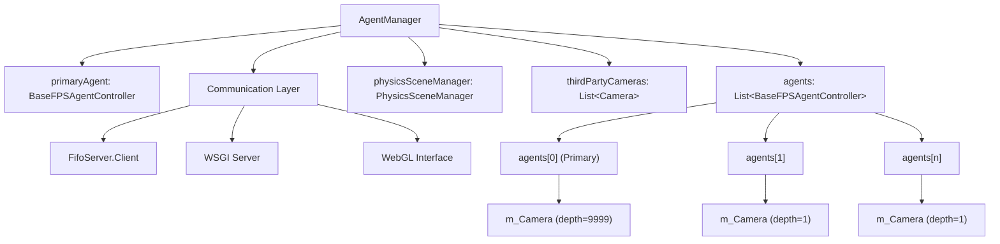
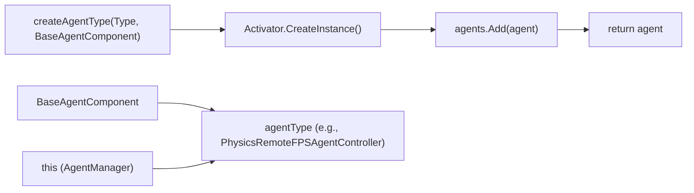
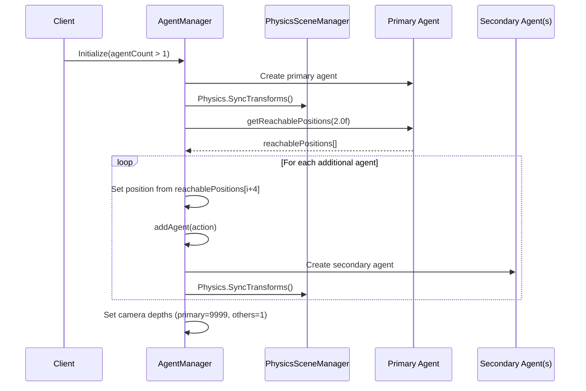
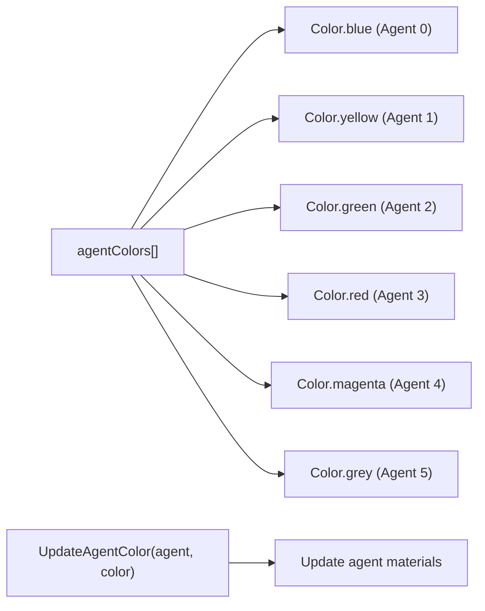
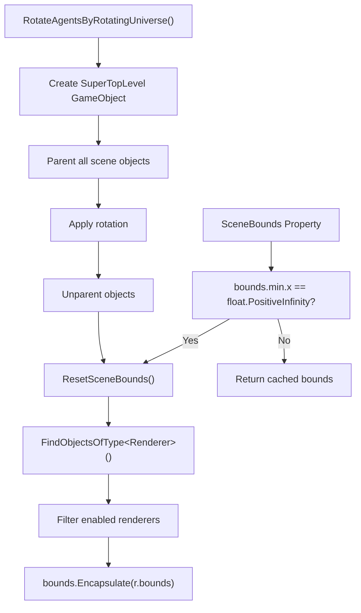
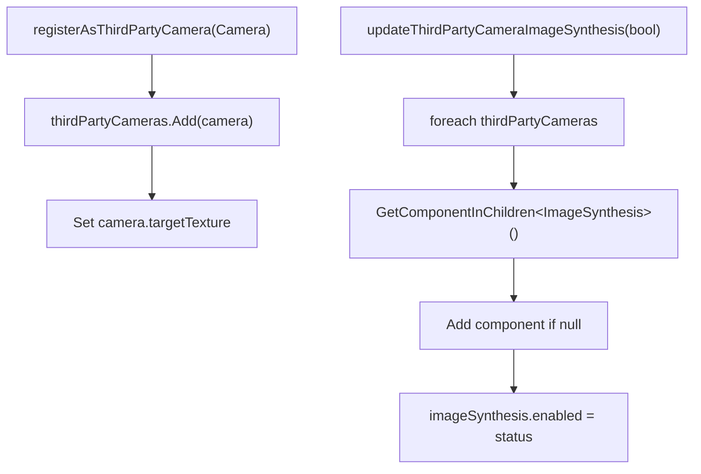
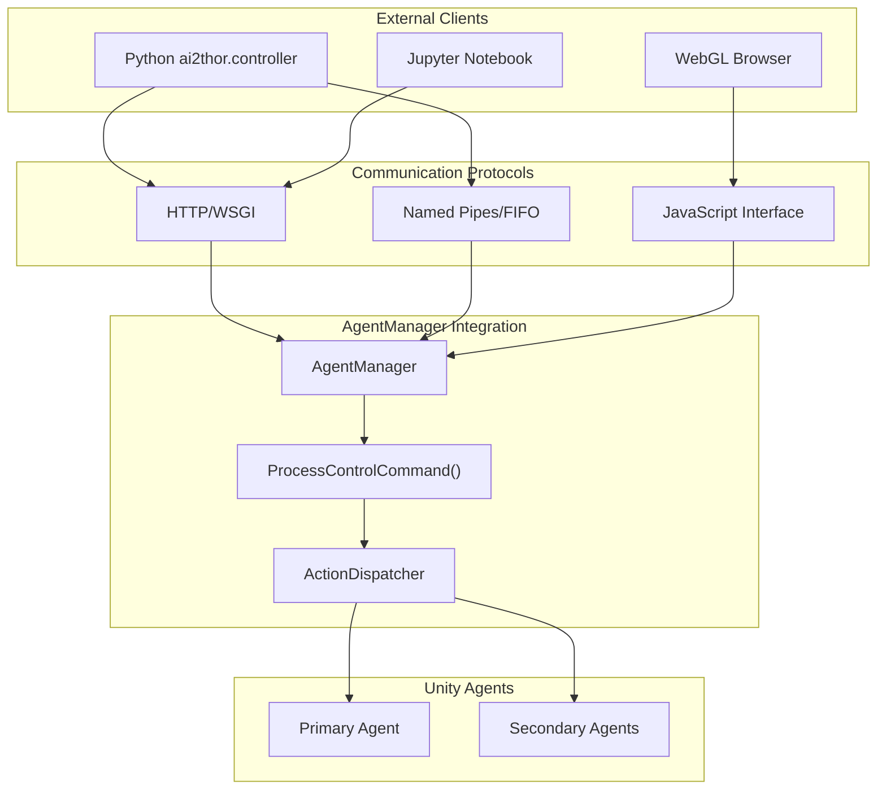

<!-- source: DeepWiki mcp.deepwiki.com · repo allenai/ai2thor · page 3.2 Agent Manager and Coordination · fetched 2026-10-30 -->

# Agent Manager and Coordination

Relevant source files

The following files were used as context for generating this wiki page:

- [ai2thor/hooks/metadata_hook.py](ai2thor/hooks/metadata_hook.py)
- [ai2thor/util/metrics.py](ai2thor/util/metrics.py)
- [ai2thor/util/trials.py](ai2thor/util/trials.py)
- [fpin_tutorial.py](fpin_tutorial.py)
- [unity/Assets/Scenes/FloorPlan_Train2_3/NavMesh.asset](unity/Assets/Scenes/FloorPlan_Train2_3/NavMesh.asset)
- [unity/Assets/Scripts/ActionDispatcher.cs](unity/Assets/Scripts/ActionDispatcher.cs)
- [unity/Assets/Scripts/AgentManager.cs](unity/Assets/Scripts/AgentManager.cs)
- [unity/Assets/Scripts/ArmAgentController.cs](unity/Assets/Scripts/ArmAgentController.cs)
- [unity/Assets/Scripts/ArmController.cs](unity/Assets/Scripts/ArmController.cs)
- [unity/Assets/Scripts/BaseAgentComponent.cs](unity/Assets/Scripts/BaseAgentComponent.cs)
- [unity/Assets/Scripts/BaseFPSAgentController.cs](unity/Assets/Scripts/BaseFPSAgentController.cs)
- [unity/Assets/Scripts/Contains.cs](unity/Assets/Scripts/Contains.cs)
- [unity/Assets/Scripts/ContinuousMovement.cs](unity/Assets/Scripts/ContinuousMovement.cs)
- [unity/Assets/Scripts/DebugDiscreteAgentController.cs](unity/Assets/Scripts/DebugDiscreteAgentController.cs)
- [unity/Assets/Scripts/DebugInputField.cs](unity/Assets/Scripts/DebugInputField.cs)
- [unity/Assets/Scripts/DiscreteHidenSeekAgentController.cs](unity/Assets/Scripts/DiscreteHidenSeekAgentController.cs)
- [unity/Assets/Scripts/DiscretePointClickAgentController.cs](unity/Assets/Scripts/DiscretePointClickAgentController.cs)
- [unity/Assets/Scripts/DroneFPSAgentController.cs](unity/Assets/Scripts/DroneFPSAgentController.cs)
- [unity/Assets/Scripts/FpinAgentController.cs](unity/Assets/Scripts/FpinAgentController.cs)
- [unity/Assets/Scripts/IK_Robot_Arm_Controller.cs](unity/Assets/Scripts/IK_Robot_Arm_Controller.cs)
- [unity/Assets/Scripts/InstantiatePrefabTest.cs](unity/Assets/Scripts/InstantiatePrefabTest.cs)
- [unity/Assets/Scripts/LocobotFPSAgentController.cs](unity/Assets/Scripts/LocobotFPSAgentController.cs)
- [unity/Assets/Scripts/ObjectHighlightController.cs](unity/Assets/Scripts/ObjectHighlightController.cs)
- [unity/Assets/Scripts/PhysicsRemoteFPSAgentController.cs](unity/Assets/Scripts/PhysicsRemoteFPSAgentController.cs)
- [unity/Assets/Scripts/PhysicsSceneManager.cs](unity/Assets/Scripts/PhysicsSceneManager.cs)
- [unity/Assets/Scripts/PlayerControllers.cs](unity/Assets/Scripts/PlayerControllers.cs)
- [unity/Assets/Scripts/RobotArmTest/Stretch_Arm_Solver.cs](unity/Assets/Scripts/RobotArmTest/Stretch_Arm_Solver.cs)
- [unity/Assets/Scripts/RobotArmTest/robot_arm_rig_gripper.prefab](unity/Assets/Scripts/RobotArmTest/robot_arm_rig_gripper.prefab)
- [unity/Assets/Scripts/RobotArmTest/stretch_arm_rig_gripper.prefab](unity/Assets/Scripts/RobotArmTest/stretch_arm_rig_gripper.prefab)
- [unity/Assets/Scripts/SimObjPhysics.cs](unity/Assets/Scripts/SimObjPhysics.cs)
- [unity/Assets/Scripts/SimObjType.cs](unity/Assets/Scripts/SimObjType.cs)
- [unity/Assets/Scripts/StretchAgentController.cs](unity/Assets/Scripts/StretchAgentController.cs)
- [unity/Assets/Scripts/Stretch_Robot_Arm_Controller.cs](unity/Assets/Scripts/Stretch_Robot_Arm_Controller.cs)
- [unity/Assets/Scripts/UtilityFunctions.cs](unity/Assets/Scripts/UtilityFunctions.cs)
- [unity/Assets/Standard Assets/Characters/FirstPersonCharacter/Models/stretch_robot_grp.fbx](unity/Assets/Standard Assets/Characters/FirstPersonCharacter/Models/stretch_robot_grp.fbx)
- [unity/Assets/Standard Assets/Characters/FirstPersonCharacter/Prefabs/FPSController.prefab](unity/Assets/Standard Assets/Characters/FirstPersonCharacter/Prefabs/FPSController.prefab)
- [unity/Assets/UnitTests/TestDispatcher.cs](unity/Assets/UnitTests/TestDispatcher.cs)
- [unity/Assets/UnitTests/TestThirdPartyCameraAndMainCamera.cs](unity/Assets/UnitTests/TestThirdPartyCameraAndMainCamera.cs)
- [unity/ProjectSettings/ProjectSettings.asset](unity/ProjectSettings/ProjectSettings.asset)

## Purpose and Scope

This document covers the `AgentManager` class and its role in orchestrating multiple agents within the AI2-THOR simulation environment. The AgentManager serves as the central coordinator for agent initialization, multi-agent scenarios, scene management, and communication layer integration.

For information about individual agent controllers and their hierarchies, see [Agent Controllers](#3.1). For details about the Python API that interfaces with AgentManager, see [Controller Class](#4.1).

## AgentManager Architecture Overview

The `AgentManager` class acts as the central orchestration point for all agent-related functionality in AI2-THOR. It manages agent lifecycles, coordinates multi-agent scenarios, and serves as the bridge between the communication layer and individual agent controllers.

### Core AgentManager Structure

**Sources:** [unity/Assets/Scripts/AgentManager.cs:33-111]()

### Agent Management State

The AgentManager maintains several key state variables that control agent coordination:

| Property | Type | Purpose |
|----------|------|---------|
| `agents` | `List<BaseFPSAgentController>` | All active agents in the scene |
| `primaryAgent` | `BaseFPSAgentController` | Main agent (always `agents[0]`) |
| `activeAgentId` | `int` | Currently active agent index |
| `agentManagerState` | `AgentState` | Overall manager state |
| `agentColors` | `Color[]` | Predefined colors for multi-agent scenarios |

**Sources:** [unity/Assets/Scripts/AgentManager.cs:34-78]()

## Agent Initialization and Factory Pattern

The AgentManager implements a factory pattern for creating different types of agent controllers based on the `agentMode` specified during initialization.

### Agent Type Factory Methods

```mermaid
graph TD
    Initialize["Initialize(ServerAction)"] --> ParseMode["Parse agentMode"]
    
    ParseMode --> Default["agentMode == 'default'"]
    ParseMode --> Locobot["agentMode == 'locobot'"]
    ParseMode --> Drone["agentMode == 'drone'"]
    ParseMode --> Stretch["agentMode == 'stretch'"]
    ParseMode --> Arm["agentMode == 'arm'"]
    ParseMode --> StretchAB["agentMode == 'stretchab'"]
    ParseMode --> FPIN["agentMode == 'fpin'"]
    
    Default --> SetUpPhysics["SetUpPhysicsController()"]
    Locobot --> SetUpLoco["SetUpLocobotController()"]
    Drone --> SetUpDroneCtrl["SetUpDroneController()"]
    Stretch --> SetUpStretchCtrl["SetUpStretchController()"]
    Arm --> SetUpArmCtrl["SetUpArmController()"]
    StretchAB --> SetUpStretchAB["SetUpStretchABController()"]
    FPIN --> SetUpFPIN["SetUpFpinController()"]
    
    SetUpPhysics --> CreateAgent["createAgentType(typeof(PhysicsRemoteFPSAgentController))"]
    SetUpLoco --> CreateAgent2["createAgentType(typeof(LocobotFPSAgentController))"]
    SetUpDroneCtrl --> CreateAgent3["createAgentType(typeof(DroneFPSAgentController))"]
    SetUpStretchCtrl --> CreateAgent4["createAgentType(typeof(StretchAgentController))"]
    SetUpArmCtrl --> CreateAgent5["createAgentType(typeof(KinovaArmAgentController))"]
    SetUpStretchAB --> CreateAgent6["createAgentType(typeof(ArticulatedAgentController))"]
    SetUpFPIN --> CreateAgent7["createAgentType(typeof(FpinAgentController))"]
```

**Sources:** [unity/Assets/Scripts/AgentManager.cs:219-300](), [unity/Assets/Scripts/AgentManager.cs:374-442]()

### Generic Agent Creation

The `createAgentType` method provides a generic factory implementation:

**Sources:** [unity/Assets/Scripts/AgentManager.cs:422-431]()

## Multi-Agent Coordination

The AgentManager supports multi-agent scenarios where multiple agents can operate simultaneously within the same scene.

### Multi-Agent Initialization Process

**Sources:** [unity/Assets/Scripts/AgentManager.cs:457-492]()

### Agent Camera Management

In multi-agent scenarios, the AgentManager coordinates camera rendering priorities:

| Agent | Camera Depth | Rendering Priority |
|-------|--------------|-------------------|
| Primary (`agents[0]`) | 9999 | Highest (main view) |
| Secondary (`agents[1+]`) | 1 | Lower (background) |

**Sources:** [unity/Assets/Scripts/AgentManager.cs:365](), [unity/Assets/Scripts/AgentManager.cs:488-490]()

### Agent Color Coordination

The AgentManager assigns distinct colors to agents for visual identification:

**Sources:** [unity/Assets/Scripts/AgentManager.cs:58-66]()

## Scene and Camera Management

The AgentManager coordinates scene bounds calculation and manages both main agent cameras and third-party cameras.

### Scene Bounds Management

**Sources:** [unity/Assets/Scripts/AgentManager.cs:494-538]()

### Third-Party Camera Registration

The AgentManager provides a system for registering additional cameras beyond the main agent cameras:

**Sources:** [unity/Assets/Scripts/AgentManager.cs:540-580]()

## Communication Layer Integration

The AgentManager serves as the bridge between external clients and the Unity simulation, supporting multiple communication protocols.

### Communication Architecture

**Sources:** [unity/Assets/Scripts/AgentManager.cs:138-158]()

### Server Type Configuration

The AgentManager configures different server types based on environment variables:

| Server Type | Protocol | Use Case |
|-------------|----------|----------|
| `WSGI` | HTTP | Web-based clients, development |
| `FIFO` | Named Pipes | Local clients, high performance |
| `WebGL` | JavaScript | Browser-based interaction |

**Sources:** [unity/Assets/Scripts/AgentManager.cs:72-77](), [unity/Assets/Scripts/AgentManager.cs:138-158]()

The AgentManager initializes the appropriate communication backend during `Awake()` based on the `SERVER_TYPE` environment variable and sets up the corresponding client interface for handling incoming action requests.

**Sources:** [unity/Assets/Scripts/AgentManager.cs:115-175]()

---

