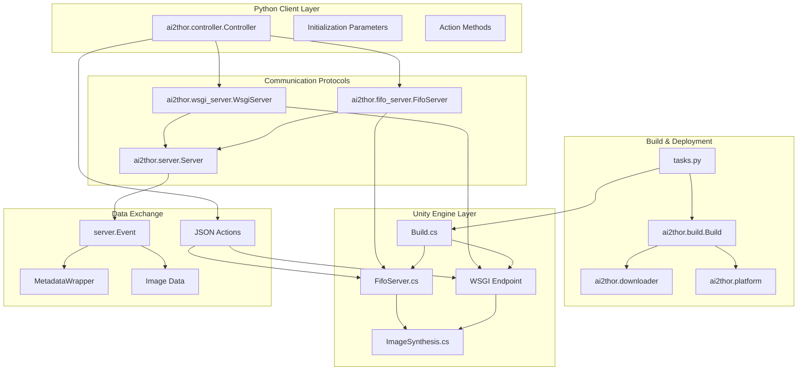
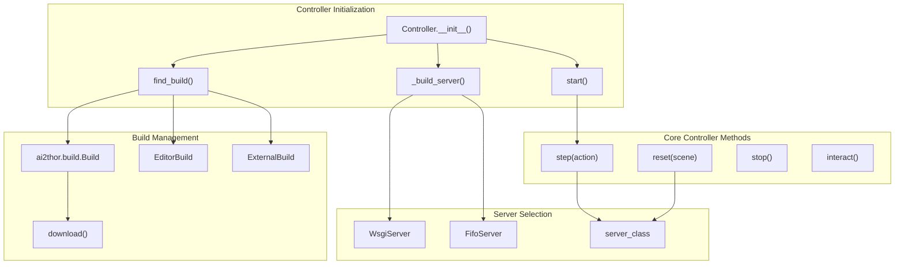
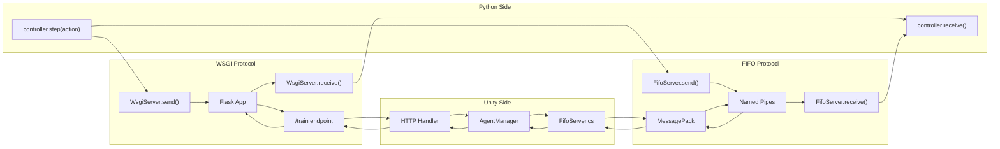
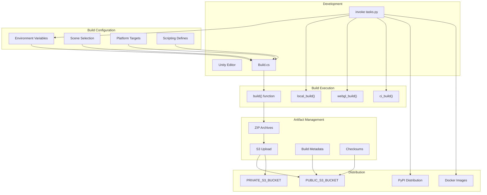
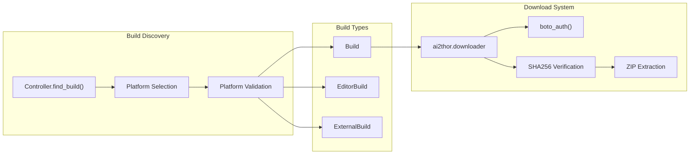
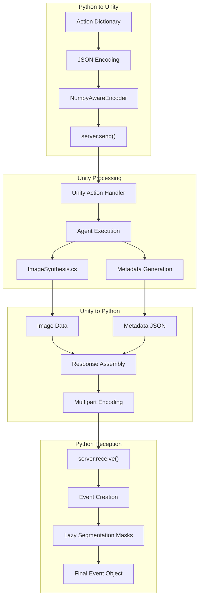
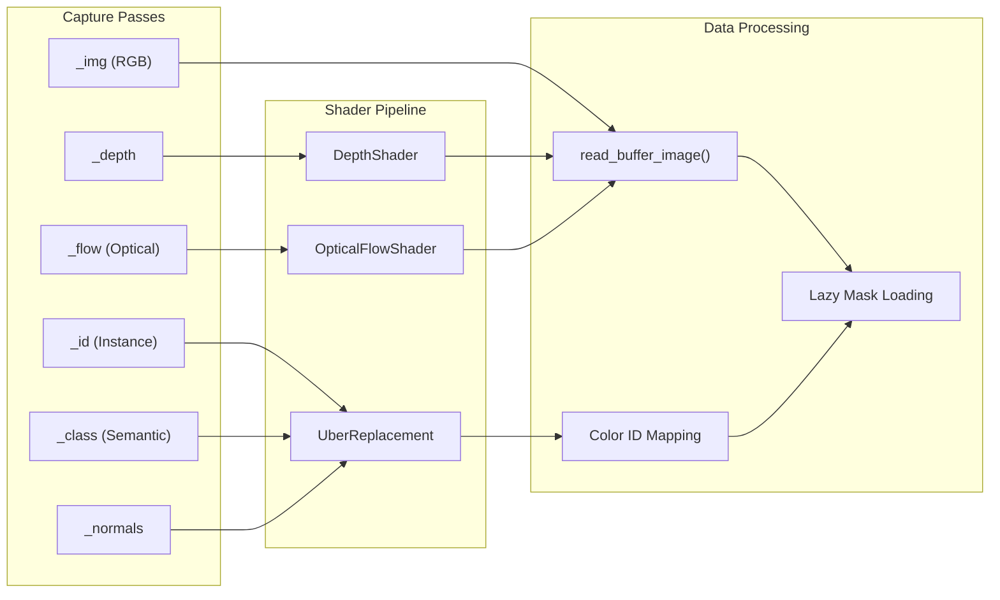

<!-- source: DeepWiki mcp.deepwiki.com · repo allenai/ai2thor · page 4 Python API and Communication · fetched 2026-10-30 -->

# Python API and Communication

Relevant source files

The following files were used as context for generating this wiki page:

- [.dockerignore](.dockerignore)
- [Dockerfile](Dockerfile)
- [ai2thor/__init__.py](ai2thor/__init__.py)
- [ai2thor/build.py](ai2thor/build.py)
- [ai2thor/controller.py](ai2thor/controller.py)
- [ai2thor/docker.py](ai2thor/docker.py)
- [ai2thor/downloader.py](ai2thor/downloader.py)
- [ai2thor/fifo_server.py](ai2thor/fifo_server.py)
- [ai2thor/platform.py](ai2thor/platform.py)
- [ai2thor/server.py](ai2thor/server.py)
- [ai2thor/tests/build_controller.py](ai2thor/tests/build_controller.py)
- [ai2thor/tests/constants.py](ai2thor/tests/constants.py)
- [ai2thor/tests/data/arm/new/pickup_object.json](ai2thor/tests/data/arm/new/pickup_object.json)
- [ai2thor/tests/data/image-depth-data256.raw](ai2thor/tests/data/image-depth-data256.raw)
- [ai2thor/tests/data/image-depth-datafloat32.raw](ai2thor/tests/data/image-depth-datafloat32.raw)
- [ai2thor/tests/fifo_client.py](ai2thor/tests/fifo_client.py)
- [ai2thor/tests/test_controller.py](ai2thor/tests/test_controller.py)
- [ai2thor/tests/test_event.py](ai2thor/tests/test_event.py)
- [ai2thor/tests/test_fifo_server.py](ai2thor/tests/test_fifo_server.py)
- [ai2thor/tests/test_server.py](ai2thor/tests/test_server.py)
- [ai2thor/tests/test_unity.py](ai2thor/tests/test_unity.py)
- [ai2thor/wsgi_server.py](ai2thor/wsgi_server.py)
- [start.sh](start.sh)
- [tasks.py](tasks.py)
- [unity/Assets/Editor/Build.cs](unity/Assets/Editor/Build.cs)
- [unity/Assets/Physics/SimObjsPhysics/RoboTHOR Objects/RoboTHOR_Assets_SmallObjects/Target_SmallObjects/SprayBottle/Materials.meta](unity/Assets/Physics/SimObjsPhysics/RoboTHOR Objects/RoboTHOR_Assets_SmallObjects/Target_SmallObjects/SprayBottle/Materials.meta)
- [unity/Assets/Resources/MagicMirror/Prefab/MirrorMaterial.mat](unity/Assets/Resources/MagicMirror/Prefab/MirrorMaterial.mat)
- [unity/Assets/Scripts/FifoServer.cs](unity/Assets/Scripts/FifoServer.cs)
- [unity/Assets/Scripts/ImageSynthesis/ImageSynthesis.cs](unity/Assets/Scripts/ImageSynthesis/ImageSynthesis.cs)
- [unity/Assets/Scripts/ImageSynthesis/Shaders/Depth.shader](unity/Assets/Scripts/ImageSynthesis/Shaders/Depth.shader)
- [unity/ProjectSettings/GraphicsSettings.asset](unity/ProjectSettings/GraphicsSettings.asset)

This document covers the Python API layer and communication systems that enable interaction between Python client code and the Unity simulation engine in AI2-THOR. This includes the primary `Controller` class, server communication protocols, build automation, and data exchange mechanisms.

For information about specialized agent types and their controllers, see [Specialized Agent Types](#5). For details about Unity project configuration and scene management, see [Unity Project Configuration](#11) and [Scenes and Environments](#6).

## Architecture Overview

The Python API and communication system forms the bridge between Python client applications and the Unity simulation engine through multiple communication protocols and build management systems.

Sources: [ai2thor/controller.py:1-1000](), [ai2thor/server.py:1-100](), [ai2thor/wsgi_server.py:1-100](), [ai2thor/fifo_server.py:1-100]()

## Controller Class - Main Python API

The `Controller` class in `ai2thor.controller` serves as the primary entry point for all Python interactions with AI2-THOR. It manages initialization, communication protocols, build selection, and action execution.

The `Controller` class handles several key responsibilities:

| Component | Purpose | Key Methods |
|-----------|---------|-------------|
| Initialization | Set up communication and build | `__init__`, `start()` |
| Action Execution | Send actions to Unity | `step()`, `multi_step_physics()` |
| Scene Management | Load and reset scenes | `reset()`, `normalize_scene()` |
| Build Management | Handle Unity builds | `find_build()`, `prune_releases()` |
| Server Communication | Manage protocol selection | `_build_server()`, `server_type_to_class()` |

Sources: [ai2thor/controller.py:372-627](), [ai2thor/controller.py:689-774](), [ai2thor/controller.py:776-796]()

## Communication Protocols

AI2-THOR supports two primary communication protocols between Python and Unity: WSGI (HTTP-based) and FIFO (named pipes). The choice depends on platform compatibility and performance requirements.

### Protocol Architecture

### WSGI Server Protocol

The `WsgiServer` uses HTTP communication through Flask endpoints:

| Component | Purpose | Key Features |
|-----------|---------|--------------|
| Flask App | HTTP server | Multi-part form data, JSON responses |
| `/train` endpoint | Action processing | Handles metadata and image data |
| Queue System | Thread-safe communication | Request/response queues |
| BufferedIO | Optimized data transfer | Reduced HTTP overhead |

### FIFO Server Protocol  

The `FifoServer` uses named pipes for lower-latency communication:

| Component | Purpose | Key Features |
|-----------|---------|--------------|
| Named Pipes | Direct OS communication | Lower latency than HTTP |
| MessagePack | Binary serialization | Efficient data encoding |
| Field Types | Structured messages | Typed data fields (RGB, depth, metadata) |
| Signal Handling | Timeout management | Connection timeout detection |

Platform compatibility determines protocol selection:
- **Windows**: WSGI only (FIFO not supported)
- **Linux/macOS**: FIFO preferred, WSGI fallback

Sources: [ai2thor/wsgi_server.py:149-196](), [ai2thor/fifo_server.py:56-124](), [ai2thor/controller.py:512-529](), [unity/Assets/Scripts/FifoServer.cs:8-50]()

## Build System and Deployment

The build system automates Unity compilation, packaging, and deployment across multiple platforms using Python invoke tasks and Unity build scripts.

### Build Pipeline Architecture

### Key Build Tasks

| Task | Purpose | Key Parameters |
|------|---------|----------------|
| `local_build` | Development builds | `prefix`, `arch`, `scenes` |
| `webgl_build` | Web deployment | `scenes`, `content_addressable` |
| `ci_build` | Continuous integration | `commit_id`, `branch` |
| `build_pip` | Package distribution | `version` validation |

### Build Metadata and Downloads

The `ai2thor.build` module manages build discovery and download:

Sources: [tasks.py:488-511](), [tasks.py:514-637](), [tasks.py:1074-1200](), [ai2thor/build.py:110-248](), [unity/Assets/Editor/Build.cs:83-128]()

## Unity Integration and Data Exchange

The communication layer handles bidirectional data exchange between Python and Unity, including action commands, scene metadata, and image data.

### Data Flow Architecture

### Event Data Structure

The `Event` class wraps all response data from Unity:

| Component | Purpose | Data Types |
|-----------|---------|------------|
| `metadata` | Scene and object information | JSON dict via `MetadataWrapper` |
| `frame` | RGB image data | NumPy array (H×W×3) |
| `depth_frame` | Depth information | NumPy array (H×W) |
| `instance_masks` | Object segmentation | `LazyInstanceSegmentationMasks` |
| `class_masks` | Semantic segmentation | `LazyClassSegmentationMasks` |
| `third_party_*` | Additional camera data | Lists of arrays |

### Image Processing and Synthesis

Unity's `ImageSynthesis` component generates multiple image types:

Sources: [ai2thor/server.py:427-533](), [ai2thor/server.py:59-155](), [unity/Assets/Scripts/ImageSynthesis/ImageSynthesis.cs:20-143](), [unity/Assets/Scripts/ImageSynthesis/ImageSynthesis.cs:235-300]()

## Error Handling and Debugging

The communication system includes comprehensive error handling and debugging capabilities for robust operation.

### Exception Handling

| Exception Type | Trigger | Recovery |
|----------------|---------|----------|
| `UnityCrashException` | Unity process exit | Process restart required |
| `TimeoutError` | Communication timeout | Configurable timeout values |
| `ValueError` | Invalid action parameters | Action validation |
| `ConnectionError` | Server communication failure | Protocol fallback |

### Debugging and Monitoring

The system provides multiple debugging mechanisms:

- **Frame rate monitoring**: Tracks rendering performance
- **Action validation**: Validates parameters before sending
- **Sequence ID tracking**: Ensures message ordering
- **Connection state monitoring**: Detects Unity process health
- **Build validation**: Verifies platform compatibility

Sources: [ai2thor/wsgi_server.py:36-65](), [ai2thor/fifo_server.py:147-200](), [ai2thor/controller.py:414-418](), [ai2thor/exceptions.py:1-10]()

---

