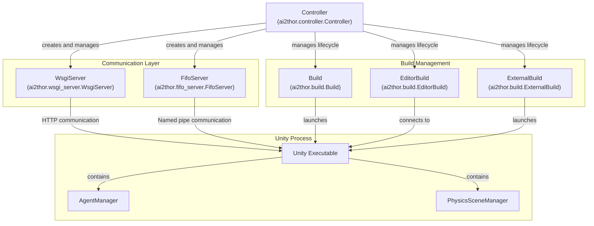
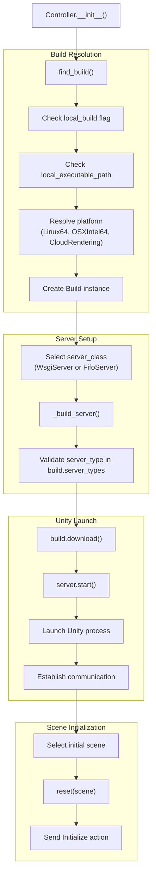
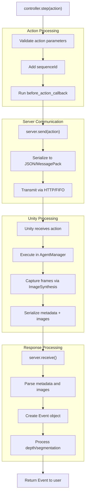
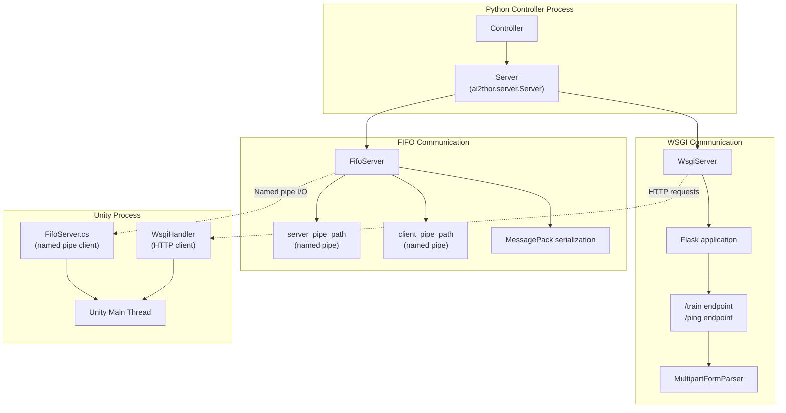
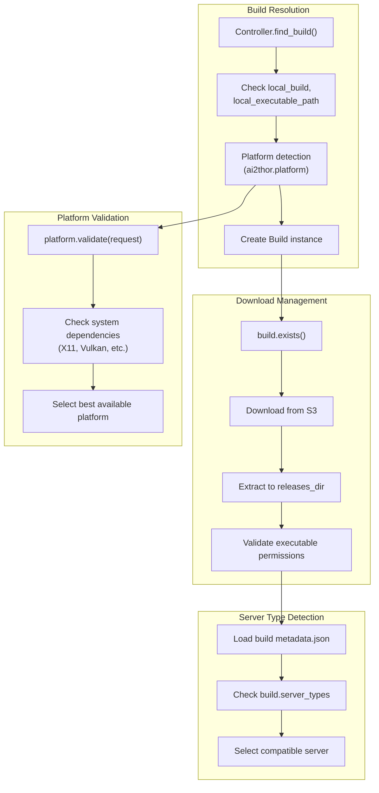

<!-- source: DeepWiki mcp.deepwiki.com · repo allenai/ai2thor · page 4.1 Controller Class · fetched 2026-10-30 -->

# Controller Class

<details>
<summary>Relevant source files</summary>

The following files were used as context for generating this wiki page:

- [.dockerignore](.dockerignore)
- [Dockerfile](Dockerfile)
- [ai2thor/__init__.py](ai2thor/__init__.py)
- [ai2thor/build.py](ai2thor/build.py)
- [ai2thor/controller.py](ai2thor/controller.py)
- [ai2thor/docker.py](ai2thor/docker.py)
- [ai2thor/downloader.py](ai2thor/downloader.py)
- [ai2thor/fifo_server.py](ai2thor/fifo_server.py)
- [ai2thor/platform.py](ai2thor/platform.py)
- [ai2thor/server.py](ai2thor/server.py)
- [ai2thor/tests/build_controller.py](ai2thor/tests/build_controller.py)
- [ai2thor/tests/constants.py](ai2thor/tests/constants.py)
- [ai2thor/tests/data/arm/new/pickup_object.json](ai2thor/tests/data/arm/new/pickup_object.json)
- [ai2thor/tests/data/image-depth-data256.raw](ai2thor/tests/data/image-depth-data256.raw)
- [ai2thor/tests/data/image-depth-datafloat32.raw](ai2thor/tests/data/image-depth-datafloat32.raw)
- [ai2thor/tests/fifo_client.py](ai2thor/tests/fifo_client.py)
- [ai2thor/tests/test_controller.py](ai2thor/tests/test_controller.py)
- [ai2thor/tests/test_event.py](ai2thor/tests/test_event.py)
- [ai2thor/tests/test_fifo_server.py](ai2thor/tests/test_fifo_server.py)
- [ai2thor/tests/test_server.py](ai2thor/tests/test_server.py)
- [ai2thor/tests/test_unity.py](ai2thor/tests/test_unity.py)
- [ai2thor/wsgi_server.py](ai2thor/wsgi_server.py)
- [start.sh](start.sh)
- [tasks.py](tasks.py)
- [unity/Assets/Editor/Build.cs](unity/Assets/Editor/Build.cs)
- [unity/Assets/Physics/SimObjsPhysics/RoboTHOR Objects/RoboTHOR_Assets_SmallObjects/Target_SmallObjects/SprayBottle/Materials.meta](unity/Assets/Physics/SimObjsPhysics/RoboTHOR Objects/RoboTHOR_Assets_SmallObjects/Target_SmallObjects/SprayBottle/Materials.meta)
- [unity/Assets/Resources/MagicMirror/Prefab/MirrorMaterial.mat](unity/Assets/Resources/MagicMirror/Prefab/MirrorMaterial.mat)
- [unity/Assets/Scripts/FifoServer.cs](unity/Assets/Scripts/FifoServer.cs)
- [unity/Assets/Scripts/ImageSynthesis/ImageSynthesis.cs](unity/Assets/Scripts/ImageSynthesis/ImageSynthesis.cs)
- [unity/Assets/Scripts/ImageSynthesis/Shaders/Depth.shader](unity/Assets/Scripts/ImageSynthesis/Shaders/Depth.shader)
- [unity/ProjectSettings/GraphicsSettings.asset](unity/ProjectSettings/GraphicsSettings.asset)

</details>


The `Controller` class serves as the primary Python API entry point for interacting with AI2-THOR simulation environments. It provides a high-level interface for controlling agents, managing scenes, sending actions, and receiving visual and metadata responses from the Unity simulation backend. This document covers the Controller's architecture, initialization process, communication mechanisms, and integration with the broader AI2-THOR system.

For information about specific agent types and their capabilities, see [Articulated Agents](#5.1). For details about the build and deployment pipeline, see [Build System and Deployment](#4.2).

## Controller Architecture Overview

The `Controller` class acts as the central orchestrator that manages Unity process lifecycle, handles server communication, and provides a unified API for simulation interaction. It abstracts away the complexity of cross-process communication and build management while exposing intuitive methods for scene control and agent manipulation.



Sources: [ai2thor/controller.py:372-405](), [ai2thor/server.py:1-50](), [ai2thor/build.py:110-248]()

## Controller Initialization Flow

The Controller initialization process involves platform detection, build resolution, server setup, and Unity process management. The initialization is highly configurable to support different deployment scenarios and platform requirements.



Sources: [ai2thor/controller.py:373-627](), [ai2thor/controller.py:544-557](), [ai2thor/controller.py:628-662]()

## Action Execution Flow

The step execution flow demonstrates how user actions are processed, transmitted to Unity, and how responses are received and packaged into Event objects containing visual data and metadata.



Sources: [ai2thor/controller.py:961-1018](), [ai2thor/server.py:427-577](), [ai2thor/wsgi_server.py:190-295](), [ai2thor/fifo_server.py:261-283]()

## Server Communication Architecture

The Controller supports multiple communication protocols for interacting with Unity, each optimized for different use cases and platform requirements.



Sources: [ai2thor/wsgi_server.py:149-295](), [ai2thor/fifo_server.py:56-318](), [unity/Assets/Scripts/FifoServer.cs:1-150]()

## Build System Integration

The Controller integrates with a sophisticated build management system that handles Unity executable distribution, platform detection, and version management.

| Build Type | Use Case | Executable Source | Platform Support |
|------------|----------|-------------------|------------------|
| `EditorBuild` | Development with Unity Editor | Local Unity installation | All platforms |
| `ExternalBuild` | Custom Unity builds | User-specified path | Linux64, OSXIntel64 |
| `Build` | Production deployment | Downloaded from S3 | Linux64, OSXIntel64, CloudRendering |



Sources: [ai2thor/controller.py:1080-1160](), [ai2thor/build.py:110-248](), [ai2thor/platform.py:214-236](), [tasks.py:252-267]()

## Key Configuration Parameters

The Controller accepts numerous initialization parameters that control its behavior, server selection, and Unity configuration:

| Parameter | Type | Default | Purpose |
|-----------|------|---------|---------|
| `quality` | str | `DEFAULT_QUALITY` | Unity rendering quality setting |
| `headless` | bool | `False` | Run without display (Linux only) |
| `server_class` | class | Auto-detected | Force specific server type |
| `width`, `height` | int | 300, 300 | Rendering resolution |
| `local_build` | bool | `False` | Use local Unity build instead of download |
| `commit_id` | str | Latest | Specific build version to use |
| `platform` | Platform | Auto-detected | Target platform override |
| `start_unity` | bool | `True` | Whether to launch Unity process |

Sources: [ai2thor/controller.py:373-405](), [ai2thor/_quality_settings.py]()

## Common Usage Patterns

### Basic Controller Setup
```python
import ai2thor.controller

# Standard initialization
controller = ai2thor.controller.Controller(
    quality="High",
    width=512, 
    height=512
)

# Reset to a specific scene
event = controller.reset("FloorPlan1_physics")

# Send actions and receive events
event = controller.step("MoveAhead")
```

### Advanced Configuration
```python
# Use specific server type
controller = ai2thor.controller.Controller(
    server_class=ai2thor.fifo_server.FifoServer,
    headless=True,
    local_build=True
)

# Multi-agent setup
controller.reset(agentCount=2)
```

Sources: [ai2thor/controller.py:689-774](), [ai2thor/tests/test_unity.py:48-90](), [ai2thor/tests/test_controller.py:105-120]()

---

