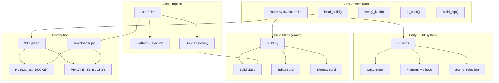
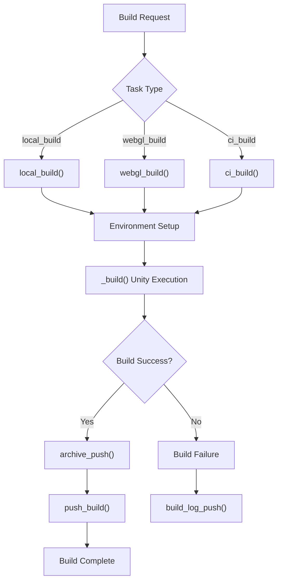
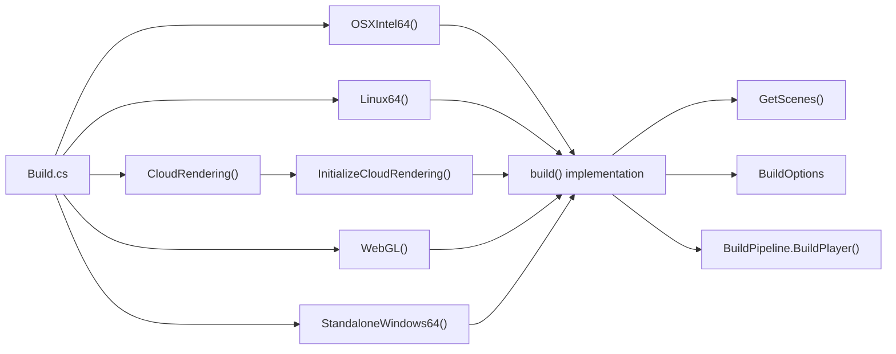
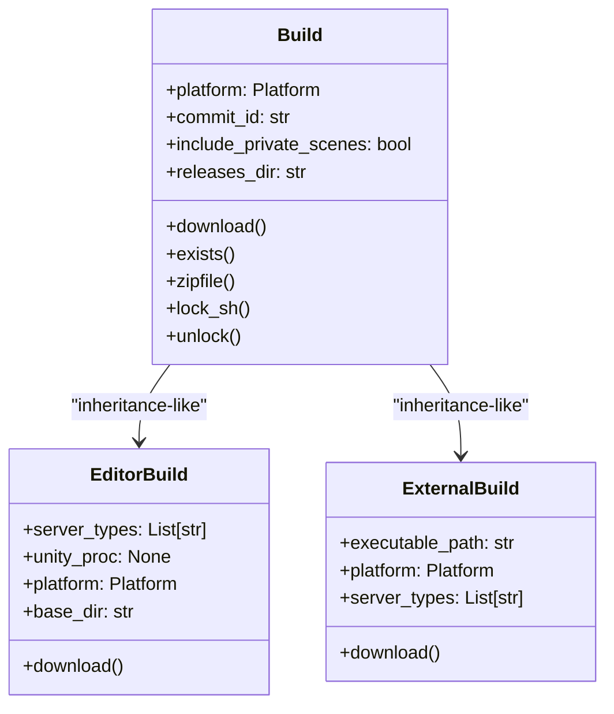
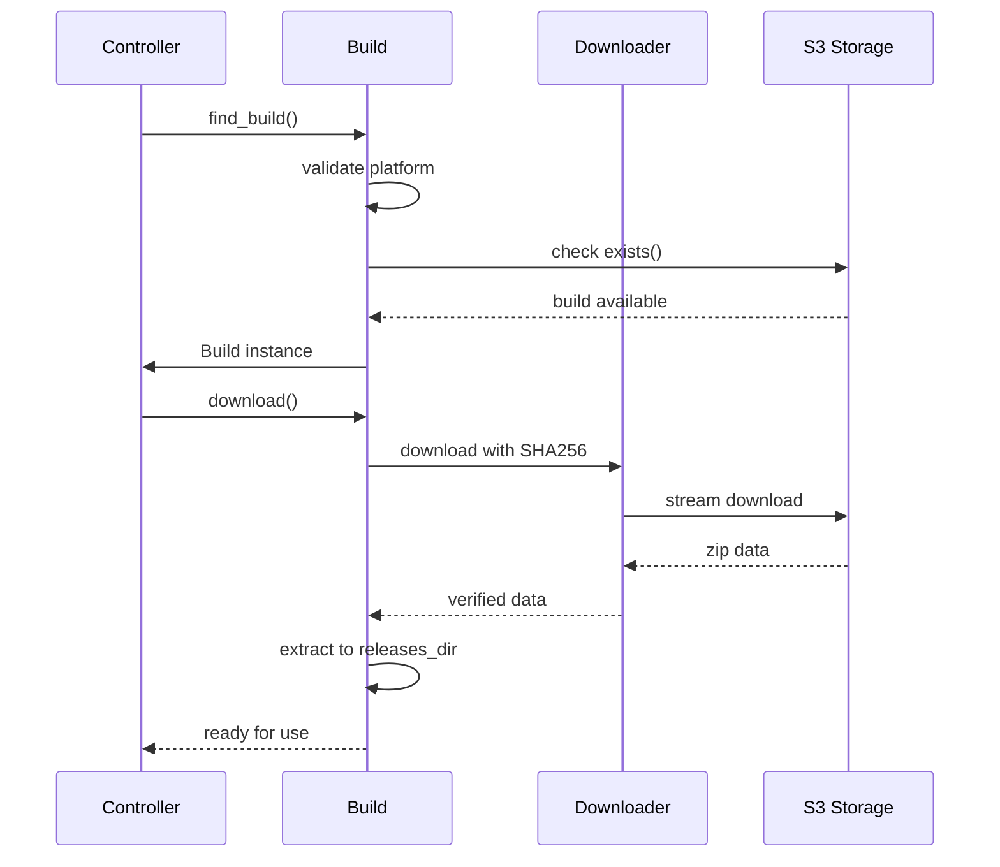
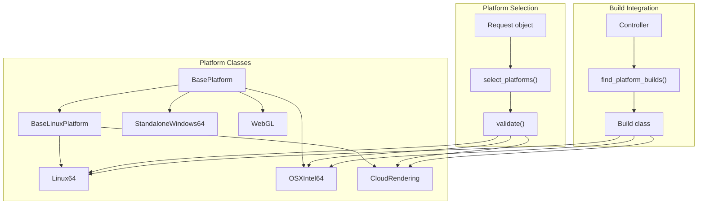
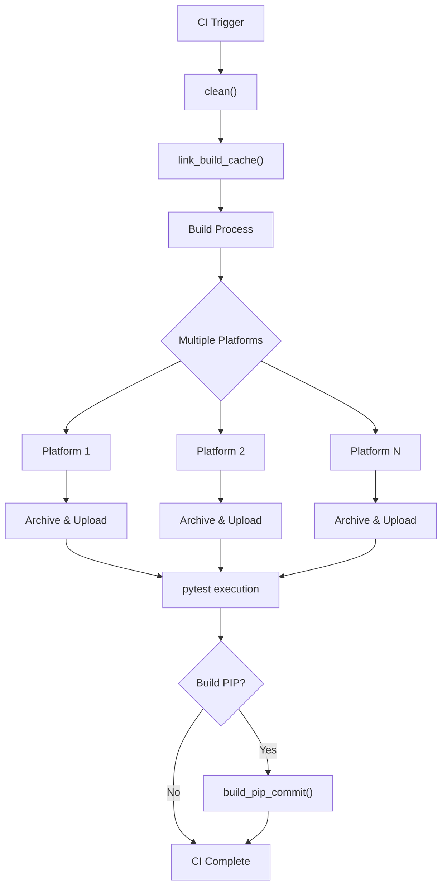

<!-- source: DeepWiki mcp.deepwiki.com · repo allenai/ai2thor · page 4.2 Build System and Deployment · fetched 2026-10-30 -->

# Build System and Deployment

Relevant source files

The following files were used as context for generating this wiki page:

- [.dockerignore](.dockerignore)
- [Dockerfile](Dockerfile)
- [ai2thor/__init__.py](ai2thor/__init__.py)
- [ai2thor/build.py](ai2thor/build.py)
- [ai2thor/controller.py](ai2thor/controller.py)
- [ai2thor/docker.py](ai2thor/docker.py)
- [ai2thor/downloader.py](ai2thor/downloader.py)
- [ai2thor/fifo_server.py](ai2thor/fifo_server.py)
- [ai2thor/platform.py](ai2thor/platform.py)
- [ai2thor/server.py](ai2thor/server.py)
- [ai2thor/tests/build_controller.py](ai2thor/tests/build_controller.py)
- [ai2thor/tests/constants.py](ai2thor/tests/constants.py)
- [ai2thor/tests/data/arm/new/pickup_object.json](ai2thor/tests/data/arm/new/pickup_object.json)
- [ai2thor/tests/data/image-depth-data256.raw](ai2thor/tests/data/image-depth-data256.raw)
- [ai2thor/tests/data/image-depth-datafloat32.raw](ai2thor/tests/data/image-depth-datafloat32.raw)
- [ai2thor/tests/fifo_client.py](ai2thor/tests/fifo_client.py)
- [ai2thor/tests/test_controller.py](ai2thor/tests/test_controller.py)
- [ai2thor/tests/test_event.py](ai2thor/tests/test_event.py)
- [ai2thor/tests/test_fifo_server.py](ai2thor/tests/test_fifo_server.py)
- [ai2thor/tests/test_server.py](ai2thor/tests/test_server.py)
- [ai2thor/tests/test_unity.py](ai2thor/tests/test_unity.py)
- [ai2thor/wsgi_server.py](ai2thor/wsgi_server.py)
- [start.sh](start.sh)
- [tasks.py](tasks.py)
- [unity/Assets/Editor/Build.cs](unity/Assets/Editor/Build.cs)
- [unity/Assets/Physics/SimObjsPhysics/RoboTHOR Objects/RoboTHOR_Assets_SmallObjects/Target_SmallObjects/SprayBottle/Materials.meta](unity/Assets/Physics/SimObjsPhysics/RoboTHOR Objects/RoboTHOR_Assets_SmallObjects/Target_SmallObjects/SprayBottle/Materials.meta)
- [unity/Assets/Resources/MagicMirror/Prefab/MirrorMaterial.mat](unity/Assets/Resources/MagicMirror/Prefab/MirrorMaterial.mat)
- [unity/Assets/Scripts/FifoServer.cs](unity/Assets/Scripts/FifoServer.cs)
- [unity/Assets/Scripts/ImageSynthesis/ImageSynthesis.cs](unity/Assets/Scripts/ImageSynthesis/ImageSynthesis.cs)
- [unity/Assets/Scripts/ImageSynthesis/Shaders/Depth.shader](unity/Assets/Scripts/ImageSynthesis/Shaders/Depth.shader)
- [unity/ProjectSettings/GraphicsSettings.asset](unity/ProjectSettings/GraphicsSettings.asset)

This document covers AI2-THOR's build system and deployment infrastructure, including build orchestration, Unity compilation, artifact management, and distribution mechanisms. The build system handles creating platform-specific Unity executables, packaging them for distribution, and enabling automatic download and consumption by the Python API.

For information about the Controller class that consumes these builds, see [Controller Class](#4.1). For details about platform-specific implementations, see [Unity Project Configuration](#11).

## Build System Overview

The AI2-THOR build system consists of several interconnected components that handle the complete lifecycle from source code to distributed executables. The system supports multiple target platforms and provides both local development builds and automated CI/CD pipelines.

Sources: [tasks.py:1-1500](), [ai2thor/build.py:1-248](), [unity/Assets/Editor/Build.cs:1-234](), [ai2thor/controller.py:530-547]()

## Build Orchestration with Invoke Tasks

The primary build orchestration is handled through Python invoke tasks defined in `tasks.py`. These tasks provide a unified interface for various build operations and maintain consistency across development and CI environments.

### Core Build Tasks

| Task | Purpose | Key Parameters |
|------|---------|----------------|
| `local_build` | Local development builds | `prefix`, `arch`, `scenes` |
| `webgl_build` | WebGL browser builds | `scenes`, `room_ranges`, `content_addressable` |
| `ci_build` | Automated CI/CD builds | `commit_id`, `branch`, `skip_pip` |
| `build_pip` | Python package creation | `version` |
| `deploy_pip` | PyPI deployment | Uses `TWINE_PASSWORD` |

The `_build()` function [tasks.py:193-250]() serves as the core Unity build executor, handling command construction, environment variables, and timeout management. It supports multiple architectures through a platform mapping system [tasks.py:203-204]().

Sources: [tasks.py:457-511](), [tasks.py:514-636](), [tasks.py:1074-1200](), [tasks.py:193-250]()

### Build Environment Management

The system manages build environments through several mechanisms:

- **Environment Variables**: `UNITY_BUILD_NAME`, `BUILD_SCENES`, `INCLUDE_PRIVATE_SCENES`
- **Build Caching**: Unity Library cache management with branch-specific directories [tasks.py:897-934]()
- **Platform Detection**: Automatic Unity path resolution [tasks.py:158-191]()
- **Quality Settings**: Automated generation from Unity project settings [tasks.py:639-664]()

Sources: [tasks.py:897-934](), [tasks.py:158-191](), [tasks.py:639-664]()

## Unity Build System

The Unity build system is implemented in C# through the `Build.cs` script, which provides platform-specific build methods and configuration management.

### Platform Build Methods

Each platform method calls the central `build()` function [unity/Assets/Editor/Build.cs:83-128]() with platform-specific parameters. The CloudRendering platform requires special initialization to copy settings from the Standalone platform [unity/Assets/Editor/Build.cs:16-36]().

### Scene Selection Logic

The build system supports flexible scene inclusion through environment variables and default fallbacks:

1. **Environment-based**: `BUILD_SCENES` comma-separated list [unity/Assets/Editor/Build.cs:190-204]()
2. **Default**: All scenes from multiple directories [unity/Assets/Editor/Build.cs:143-188]()
3. **Private scenes**: Controlled by `INCLUDE_PRIVATE_SCENES` flag [unity/Assets/Editor/Build.cs:149-156]()

Sources: [unity/Assets/Editor/Build.cs:83-128](), [unity/Assets/Editor/Build.cs:16-36](), [unity/Assets/Editor/Build.cs:190-204](), [unity/Assets/Editor/Build.cs:143-188]()

## Build Management Classes

The `ai2thor/build.py` module provides object-oriented abstractions for different build types and their management.

### Build Class Hierarchy

### Build Discovery and Download

The `Build` class [ai2thor/build.py:110-248]() handles the complete lifecycle of build artifacts:

- **URL Construction**: Based on platform, commit ID, and privacy settings [ai2thor/build.py:207-210]()
- **Download Management**: With SHA256 verification and progress tracking [ai2thor/build.py:127-151]()
- **Lock-based Coordination**: Prevents concurrent downloads [ai2thor/build.py:131-139]()
- **Metadata Handling**: Server type capabilities and build information [ai2thor/build.py:191-194]()

Sources: [ai2thor/build.py:110-248](), [ai2thor/build.py:60-84](), [ai2thor/build.py:85-108](), [ai2thor/build.py:127-151]()

## Distribution Infrastructure

The distribution system uses Amazon S3 for hosting build artifacts with separate buckets for public and private content.

### S3 Bucket Configuration

| Bucket | Purpose | Access |
|--------|---------|--------|
| `ai2-thor-public` | Standard builds | Public read |
| `ai2-thor-private` | Private scene builds | Authenticated |
| `ai2-thor-webgl-public` | WebGL builds | Public read |
| `ai2-thor-pypi` | Development packages | Public read |

The `push_build()` function [tasks.py:77-114]() handles the upload process with SHA256 checksums and appropriate ACL settings. Build logs are also uploaded for debugging purposes [tasks.py:816-834]().

### Download and Verification

The `ai2thor/downloader.py` module provides secure download functionality:

- **Progress Tracking**: Visual progress bar with transfer speed [ai2thor/downloader.py:22-31]()
- **Integrity Verification**: SHA256 checksum validation [ai2thor/downloader.py:42-43]()
- **Authentication**: AWS credentials for private builds [ai2thor/downloader.py:13-14]()

Sources: [tasks.py:77-114](), [tasks.py:816-834](), [ai2thor/downloader.py:11-46](), [ai2thor/build.py:23-27]()

## Platform Support and Build Variants

The system supports multiple target platforms with platform-specific handling for executables, dependencies, and validation.

### Platform Architecture

Each platform class provides:
- **Validation**: Dependency checking and system requirements [ai2thor/platform.py:151-160]()
- **Executable Paths**: Platform-specific binary location logic [ai2thor/platform.py:44-49]()
- **Launch Environment**: Platform-specific environment variables [ai2thor/platform.py:74-79]()

Sources: [ai2thor/platform.py:18-40](), [ai2thor/platform.py:214-227](), [ai2thor/platform.py:151-160](), [ai2thor/platform.py:44-49]()

## CI/CD Integration

The build system provides comprehensive CI/CD integration through the `ci_build()` task and related automation.

### Continuous Integration Workflow

The CI system includes:
- **Cache Management**: Branch-specific Unity Library caching [tasks.py:897-934]()
- **Parallel Builds**: Multi-platform concurrent building [tasks.py:1165-1180]()
- **Test Integration**: Automated pytest execution [tasks.py:1051-1070]()
- **Artifact Management**: Automatic S3 upload and metadata generation [tasks.py:836-854]()

### Build Validation and Testing

The system includes comprehensive validation:
- **Platform Dependencies**: Automatic dependency checking before builds
- **Scene Validation**: Verification of scene availability and consistency
- **Executable Testing**: Post-build functionality verification
- **Regression Testing**: Automated test suite execution against new builds

Sources: [tasks.py:1074-1200](), [tasks.py:897-934](), [tasks.py:1051-1070](), [tasks.py:836-854]()

---

