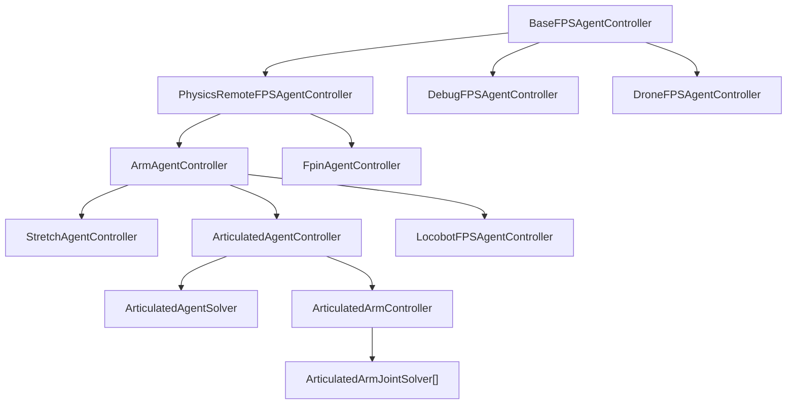
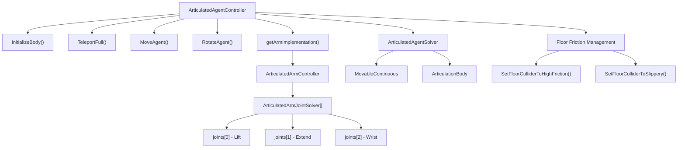
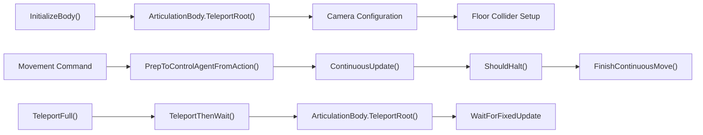
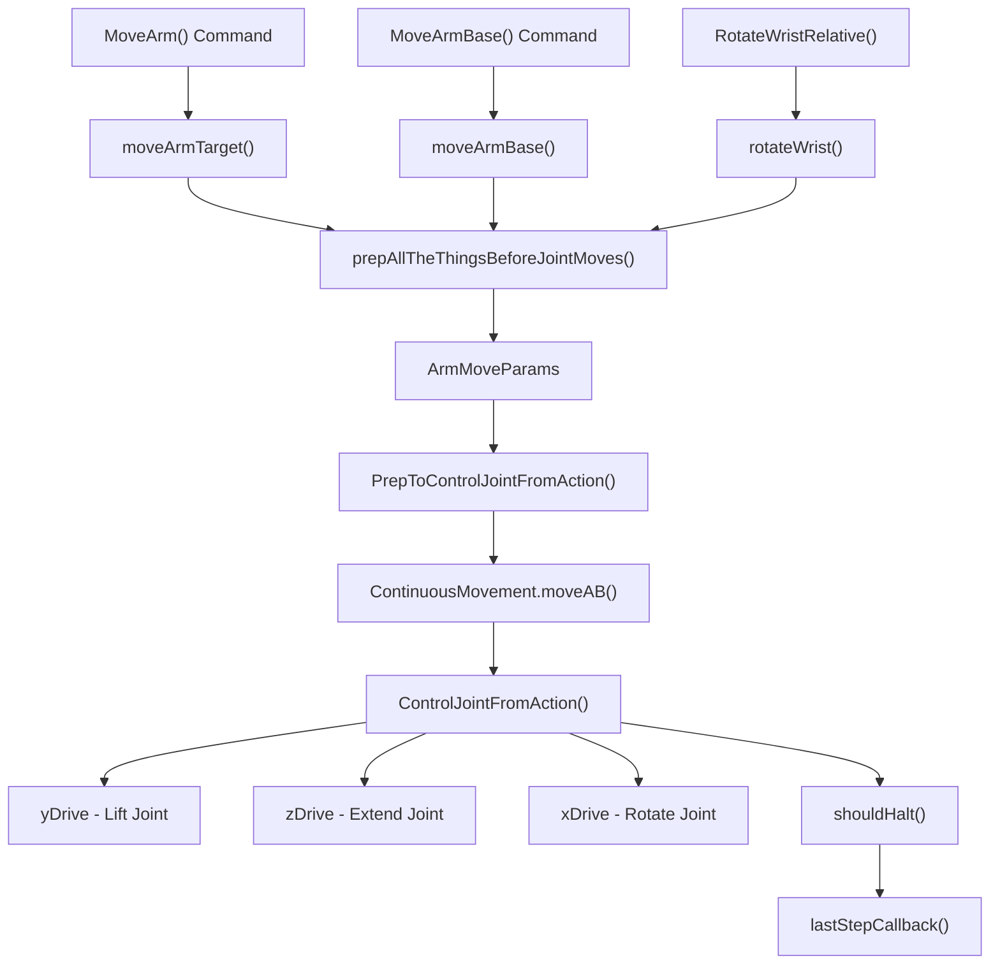
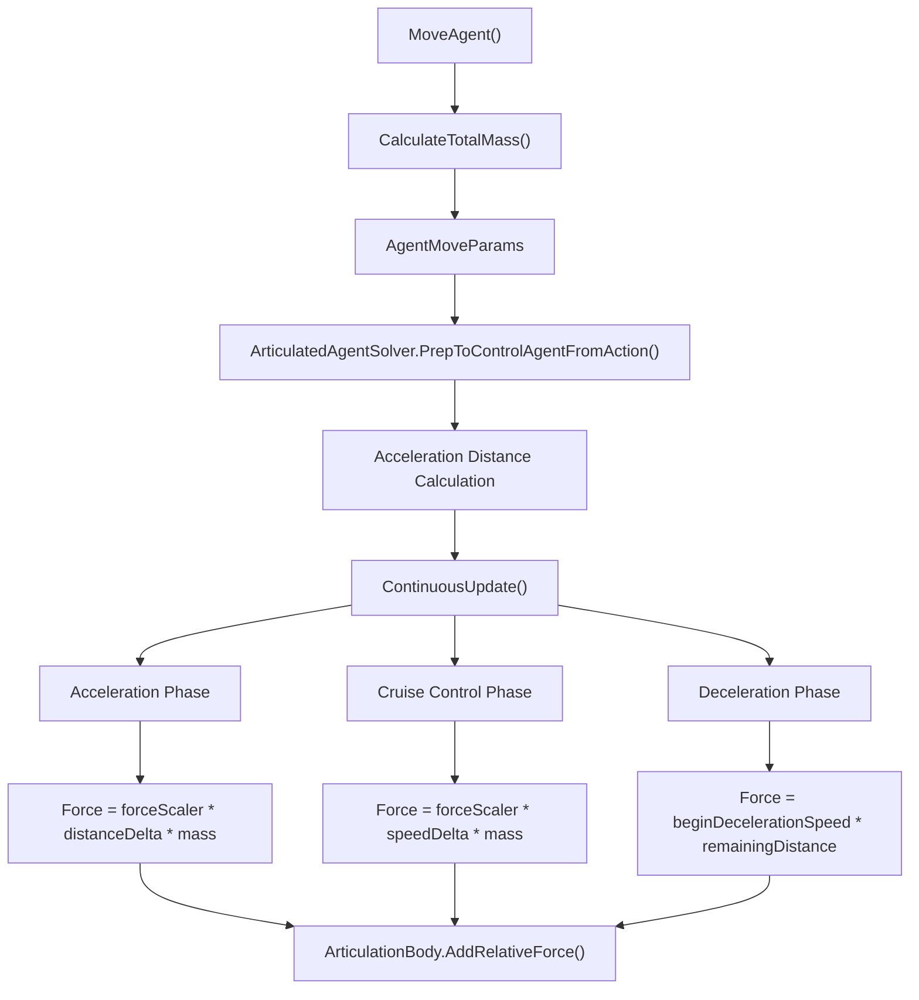
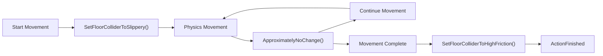
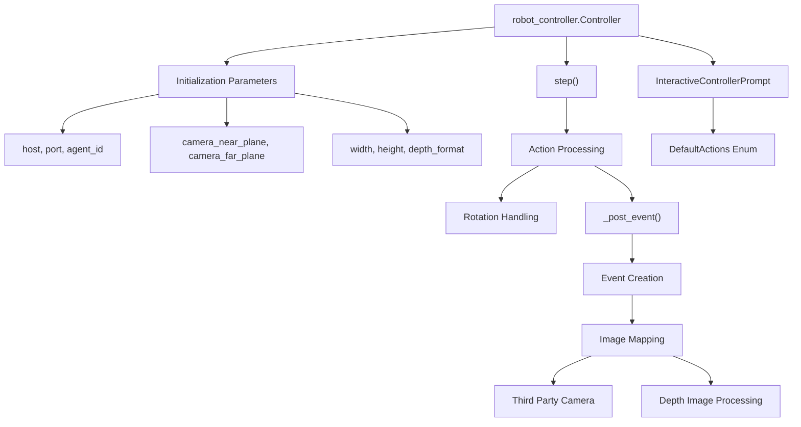
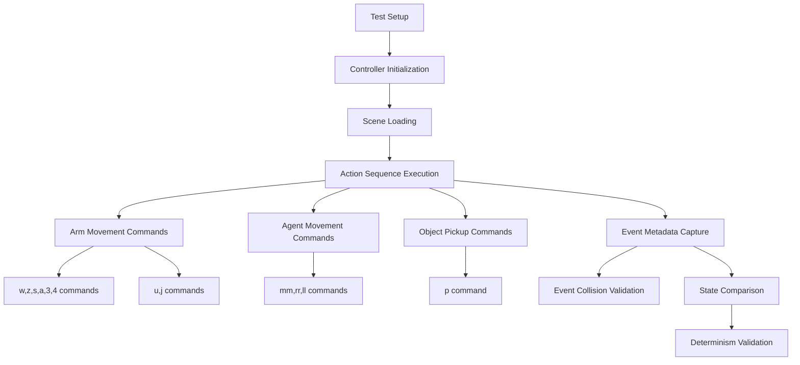

<!-- source: DeepWiki mcp.deepwiki.com · repo allenai/ai2thor · page 5 Specialized Agent Types · fetched 2026-10-30 -->

# Specialized Agent Types

Relevant source files

The following files were used as context for generating this wiki page:

- [ai2thor/interact.py](ai2thor/interact.py)
- [ai2thor/offline_controller.py](ai2thor/offline_controller.py)
- [ai2thor/robot_controller.py](ai2thor/robot_controller.py)
- [ai2thor/tests/data/arm/object_drop.json](ai2thor/tests/data/arm/object_drop.json)
- [ai2thor/tests/data/arm/pickup_object.json](ai2thor/tests/data/arm/pickup_object.json)
- [ai2thor/tests/data/arm/pickup_plate_before_intersect.json](ai2thor/tests/data/arm/pickup_plate_before_intersect.json)
- [ai2thor/tests/data/arm/procthor_train_1.json](ai2thor/tests/data/arm/procthor_train_1.json)
- [ai2thor/tests/data/arm/procthor_train_1_laptop.json](ai2thor/tests/data/arm/procthor_train_1_laptop.json)
- [ai2thor/tests/test_arm.py](ai2thor/tests/test_arm.py)
- [ai2thor/util/scene_yaml_edit.py](ai2thor/util/scene_yaml_edit.py)
- [ai2thor/video_controller.py](ai2thor/video_controller.py)
- [arm_test/arm_counter_30fps_fixed_update.py](arm_test/arm_counter_30fps_fixed_update.py)
- [arm_test/arm_counter_30fps_fixed_update_random_sleep.py](arm_test/arm_counter_30fps_fixed_update_random_sleep.py)
- [arm_test/arm_counter_30fps_simulate.py](arm_test/arm_counter_30fps_simulate.py)
- [arm_test/arm_counter_30fps_simulate_pause_return_start.py](arm_test/arm_counter_30fps_simulate_pause_return_start.py)
- [arm_test/arm_stuck_test.py](arm_test/arm_stuck_test.py)
- [arm_test/arm_stuck_test_wait_frame.py](arm_test/arm_stuck_test_wait_frame.py)
- [arm_test/base.py](arm_test/base.py)
- [arm_test/check_determinism_different_machines.py](arm_test/check_determinism_different_machines.py)
- [arm_test/check_determinism_event_collision_different_machines.py](arm_test/check_determinism_event_collision_different_machines.py)
- [unity/Assets/Plugins/WebGL.jslib](unity/Assets/Plugins/WebGL.jslib)
- [unity/Assets/Scenes/Procedural/ProceduralAB.unity](unity/Assets/Scenes/Procedural/ProceduralAB.unity)
- [unity/Assets/Scripts/ArticulatedAgentController.cs](unity/Assets/Scripts/ArticulatedAgentController.cs)
- [unity/Assets/Scripts/ArticulatedAgentSolver.cs](unity/Assets/Scripts/ArticulatedAgentSolver.cs)
- [unity/Assets/Scripts/ArticulatedArmController.cs](unity/Assets/Scripts/ArticulatedArmController.cs)
- [unity/Assets/Scripts/ArticulatedArmExtender.cs](unity/Assets/Scripts/ArticulatedArmExtender.cs)
- [unity/Assets/Scripts/ArticulatedArmExtender.cs.meta](unity/Assets/Scripts/ArticulatedArmExtender.cs.meta)
- [unity/Assets/Scripts/ArticulatedArmJointSolver.cs](unity/Assets/Scripts/ArticulatedArmJointSolver.cs)
- [unity/Assets/Scripts/JavaScriptInterface.cs](unity/Assets/Scripts/JavaScriptInterface.cs)
- [unity/Assets/Scripts/NavMeshSetup.cs](unity/Assets/Scripts/NavMeshSetup.cs)
- [unity/Assets/Standard Assets/Characters/FirstPersonCharacter/Prefabs/ArticulatedFPSController.prefab](unity/Assets/Standard Assets/Characters/FirstPersonCharacter/Prefabs/ArticulatedFPSController.prefab)
- [unity/Assets/UnitTests/TestStretchArmMeta.cs](unity/Assets/UnitTests/TestStretchArmMeta.cs)
- [unity/Assets/WebGLTemplates/HideNSeek/TemplateData/script.js](unity/Assets/WebGLTemplates/HideNSeek/TemplateData/script.js)
- [unity/ProjectSettings/DynamicsManager.asset](unity/ProjectSettings/DynamicsManager.asset)
- [unity/ProjectSettings/TagManager.asset](unity/ProjectSettings/TagManager.asset)
- [unity/debug/test-arm-half-3.json](unity/debug/test-arm-half-3.json)
- [unity/debug/test-arm-half-limits-3.json](unity/debug/test-arm-half-limits-3.json)

This document covers the specialized agent implementations in AI2-THOR that extend beyond the basic `BaseFPSAgentController` functionality. These agents provide domain-specific capabilities such as robotic arm manipulation, articulated body physics, and specialized movement patterns. For core agent functionality and the base agent hierarchy, see [Core Agent System](#3).

## Agent Specialization Hierarchy

The specialized agents in AI2-THOR form an inheritance hierarchy that builds upon the base physics-enabled agent controller to provide specific capabilities for different use cases.

**Sources:** [unity/Assets/Scripts/ArticulatedAgentController.cs:11-16](), [unity/Assets/Scripts/ArticulatedArmController.cs:8]()

## ArticulatedAgentController System

The `ArticulatedAgentController` represents the most sophisticated specialized agent implementation, designed for realistic robotic arm simulation using Unity's Articulation Body physics system.

### Core Components Architecture

**Sources:** [unity/Assets/Scripts/ArticulatedAgentController.cs:11-17](), [unity/Assets/Scripts/ArticulatedArmController.cs:131-140](), [unity/Assets/Scripts/ArticulatedAgentSolver.cs:36]()

### Articulation Body Physics Integration

The articulated agent uses Unity's `ArticulationBody` system for realistic physics simulation, requiring specialized initialization and movement handling.

**Sources:** [unity/Assets/Scripts/ArticulatedAgentController.cs:45-129](), [unity/Assets/Scripts/ArticulatedAgentController.cs:297-307](), [unity/Assets/Scripts/ArticulatedAgentSolver.cs:73-115]()

## Articulated Arm Control System

The arm control system manages complex multi-joint robotic arm movements through a hierarchical joint solver architecture.

### Joint Control Architecture

**Sources:** [unity/Assets/Scripts/ArticulatedArmController.cs:150-202](), [unity/Assets/Scripts/ArticulatedArmJointSolver.cs:72-131](), [unity/Assets/Scripts/ArticulatedArmJointSolver.cs:133-397]()

### Joint Movement State Management

The joint solver system manages individual joint states and coordinates movement across multiple degrees of freedom.

| Joint Type | Enum State | Drive Axis | Movement Range |
|------------|------------|------------|----------------|
| Lift | `ArmLiftState` | yDrive | -0.1832155f to 0.9177839f |
| Extend | `ArmExtendState` | zDrive | 0.0f to 0.516f |
| Rotate | `ArmRotateState` | xDrive | Unlimited rotation |

**Sources:** [unity/Assets/Scripts/ArticulatedArmJointSolver.cs:7-30](), [unity/Assets/Scripts/ArticulatedArmJointSolver.cs:63-67]()

## Agent Movement and Physics

### Continuous Movement System

The articulated agent implements sophisticated continuous movement with physics-based acceleration and deceleration.

**Sources:** [unity/Assets/Scripts/ArticulatedAgentController.cs:559-610](), [unity/Assets/Scripts/ArticulatedAgentSolver.cs:117-367]()

### Physics State Management

The system manages physics state transitions and collision handling through friction control and halt detection.

**Sources:** [unity/Assets/Scripts/ArticulatedAgentController.cs:256-267](), [unity/Assets/Scripts/ArticulatedAgentController.cs:146-151](), [unity/Assets/Scripts/ArticulatedAgentSolver.cs:476-498]()

## Robot Controller Integration

The Python `robot_controller.py` provides a simplified interface for robotic agent interaction, particularly useful for testing and validation.

### Robot Controller Architecture

**Sources:** [ai2thor/robot_controller.py:15-62](), [ai2thor/robot_controller.py:85-181](), [ai2thor/robot_controller.py:183-198]()

## Testing and Validation Systems

### Determinism Testing Framework

Specialized agents require extensive determinism testing to ensure reproducible behavior across different machines and configurations.

**Sources:** [arm_test/check_determinism_different_machines.py:95-142](), [arm_test/check_determinism_event_collision_different_machines.py:50-142]()

### Arm Manipulation Testing

The testing framework validates complex arm manipulation scenarios including object pickup, collision detection, and state consistency.

| Test Category | Test Functions | Validation Points |
|---------------|----------------|-------------------|
| Object Pickup | `test_arm_pickup_object()` | `heldObjects` metadata |
| Collision Detection | `test_arm_object_intersect()` | Action failure on collision |
| Body Intersection | `test_arm_body_object_intersect()` | State rollback validation |
| Metadata Consistency | `TestStretchArmMeta` | Gripper state tracking |

**Sources:** [ai2thor/tests/test_arm.py:61-82](), [ai2thor/tests/test_arm.py:125-162](), [unity/Assets/UnitTests/TestStretchArmMeta.cs:14-20]()

---

