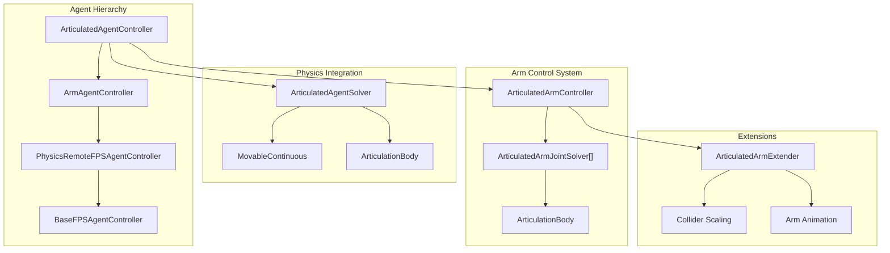
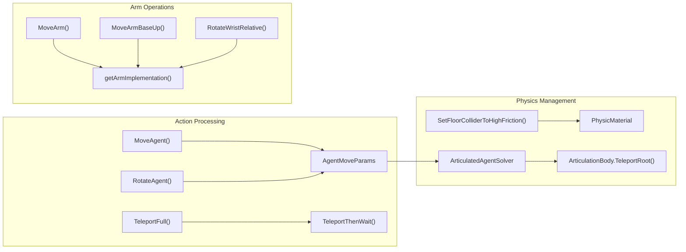
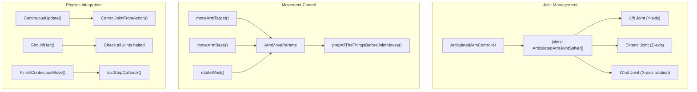
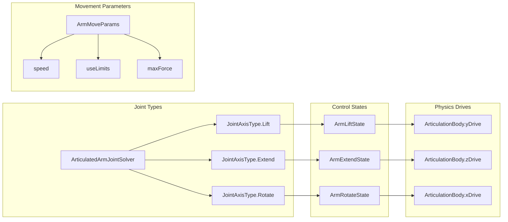
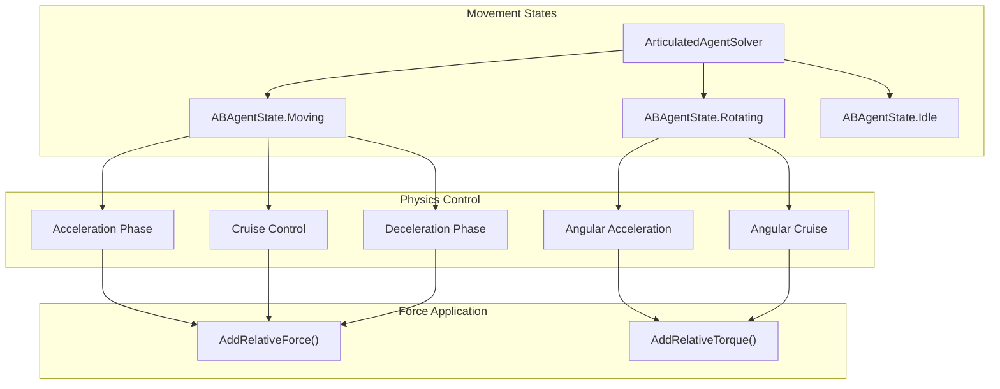
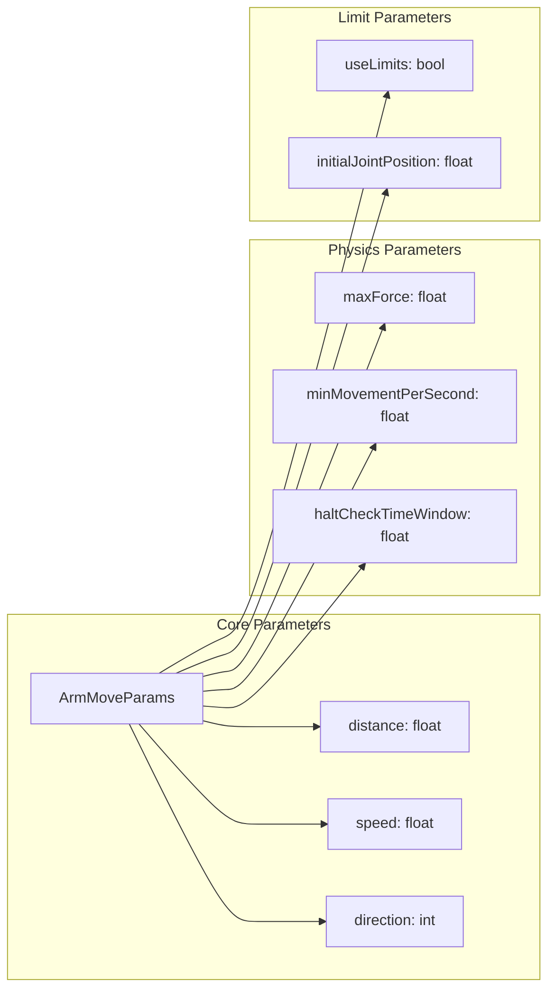
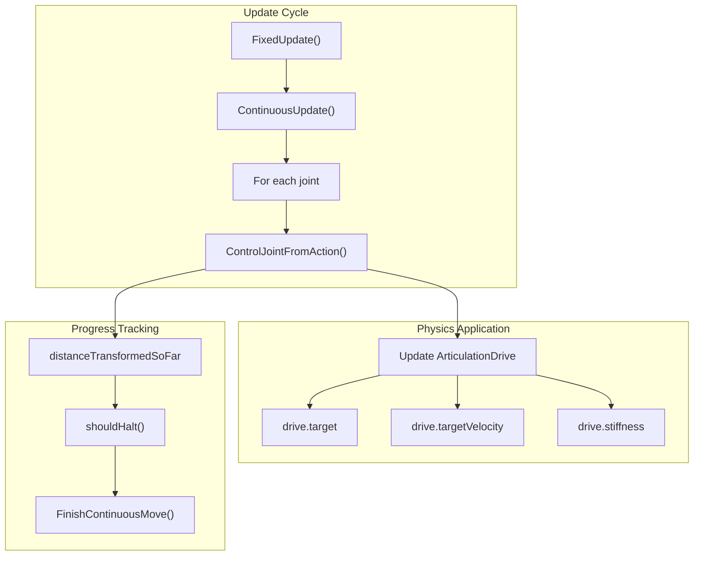
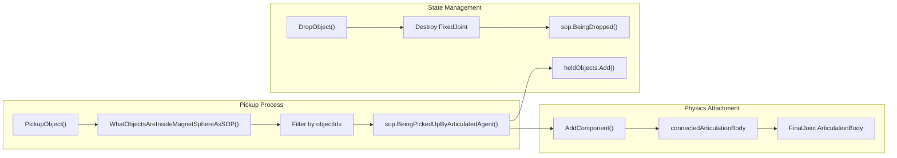
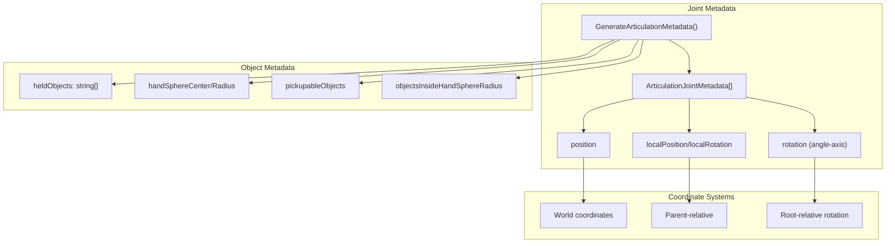
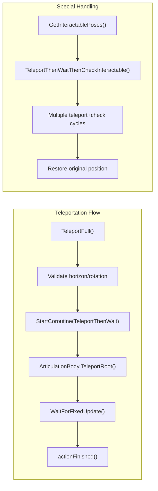

<!-- source: DeepWiki mcp.deepwiki.com · repo allenai/ai2thor · page 5.1 Articulated Agents · fetched 2026-10-30 -->

# Articulated Agents

<details>
<summary>Relevant source files</summary>

The following files were used as context for generating this wiki page:

- [unity/Assets/Scenes/Procedural/ProceduralAB.unity](unity/Assets/Scenes/Procedural/ProceduralAB.unity)
- [unity/Assets/Scripts/ArticulatedAgentController.cs](unity/Assets/Scripts/ArticulatedAgentController.cs)
- [unity/Assets/Scripts/ArticulatedAgentSolver.cs](unity/Assets/Scripts/ArticulatedAgentSolver.cs)
- [unity/Assets/Scripts/ArticulatedArmController.cs](unity/Assets/Scripts/ArticulatedArmController.cs)
- [unity/Assets/Scripts/ArticulatedArmExtender.cs](unity/Assets/Scripts/ArticulatedArmExtender.cs)
- [unity/Assets/Scripts/ArticulatedArmExtender.cs.meta](unity/Assets/Scripts/ArticulatedArmExtender.cs.meta)
- [unity/Assets/Scripts/ArticulatedArmJointSolver.cs](unity/Assets/Scripts/ArticulatedArmJointSolver.cs)
- [unity/Assets/Standard Assets/Characters/FirstPersonCharacter/Prefabs/ArticulatedFPSController.prefab](unity/Assets/Standard Assets/Characters/FirstPersonCharacter/Prefabs/ArticulatedFPSController.prefab)
- [unity/ProjectSettings/DynamicsManager.asset](unity/ProjectSettings/DynamicsManager.asset)
- [unity/ProjectSettings/TagManager.asset](unity/ProjectSettings/TagManager.asset)
- [unity/debug/test-arm-half-3.json](unity/debug/test-arm-half-3.json)
- [unity/debug/test-arm-half-limits-3.json](unity/debug/test-arm-half-limits-3.json)

</details>


This document covers the ArticulatedAgentController system, which provides physics-based robotic agent simulation using Unity's ArticulationBody framework. This system enables realistic robotic manipulation and movement with properly simulated joint dynamics, making it suitable for research requiring accurate robotic physics.

For information about other agent types, see [Core Agent System](#3). For arm manipulation in general, see [Robot Controller and Testing](#5.2).

## System Overview

The Articulated Agents system implements a complete robotic agent using Unity's ArticulationBody physics system instead of traditional Rigidbody physics. This provides more accurate simulation of robotic joints, constraints, and dynamics suitable for research applications requiring realistic robotic behavior.



**Articulated Agent System Architecture**

The system consists of four main components working together to provide realistic robotic simulation with proper joint physics and constraints.

Sources: [unity/Assets/Scripts/ArticulatedAgentController.cs:1-798](), [unity/Assets/Scripts/ArticulatedArmController.cs:1-609]()

## Core Components

### ArticulatedAgentController

The `ArticulatedAgentController` serves as the main entry point for articulated agent functionality. It inherits from `ArmAgentController` and coordinates between agent movement, arm control, and physics simulation.



**ArticulatedAgentController Action Flow**

The controller manages high-level actions and delegates to appropriate subsystems while handling ArticulationBody-specific requirements.

Key responsibilities include:
- **Action Coordination**: Processes movement and manipulation commands
- **Physics Management**: Controls floor friction and ArticulationBody teleportation
- **Arm Integration**: Delegates arm operations to `ArticulatedArmController`
- **Visibility Checks**: Handles `GetInteractablePoses` with coroutine-based teleportation

Sources: [unity/Assets/Scripts/ArticulatedAgentController.cs:11-144](), [unity/Assets/Scripts/ArticulatedAgentController.cs:269-307]()

### ArticulatedArmController

The `ArticulatedArmController` manages robotic arm functionality through a collection of joint solvers. It implements physics-based arm movement with proper joint limits and continuous control.



**ArticulatedArmController Joint Control System**

The arm controller coordinates multiple joint solvers to achieve complex arm movements while respecting physical constraints.

Key features include:
- **Joint Coordination**: Manages lift, extend, and rotate joints simultaneously
- **Continuous Control**: Updates joint targets each physics frame
- **Limit Enforcement**: Supports optional joint limit checking via `useLimits` parameter
- **Object Manipulation**: Handles pickup/drop with `FixedJoint` attachments

Sources: [unity/Assets/Scripts/ArticulatedArmController.cs:8-144](), [unity/Assets/Scripts/ArticulatedArmController.cs:150-202]()

### ArticulatedArmJointSolver

Individual joint control is handled by `ArticulatedArmJointSolver` components, each managing a specific joint type with appropriate physics parameters and movement logic.



**Joint Solver Architecture and Control Flow**

Each joint solver manages a specific axis of movement with appropriate physics drive configuration and state tracking.

The joint solver implements:
- **Axis-Specific Control**: Different drive configurations for lift (Y), extend (Z), and rotate (X) axes
- **State Management**: Tracks movement state and progress for each joint
- **Limit Enforcement**: Optional upper/lower limits for prismatic joints
- **Halt Detection**: Monitors movement progress to determine completion

Sources: [unity/Assets/Scripts/ArticulatedArmJointSolver.cs:39-131](), [unity/Assets/Scripts/ArticulatedArmJointSolver.cs:133-397]()

### ArticulatedAgentSolver

The `ArticulatedAgentSolver` implements agent body movement using ArticulationBody physics, providing realistic robotic base movement with proper acceleration and damping.



**Agent Solver Movement Control System**

The solver implements sophisticated physics-based movement with proper acceleration profiles and damping for realistic robotic motion.

Key aspects include:
- **Multi-Phase Movement**: Acceleration, cruise, and deceleration phases
- **Damping Forces**: Lateral and forward/backward damping to prevent unwanted drift
- **Angular Control**: Separate logic for rotational movement
- **Force Limiting**: Configurable maximum force application

Sources: [unity/Assets/Scripts/ArticulatedAgentSolver.cs:36-115](), [unity/Assets/Scripts/ArticulatedAgentSolver.cs:117-367]()

## Joint Control and Physics

### Joint Types and Configuration

The system supports three primary joint types, each configured for specific movement axes:

| Joint Type | Axis | ArticulationBody Drive | Description |
|------------|------|----------------------|-------------|
| `JointAxisType.Lift` | Y | `yDrive` | Vertical arm base movement |
| `JointAxisType.Extend` | Z | `zDrive` | Forward/backward arm extension |
| `JointAxisType.Rotate` | X | `xDrive` | Wrist rotation (revolute joint) |

### Movement Parameters

Joint movement is controlled through `ArmMoveParams` containing:



**Movement Parameter Structure**

Parameters control both target movement and physics behavior for realistic joint control.

Sources: [unity/Assets/Scripts/ArticulatedArmJointSolver.cs:32-37](), [unity/Assets/Scripts/ArticulatedArmJointSolver.cs:72-90]()

### Continuous Movement System

The articulated system uses continuous physics updates rather than discrete teleportation:



**Continuous Movement Control Flow**

The system updates joint targets continuously during physics simulation for smooth, realistic movement.

Sources: [unity/Assets/Scripts/ArticulatedArmController.cs:52-97](), [unity/Assets/Scripts/ArticulatedArmJointSolver.cs:133-396]()

## Object Manipulation

### Pickup System

Object pickup uses Unity's `FixedJoint` system for secure attachment:



**Object Manipulation System**

Objects are attached using FixedJoint components connected to the arm's final ArticulationBody for secure physics-based manipulation.

Sources: [unity/Assets/Scripts/ArticulatedArmController.cs:346-401]()

### Metadata Generation

The system provides detailed metadata about joint states and object interactions:



**Metadata Structure for Articulated Arms**

Comprehensive metadata includes joint states, object relationships, and coordinate transformations for research and debugging.

Sources: [unity/Assets/Scripts/ArticulatedArmController.cs:487-589]()

## Physics Integration

### ArticulationBody vs Rigidbody

The articulated system uses Unity's `ArticulationBody` physics system which provides:

- **Realistic Joint Physics**: Proper constraint solving for robotic systems
- **Drive Control**: Position and velocity control for each joint
- **Force Limiting**: Built-in force limits and damping
- **Teleportation Constraints**: Special handling required for position changes

### Teleportation System

ArticulationBody teleportation requires coroutine-based implementation due to Unity's physics synchronization requirements:



**ArticulationBody Teleportation Requirements**

Special coroutine handling is required due to ArticulationBody physics synchronization constraints.

Sources: [unity/Assets/Scripts/ArticulatedAgentController.cs:269-307](), [unity/Assets/Scripts/ArticulatedAgentController.cs:459-557]()

## Configuration and Setup

### Prefab Structure

The `ArticulatedFPSController.prefab` contains the complete agent hierarchy with all required components configured for articulated physics simulation.

### Physics Settings

The system requires specific Unity physics configuration:
- Enhanced Determinism enabled in Physics Settings
- Appropriate solver iterations for stable ArticulationBody simulation
- Proper layer collision matrix for agent interactions

Sources: [unity/Assets/Standard Assets/Characters/FirstPersonCharacter/Prefabs/ArticulatedFPSController.prefab:1-50](), [unity/ProjectSettings/DynamicsManager.asset:34-35]()

## Usage Examples

### Basic Agent Initialization

```json
{
  "action": "Initialize",
  "agentMode": "arm",
  "agentControllerType": "articulated"
}
```

### Arm Movement with Limits

```json
{
  "action": "MoveArmBaseUp", 
  "distance": 0.1,
  "useLimits": true,
  "speed": 0.05
}
```

### Object Manipulation

```json
{
  "action": "PickupObject",
  "objectIds": ["Apple|1|2|3"]
}
```

Sources: [unity/debug/test-arm-half-limits-3.json:1-50]()

---

