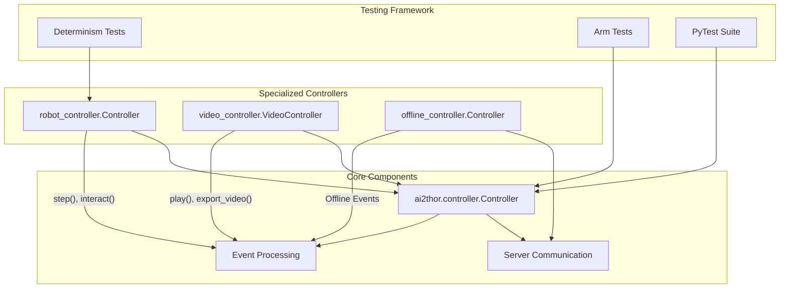
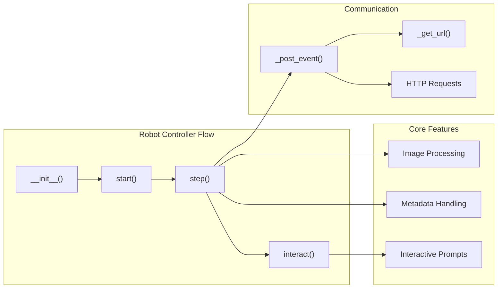
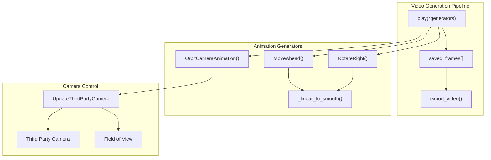
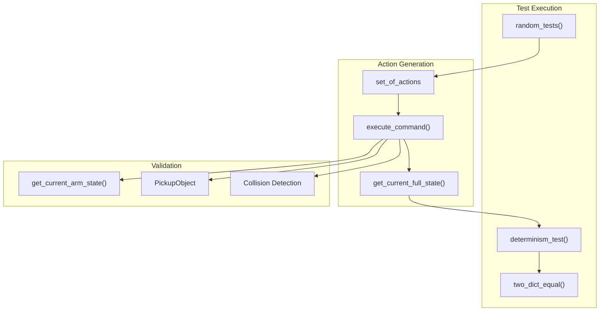
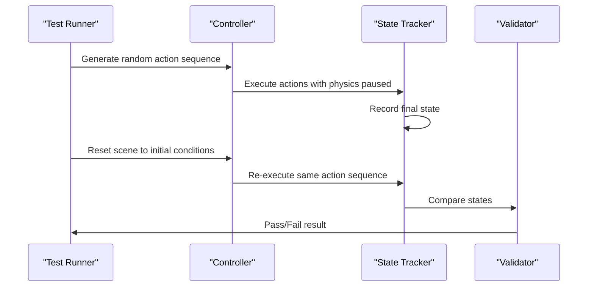
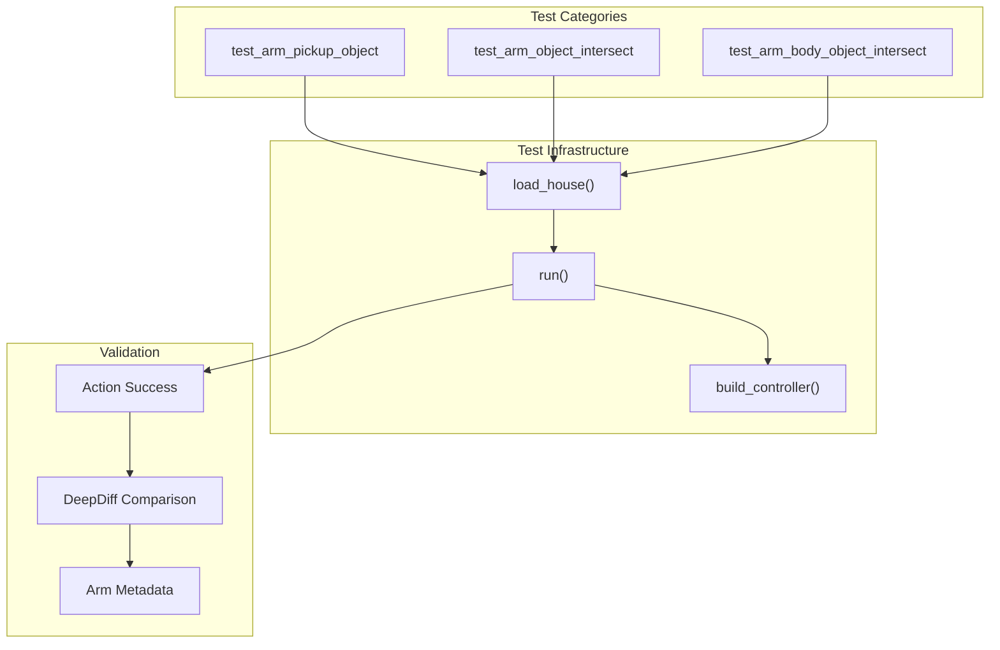
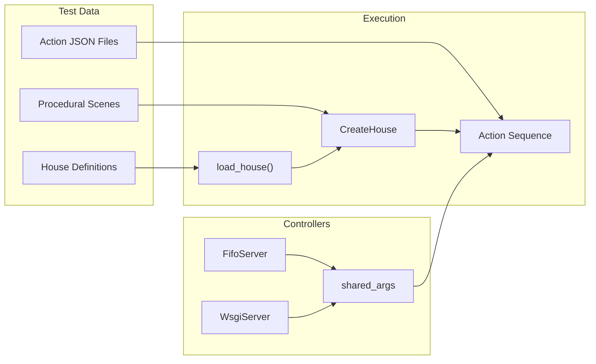
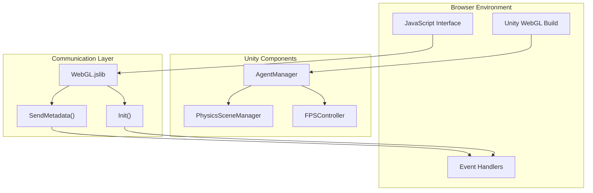

<!-- source: DeepWiki mcp.deepwiki.com · repo allenai/ai2thor · page 5.2 Robot Controller and Testing · fetched 2026-10-30 -->

# Robot Controller and Testing

Relevant source files

The following files were used as context for generating this wiki page:

- [ai2thor/interact.py](ai2thor/interact.py)
- [ai2thor/offline_controller.py](ai2thor/offline_controller.py)
- [ai2thor/robot_controller.py](ai2thor/robot_controller.py)
- [ai2thor/tests/data/arm/object_drop.json](ai2thor/tests/data/arm/object_drop.json)
- [ai2thor/tests/data/arm/pickup_object.json](ai2thor/tests/data/arm/pickup_object.json)
- [ai2thor/tests/data/arm/pickup_plate_before_intersect.json](ai2thor/tests/data/arm/pickup_plate_before_intersect.json)
- [ai2thor/tests/data/arm/procthor_train_1.json](ai2thor/tests/data/arm/procthor_train_1.json)
- [ai2thor/tests/data/arm/procthor_train_1_laptop.json](ai2thor/tests/data/arm/procthor_train_1_laptop.json)
- [ai2thor/tests/test_arm.py](ai2thor/tests/test_arm.py)
- [ai2thor/util/scene_yaml_edit.py](ai2thor/util/scene_yaml_edit.py)
- [ai2thor/video_controller.py](ai2thor/video_controller.py)
- [arm_test/arm_counter_30fps_fixed_update.py](arm_test/arm_counter_30fps_fixed_update.py)
- [arm_test/arm_counter_30fps_fixed_update_random_sleep.py](arm_test/arm_counter_30fps_fixed_update_random_sleep.py)
- [arm_test/arm_counter_30fps_simulate.py](arm_test/arm_counter_30fps_simulate.py)
- [arm_test/arm_counter_30fps_simulate_pause_return_start.py](arm_test/arm_counter_30fps_simulate_pause_return_start.py)
- [arm_test/arm_stuck_test.py](arm_test/arm_stuck_test.py)
- [arm_test/arm_stuck_test_wait_frame.py](arm_test/arm_stuck_test_wait_frame.py)
- [arm_test/base.py](arm_test/base.py)
- [arm_test/check_determinism_different_machines.py](arm_test/check_determinism_different_machines.py)
- [arm_test/check_determinism_event_collision_different_machines.py](arm_test/check_determinism_event_collision_different_machines.py)
- [unity/Assets/Plugins/WebGL.jslib](unity/Assets/Plugins/WebGL.jslib)
- [unity/Assets/Scripts/JavaScriptInterface.cs](unity/Assets/Scripts/JavaScriptInterface.cs)
- [unity/Assets/Scripts/NavMeshSetup.cs](unity/Assets/Scripts/NavMeshSetup.cs)
- [unity/Assets/UnitTests/TestStretchArmMeta.cs](unity/Assets/UnitTests/TestStretchArmMeta.cs)
- [unity/Assets/WebGLTemplates/HideNSeek/TemplateData/script.js](unity/Assets/WebGLTemplates/HideNSeek/TemplateData/script.js)

This document covers specialized controller implementations for robot simulation and comprehensive testing frameworks for validating robotic behavior determinism and arm manipulation capabilities in AI2-THOR. For information about the core articulated agent controllers and robotic arm simulation, see [Articulated Agents](#5.1). For interactive debugging tools, see [Debug and Development Tools](#5.3).

## Controller Variants for Robot Applications

AI2-THOR provides several specialized controller implementations beyond the main `Controller` class, each designed for specific robot control and testing scenarios.

### Robot Controller Architecture

**Robot Controller Components**

| Controller | Purpose | Key Features |
|------------|---------|--------------|
| `robot_controller.Controller` | Simplified robot interface | Basic movement, image handling, interactive prompts |
| `video_controller.VideoController` | Video generation | Smooth animations, camera control, video export |
| `offline_controller.Controller` | Pre-recorded data | Offline simulation, cached events, no Unity required |

Sources: [ai2thor/robot_controller.py:15-219](), [ai2thor/video_controller.py:22-362](), [ai2thor/offline_controller.py:19-247]()

### Robot Controller Implementation

The `robot_controller.Controller` provides a simplified interface for basic robot control scenarios:

Key capabilities include:
- **Basic Movement**: Standard agent actions like `MoveAhead`, `RotateLeft`, `LookUp`
- **Image Handling**: RGB, depth, and third-party camera processing 
- **Interactive Mode**: Terminal-based control with `InteractiveControllerPrompt`
- **Simplified API**: Reduced complexity compared to full `Controller`

Sources: [ai2thor/robot_controller.py:15-61](), [ai2thor/robot_controller.py:85-181](), [ai2thor/robot_controller.py:183-198]()

### Video Controller for Demonstrations

The `VideoController` extends the base controller to create smooth video demonstrations:

Features:
- **Smooth Animations**: Gaussian-smoothed movement curves via `_linear_to_smooth()`
- **Camera Orbiting**: `OrbitCameraAnimation()` for cinematic shots
- **Multi-Action Support**: Concurrent agent and camera movement
- **Video Export**: Direct MP4 output with OpenCV

Sources: [ai2thor/video_controller.py:54-92](), [ai2thor/video_controller.py:192-220](), [ai2thor/video_controller.py:322-339]()

## Determinism Testing Framework

A comprehensive testing framework ensures robot behaviors are deterministic across different execution environments and hardware configurations.

### Test Architecture

**Test Configuration**

| Parameter | Value | Purpose |
|-----------|-------|---------|
| `MAX_TESTS` | 20 | Number of random test sequences |
| `MAX_EP_LEN` | 100 | Maximum actions per episode |
| `set_of_actions` | `["mm", "rr", "ll", "w", "z", "a", "s", "u", "j", "3", "4", "p"]` | Available robot actions |

Sources: [arm_test/check_determinism_different_machines.py:17-21](), [arm_test/check_determinism_different_machines.py:250-322]()

### Determinism Validation Process

The framework tests determinism by:
1. **Random Generation**: Creating sequences of robot actions in random scenes
2. **State Capture**: Recording complete arm joint positions, agent location, held objects
3. **Replay Execution**: Re-running identical action sequences
4. **Precise Comparison**: Floating-point comparison with 0.001 tolerance

Key validation functions:
- `get_current_full_state()`: Captures agent position, rotation, arm joints, held objects
- `two_dict_equal()`: Recursive comparison with NaN and float handling
- `execute_command()`: Translates command strings to Unity actions

Sources: [arm_test/check_determinism_different_machines.py:325-369](), [arm_test/check_determinism_different_machines.py:200-248](), [arm_test/check_determinism_different_machines.py:95-174]()

## Arm Manipulation Testing

Specialized testing validates robotic arm functionality including pickup, movement, and collision detection.

### Arm Test Suite Architecture

**Test Scenarios**

| Test | Description | Validation |
|------|-------------|------------|
| `test_arm_pickup_object` | Object grasping validation | Checks `heldObjects` contains target |
| `test_arm_object_intersect` | Collision with held objects | Verifies action failure and state rollback |
| `test_arm_body_object_intersect` | Robot body collisions | Tests collision detection with structures |

Sources: [ai2thor/tests/test_arm.py:61-82](), [ai2thor/tests/test_arm.py:85-123](), [ai2thor/tests/test_arm.py:126-173]()

### Test Data and Execution

The test framework uses procedural scenes and predefined action sequences:

Test execution features:
- **Procedural Houses**: Complex 3D environments from `procthor_train_1.json`
- **Action Sequences**: Pre-recorded manipulation sequences in JSON format
- **Multi-Server Support**: Tests run on both FIFO and WSGI servers
- **Metadata Validation**: Deep comparison of arm state before/after failed actions

Sources: [ai2thor/tests/test_arm.py:22-38](), [ai2thor/tests/test_arm.py:41-57](), [ai2thor/tests/test_arm.py:48-57]()

## WebGL Robot Interface

The WebGL interface enables browser-based robot control with JavaScript integration.

### WebGL Communication Architecture

**WebGL Integration Points**

| Component | Function | Purpose |
|-----------|----------|---------|
| `JavaScriptInterface.cs` | Unity→JavaScript bridge | Metadata transmission, action processing |
| `WebGL.jslib` | JavaScript library | Native function bindings |
| `script.js` | Web application logic | Robot control interface, Turk integration |

The interface supports:
- **Real-time Control**: Direct robot manipulation from browser
- **Metadata Streaming**: Live simulation state updates 
- **Action Processing**: JSON action commands to Unity
- **Video Integration**: Recording and playback capabilities

Sources: [unity/Assets/Scripts/JavaScriptInterface.cs:23-73](), [unity/Assets/Plugins/WebGL.jslib:3-14](), [unity/Assets/WebGLTemplates/HideNSeek/TemplateData/script.js:70-73]()

---

