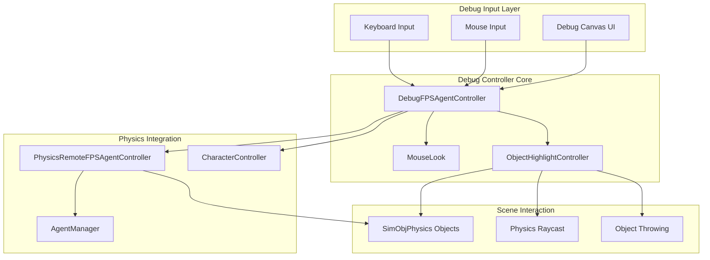
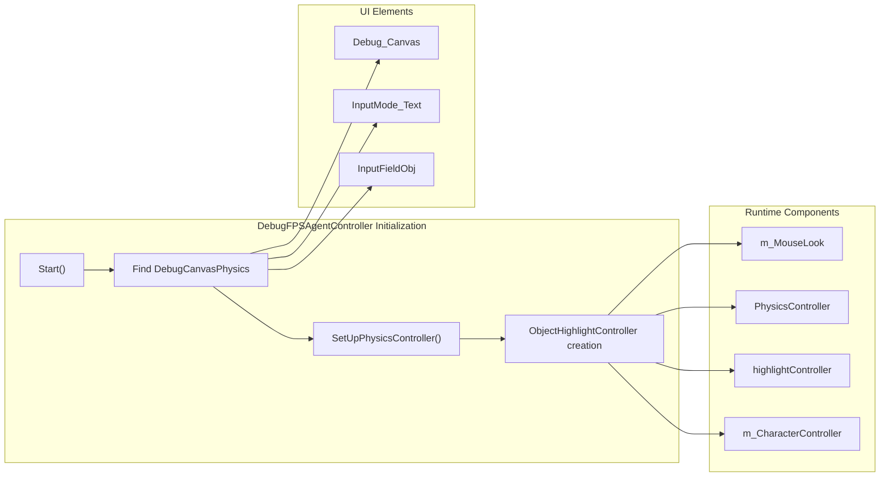
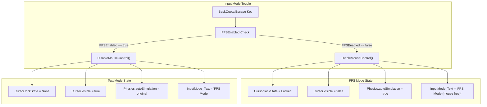
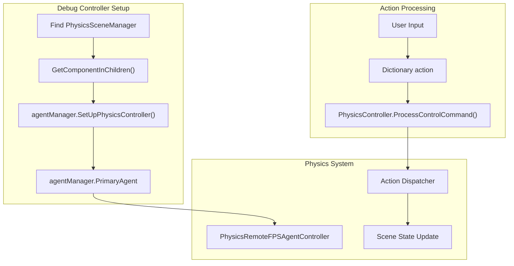
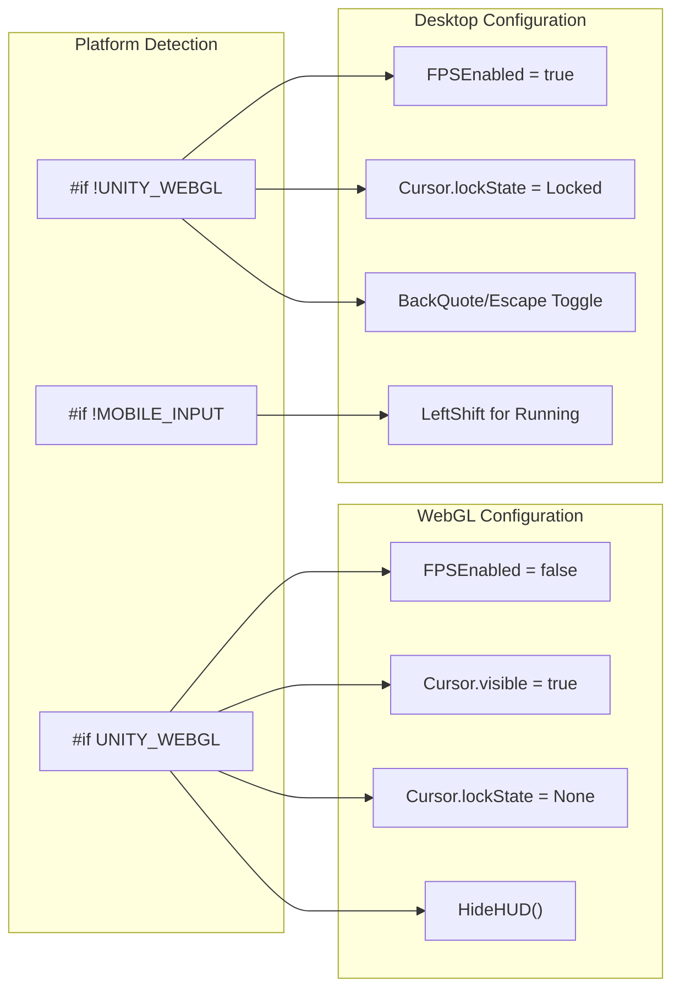

<!-- source: DeepWiki mcp.deepwiki.com · repo allenai/ai2thor · page 5.3 Debug and Development Tools · fetched 2026-10-30 -->

# Debug and Development Tools

<details>
<summary>Relevant source files</summary>

The following files were used as context for generating this wiki page:

- [unity/Assets/Scripts/DebugFPSAgentController.cs](unity/Assets/Scripts/DebugFPSAgentController.cs)

</details>


This document covers the debug and development tools provided by AI2-THOR for interactive testing, development, and debugging of agent behaviors and scene interactions. The primary focus is on the `DebugFPSAgentController` system which provides first-person interactive controls for manual scene exploration and testing.

For information about automated testing and validation tools, see [Robot Controller and Testing](#5.2). For details about the core agent system architecture, see [Agent Controllers](#3.1).

## Overview

The debug system enables developers to manually control an agent in the simulation environment using keyboard and mouse input, providing immediate feedback for testing agent actions, scene interactions, and object behaviors. This is primarily implemented through the `DebugFPSAgentController` class which provides a bridge between manual user input and the underlying physics simulation system.



Sources: [unity/Assets/Scripts/DebugFPSAgentController.cs:1-327]()

## DebugFPSAgentController Architecture

The `DebugFPSAgentController` serves as the primary debug interface, inheriting from `MonoBehaviour` and integrating with multiple Unity systems to provide comprehensive manual control capabilities.

### Core Components

| Component | Purpose | Integration Point |
|-----------|---------|-------------------|
| `MouseLook` | Camera rotation control | Direct mouse input translation |
| `ObjectHighlightController` | Object selection and interaction | Physics raycast system |
| `CharacterController` | Movement and collision | Unity's built-in character physics |
| `PhysicsRemoteFPSAgentController` | Action execution | Primary agent system integration |



Sources: [unity/Assets/Scripts/DebugFPSAgentController.cs:68-108]()

## Input Handling and Control Modes

The debug controller supports two primary control modes that can be toggled during runtime to accommodate different debugging needs.

### Control Mode Management

The system manages two distinct input states:

- **FPS Mode**: Full mouse and keyboard control with cursor locked
- **Text Input Mode**: Mouse cursor visible for UI interaction



Sources: [unity/Assets/Scripts/DebugFPSAgentController.cs:194-206](), [unity/Assets/Scripts/DebugFPSAgentController.cs:160-179]()

### Movement and Camera Controls

The FPS input system translates WASD keyboard input and mouse movement into agent actions through the Unity `CharacterController` and camera rotation systems.

| Input Type | Mapping | Implementation |
|------------|---------|----------------|
| WASD Keys | Agent movement | `CrossPlatformInputManager.GetAxis()` |
| Mouse Delta | Camera rotation | `MouseLook.LookRotation()` |
| Left Shift | Walk/Run toggle | `m_IsWalking` state modification |
| Mouse Scroll | Hand movement | `MoveHandDelta`/`MoveHandAhead` actions |

Sources: [unity/Assets/Scripts/DebugFPSAgentController.cs:264-284](), [unity/Assets/Scripts/DebugFPSAgentController.cs:290-292](), [unity/Assets/Scripts/DebugFPSAgentController.cs:209-222]()

## Object Interaction System

The debug controller integrates with the `ObjectHighlightController` to provide intuitive object selection and manipulation capabilities.

### Highlight and Selection

```mermaid
graph TB
    subgraph "Object Detection"
        SCREEN_CENTER["Screen Center (width/2, height/2)"]
        UPDATE_HIGHLIGHT["UpdateHighlightedObject()"]
        RAYCAST_HIT["Physics Raycast"]
    end
    
    subgraph "Interaction Controls"
        MOUSE_CONTROLS["MouseControls()"]
        THROW_ENABLED["ThrowEnabled State"]
        INPUT_FOCUS["InputField Focus Check"]
    end
    
    subgraph "Hand Movement"
        SCROLL_1D["1D Scroll (Mouse ScrollWheel)"]
        SCROLL_2D["2D Scroll (OnGUI ScrollWheel)"]
        MOVE_HAND_AHEAD["MoveHandAhead Action"]
        MOVE_HAND_DELTA["MoveHandDelta Action"]
    end
    
    SCREEN_CENTER --> UPDATE_HIGHLIGHT
    UPDATE_HIGHLIGHT --> RAYCAST_HIT
    
    MOUSE_CONTROLS --> THROW_ENABLED
    INPUT_FOCUS --> THROW_ENABLED
    
    SCROLL_1D --> MOVE_HAND_AHEAD
    SCROLL_2D --> MOVE_HAND_DELTA
    
    MOVE_HAND_AHEAD --> "PhysicsController.ProcessControlCommand()"
    MOVE_HAND_DELTA --> "PhysicsController.ProcessControlCommand()"
```

Sources: [unity/Assets/Scripts/DebugFPSAgentController.cs:225-230](), [unity/Assets/Scripts/DebugFPSAgentController.cs:182-192](), [unity/Assets/Scripts/DebugFPSAgentController.cs:244-262]()

### Object Throwing System

The debug controller supports object throwing through the `ObjectHighlightController` with configurable force and charge time parameters.

| Parameter | Default Value | Purpose |
|-----------|---------------|---------|
| `MaxThrowForce` | 1000.0f | Maximum throwing force |
| `MaxChargeThrowSeconds` | 1.4f | Maximum charge time |
| `MaxViewDistance` | 5.0f | Object detection range |

Sources: [unity/Assets/Scripts/DebugFPSAgentController.cs:42-48](), [unity/Assets/Scripts/DebugFPSAgentController.cs:84-91]()

## Physics Integration

The debug controller acts as a facade over the `PhysicsRemoteFPSAgentController`, translating user input into structured action commands that are processed by the main physics system.

### Agent Manager Integration



Sources: [unity/Assets/Scripts/DebugFPSAgentController.cs:78-82](), [unity/Assets/Scripts/DebugFPSAgentController.cs:215-221](), [unity/Assets/Scripts/DebugFPSAgentController.cs:251-259]()

## UI and Canvas System

The debug system manages a Unity Canvas-based UI that provides visual feedback and input controls for development workflows.

### Canvas Components

| GameObject Path | Component Type | Purpose |
|----------------|---------------|---------|
| `DebugCanvasPhysics` | Canvas | Main debug UI container |
| `DebugCanvasPhysics/InputModeText` | Text | Current input mode indicator |
| `DebugCanvasPhysics/InputField` | InputField | Text command input |
| `DebugCanvasPhysics/InputModeText_Background` | GameObject | UI background element |

### Platform-Specific Behavior

The debug controller adapts its behavior based on the target platform:



Sources: [unity/Assets/Scripts/DebugFPSAgentController.cs:102-108](), [unity/Assets/Scripts/DebugFPSAgentController.cs:195-206](), [unity/Assets/Scripts/DebugFPSAgentController.cs:271-275]()

## Development Workflow Integration

The debug controller is designed to integrate seamlessly with AI2-THOR development workflows, providing immediate feedback for testing agent behaviors, scene configurations, and object interactions without requiring full programmatic control.

### Typical Usage Pattern

1. **Scene Loading**: Debug controller automatically detects and integrates with the active `AgentManager`
2. **Interactive Testing**: Developers can manually navigate scenes and test object interactions
3. **Action Validation**: User input translates to the same action format used by automated agents
4. **Visual Feedback**: Object highlighting and UI elements provide immediate feedback

This system bridges the gap between automated agent testing and manual verification, enabling rapid iteration on agent behaviors and scene configurations.

Sources: [unity/Assets/Scripts/DebugFPSAgentController.cs:68-108](), [unity/Assets/Scripts/DebugFPSAgentController.cs:225-242]()

---

