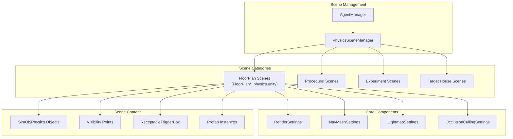
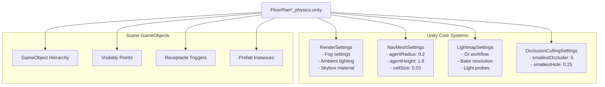
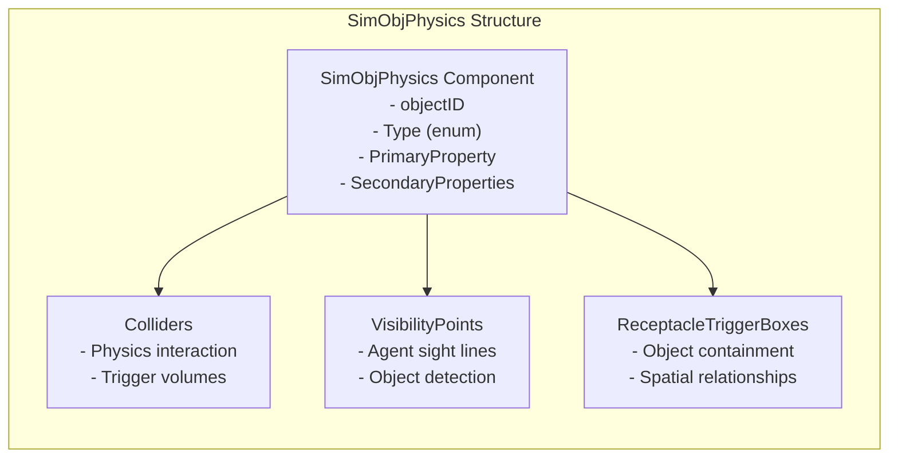
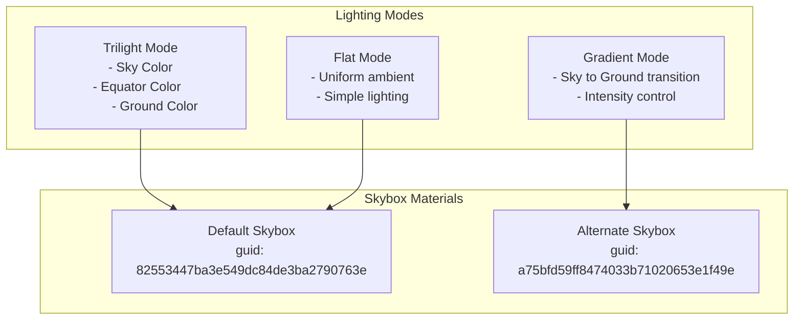

<!-- source: DeepWiki mcp.deepwiki.com · repo allenai/ai2thor · page 6 Scenes and Environments · fetched 2026-10-30 -->

# Scenes and Environments

Relevant source files

The following files were used as context for generating this wiki page:

- [unity/Assets/QuickMaterials/Skyboxes/HDRcubemaps/SkyTreeFarm.mat](unity/Assets/QuickMaterials/Skyboxes/HDRcubemaps/SkyTreeFarm.mat)
- [unity/Assets/QuickMaterials/Skyboxes/HDRcubemaps/SkyTreeFarm.mat.meta](unity/Assets/QuickMaterials/Skyboxes/HDRcubemaps/SkyTreeFarm.mat.meta)
- [unity/Assets/QuickMaterials/SourceTextures/LightWoodCounters.jpg](unity/Assets/QuickMaterials/SourceTextures/LightWoodCounters.jpg)
- [unity/Assets/Resources/ChairsTables_Kitchen.meta](unity/Assets/Resources/ChairsTables_Kitchen.meta)
- [unity/Assets/Resources/ChairsTables_Kitchen/Materials.meta](unity/Assets/Resources/ChairsTables_Kitchen/Materials.meta)
- [unity/Assets/Resources/QuickMaterials/Ceramics/GREYGRANITE.mat](unity/Assets/Resources/QuickMaterials/Ceramics/GREYGRANITE.mat)
- [unity/Assets/Resources/QuickMaterials/Ceramics/SmallKitchenTiles.mat](unity/Assets/Resources/QuickMaterials/Ceramics/SmallKitchenTiles.mat)
- [unity/Assets/Resources/QuickMaterials/Ceramics/TexturesCom_Marble Floor Tiles 1_diffuse_S.mat](unity/Assets/Resources/QuickMaterials/Ceramics/TexturesCom_Marble Floor Tiles 1_diffuse_S.mat)
- [unity/Assets/Resources/QuickMaterials/Ceramics/WhiteBrick.mat](unity/Assets/Resources/QuickMaterials/Ceramics/WhiteBrick.mat)
- [unity/Assets/Resources/QuickMaterials/Ceramics/bathroomTilesGrey.mat](unity/Assets/Resources/QuickMaterials/Ceramics/bathroomTilesGrey.mat)
- [unity/Assets/Resources/QuickMaterials/Fabrics/CarpetWhite 3.mat](unity/Assets/Resources/QuickMaterials/Fabrics/CarpetWhite 3.mat)
- [unity/Assets/Resources/QuickMaterials/Wood/DarkWood2.mat](unity/Assets/Resources/QuickMaterials/Wood/DarkWood2.mat)
- [unity/Assets/Resources/QuickMaterials/Wood/WornWood.mat](unity/Assets/Resources/QuickMaterials/Wood/WornWood.mat)
- [unity/Assets/Scenes/FloorPlan10_physics.unity](unity/Assets/Scenes/FloorPlan10_physics.unity)
- [unity/Assets/Scenes/FloorPlan11_physics.unity](unity/Assets/Scenes/FloorPlan11_physics.unity)
- [unity/Assets/Scenes/FloorPlan12_physics.unity](unity/Assets/Scenes/FloorPlan12_physics.unity)
- [unity/Assets/Scenes/FloorPlan13_physics.unity](unity/Assets/Scenes/FloorPlan13_physics.unity)
- [unity/Assets/Scenes/FloorPlan14_physics.unity](unity/Assets/Scenes/FloorPlan14_physics.unity)
- [unity/Assets/Scenes/FloorPlan15_physics.unity](unity/Assets/Scenes/FloorPlan15_physics.unity)
- [unity/Assets/Scenes/FloorPlan16_physics.unity](unity/Assets/Scenes/FloorPlan16_physics.unity)
- [unity/Assets/Scenes/FloorPlan17_physics.unity](unity/Assets/Scenes/FloorPlan17_physics.unity)
- [unity/Assets/Scenes/FloorPlan18_physics.unity](unity/Assets/Scenes/FloorPlan18_physics.unity)
- [unity/Assets/Scenes/FloorPlan19_physics.unity](unity/Assets/Scenes/FloorPlan19_physics.unity)
- [unity/Assets/Scenes/FloorPlan1_physics.unity](unity/Assets/Scenes/FloorPlan1_physics.unity)
- [unity/Assets/Scenes/FloorPlan20_physics.unity](unity/Assets/Scenes/FloorPlan20_physics.unity)
- [unity/Assets/Scenes/FloorPlan21_physics.unity](unity/Assets/Scenes/FloorPlan21_physics.unity)
- [unity/Assets/Scenes/FloorPlan22_physics.unity](unity/Assets/Scenes/FloorPlan22_physics.unity)
- [unity/Assets/Scenes/FloorPlan23_physics.unity](unity/Assets/Scenes/FloorPlan23_physics.unity)
- [unity/Assets/Scenes/FloorPlan24_physics.unity](unity/Assets/Scenes/FloorPlan24_physics.unity)
- [unity/Assets/Scenes/FloorPlan25_physics.unity](unity/Assets/Scenes/FloorPlan25_physics.unity)
- [unity/Assets/Scenes/FloorPlan26_physics.unity](unity/Assets/Scenes/FloorPlan26_physics.unity)
- [unity/Assets/Scenes/FloorPlan27_physics.unity](unity/Assets/Scenes/FloorPlan27_physics.unity)
- [unity/Assets/Scenes/FloorPlan28_physics.unity](unity/Assets/Scenes/FloorPlan28_physics.unity)
- [unity/Assets/Scenes/FloorPlan29_physics.unity](unity/Assets/Scenes/FloorPlan29_physics.unity)
- [unity/Assets/Scenes/FloorPlan2_physics.unity](unity/Assets/Scenes/FloorPlan2_physics.unity)
- [unity/Assets/Scenes/FloorPlan30_physics.unity](unity/Assets/Scenes/FloorPlan30_physics.unity)
- [unity/Assets/Scenes/FloorPlan3_physics.unity](unity/Assets/Scenes/FloorPlan3_physics.unity)
- [unity/Assets/Scenes/FloorPlan4_physics.unity](unity/Assets/Scenes/FloorPlan4_physics.unity)
- [unity/Assets/Scenes/FloorPlan5_physics.unity](unity/Assets/Scenes/FloorPlan5_physics.unity)
- [unity/Assets/Scenes/FloorPlan6_physics.unity](unity/Assets/Scenes/FloorPlan6_physics.unity)
- [unity/Assets/Scenes/FloorPlan7_physics.unity](unity/Assets/Scenes/FloorPlan7_physics.unity)
- [unity/Assets/Scenes/FloorPlan8_physics.unity](unity/Assets/Scenes/FloorPlan8_physics.unity)
- [unity/Assets/Scenes/FloorPlan9_physics.unity](unity/Assets/Scenes/FloorPlan9_physics.unity)
- [unity/Assets/Scenes/SourceFiles_Procedural/target_house_01_grp.fbx](unity/Assets/Scenes/SourceFiles_Procedural/target_house_01_grp.fbx)
- [unity/Assets/Scenes/SourceFiles_Procedural/target_house_02_grp.fbx](unity/Assets/Scenes/SourceFiles_Procedural/target_house_02_grp.fbx)
- [unity/Assets/Scenes/SourceFiles_Procedural/target_house_03_grp.fbx](unity/Assets/Scenes/SourceFiles_Procedural/target_house_03_grp.fbx)
- [unity/Assets/Scenes/SourceFiles_Procedural/target_house_04_grp.fbx](unity/Assets/Scenes/SourceFiles_Procedural/target_house_04_grp.fbx)
- [unity/Assets/Scenes/SourceFiles_Procedural/target_house_05_grp.fbx](unity/Assets/Scenes/SourceFiles_Procedural/target_house_05_grp.fbx)
- [unity/Assets/Scenes/SourceFiles_Procedural/val_house_01_grp.fbx](unity/Assets/Scenes/SourceFiles_Procedural/val_house_01_grp.fbx)
- [unity/Assets/Scenes/SourceFiles_Procedural/val_house_01_grp.fbx.meta](unity/Assets/Scenes/SourceFiles_Procedural/val_house_01_grp.fbx.meta)
- [unity/Assets/Scenes/SourceFiles_Procedural/val_house_02_grp.fbx](unity/Assets/Scenes/SourceFiles_Procedural/val_house_02_grp.fbx)
- [unity/Assets/Scenes/SourceFiles_Procedural/val_house_02_grp.fbx.meta](unity/Assets/Scenes/SourceFiles_Procedural/val_house_02_grp.fbx.meta)
- [unity/Assets/Scenes/SourceFiles_Procedural/val_house_03_grp.fbx](unity/Assets/Scenes/SourceFiles_Procedural/val_house_03_grp.fbx)

This document covers the scene management and environment configuration system in AI2-THOR. It describes how Unity scenes are structured, configured, and loaded to provide physics-based simulation environments for embodied AI research. This includes the FloorPlan physics scenes, scene components, object placement, and navigation setup.

For information about procedural scene generation, see [Procedural Generation](#6.2). For details about scene assets and 3D models, see [Scene Assets and Models](#6.3). For object interaction behaviors within scenes, see [Object Interaction System](#7).

## Scene Types and Architecture

AI2-THOR uses Unity scenes as the foundation for simulation environments. The system organizes scenes into several categories, each serving different research and testing purposes.

Sources: [unity/Assets/Scenes/FloorPlan1_physics.unity:1-127](), [unity/Assets/Scenes/FloorPlan28_physics.unity:1-126]()

## FloorPlan Physics Scenes

The primary scene type consists of numbered FloorPlan scenes (e.g., `FloorPlan1_physics.unity`, `FloorPlan28_physics.unity`) that represent different room layouts and environments. Each scene is a complete Unity scene file containing all necessary components for physics simulation.

### Scene Structure

Every FloorPlan physics scene follows a standardized structure with core Unity systems:

| Component | Purpose | Configuration |
|-----------|---------|---------------|
| `RenderSettings` | Lighting and visual environment | Fog, ambient lighting, skybox materials |
| `NavMeshSettings` | Agent navigation mesh | Agent radius (0.2), height (1.8), cell size (0.03) |
| `LightmapSettings` | Baked lighting configuration | Resolution, bounce settings, probe usage |
| `OcclusionCullingSettings` | Performance optimization | Smallest occluder/hole thresholds |

Sources: [unity/Assets/Scenes/FloorPlan1_physics.unity:14-103](), [unity/Assets/Scenes/FloorPlan28_physics.unity:14-102]()

### Navigation Mesh Configuration

All FloorPlan scenes use consistent NavMesh settings optimized for agent movement:

- **Agent Radius**: 0.2 units (allows tight navigation)
- **Agent Height**: 1.8 units (standard agent height)
- **Cell Size**: 0.03 units (high precision navigation)
- **Tile Size**: 256 (performance optimization)

Sources: [unity/Assets/Scenes/FloorPlan1_physics.unity:104-127](), [unity/Assets/Scenes/FloorPlan2_physics.unity:104-126]()

## Scene Objects and Components

### SimObjPhysics Objects

Scenes contain interactive objects implemented as `SimObjPhysics` components. These objects have standardized properties and behaviors:

Sources: [unity/Assets/Scenes/FloorPlan1_physics.unity:813-932](), [unity/Assets/Scenes/FloorPlan28_physics.unity:525-658]()

### Visibility Points System

Each interactive object includes multiple visibility points (`vPoint`) that define locations from which agents can observe the object:

- **Naming Convention**: `vPoint`, `vPoint (1)`, `vPoint (2)`, etc.
- **Layer**: 8 (standard visibility layer)
- **StaticEditorFlags**: 64 (marked as static for optimization)
- **Purpose**: Agent line-of-sight calculations and object detection

Sources: [unity/Assets/Scenes/FloorPlan1_physics.unity:128-157](), [unity/Assets/Scenes/FloorPlan28_physics.unity:128-157]()

### Receptacle Trigger System

Objects that can contain other objects use `ReceptacleTriggerBox` components:

- **Tag**: "Receptacle" 
- **Trigger Colliders**: Define containment volumes
- **Parent References**: Link to containing `SimObjPhysics` object
- **Spatial Tracking**: Monitor object placement and removal

Sources: [unity/Assets/Scenes/FloorPlan1_physics.unity:748-797](), [unity/Assets/Scenes/FloorPlan28_physics.unity:653-664]()

## Lighting and Rendering Configuration

### Ambient Lighting

Scenes use varied ambient lighting configurations to simulate different times of day and environments:

Sources: [unity/Assets/Scenes/FloorPlan1_physics.unity:23-29](), [unity/Assets/Scenes/FloorPlan28_physics.unity:23-29]()

### Lightmapping Settings

Scenes use real-time lighting with disabled lightmapping for dynamic simulation:

- **EnableBakedLightmaps**: false (dynamic lighting only)
- **EnableRealtimeLightmaps**: false (performance optimization) 
- **GIWorkflowMode**: 0 (iterative workflow)
- **BakeResolution**: 40 (when baking is needed)

Sources: [unity/Assets/Scenes/FloorPlan1_physics.unity:44-103](), [unity/Assets/Scenes/FloorPlan3_physics.unity:44-102]()

## Prefab Integration

Scenes extensively use Unity prefabs for reusable objects and components. Prefab instances maintain references to their source prefabs while allowing per-instance customization:

- **Modification Tracking**: Changes to prefab properties are tracked per instance
- **GUID References**: Prefabs referenced by stable GUIDs
- **Property Overrides**: Position, rotation, scale, and component properties can be overridden
- **Removed Components**: Some prefab components may be selectively removed

Sources: [unity/Assets/Scenes/FloorPlan1_physics.unity:278-381](), [unity/Assets/Scenes/FloorPlan28_physics.unity:467-523]()

---

