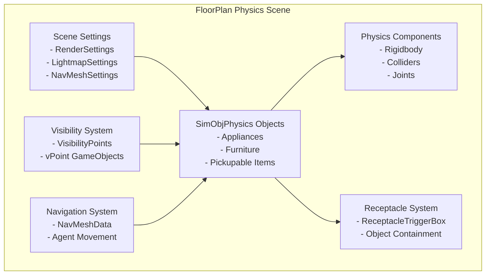
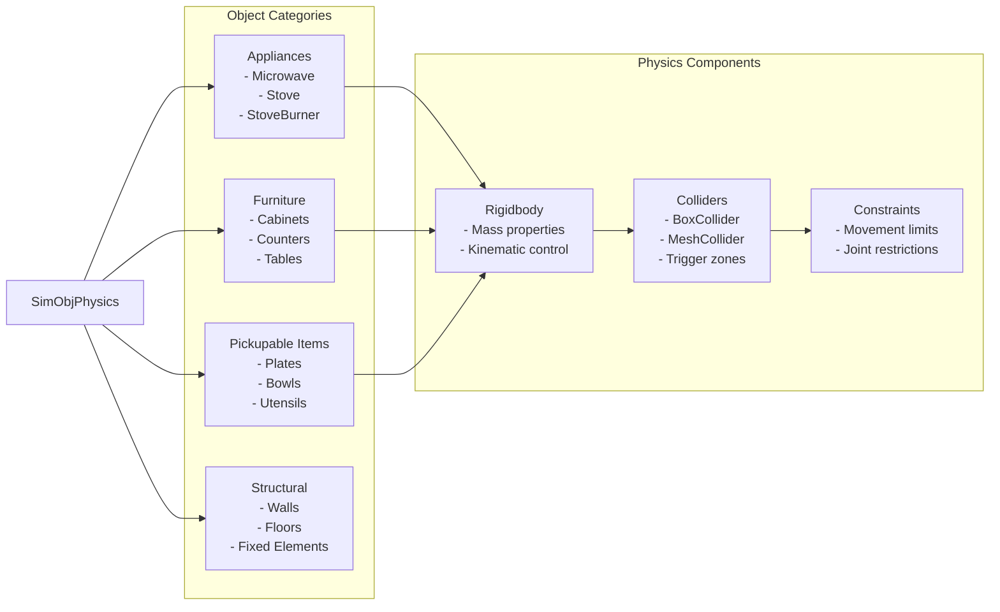
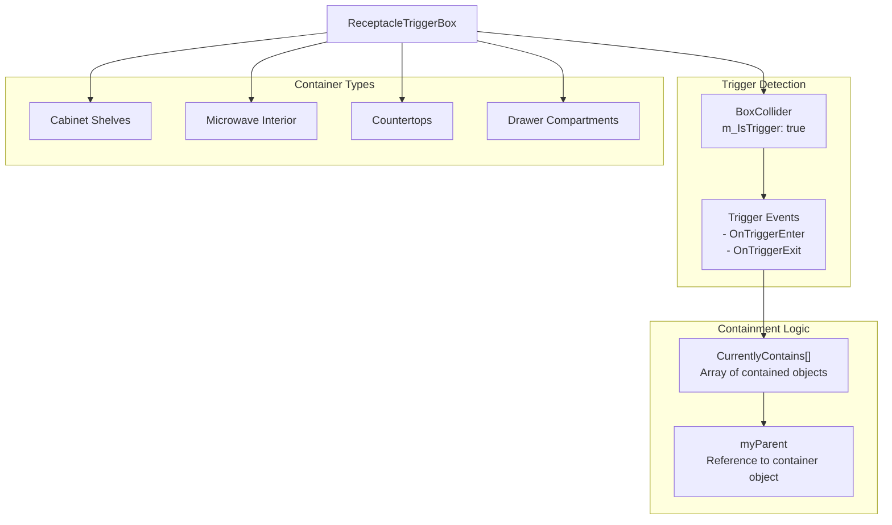
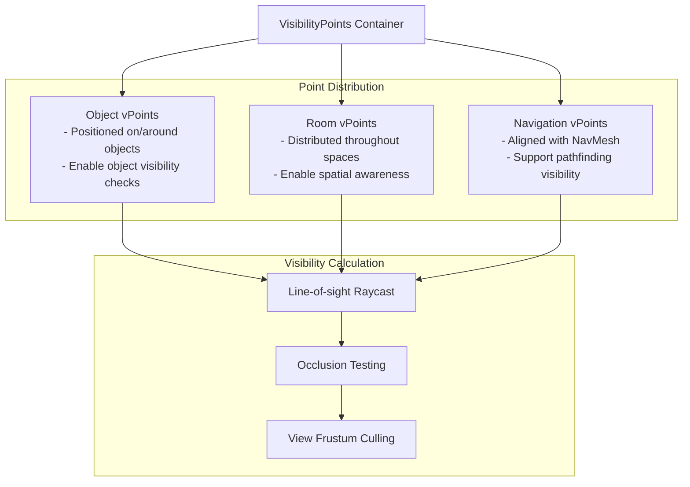

<!-- source: DeepWiki mcp.deepwiki.com · repo allenai/ai2thor · page 6.1 Physics Scenes · fetched 2026-10-30 -->

# Physics Scenes

Relevant source files

The following files were used as context for generating this wiki page:

- [unity/Assets/Scenes/FloorPlan10_physics.unity](unity/Assets/Scenes/FloorPlan10_physics.unity)
- [unity/Assets/Scenes/FloorPlan11_physics.unity](unity/Assets/Scenes/FloorPlan11_physics.unity)
- [unity/Assets/Scenes/FloorPlan12_physics.unity](unity/Assets/Scenes/FloorPlan12_physics.unity)
- [unity/Assets/Scenes/FloorPlan13_physics.unity](unity/Assets/Scenes/FloorPlan13_physics.unity)
- [unity/Assets/Scenes/FloorPlan14_physics.unity](unity/Assets/Scenes/FloorPlan14_physics.unity)
- [unity/Assets/Scenes/FloorPlan15_physics.unity](unity/Assets/Scenes/FloorPlan15_physics.unity)
- [unity/Assets/Scenes/FloorPlan16_physics.unity](unity/Assets/Scenes/FloorPlan16_physics.unity)
- [unity/Assets/Scenes/FloorPlan17_physics.unity](unity/Assets/Scenes/FloorPlan17_physics.unity)
- [unity/Assets/Scenes/FloorPlan18_physics.unity](unity/Assets/Scenes/FloorPlan18_physics.unity)
- [unity/Assets/Scenes/FloorPlan19_physics.unity](unity/Assets/Scenes/FloorPlan19_physics.unity)
- [unity/Assets/Scenes/FloorPlan1_physics.unity](unity/Assets/Scenes/FloorPlan1_physics.unity)
- [unity/Assets/Scenes/FloorPlan20_physics.unity](unity/Assets/Scenes/FloorPlan20_physics.unity)
- [unity/Assets/Scenes/FloorPlan21_physics.unity](unity/Assets/Scenes/FloorPlan21_physics.unity)
- [unity/Assets/Scenes/FloorPlan22_physics.unity](unity/Assets/Scenes/FloorPlan22_physics.unity)
- [unity/Assets/Scenes/FloorPlan23_physics.unity](unity/Assets/Scenes/FloorPlan23_physics.unity)
- [unity/Assets/Scenes/FloorPlan24_physics.unity](unity/Assets/Scenes/FloorPlan24_physics.unity)
- [unity/Assets/Scenes/FloorPlan25_physics.unity](unity/Assets/Scenes/FloorPlan25_physics.unity)
- [unity/Assets/Scenes/FloorPlan26_physics.unity](unity/Assets/Scenes/FloorPlan26_physics.unity)
- [unity/Assets/Scenes/FloorPlan27_physics.unity](unity/Assets/Scenes/FloorPlan27_physics.unity)
- [unity/Assets/Scenes/FloorPlan28_physics.unity](unity/Assets/Scenes/FloorPlan28_physics.unity)
- [unity/Assets/Scenes/FloorPlan29_physics.unity](unity/Assets/Scenes/FloorPlan29_physics.unity)
- [unity/Assets/Scenes/FloorPlan2_physics.unity](unity/Assets/Scenes/FloorPlan2_physics.unity)
- [unity/Assets/Scenes/FloorPlan30_physics.unity](unity/Assets/Scenes/FloorPlan30_physics.unity)
- [unity/Assets/Scenes/FloorPlan3_physics.unity](unity/Assets/Scenes/FloorPlan3_physics.unity)
- [unity/Assets/Scenes/FloorPlan4_physics.unity](unity/Assets/Scenes/FloorPlan4_physics.unity)
- [unity/Assets/Scenes/FloorPlan5_physics.unity](unity/Assets/Scenes/FloorPlan5_physics.unity)
- [unity/Assets/Scenes/FloorPlan6_physics.unity](unity/Assets/Scenes/FloorPlan6_physics.unity)
- [unity/Assets/Scenes/FloorPlan7_physics.unity](unity/Assets/Scenes/FloorPlan7_physics.unity)
- [unity/Assets/Scenes/FloorPlan8_physics.unity](unity/Assets/Scenes/FloorPlan8_physics.unity)
- [unity/Assets/Scenes/FloorPlan9_physics.unity](unity/Assets/Scenes/FloorPlan9_physics.unity)

Physics scenes in AI2-THOR are pre-built Unity environments that provide realistic household settings with fully interactive physics-enabled objects. These scenes serve as the primary simulation environments where agents can navigate, manipulate objects, and perform embodied AI tasks.

For information about procedurally generated scenes, see [Procedural Generation](#6.2). For details about scene assets and 3D models, see [Scene Assets and Models](#6.3).

## Scene Overview and Architecture

Physics scenes are Unity scene files named with the pattern `FloorPlan{N}_physics.unity`, where N represents the scene number. Each scene contains a complete household environment with multiple rooms, furniture, appliances, and interactive objects that follow realistic physics constraints.

Sources: [unity/Assets/Scenes/FloorPlan1_physics.unity:1-127](), [unity/Assets/Scenes/FloorPlan28_physics.unity:1-126]()

## Scene Configuration and Settings

Each physics scene contains standardized Unity configuration components that ensure consistent simulation behavior across different environments.

### Core Scene Components

| Component | Purpose | Configuration |
|-----------|---------|---------------|
| `OcclusionCullingSettings` | Rendering optimization | `smallestOccluder: 5`, `smallestHole: 0.25` |
| `RenderSettings` | Lighting and visual quality | Ambient lighting, fog, skybox materials |
| `LightmapSettings` | Pre-computed lighting | Disabled real-time lighting for performance |
| `NavMeshSettings` | Agent navigation | `agentRadius: 0.2`, `agentHeight: 1.8`, `cellSize: 0.03` |

The navigation mesh configuration is specifically tuned for embodied AI agents with standardized dimensions and movement constraints.

Sources: [unity/Assets/Scenes/FloorPlan1_physics.unity:4-126](), [unity/Assets/Scenes/FloorPlan3_physics.unity:104-126]()

## Physics Objects and Interactions

### SimObjPhysics Framework

All interactive objects in physics scenes inherit from the `SimObjPhysics` system, which provides standardized physics behavior and interaction capabilities.

Sources: [unity/Assets/Scenes/FloorPlan1_physics.unity:813-955](), [unity/Assets/Scenes/FloorPlan28_physics.unity:734-778]()

### Object Properties and Behaviors

Interactive objects contain standardized property sets that define their interaction capabilities:

- **IsReceptacle**: Objects that can contain other objects
- **IsPickupable**: Objects that can be grasped and moved by agents  
- **IsOpenable**: Objects with openable components (cabinets, microwaves)
- **IsToggleable**: Objects with on/off states (appliances, lights)
- **IsBreakable**: Objects that can be destroyed through interaction
- **IsFillable**: Objects that can contain liquids or substances

Sources: [unity/Assets/Scenes/FloorPlan1_physics.unity:917-931]()

## Receptacle and Containment System

The receptacle system enables realistic object containment through `ReceptacleTriggerBox` components that detect when objects are placed within containers.

Sources: [unity/Assets/Scenes/FloorPlan1_physics.unity:748-797](), [unity/Assets/Scenes/FloorPlan28_physics.unity:621-651]()

## Visibility and Observation System

### Visibility Points Architecture

Physics scenes contain extensive networks of visibility points (`vPoint` GameObjects) that enable accurate line-of-sight calculations for agent perception.

The visibility system places hundreds of `vPoint` objects throughout each scene at strategic locations to ensure comprehensive visibility coverage for agent perception systems.

Sources: [unity/Assets/Scenes/FloorPlan1_physics.unity:128-157](), [unity/Assets/Scenes/FloorPlan1_physics.unity:188-217](), [unity/Assets/Scenes/FloorPlan28_physics.unity:412-436]()

## Navigation Mesh Integration

Each physics scene includes pre-computed NavMesh data optimized for embodied AI agent navigation with specific parameters tuned for realistic movement constraints.

### NavMesh Configuration

- **Agent Radius**: 0.2 units (realistic human-like agent size)
- **Agent Height**: 1.8 units (standard human height)
- **Agent Slope**: 10 degrees (maximum walkable slope)
- **Agent Climb**: 0.5 units (maximum step height)
- **Cell Size**: 0.03 units (high-resolution pathfinding)

The navigation system integrates with the physics simulation to ensure agents can only navigate through physically accessible areas while respecting collision constraints.

Sources: [unity/Assets/Scenes/FloorPlan1_physics.unity:104-127](), [unity/Assets/Scenes/FloorPlan28_physics.unity:104-126]()

---

