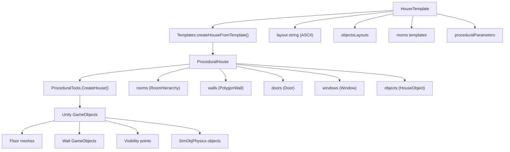
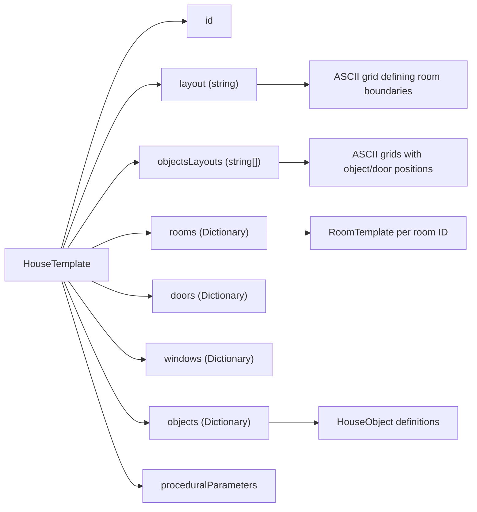
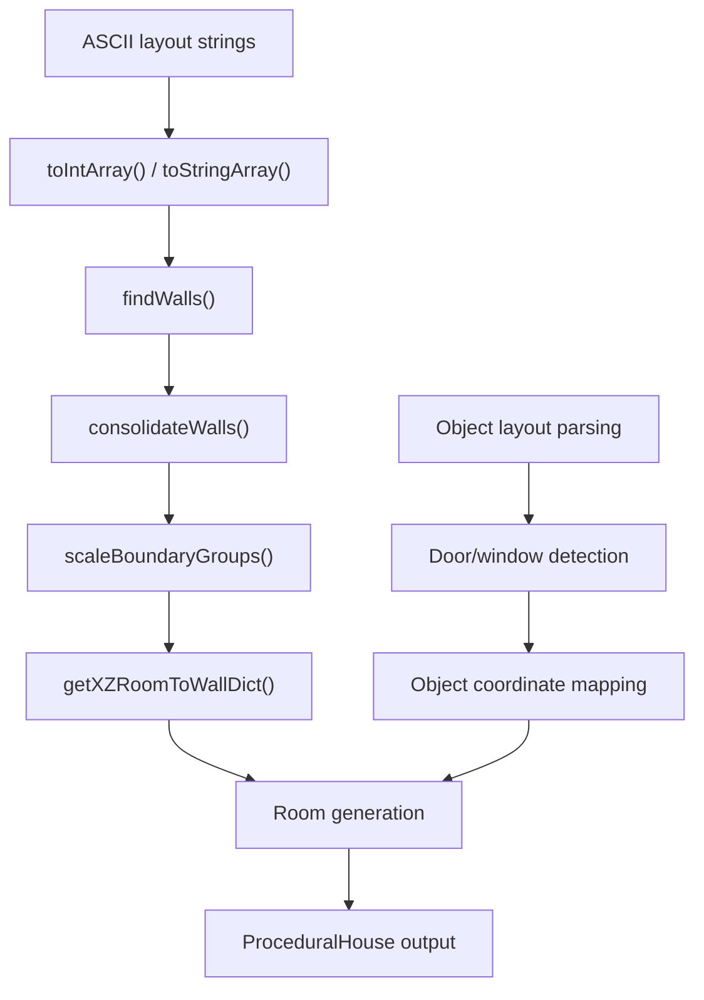
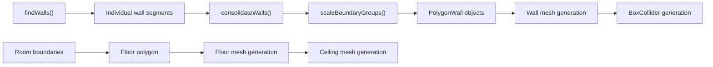
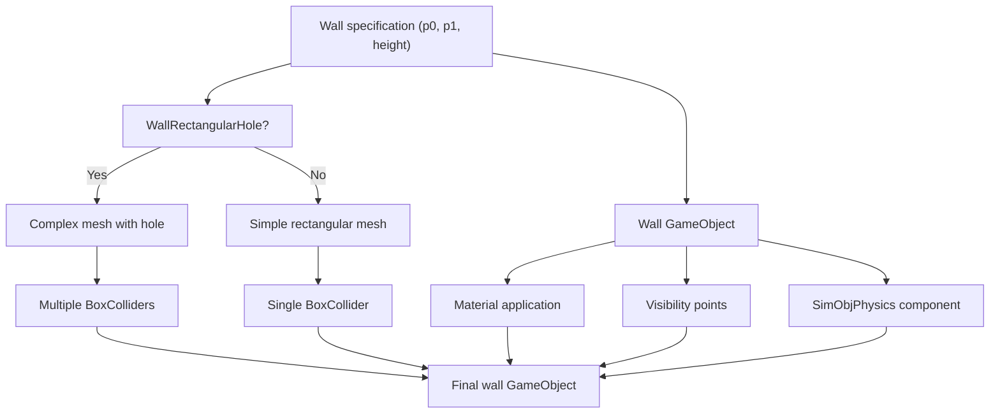
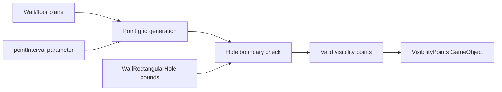
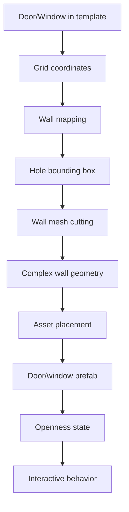
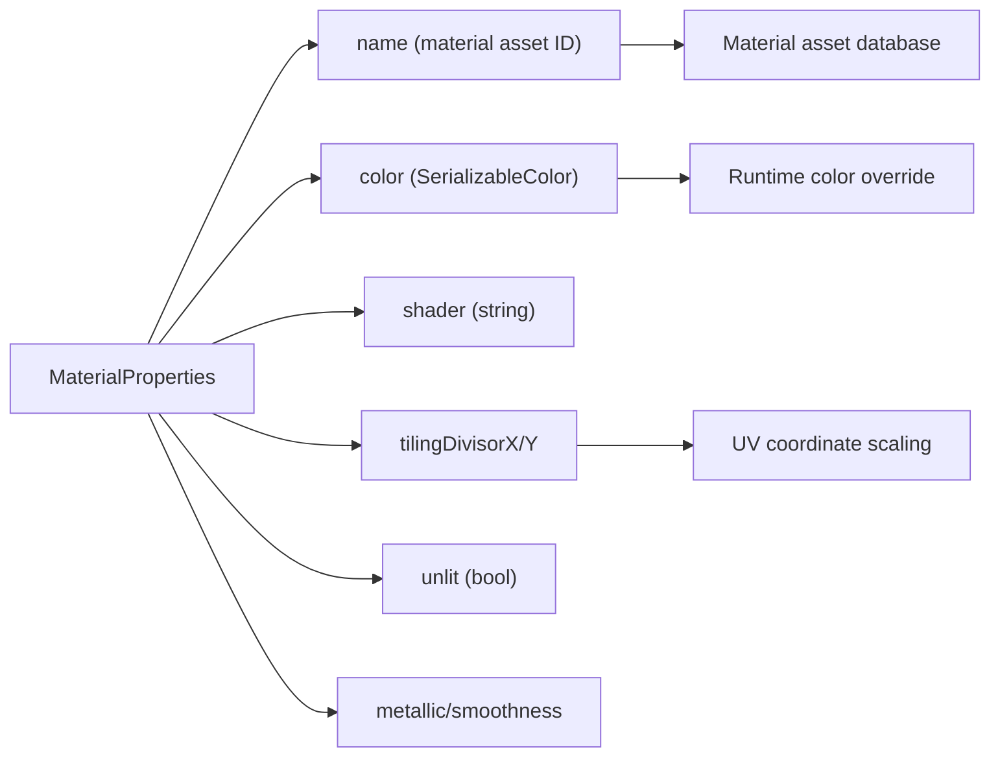
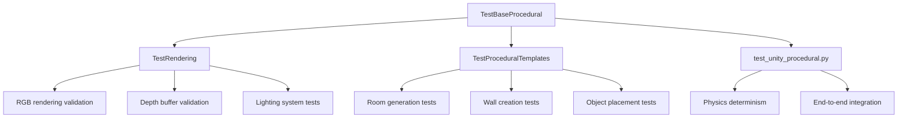

<!-- source: DeepWiki mcp.deepwiki.com · repo allenai/ai2thor · page 6.2 Procedural Generation · fetched 2026-10-30 -->

# Procedural Generation

<details>
<summary>Relevant source files</summary>

The following files were used as context for generating this wiki page:

- [ai2thor/tests/test_unity_procedural.py](ai2thor/tests/test_unity_procedural.py)
- [unity/Assets/Scenes/Procedural/set_doors.unity](unity/Assets/Scenes/Procedural/set_doors.unity)
- [unity/Assets/Scenes/Procedural/set_doors.unity.meta](unity/Assets/Scenes/Procedural/set_doors.unity.meta)
- [unity/Assets/Scripts/PrefabNameRevert.cs](unity/Assets/Scripts/PrefabNameRevert.cs)
- [unity/Assets/Scripts/PrefabNameRevert.cs.meta](unity/Assets/Scripts/PrefabNameRevert.cs.meta)
- [unity/Assets/Scripts/ProceduralData.cs](unity/Assets/Scripts/ProceduralData.cs)
- [unity/Assets/Scripts/ProceduralRoomEditor.cs](unity/Assets/Scripts/ProceduralRoomEditor.cs)
- [unity/Assets/Scripts/ProceduralTemplates.cs](unity/Assets/Scripts/ProceduralTemplates.cs)
- [unity/Assets/Scripts/ProceduralTools.cs](unity/Assets/Scripts/ProceduralTools.cs)
- [unity/Assets/UnitTests/Procedural/Rendering/TestRendering.cs](unity/Assets/UnitTests/Procedural/Rendering/TestRendering.cs)
- [unity/Assets/UnitTests/Procedural/Templates/TestProceduralTemplates.cs](unity/Assets/UnitTests/Procedural/Templates/TestProceduralTemplates.cs)
- [unity/Assets/UnitTests/Procedural/TestBaseProcedural.cs](unity/Assets/UnitTests/Procedural/TestBaseProcedural.cs)

</details>


The procedural generation system enables creation of 3D environments from template-based descriptions. This system converts high-level layout specifications into fully realized Unity scenes with rooms, walls, objects, and navigation data.

For information about physics simulation in these environments, see [Physics Scenes](#6.1). For details about 3D assets and models used in procedural generation, see [Scene Assets and Models](#6.3).

## System Overview

The procedural generation pipeline transforms `HouseTemplate` objects into `ProceduralHouse` instances that can be instantiated as Unity GameObjects. The system parses ASCII-style layout strings, generates 3D geometry, and places interactive objects with proper physics and navigation support.



**Core Transformation Pipeline**

Sources: [unity/Assets/Scripts/ProceduralTemplates.cs:42-45](), [unity/Assets/Scripts/ProceduralTools.cs:67]()

## Template System

### HouseTemplate Structure

The `HouseTemplate` class defines the input format for procedural generation:



**HouseTemplate Data Structure**

The layout uses numeric IDs to define room boundaries, while object layouts use symbolic characters to place doors, windows, and objects:

```
layout: "0 0 0 0 0 0
         0 2 2 2 2 0  
         0 2 2 2 2 0
         0 1 1 1 1 0
         0 1 1 1 1 0
         0 0 0 0 0 0"

objectsLayouts: ["0 0 0 0 0 0
                  0 2 2 2 2 0
                  0 2 2 2 = 0  
                  0 1 1 1 = 0
                  0 1 * 1 + 0
                  0 0 0 0 0 0"]
```

Sources: [unity/Assets/Scripts/ProceduralTemplates.cs:20-30](), [ai2thor/tests/test_unity_procedural.py:43-62]()

### Room Templates

`RoomTemplate` objects define the visual and structural properties for each room type:

| Property | Type | Purpose |
|----------|------|---------|
| `wallTemplate` | `PolygonWall` | Material and rendering properties for walls |
| `floorTemplate` | `RoomHierarchy` | Floor material and room metadata |
| `floorYPosition` | `float` | Vertical position of the floor |
| `wallHeight` | `float` | Height of room walls |

Sources: [unity/Assets/Scripts/ProceduralTemplates.cs:32-39]()

## Core Processing Pipeline

### Layout Parsing and Wall Detection

The `Templates.createHouseFromTemplate()` function processes ASCII layouts through several stages:



**Layout Processing Flow**

Sources: [unity/Assets/Scripts/ProceduralTemplates.cs:49-78](), [unity/Assets/Scripts/ProceduralTemplates.cs:249-256]()

### Wall and Room Generation

The system automatically detects room boundaries and generates wall segments:



**Wall and Floor Generation Pipeline**

Sources: [unity/Assets/Scripts/ProceduralTemplates.cs:250-253](), [unity/Assets/Scripts/ProceduralTools.cs:203-226]()

## Geometry Generation

### ProceduralTools Core Functions

The `ProceduralTools` class provides static methods for creating 3D geometry:

| Method | Purpose | Output |
|--------|---------|---------|
| `CreateHouse()` | Main house instantiation | Unity GameObject hierarchy |
| `createWalls()` | Wall mesh generation | Wall GameObjects with colliders |
| `createAndJoinWall()` | Individual wall creation | Single wall GameObject |
| `GenerateFloorMesh()` | Floor polygon triangulation | Mesh for floor surfaces |
| `CreateVisibilityPointsOnPlane()` | Navigation point generation | Visibility point GameObjects |

Sources: [unity/Assets/Scripts/ProceduralTools.cs:517-571](), [unity/Assets/Scripts/ProceduralTools.cs:602-920]()

### Wall Creation Process

The wall creation system handles complex geometry including holes for doors and windows:



**Wall Creation with Door/Window Holes**

Sources: [unity/Assets/Scripts/ProceduralTools.cs:602-614](), [unity/Assets/Scripts/ProceduralTools.cs:838-864]()

### Visibility Point Generation

The system generates visibility points for AI navigation using `CreateVisibilityPointsOnPlane()`:



**Visibility Point Generation System**

Sources: [unity/Assets/Scripts/ProceduralTools.cs:392-501](), [unity/Assets/Scripts/ProceduralTools.cs:503-515]()

## Object and Asset Integration

### HouseObject Placement

`HouseObject` instances define interactive objects in the procedural environment:

| Property | Type | Purpose |
|----------|------|---------|
| `assetId` | `string` | Reference to prefab asset |
| `position` | `Vector3` | World position |
| `rotation` | `FlexibleRotation` | Orientation (Euler or axis-angle) |
| `kinematic` | `bool` | Physics simulation mode |
| `room` | `string` | Containing room ID |

Sources: [unity/Assets/Scripts/ProceduralData.cs:351-373]()

### Door and Window System

Doors and windows implement the `WallRectangularHole` interface and create openings in walls:



**Door and Window Integration**

Sources: [unity/Assets/Scripts/ProceduralData.cs:111-127](), [unity/Assets/Scripts/ProceduralData.cs:256-272]()

## Material and Rendering System

### Material Properties

The `MaterialProperties` class defines visual appearance:



**Material Property System**

Sources: [unity/Assets/Scripts/ProceduralData.cs:429-439]()

### Procedural Parameters

`ProceduralParameters` control global rendering and physics settings:

| Parameter | Type | Purpose |
|-----------|------|---------|
| `floorColliderThickness` | `float` | Floor collision geometry |
| `skyboxId` | `string` | Environment skybox |
| `lights` | `LightParameters[]` | Scene lighting setup |
| `ceilingMaterial` | `MaterialProperties` | Default ceiling appearance |
| `squareTiling` | `bool` | UV mapping mode |

Sources: [unity/Assets/Scripts/ProceduralData.cs:131-155]()

## Testing and Validation

The system includes comprehensive testing through multiple test classes:

### Test Structure



**Testing System Organization**

Sources: [unity/Assets/UnitTests/Procedural/TestBaseProcedural.cs:16-30](), [ai2thor/tests/test_unity_procedural.py:105-152]()

### Key Test Scenarios

The test suite validates critical functionality:

- **Template Processing**: Conversion from `HouseTemplate` to `ProceduralHouse`
- **Geometry Generation**: Wall, floor, and ceiling mesh creation
- **Object Placement**: Asset instantiation and positioning
- **Physics Integration**: Collision detection and rigid body simulation
- **Rendering Validation**: Visual output verification

Sources: [unity/Assets/UnitTests/Procedural/Templates/TestProceduralTemplates.cs:137-185](), [ai2thor/tests/test_unity_procedural.py:214-285]()

---

