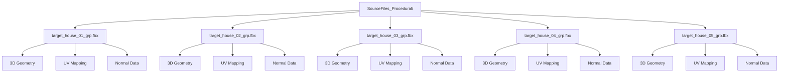
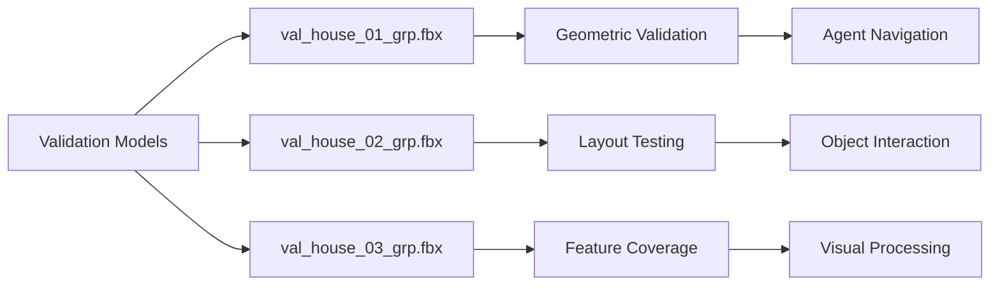
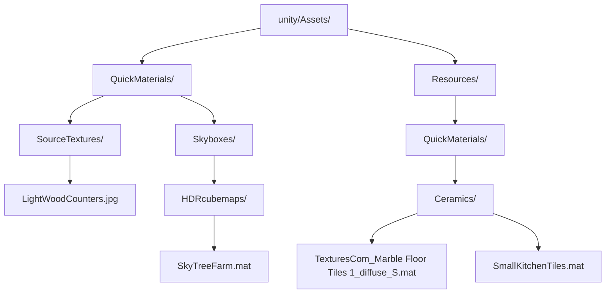
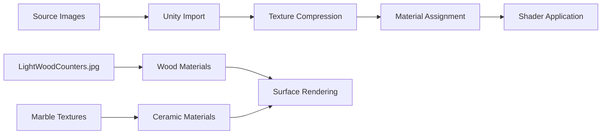
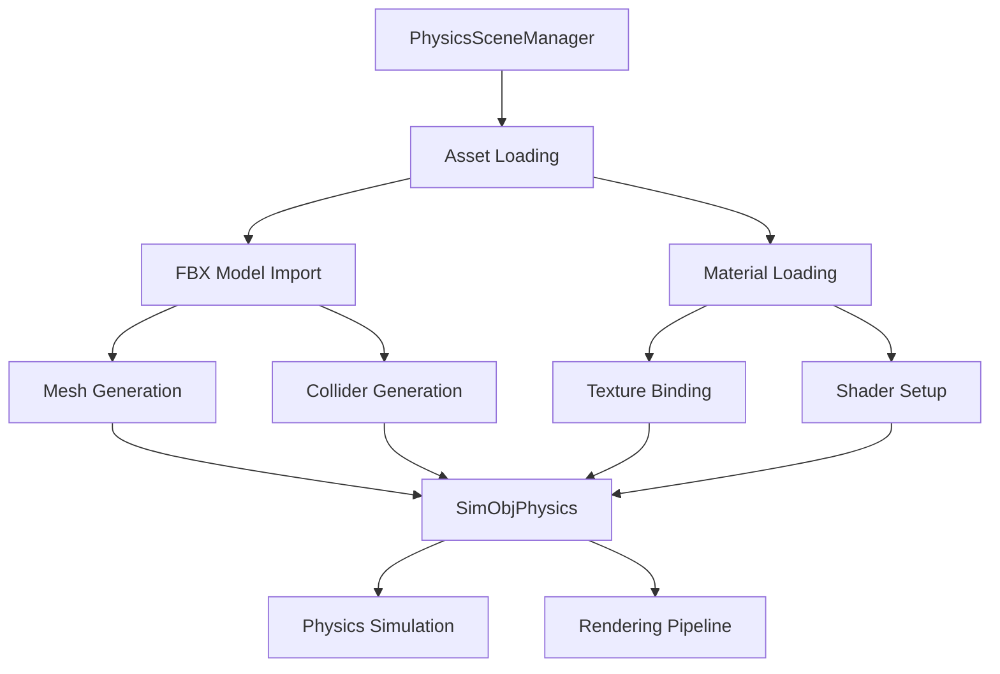

<!-- source: DeepWiki mcp.deepwiki.com · repo allenai/ai2thor · page 6.3 Scene Assets and Models · fetched 2026-10-30 -->

# Scene Assets and Models

Relevant source files

The following files were used as context for generating this wiki page:

- [unity/Assets/QuickMaterials/Skyboxes/HDRcubemaps/SkyTreeFarm.mat](unity/Assets/QuickMaterials/Skyboxes/HDRcubemaps/SkyTreeFarm.mat)
- [unity/Assets/QuickMaterials/Skyboxes/HDRcubemaps/SkyTreeFarm.mat.meta](unity/Assets/QuickMaterials/Skyboxes/HDRcubemaps/SkyTreeFarm.mat.meta)
- [unity/Assets/QuickMaterials/SourceTextures/LightWoodCounters.jpg](unity/Assets/QuickMaterials/SourceTextures/LightWoodCounters.jpg)
- [unity/Assets/Resources/ChairsTables_Kitchen.meta](unity/Assets/Resources/ChairsTables_Kitchen.meta)
- [unity/Assets/Resources/ChairsTables_Kitchen/Materials.meta](unity/Assets/Resources/ChairsTables_Kitchen/Materials.meta)
- [unity/Assets/Resources/QuickMaterials/Ceramics/GREYGRANITE.mat](unity/Assets/Resources/QuickMaterials/Ceramics/GREYGRANITE.mat)
- [unity/Assets/Resources/QuickMaterials/Ceramics/SmallKitchenTiles.mat](unity/Assets/Resources/QuickMaterials/Ceramics/SmallKitchenTiles.mat)
- [unity/Assets/Resources/QuickMaterials/Ceramics/TexturesCom_Marble Floor Tiles 1_diffuse_S.mat](unity/Assets/Resources/QuickMaterials/Ceramics/TexturesCom_Marble Floor Tiles 1_diffuse_S.mat)
- [unity/Assets/Resources/QuickMaterials/Ceramics/WhiteBrick.mat](unity/Assets/Resources/QuickMaterials/Ceramics/WhiteBrick.mat)
- [unity/Assets/Resources/QuickMaterials/Ceramics/bathroomTilesGrey.mat](unity/Assets/Resources/QuickMaterials/Ceramics/bathroomTilesGrey.mat)
- [unity/Assets/Resources/QuickMaterials/Fabrics/CarpetWhite 3.mat](unity/Assets/Resources/QuickMaterials/Fabrics/CarpetWhite 3.mat)
- [unity/Assets/Resources/QuickMaterials/Wood/DarkWood2.mat](unity/Assets/Resources/QuickMaterials/Wood/DarkWood2.mat)
- [unity/Assets/Resources/QuickMaterials/Wood/WornWood.mat](unity/Assets/Resources/QuickMaterials/Wood/WornWood.mat)
- [unity/Assets/Scenes/SourceFiles_Procedural/target_house_01_grp.fbx](unity/Assets/Scenes/SourceFiles_Procedural/target_house_01_grp.fbx)
- [unity/Assets/Scenes/SourceFiles_Procedural/target_house_02_grp.fbx](unity/Assets/Scenes/SourceFiles_Procedural/target_house_02_grp.fbx)
- [unity/Assets/Scenes/SourceFiles_Procedural/target_house_03_grp.fbx](unity/Assets/Scenes/SourceFiles_Procedural/target_house_03_grp.fbx)
- [unity/Assets/Scenes/SourceFiles_Procedural/target_house_04_grp.fbx](unity/Assets/Scenes/SourceFiles_Procedural/target_house_04_grp.fbx)
- [unity/Assets/Scenes/SourceFiles_Procedural/target_house_05_grp.fbx](unity/Assets/Scenes/SourceFiles_Procedural/target_house_05_grp.fbx)
- [unity/Assets/Scenes/SourceFiles_Procedural/val_house_01_grp.fbx](unity/Assets/Scenes/SourceFiles_Procedural/val_house_01_grp.fbx)
- [unity/Assets/Scenes/SourceFiles_Procedural/val_house_01_grp.fbx.meta](unity/Assets/Scenes/SourceFiles_Procedural/val_house_01_grp.fbx.meta)
- [unity/Assets/Scenes/SourceFiles_Procedural/val_house_02_grp.fbx](unity/Assets/Scenes/SourceFiles_Procedural/val_house_02_grp.fbx)
- [unity/Assets/Scenes/SourceFiles_Procedural/val_house_02_grp.fbx.meta](unity/Assets/Scenes/SourceFiles_Procedural/val_house_02_grp.fbx.meta)
- [unity/Assets/Scenes/SourceFiles_Procedural/val_house_03_grp.fbx](unity/Assets/Scenes/SourceFiles_Procedural/val_house_03_grp.fbx)

This document covers the 3D models, textures, and materials that comprise the physical scenes in AI2-THOR. This includes the target house models used for evaluation, validation house models for testing, and the supporting asset pipeline for materials and textures.

For information about physics simulation and scene management, see [Physics Scenes](#6.1). For information about programmatic scene generation, see [Procedural Generation](#6.2).

## Purpose and Scope

The scene assets and models system provides the foundational 3D content that populates AI2-THOR scenes. This includes pre-built house models in FBX format, texture assets, material definitions, and the organizational structure that makes these assets available to the Unity simulation environment.

## Target House Models

Target house models are pre-built 3D environments used for agent evaluation and testing. These models are stored as FBX files in the procedural source directory.

### Model Organization

Each target house model contains complete geometric data including vertices, polygon topology, UV texture coordinates, and surface normals. The models are exported from Maya and contain creation timestamps and metadata.

Sources: [unity/Assets/Scenes/SourceFiles_Procedural/target_house_01_grp.fbx](), [unity/Assets/Scenes/SourceFiles_Procedural/target_house_02_grp.fbx](), [unity/Assets/Scenes/SourceFiles_Procedural/target_house_03_grp.fbx](), [unity/Assets/Scenes/SourceFiles_Procedural/target_house_04_grp.fbx](), [unity/Assets/Scenes/SourceFiles_Procedural/target_house_05_grp.fbx]()

### FBX Model Structure

The FBX files follow a consistent internal structure:

| Component | Purpose | Data |
|-----------|---------|------|
| `Vertices` | 3D positions | Compressed coordinate arrays |
| `PolygonVertexIndex` | Face topology | Triangle/quad face definitions |
| `Edges` | Edge connectivity | Edge relationship data |
| `Normals` | Surface orientation | Per-vertex normal vectors |
| `UV` | Texture mapping | 2D texture coordinates |
| `Materials` | Surface properties | Material assignment indices |

Each model includes metadata indicating creation in Maya 2022 with export timestamps. The models use FBX SDK version 2020.1 format.

Sources: [unity/Assets/Scenes/SourceFiles_Procedural/target_house_02_grp.fbx:26-48]()

## Validation House Models

Validation house models provide additional test environments for validating agent behavior across different architectural layouts.

The validation models follow the same FBX structure as target houses but are optimized for specific testing scenarios. They provide controlled environments for regression testing and validation of new features.

Sources: [unity/Assets/Scenes/SourceFiles_Procedural/val_house_01_grp.fbx](), [unity/Assets/Scenes/SourceFiles_Procedural/val_house_02_grp.fbx](), [unity/Assets/Scenes/SourceFiles_Procedural/val_house_03_grp.fbx]()

## Asset Organization Structure

The asset pipeline organizes materials and textures across multiple directories to support both quick prototyping and production-quality rendering.

### Material Hierarchy

This organization separates rapid prototyping materials (`QuickMaterials`) from production-ready resources (`Resources`), while maintaining consistent naming and categorization.

Sources: [unity/Assets/QuickMaterials/SourceTextures/LightWoodCounters.jpg](), [unity/Assets/QuickMaterials/Skyboxes/HDRcubemaps/SkyTreeFarm.mat](), [unity/Assets/Resources/QuickMaterials/Ceramics/TexturesCom_Marble Floor Tiles 1_diffuse_S.mat](), [unity/Assets/Resources/QuickMaterials/Ceramics/SmallKitchenTiles.mat]()

## Materials and Textures

The material system provides surface properties for scene objects through Unity's material pipeline.

### Material Configuration

Materials use Unity's Standard shader with configurable properties:

| Property | Purpose | Example Values |
|----------|---------|----------------|
| `_MainTex` | Diffuse texture | Texture2D references |
| `_Color` | Base color tint | RGBA color values |
| `_Glossiness` | Surface smoothness | 0.0 to 1.0 range |
| `_Metallic` | Metallic properties | 0.0 to 1.0 range |

The ceramic materials demonstrate typical configuration patterns with texture assignments and property overrides for realistic surface rendering.

Sources: [unity/Assets/Resources/QuickMaterials/Ceramics/SmallKitchenTiles.mat:1-10]()

### Texture Pipeline

Source textures are organized by material category and usage context:

The texture pipeline supports standard image formats with automatic import settings optimized for real-time rendering performance.

Sources: [unity/Assets/QuickMaterials/SourceTextures/LightWoodCounters.jpg:1-2]()

## Integration with Scene Systems

Scene assets integrate with the broader AI2-THOR architecture through the Unity asset management system.

### Asset Loading Pipeline

The asset integration process transforms static 3D models into interactive `SimObjPhysics` objects that can participate in physics simulation and agent interaction.

Sources: Based on integration patterns across the scenes and environment systems

This asset pipeline ensures that pre-built house models and materials are efficiently loaded and configured for real-time simulation while maintaining visual fidelity and physical accuracy required for embodied AI research.

---

