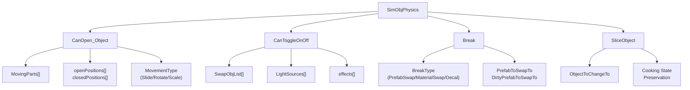
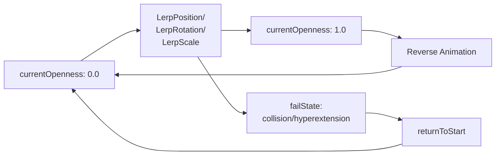
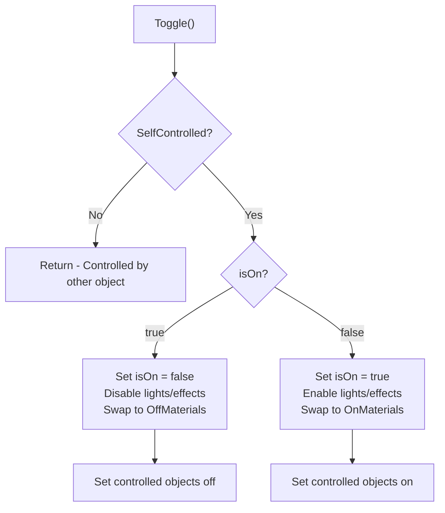
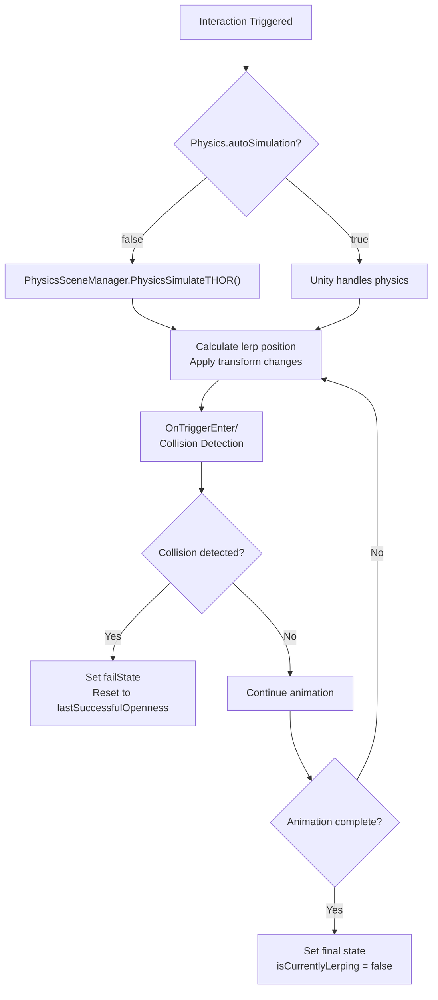
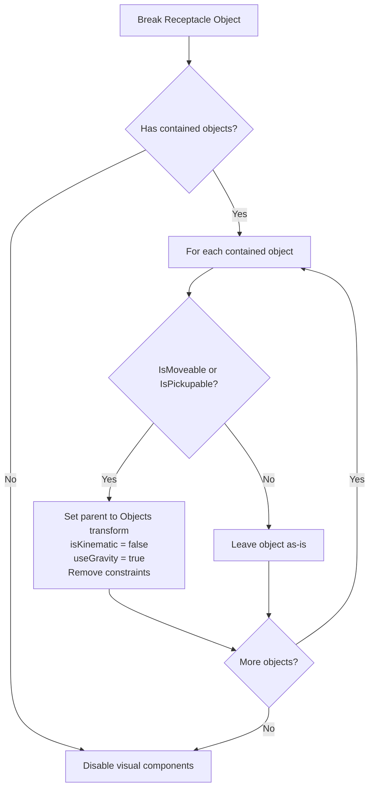

<!-- source: DeepWiki mcp.deepwiki.com · repo allenai/ai2thor · page 7 Object Interaction System · fetched 2026-10-30 -->

# Object Interaction System

Relevant source files

The following files were used as context for generating this wiki page:

- [unity/Assets/Physics/SimObjsPhysics/Bedroom Objects/Pencil/Prefabs.meta](unity/Assets/Physics/SimObjsPhysics/Bedroom Objects/Pencil/Prefabs.meta)
- [unity/Assets/Physics/SimObjsPhysics/Bedroom Objects/Pencil/Prefabs/Pencil_1.prefab.meta](unity/Assets/Physics/SimObjsPhysics/Bedroom Objects/Pencil/Prefabs/Pencil_1.prefab.meta)
- [unity/Assets/Physics/SimObjsPhysics/Bedroom Objects/Pencil/Prefabs/Pencil_2.prefab.meta](unity/Assets/Physics/SimObjsPhysics/Bedroom Objects/Pencil/Prefabs/Pencil_2.prefab.meta)
- [unity/Assets/Physics/SimObjsPhysics/Bedroom Objects/Pencil/Prefabs/Pencil_3.prefab.meta](unity/Assets/Physics/SimObjsPhysics/Bedroom Objects/Pencil/Prefabs/Pencil_3.prefab.meta)
- [unity/Assets/Physics/SimObjsPhysics/Bedroom Objects/Pencil/Prefabs/Pencil_4.prefab.meta](unity/Assets/Physics/SimObjsPhysics/Bedroom Objects/Pencil/Prefabs/Pencil_4.prefab.meta)
- [unity/Assets/Physics/SimObjsPhysics/Bedroom Objects/Pencil/Prefabs/Pencil_5.prefab.meta](unity/Assets/Physics/SimObjsPhysics/Bedroom Objects/Pencil/Prefabs/Pencil_5.prefab.meta)
- [unity/Assets/Physics/SimObjsPhysics/Custom Project Objects/Hide And Seek Objects/Objects to Spawn/HaS_Footstool_1.prefab](unity/Assets/Physics/SimObjsPhysics/Custom Project Objects/Hide And Seek Objects/Objects to Spawn/HaS_Footstool_1.prefab)
- [unity/Assets/Physics/SimObjsPhysics/Custom Project Objects/Hide And Seek Objects/Objects to Spawn/HaS_Tomato_1.prefab](unity/Assets/Physics/SimObjsPhysics/Custom Project Objects/Hide And Seek Objects/Objects to Spawn/HaS_Tomato_1.prefab)
- [unity/Assets/Physics/SimObjsPhysics/Kitchen Objects/Fridge/Prefabs/Fridge_1.prefab](unity/Assets/Physics/SimObjsPhysics/Kitchen Objects/Fridge/Prefabs/Fridge_1.prefab)
- [unity/Assets/Physics/SimObjsPhysics/Kitchen Objects/Fridge/Prefabs/Fridge_10.prefab](unity/Assets/Physics/SimObjsPhysics/Kitchen Objects/Fridge/Prefabs/Fridge_10.prefab)
- [unity/Assets/Physics/SimObjsPhysics/Kitchen Objects/Fridge/Prefabs/Fridge_11.prefab](unity/Assets/Physics/SimObjsPhysics/Kitchen Objects/Fridge/Prefabs/Fridge_11.prefab)
- [unity/Assets/Physics/SimObjsPhysics/Kitchen Objects/Fridge/Prefabs/Fridge_12.prefab](unity/Assets/Physics/SimObjsPhysics/Kitchen Objects/Fridge/Prefabs/Fridge_12.prefab)
- [unity/Assets/Physics/SimObjsPhysics/Kitchen Objects/Fridge/Prefabs/Fridge_13.prefab](unity/Assets/Physics/SimObjsPhysics/Kitchen Objects/Fridge/Prefabs/Fridge_13.prefab)
- [unity/Assets/Physics/SimObjsPhysics/Kitchen Objects/Fridge/Prefabs/Fridge_14.prefab](unity/Assets/Physics/SimObjsPhysics/Kitchen Objects/Fridge/Prefabs/Fridge_14.prefab)
- [unity/Assets/Physics/SimObjsPhysics/Kitchen Objects/Fridge/Prefabs/Fridge_15.prefab](unity/Assets/Physics/SimObjsPhysics/Kitchen Objects/Fridge/Prefabs/Fridge_15.prefab)
- [unity/Assets/Physics/SimObjsPhysics/Kitchen Objects/Fridge/Prefabs/Fridge_16.prefab](unity/Assets/Physics/SimObjsPhysics/Kitchen Objects/Fridge/Prefabs/Fridge_16.prefab)
- [unity/Assets/Physics/SimObjsPhysics/Kitchen Objects/Fridge/Prefabs/Fridge_17.prefab](unity/Assets/Physics/SimObjsPhysics/Kitchen Objects/Fridge/Prefabs/Fridge_17.prefab)
- [unity/Assets/Physics/SimObjsPhysics/Kitchen Objects/Fridge/Prefabs/Fridge_18.prefab](unity/Assets/Physics/SimObjsPhysics/Kitchen Objects/Fridge/Prefabs/Fridge_18.prefab)
- [unity/Assets/Physics/SimObjsPhysics/Kitchen Objects/Fridge/Prefabs/Fridge_19.prefab](unity/Assets/Physics/SimObjsPhysics/Kitchen Objects/Fridge/Prefabs/Fridge_19.prefab)
- [unity/Assets/Physics/SimObjsPhysics/Kitchen Objects/Fridge/Prefabs/Fridge_2.prefab](unity/Assets/Physics/SimObjsPhysics/Kitchen Objects/Fridge/Prefabs/Fridge_2.prefab)
- [unity/Assets/Physics/SimObjsPhysics/Kitchen Objects/Fridge/Prefabs/Fridge_20.prefab](unity/Assets/Physics/SimObjsPhysics/Kitchen Objects/Fridge/Prefabs/Fridge_20.prefab)
- [unity/Assets/Physics/SimObjsPhysics/Kitchen Objects/Fridge/Prefabs/Fridge_27.prefab](unity/Assets/Physics/SimObjsPhysics/Kitchen Objects/Fridge/Prefabs/Fridge_27.prefab)
- [unity/Assets/Physics/SimObjsPhysics/Kitchen Objects/Fridge/Prefabs/Fridge_3.prefab](unity/Assets/Physics/SimObjsPhysics/Kitchen Objects/Fridge/Prefabs/Fridge_3.prefab)
- [unity/Assets/Physics/SimObjsPhysics/Kitchen Objects/Fridge/Prefabs/Fridge_4.prefab](unity/Assets/Physics/SimObjsPhysics/Kitchen Objects/Fridge/Prefabs/Fridge_4.prefab)
- [unity/Assets/Physics/SimObjsPhysics/Kitchen Objects/Fridge/Prefabs/Fridge_5.prefab](unity/Assets/Physics/SimObjsPhysics/Kitchen Objects/Fridge/Prefabs/Fridge_5.prefab)
- [unity/Assets/Physics/SimObjsPhysics/Kitchen Objects/Fridge/Prefabs/Fridge_6.prefab](unity/Assets/Physics/SimObjsPhysics/Kitchen Objects/Fridge/Prefabs/Fridge_6.prefab)
- [unity/Assets/Physics/SimObjsPhysics/Kitchen Objects/Fridge/Prefabs/Fridge_7.prefab](unity/Assets/Physics/SimObjsPhysics/Kitchen Objects/Fridge/Prefabs/Fridge_7.prefab)
- [unity/Assets/Physics/SimObjsPhysics/Kitchen Objects/Fridge/Prefabs/Fridge_8.prefab](unity/Assets/Physics/SimObjsPhysics/Kitchen Objects/Fridge/Prefabs/Fridge_8.prefab)
- [unity/Assets/Physics/SimObjsPhysics/Kitchen Objects/Fridge/Prefabs/Fridge_9.prefab](unity/Assets/Physics/SimObjsPhysics/Kitchen Objects/Fridge/Prefabs/Fridge_9.prefab)
- [unity/Assets/Physics/SimObjsPhysics/Kitchen Objects/Kettle/Prefabs.meta](unity/Assets/Physics/SimObjsPhysics/Kitchen Objects/Kettle/Prefabs.meta)
- [unity/Assets/Physics/SimObjsPhysics/Kitchen Objects/SaltShaker/Prefabs.meta](unity/Assets/Physics/SimObjsPhysics/Kitchen Objects/SaltShaker/Prefabs.meta)
- [unity/Assets/Scripts/Break.cs](unity/Assets/Scripts/Break.cs)
- [unity/Assets/Scripts/Break.cs.meta](unity/Assets/Scripts/Break.cs.meta)
- [unity/Assets/Scripts/Breakdown.cs](unity/Assets/Scripts/Breakdown.cs)
- [unity/Assets/Scripts/Breakdown.cs.meta](unity/Assets/Scripts/Breakdown.cs.meta)
- [unity/Assets/Scripts/CanOpen_Object.cs](unity/Assets/Scripts/CanOpen_Object.cs)
- [unity/Assets/Scripts/CanToggleOnOff.cs](unity/Assets/Scripts/CanToggleOnOff.cs)
- [unity/Assets/Scripts/SliceObject.cs](unity/Assets/Scripts/SliceObject.cs)

The Object Interaction System provides the framework for dynamic object behaviors and state changes in AI2-THOR simulations. This system enables objects to be opened, closed, broken, sliced, toggled on/off, and undergo other state transitions through agent actions or physics-based interactions. It handles the animation, collision detection, failure modes, and visual/physical state changes that make objects responsive and realistic.

For information about the core SimObjPhysics framework that these interactions build upon, see [SimObjPhysics Framework](#7.1). For details about specific interactive behaviors like opening and toggling, see [Interactive Behaviors](#7.2). For information about destructive state changes like breaking and slicing, see [Object State Changes](#7.3).

## Core Interaction Architecture

The interaction system is built around specialized components that attach to `SimObjPhysics` objects to provide specific behaviors. Each interaction type is implemented as a separate MonoBehaviour component that manages its own state, animations, and collision handling.

### Interaction Component Framework

**Sources:** [unity/Assets/Scripts/CanOpen_Object.cs:7-631](), [unity/Assets/Scripts/CanToggleOnOff.cs:24-381](), [unity/Assets/Scripts/Break.cs:6-282](), [unity/Assets/Scripts/SliceObject.cs:8-192]()

## Interaction Types and State Management

The system supports four primary interaction types, each with distinct state management approaches and animation systems.

### Openable Objects (`CanOpen_Object`)

Openable objects use a continuous state model with `currentOpenness` ranging from 0.0 (closed) to 1.0 (open). The component supports three movement types and handles collision-based failure detection.

**Sources:** [unity/Assets/Scripts/CanOpen_Object.cs:25-26](), [unity/Assets/Scripts/CanOpen_Object.cs:31-37](), [unity/Assets/Scripts/CanOpen_Object.cs:158-279]()

### Toggle Objects (`CanToggleOnOff`)

Toggle objects maintain binary on/off states and can control other objects through proxy relationships. The system supports both self-controlled objects and objects controlled by external toggles.

**Sources:** [unity/Assets/Scripts/CanToggleOnOff.cs:159-294](), [unity/Assets/Scripts/CanToggleOnOff.cs:83-103]()

## Animation and Physics Integration

The interaction system integrates closely with Unity's physics simulation and provides smooth animations through coroutine-based lerping. Each interaction type handles physics constraints and collision detection differently.

### Animation Flow Control

**Sources:** [unity/Assets/Scripts/CanOpen_Object.cs:438-463](), [unity/Assets/Scripts/CanOpen_Object.cs:465-540](), [unity/Assets/Scripts/CanOpen_Object.cs:281-427]()

## Collision Detection and Failure Handling

The system implements sophisticated collision detection to prevent unrealistic interactions and handle physical constraints like arm hyperextension for robotic agents.

### Collision Filtering Logic

The collision system filters various types of colliders to determine legitimate interaction failures:

| Collision Type | Action | Reasoning |
|----------------|--------|-----------|
| Trigger colliders | Ignore | Non-physical boundaries |
| Self-descendants | Ignore | Object's own components |
| Agent parts (when `ignoreAgentInTransition`) | Ignore | Allow agent to move during interaction |
| Non-static SimObjects (when `stopAtNonStaticCol` = false) | Ignore | Don't block on moveable objects |
| Objects in `IgnoreTheseObjects` array | Ignore | Explicitly configured exceptions |
| BoundingBox/ReceptacleTriggerBox | Ignore | Invisible collision helpers |

**Sources:** [unity/Assets/Scripts/CanOpen_Object.cs:465-540](), [unity/Assets/Scripts/CanOpen_Object.cs:44-51]()

## Receptacle Integration

Many interactive objects serve as receptacles that can contain other objects. The interaction system handles the relationship between container state and contained objects, especially during destructive interactions.

**Sources:** [unity/Assets/Scripts/Break.cs:114-132](), [unity/Assets/Physics/SimObjsPhysics/Kitchen Objects/Fridge/Prefabs/Fridge_2.prefab:903-909]()

The Object Interaction System provides the foundational framework for making AI2-THOR objects responsive and realistic. Through its component-based architecture, it enables complex behaviors while maintaining clean separation of concerns and robust error handling for physics-based interactions.

---

