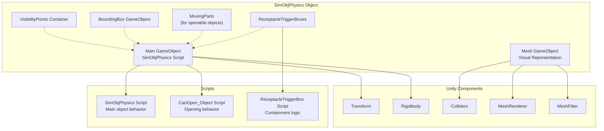
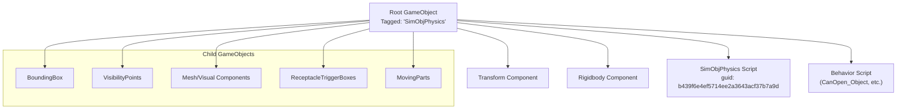
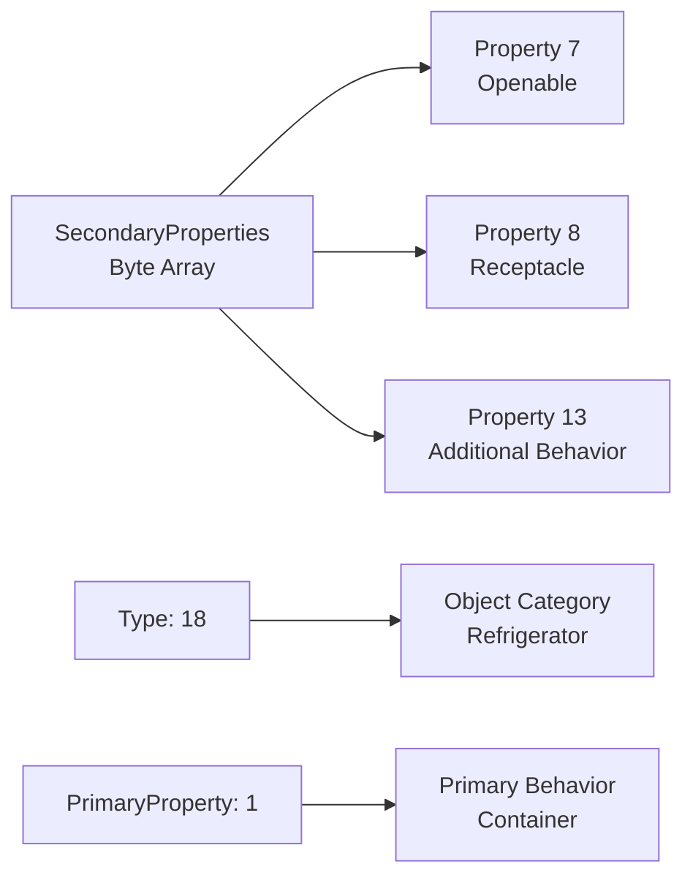
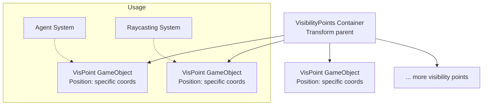
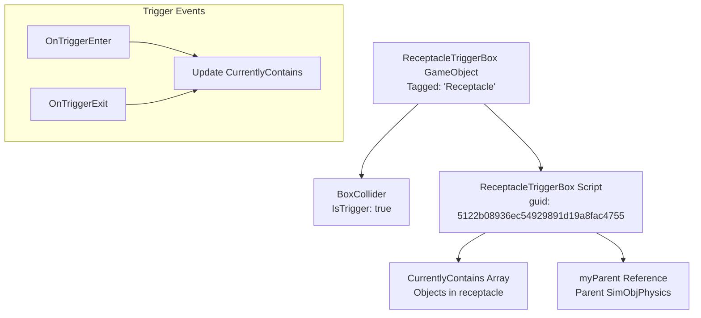
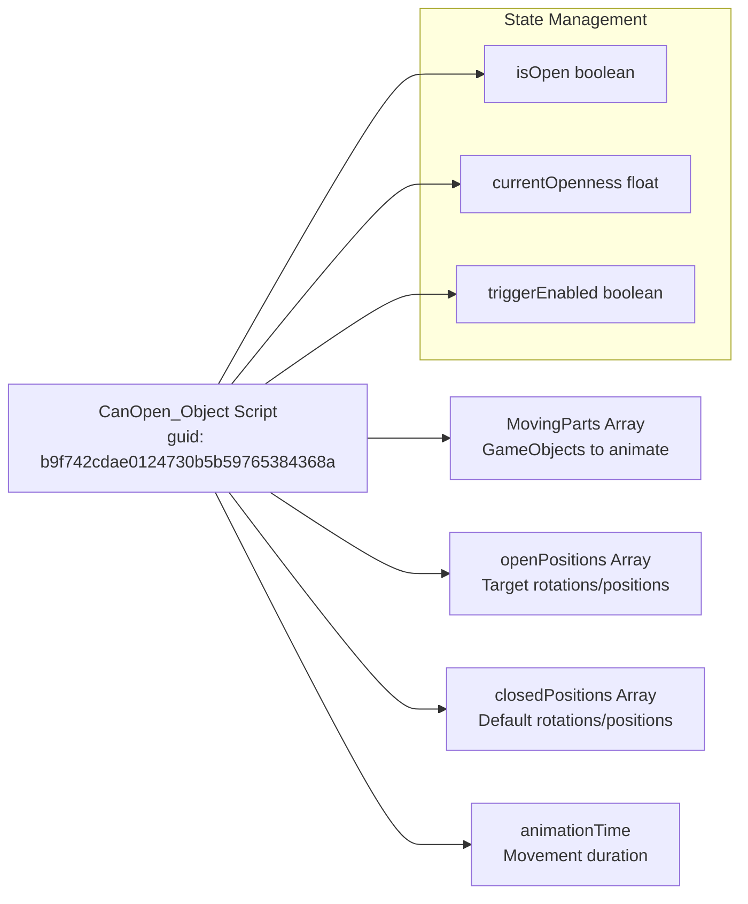
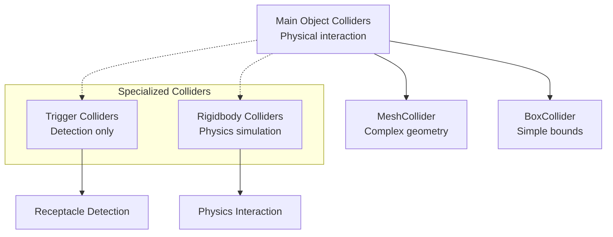

<!-- source: DeepWiki mcp.deepwiki.com · repo allenai/ai2thor · page 7.1 SimObjPhysics Framework · fetched 2026-10-30 -->

# SimObjPhysics Framework

Relevant source files

The following files were used as context for generating this wiki page:

- [unity/Assets/Physics/SimObjsPhysics/Kitchen Objects/Fridge/Prefabs/Fridge_1.prefab](unity/Assets/Physics/SimObjsPhysics/Kitchen Objects/Fridge/Prefabs/Fridge_1.prefab)
- [unity/Assets/Physics/SimObjsPhysics/Kitchen Objects/Fridge/Prefabs/Fridge_10.prefab](unity/Assets/Physics/SimObjsPhysics/Kitchen Objects/Fridge/Prefabs/Fridge_10.prefab)
- [unity/Assets/Physics/SimObjsPhysics/Kitchen Objects/Fridge/Prefabs/Fridge_11.prefab](unity/Assets/Physics/SimObjsPhysics/Kitchen Objects/Fridge/Prefabs/Fridge_11.prefab)
- [unity/Assets/Physics/SimObjsPhysics/Kitchen Objects/Fridge/Prefabs/Fridge_12.prefab](unity/Assets/Physics/SimObjsPhysics/Kitchen Objects/Fridge/Prefabs/Fridge_12.prefab)
- [unity/Assets/Physics/SimObjsPhysics/Kitchen Objects/Fridge/Prefabs/Fridge_13.prefab](unity/Assets/Physics/SimObjsPhysics/Kitchen Objects/Fridge/Prefabs/Fridge_13.prefab)
- [unity/Assets/Physics/SimObjsPhysics/Kitchen Objects/Fridge/Prefabs/Fridge_14.prefab](unity/Assets/Physics/SimObjsPhysics/Kitchen Objects/Fridge/Prefabs/Fridge_14.prefab)
- [unity/Assets/Physics/SimObjsPhysics/Kitchen Objects/Fridge/Prefabs/Fridge_15.prefab](unity/Assets/Physics/SimObjsPhysics/Kitchen Objects/Fridge/Prefabs/Fridge_15.prefab)
- [unity/Assets/Physics/SimObjsPhysics/Kitchen Objects/Fridge/Prefabs/Fridge_16.prefab](unity/Assets/Physics/SimObjsPhysics/Kitchen Objects/Fridge/Prefabs/Fridge_16.prefab)
- [unity/Assets/Physics/SimObjsPhysics/Kitchen Objects/Fridge/Prefabs/Fridge_17.prefab](unity/Assets/Physics/SimObjsPhysics/Kitchen Objects/Fridge/Prefabs/Fridge_17.prefab)
- [unity/Assets/Physics/SimObjsPhysics/Kitchen Objects/Fridge/Prefabs/Fridge_18.prefab](unity/Assets/Physics/SimObjsPhysics/Kitchen Objects/Fridge/Prefabs/Fridge_18.prefab)
- [unity/Assets/Physics/SimObjsPhysics/Kitchen Objects/Fridge/Prefabs/Fridge_19.prefab](unity/Assets/Physics/SimObjsPhysics/Kitchen Objects/Fridge/Prefabs/Fridge_19.prefab)
- [unity/Assets/Physics/SimObjsPhysics/Kitchen Objects/Fridge/Prefabs/Fridge_2.prefab](unity/Assets/Physics/SimObjsPhysics/Kitchen Objects/Fridge/Prefabs/Fridge_2.prefab)
- [unity/Assets/Physics/SimObjsPhysics/Kitchen Objects/Fridge/Prefabs/Fridge_20.prefab](unity/Assets/Physics/SimObjsPhysics/Kitchen Objects/Fridge/Prefabs/Fridge_20.prefab)
- [unity/Assets/Physics/SimObjsPhysics/Kitchen Objects/Fridge/Prefabs/Fridge_27.prefab](unity/Assets/Physics/SimObjsPhysics/Kitchen Objects/Fridge/Prefabs/Fridge_27.prefab)
- [unity/Assets/Physics/SimObjsPhysics/Kitchen Objects/Fridge/Prefabs/Fridge_3.prefab](unity/Assets/Physics/SimObjsPhysics/Kitchen Objects/Fridge/Prefabs/Fridge_3.prefab)
- [unity/Assets/Physics/SimObjsPhysics/Kitchen Objects/Fridge/Prefabs/Fridge_4.prefab](unity/Assets/Physics/SimObjsPhysics/Kitchen Objects/Fridge/Prefabs/Fridge_4.prefab)
- [unity/Assets/Physics/SimObjsPhysics/Kitchen Objects/Fridge/Prefabs/Fridge_5.prefab](unity/Assets/Physics/SimObjsPhysics/Kitchen Objects/Fridge/Prefabs/Fridge_5.prefab)
- [unity/Assets/Physics/SimObjsPhysics/Kitchen Objects/Fridge/Prefabs/Fridge_6.prefab](unity/Assets/Physics/SimObjsPhysics/Kitchen Objects/Fridge/Prefabs/Fridge_6.prefab)
- [unity/Assets/Physics/SimObjsPhysics/Kitchen Objects/Fridge/Prefabs/Fridge_7.prefab](unity/Assets/Physics/SimObjsPhysics/Kitchen Objects/Fridge/Prefabs/Fridge_7.prefab)
- [unity/Assets/Physics/SimObjsPhysics/Kitchen Objects/Fridge/Prefabs/Fridge_8.prefab](unity/Assets/Physics/SimObjsPhysics/Kitchen Objects/Fridge/Prefabs/Fridge_8.prefab)
- [unity/Assets/Physics/SimObjsPhysics/Kitchen Objects/Fridge/Prefabs/Fridge_9.prefab](unity/Assets/Physics/SimObjsPhysics/Kitchen Objects/Fridge/Prefabs/Fridge_9.prefab)

## Purpose and Scope

The SimObjPhysics Framework is the core system that defines interactive objects within the AI2-THOR simulation environment. This framework provides the foundational structure for all simulated objects, including their physical properties, visual representation, behavioral characteristics, and interaction capabilities. It serves as the bridge between Unity GameObjects and the simulation's object management system.

For information about specific interactive behaviors like opening/closing and toggling, see [Interactive Behaviors](#7.2). For details about dynamic object state changes like breaking and slicing, see [Object State Changes](#7.3).

## Core Architecture Overview

The SimObjPhysics Framework organizes objects into a hierarchical structure where each simulated object consists of multiple Unity GameObjects with specialized roles. The framework uses a component-based architecture that separates visual, physical, and behavioral concerns.

**Sources:** [unity/Assets/Physics/SimObjsPhysics/Kitchen Objects/Fridge/Prefabs/Fridge_2.prefab:784-822](), [unity/Assets/Physics/SimObjsPhysics/Kitchen Objects/Fridge/Prefabs/Fridge_1.prefab:1590-1650]()

## Object Hierarchy and Components

Every SimObjPhysics object follows a standardized GameObject hierarchy that separates concerns and enables modular functionality. The main object serves as the root and contains the primary behavior scripts and metadata.

### Main GameObject Structure

The root GameObject contains the core SimObjPhysics script and essential Unity components:

### Component Relationships

Each child GameObject serves a specific purpose within the framework:

- **BoundingBox**: Defines the object's spatial bounds for collision detection and positioning
- **Mesh**: Contains visual representation with MeshFilter, MeshRenderer, and collision geometry
- **VisibilityPoints**: Collection of Transform points used for visibility calculations
- **ReceptacleTriggerBoxes**: Trigger volumes that detect object containment
- **MovingParts**: Animated components for objects with moving elements (doors, drawers)

**Sources:** [unity/Assets/Physics/SimObjsPhysics/Kitchen Objects/Fridge/Prefabs/Fridge_2.prefab:813-822](), [unity/Assets/Physics/SimObjsPhysics/Kitchen Objects/Fridge/Prefabs/Fridge_2.prefab:1000-1044]()

## Properties and Metadata System

The SimObjPhysics script defines a comprehensive metadata system that categorizes objects and defines their capabilities. This system uses numerical codes to efficiently represent object types and properties.

### Core Object Properties

| Property | Purpose | Example Values |
|----------|---------|----------------|
| `objectID` | Unique instance identifier | Generated at runtime |
| `assetID` | Asset type identifier | "Fridge_2", "Fridge_1" |
| `Type` | Object category code | 18 (for refrigerators) |
| `PrimaryProperty` | Main behavioral characteristic | 1 (receptacle capability) |
| `SecondaryProperties` | Additional capabilities | [7, 8, 13] (openable, etc.) |

### Property Encoding

The framework uses byte arrays to encode multiple properties efficiently:

### Object State Management

The framework tracks various object states and physical properties:

- **Motion State**: `inMotion`, `lastVelocity`, collision counters
- **Temperature**: `CurrentTemperature`, `HowManySecondsUntilRoomTemp`
- **Physical Properties**: `HFdynamicfriction`, `HFstaticfriction`, `HFbounciness`
- **Behavioral Flags**: `IsReceptacle`, `IsPickupable`, `IsOpenable`, `IsBreakable`

**Sources:** [unity/Assets/Physics/SimObjsPhysics/Kitchen Objects/Fridge/Prefabs/Fridge_2.prefab:853-941](), [unity/Assets/Physics/SimObjsPhysics/Kitchen Objects/Fridge/Prefabs/Fridge_20.prefab:410-525]()

## Spatial Systems

The framework implements sophisticated spatial systems for object positioning, visibility calculations, and interaction detection.

### Visibility Points System

Objects contain multiple visibility points that enable the agent system to determine optimal viewing positions and object visibility:

### Bounding Box System

Each object has a BoundingBox GameObject that defines its spatial extent for physics calculations and positioning:

- **Component**: `BoxCollider` with `m_IsTrigger: 0` and `m_Enabled: 0`
- **Purpose**: Spatial reference without active collision
- **Usage**: Object placement, clearance checking, spatial queries

**Sources:** [unity/Assets/Physics/SimObjsPhysics/Kitchen Objects/Fridge/Prefabs/Fridge_2.prefab:1000-1044](), [unity/Assets/Physics/SimObjsPhysics/Kitchen Objects/Fridge/Prefabs/Fridge_2.prefab:859-902]()

## Receptacle System

The framework implements a receptacle system that allows objects to contain other objects. This system uses trigger volumes to detect when objects enter or leave containment areas.

### ReceptacleTriggerBox Components

### Receptacle Configuration

Objects can have multiple receptacle areas with different purposes:

- **Main compartments**: Primary storage areas (refrigerator interior)
- **Specialized areas**: Specific storage zones (freezer compartments)
- **Surface receptacles**: Top surfaces for object placement

**Sources:** [unity/Assets/Physics/SimObjsPhysics/Kitchen Objects/Fridge/Prefabs/Fridge_1.prefab:606-656](), [unity/Assets/Physics/SimObjsPhysics/Kitchen Objects/Fridge/Prefabs/Fridge_2.prefab:284-331]()

## Moving Parts and Animation System

For objects with moveable components (doors, drawers), the framework provides an animation system based on MovingParts and position states.

### CanOpen_Object Integration

### Movement Types

The system supports different types of object movement:

- **Rotation-based**: Doors that rotate around hinges
- **Translation-based**: Drawers that slide in/out
- **Combined movement**: Complex mechanical behaviors

**Sources:** [unity/Assets/Physics/SimObjsPhysics/Kitchen Objects/Fridge/Prefabs/Fridge_2.prefab:954-969](), [unity/Assets/Physics/SimObjsPhysics/Kitchen Objects/Fridge/Prefabs/Fridge_2.prefab:1159-1193]()

## Physics Integration

The framework integrates with Unity's physics system through careful management of Rigidbody components and collision detection.

### Rigidbody Configuration

SimObjPhysics objects use kinematic Rigidbodies by default:

- **`m_IsKinematic: 1`**: Prevents physics simulation interference
- **`m_UseGravity: 1`**: Maintains gravity awareness for state changes
- **`m_Mass: 1`**: Standard mass for interaction calculations

### Collision Hierarchy

The framework carefully manages collision detection to balance performance with interaction fidelity, using simplified colliders for most interactions and detailed mesh colliders only when necessary.

**Sources:** [unity/Assets/Physics/SimObjsPhysics/Kitchen Objects/Fridge/Prefabs/Fridge_2.prefab:825-840](), [unity/Assets/Physics/SimObjsPhysics/Kitchen Objects/Fridge/Prefabs/Fridge_1.prefab:152-167]()

---

