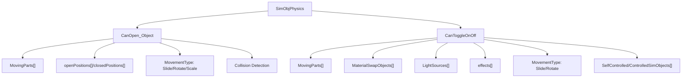
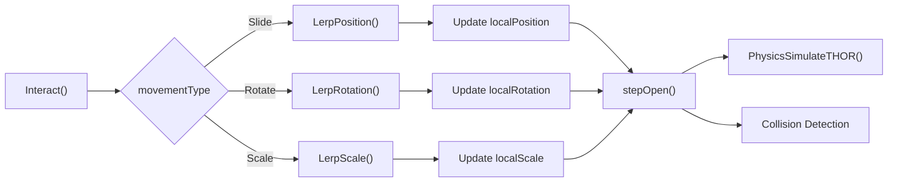
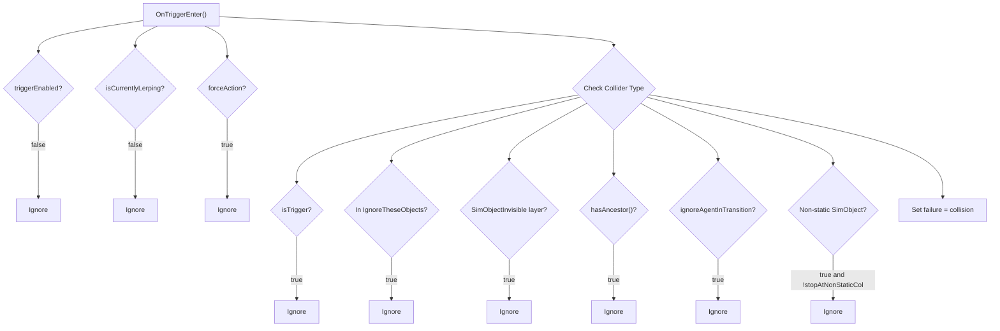
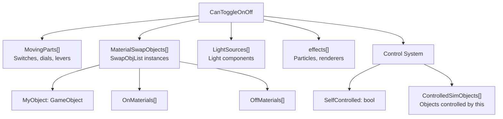
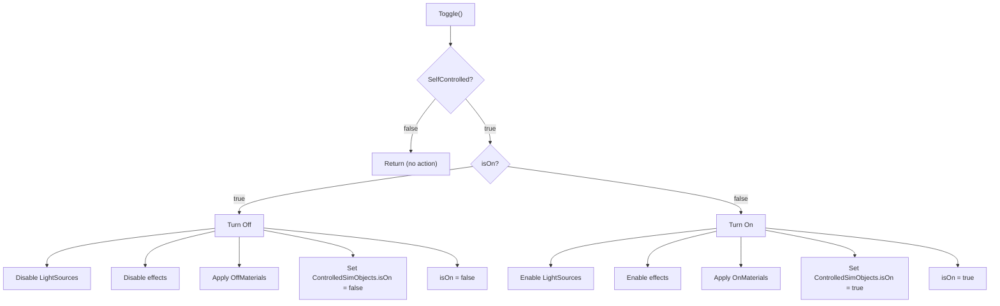
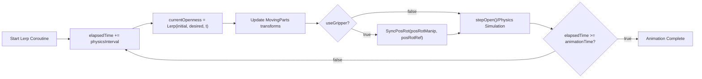
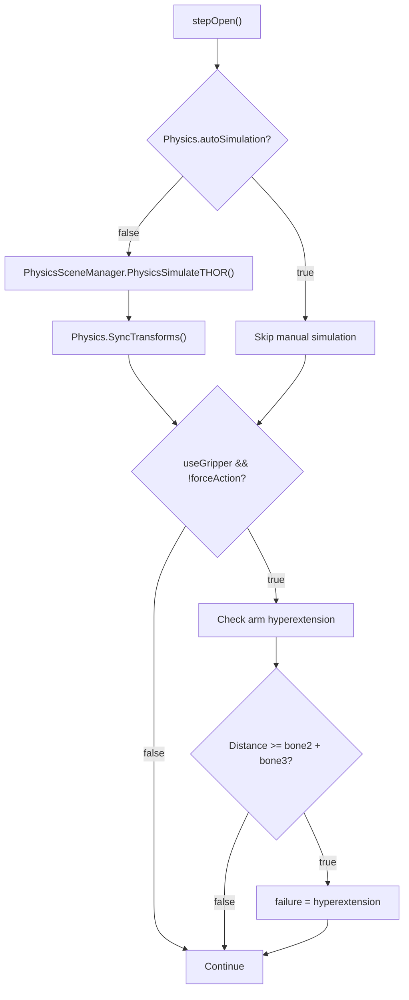

<!-- source: DeepWiki mcp.deepwiki.com · repo allenai/ai2thor · page 7.2 Interactive Behaviors · fetched 2026-10-30 -->

# Interactive Behaviors

Relevant source files

The following files were used as context for generating this wiki page:

- [unity/Assets/Scripts/CanOpen_Object.cs](unity/Assets/Scripts/CanOpen_Object.cs)
- [unity/Assets/Scripts/CanToggleOnOff.cs](unity/Assets/Scripts/CanToggleOnOff.cs)

This document covers the interactive behavior components that enable objects in AI2-THOR to respond to agent actions through opening/closing and on/off state changes. These behaviors form the core interaction mechanics for simulated objects beyond basic physics manipulation.

For information about the underlying object framework, see [SimObjPhysics Framework](#7.1). For dynamic state changes like breaking and slicing, see [Object State Changes](#7.3).

## Overview

Interactive behaviors in AI2-THOR are implemented through two primary component systems that attach to `SimObjPhysics` objects:

- **CanOpen_Object** - Handles objects that can open and close (cabinets, drawers, books, laptops)
- **CanToggleOnOff** - Handles objects that can be turned on and off (lights, microwaves, stoves)

Both systems support animated transitions with collision detection and failure handling to ensure realistic interactions within the physics simulation.

Sources: [unity/Assets/Scripts/CanOpen_Object.cs:1-631](), [unity/Assets/Scripts/CanToggleOnOff.cs:1-380]()

## CanOpen_Object System

The `CanOpen_Object` component manages objects that transition between open and closed states through physical movement of their parts.

### Core Configuration

| Property | Type | Purpose |
|----------|------|---------|
| `MovingParts` | `GameObject[]` | Parts that physically move during opening/closing |
| `openPositions` | `Vector3[]` | Target positions/rotations when fully open |
| `closedPositions` | `Vector3[]` | Target positions/rotations when fully closed |
| `currentOpenness` | `float` | Current state from 0.0 (closed) to 1.0 (open) |
| `movementType` | `MovementType` | How parts move: Slide, Rotate, or Scale |
| `animationTime` | `float` | Duration of open/close animation |

### Movement Types

The system supports three distinct movement patterns:

Sources: [unity/Assets/Scripts/CanOpen_Object.cs:185-278](), [unity/Assets/Scripts/CanOpen_Object.cs:281-427]()

### Collision Detection and Failure Handling

The opening/closing process includes comprehensive collision detection to prevent unrealistic interactions:

Sources: [unity/Assets/Scripts/CanOpen_Object.cs:465-540](), [unity/Assets/Scripts/CanOpen_Object.cs:31-38]()

## CanToggleOnOff System

The `CanToggleOnOff` component manages objects that switch between on and off states, affecting visual appearance, lighting, and other objects.

### Component Structure

Sources: [unity/Assets/Scripts/CanToggleOnOff.cs:24-88](), [unity/Assets/Scripts/CanToggleOnOff.cs:6-22]()

### Toggle Operation

The toggle mechanism coordinates multiple visual and functional changes:

Sources: [unity/Assets/Scripts/CanToggleOnOff.cs:159-294]()

### Control Relationships

The system supports hierarchical control where one object can control the state of others:

| Control Type | Example | Implementation |
|--------------|---------|----------------|
| Self-Controlled | Lamp, Laptop | `SelfControlled = true`, no `ControlledSimObjects` |
| Controller | Stove Knob | `SelfControlled = true`, has `ControlledSimObjects[]` |
| Controlled | Stove Burner | `SelfControlled = false`, referenced in another's `ControlledSimObjects` |

Sources: [unity/Assets/Scripts/CanToggleOnOff.cs:81-88](), [unity/Assets/Scripts/CanToggleOnOff.cs:95-103]()

## Animation System

Both behavior types share a common animation framework based on linear interpolation (lerping) between states.

### Lerp Coroutines

The animation system uses Unity coroutines to smoothly transition object parts:

Sources: [unity/Assets/Scripts/CanOpen_Object.cs:281-427](), [unity/Assets/Scripts/CanToggleOnOff.cs:296-350]()

### Physics Integration

The animation system integrates with the physics simulation through `stepOpen()` which handles both physics updates and collision detection:

Sources: [unity/Assets/Scripts/CanOpen_Object.cs:438-463]()

## Failure Recovery and Safety

The interactive behavior system includes multiple safety mechanisms to handle failed interactions:

### Failure States

| Failure Type | Trigger | Recovery Action |
|--------------|---------|-----------------|
| `collision` | OnTriggerEnter with valid collider | Reset to `lastSuccessfulOpenness` |
| `hyperextension` | Arm reaches maximum extension | Reset to `lastSuccessfulOpenness` |
| `none` | No failure detected | Continue normal operation |

### Safety Mechanisms

- **Force Action Mode**: Bypasses collision detection when `forceAction = true`
- **Ignore Arrays**: `IgnoreTheseObjects[]` prevents certain objects from triggering failures
- **Agent Interaction**: `ignoreAgentInTransition` prevents agent body from interfering
- **Static Object Handling**: `stopAtNonStaticCol` controls whether non-static objects block movement

Sources: [unity/Assets/Scripts/CanOpen_Object.cs:587-613](), [unity/Assets/Scripts/CanOpen_Object.cs:177-182]()

This interactive behavior system provides the foundation for realistic object interactions in AI2-THOR, enabling agents to manipulate the environment through opening containers, turning on appliances, and triggering visual state changes while maintaining physical plausibility through collision detection and failure recovery.

---

