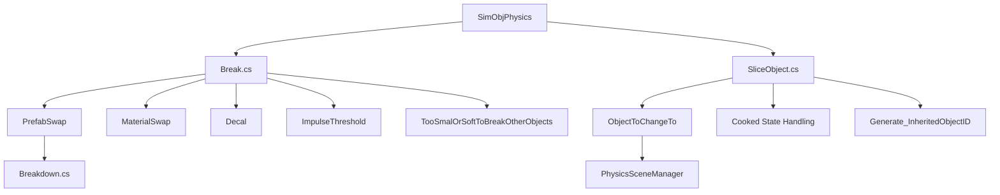
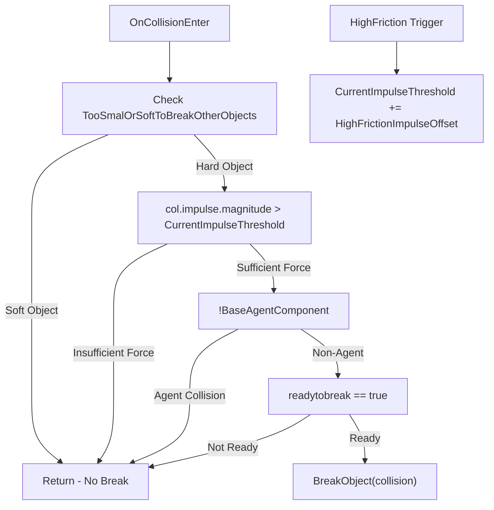
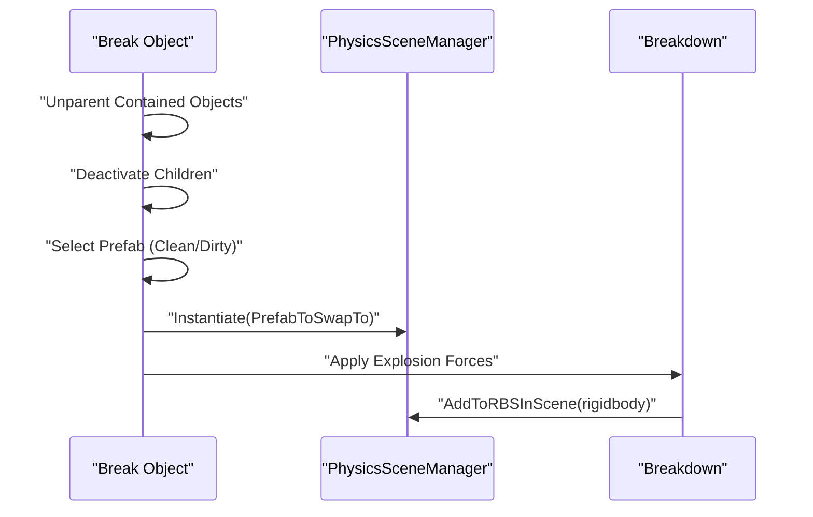
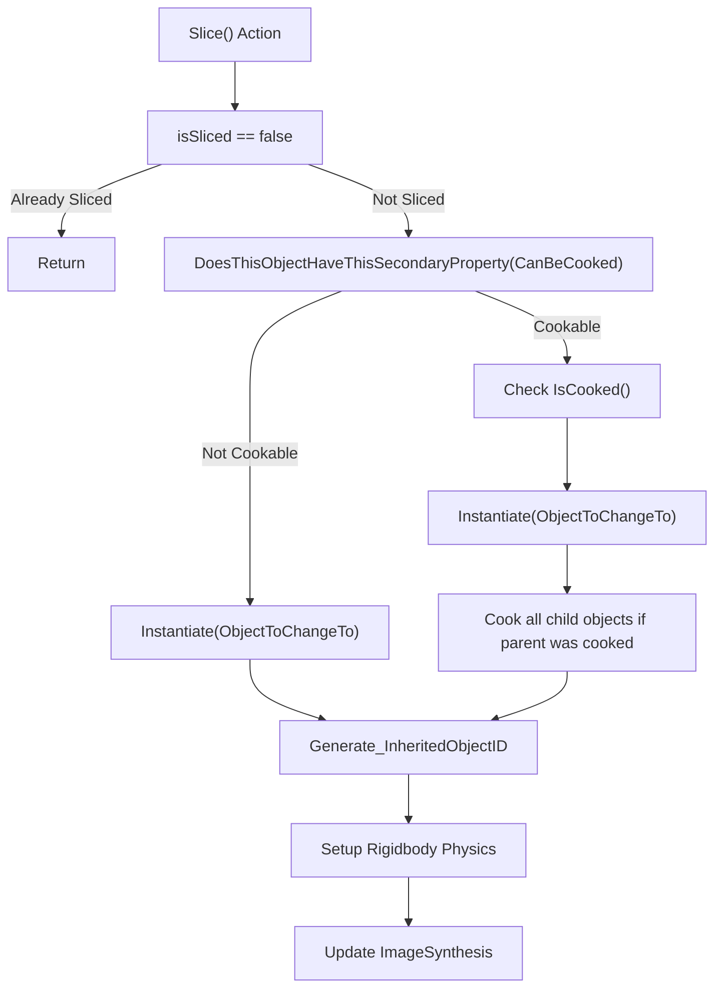
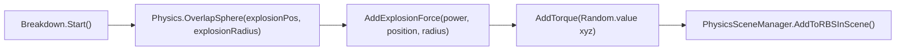

<!-- source: DeepWiki mcp.deepwiki.com · repo allenai/ai2thor · page 7.3 Object State Changes · fetched 2026-10-30 -->

# Object State Changes

<details>
<summary>Relevant source files</summary>

The following files were used as context for generating this wiki page:

- [unity/Assets/Physics/SimObjsPhysics/Bedroom Objects/Pencil/Prefabs.meta](unity/Assets/Physics/SimObjsPhysics/Bedroom Objects/Pencil/Prefabs.meta)
- [unity/Assets/Physics/SimObjsPhysics/Bedroom Objects/Pencil/Prefabs/Pencil_1.prefab.meta](unity/Assets/Physics/SimObjsPhysics/Bedroom Objects/Pencil/Prefabs/Pencil_1.prefab.meta)
- [unity/Assets/Physics/SimObjsPhysics/Bedroom Objects/Pencil/Prefabs/Pencil_2.prefab.meta](unity/Assets/Physics/SimObjsPhysics/Bedroom Objects/Pencil/Prefabs/Pencil_2.prefab.meta)
- [unity/Assets/Physics/SimObjsPhysics/Bedroom Objects/Pencil/Prefabs/Pencil_3.prefab.meta](unity/Assets/Physics/SimObjsPhysics/Bedroom Objects/Pencil/Prefabs/Pencil_3.prefab.meta)
- [unity/Assets/Physics/SimObjsPhysics/Bedroom Objects/Pencil/Prefabs/Pencil_4.prefab.meta](unity/Assets/Physics/SimObjsPhysics/Bedroom Objects/Pencil/Prefabs/Pencil_4.prefab.meta)
- [unity/Assets/Physics/SimObjsPhysics/Bedroom Objects/Pencil/Prefabs/Pencil_5.prefab.meta](unity/Assets/Physics/SimObjsPhysics/Bedroom Objects/Pencil/Prefabs/Pencil_5.prefab.meta)
- [unity/Assets/Physics/SimObjsPhysics/Custom Project Objects/Hide And Seek Objects/Objects to Spawn/HaS_Footstool_1.prefab](unity/Assets/Physics/SimObjsPhysics/Custom Project Objects/Hide And Seek Objects/Objects to Spawn/HaS_Footstool_1.prefab)
- [unity/Assets/Physics/SimObjsPhysics/Custom Project Objects/Hide And Seek Objects/Objects to Spawn/HaS_Tomato_1.prefab](unity/Assets/Physics/SimObjsPhysics/Custom Project Objects/Hide And Seek Objects/Objects to Spawn/HaS_Tomato_1.prefab)
- [unity/Assets/Physics/SimObjsPhysics/Kitchen Objects/Kettle/Prefabs.meta](unity/Assets/Physics/SimObjsPhysics/Kitchen Objects/Kettle/Prefabs.meta)
- [unity/Assets/Physics/SimObjsPhysics/Kitchen Objects/SaltShaker/Prefabs.meta](unity/Assets/Physics/SimObjsPhysics/Kitchen Objects/SaltShaker/Prefabs.meta)
- [unity/Assets/Scripts/Break.cs](unity/Assets/Scripts/Break.cs)
- [unity/Assets/Scripts/Break.cs.meta](unity/Assets/Scripts/Break.cs.meta)
- [unity/Assets/Scripts/Breakdown.cs](unity/Assets/Scripts/Breakdown.cs)
- [unity/Assets/Scripts/Breakdown.cs.meta](unity/Assets/Scripts/Breakdown.cs.meta)
- [unity/Assets/Scripts/SliceObject.cs](unity/Assets/Scripts/SliceObject.cs)

</details>


This page covers the AI2-THOR systems that handle dynamic state transitions of objects during simulation, specifically object breaking and slicing mechanics. These systems allow objects to transition from their intact state to broken or sliced variants through physics interactions or agent actions.

For information about other object behaviors like opening/closing or toggling, see [Interactive Behaviors](#7.2). For the underlying object framework, see [SimObjPhysics Framework](#7.1).

## Overview

The object state change system provides two primary mechanisms for altering object states:

1. **Breaking System** - Objects can break when subjected to sufficient physical force
2. **Slicing System** - Objects can be sliced through explicit agent actions

Both systems integrate with the `SimObjPhysics` framework and support multiple transformation methods including prefab swapping, material changes, and physics-based fragmentation.

## State Change Types and Components

The following diagram shows the relationship between the core components and the types of state changes they enable:



**Sources:** [unity/Assets/Scripts/Break.cs:1-282](), [unity/Assets/Scripts/SliceObject.cs:1-192](), [unity/Assets/Scripts/Breakdown.cs:1-35]()

## Breaking System

The breaking system is implemented primarily through the `Break` component, which monitors collision forces and triggers object destruction when thresholds are exceeded.

### Break Types

The system supports three break types defined in the `BreakType` enum:

| Break Type | Description | Implementation |
|------------|-------------|----------------|
| `PrefabSwap` | Replaces entire object with shattered pieces | Instantiates `PrefabToSwapTo` |
| `MaterialSwap` | Changes materials to show damage | Swaps materials in `MaterialSwapObjects` |
| `Decal` | Applies damage decals at collision points | Calls `BreakForDecalType()` |

### Force Thresholds and Collision Detection



The `ImpulseThreshold` (default 3.6) determines the force required to break an object. The `HighFrictionImpulseOffset` (default 2.0) increases this threshold when objects are in high-friction zones like rugs.

**Sources:** [unity/Assets/Scripts/Break.cs:233-266](), [unity/Assets/Scripts/Break.cs:270-280]()

### Prefab Swapping Process

When using `PrefabSwap` break type, the system follows this process:

1. **Container Handling** - If the object is a receptacle, contained objects are unparented and made kinematic
2. **Deactivation** - All child transforms are deactivated while preserving the root object
3. **Prefab Selection** - Chooses between `PrefabToSwapTo` and `DirtyPrefabToSwapTo` based on object cleanliness
4. **Spawning** - Instantiates the broken prefab at the original location
5. **Physics Transfer** - Transfers velocity and angular velocity to broken pieces



**Sources:** [unity/Assets/Scripts/Break.cs:104-191](), [unity/Assets/Scripts/Breakdown.cs:13-30]()

## Slicing System

The slicing system allows objects to be deliberately cut into pieces through the `Slice()` action, typically called by agent controllers.

### Slice Implementation

The `SliceObject` component handles the transition from whole objects to sliced variants:



### Object ID Inheritance

When objects are sliced, the resulting pieces inherit relationships to the original object through ID generation:

- **Single SimObj Result** - Gets inherited ID with index 0
- **Multiple SimObj Children** - Each gets inherited ID with incremental index
- **Special Cases** - Eggs get rotation reset to `Quaternion.Euler(Vector3.zero)`

**Sources:** [unity/Assets/Scripts/SliceObject.cs:58-171](), [unity/Assets/Scripts/SliceObject.cs:114-156]()

## Physics and Breakdown Effects

The `Breakdown` component manages the physics effects when broken objects are spawned, creating realistic fragmentation behavior.

### Explosion Physics



Default parameters:
- `power`: 10.0f
- `explosionRadius`: 0.25f
- Random torque applied to create realistic tumbling motion

**Sources:** [unity/Assets/Scripts/Breakdown.cs:8-30]()

## Integration with SimObjPhysics

Both breaking and slicing systems require specific secondary properties on `SimObjPhysics` objects:

| System | Required Property | Validation |
|--------|------------------|------------|
| Breaking | `SimObjSecondaryProperty.CanBreak` | Checked in `Break.Start()` |
| Slicing | `SimObjSecondaryProperty.CanBeSliced` | Checked in `SliceObject.OnEnable()` |

### Soft Object Exclusions

The breaking system maintains a list of object types that cannot break other objects due to being too soft or small:

```csharp
// Objects that won't cause breaking when they collide
TooSmalOrSoftToBreakOtherObjects = {
    SimObjType.TeddyBear, SimObjType.Pillow, SimObjType.Cloth,
    SimObjType.Bread, SimObjType.Egg, SimObjType.Tissue, ...
}
```

This prevents unrealistic scenarios like bread breaking a mug.

**Sources:** [unity/Assets/Scripts/Break.cs:45-73](), [unity/Assets/Scripts/Break.cs:83-93](), [unity/Assets/Scripts/SliceObject.cs:24-39]()

## Scene Management Integration

Both systems integrate with the broader scene management infrastructure:

- **PhysicsSceneManager** - Handles object ID generation and rigidbody caching
- **AgentManager** - Provides access to primary agent for image synthesis updates  
- **ImageSynthesis** - Updates renderers when new objects are spawned
- **Objects Transform** - Parent container for all spawned object pieces

**Sources:** [unity/Assets/Scripts/Break.cs:219-228](), [unity/Assets/Scripts/SliceObject.cs:162-170]()

---

