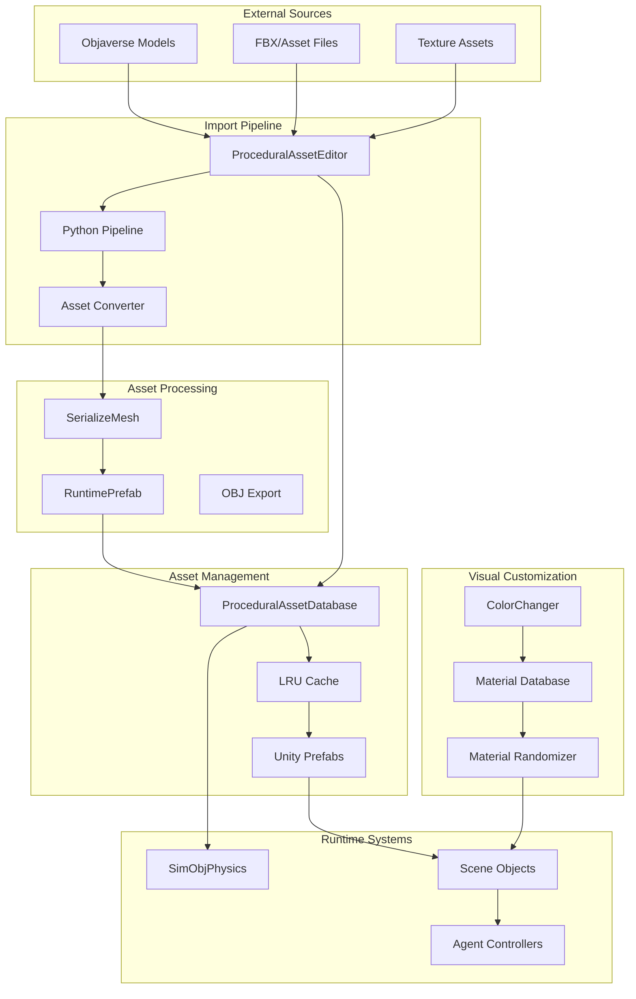
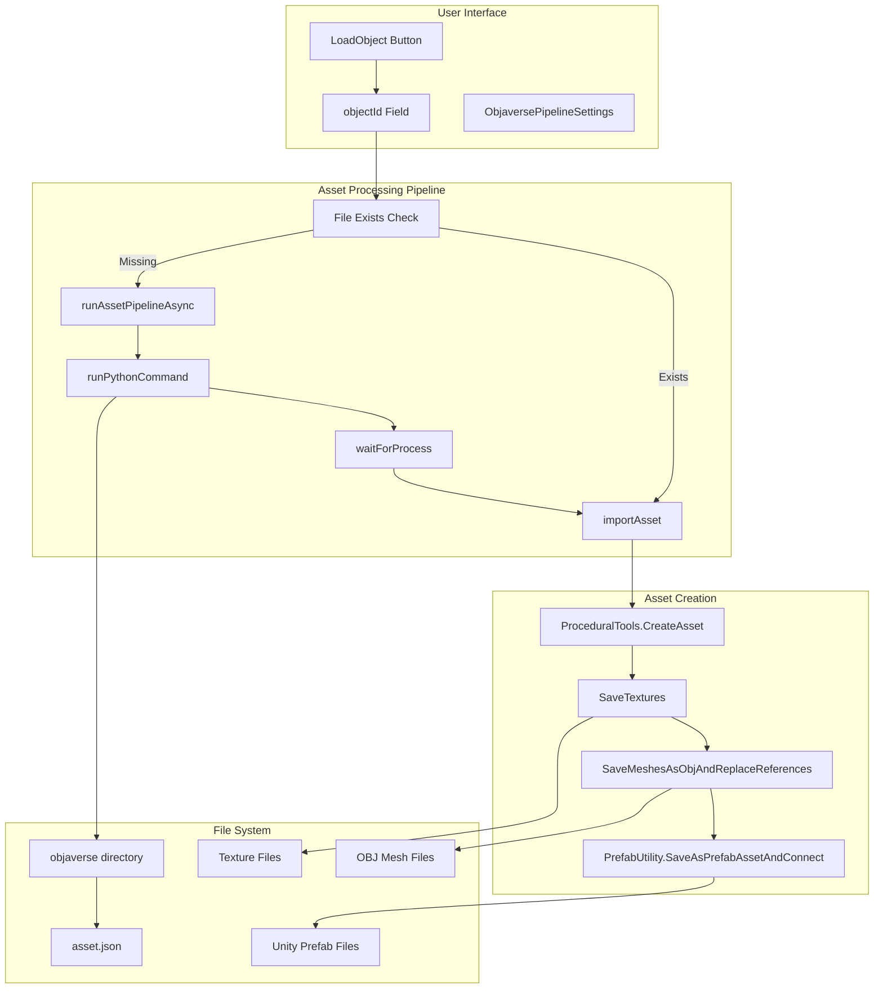
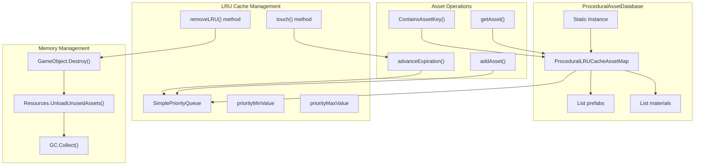
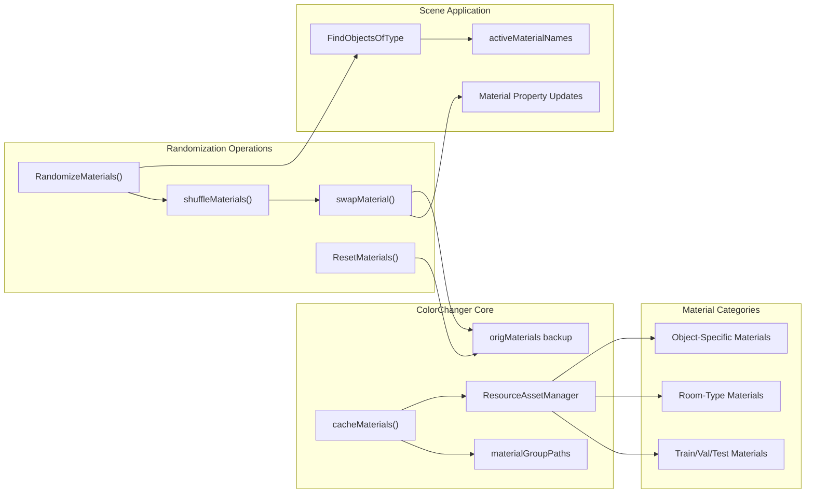
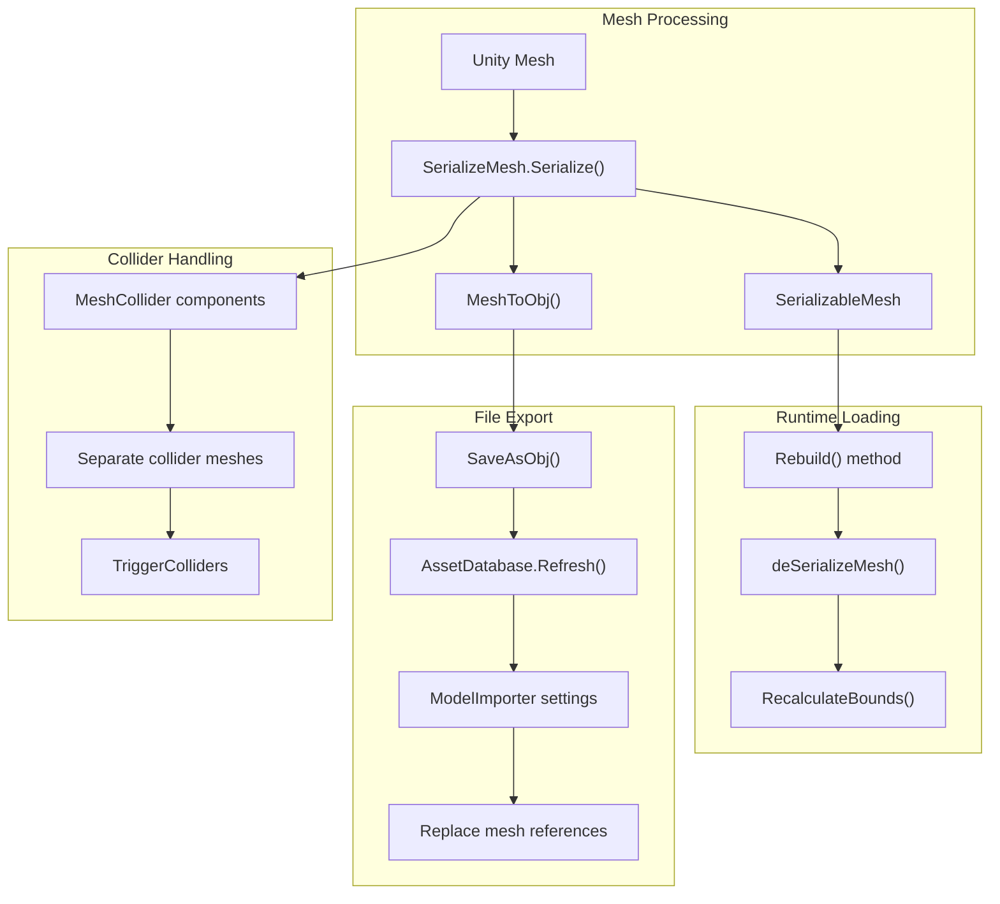
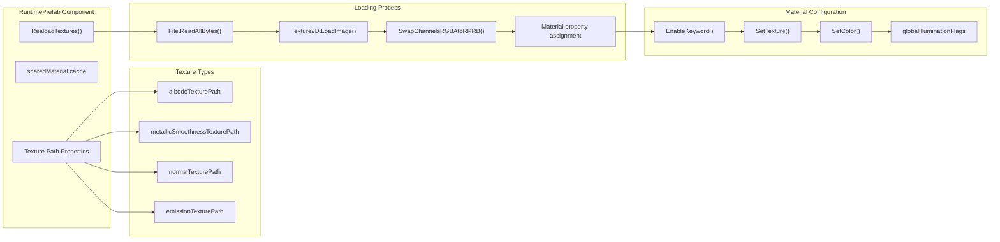

<!-- source: DeepWiki mcp.deepwiki.com · repo allenai/ai2thor · page 8 Content Creation and Management · fetched 2026-10-30 -->

# Content Creation and Management

Relevant source files

The following files were used as context for generating this wiki page:

- [scripts/objaverse_expand.py](scripts/objaverse_expand.py)
- [unity/Assets/Editor/ExpRoomEditor.cs](unity/Assets/Editor/ExpRoomEditor.cs)
- [unity/Assets/Editor/ExpRoomEditor.cs.meta](unity/Assets/Editor/ExpRoomEditor.cs.meta)
- [unity/Assets/Physics/SimObjsPhysics/Custom Project Objects/FurnMove/MATVStand.prefab](unity/Assets/Physics/SimObjsPhysics/Custom Project Objects/FurnMove/MATVStand.prefab)
- [unity/Assets/Physics/SimObjsPhysics/Custom Project Objects/FurnMove/MATVStand.prefab.meta](unity/Assets/Physics/SimObjsPhysics/Custom Project Objects/FurnMove/MATVStand.prefab.meta)
- [unity/Assets/Physics/SimObjsPhysics/Custom Project Objects/Hide And Seek Objects/ExperimentScene/ExpSceneScreens/screen_1.prefab](unity/Assets/Physics/SimObjsPhysics/Custom Project Objects/Hide And Seek Objects/ExperimentScene/ExpSceneScreens/screen_1.prefab)
- [unity/Assets/Physics/SimObjsPhysics/Custom Project Objects/Hide And Seek Objects/ExperimentScene/ExpSceneScreens/screen_2.prefab](unity/Assets/Physics/SimObjsPhysics/Custom Project Objects/Hide And Seek Objects/ExperimentScene/ExpSceneScreens/screen_2.prefab)
- [unity/Assets/Physics/SimObjsPhysics/Custom Project Objects/Hide And Seek Objects/ExperimentScene/ExpSceneScreens/screen_2.prefab.meta](unity/Assets/Physics/SimObjsPhysics/Custom Project Objects/Hide And Seek Objects/ExperimentScene/ExpSceneScreens/screen_2.prefab.meta)
- [unity/Assets/Physics/SimObjsPhysics/Custom Project Objects/Hide And Seek Objects/ExperimentScene/ExpSceneTable.meta](unity/Assets/Physics/SimObjsPhysics/Custom Project Objects/Hide And Seek Objects/ExperimentScene/ExpSceneTable.meta)
- [unity/Assets/Physics/SimObjsPhysics/Custom Project Objects/Hide And Seek Objects/ExperimentScene/ExpSceneTable/ExpRoomTable.prefab](unity/Assets/Physics/SimObjsPhysics/Custom Project Objects/Hide And Seek Objects/ExperimentScene/ExpSceneTable/ExpRoomTable.prefab)
- [unity/Assets/Physics/SimObjsPhysics/Custom Project Objects/Hide And Seek Objects/ExperimentScene/ExpSceneTable/ExpRoomTable.prefab.meta](unity/Assets/Physics/SimObjsPhysics/Custom Project Objects/Hide And Seek Objects/ExperimentScene/ExpSceneTable/ExpRoomTable.prefab.meta)
- [unity/Assets/Physics/SimObjsPhysics/Custom Project Objects/Hide And Seek Objects/ExperimentScene/Screen/Screen_Adjust_Script.cs](unity/Assets/Physics/SimObjsPhysics/Custom Project Objects/Hide And Seek Objects/ExperimentScene/Screen/Screen_Adjust_Script.cs)
- [unity/Assets/Physics/SimObjsPhysics/Custom Project Objects/Hide And Seek Objects/ExperimentScene/Screen/screen_grp.fbx](unity/Assets/Physics/SimObjsPhysics/Custom Project Objects/Hide And Seek Objects/ExperimentScene/Screen/screen_grp.fbx)
- [unity/Assets/Physics/SimObjsPhysics/Custom Project Objects/Hide And Seek Objects/ExperimentScene/Screen/screen_pair.prefab](unity/Assets/Physics/SimObjsPhysics/Custom Project Objects/Hide And Seek Objects/ExperimentScene/Screen/screen_pair.prefab)
- [unity/Assets/Physics/SimObjsPhysics/Custom Project Objects/Hide And Seek Objects/ExperimentScene/Screen/screen_pair.prefab.meta](unity/Assets/Physics/SimObjsPhysics/Custom Project Objects/Hide And Seek Objects/ExperimentScene/Screen/screen_pair.prefab.meta)
- [unity/Assets/Scenes/FloorPlan_ExpRoom.unity](unity/Assets/Scenes/FloorPlan_ExpRoom.unity)
- [unity/Assets/Scripts/CollisionListenerChild.cs](unity/Assets/Scripts/CollisionListenerChild.cs)
- [unity/Assets/Scripts/ColorChanger.cs](unity/Assets/Scripts/ColorChanger.cs)
- [unity/Assets/Scripts/DraggablePoint.cs](unity/Assets/Scripts/DraggablePoint.cs)
- [unity/Assets/Scripts/ExpRoom.meta](unity/Assets/Scripts/ExpRoom.meta)
- [unity/Assets/Scripts/ExpRoom/PhysicsRemoteFPSAgentController_partial_ExpRoom.cs.meta](unity/Assets/Scripts/ExpRoom/PhysicsRemoteFPSAgentController_partial_ExpRoom.cs.meta)
- [unity/Assets/Scripts/ProceduralAssetDatabase.cs](unity/Assets/Scripts/ProceduralAssetDatabase.cs)
- [unity/Assets/Scripts/ProceduralAssetEditor.cs](unity/Assets/Scripts/ProceduralAssetEditor.cs)
- [unity/Assets/Scripts/ProceduralAssetEditor.cs.meta](unity/Assets/Scripts/ProceduralAssetEditor.cs.meta)
- [unity/Assets/Scripts/RuntimePrefab.cs](unity/Assets/Scripts/RuntimePrefab.cs)
- [unity/Assets/Scripts/SerializeMesh.cs](unity/Assets/Scripts/SerializeMesh.cs)
- [unity/Assets/Scripts/SimUtil.cs](unity/Assets/Scripts/SimUtil.cs)

## Purpose and Scope

This document covers AI2-THOR's content creation and management systems, including procedural asset generation, material randomization, asset database management, and content creation tools. These systems enable dynamic scene construction, asset importing from external sources like Objaverse, and visual customization for experimental scenarios.

For information about scene generation and procedural environments, see [Procedural Generation](#6.2). For object physics and interactions, see [Object Interaction System](#7).

## System Architecture

The content creation and management system consists of several interconnected components that handle asset lifecycle from import to runtime usage.

### Overall Content Management Architecture

Sources: [unity/Assets/Scripts/ProceduralAssetEditor.cs:1-666](), [unity/Assets/Scripts/ProceduralAssetDatabase.cs:1-222](), [unity/Assets/Scripts/ColorChanger.cs:1-289]()

## Asset Import Pipeline

The asset import system handles conversion of external 3D models into AI2-THOR compatible assets through a multi-stage pipeline.

### Objaverse Integration Workflow

Sources: [unity/Assets/Scripts/ProceduralAssetEditor.cs:285-330](), [unity/Assets/Scripts/ProceduralAssetEditor.cs:596-645](), [unity/Assets/Scripts/SerializeMesh.cs:109-188]()

### Asset Database and Caching

The `ProceduralAssetDatabase` provides centralized asset management with LRU caching for memory efficiency.

Sources: [unity/Assets/Scripts/ProceduralAssetDatabase.cs:8-71](), [unity/Assets/Scripts/ProceduralAssetDatabase.cs:72-221]()

## Visual Customization System

The material and color customization system enables randomization and visual variation for experiments and training scenarios.

### Material Randomization Architecture

Sources: [unity/Assets/Scripts/ColorChanger.cs:14-102](), [unity/Assets/Scripts/ColorChanger.cs:146-231](), [unity/Assets/Scripts/ColorChanger.cs:233-267]()

## Content Creation Tools

### Experimental Scene Editor

The system includes specialized tools for experimental content creation, particularly for the ExpRoom scene.

| Tool Component | Purpose | Key Methods |
|----------------|---------|-------------|
| `ExpRoomEditor` | Interactive prefab management | `AddPickupableToAvailableObjects()`, `AddPickupableReceptaclesToAvailableContainers()` |
| `ProceduralAssetEditor` | Asset import and conversion | `LoadObject()`, `SaveObjectPrefabAndTextures()`, `FixPrefabs()` |
| `SerializeMesh` | Mesh serialization | `SaveMeshesAsObjAndReplaceReferences()`, `MeshToObj()` |
| `RuntimePrefab` | Runtime texture loading | `RealoadTextures()`, texture path management |

Sources: [unity/Assets/Editor/ExpRoomEditor.cs:9-418](), [unity/Assets/Scripts/ProceduralAssetEditor.cs:285-475]()

### Mesh and Asset Serialization

The mesh serialization system converts Unity meshes to portable formats and manages asset references.

Sources: [unity/Assets/Scripts/SerializeMesh.cs:49-78](), [unity/Assets/Scripts/SerializeMesh.cs:109-188](), [unity/Assets/Scripts/SerializeMesh.cs:226-306]()

### Runtime Asset Management

Runtime prefabs handle dynamic texture loading and material configuration for procedurally generated content.

Sources: [unity/Assets/Scripts/RuntimePrefab.cs:14-99](), [unity/Assets/Scripts/RuntimePrefab.cs:45-86]()

---

