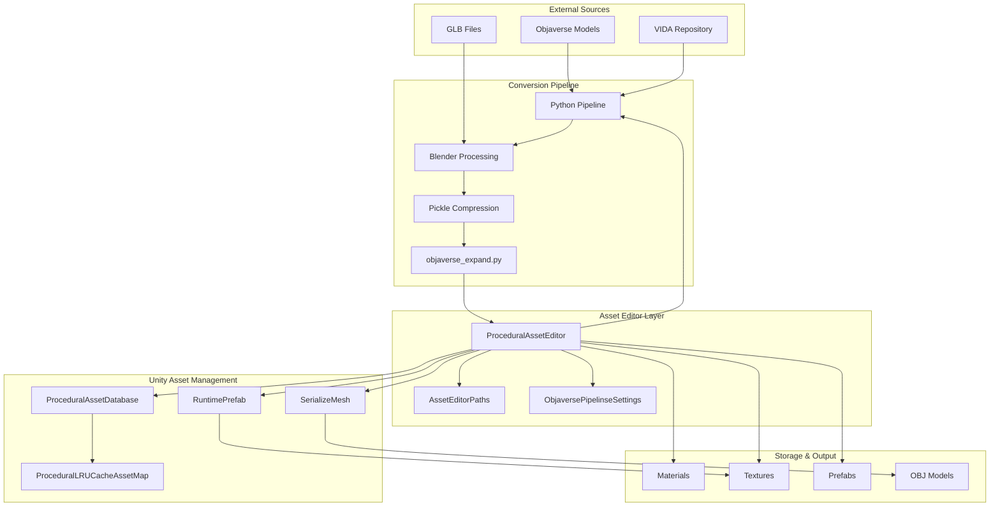
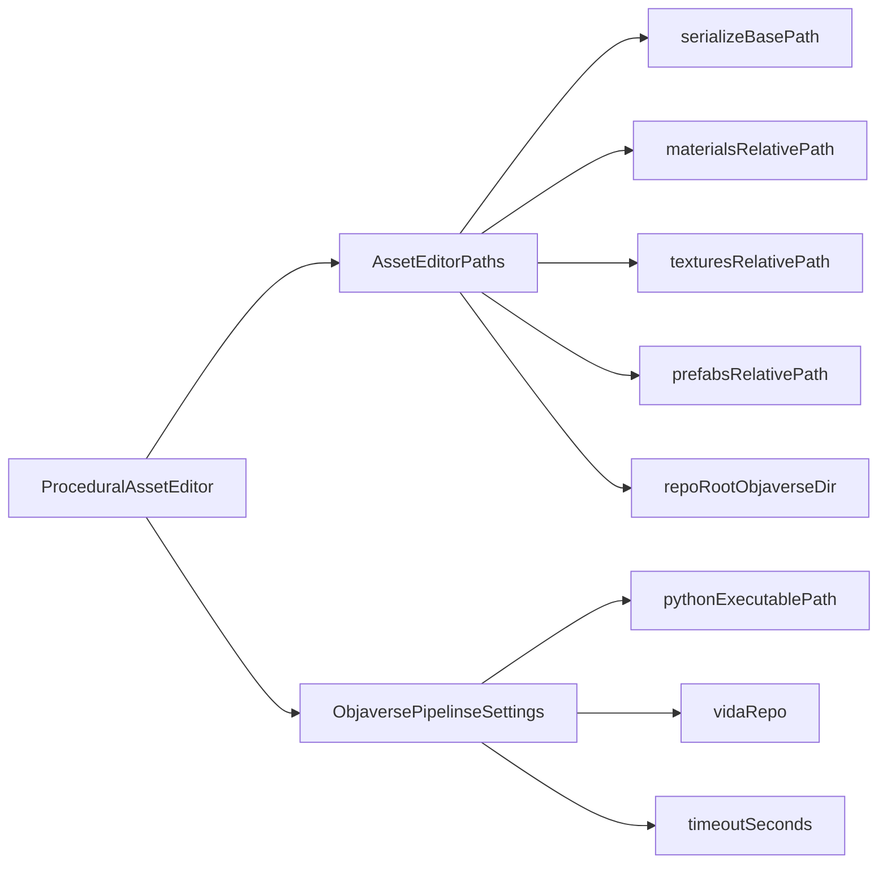
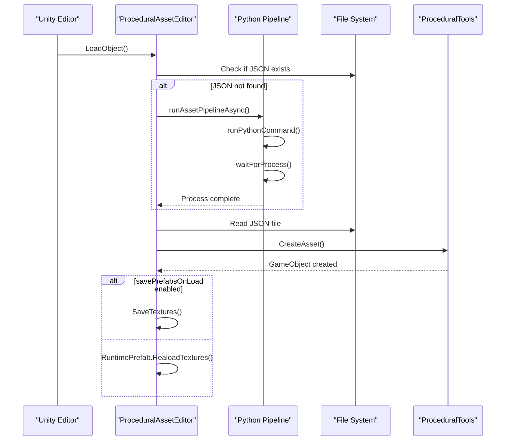
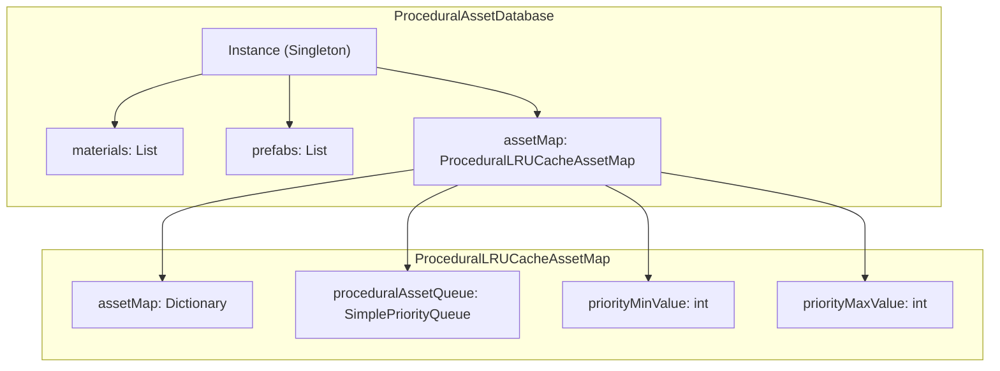
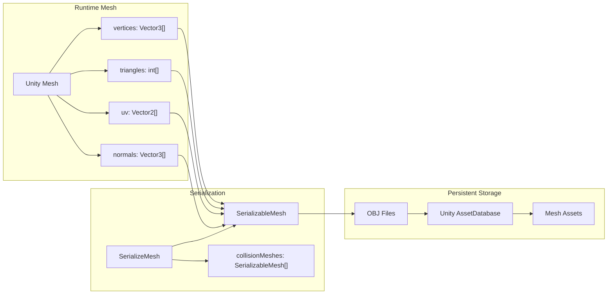
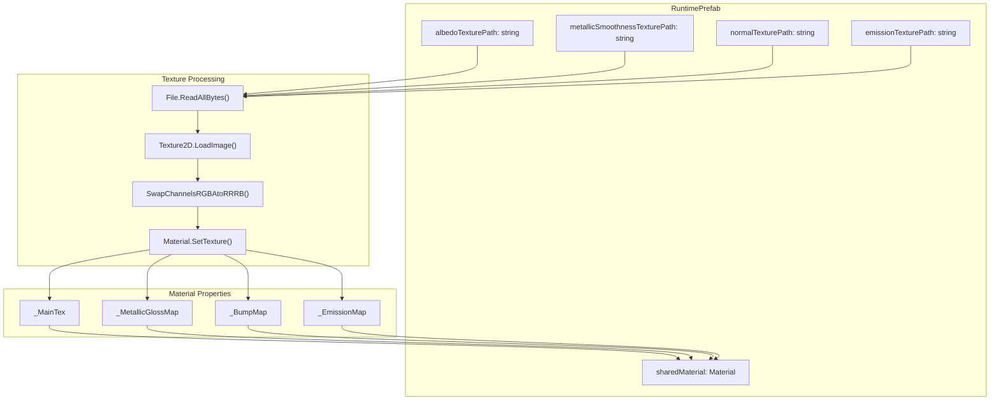
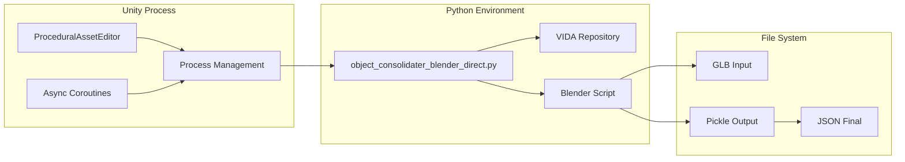
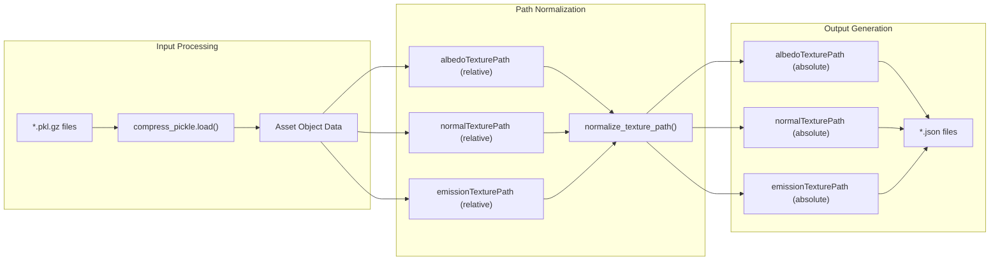

<!-- source: DeepWiki mcp.deepwiki.com · repo allenai/ai2thor · page 8.1 Asset Management Pipeline · fetched 2026-10-30 -->

# Asset Management Pipeline

Relevant source files

The following files were used as context for generating this wiki page:

- [scripts/objaverse_expand.py](scripts/objaverse_expand.py)
- [unity/Assets/Scripts/DraggablePoint.cs](unity/Assets/Scripts/DraggablePoint.cs)
- [unity/Assets/Scripts/ProceduralAssetDatabase.cs](unity/Assets/Scripts/ProceduralAssetDatabase.cs)
- [unity/Assets/Scripts/ProceduralAssetEditor.cs](unity/Assets/Scripts/ProceduralAssetEditor.cs)
- [unity/Assets/Scripts/ProceduralAssetEditor.cs.meta](unity/Assets/Scripts/ProceduralAssetEditor.cs.meta)
- [unity/Assets/Scripts/RuntimePrefab.cs](unity/Assets/Scripts/RuntimePrefab.cs)
- [unity/Assets/Scripts/SerializeMesh.cs](unity/Assets/Scripts/SerializeMesh.cs)

This document covers the Asset Management Pipeline system, which handles the integration, conversion, and management of 3D assets within AI2-THOR. The pipeline primarily focuses on importing external assets from Objaverse, converting them to Unity-compatible formats, and managing their lifecycle within the simulation environment.

For information about procedural house generation using these assets, see [Procedural Generation](#6.2). For details about the core object interaction framework, see [SimObjPhysics Framework](#7.1).

## System Overview

The Asset Management Pipeline consists of several interconnected components that handle the complete lifecycle of 3D assets, from external sources to runtime usage within Unity scenes.

### Core Components Architecture

Sources: [unity/Assets/Scripts/ProceduralAssetEditor.cs:1-666](), [unity/Assets/Scripts/ProceduralAssetDatabase.cs:1-222](), [scripts/objaverse_expand.py:1-46]()

## ProceduralAssetEditor

The `ProceduralAssetEditor` class serves as the central orchestrator for the asset import and conversion pipeline.

### Configuration Management

The configuration system manages file paths and external tool settings:

| Configuration Class | Purpose | Key Properties |
|---------------------|---------|----------------|
| `AssetEditorPaths` | File system organization | `serializeBasePath`, `materialsRelativePath`, `texturesRelativePath`, `prefabsRelativePath` |
| `ObjaversePipelinseSettings` | External pipeline configuration | `pythonExecutablePath`, `vidaRepo`, `timeoutSeconds` |

Sources: [unity/Assets/Scripts/ProceduralAssetEditor.cs:25-58]()

### Asset Import Workflow

The import process follows these key steps:

1. **Asset Validation**: Check if processed asset JSON exists locally
2. **Pipeline Execution**: Run external Python conversion pipeline if needed
3. **Asset Creation**: Use `ProceduralTools.CreateAsset()` to instantiate GameObject
4. **Texture Management**: Either save textures to disk or reload runtime textures

Sources: [unity/Assets/Scripts/ProceduralAssetEditor.cs:284-330](), [unity/Assets/Scripts/ProceduralAssetEditor.cs:596-645]()

## Asset Database and Caching

The `ProceduralAssetDatabase` manages runtime asset storage with LRU caching capabilities.

### Database Architecture

### LRU Cache Operations

The caching system implements intelligent memory management:

| Operation | Method | Purpose |
|-----------|--------|---------|
| Asset Addition | `addAsset()` | Add asset to cache with max priority |
| Cache Touch | `touch()` | Update asset priority to prevent eviction |
| LRU Removal | `removeLRU()` | Remove least recently used assets |
| Priority Advance | `advanceExpiration()` | Age existing cache entries |

Sources: [unity/Assets/Scripts/ProceduralAssetDatabase.cs:8-70](), [unity/Assets/Scripts/ProceduralAssetDatabase.cs:72-220]()

## Mesh Serialization and Storage

The `SerializeMesh` component handles conversion between Unity meshes and persistent storage formats.

### Mesh Processing Pipeline

### OBJ Export Format

The system converts Unity meshes to OBJ format using specific formatting rules:

- Vertices: `v {-x} {y} {z}` (X-axis flipped for coordinate system conversion)
- Normals: `vn {-x} {y} {z}` (X-axis flipped)
- UVs: `vt {x} {y}`
- Faces: `f {v1}/{vt1}/{vn1} {v2}/{vt2}/{vn2} {v3}/{vt3}/{vn3}`

Sources: [unity/Assets/Scripts/SerializeMesh.cs:49-78](), [unity/Assets/Scripts/SerializeMesh.cs:109-187]()

## Runtime Texture Management

The `RuntimePrefab` component manages dynamic texture loading for procedurally generated assets.

### Texture Loading System

### Texture Format Handling

The system handles different texture formats with specific processing:

- **JPG Metallic/Smoothness**: Channel swapping from RGBA to RRRB format
- **Normal Maps**: Automatic keyword enabling (`_NORMALMAP`)
- **Emission Maps**: Global illumination flags and emission color settings
- **Shared Materials**: Texture caching across multiple instances

Sources: [unity/Assets/Scripts/RuntimePrefab.cs:32-86](), [unity/Assets/Scripts/RuntimePrefab.cs:88-99]()

## External Pipeline Integration

The system integrates with external Python-based processing tools for asset conversion.

### Python Pipeline Architecture

### Process Management

The pipeline includes robust process management features:

| Feature | Implementation | Purpose |
|---------|---------------|---------|
| Timeout Handling | `timeoutSeconds` configuration | Prevent hanging processes |
| Progress Tracking | `EditorUtility.DisplayProgressBar()` | User feedback |
| Process Cancellation | `CancelAll()` method | Manual abort capability |
| Output Monitoring | `OutputDataReceived` events | Real-time logging |

Sources: [unity/Assets/Scripts/ProceduralAssetEditor.cs:498-590](), [unity/Assets/Scripts/ProceduralAssetEditor.cs:332-350]()

## Asset Expansion Utilities

The `objaverse_expand.py` script handles conversion from compressed pickle format to Unity-compatible JSON.

### Expansion Process

The expansion utility performs:
- **Decompression**: Extract pickle data to memory
- **Path Resolution**: Convert relative texture paths to absolute paths
- **JSON Export**: Serialize processed data to Unity-readable format

Sources: [scripts/objaverse_expand.py:8-32]()

---

