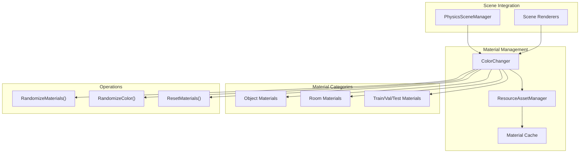
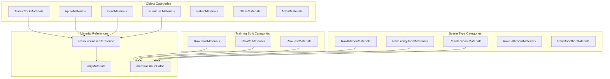
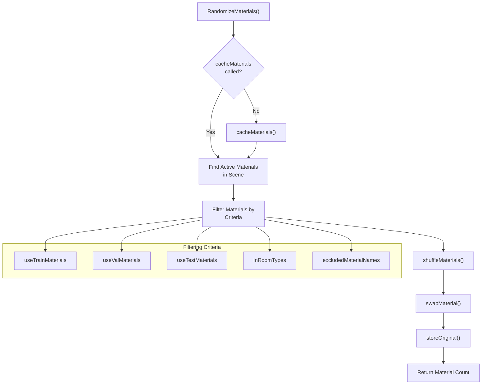
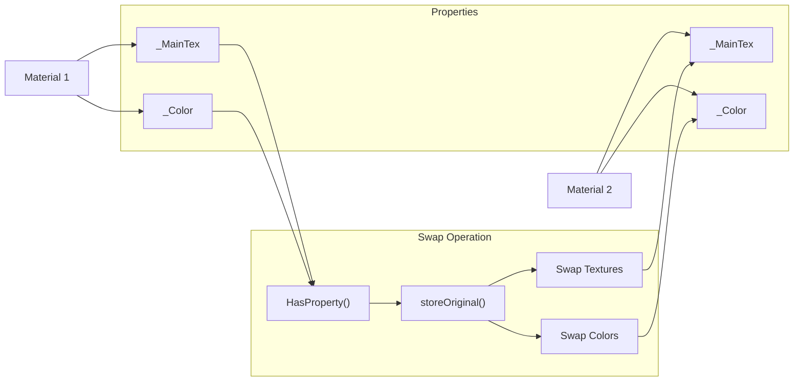

<!-- source: DeepWiki mcp.deepwiki.com · repo allenai/ai2thor · page 8.2 Visual Customization · fetched 2026-10-30 -->

# Visual Customization

<details>
<summary>Relevant source files</summary>

The following files were used as context for generating this wiki page:

- [unity/Assets/Editor/ExpRoomEditor.cs](unity/Assets/Editor/ExpRoomEditor.cs)
- [unity/Assets/Editor/ExpRoomEditor.cs.meta](unity/Assets/Editor/ExpRoomEditor.cs.meta)
- [unity/Assets/Physics/SimObjsPhysics/Custom Project Objects/FurnMove/MATVStand.prefab](unity/Assets/Physics/SimObjsPhysics/Custom Project Objects/FurnMove/MATVStand.prefab)
- [unity/Assets/Physics/SimObjsPhysics/Custom Project Objects/FurnMove/MATVStand.prefab.meta](unity/Assets/Physics/SimObjsPhysics/Custom Project Objects/FurnMove/MATVStand.prefab.meta)
- [unity/Assets/Physics/SimObjsPhysics/Custom Project Objects/Hide And Seek Objects/ExperimentScene/ExpSceneScreens/screen_1.prefab](unity/Assets/Physics/SimObjsPhysics/Custom Project Objects/Hide And Seek Objects/ExperimentScene/ExpSceneScreens/screen_1.prefab)
- [unity/Assets/Physics/SimObjsPhysics/Custom Project Objects/Hide And Seek Objects/ExperimentScene/ExpSceneScreens/screen_2.prefab](unity/Assets/Physics/SimObjsPhysics/Custom Project Objects/Hide And Seek Objects/ExperimentScene/ExpSceneScreens/screen_2.prefab)
- [unity/Assets/Physics/SimObjsPhysics/Custom Project Objects/Hide And Seek Objects/ExperimentScene/ExpSceneScreens/screen_2.prefab.meta](unity/Assets/Physics/SimObjsPhysics/Custom Project Objects/Hide And Seek Objects/ExperimentScene/ExpSceneScreens/screen_2.prefab.meta)
- [unity/Assets/Physics/SimObjsPhysics/Custom Project Objects/Hide And Seek Objects/ExperimentScene/ExpSceneTable.meta](unity/Assets/Physics/SimObjsPhysics/Custom Project Objects/Hide And Seek Objects/ExperimentScene/ExpSceneTable.meta)
- [unity/Assets/Physics/SimObjsPhysics/Custom Project Objects/Hide And Seek Objects/ExperimentScene/ExpSceneTable/ExpRoomTable.prefab](unity/Assets/Physics/SimObjsPhysics/Custom Project Objects/Hide And Seek Objects/ExperimentScene/ExpSceneTable/ExpRoomTable.prefab)
- [unity/Assets/Physics/SimObjsPhysics/Custom Project Objects/Hide And Seek Objects/ExperimentScene/ExpSceneTable/ExpRoomTable.prefab.meta](unity/Assets/Physics/SimObjsPhysics/Custom Project Objects/Hide And Seek Objects/ExperimentScene/ExpSceneTable/ExpRoomTable.prefab.meta)
- [unity/Assets/Physics/SimObjsPhysics/Custom Project Objects/Hide And Seek Objects/ExperimentScene/Screen/Screen_Adjust_Script.cs](unity/Assets/Physics/SimObjsPhysics/Custom Project Objects/Hide And Seek Objects/ExperimentScene/Screen/Screen_Adjust_Script.cs)
- [unity/Assets/Physics/SimObjsPhysics/Custom Project Objects/Hide And Seek Objects/ExperimentScene/Screen/screen_grp.fbx](unity/Assets/Physics/SimObjsPhysics/Custom Project Objects/Hide And Seek Objects/ExperimentScene/Screen/screen_grp.fbx)
- [unity/Assets/Physics/SimObjsPhysics/Custom Project Objects/Hide And Seek Objects/ExperimentScene/Screen/screen_pair.prefab](unity/Assets/Physics/SimObjsPhysics/Custom Project Objects/Hide And Seek Objects/ExperimentScene/Screen/screen_pair.prefab)
- [unity/Assets/Physics/SimObjsPhysics/Custom Project Objects/Hide And Seek Objects/ExperimentScene/Screen/screen_pair.prefab.meta](unity/Assets/Physics/SimObjsPhysics/Custom Project Objects/Hide And Seek Objects/ExperimentScene/Screen/screen_pair.prefab.meta)
- [unity/Assets/Scenes/FloorPlan_ExpRoom.unity](unity/Assets/Scenes/FloorPlan_ExpRoom.unity)
- [unity/Assets/Scripts/CollisionListenerChild.cs](unity/Assets/Scripts/CollisionListenerChild.cs)
- [unity/Assets/Scripts/ColorChanger.cs](unity/Assets/Scripts/ColorChanger.cs)
- [unity/Assets/Scripts/ExpRoom.meta](unity/Assets/Scripts/ExpRoom.meta)
- [unity/Assets/Scripts/ExpRoom/PhysicsRemoteFPSAgentController_partial_ExpRoom.cs.meta](unity/Assets/Scripts/ExpRoom/PhysicsRemoteFPSAgentController_partial_ExpRoom.cs.meta)
- [unity/Assets/Scripts/SimUtil.cs](unity/Assets/Scripts/SimUtil.cs)

</details>


This document covers the visual customization system in AI2-THOR, primarily implemented through the `ColorChanger` component. This system enables material randomization, color variation, and visual domain adaptation for experimental scenarios and training data generation.

For information about asset management and procedural content creation, see [Asset Management Pipeline](#8.1). For scene-specific configurations, see [Physics Scenes](#6.1).

## System Overview

The visual customization system provides runtime material and color randomization capabilities to support domain randomization experiments, visual variety in training data, and experimental scene setup. The core functionality is implemented in the `ColorChanger` class, which manages material assets, performs randomization operations, and maintains state for reset operations.

**System Architecture**



Sources: [unity/Assets/Scripts/ColorChanger.cs:5-288]()

## Material Organization

The `ColorChanger` system organizes materials into hierarchical categories to enable targeted randomization and maintain experimental control.

**Material Category Structure**



The system maintains several data structures for material organization:
- `objectMaterials`: Maps material category names to lists of `ResourceAssetReference<Material>`
- `materialGroupPaths`: Maps group labels to sets of material resource paths
- `origMaterials`: Stores original material states for reset operations

Sources: [unity/Assets/Scripts/ColorChanger.cs:9-12](), [unity/Assets/Scripts/ColorChanger.cs:15-69](), [unity/Assets/Scripts/ColorChanger.cs:70-80]()

## Material Caching and Loading

The `cacheMaterials()` method initializes the material reference system by loading and categorizing materials based on Unity asset labels.

| Material Category | Examples | Purpose |
|------------------|----------|---------|
| Object-Specific | `AppleMaterials`, `BowlMaterials`, `ChairMaterials` | Target specific object types |
| Generic | `FabricMaterials`, `MetalMaterials`, `WoodMaterials` | Broad material categories |
| Room-Specific | `RawKitchenMaterials`, `RawBedroomMaterials` | Scene-type filtering |
| Training Splits | `RawTrainMaterials`, `RawValMaterials` | Dataset partitioning |

The caching process:
1. Instantiates `ResourceAssetManager` for asset discovery
2. Loads material references for each category using Unity labels
3. Builds path lookup tables for filtering operations
4. Establishes cross-references between categories

Sources: [unity/Assets/Scripts/ColorChanger.cs:14-102]()

## Randomization Operations

The visual customization system provides three primary randomization operations with different scopes and effects.

**Randomization Workflow**



### Material Randomization

The `RandomizeMaterials()` method performs selective material swapping based on filtering criteria:

**Parameters:**
- `useTrainMaterials`, `useValMaterials`, `useTestMaterials`: Enable specific training split materials
- `inRoomTypes`: Restrict to specific room types (kitchen, livingroom, bedroom, bathroom, robothor)
- `excludedMaterialNames`: Materials to skip during randomization

**Process:**
1. Scans scene for active materials on renderers
2. Filters available materials by training split and room type
3. Performs Fisher-Yates shuffle on material groups
4. Swaps texture and color properties between materials
5. Stores original states for reset capability

Sources: [unity/Assets/Scripts/ColorChanger.cs:146-231]()

### Color Randomization

The `RandomizeColor()` method provides broader color variation by modifying material color properties directly:

```csharp
// Generates random HSV colors with controlled ranges
mat.color = Random.ColorHSV(0f, 1f, 0.5f, 1f, 0.5f, 1f);
```

This approach:
- Maintains saturation and value bounds for visual consistency
- Applies to all materials with `_Color` properties
- Preserves texture information while varying colors
- Stores original colors for reset operations

Sources: [unity/Assets/Scripts/ColorChanger.cs:245-258]()

## Material Property Management

The system manipulates two primary material properties for visual customization:

**Property Swapping Logic**



The `swapMaterial()` method safely exchanges properties between materials:
- Validates property existence using `HasProperty()`
- Stores original states before modification
- Performs atomic texture and color swaps
- Maintains material integrity throughout the process

Sources: [unity/Assets/Scripts/ColorChanger.cs:110-125](), [unity/Assets/Scripts/ColorChanger.cs:104-108]()

## State Management and Reset

The visual customization system maintains original material states to enable reset operations and experimental repeatability.

**Reset Operations:**
- `ResetMaterials()`: Restores both texture and color properties
- `ResetColors()`: Restores only color properties

The reset system uses the `origMaterials` dictionary to map current materials to their original states, ensuring complete restoration of visual properties after randomization experiments.

Sources: [unity/Assets/Scripts/ColorChanger.cs:233-243](), [unity/Assets/Scripts/ColorChanger.cs:260-267]()

## Integration with Scene Management

The `ColorChanger` is typically attached to the `PhysicsSceneManager` prefab and integrated into the scene initialization workflow. The system coordinates with:

- **Scene Loading**: Material caching occurs during scene setup
- **Renderer Discovery**: Active material detection through `GameObject.FindObjectsOfType<Renderer>()`
- **Asset Management**: Integration with Unity's resource and labeling systems
- **Experimental Control**: Filtering and exclusion mechanisms for controlled randomization

The system supports both runtime randomization for interactive experiments and batch processing for dataset generation.

Sources: [unity/Assets/Scripts/ColorChanger.cs:177-186](), [unity/Assets/Scripts/ColorChanger.cs:269-287]()

---

