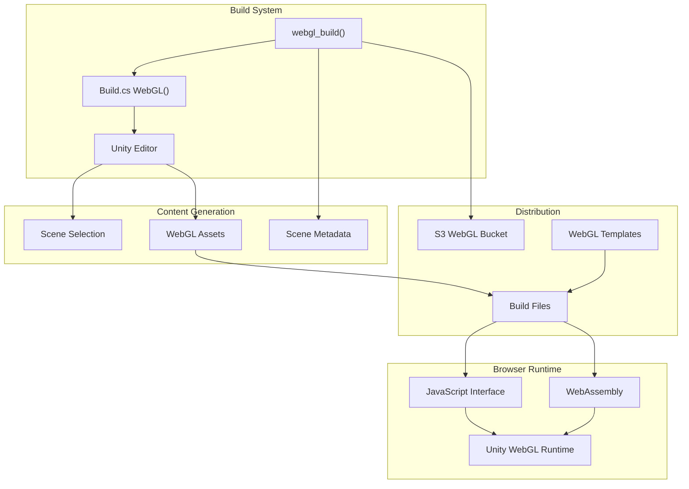
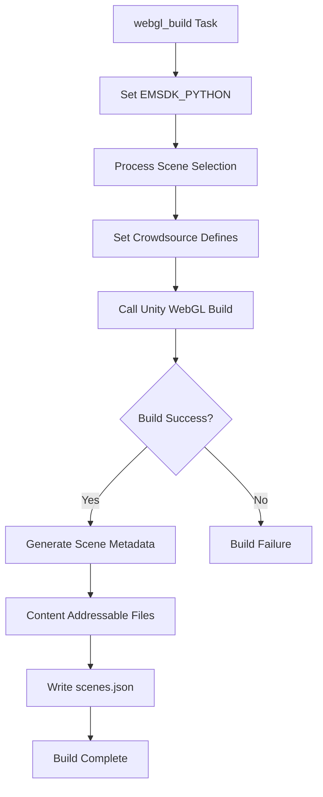
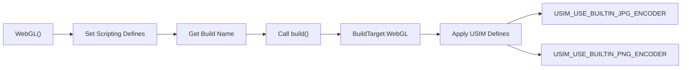
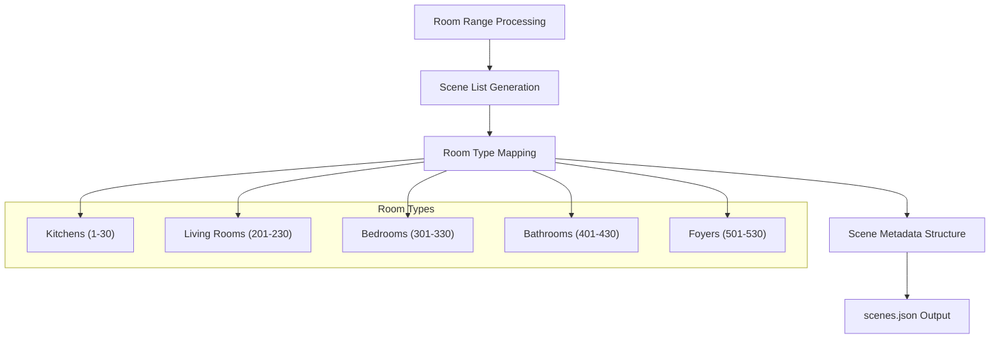
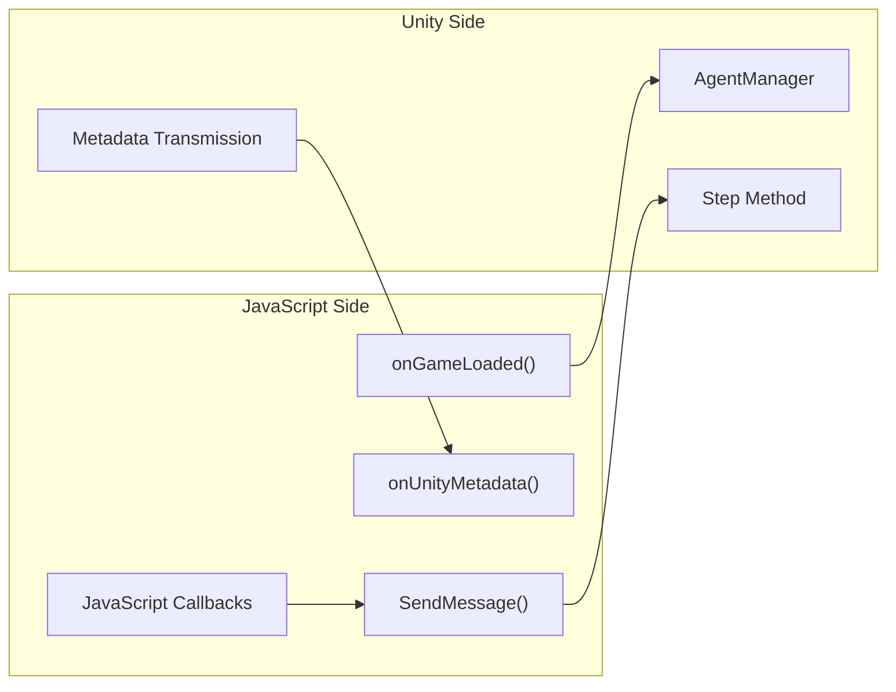
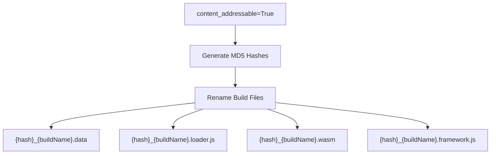
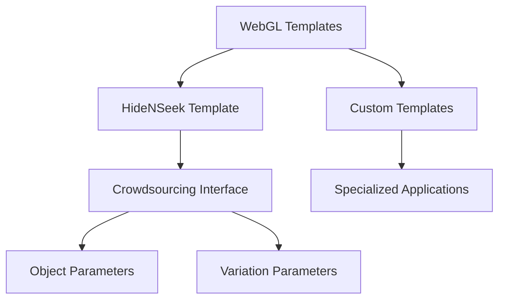

<!-- source: DeepWiki mcp.deepwiki.com · repo allenai/ai2thor · page 9 WebGL Integration · fetched 2026-10-30 -->

# WebGL Integration

Relevant source files

The following files were used as context for generating this wiki page:

- [.dockerignore](.dockerignore)
- [Dockerfile](Dockerfile)
- [README.md](README.md)
- [WEBGL.md](WEBGL.md)
- [ai2thor/__init__.py](ai2thor/__init__.py)
- [ai2thor/build.py](ai2thor/build.py)
- [ai2thor/controller.py](ai2thor/controller.py)
- [ai2thor/docker.py](ai2thor/docker.py)
- [ai2thor/downloader.py](ai2thor/downloader.py)
- [ai2thor/fifo_server.py](ai2thor/fifo_server.py)
- [ai2thor/platform.py](ai2thor/platform.py)
- [ai2thor/server.py](ai2thor/server.py)
- [ai2thor/tests/build_controller.py](ai2thor/tests/build_controller.py)
- [ai2thor/tests/constants.py](ai2thor/tests/constants.py)
- [ai2thor/tests/data/arm/new/pickup_object.json](ai2thor/tests/data/arm/new/pickup_object.json)
- [ai2thor/tests/data/image-depth-data256.raw](ai2thor/tests/data/image-depth-data256.raw)
- [ai2thor/tests/data/image-depth-datafloat32.raw](ai2thor/tests/data/image-depth-datafloat32.raw)
- [ai2thor/tests/fifo_client.py](ai2thor/tests/fifo_client.py)
- [ai2thor/tests/test_controller.py](ai2thor/tests/test_controller.py)
- [ai2thor/tests/test_event.py](ai2thor/tests/test_event.py)
- [ai2thor/tests/test_fifo_server.py](ai2thor/tests/test_fifo_server.py)
- [ai2thor/tests/test_server.py](ai2thor/tests/test_server.py)
- [ai2thor/tests/test_unity.py](ai2thor/tests/test_unity.py)
- [ai2thor/wsgi_server.py](ai2thor/wsgi_server.py)
- [doc/static/ReleaseNotes/Cook.png](doc/static/ReleaseNotes/Cook.png)
- [doc/static/ReleaseNotes/Dirty.png](doc/static/ReleaseNotes/Dirty.png)
- [doc/static/ReleaseNotes/Fill.png](doc/static/ReleaseNotes/Fill.png)
- [doc/static/ReleaseNotes/Moveable.png](doc/static/ReleaseNotes/Moveable.png)
- [doc/static/ReleaseNotes/ReleaseNotes_2.4.md](doc/static/ReleaseNotes/ReleaseNotes_2.4.md)
- [doc/static/ReleaseNotes/Slice.png](doc/static/ReleaseNotes/Slice.png)
- [doc/static/ReleaseNotes/UseUp.png](doc/static/ReleaseNotes/UseUp.png)
- [start.sh](start.sh)
- [tasks.py](tasks.py)
- [unity/Assets/Editor/Build.cs](unity/Assets/Editor/Build.cs)
- [unity/Assets/Physics/SimObjsPhysics/RoboTHOR Objects/RoboTHOR_Assets_SmallObjects/Target_SmallObjects/SprayBottle/Materials.meta](unity/Assets/Physics/SimObjsPhysics/RoboTHOR Objects/RoboTHOR_Assets_SmallObjects/Target_SmallObjects/SprayBottle/Materials.meta)
- [unity/Assets/Resources/MagicMirror/Prefab/MirrorMaterial.mat](unity/Assets/Resources/MagicMirror/Prefab/MirrorMaterial.mat)
- [unity/Assets/Scripts/FifoServer.cs](unity/Assets/Scripts/FifoServer.cs)
- [unity/Assets/Scripts/ImageSynthesis/ImageSynthesis.cs](unity/Assets/Scripts/ImageSynthesis/ImageSynthesis.cs)
- [unity/Assets/Scripts/ImageSynthesis/Shaders/Depth.shader](unity/Assets/Scripts/ImageSynthesis/Shaders/Depth.shader)
- [unity/ProjectSettings/GraphicsSettings.asset](unity/ProjectSettings/GraphicsSettings.asset)

## Purpose and Scope

The WebGL Integration system enables AI2-THOR to run in web browsers through Unity's WebGL build target. This system provides the infrastructure for creating browser-based interfaces for AI2-THOR simulations, enabling applications such as crowdsourcing tasks, web-based data collection, and accessible simulation environments without requiring local Unity installations.

For information about general build processes and deployment infrastructure, see [Build System and Deployment](#4.2). For Unity project configuration details, see [Unity Project Configuration](#11).

## WebGL Build System Overview

The WebGL integration consists of several interconnected components that handle building, deploying, and running AI2-THOR in web browsers:

**Sources:** [tasks.py:514-636](), [unity/Assets/Editor/Build.cs:59-70](), [ai2thor/build.py:24]()

## Build Process and Task Automation

The WebGL build process is orchestrated through the `webgl_build` invoke task, which handles scene selection, Unity compilation, and metadata generation:

The task supports several configuration options:

| Parameter | Description | Default |
|-----------|-------------|---------|
| `scenes` | Comma-separated scene list | All scenes |
| `room_ranges` | Range-based scene selection | None |
| `prefix` | Build name prefix | "local" |
| `content_addressable` | Hash-based file naming | False |
| `crowdsource_build` | Enable crowdsource defines | False |

**Sources:** [tasks.py:514-636](), [tasks.py:572-579]()

## Unity WebGL Build Configuration

The Unity build system handles WebGL-specific compilation requirements through the `Build.cs` script:

The WebGL build requires specific scripting defines to disable native encoders that are incompatible with WebGL:

- `USIM_USE_BUILTIN_JPG_ENCODER`
- `USIM_USE_BUILTIN_PNG_ENCODER`

**Sources:** [unity/Assets/Editor/Build.cs:59-70]()

## Content Types and File Handling

The WebGL system manages various file types with appropriate MIME types for web delivery:

| Extension | Content Type | Purpose |
|-----------|--------------|---------|
| `.js` | `application/javascript` | Unity loader scripts |
| `.wasm` | `application/wasm` | WebAssembly binary |
| `.data` | `application/octet-stream` | Unity data files |
| `.unityweb` | `application/octet-stream` | Unity web resources |
| `.html` | `text/html` | Web page templates |
| `.json` | `application/json` | Scene metadata |

**Sources:** [tasks.py:41-54]()

## Scene Metadata Generation

The build process generates structured metadata for WebGL builds, organizing scenes by room types:

**Sources:** [tasks.py:589-635]()

## JavaScript-Unity Communication Interface

The WebGL integration provides a bidirectional communication interface between JavaScript and Unity:

### Communication Methods

| Direction | Method | Purpose |
|-----------|--------|---------|
| JS → Unity | `SendMessage('FPSController', 'Step', jsonAction)` | Execute actions |
| JS → Unity | `SetController(controllerType)` | Set input controller |
| Unity → JS | `onUnityMetadata(metadataString)` | Return action results |
| Unity → JS | `onGameLoaded()` | Signal initialization complete |

**Sources:** [WEBGL.md:49-87](), [WEBGL.md:94-102]()

## Content Addressable Assets

For production deployments, the system supports content-addressable file naming to enable efficient caching:

**Sources:** [tasks.py:622-632](), [tasks.py:535-547]()

## Distribution and Deployment

WebGL builds are distributed through S3 with appropriate content types and access controls:

| Component | S3 Bucket | Access |
|-----------|-----------|---------|
| Public WebGL Builds | `PUBLIC_WEBGL_S3_BUCKET` | Public Read |
| Build Assets | File-specific content types | Optimized delivery |

**Sources:** [ai2thor/build.py:24](), [tasks.py:41-54]()

## WebGL Templates and Customization

The system supports custom WebGL templates for specialized interfaces:

Templates are located in `unity/Assets/WebGLTemplates/` and can be selected through Unity's build settings for different use cases.

**Sources:** [WEBGL.md:28-45](), [WEBGL.md:89-103]()

---

