# Page: AI2-THOR Overview

# AI2-THOR Overview

<details>
<summary>Relevant source files</summary>

The following files were used as context for generating this wiki page:

- [.dockerignore](.dockerignore)
- [Dockerfile](Dockerfile)
- [README.md](README.md)
- [WEBGL.md](WEBGL.md)
- [ai2thor/__init__.py](ai2thor/__init__.py)
- [ai2thor/build.py](ai2thor/build.py)
- [ai2thor/controller.py](ai2thor/controller.py)
- [ai2thor/docker.py](ai2thor/docker.py)
- [ai2thor/downloader.py](ai2thor/downloader.py)
- [ai2thor/fifo_server.py](ai2thor/fifo_server.py)
- [ai2thor/platform.py](ai2thor/platform.py)
- [ai2thor/server.py](ai2thor/server.py)
- [ai2thor/tests/build_controller.py](ai2thor/tests/build_controller.py)
- [ai2thor/tests/constants.py](ai2thor/tests/constants.py)
- [ai2thor/tests/data/arm/new/pickup_object.json](ai2thor/tests/data/arm/new/pickup_object.json)
- [ai2thor/tests/data/image-depth-data256.raw](ai2thor/tests/data/image-depth-data256.raw)
- [ai2thor/tests/data/image-depth-datafloat32.raw](ai2thor/tests/data/image-depth-datafloat32.raw)
- [ai2thor/tests/fifo_client.py](ai2thor/tests/fifo_client.py)
- [ai2thor/tests/test_controller.py](ai2thor/tests/test_controller.py)
- [ai2thor/tests/test_event.py](ai2thor/tests/test_event.py)
- [ai2thor/tests/test_fifo_server.py](ai2thor/tests/test_fifo_server.py)
- [ai2thor/tests/test_server.py](ai2thor/tests/test_server.py)
- [ai2thor/tests/test_unity.py](ai2thor/tests/test_unity.py)
- [ai2thor/wsgi_server.py](ai2thor/wsgi_server.py)
- [doc/static/ReleaseNotes/Cook.png](doc/static/ReleaseNotes/Cook.png)
- [doc/static/ReleaseNotes/Dirty.png](doc/static/ReleaseNotes/Dirty.png)
- [doc/static/ReleaseNotes/Fill.png](doc/static/ReleaseNotes/Fill.png)
- [doc/static/ReleaseNotes/Moveable.png](doc/static/ReleaseNotes/Moveable.png)
- [doc/static/ReleaseNotes/ReleaseNotes_2.4.md](doc/static/ReleaseNotes/ReleaseNotes_2.4.md)
- [doc/static/ReleaseNotes/Slice.png](doc/static/ReleaseNotes/Slice.png)
- [doc/static/ReleaseNotes/UseUp.png](doc/static/ReleaseNotes/UseUp.png)
- [start.sh](start.sh)
- [tasks.py](tasks.py)
- [unity/Assets/Editor/Build.cs](unity/Assets/Editor/Build.cs)
- [unity/Assets/Physics/SimObjsPhysics/RoboTHOR Objects/RoboTHOR_Assets_SmallObjects/Target_SmallObjects/SprayBottle/Materials.meta](unity/Assets/Physics/SimObjsPhysics/RoboTHOR Objects/RoboTHOR_Assets_SmallObjects/Target_SmallObjects/SprayBottle/Materials.meta)
- [unity/Assets/Resources/MagicMirror/Prefab/MirrorMaterial.mat](unity/Assets/Resources/MagicMirror/Prefab/MirrorMaterial.mat)
- [unity/Assets/Scripts/FifoServer.cs](unity/Assets/Scripts/FifoServer.cs)
- [unity/Assets/Scripts/ImageSynthesis/ImageSynthesis.cs](unity/Assets/Scripts/ImageSynthesis/ImageSynthesis.cs)
- [unity/Assets/Scripts/ImageSynthesis/Shaders/Depth.shader](unity/Assets/Scripts/ImageSynthesis/Shaders/Depth.shader)
- [unity/ProjectSettings/GraphicsSettings.asset](unity/ProjectSettings/GraphicsSettings.asset)

</details>


## Purpose and Scope

AI2-THOR is a near photo-realistic interactable framework for embodied AI agents. This document provides an overview of the core system architecture, communication protocols, and key components that enable researchers to create and control AI agents in 3D simulated environments. 

For detailed information about specific agent types and their capabilities, see [Specialized Agent Types](#5). For scene management and procedural generation, see [Scenes and Environments](#6). For object interaction systems, see [Object Interaction System](#7).

## High-Level System Architecture

AI2-THOR operates as a client-server architecture where Python clients communicate with a Unity simulation backend through multiple communication protocols.

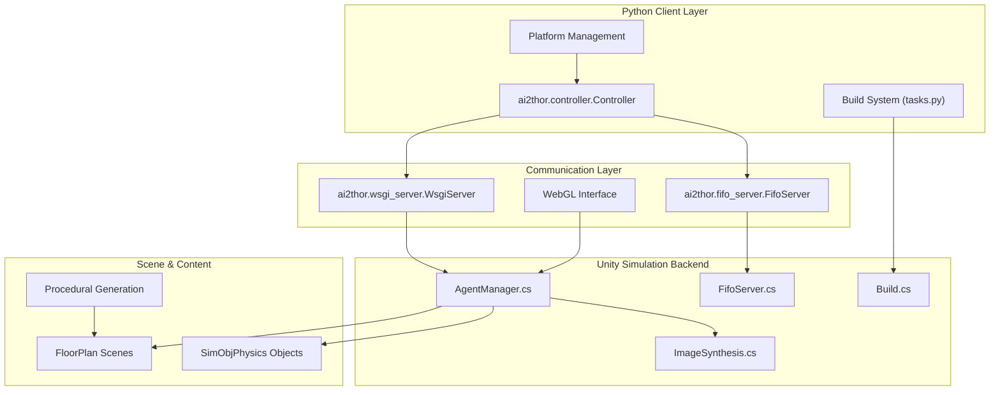

**Sources:** [ai2thor/controller.py:1-50](), [tasks.py:1-100](), [unity/Assets/Scripts/AgentManager.cs](), [unity/Assets/Scripts/ImageSynthesis/ImageSynthesis.cs:1-50]()

## Core Python Controller

The `Controller` class serves as the primary entry point for interacting with AI2-THOR simulations. It manages the lifecycle of Unity processes, handles build downloads, and provides the main API for sending actions and receiving observations.

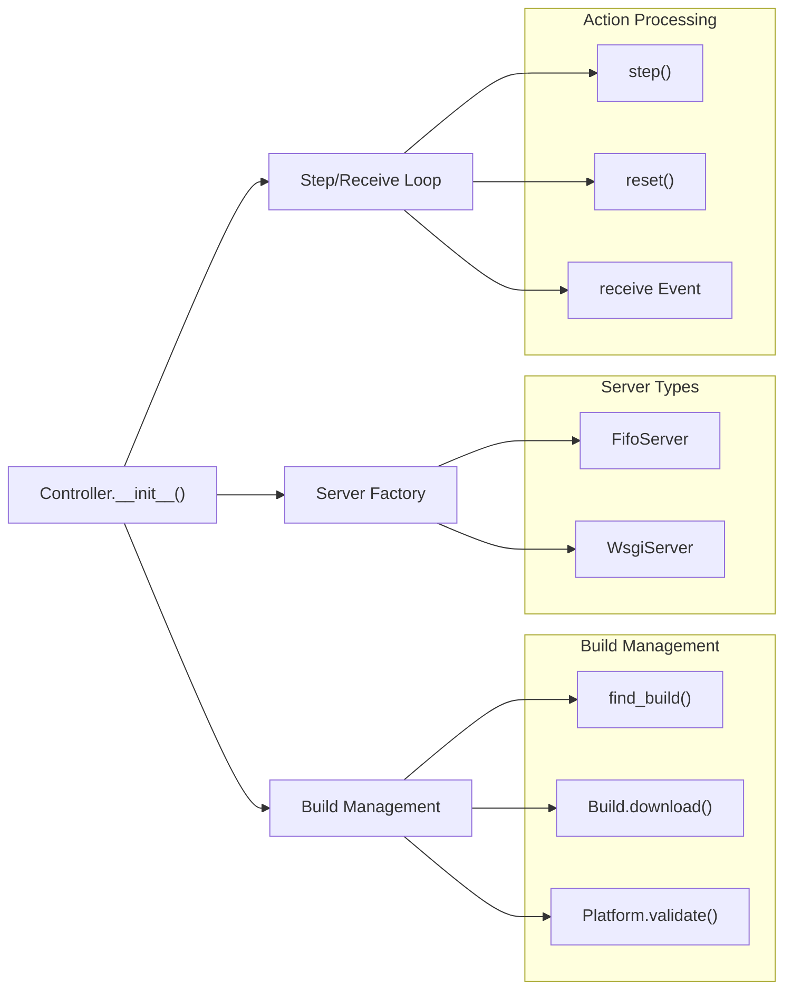

The controller initialization process involves several key phases:

| Phase | Components | Key Classes |
|-------|------------|-------------|
| Platform Detection | `ai2thor.platform` | `Linux64`, `OSXIntel64`, `CloudRendering` |
| Build Management | `ai2thor.build` | `Build`, `EditorBuild`, `ExternalBuild` |
| Server Selection | Communication protocols | `FifoServer`, `WsgiServer` |
| Unity Process | Process management | `subprocess.Popen` |

**Sources:** [ai2thor/controller.py:372-627](), [ai2thor/build.py:110-248](), [ai2thor/platform.py:1-236]()

## Communication Architecture

AI2-THOR supports multiple communication protocols between the Python client and Unity backend, each optimized for different use cases.

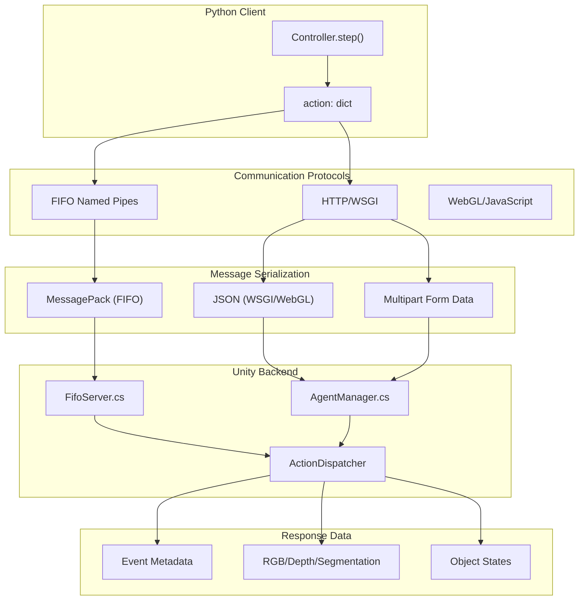

### FIFO Server Communication

The FIFO server uses named pipes for high-performance local communication:

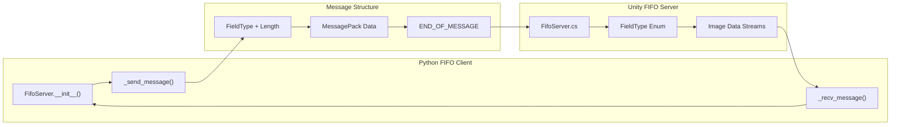

**Sources:** [ai2thor/fifo_server.py:56-318](), [unity/Assets/Scripts/FifoServer.cs:1-50](), [ai2thor/fifo_server.py:26-46]()

## Build and Deployment System

The build system manages Unity compilation, asset bundling, and distribution across multiple platforms.

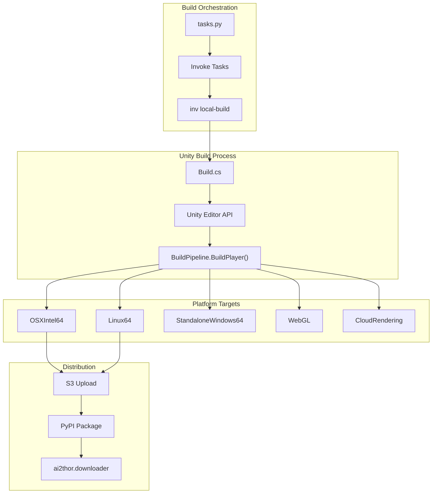

The build system supports environment-driven configuration:

| Environment Variable | Purpose | Code Reference |
|---------------------|---------|----------------|
| `BUILD_SCENES` | Scene selection | [unity/Assets/Editor/Build.cs:190-204]() |
| `INCLUDE_PRIVATE_SCENES` | Private content | [unity/Assets/Editor/Build.cs:224-227]() |
| `BUILD_SCRIPTS_ONLY` | Development builds | [unity/Assets/Editor/Build.cs:219-222]() |
| `UNITY_BUILD_NAME` | Output naming | [unity/Assets/Editor/Build.cs:43-46]() |

**Sources:** [tasks.py:193-250](), [unity/Assets/Editor/Build.cs:83-128](), [ai2thor/build.py:110-248]()

## Event and Observation System

AI2-THOR's observation system provides rich sensory data through the `Event` class, which encapsulates all simulation state and sensor outputs.

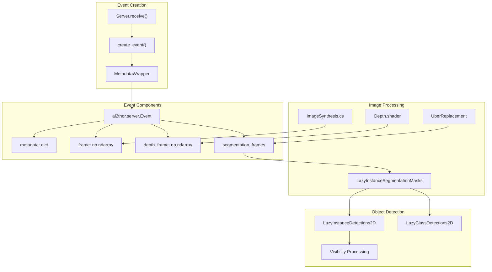

**Sources:** [ai2thor/server.py:427-522](), [unity/Assets/Scripts/ImageSynthesis/ImageSynthesis.cs:20-143](), [ai2thor/server.py:59-331]()

## Platform and Dependencies

AI2-THOR adapts to different operating systems and hardware configurations through its platform abstraction layer.

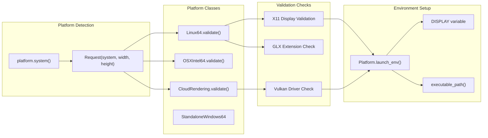

**Sources:** [ai2thor/platform.py:214-227](), [ai2thor/platform.py:150-160](), [ai2thor/platform.py:185-202]()

## Summary

AI2-THOR provides a comprehensive framework for embodied AI research through:

- **Unified Python API**: The `Controller` class abstracts platform differences and communication protocols
- **Multi-protocol Communication**: FIFO pipes for performance, WSGI for compatibility, WebGL for web deployment  
- **Automated Build System**: Cross-platform Unity builds with automated distribution
- **Rich Observation Space**: RGB, depth, segmentation, and structured metadata
- **Platform Flexibility**: Support for Linux, macOS, Windows, and cloud rendering

The system is designed for both local development and large-scale distributed training, with extensive testing and validation frameworks to ensure reliability across different hardware configurations.

**Sources:** [README.md:1-312](), [ai2thor/__init__.py:1-8](), [ai2thor/controller.py:1-100]()

---

# Page: Installation and Setup

# Installation and Setup

<details>
<summary>Relevant source files</summary>

The following files were used as context for generating this wiki page:

- [.coveragerc](.coveragerc)
- [.csharpierignore](.csharpierignore)
- [.editorconfig](.editorconfig)
- [.github/workflows/black.yaml](.github/workflows/black.yaml)
- [.gitignore](.gitignore)
- [CONTRIBUTING.md](CONTRIBUTING.md)
- [ai2thor/tests/__init__.py](ai2thor/tests/__init__.py)
- [pyproject.toml](pyproject.toml)
- [pytest.ini](pytest.ini)
- [requirements-dev.txt](requirements-dev.txt)
- [requirements.txt](requirements.txt)
- [setup.py](setup.py)
- [unity/Assets/MagicMirror/Prefab/MirrorCameraScript.cs](unity/Assets/MagicMirror/Prefab/MirrorCameraScript.cs)
- [unity/Assets/MessagePack/MessagePackSerializer.NonGeneric.cs](unity/Assets/MessagePack/MessagePackSerializer.NonGeneric.cs)
- [unity/Assets/MessagePack/Resolvers/StandardResolver.cs](unity/Assets/MessagePack/Resolvers/StandardResolver.cs)
- [unity/Assets/MessagePack/Resolvers/TypelessContractlessStandardResolver.cs](unity/Assets/MessagePack/Resolvers/TypelessContractlessStandardResolver.cs)
- [unity/Assets/Physics/SimObjsPhysics/Custom Project Objects/FurnMove.meta](unity/Assets/Physics/SimObjsPhysics/Custom Project Objects/FurnMove.meta)
- [unity/Assets/Scripts/ThorContractlessStandardResolver.cs](unity/Assets/Scripts/ThorContractlessStandardResolver.cs)
- [unity/Packages/manifest.json](unity/Packages/manifest.json)
- [unity/Packages/packages-lock.json](unity/Packages/packages-lock.json)
- [unity/ProjectSettings/ProjectVersion.txt](unity/ProjectSettings/ProjectVersion.txt)
- [unity/ProjectSettings/UnityConnectSettings.asset](unity/ProjectSettings/UnityConnectSettings.asset)
- [unity/ProjectSettings/VersionControlSettings.asset](unity/ProjectSettings/VersionControlSettings.asset)

</details>


This document covers the installation and configuration of AI2-THOR, including Python package setup, Unity dependencies, and build system configuration. AI2-THOR is a near photo-realistic interactive framework for embodied AI agents that consists of both Python API components and Unity simulation environments.

For information about using the Python Controller API after installation, see [Controller Class](#4.1). For details about the build system and deployment pipeline, see [Build System and Deployment](#4.2).

## System Requirements and Dependencies

AI2-THOR requires both Python and Unity components to function properly. The framework supports multiple platforms and deployment targets.

### Python Environment Requirements

The Python package supports Python 3.5 through 3.8 as specified in [setup.py:38-43](). The core Python dependencies are managed through requirements files:

| Dependency Category | File | Key Components |
|-------------------|------|----------------|
| Core Runtime | `requirements.txt` | Flask 2.0.1, numpy, PyYAML, requests |
| Communication | `requirements.txt` | msgpack, Werkzeug 2.0.1, compress_pickle |
| Development | `requirements-dev.txt` | pytest, black, jsonschema |

**Installation Flow Diagram**

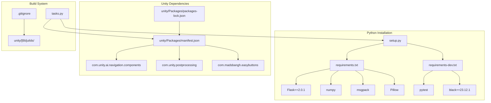

Sources: [setup.py:1-59](), [requirements.txt:1-16](), [requirements-dev.txt:1-9](), [unity/Packages/manifest.json:1-58]()

### Unity Environment Requirements

The Unity project requires Unity Editor 2020.3.25f1 as specified in [unity/ProjectSettings/ProjectVersion.txt:1-2](). The project uses the Unity Package Manager for dependency management.

**Unity Dependency Resolution**

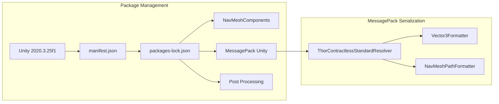

Sources: [unity/ProjectSettings/ProjectVersion.txt:1-3](), [unity/Packages/manifest.json:11-26](), [unity/Assets/Scripts/ThorContractlessStandardResolver.cs:226-277]()

## Python Package Installation

### Standard Installation

Install the AI2-THOR Python package using pip:

```bash
pip install ai2thor
```

The package is configured through [setup.py:25-59]() with the following key metadata:
- Package name: `ai2thor`
- License: Apache License 2.0
- Platforms: macOS, Unix
- Scripts: `ai2thor-xorg` for X server configuration

### Development Installation

For development work, clone the repository and install in development mode:

```bash
git clone https://github.com/allenai/ai2thor.git
cd ai2thor
pip install -e .
pip install -r requirements-dev.txt
```

**Package Structure and Entry Points**

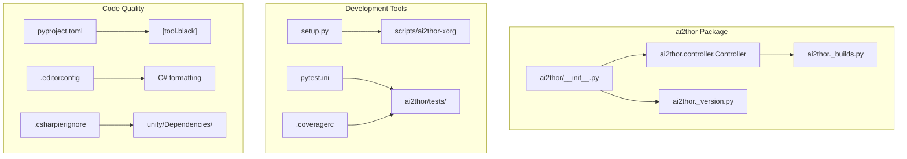

Sources: [setup.py:53-57](), [pytest.ini:1-6](), [pyproject.toml:1-22](), [.editorconfig:10-25]()

## Unity Development Setup

### Unity Editor Configuration

For Unity development, install Unity 2020.3.25f1 and open the project located in the `unity/` directory. The project configuration includes:

- **Package Dependencies**: Managed through [unity/Packages/manifest.json:11-57]()
- **Project Settings**: Version control, analytics, and editor configurations
- **Build Targets**: Multiple platform support including standalone and WebGL

### MessagePack Serialization Setup

AI2-THOR uses a custom MessagePack serialization system for Unity-Python communication. The key components are:

| Component | File | Purpose |
|-----------|------|---------|
| `ThorContractlessStandardResolver` | [unity/Assets/Scripts/ThorContractlessStandardResolver.cs:226-277]() | Main serialization resolver |
| `Vector3Formatter` | [unity/Assets/Scripts/ThorContractlessStandardResolver.cs:174-224]() | Unity Vector3 serialization |
| `NavMeshPathFormatter` | [unity/Assets/Scripts/ThorContractlessStandardResolver.cs:21-45]() | Navigation mesh path serialization |

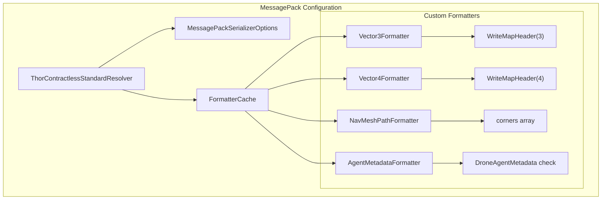

Sources: [unity/Assets/Scripts/ThorContractlessStandardResolver.cs:1-318]()

## Build System Configuration

### Environment Setup

The build system uses Python's `invoke` task runner and requires specific environment configurations:

**Gitignore Configuration**: The [.gitignore:1-133]() file excludes build artifacts, temporary files, and platform-specific directories:
- Unity build directories: `unity/[Bb]uilds/`
- Python artifacts: `ai2thor.egg-info/`, `dist/`, `.pytest_cache`
- Generated files: `ai2thor/_builds.py`, `ai2thor/_version.py`

**Code Formatting**: The project enforces consistent code formatting:
- **Python**: Black formatter configured in [pyproject.toml:1-3]() with 100-character line length
- **C#**: EditorConfig rules in [.editorconfig:13-25]() with specific brace and newline preferences

### Platform Support

AI2-THOR supports multiple deployment targets and platforms as configured in the Unity package dependencies:

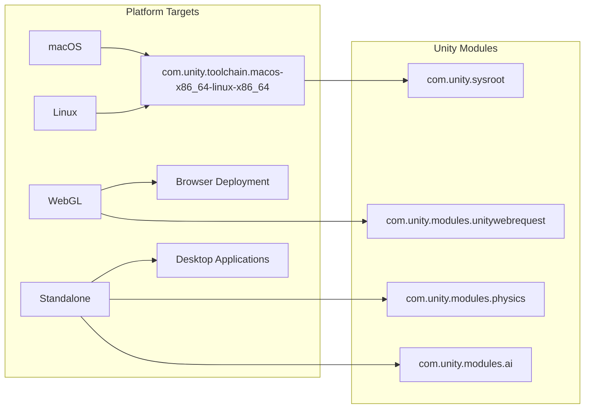

Sources: [unity/Packages/manifest.json:25](), [unity/Packages/packages-lock.json:145-154](), [setup.py:46-47]()

## Verification and Testing

### Test Configuration

The testing framework is configured through [pytest.ini:1-6]() with the following settings:
- **Test Discovery**: `testpaths = ai2thor/tests/`
- **Logging**: DEBUG level with timestamp formatting
- **Timeout**: 60 seconds per test
- **Coverage**: Configured in [.coveragerc:1-3]() to omit test files

### Development Workflow Verification

After installation, verify the setup by running the test suite:

```bash
# Run tests
pytest

# Run with coverage
pytest --cov=ai2thor

# Format code
invoke format  # Runs black and C# formatting
```

The continuous integration system enforces code formatting through GitHub Actions as configured in [.github/workflows/black.yaml:1-10]().

**Testing and Quality Assurance Flow**

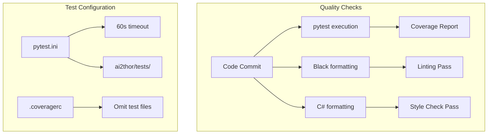

Sources: [pytest.ini:1-6](), [.coveragerc:1-3](), [.github/workflows/black.yaml:1-10](), [CONTRIBUTING.md:16-22]()

---

# Page: Core Agent System

# Core Agent System

<details>
<summary>Relevant source files</summary>

The following files were used as context for generating this wiki page:

- [ai2thor/hooks/metadata_hook.py](ai2thor/hooks/metadata_hook.py)
- [ai2thor/util/metrics.py](ai2thor/util/metrics.py)
- [ai2thor/util/trials.py](ai2thor/util/trials.py)
- [fpin_tutorial.py](fpin_tutorial.py)
- [unity/Assets/Scenes/FloorPlan_Train2_3/NavMesh.asset](unity/Assets/Scenes/FloorPlan_Train2_3/NavMesh.asset)
- [unity/Assets/Scripts/ActionDispatcher.cs](unity/Assets/Scripts/ActionDispatcher.cs)
- [unity/Assets/Scripts/AgentManager.cs](unity/Assets/Scripts/AgentManager.cs)
- [unity/Assets/Scripts/ArmAgentController.cs](unity/Assets/Scripts/ArmAgentController.cs)
- [unity/Assets/Scripts/ArmController.cs](unity/Assets/Scripts/ArmController.cs)
- [unity/Assets/Scripts/BaseAgentComponent.cs](unity/Assets/Scripts/BaseAgentComponent.cs)
- [unity/Assets/Scripts/BaseFPSAgentController.cs](unity/Assets/Scripts/BaseFPSAgentController.cs)
- [unity/Assets/Scripts/Contains.cs](unity/Assets/Scripts/Contains.cs)
- [unity/Assets/Scripts/ContinuousMovement.cs](unity/Assets/Scripts/ContinuousMovement.cs)
- [unity/Assets/Scripts/DebugDiscreteAgentController.cs](unity/Assets/Scripts/DebugDiscreteAgentController.cs)
- [unity/Assets/Scripts/DebugInputField.cs](unity/Assets/Scripts/DebugInputField.cs)
- [unity/Assets/Scripts/DiscreteHidenSeekAgentController.cs](unity/Assets/Scripts/DiscreteHidenSeekAgentController.cs)
- [unity/Assets/Scripts/DiscretePointClickAgentController.cs](unity/Assets/Scripts/DiscretePointClickAgentController.cs)
- [unity/Assets/Scripts/DroneFPSAgentController.cs](unity/Assets/Scripts/DroneFPSAgentController.cs)
- [unity/Assets/Scripts/FpinAgentController.cs](unity/Assets/Scripts/FpinAgentController.cs)
- [unity/Assets/Scripts/IK_Robot_Arm_Controller.cs](unity/Assets/Scripts/IK_Robot_Arm_Controller.cs)
- [unity/Assets/Scripts/InstantiatePrefabTest.cs](unity/Assets/Scripts/InstantiatePrefabTest.cs)
- [unity/Assets/Scripts/LocobotFPSAgentController.cs](unity/Assets/Scripts/LocobotFPSAgentController.cs)
- [unity/Assets/Scripts/ObjectHighlightController.cs](unity/Assets/Scripts/ObjectHighlightController.cs)
- [unity/Assets/Scripts/PhysicsRemoteFPSAgentController.cs](unity/Assets/Scripts/PhysicsRemoteFPSAgentController.cs)
- [unity/Assets/Scripts/PhysicsSceneManager.cs](unity/Assets/Scripts/PhysicsSceneManager.cs)
- [unity/Assets/Scripts/PlayerControllers.cs](unity/Assets/Scripts/PlayerControllers.cs)
- [unity/Assets/Scripts/RobotArmTest/Stretch_Arm_Solver.cs](unity/Assets/Scripts/RobotArmTest/Stretch_Arm_Solver.cs)
- [unity/Assets/Scripts/RobotArmTest/robot_arm_rig_gripper.prefab](unity/Assets/Scripts/RobotArmTest/robot_arm_rig_gripper.prefab)
- [unity/Assets/Scripts/RobotArmTest/stretch_arm_rig_gripper.prefab](unity/Assets/Scripts/RobotArmTest/stretch_arm_rig_gripper.prefab)
- [unity/Assets/Scripts/SimObjPhysics.cs](unity/Assets/Scripts/SimObjPhysics.cs)
- [unity/Assets/Scripts/SimObjType.cs](unity/Assets/Scripts/SimObjType.cs)
- [unity/Assets/Scripts/StretchAgentController.cs](unity/Assets/Scripts/StretchAgentController.cs)
- [unity/Assets/Scripts/Stretch_Robot_Arm_Controller.cs](unity/Assets/Scripts/Stretch_Robot_Arm_Controller.cs)
- [unity/Assets/Scripts/UtilityFunctions.cs](unity/Assets/Scripts/UtilityFunctions.cs)
- [unity/Assets/Standard Assets/Characters/FirstPersonCharacter/Models/stretch_robot_grp.fbx](unity/Assets/Standard Assets/Characters/FirstPersonCharacter/Models/stretch_robot_grp.fbx)
- [unity/Assets/Standard Assets/Characters/FirstPersonCharacter/Prefabs/FPSController.prefab](unity/Assets/Standard Assets/Characters/FirstPersonCharacter/Prefabs/FPSController.prefab)
- [unity/Assets/UnitTests/TestDispatcher.cs](unity/Assets/UnitTests/TestDispatcher.cs)
- [unity/Assets/UnitTests/TestThirdPartyCameraAndMainCamera.cs](unity/Assets/UnitTests/TestThirdPartyCameraAndMainCamera.cs)
- [unity/ProjectSettings/ProjectSettings.asset](unity/ProjectSettings/ProjectSettings.asset)

</details>


## Purpose and Scope

The Core Agent System forms the foundation of AI2-THOR's embodied AI simulation framework, providing a hierarchical architecture for different types of virtual agents that can perceive and interact with 3D environments. This system manages agent initialization, movement, action execution, and physics simulation across multiple specialized agent types including standard first-person controllers, robotic arms, drones, and mobile robots.

For information about scene management and object interaction, see [Object Interaction System](#7). For details about communication protocols and Python API integration, see [Python API and Communication](#4).

## Agent Controller Hierarchy

The agent system is built around an inheritance hierarchy with `BaseFPSAgentController` as the abstract foundation:

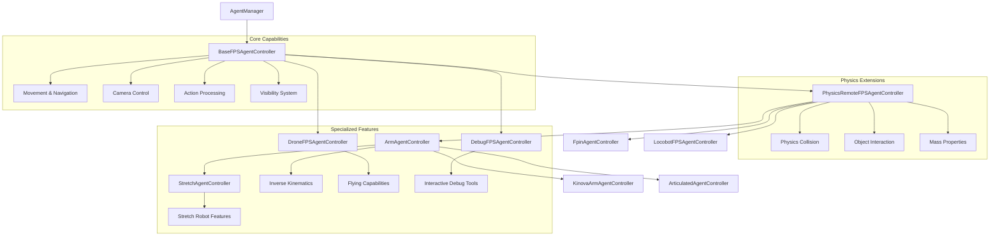

**Sources:** [unity/Assets/Scripts/BaseFPSAgentController.cs:28-29](), [unity/Assets/Scripts/PhysicsRemoteFPSAgentController.cs:28](), [unity/Assets/Scripts/AgentManager.cs:33](), [unity/Assets/Scripts/ArmAgentController.cs:11]()

## BaseFPSAgentController Foundation

The `BaseFPSAgentController` class provides core functionality shared by all agent types:

### Core Components and Properties

| Component | Purpose | Key Properties |
|-----------|---------|----------------|
| `BaseAgentComponent` | Unity MonoBehaviour wrapper | Camera, hand transforms, visibility capsules |
| `CharacterController` | Unity physics movement | Collision detection, ground constraints |
| `AgentManager` | Scene-level coordination | Multi-agent management, bounds tracking |
| `PhysicsSceneManager` | Physics simulation control | Object spawning, scene setup |

### Essential Agent State Management

The agent system maintains several critical state variables:

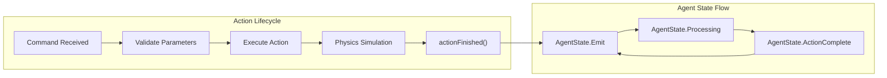

**Sources:** [unity/Assets/Scripts/BaseFPSAgentController.cs:196](), [unity/Assets/Scripts/BaseFPSAgentController.cs:294-312](), [unity/Assets/Scripts/BaseFPSAgentController.cs:445-479]()

### Movement and Navigation System

The base controller implements grid-based and continuous movement through several key methods:

- `getReachablePositions()` - Computes valid agent positions using capsule casting
- `CastBodyTrayectory()` - Physics-based collision detection for movement validation  
- `handObjectCanFitInPosition()` - Validates positions considering held objects

**Sources:** [unity/Assets/Scripts/BaseFPSAgentController.cs:526-711](), [unity/Assets/Scripts/BaseFPSAgentController.cs:1459-1515]()

## PhysicsRemoteFPSAgentController Extensions

The `PhysicsRemoteFPSAgentController` extends the base class with physics-based capabilities:

### Physics Integration Features

| Feature | Implementation | Purpose |
|---------|---------------|---------|
| Object Pickup/Drop | `PickupObject()`, `DropHandObject()` | Manipulate scene objects |
| Temperature System | `SetTemperatureDecayTime()` | Object state management |
| Mass Properties | `SetMassProperties()` | Dynamic physics tuning |
| Collision Handling | `CheckIfAgentCanRotate()` | Movement validation |

### Rotation and Look Controls

The physics controller implements sophisticated rotation checking to prevent object collisions:

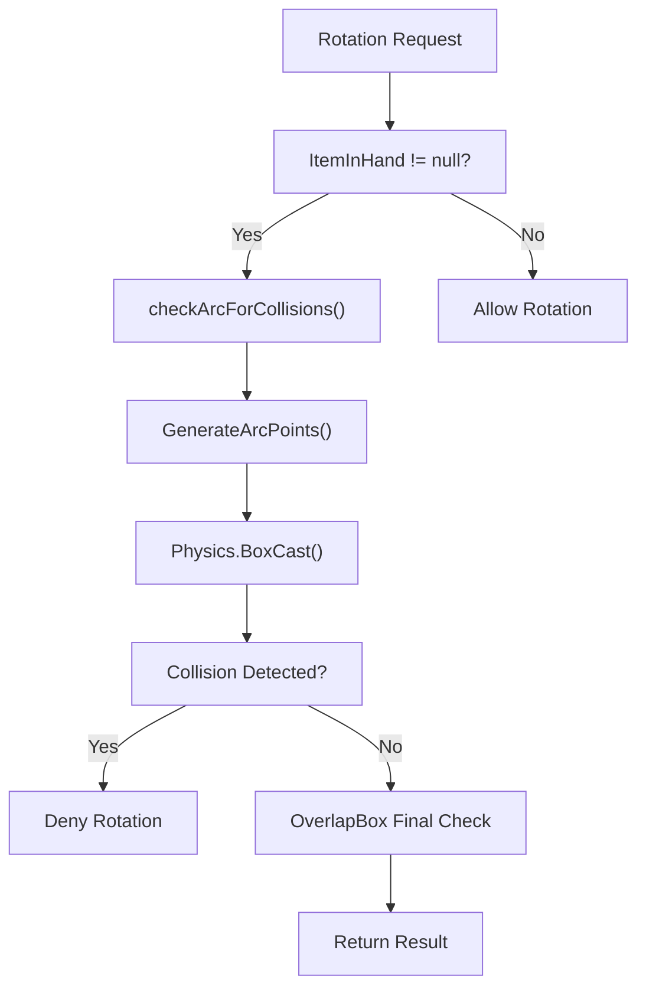

**Sources:** [unity/Assets/Scripts/PhysicsRemoteFPSAgentController.cs:687-734](), [unity/Assets/Scripts/PhysicsRemoteFPSAgentController.cs:513-625]()

## Specialized Agent Types

### ArmAgentController for Robotic Manipulation

The `ArmAgentController` provides a foundation for robotic arm simulation with several concrete implementations:

| Controller Type | Use Case | Key Features |
|----------------|----------|--------------|
| `StretchAgentController` | Stretch Research Robot | Telescoping arm, dual cameras |
| `KinovaArmAgentController` | Kinova robotic arm | 6-DOF manipulation |
| `ArticulatedAgentController` | General articulated robots | Multi-joint coordination |

**Sources:** [unity/Assets/Scripts/ArmAgentController.cs:11-13](), [unity/Assets/Scripts/StretchAgentController.cs:12]()

### DroneFPSAgentController for Aerial Agents

The drone controller implements 3D movement with physics constraints:

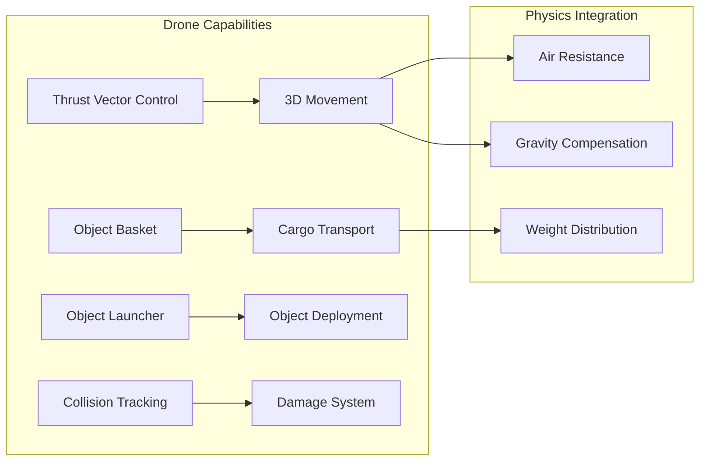

**Sources:** [unity/Assets/Scripts/DroneFPSAgentController.cs:12](), [unity/Assets/Scripts/DroneFPSAgentController.cs:16-22]()

## Agent Lifecycle and Coordination

### Initialization Process

Agent initialization follows a structured sequence managed by `AgentManager`:

1. **Controller Selection** - `SetUpPhysicsController()`, `SetUpArmController()`, etc.
2. **Body Initialization** - `InitializeBody()` sets physical parameters
3. **Camera Setup** - Field of view, clipping planes, render targets
4. **Physics Configuration** - Collision detection, mass properties
5. **Multi-agent Coordination** - Position validation for additional agents

**Sources:** [unity/Assets/Scripts/AgentManager.cs:219-372](), [unity/Assets/Scripts/BaseFPSAgentController.cs:745-912]()

### Action Execution Framework

The system uses `ActionDispatcher` to route commands to appropriate agent methods:

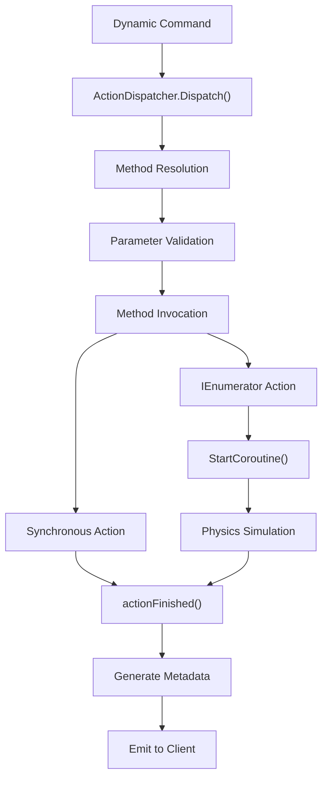

**Sources:** [unity/Assets/Scripts/ActionDispatcher.cs:73-92](), [unity/Assets/Scripts/BaseFPSAgentController.cs:445-512]()

## Communication and Control Interface

### Multi-Modal Communication

The agent system supports multiple communication protocols through `AgentManager`:

| Protocol | Implementation | Use Case |
|----------|---------------|----------|
| WSGI Server | `WsgiServer` | HTTP-based communication |
| FIFO Pipes | `FifoServer.Client` | Named pipe communication |
| WebGL Interface | `JavaScriptInterface` | Browser-based control |

### Debug and Development Tools

The `DebugInputField` provides interactive development capabilities:

- Text-based command input with auto-completion
- Real-time agent state visualization  
- Multi-agent switching and control
- Physics parameter tuning

**Sources:** [unity/Assets/Scripts/AgentManager.cs:72-77](), [unity/Assets/Scripts/AgentManager.cs:143-158](), [unity/Assets/Scripts/DebugInputField.cs:16-17]()

### Metadata and State Reporting

Each agent generates comprehensive metadata through `generateMetadataWrapper()`:

- Agent position, rotation, and camera parameters
- Visible object inventories with distance and visibility data
- Physics state including velocity and collision status
- Specialized data for arm positions, drone status, etc.

**Sources:** [unity/Assets/Scripts/BaseFPSAgentController.cs:3023-3122](), [unity/Assets/Scripts/PhysicsRemoteFPSAgentController.cs:203-207]()

---

# Page: Agent Controllers

# Agent Controllers

<details>
<summary>Relevant source files</summary>

The following files were used as context for generating this wiki page:

- [ai2thor/hooks/metadata_hook.py](ai2thor/hooks/metadata_hook.py)
- [ai2thor/util/metrics.py](ai2thor/util/metrics.py)
- [ai2thor/util/trials.py](ai2thor/util/trials.py)
- [fpin_tutorial.py](fpin_tutorial.py)
- [unity/Assets/Scenes/FloorPlan_Train2_3/NavMesh.asset](unity/Assets/Scenes/FloorPlan_Train2_3/NavMesh.asset)
- [unity/Assets/Scripts/ActionDispatcher.cs](unity/Assets/Scripts/ActionDispatcher.cs)
- [unity/Assets/Scripts/AgentManager.cs](unity/Assets/Scripts/AgentManager.cs)
- [unity/Assets/Scripts/ArmAgentController.cs](unity/Assets/Scripts/ArmAgentController.cs)
- [unity/Assets/Scripts/ArmController.cs](unity/Assets/Scripts/ArmController.cs)
- [unity/Assets/Scripts/BaseAgentComponent.cs](unity/Assets/Scripts/BaseAgentComponent.cs)
- [unity/Assets/Scripts/BaseFPSAgentController.cs](unity/Assets/Scripts/BaseFPSAgentController.cs)
- [unity/Assets/Scripts/Contains.cs](unity/Assets/Scripts/Contains.cs)
- [unity/Assets/Scripts/ContinuousMovement.cs](unity/Assets/Scripts/ContinuousMovement.cs)
- [unity/Assets/Scripts/DebugDiscreteAgentController.cs](unity/Assets/Scripts/DebugDiscreteAgentController.cs)
- [unity/Assets/Scripts/DebugInputField.cs](unity/Assets/Scripts/DebugInputField.cs)
- [unity/Assets/Scripts/DiscreteHidenSeekAgentController.cs](unity/Assets/Scripts/DiscreteHidenSeekAgentController.cs)
- [unity/Assets/Scripts/DiscretePointClickAgentController.cs](unity/Assets/Scripts/DiscretePointClickAgentController.cs)
- [unity/Assets/Scripts/DroneFPSAgentController.cs](unity/Assets/Scripts/DroneFPSAgentController.cs)
- [unity/Assets/Scripts/FpinAgentController.cs](unity/Assets/Scripts/FpinAgentController.cs)
- [unity/Assets/Scripts/IK_Robot_Arm_Controller.cs](unity/Assets/Scripts/IK_Robot_Arm_Controller.cs)
- [unity/Assets/Scripts/InstantiatePrefabTest.cs](unity/Assets/Scripts/InstantiatePrefabTest.cs)
- [unity/Assets/Scripts/LocobotFPSAgentController.cs](unity/Assets/Scripts/LocobotFPSAgentController.cs)
- [unity/Assets/Scripts/ObjectHighlightController.cs](unity/Assets/Scripts/ObjectHighlightController.cs)
- [unity/Assets/Scripts/PhysicsRemoteFPSAgentController.cs](unity/Assets/Scripts/PhysicsRemoteFPSAgentController.cs)
- [unity/Assets/Scripts/PhysicsSceneManager.cs](unity/Assets/Scripts/PhysicsSceneManager.cs)
- [unity/Assets/Scripts/PlayerControllers.cs](unity/Assets/Scripts/PlayerControllers.cs)
- [unity/Assets/Scripts/RobotArmTest/Stretch_Arm_Solver.cs](unity/Assets/Scripts/RobotArmTest/Stretch_Arm_Solver.cs)
- [unity/Assets/Scripts/RobotArmTest/robot_arm_rig_gripper.prefab](unity/Assets/Scripts/RobotArmTest/robot_arm_rig_gripper.prefab)
- [unity/Assets/Scripts/RobotArmTest/stretch_arm_rig_gripper.prefab](unity/Assets/Scripts/RobotArmTest/stretch_arm_rig_gripper.prefab)
- [unity/Assets/Scripts/SimObjPhysics.cs](unity/Assets/Scripts/SimObjPhysics.cs)
- [unity/Assets/Scripts/SimObjType.cs](unity/Assets/Scripts/SimObjType.cs)
- [unity/Assets/Scripts/StretchAgentController.cs](unity/Assets/Scripts/StretchAgentController.cs)
- [unity/Assets/Scripts/Stretch_Robot_Arm_Controller.cs](unity/Assets/Scripts/Stretch_Robot_Arm_Controller.cs)
- [unity/Assets/Scripts/UtilityFunctions.cs](unity/Assets/Scripts/UtilityFunctions.cs)
- [unity/Assets/Standard Assets/Characters/FirstPersonCharacter/Models/stretch_robot_grp.fbx](unity/Assets/Standard Assets/Characters/FirstPersonCharacter/Models/stretch_robot_grp.fbx)
- [unity/Assets/Standard Assets/Characters/FirstPersonCharacter/Prefabs/FPSController.prefab](unity/Assets/Standard Assets/Characters/FirstPersonCharacter/Prefabs/FPSController.prefab)
- [unity/Assets/UnitTests/TestDispatcher.cs](unity/Assets/UnitTests/TestDispatcher.cs)
- [unity/Assets/UnitTests/TestThirdPartyCameraAndMainCamera.cs](unity/Assets/UnitTests/TestThirdPartyCameraAndMainCamera.cs)
- [unity/ProjectSettings/ProjectSettings.asset](unity/ProjectSettings/ProjectSettings.asset)

</details>


## Purpose and Scope

This page documents the agent controller system in AI2-THOR, which provides the core abstraction for embodied AI agents that can perceive and interact with simulated environments. Agent controllers handle movement, vision, object interaction, and action processing for different types of agents including humanoid agents, robotic arms, drones, and specialized research platforms.

For information about agent coordination and multi-agent scenarios, see [Agent Manager and Coordination](#3.2). For details about specific robotic arm implementations, see [Articulated Agents](#5.1).

## Core Architecture

The agent controller system is built around a hierarchical class structure with `BaseFPSAgentController` as the abstract base class that defines the core interface and functionality for all agents.

### Agent Controller Class Hierarchy

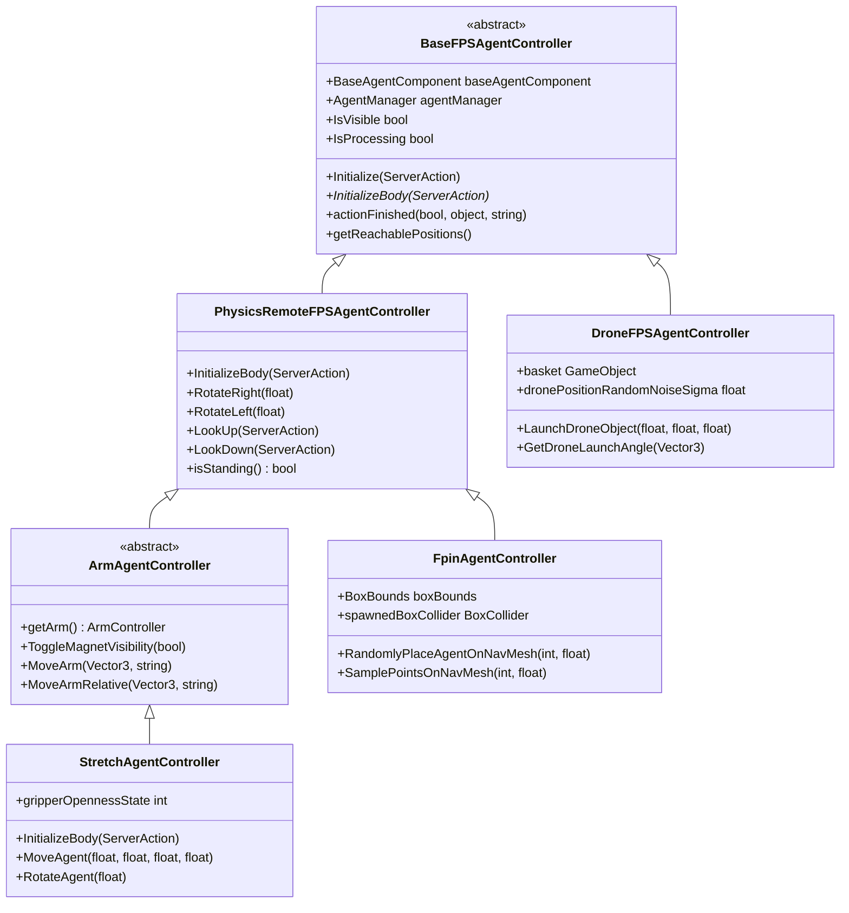

**Sources:** [unity/Assets/Scripts/BaseFPSAgentController.cs:29-431](), [unity/Assets/Scripts/PhysicsRemoteFPSAgentController.cs:28-41](), [unity/Assets/Scripts/ArmAgentController.cs:11-15](), [unity/Assets/Scripts/StretchAgentController.cs:12-37](), [unity/Assets/Scripts/FpinAgentController.cs:67-107](), [unity/Assets/Scripts/DroneFPSAgentController.cs:12-23]()

### Unity Component Integration

Agent controllers integrate with Unity's component system through `BaseAgentComponent`, which holds references to Unity GameObjects and provides the bridge between the agent logic and the Unity scene.

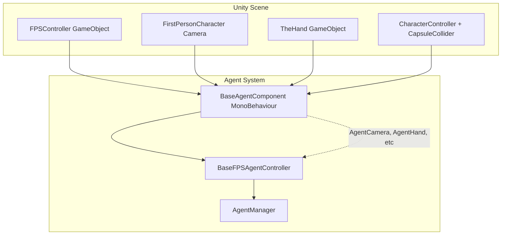

**Sources:** [unity/Assets/Scripts/BaseAgentComponent.cs:6-18](), [unity/Assets/Scripts/BaseFPSAgentController.cs:34-81](), [unity/Assets/Standard Assets/Characters/FirstPersonCharacter/Prefabs/FPSController.prefab:114-206]()

## Agent Initialization Process

The agent initialization process is coordinated by `AgentManager` and involves several distinct phases: agent type selection, controller instantiation, body initialization, and parameter configuration.

### Agent Manager Initialization Flow

```mermaid
sequenceDiagram
    participant Client
    participant AgentManager
    participant ControllerFactory as "createAgentType()"
    participant Controller as "BaseFPSAgentController"
    participant Unity as "Unity Components"

    Client->>AgentManager: Initialize(ServerAction)
    AgentManager->>AgentManager: Parse agentMode
    
    alt agentMode == "default"
        AgentManager->>ControllerFactory: SetUpPhysicsController()
        ControllerFactory->>Controller: new PhysicsRemoteFPSAgentController()
    else agentMode == "arm" 
        AgentManager->>ControllerFactory: SetUpArmController()
        ControllerFactory->>Controller: new KinovaArmAgentController()
    else agentMode == "stretch"
        AgentManager->>ControllerFactory: SetUpStretchController()
        ControllerFactory->>Controller: new StretchAgentController()
    else agentMode == "drone"
        AgentManager->>ControllerFactory: SetUpDroneController()
        ControllerFactory->>Controller: new DroneFPSAgentController()
    end
    
    Controller->>Unity: Configure CharacterController, Camera, etc.
    Controller->>Controller: InitializeBody(action)
    AgentManager->>Controller: ProcessControlCommand(initParams)
    Controller-->>Client: Initialization Complete
```

**Sources:** [unity/Assets/Scripts/AgentManager.cs:219-300](), [unity/Assets/Scripts/AgentManager.cs:409-441](), [unity/Assets/Scripts/AgentManager.cs:422-431]()

### Agent Type Factory Methods

The `AgentManager` uses dedicated factory methods to create different types of agents:

| Factory Method | Agent Type | Controller Class | Key Features |
|---|---|---|---|
| `SetUpPhysicsController()` | Default | PhysicsRemoteFPSAgentController | Basic physics-based movement |
| `SetUpLocobotController()` | Locobot | LocobotFPSAgentController | Continuous movement mode |
| `SetUpArmController()` | Arm | KinovaArmAgentController | Robotic arm manipulation |
| `SetUpStretchController()` | Stretch | StretchAgentController | Stretch robot platform |
| `SetUpDroneController()` | Drone | DroneFPSAgentController | Flying agent capabilities |
| `SetUpFpinController()` | FPIN | FpinAgentController | Custom geometry agents |

**Sources:** [unity/Assets/Scripts/AgentManager.cs:374-441]()

## Core Agent Functionality

### Action Processing and State Management

All agents inherit core action processing capabilities from `BaseFPSAgentController`. The system uses a state machine to manage action execution:

```mermaid
stateDiagram-v2
    [*] --> Emit
    Emit --> Processing : ProcessControlCommand()
    Processing --> ActionComplete : actionFinished(success=true)
    Processing --> Emit : actionFinishedEmit(success=true)  
    Processing --> ActionComplete : actionFinished(success=false)
    ActionComplete --> Emit : Next Action
    
    note right of Processing : agentState == AgentState.Processing
    note right of Emit : ReadyForCommand == true
    note right of ActionComplete : ReadyForCommand == true
```

**Sources:** [unity/Assets/Scripts/BaseFPSAgentController.cs:196-512](), [unity/Assets/Scripts/BaseFPSAgentController.cs:294-312](), [unity/Assets/Scripts/BaseFPSAgentController.cs:434-512]()

### Movement and Navigation

The base controller provides fundamental movement capabilities that are extended by specialized agents:

- **Grid-based Movement**: Discrete movement on a configurable grid system
- **Continuous Movement**: Smooth interpolated movement for specialized agents  
- **Collision Detection**: Physics-based collision checking using Unity's CharacterController
- **Reachable Positions**: Algorithmic calculation of valid agent positions

**Sources:** [unity/Assets/Scripts/BaseFPSAgentController.cs:526-733](), [unity/Assets/Scripts/PhysicsRemoteFPSAgentController.cs:445-511]()

### Visibility and Perception System

Agents use a sophisticated visibility system to determine which objects can be perceived:

```mermaid
graph TB
    subgraph "Visibility System"
        VisibilityCapsule["VisibilityCapsule GameObject"]
        VisibilityPoints["Object VisibilityPoints"]
        RaycastCheck["Raycast Visibility Check"]
        DistanceCheck["Distance Filtering"]
    end
    
    subgraph "Agent Types"
        TallVisCap["TallVisCap - Humanoid"]
        BotVisCap["BotVisCap - Low Height"]
        DroneVisCap["DroneVisCap - Flying"] 
        StretchVisCap["StretchVisCap - Stretch Robot"]
    end
    
    VisibilityCapsule --> TallVisCap
    VisibilityCapsule --> BotVisCap  
    VisibilityCapsule --> DroneVisCap
    VisibilityCapsule --> StretchVisCap
    
    VisibilityPoints --> RaycastCheck
    RaycastCheck --> DistanceCheck
    DistanceCheck --> VisibleSimObjPhysics["VisibleSimObjPhysics[]"]
```

**Sources:** [unity/Assets/Scripts/BaseFPSAgentController.cs:83-101](), [unity/Assets/Scripts/BaseFPSAgentController.cs:279-292](), [unity/Assets/Scripts/BaseFPSAgentController.cs:48]()

## Specialized Agent Implementations

### Physics Remote Agent Controller

`PhysicsRemoteFPSAgentController` serves as the standard implementation for most embodied AI research scenarios. It provides physics-based movement with collision detection and supports both discrete and continuous actions.

Key capabilities include:
- **Rotation Actions**: `RotateRight()`, `RotateLeft()` with collision checking for held objects
- **Look Actions**: `LookUp()`, `LookDown()` with configurable angle limits  
- **Standing State**: `isStanding()` detection for tall humanoid agents
- **Object Interaction**: Physics-based pickup and manipulation

**Sources:** [unity/Assets/Scripts/PhysicsRemoteFPSAgentController.cs:43-68](), [unity/Assets/Scripts/PhysicsRemoteFPSAgentController.cs:445-511](), [unity/Assets/Scripts/PhysicsRemoteFPSAgentController.cs:176-201]()

### FPIN Agent Controller

`FpinAgentController` enables research with agents of arbitrary geometries by replacing the standard capsule collider with custom box colliders:

```mermaid
graph LR
    subgraph "Standard Agent"
        CapsuleCollider["CapsuleCollider"]
        CapsuleMovement["Capsule-based Movement"]
    end
    
    subgraph "FPIN Agent"  
        BoxCollider["Custom BoxCollider"]
        BoxMovement["Box-based Movement"]
        CustomGeometry["Arbitrary Agent Geometry"]
    end
    
    CapsuleCollider --> CapsuleMovement
    BoxCollider --> BoxMovement
    CustomGeometry --> BoxCollider
```

**Sources:** [unity/Assets/Scripts/FpinAgentController.cs:67-102](), [unity/Assets/Scripts/FpinAgentController.cs:113-134](), [unity/Assets/Scripts/FpinAgentController.cs:268-307]()

### Drone Agent Controller

`DroneFPSAgentController` provides flying agent capabilities with unique physics and interaction models:

- **3D Movement**: Full 6-DOF movement including vertical thrust
- **Object Launching**: `LaunchDroneObject()` for projectile interactions
- **Basket Collection**: Object collection and transport capabilities
- **Noise Simulation**: Configurable position noise for realistic flight dynamics

**Sources:** [unity/Assets/Scripts/DroneFPSAgentController.cs:12-23](), [unity/Assets/Scripts/DroneFPSAgentController.cs:16-22]()

This agent controller system provides the foundation for all embodied AI research in AI2-THOR, with each controller type optimized for specific research domains while maintaining a consistent interface and integration with the broader simulation framework.

---

# Page: Agent Manager and Coordination

# Agent Manager and Coordination

<details>
<summary>Relevant source files</summary>

The following files were used as context for generating this wiki page:

- [ai2thor/hooks/metadata_hook.py](ai2thor/hooks/metadata_hook.py)
- [ai2thor/util/metrics.py](ai2thor/util/metrics.py)
- [ai2thor/util/trials.py](ai2thor/util/trials.py)
- [fpin_tutorial.py](fpin_tutorial.py)
- [unity/Assets/Scenes/FloorPlan_Train2_3/NavMesh.asset](unity/Assets/Scenes/FloorPlan_Train2_3/NavMesh.asset)
- [unity/Assets/Scripts/ActionDispatcher.cs](unity/Assets/Scripts/ActionDispatcher.cs)
- [unity/Assets/Scripts/AgentManager.cs](unity/Assets/Scripts/AgentManager.cs)
- [unity/Assets/Scripts/ArmAgentController.cs](unity/Assets/Scripts/ArmAgentController.cs)
- [unity/Assets/Scripts/ArmController.cs](unity/Assets/Scripts/ArmController.cs)
- [unity/Assets/Scripts/BaseAgentComponent.cs](unity/Assets/Scripts/BaseAgentComponent.cs)
- [unity/Assets/Scripts/BaseFPSAgentController.cs](unity/Assets/Scripts/BaseFPSAgentController.cs)
- [unity/Assets/Scripts/Contains.cs](unity/Assets/Scripts/Contains.cs)
- [unity/Assets/Scripts/ContinuousMovement.cs](unity/Assets/Scripts/ContinuousMovement.cs)
- [unity/Assets/Scripts/DebugDiscreteAgentController.cs](unity/Assets/Scripts/DebugDiscreteAgentController.cs)
- [unity/Assets/Scripts/DebugInputField.cs](unity/Assets/Scripts/DebugInputField.cs)
- [unity/Assets/Scripts/DiscreteHidenSeekAgentController.cs](unity/Assets/Scripts/DiscreteHidenSeekAgentController.cs)
- [unity/Assets/Scripts/DiscretePointClickAgentController.cs](unity/Assets/Scripts/DiscretePointClickAgentController.cs)
- [unity/Assets/Scripts/DroneFPSAgentController.cs](unity/Assets/Scripts/DroneFPSAgentController.cs)
- [unity/Assets/Scripts/FpinAgentController.cs](unity/Assets/Scripts/FpinAgentController.cs)
- [unity/Assets/Scripts/IK_Robot_Arm_Controller.cs](unity/Assets/Scripts/IK_Robot_Arm_Controller.cs)
- [unity/Assets/Scripts/InstantiatePrefabTest.cs](unity/Assets/Scripts/InstantiatePrefabTest.cs)
- [unity/Assets/Scripts/LocobotFPSAgentController.cs](unity/Assets/Scripts/LocobotFPSAgentController.cs)
- [unity/Assets/Scripts/ObjectHighlightController.cs](unity/Assets/Scripts/ObjectHighlightController.cs)
- [unity/Assets/Scripts/PhysicsRemoteFPSAgentController.cs](unity/Assets/Scripts/PhysicsRemoteFPSAgentController.cs)
- [unity/Assets/Scripts/PhysicsSceneManager.cs](unity/Assets/Scripts/PhysicsSceneManager.cs)
- [unity/Assets/Scripts/PlayerControllers.cs](unity/Assets/Scripts/PlayerControllers.cs)
- [unity/Assets/Scripts/RobotArmTest/Stretch_Arm_Solver.cs](unity/Assets/Scripts/RobotArmTest/Stretch_Arm_Solver.cs)
- [unity/Assets/Scripts/RobotArmTest/robot_arm_rig_gripper.prefab](unity/Assets/Scripts/RobotArmTest/robot_arm_rig_gripper.prefab)
- [unity/Assets/Scripts/RobotArmTest/stretch_arm_rig_gripper.prefab](unity/Assets/Scripts/RobotArmTest/stretch_arm_rig_gripper.prefab)
- [unity/Assets/Scripts/SimObjPhysics.cs](unity/Assets/Scripts/SimObjPhysics.cs)
- [unity/Assets/Scripts/SimObjType.cs](unity/Assets/Scripts/SimObjType.cs)
- [unity/Assets/Scripts/StretchAgentController.cs](unity/Assets/Scripts/StretchAgentController.cs)
- [unity/Assets/Scripts/Stretch_Robot_Arm_Controller.cs](unity/Assets/Scripts/Stretch_Robot_Arm_Controller.cs)
- [unity/Assets/Scripts/UtilityFunctions.cs](unity/Assets/Scripts/UtilityFunctions.cs)
- [unity/Assets/Standard Assets/Characters/FirstPersonCharacter/Models/stretch_robot_grp.fbx](unity/Assets/Standard Assets/Characters/FirstPersonCharacter/Models/stretch_robot_grp.fbx)
- [unity/Assets/Standard Assets/Characters/FirstPersonCharacter/Prefabs/FPSController.prefab](unity/Assets/Standard Assets/Characters/FirstPersonCharacter/Prefabs/FPSController.prefab)
- [unity/Assets/UnitTests/TestDispatcher.cs](unity/Assets/UnitTests/TestDispatcher.cs)
- [unity/Assets/UnitTests/TestThirdPartyCameraAndMainCamera.cs](unity/Assets/UnitTests/TestThirdPartyCameraAndMainCamera.cs)
- [unity/ProjectSettings/ProjectSettings.asset](unity/ProjectSettings/ProjectSettings.asset)

</details>


## Purpose and Scope

This document covers the `AgentManager` class and its role in orchestrating multiple agents within the AI2-THOR simulation environment. The AgentManager serves as the central coordinator for agent initialization, multi-agent scenarios, scene management, and communication layer integration.

For information about individual agent controllers and their hierarchies, see [Agent Controllers](#3.1). For details about the Python API that interfaces with AgentManager, see [Controller Class](#4.1).

## AgentManager Architecture Overview

The `AgentManager` class acts as the central orchestration point for all agent-related functionality in AI2-THOR. It manages agent lifecycles, coordinates multi-agent scenarios, and serves as the bridge between the communication layer and individual agent controllers.

### Core AgentManager Structure

```mermaid
graph TB
    AM["AgentManager"] --> PrimaryAgent["primaryAgent: BaseFPSAgentController"]
    AM --> AgentList["agents: List&lt;BaseFPSAgentController&gt;"]
    AM --> PSM["physicsSceneManager: PhysicsSceneManager"]
    AM --> ThirdParty["thirdPartyCameras: List&lt;Camera&gt;"]
    
    AM --> CommLayer["Communication Layer"]
    CommLayer --> FIFO["FifoServer.Client"]
    CommLayer --> WSGI["WSGI Server"]
    CommLayer --> WebGL["WebGL Interface"]
    
    AgentList --> Agent1["agents[0] (Primary)"]
    AgentList --> Agent2["agents[1]"]
    AgentList --> AgentN["agents[n]"]
    
    Agent1 --> Camera1["m_Camera (depth=9999)"]
    Agent2 --> Camera2["m_Camera (depth=1)"]
    AgentN --> CameraN["m_Camera (depth=1)"]
```

**Sources:** [unity/Assets/Scripts/AgentManager.cs:33-111]()

### Agent Management State

The AgentManager maintains several key state variables that control agent coordination:

| Property | Type | Purpose |
|----------|------|---------|
| `agents` | `List<BaseFPSAgentController>` | All active agents in the scene |
| `primaryAgent` | `BaseFPSAgentController` | Main agent (always `agents[0]`) |
| `activeAgentId` | `int` | Currently active agent index |
| `agentManagerState` | `AgentState` | Overall manager state |
| `agentColors` | `Color[]` | Predefined colors for multi-agent scenarios |

**Sources:** [unity/Assets/Scripts/AgentManager.cs:34-78]()

## Agent Initialization and Factory Pattern

The AgentManager implements a factory pattern for creating different types of agent controllers based on the `agentMode` specified during initialization.

### Agent Type Factory Methods

```mermaid
graph TD
    Initialize["Initialize(ServerAction)"] --> ParseMode["Parse agentMode"]
    
    ParseMode --> Default["agentMode == 'default'"]
    ParseMode --> Locobot["agentMode == 'locobot'"]
    ParseMode --> Drone["agentMode == 'drone'"]
    ParseMode --> Stretch["agentMode == 'stretch'"]
    ParseMode --> Arm["agentMode == 'arm'"]
    ParseMode --> StretchAB["agentMode == 'stretchab'"]
    ParseMode --> FPIN["agentMode == 'fpin'"]
    
    Default --> SetUpPhysics["SetUpPhysicsController()"]
    Locobot --> SetUpLoco["SetUpLocobotController()"]
    Drone --> SetUpDroneCtrl["SetUpDroneController()"]
    Stretch --> SetUpStretchCtrl["SetUpStretchController()"]
    Arm --> SetUpArmCtrl["SetUpArmController()"]
    StretchAB --> SetUpStretchAB["SetUpStretchABController()"]
    FPIN --> SetUpFPIN["SetUpFpinController()"]
    
    SetUpPhysics --> CreateAgent["createAgentType(typeof(PhysicsRemoteFPSAgentController))"]
    SetUpLoco --> CreateAgent2["createAgentType(typeof(LocobotFPSAgentController))"]
    SetUpDroneCtrl --> CreateAgent3["createAgentType(typeof(DroneFPSAgentController))"]
    SetUpStretchCtrl --> CreateAgent4["createAgentType(typeof(StretchAgentController))"]
    SetUpArmCtrl --> CreateAgent5["createAgentType(typeof(KinovaArmAgentController))"]
    SetUpStretchAB --> CreateAgent6["createAgentType(typeof(ArticulatedAgentController))"]
    SetUpFPIN --> CreateAgent7["createAgentType(typeof(FpinAgentController))"]
```

**Sources:** [unity/Assets/Scripts/AgentManager.cs:219-300](), [unity/Assets/Scripts/AgentManager.cs:374-442]()

### Generic Agent Creation

The `createAgentType` method provides a generic factory implementation:

```mermaid
graph LR
    CreateAgent["createAgentType(Type, BaseAgentComponent)"] --> Activator["Activator.CreateInstance()"]
    Activator --> AddToList["agents.Add(agent)"]
    AddToList --> ReturnAgent["return agent"]
    
    BaseAgentComponent["BaseAgentComponent"] --> AgentType["agentType (e.g., PhysicsRemoteFPSAgentController)"]
    AgentManager["this (AgentManager)"] --> AgentType
```

**Sources:** [unity/Assets/Scripts/AgentManager.cs:422-431]()

## Multi-Agent Coordination

The AgentManager supports multi-agent scenarios where multiple agents can operate simultaneously within the same scene.

### Multi-Agent Initialization Process

```mermaid
sequenceDiagram
    participant Client
    participant AM as AgentManager
    participant PSM as PhysicsSceneManager
    participant Primary as Primary Agent
    participant Secondary as Secondary Agent(s)
    
    Client->>AM: Initialize(agentCount > 1)
    AM->>Primary: Create primary agent
    AM->>PSM: Physics.SyncTransforms()
    AM->>Primary: getReachablePositions(2.0f)
    Primary-->>AM: reachablePositions[]
    
    loop For each additional agent
        AM->>AM: Set position from reachablePositions[i+4]
        AM->>AM: addAgent(action)
        AM->>Secondary: Create secondary agent
        AM->>PSM: Physics.SyncTransforms()
    end
    
    AM->>AM: Set camera depths (primary=9999, others=1)
```

**Sources:** [unity/Assets/Scripts/AgentManager.cs:457-492]()

### Agent Camera Management

In multi-agent scenarios, the AgentManager coordinates camera rendering priorities:

| Agent | Camera Depth | Rendering Priority |
|-------|--------------|-------------------|
| Primary (`agents[0]`) | 9999 | Highest (main view) |
| Secondary (`agents[1+]`) | 1 | Lower (background) |

**Sources:** [unity/Assets/Scripts/AgentManager.cs:365](), [unity/Assets/Scripts/AgentManager.cs:488-490]()

### Agent Color Coordination

The AgentManager assigns distinct colors to agents for visual identification:

```mermaid
graph LR
    Colors["agentColors[]"] --> Blue["Color.blue (Agent 0)"]
    Colors --> Yellow["Color.yellow (Agent 1)"]
    Colors --> Green["Color.green (Agent 2)"]
    Colors --> Red["Color.red (Agent 3)"]
    Colors --> Magenta["Color.magenta (Agent 4)"]
    Colors --> Grey["Color.grey (Agent 5)"]
    
    UpdateColor["UpdateAgentColor(agent, color)"] --> SetMaterial["Update agent materials"]
```

**Sources:** [unity/Assets/Scripts/AgentManager.cs:58-66]()

## Scene and Camera Management

The AgentManager coordinates scene bounds calculation and manages both main agent cameras and third-party cameras.

### Scene Bounds Management

```mermaid
graph TD
    SceneBounds["SceneBounds Property"] --> Check["bounds.min.x == float.PositiveInfinity?"]
    Check -->|Yes| Reset["ResetSceneBounds()"]
    Check -->|No| Return["Return cached bounds"]
    
    Reset --> FindRenderers["FindObjectsOfType&lt;Renderer&gt;()"]
    FindRenderers --> Filter["Filter enabled renderers"]
    Filter --> Encapsulate["bounds.Encapsulate(r.bounds)"]
    
    RotateUniverse["RotateAgentsByRotatingUniverse()"] --> CreateSuper["Create SuperTopLevel GameObject"]
    CreateSuper --> ParentAll["Parent all scene objects"]
    ParentAll --> Rotate["Apply rotation"]
    Rotate --> Unparent["Unparent objects"]
    Unparent --> Reset
```

**Sources:** [unity/Assets/Scripts/AgentManager.cs:494-538]()

### Third-Party Camera Registration

The AgentManager provides a system for registering additional cameras beyond the main agent cameras:

```mermaid
graph TB
    Register["registerAsThirdPartyCamera(Camera)"] --> AddToList["thirdPartyCameras.Add(camera)"]
    AddToList --> SetTarget["Set camera.targetTexture"]
    
    UpdateSynthesis["updateThirdPartyCameraImageSynthesis(bool)"] --> Loop["foreach thirdPartyCameras"]
    Loop --> GetComponent["GetComponentInChildren&lt;ImageSynthesis&gt;()"]
    GetComponent --> AddIfMissing["Add component if null"]
    AddIfMissing --> Enable["imageSynthesis.enabled = status"]
```

**Sources:** [unity/Assets/Scripts/AgentManager.cs:540-580]()

## Communication Layer Integration

The AgentManager serves as the bridge between external clients and the Unity simulation, supporting multiple communication protocols.

### Communication Architecture

```mermaid
graph TB
    subgraph "External Clients"
        Python["Python ai2thor.controller"]
        WebGL["WebGL Browser"]
        Jupyter["Jupyter Notebook"]
    end
    
    subgraph "Communication Protocols"
        HTTP["HTTP/WSGI"]
        FIFO["Named Pipes/FIFO"]
        JS["JavaScript Interface"]
    end
    
    subgraph "AgentManager Integration"
        AM["AgentManager"]
        ProcessCmd["ProcessControlCommand()"]
        ActionDisp["ActionDispatcher"]
    end
    
    subgraph "Unity Agents"
        Primary["Primary Agent"]
        Secondary["Secondary Agents"]
    end
    
    Python --> HTTP
    Python --> FIFO
    WebGL --> JS
    Jupyter --> HTTP
    
    HTTP --> AM
    FIFO --> AM
    JS --> AM
    
    AM --> ProcessCmd
    ProcessCmd --> ActionDisp
    ActionDisp --> Primary
    ActionDisp --> Secondary
```

**Sources:** [unity/Assets/Scripts/AgentManager.cs:138-158]()

### Server Type Configuration

The AgentManager configures different server types based on environment variables:

| Server Type | Protocol | Use Case |
|-------------|----------|----------|
| `WSGI` | HTTP | Web-based clients, development |
| `FIFO` | Named Pipes | Local clients, high performance |
| `WebGL` | JavaScript | Browser-based interaction |

**Sources:** [unity/Assets/Scripts/AgentManager.cs:72-77](), [unity/Assets/Scripts/AgentManager.cs:138-158]()

The AgentManager initializes the appropriate communication backend during `Awake()` based on the `SERVER_TYPE` environment variable and sets up the corresponding client interface for handling incoming action requests.

**Sources:** [unity/Assets/Scripts/AgentManager.cs:115-175]()

---

# Page: Python API and Communication

# Python API and Communication

<details>
<summary>Relevant source files</summary>

The following files were used as context for generating this wiki page:

- [.dockerignore](.dockerignore)
- [Dockerfile](Dockerfile)
- [ai2thor/__init__.py](ai2thor/__init__.py)
- [ai2thor/build.py](ai2thor/build.py)
- [ai2thor/controller.py](ai2thor/controller.py)
- [ai2thor/docker.py](ai2thor/docker.py)
- [ai2thor/downloader.py](ai2thor/downloader.py)
- [ai2thor/fifo_server.py](ai2thor/fifo_server.py)
- [ai2thor/platform.py](ai2thor/platform.py)
- [ai2thor/server.py](ai2thor/server.py)
- [ai2thor/tests/build_controller.py](ai2thor/tests/build_controller.py)
- [ai2thor/tests/constants.py](ai2thor/tests/constants.py)
- [ai2thor/tests/data/arm/new/pickup_object.json](ai2thor/tests/data/arm/new/pickup_object.json)
- [ai2thor/tests/data/image-depth-data256.raw](ai2thor/tests/data/image-depth-data256.raw)
- [ai2thor/tests/data/image-depth-datafloat32.raw](ai2thor/tests/data/image-depth-datafloat32.raw)
- [ai2thor/tests/fifo_client.py](ai2thor/tests/fifo_client.py)
- [ai2thor/tests/test_controller.py](ai2thor/tests/test_controller.py)
- [ai2thor/tests/test_event.py](ai2thor/tests/test_event.py)
- [ai2thor/tests/test_fifo_server.py](ai2thor/tests/test_fifo_server.py)
- [ai2thor/tests/test_server.py](ai2thor/tests/test_server.py)
- [ai2thor/tests/test_unity.py](ai2thor/tests/test_unity.py)
- [ai2thor/wsgi_server.py](ai2thor/wsgi_server.py)
- [start.sh](start.sh)
- [tasks.py](tasks.py)
- [unity/Assets/Editor/Build.cs](unity/Assets/Editor/Build.cs)
- [unity/Assets/Physics/SimObjsPhysics/RoboTHOR Objects/RoboTHOR_Assets_SmallObjects/Target_SmallObjects/SprayBottle/Materials.meta](unity/Assets/Physics/SimObjsPhysics/RoboTHOR Objects/RoboTHOR_Assets_SmallObjects/Target_SmallObjects/SprayBottle/Materials.meta)
- [unity/Assets/Resources/MagicMirror/Prefab/MirrorMaterial.mat](unity/Assets/Resources/MagicMirror/Prefab/MirrorMaterial.mat)
- [unity/Assets/Scripts/FifoServer.cs](unity/Assets/Scripts/FifoServer.cs)
- [unity/Assets/Scripts/ImageSynthesis/ImageSynthesis.cs](unity/Assets/Scripts/ImageSynthesis/ImageSynthesis.cs)
- [unity/Assets/Scripts/ImageSynthesis/Shaders/Depth.shader](unity/Assets/Scripts/ImageSynthesis/Shaders/Depth.shader)
- [unity/ProjectSettings/GraphicsSettings.asset](unity/ProjectSettings/GraphicsSettings.asset)

</details>


This document covers the Python API layer and communication systems that enable interaction between Python client code and the Unity simulation engine in AI2-THOR. This includes the primary `Controller` class, server communication protocols, build automation, and data exchange mechanisms.

For information about specialized agent types and their controllers, see [Specialized Agent Types](#5). For details about Unity project configuration and scene management, see [Unity Project Configuration](#11) and [Scenes and Environments](#6).

## Architecture Overview

The Python API and communication system forms the bridge between Python client applications and the Unity simulation engine through multiple communication protocols and build management systems.

```mermaid
graph TB
    subgraph "Python Client Layer"
        CTRL["ai2thor.controller.Controller"]
        API_INIT["Initialization Parameters"]
        API_ACTIONS["Action Methods"]
    end
    
    subgraph "Communication Protocols"
        WSGI["ai2thor.wsgi_server.WsgiServer"]
        FIFO["ai2thor.fifo_server.FifoServer"]
        SERVER_BASE["ai2thor.server.Server"]
    end
    
    subgraph "Build & Deployment"
        TASKS["tasks.py"]
        BUILD_PY["ai2thor.build.Build"]
        DOWNLOADER["ai2thor.downloader"]
        PLATFORM["ai2thor.platform"]
    end
    
    subgraph "Unity Engine Layer"
        UNITY_FIFO["FifoServer.cs"]
        UNITY_WSGI["WSGI Endpoint"]
        IMAGE_SYNTH["ImageSynthesis.cs"]
        BUILD_CS["Build.cs"]
    end
    
    subgraph "Data Exchange"
        EVENT["server.Event"]
        METADATA["MetadataWrapper"]
        IMAGES["Image Data"]
        ACTIONS_JSON["JSON Actions"]
    end
    
    CTRL --> WSGI
    CTRL --> FIFO
    WSGI --> SERVER_BASE
    FIFO --> SERVER_BASE
    
    SERVER_BASE --> EVENT
    EVENT --> METADATA
    EVENT --> IMAGES
    
    WSGI --> UNITY_WSGI
    FIFO --> UNITY_FIFO
    
    TASKS --> BUILD_PY
    BUILD_PY --> DOWNLOADER
    BUILD_PY --> PLATFORM
    
    TASKS --> BUILD_CS
    BUILD_CS --> UNITY_WSGI
    BUILD_CS --> UNITY_FIFO
    
    UNITY_FIFO --> IMAGE_SYNTH
    UNITY_WSGI --> IMAGE_SYNTH
    
    CTRL --> ACTIONS_JSON
    ACTIONS_JSON --> UNITY_FIFO
    ACTIONS_JSON --> UNITY_WSGI
```

Sources: [ai2thor/controller.py:1-1000](), [ai2thor/server.py:1-100](), [ai2thor/wsgi_server.py:1-100](), [ai2thor/fifo_server.py:1-100]()

## Controller Class - Main Python API

The `Controller` class in `ai2thor.controller` serves as the primary entry point for all Python interactions with AI2-THOR. It manages initialization, communication protocols, build selection, and action execution.

```mermaid
graph TB
    subgraph "Controller Initialization"
        INIT["Controller.__init__()"]
        BUILD_FIND["find_build()"]
        SERVER_BUILD["_build_server()"]
        START["start()"]
    end
    
    subgraph "Core Controller Methods"
        STEP["step(action)"]
        RESET["reset(scene)"]
        STOP["stop()"]
        INTERACT["interact()"]
    end
    
    subgraph "Build Management"
        BUILD_CLASS["ai2thor.build.Build"]
        BUILD_EDITOR["EditorBuild"]
        BUILD_EXTERNAL["ExternalBuild"]
        DOWNLOAD["download()"]
    end
    
    subgraph "Server Selection"
        WSGI_SERVER["WsgiServer"]
        FIFO_SERVER["FifoServer"]
        SERVER_CLASS["server_class"]
    end
    
    INIT --> BUILD_FIND
    BUILD_FIND --> BUILD_CLASS
    BUILD_FIND --> BUILD_EDITOR
    BUILD_FIND --> BUILD_EXTERNAL
    
    INIT --> SERVER_BUILD
    SERVER_BUILD --> WSGI_SERVER
    SERVER_BUILD --> FIFO_SERVER
    
    BUILD_CLASS --> DOWNLOAD
    
    STEP --> SERVER_CLASS
    RESET --> SERVER_CLASS
    
    INIT --> START
    START --> STEP
```

The `Controller` class handles several key responsibilities:

| Component | Purpose | Key Methods |
|-----------|---------|-------------|
| Initialization | Set up communication and build | `__init__`, `start()` |
| Action Execution | Send actions to Unity | `step()`, `multi_step_physics()` |
| Scene Management | Load and reset scenes | `reset()`, `normalize_scene()` |
| Build Management | Handle Unity builds | `find_build()`, `prune_releases()` |
| Server Communication | Manage protocol selection | `_build_server()`, `server_type_to_class()` |

Sources: [ai2thor/controller.py:372-627](), [ai2thor/controller.py:689-774](), [ai2thor/controller.py:776-796]()

## Communication Protocols

AI2-THOR supports two primary communication protocols between Python and Unity: WSGI (HTTP-based) and FIFO (named pipes). The choice depends on platform compatibility and performance requirements.

### Protocol Architecture

```mermaid
graph LR
    subgraph "Python Side"
        CTRL_SEND["controller.step(action)"]
        CTRL_RECV["controller.receive()"]
    end
    
    subgraph "WSGI Protocol"
        WSGI_SEND["WsgiServer.send()"]
        WSGI_RECV["WsgiServer.receive()"]
        FLASK["Flask App"]
        HTTP_ENDPOINT["/train endpoint"]
    end
    
    subgraph "FIFO Protocol"
        FIFO_SEND["FifoServer.send()"]
        FIFO_RECV["FifoServer.receive()"]
        NAMED_PIPES["Named Pipes"]
        MSGPACK["MessagePack"]
    end
    
    subgraph "Unity Side"
        UNITY_HTTP["HTTP Handler"]
        UNITY_FIFO["FifoServer.cs"]
        AGENT_MGR["AgentManager"]
    end
    
    CTRL_SEND --> WSGI_SEND
    CTRL_SEND --> FIFO_SEND
    
    WSGI_SEND --> FLASK
    FLASK --> HTTP_ENDPOINT
    HTTP_ENDPOINT --> UNITY_HTTP
    
    FIFO_SEND --> NAMED_PIPES
    NAMED_PIPES --> MSGPACK
    MSGPACK --> UNITY_FIFO
    
    UNITY_HTTP --> AGENT_MGR
    UNITY_FIFO --> AGENT_MGR
    
    AGENT_MGR --> UNITY_HTTP
    AGENT_MGR --> UNITY_FIFO
    
    UNITY_HTTP --> HTTP_ENDPOINT
    UNITY_FIFO --> MSGPACK
    
    HTTP_ENDPOINT --> FLASK
    MSGPACK --> NAMED_PIPES
    
    FLASK --> WSGI_RECV
    NAMED_PIPES --> FIFO_RECV
    
    WSGI_RECV --> CTRL_RECV
    FIFO_RECV --> CTRL_RECV
```

### WSGI Server Protocol

The `WsgiServer` uses HTTP communication through Flask endpoints:

| Component | Purpose | Key Features |
|-----------|---------|--------------|
| Flask App | HTTP server | Multi-part form data, JSON responses |
| `/train` endpoint | Action processing | Handles metadata and image data |
| Queue System | Thread-safe communication | Request/response queues |
| BufferedIO | Optimized data transfer | Reduced HTTP overhead |

### FIFO Server Protocol  

The `FifoServer` uses named pipes for lower-latency communication:

| Component | Purpose | Key Features |
|-----------|---------|--------------|
| Named Pipes | Direct OS communication | Lower latency than HTTP |
| MessagePack | Binary serialization | Efficient data encoding |
| Field Types | Structured messages | Typed data fields (RGB, depth, metadata) |
| Signal Handling | Timeout management | Connection timeout detection |

Platform compatibility determines protocol selection:
- **Windows**: WSGI only (FIFO not supported)
- **Linux/macOS**: FIFO preferred, WSGI fallback

Sources: [ai2thor/wsgi_server.py:149-196](), [ai2thor/fifo_server.py:56-124](), [ai2thor/controller.py:512-529](), [unity/Assets/Scripts/FifoServer.cs:8-50]()

## Build System and Deployment

The build system automates Unity compilation, packaging, and deployment across multiple platforms using Python invoke tasks and Unity build scripts.

### Build Pipeline Architecture

```mermaid
graph TB
    subgraph "Development"
        INVOKE["invoke tasks.py"]
        UNITY_EDITOR["Unity Editor"]
        BUILD_CS["Build.cs"]
    end
    
    subgraph "Build Configuration"
        ENV_VARS["Environment Variables"]
        SCENES["Scene Selection"]
        PLATFORMS["Platform Targets"]
        DEFINES["Scripting Defines"]
    end
    
    subgraph "Build Execution"
        LOCAL_BUILD["local_build()"]
        WEBGL_BUILD["webgl_build()"]
        CI_BUILD["ci_build()"]
        BUILD_FUNC["build() function"]
    end
    
    subgraph "Artifact Management"
        ZIP_ARCHIVE["ZIP Archives"]
        S3_UPLOAD["S3 Upload"]
        METADATA["Build Metadata"]
        SHA256["Checksums"]
    end
    
    subgraph "Distribution"
        PUBLIC_S3["PUBLIC_S3_BUCKET"]
        PRIVATE_S3["PRIVATE_S3_BUCKET"]
        PYPI["PyPI Distribution"]
        DOCKER["Docker Images"]
    end
    
    INVOKE --> ENV_VARS
    INVOKE --> LOCAL_BUILD
    INVOKE --> WEBGL_BUILD
    INVOKE --> CI_BUILD
    
    ENV_VARS --> BUILD_CS
    SCENES --> BUILD_CS
    PLATFORMS --> BUILD_CS
    DEFINES --> BUILD_CS
    
    BUILD_CS --> BUILD_FUNC
    BUILD_FUNC --> ZIP_ARCHIVE
    
    ZIP_ARCHIVE --> S3_UPLOAD
    S3_UPLOAD --> PUBLIC_S3
    S3_UPLOAD --> PRIVATE_S3
    
    METADATA --> PUBLIC_S3
    SHA256 --> PUBLIC_S3
    
    INVOKE --> PYPI
    INVOKE --> DOCKER
```

### Key Build Tasks

| Task | Purpose | Key Parameters |
|------|---------|----------------|
| `local_build` | Development builds | `prefix`, `arch`, `scenes` |
| `webgl_build` | Web deployment | `scenes`, `content_addressable` |
| `ci_build` | Continuous integration | `commit_id`, `branch` |
| `build_pip` | Package distribution | `version` validation |

### Build Metadata and Downloads

The `ai2thor.build` module manages build discovery and download:

```mermaid
graph LR
    subgraph "Build Discovery"
        FIND_BUILD["Controller.find_build()"]
        PLATFORMS["Platform Selection"]
        VALIDATION["Platform Validation"]
    end
    
    subgraph "Build Types"
        BUILD_CLASS["Build"]
        EDITOR_BUILD["EditorBuild"]
        EXTERNAL_BUILD["ExternalBuild"]
    end
    
    subgraph "Download System"
        DOWNLOADER["ai2thor.downloader"]
        S3_AUTH["boto_auth()"]
        SHA256_CHECK["SHA256 Verification"]
        EXTRACT["ZIP Extraction"]
    end
    
    FIND_BUILD --> PLATFORMS
    PLATFORMS --> VALIDATION
    VALIDATION --> BUILD_CLASS
    VALIDATION --> EDITOR_BUILD
    VALIDATION --> EXTERNAL_BUILD
    
    BUILD_CLASS --> DOWNLOADER
    DOWNLOADER --> S3_AUTH
    DOWNLOADER --> SHA256_CHECK
    SHA256_CHECK --> EXTRACT
```

Sources: [tasks.py:488-511](), [tasks.py:514-637](), [tasks.py:1074-1200](), [ai2thor/build.py:110-248](), [unity/Assets/Editor/Build.cs:83-128]()

## Unity Integration and Data Exchange

The communication layer handles bidirectional data exchange between Python and Unity, including action commands, scene metadata, and image data.

### Data Flow Architecture

```mermaid
graph TB
    subgraph "Python to Unity"
        ACTION_DICT["Action Dictionary"]
        JSON_ENCODE["JSON Encoding"]
        NUMPY_AWARE["NumpyAwareEncoder"]
        SEND_METHOD["server.send()"]
    end
    
    subgraph "Unity Processing"
        UNITY_RECEIVE["Unity Action Handler"]
        AGENT_EXECUTE["Agent Execution"]
        IMAGE_SYNTHESIS["ImageSynthesis.cs"]
        METADATA_GEN["Metadata Generation"]
    end
    
    subgraph "Unity to Python"
        RESPONSE_DATA["Response Assembly"]
        IMAGE_DATA["Image Data"]
        METADATA_JSON["Metadata JSON"]
        MULTIPART["Multipart Encoding"]
    end
    
    subgraph "Python Reception"
        SERVER_RECEIVE["server.receive()"]
        EVENT_CREATE["Event Creation"]
        LAZY_MASKS["Lazy Segmentation Masks"]
        FINAL_EVENT["Final Event Object"]
    end
    
    ACTION_DICT --> JSON_ENCODE
    JSON_ENCODE --> NUMPY_AWARE
    NUMPY_AWARE --> SEND_METHOD
    
    SEND_METHOD --> UNITY_RECEIVE
    UNITY_RECEIVE --> AGENT_EXECUTE
    AGENT_EXECUTE --> IMAGE_SYNTHESIS
    AGENT_EXECUTE --> METADATA_GEN
    
    IMAGE_SYNTHESIS --> IMAGE_DATA
    METADATA_GEN --> METADATA_JSON
    IMAGE_DATA --> RESPONSE_DATA
    METADATA_JSON --> RESPONSE_DATA
    RESPONSE_DATA --> MULTIPART
    
    MULTIPART --> SERVER_RECEIVE
    SERVER_RECEIVE --> EVENT_CREATE
    EVENT_CREATE --> LAZY_MASKS
    LAZY_MASKS --> FINAL_EVENT
```

### Event Data Structure

The `Event` class wraps all response data from Unity:

| Component | Purpose | Data Types |
|-----------|---------|------------|
| `metadata` | Scene and object information | JSON dict via `MetadataWrapper` |
| `frame` | RGB image data | NumPy array (H×W×3) |
| `depth_frame` | Depth information | NumPy array (H×W) |
| `instance_masks` | Object segmentation | `LazyInstanceSegmentationMasks` |
| `class_masks` | Semantic segmentation | `LazyClassSegmentationMasks` |
| `third_party_*` | Additional camera data | Lists of arrays |

### Image Processing and Synthesis

Unity's `ImageSynthesis` component generates multiple image types:

```mermaid
graph LR
    subgraph "Capture Passes"
        IMG_PASS["_img (RGB)"]
        DEPTH_PASS["_depth"]
        ID_PASS["_id (Instance)"]
        CLASS_PASS["_class (Semantic)"]
        NORMALS_PASS["_normals"]
        FLOW_PASS["_flow (Optical)"]
    end
    
    subgraph "Shader Pipeline"
        UBER_SHADER["UberReplacement"]
        DEPTH_SHADER["DepthShader"]
        FLOW_SHADER["OpticalFlowShader"]
    end
    
    subgraph "Data Processing"
        BUFFER_READ["read_buffer_image()"]
        LAZY_LOADING["Lazy Mask Loading"]
        COLOR_MAPPING["Color ID Mapping"]
    end
    
    IMG_PASS --> BUFFER_READ
    DEPTH_PASS --> DEPTH_SHADER
    ID_PASS --> UBER_SHADER
    CLASS_PASS --> UBER_SHADER
    NORMALS_PASS --> UBER_SHADER
    FLOW_PASS --> FLOW_SHADER
    
    UBER_SHADER --> COLOR_MAPPING
    DEPTH_SHADER --> BUFFER_READ
    FLOW_SHADER --> BUFFER_READ
    
    BUFFER_READ --> LAZY_LOADING
    COLOR_MAPPING --> LAZY_LOADING
```

Sources: [ai2thor/server.py:427-533](), [ai2thor/server.py:59-155](), [unity/Assets/Scripts/ImageSynthesis/ImageSynthesis.cs:20-143](), [unity/Assets/Scripts/ImageSynthesis/ImageSynthesis.cs:235-300]()

## Error Handling and Debugging

The communication system includes comprehensive error handling and debugging capabilities for robust operation.

### Exception Handling

| Exception Type | Trigger | Recovery |
|----------------|---------|----------|
| `UnityCrashException` | Unity process exit | Process restart required |
| `TimeoutError` | Communication timeout | Configurable timeout values |
| `ValueError` | Invalid action parameters | Action validation |
| `ConnectionError` | Server communication failure | Protocol fallback |

### Debugging and Monitoring

The system provides multiple debugging mechanisms:

- **Frame rate monitoring**: Tracks rendering performance
- **Action validation**: Validates parameters before sending
- **Sequence ID tracking**: Ensures message ordering
- **Connection state monitoring**: Detects Unity process health
- **Build validation**: Verifies platform compatibility

Sources: [ai2thor/wsgi_server.py:36-65](), [ai2thor/fifo_server.py:147-200](), [ai2thor/controller.py:414-418](), [ai2thor/exceptions.py:1-10]()

---

# Page: Controller Class

# Controller Class

<details>
<summary>Relevant source files</summary>

The following files were used as context for generating this wiki page:

- [.dockerignore](.dockerignore)
- [Dockerfile](Dockerfile)
- [ai2thor/__init__.py](ai2thor/__init__.py)
- [ai2thor/build.py](ai2thor/build.py)
- [ai2thor/controller.py](ai2thor/controller.py)
- [ai2thor/docker.py](ai2thor/docker.py)
- [ai2thor/downloader.py](ai2thor/downloader.py)
- [ai2thor/fifo_server.py](ai2thor/fifo_server.py)
- [ai2thor/platform.py](ai2thor/platform.py)
- [ai2thor/server.py](ai2thor/server.py)
- [ai2thor/tests/build_controller.py](ai2thor/tests/build_controller.py)
- [ai2thor/tests/constants.py](ai2thor/tests/constants.py)
- [ai2thor/tests/data/arm/new/pickup_object.json](ai2thor/tests/data/arm/new/pickup_object.json)
- [ai2thor/tests/data/image-depth-data256.raw](ai2thor/tests/data/image-depth-data256.raw)
- [ai2thor/tests/data/image-depth-datafloat32.raw](ai2thor/tests/data/image-depth-datafloat32.raw)
- [ai2thor/tests/fifo_client.py](ai2thor/tests/fifo_client.py)
- [ai2thor/tests/test_controller.py](ai2thor/tests/test_controller.py)
- [ai2thor/tests/test_event.py](ai2thor/tests/test_event.py)
- [ai2thor/tests/test_fifo_server.py](ai2thor/tests/test_fifo_server.py)
- [ai2thor/tests/test_server.py](ai2thor/tests/test_server.py)
- [ai2thor/tests/test_unity.py](ai2thor/tests/test_unity.py)
- [ai2thor/wsgi_server.py](ai2thor/wsgi_server.py)
- [start.sh](start.sh)
- [tasks.py](tasks.py)
- [unity/Assets/Editor/Build.cs](unity/Assets/Editor/Build.cs)
- [unity/Assets/Physics/SimObjsPhysics/RoboTHOR Objects/RoboTHOR_Assets_SmallObjects/Target_SmallObjects/SprayBottle/Materials.meta](unity/Assets/Physics/SimObjsPhysics/RoboTHOR Objects/RoboTHOR_Assets_SmallObjects/Target_SmallObjects/SprayBottle/Materials.meta)
- [unity/Assets/Resources/MagicMirror/Prefab/MirrorMaterial.mat](unity/Assets/Resources/MagicMirror/Prefab/MirrorMaterial.mat)
- [unity/Assets/Scripts/FifoServer.cs](unity/Assets/Scripts/FifoServer.cs)
- [unity/Assets/Scripts/ImageSynthesis/ImageSynthesis.cs](unity/Assets/Scripts/ImageSynthesis/ImageSynthesis.cs)
- [unity/Assets/Scripts/ImageSynthesis/Shaders/Depth.shader](unity/Assets/Scripts/ImageSynthesis/Shaders/Depth.shader)
- [unity/ProjectSettings/GraphicsSettings.asset](unity/ProjectSettings/GraphicsSettings.asset)

</details>


The `Controller` class serves as the primary Python API entry point for interacting with AI2-THOR simulation environments. It provides a high-level interface for controlling agents, managing scenes, sending actions, and receiving visual and metadata responses from the Unity simulation backend. This document covers the Controller's architecture, initialization process, communication mechanisms, and integration with the broader AI2-THOR system.

For information about specific agent types and their capabilities, see [Articulated Agents](#5.1). For details about the build and deployment pipeline, see [Build System and Deployment](#4.2).

## Controller Architecture Overview

The `Controller` class acts as the central orchestrator that manages Unity process lifecycle, handles server communication, and provides a unified API for simulation interaction. It abstracts away the complexity of cross-process communication and build management while exposing intuitive methods for scene control and agent manipulation.

```mermaid
graph TB
    Controller["Controller<br/>(ai2thor.controller.Controller)"]
    
    subgraph "Communication Layer"
        WsgiServer["WsgiServer<br/>(ai2thor.wsgi_server.WsgiServer)"]
        FifoServer["FifoServer<br/>(ai2thor.fifo_server.FifoServer)"]
    end
    
    subgraph "Build Management"
        Build["Build<br/>(ai2thor.build.Build)"]
        EditorBuild["EditorBuild<br/>(ai2thor.build.EditorBuild)"]
        ExternalBuild["ExternalBuild<br/>(ai2thor.build.ExternalBuild)"]
    end
    
    subgraph "Unity Process"
        UnityExe["Unity Executable"]
        AgentManager["AgentManager"]
        SceneManager["PhysicsSceneManager"]
    end
    
    Controller -->|creates and manages| WsgiServer
    Controller -->|creates and manages| FifoServer
    Controller -->|manages lifecycle| Build
    Controller -->|manages lifecycle| EditorBuild
    Controller -->|manages lifecycle| ExternalBuild
    
    WsgiServer -->|HTTP communication| UnityExe
    FifoServer -->|Named pipe communication| UnityExe
    
    Build -->|launches| UnityExe
    EditorBuild -->|connects to| UnityExe
    ExternalBuild -->|launches| UnityExe
    
    UnityExe -->|contains| AgentManager
    UnityExe -->|contains| SceneManager
```

Sources: [ai2thor/controller.py:372-405](), [ai2thor/server.py:1-50](), [ai2thor/build.py:110-248]()

## Controller Initialization Flow

The Controller initialization process involves platform detection, build resolution, server setup, and Unity process management. The initialization is highly configurable to support different deployment scenarios and platform requirements.

```mermaid
graph TD
    Init["Controller.__init__()"]
    
    subgraph "Build Resolution"
        FindBuild["find_build()"]
        CheckLocal["Check local_build flag"]
        CheckPath["Check local_executable_path"]
        ResolvePlatform["Resolve platform<br/>(Linux64, OSXIntel64, CloudRendering)"]
        CreateBuild["Create Build instance"]
    end
    
    subgraph "Server Setup"
        SelectServerType["Select server_class<br/>(WsgiServer or FifoServer)"]
        CreateServer["_build_server()"]
        ValidateServer["Validate server_type in build.server_types"]
    end
    
    subgraph "Unity Launch"
        Download["build.download()"]
        StartServer["server.start()"]
        LaunchUnity["Launch Unity process"]
        EstablishComm["Establish communication"]
    end
    
    subgraph "Scene Initialization"
        SelectScene["Select initial scene"]
        Reset["reset(scene)"]
        Initialize["Send Initialize action"]
    end
    
    Init --> FindBuild
    FindBuild --> CheckLocal
    CheckLocal --> CheckPath
    CheckPath --> ResolvePlatform
    ResolvePlatform --> CreateBuild
    
    CreateBuild --> SelectServerType
    SelectServerType --> CreateServer
    CreateServer --> ValidateServer
    
    ValidateServer --> Download
    Download --> StartServer
    StartServer --> LaunchUnity
    LaunchUnity --> EstablishComm
    
    EstablishComm --> SelectScene
    SelectScene --> Reset
    Reset --> Initialize
```

Sources: [ai2thor/controller.py:373-627](), [ai2thor/controller.py:544-557](), [ai2thor/controller.py:628-662]()

## Action Execution Flow

The step execution flow demonstrates how user actions are processed, transmitted to Unity, and how responses are received and packaged into Event objects containing visual data and metadata.

```mermaid
graph TD
    Step["controller.step(action)"]
    
    subgraph "Action Processing"
        ValidateAction["Validate action parameters"]
        AddSequenceId["Add sequenceId"]
        RunCallbacks["Run before_action_callback"]
    end
    
    subgraph "Server Communication"
        ServerSend["server.send(action)"]
        SerializeAction["Serialize to JSON/MessagePack"]
        TransmitAction["Transmit via HTTP/FIFO"]
    end
    
    subgraph "Unity Processing"
        UnityReceive["Unity receives action"]
        ExecuteAction["Execute in AgentManager"]
        CaptureFrames["Capture frames via ImageSynthesis"]
        SerializeResponse["Serialize metadata + images"]
    end
    
    subgraph "Response Processing"
        ServerReceive["server.receive()"]
        DeserializeResponse["Parse metadata and images"]
        CreateEvent["Create Event object"]
        ProcessImages["Process depth/segmentation"]
    end
    
    Step --> ValidateAction
    ValidateAction --> AddSequenceId
    AddSequenceId --> RunCallbacks
    RunCallbacks --> ServerSend
    
    ServerSend --> SerializeAction
    SerializeAction --> TransmitAction
    TransmitAction --> UnityReceive
    
    UnityReceive --> ExecuteAction
    ExecuteAction --> CaptureFrames
    CaptureFrames --> SerializeResponse
    SerializeResponse --> ServerReceive
    
    ServerReceive --> DeserializeResponse
    DeserializeResponse --> CreateEvent
    CreateEvent --> ProcessImages
    ProcessImages --> ReturnEvent["Return Event to user"]
```

Sources: [ai2thor/controller.py:961-1018](), [ai2thor/server.py:427-577](), [ai2thor/wsgi_server.py:190-295](), [ai2thor/fifo_server.py:261-283]()

## Server Communication Architecture

The Controller supports multiple communication protocols for interacting with Unity, each optimized for different use cases and platform requirements.

```mermaid
graph TB
    subgraph "Python Controller Process"
        Controller["Controller"]
        ServerBase["Server<br/>(ai2thor.server.Server)"]
    end
    
    subgraph "WSGI Communication"
        WsgiServer["WsgiServer"]
        Flask["Flask application"]
        HTTPEndpoints["/train endpoint<br/>/ping endpoint"]
        MultipartParser["MultipartFormParser"]
    end
    
    subgraph "FIFO Communication"
        FifoServer["FifoServer"]
        ServerPipe["server_pipe_path<br/>(named pipe)"]
        ClientPipe["client_pipe_path<br/>(named pipe)"]
        MessagePack["MessagePack serialization"]
    end
    
    subgraph "Unity Process"
        UnityMain["Unity Main Thread"]
        WsgiHandler["WsgiHandler<br/>(HTTP client)"]
        FifoHandler["FifoServer.cs<br/>(named pipe client)"]
    end
    
    Controller --> ServerBase
    ServerBase --> WsgiServer
    ServerBase --> FifoServer
    
    WsgiServer --> Flask
    Flask --> HTTPEndpoints
    HTTPEndpoints --> MultipartParser
    
    FifoServer --> ServerPipe
    FifoServer --> ClientPipe
    FifoServer --> MessagePack
    
    WsgiServer -.->|HTTP requests| WsgiHandler
    FifoServer -.->|Named pipe I/O| FifoHandler
    
    WsgiHandler --> UnityMain
    FifoHandler --> UnityMain
```

Sources: [ai2thor/wsgi_server.py:149-295](), [ai2thor/fifo_server.py:56-318](), [unity/Assets/Scripts/FifoServer.cs:1-150]()

## Build System Integration

The Controller integrates with a sophisticated build management system that handles Unity executable distribution, platform detection, and version management.

| Build Type | Use Case | Executable Source | Platform Support |
|------------|----------|-------------------|------------------|
| `EditorBuild` | Development with Unity Editor | Local Unity installation | All platforms |
| `ExternalBuild` | Custom Unity builds | User-specified path | Linux64, OSXIntel64 |
| `Build` | Production deployment | Downloaded from S3 | Linux64, OSXIntel64, CloudRendering |

```mermaid
graph TB
    subgraph "Build Resolution"
        FindBuild["Controller.find_build()"]
        CheckFlags["Check local_build,<br/>local_executable_path"]
        PlatformDetection["Platform detection<br/>(ai2thor.platform)"]
        CreateBuildInstance["Create Build instance"]
    end
    
    subgraph "Download Management" 
        BuildExists["build.exists()"]
        DownloadZip["Download from S3"]
        ExtractBuild["Extract to releases_dir"]
        ValidateExecutable["Validate executable permissions"]
    end
    
    subgraph "Platform Validation"
        ValidatePlatform["platform.validate(request)"]
        CheckDependencies["Check system dependencies<br/>(X11, Vulkan, etc.)"]
        SelectBestPlatform["Select best available platform"]
    end
    
    subgraph "Server Type Detection"
        LoadMetadata["Load build metadata.json"]
        CheckServerTypes["Check build.server_types"]
        SelectServer["Select compatible server"]
    end
    
    FindBuild --> CheckFlags
    CheckFlags --> PlatformDetection
    PlatformDetection --> CreateBuildInstance
    
    CreateBuildInstance --> BuildExists
    BuildExists --> DownloadZip
    DownloadZip --> ExtractBuild
    ExtractBuild --> ValidateExecutable
    
    PlatformDetection --> ValidatePlatform
    ValidatePlatform --> CheckDependencies
    CheckDependencies --> SelectBestPlatform
    
    ValidateExecutable --> LoadMetadata
    LoadMetadata --> CheckServerTypes
    CheckServerTypes --> SelectServer
```

Sources: [ai2thor/controller.py:1080-1160](), [ai2thor/build.py:110-248](), [ai2thor/platform.py:214-236](), [tasks.py:252-267]()

## Key Configuration Parameters

The Controller accepts numerous initialization parameters that control its behavior, server selection, and Unity configuration:

| Parameter | Type | Default | Purpose |
|-----------|------|---------|---------|
| `quality` | str | `DEFAULT_QUALITY` | Unity rendering quality setting |
| `headless` | bool | `False` | Run without display (Linux only) |
| `server_class` | class | Auto-detected | Force specific server type |
| `width`, `height` | int | 300, 300 | Rendering resolution |
| `local_build` | bool | `False` | Use local Unity build instead of download |
| `commit_id` | str | Latest | Specific build version to use |
| `platform` | Platform | Auto-detected | Target platform override |
| `start_unity` | bool | `True` | Whether to launch Unity process |

Sources: [ai2thor/controller.py:373-405](), [ai2thor/_quality_settings.py]()

## Common Usage Patterns

### Basic Controller Setup
```python
import ai2thor.controller

# Standard initialization
controller = ai2thor.controller.Controller(
    quality="High",
    width=512, 
    height=512
)

# Reset to a specific scene
event = controller.reset("FloorPlan1_physics")

# Send actions and receive events
event = controller.step("MoveAhead")
```

### Advanced Configuration
```python
# Use specific server type
controller = ai2thor.controller.Controller(
    server_class=ai2thor.fifo_server.FifoServer,
    headless=True,
    local_build=True
)

# Multi-agent setup
controller.reset(agentCount=2)
```

Sources: [ai2thor/controller.py:689-774](), [ai2thor/tests/test_unity.py:48-90](), [ai2thor/tests/test_controller.py:105-120]()

---

# Page: Build System and Deployment

# Build System and Deployment

<details>
<summary>Relevant source files</summary>

The following files were used as context for generating this wiki page:

- [.dockerignore](.dockerignore)
- [Dockerfile](Dockerfile)
- [ai2thor/__init__.py](ai2thor/__init__.py)
- [ai2thor/build.py](ai2thor/build.py)
- [ai2thor/controller.py](ai2thor/controller.py)
- [ai2thor/docker.py](ai2thor/docker.py)
- [ai2thor/downloader.py](ai2thor/downloader.py)
- [ai2thor/fifo_server.py](ai2thor/fifo_server.py)
- [ai2thor/platform.py](ai2thor/platform.py)
- [ai2thor/server.py](ai2thor/server.py)
- [ai2thor/tests/build_controller.py](ai2thor/tests/build_controller.py)
- [ai2thor/tests/constants.py](ai2thor/tests/constants.py)
- [ai2thor/tests/data/arm/new/pickup_object.json](ai2thor/tests/data/arm/new/pickup_object.json)
- [ai2thor/tests/data/image-depth-data256.raw](ai2thor/tests/data/image-depth-data256.raw)
- [ai2thor/tests/data/image-depth-datafloat32.raw](ai2thor/tests/data/image-depth-datafloat32.raw)
- [ai2thor/tests/fifo_client.py](ai2thor/tests/fifo_client.py)
- [ai2thor/tests/test_controller.py](ai2thor/tests/test_controller.py)
- [ai2thor/tests/test_event.py](ai2thor/tests/test_event.py)
- [ai2thor/tests/test_fifo_server.py](ai2thor/tests/test_fifo_server.py)
- [ai2thor/tests/test_server.py](ai2thor/tests/test_server.py)
- [ai2thor/tests/test_unity.py](ai2thor/tests/test_unity.py)
- [ai2thor/wsgi_server.py](ai2thor/wsgi_server.py)
- [start.sh](start.sh)
- [tasks.py](tasks.py)
- [unity/Assets/Editor/Build.cs](unity/Assets/Editor/Build.cs)
- [unity/Assets/Physics/SimObjsPhysics/RoboTHOR Objects/RoboTHOR_Assets_SmallObjects/Target_SmallObjects/SprayBottle/Materials.meta](unity/Assets/Physics/SimObjsPhysics/RoboTHOR Objects/RoboTHOR_Assets_SmallObjects/Target_SmallObjects/SprayBottle/Materials.meta)
- [unity/Assets/Resources/MagicMirror/Prefab/MirrorMaterial.mat](unity/Assets/Resources/MagicMirror/Prefab/MirrorMaterial.mat)
- [unity/Assets/Scripts/FifoServer.cs](unity/Assets/Scripts/FifoServer.cs)
- [unity/Assets/Scripts/ImageSynthesis/ImageSynthesis.cs](unity/Assets/Scripts/ImageSynthesis/ImageSynthesis.cs)
- [unity/Assets/Scripts/ImageSynthesis/Shaders/Depth.shader](unity/Assets/Scripts/ImageSynthesis/Shaders/Depth.shader)
- [unity/ProjectSettings/GraphicsSettings.asset](unity/ProjectSettings/GraphicsSettings.asset)

</details>


This document covers AI2-THOR's build system and deployment infrastructure, including build orchestration, Unity compilation, artifact management, and distribution mechanisms. The build system handles creating platform-specific Unity executables, packaging them for distribution, and enabling automatic download and consumption by the Python API.

For information about the Controller class that consumes these builds, see [Controller Class](#4.1). For details about platform-specific implementations, see [Unity Project Configuration](#11).

## Build System Overview

The AI2-THOR build system consists of several interconnected components that handle the complete lifecycle from source code to distributed executables. The system supports multiple target platforms and provides both local development builds and automated CI/CD pipelines.

```mermaid
graph TB
    subgraph "Build Orchestration"
        TASKS["tasks.py invoke tasks"]
        LOCAL["local_build()"]
        WEBGL["webgl_build()"]
        CI["ci_build()"]
        PIP["build_pip()"]
    end
    
    subgraph "Unity Build System"
        BUILD_CS["Build.cs"]
        UNITY["Unity Editor"]
        PLATFORMS["Platform Methods"]
        SCENES["Scene Selection"]
    end
    
    subgraph "Build Management"
        BUILD_PY["build.py"]
        BUILD_CLASS["Build class"]
        EDITOR_BUILD["EditorBuild"]
        EXTERNAL_BUILD["ExternalBuild"]
    end
    
    subgraph "Distribution"
        S3_UPLOAD["S3 Upload"]
        S3_PUBLIC["PUBLIC_S3_BUCKET"]
        S3_PRIVATE["PRIVATE_S3_BUCKET"]
        DOWNLOAD["downloader.py"]
    end
    
    subgraph "Consumption"
        CONTROLLER["Controller"]
        PLATFORM_SELECT["Platform Selection"]
        BUILD_DISCOVERY["Build Discovery"]
    end
    
    TASKS --> BUILD_CS
    BUILD_CS --> UNITY
    BUILD_CS --> PLATFORMS
    BUILD_CS --> SCENES
    
    TASKS --> BUILD_PY
    BUILD_PY --> BUILD_CLASS
    BUILD_PY --> EDITOR_BUILD
    BUILD_PY --> EXTERNAL_BUILD
    
    TASKS --> S3_UPLOAD
    S3_UPLOAD --> S3_PUBLIC
    S3_UPLOAD --> S3_PRIVATE
    
    CONTROLLER --> DOWNLOAD
    DOWNLOAD --> S3_PUBLIC
    DOWNLOAD --> S3_PRIVATE
    
    CONTROLLER --> PLATFORM_SELECT
    CONTROLLER --> BUILD_DISCOVERY
    BUILD_DISCOVERY --> BUILD_CLASS
```

Sources: [tasks.py:1-1500](), [ai2thor/build.py:1-248](), [unity/Assets/Editor/Build.cs:1-234](), [ai2thor/controller.py:530-547]()

## Build Orchestration with Invoke Tasks

The primary build orchestration is handled through Python invoke tasks defined in `tasks.py`. These tasks provide a unified interface for various build operations and maintain consistency across development and CI environments.

### Core Build Tasks

| Task | Purpose | Key Parameters |
|------|---------|----------------|
| `local_build` | Local development builds | `prefix`, `arch`, `scenes` |
| `webgl_build` | WebGL browser builds | `scenes`, `room_ranges`, `content_addressable` |
| `ci_build` | Automated CI/CD builds | `commit_id`, `branch`, `skip_pip` |
| `build_pip` | Python package creation | `version` |
| `deploy_pip` | PyPI deployment | Uses `TWINE_PASSWORD` |

```mermaid
flowchart TD
    START["Build Request"] --> TASK_SELECT{"Task Type"}
    
    TASK_SELECT -->|"local_build"| LOCAL["local_build()"]
    TASK_SELECT -->|"webgl_build"| WEBGL["webgl_build()"]
    TASK_SELECT -->|"ci_build"| CI["ci_build()"]
    
    LOCAL --> ENV_SETUP["Environment Setup"]
    WEBGL --> ENV_SETUP
    CI --> ENV_SETUP
    
    ENV_SETUP --> UNITY_BUILD["_build() Unity Execution"]
    UNITY_BUILD --> BUILD_SUCCESS{"Build Success?"}
    
    BUILD_SUCCESS -->|"Yes"| ARCHIVE["archive_push()"]
    BUILD_SUCCESS -->|"No"| FAILURE["Build Failure"]
    
    ARCHIVE --> S3_PUSH["push_build()"]
    S3_PUSH --> COMPLETE["Build Complete"]
    
    FAILURE --> LOG_PUSH["build_log_push()"]
```

The `_build()` function [tasks.py:193-250]() serves as the core Unity build executor, handling command construction, environment variables, and timeout management. It supports multiple architectures through a platform mapping system [tasks.py:203-204]().

Sources: [tasks.py:457-511](), [tasks.py:514-636](), [tasks.py:1074-1200](), [tasks.py:193-250]()

### Build Environment Management

The system manages build environments through several mechanisms:

- **Environment Variables**: `UNITY_BUILD_NAME`, `BUILD_SCENES`, `INCLUDE_PRIVATE_SCENES`
- **Build Caching**: Unity Library cache management with branch-specific directories [tasks.py:897-934]()
- **Platform Detection**: Automatic Unity path resolution [tasks.py:158-191]()
- **Quality Settings**: Automated generation from Unity project settings [tasks.py:639-664]()

Sources: [tasks.py:897-934](), [tasks.py:158-191](), [tasks.py:639-664]()

## Unity Build System

The Unity build system is implemented in C# through the `Build.cs` script, which provides platform-specific build methods and configuration management.

### Platform Build Methods

```mermaid
graph LR
    BUILD_CS["Build.cs"] --> OSX["OSXIntel64()"]
    BUILD_CS --> LINUX["Linux64()"]
    BUILD_CS --> CR["CloudRendering()"]
    BUILD_CS --> WEBGL["WebGL()"]
    BUILD_CS --> WIN["StandaloneWindows64()"]
    
    OSX --> BUILD_IMPL["build() implementation"]
    LINUX --> BUILD_IMPL
    CR --> INIT_CR["InitializeCloudRendering()"]
    INIT_CR --> BUILD_IMPL
    WEBGL --> BUILD_IMPL
    WIN --> BUILD_IMPL
    
    BUILD_IMPL --> SCENES["GetScenes()"]
    BUILD_IMPL --> OPTIONS["BuildOptions"]
    BUILD_IMPL --> PIPELINE["BuildPipeline.BuildPlayer()"]
```

Each platform method calls the central `build()` function [unity/Assets/Editor/Build.cs:83-128]() with platform-specific parameters. The CloudRendering platform requires special initialization to copy settings from the Standalone platform [unity/Assets/Editor/Build.cs:16-36]().

### Scene Selection Logic

The build system supports flexible scene inclusion through environment variables and default fallbacks:

1. **Environment-based**: `BUILD_SCENES` comma-separated list [unity/Assets/Editor/Build.cs:190-204]()
2. **Default**: All scenes from multiple directories [unity/Assets/Editor/Build.cs:143-188]()
3. **Private scenes**: Controlled by `INCLUDE_PRIVATE_SCENES` flag [unity/Assets/Editor/Build.cs:149-156]()

Sources: [unity/Assets/Editor/Build.cs:83-128](), [unity/Assets/Editor/Build.cs:16-36](), [unity/Assets/Editor/Build.cs:190-204](), [unity/Assets/Editor/Build.cs:143-188]()

## Build Management Classes

The `ai2thor/build.py` module provides object-oriented abstractions for different build types and their management.

### Build Class Hierarchy

```mermaid
classDiagram
    class Build {
        +platform: Platform
        +commit_id: str
        +include_private_scenes: bool
        +releases_dir: str
        +download()
        +exists()
        +zipfile()
        +lock_sh()
        +unlock()
    }
    
    class EditorBuild {
        +server_types: List[str]
        +unity_proc: None
        +platform: Platform
        +download()
        +base_dir: str
    }
    
    class ExternalBuild {
        +executable_path: str
        +platform: Platform
        +server_types: List[str]
        +download()
    }
    
    Build --> EditorBuild : "inheritance-like"
    Build --> ExternalBuild : "inheritance-like"
```

### Build Discovery and Download

The `Build` class [ai2thor/build.py:110-248]() handles the complete lifecycle of build artifacts:

- **URL Construction**: Based on platform, commit ID, and privacy settings [ai2thor/build.py:207-210]()
- **Download Management**: With SHA256 verification and progress tracking [ai2thor/build.py:127-151]()
- **Lock-based Coordination**: Prevents concurrent downloads [ai2thor/build.py:131-139]()
- **Metadata Handling**: Server type capabilities and build information [ai2thor/build.py:191-194]()

```mermaid
sequenceDiagram
    participant C as Controller
    participant B as Build
    participant D as Downloader
    participant S3 as S3 Storage
    
    C->>B: find_build()
    B->>B: validate platform
    B->>S3: check exists()
    S3-->>B: build available
    B->>C: Build instance
    C->>B: download()
    B->>D: download with SHA256
    D->>S3: stream download
    S3-->>D: zip data
    D-->>B: verified data
    B->>B: extract to releases_dir
    B-->>C: ready for use
```

Sources: [ai2thor/build.py:110-248](), [ai2thor/build.py:60-84](), [ai2thor/build.py:85-108](), [ai2thor/build.py:127-151]()

## Distribution Infrastructure

The distribution system uses Amazon S3 for hosting build artifacts with separate buckets for public and private content.

### S3 Bucket Configuration

| Bucket | Purpose | Access |
|--------|---------|--------|
| `ai2-thor-public` | Standard builds | Public read |
| `ai2-thor-private` | Private scene builds | Authenticated |
| `ai2-thor-webgl-public` | WebGL builds | Public read |
| `ai2-thor-pypi` | Development packages | Public read |

The `push_build()` function [tasks.py:77-114]() handles the upload process with SHA256 checksums and appropriate ACL settings. Build logs are also uploaded for debugging purposes [tasks.py:816-834]().

### Download and Verification

The `ai2thor/downloader.py` module provides secure download functionality:

- **Progress Tracking**: Visual progress bar with transfer speed [ai2thor/downloader.py:22-31]()
- **Integrity Verification**: SHA256 checksum validation [ai2thor/downloader.py:42-43]()
- **Authentication**: AWS credentials for private builds [ai2thor/downloader.py:13-14]()

Sources: [tasks.py:77-114](), [tasks.py:816-834](), [ai2thor/downloader.py:11-46](), [ai2thor/build.py:23-27]()

## Platform Support and Build Variants

The system supports multiple target platforms with platform-specific handling for executables, dependencies, and validation.

### Platform Architecture

```mermaid
graph TB
    subgraph "Platform Classes"
        BASE["BasePlatform"]
        LINUX_BASE["BaseLinuxPlatform"]
        LINUX["Linux64"]
        OSX["OSXIntel64"]
        CR["CloudRendering"]
        WIN["StandaloneWindows64"]
        WEBGL["WebGL"]
    end
    
    subgraph "Platform Selection"
        SELECT["select_platforms()"]
        REQUEST["Request object"]
        VALIDATE["validate()"]
    end
    
    subgraph "Build Integration"
        CONTROLLER["Controller"]
        FIND_BUILD["find_platform_builds()"]
        BUILD_CLASS["Build class"]
    end
    
    BASE --> LINUX_BASE
    LINUX_BASE --> LINUX
    LINUX_BASE --> CR
    BASE --> OSX
    BASE --> WIN
    BASE --> WEBGL
    
    REQUEST --> SELECT
    SELECT --> VALIDATE
    VALIDATE --> LINUX
    VALIDATE --> OSX
    VALIDATE --> CR
    
    CONTROLLER --> FIND_BUILD
    FIND_BUILD --> BUILD_CLASS
    BUILD_CLASS --> LINUX
    BUILD_CLASS --> OSX
    BUILD_CLASS --> CR
```

Each platform class provides:
- **Validation**: Dependency checking and system requirements [ai2thor/platform.py:151-160]()
- **Executable Paths**: Platform-specific binary location logic [ai2thor/platform.py:44-49]()
- **Launch Environment**: Platform-specific environment variables [ai2thor/platform.py:74-79]()

Sources: [ai2thor/platform.py:18-40](), [ai2thor/platform.py:214-227](), [ai2thor/platform.py:151-160](), [ai2thor/platform.py:44-49]()

## CI/CD Integration

The build system provides comprehensive CI/CD integration through the `ci_build()` task and related automation.

### Continuous Integration Workflow

```mermaid
flowchart TD
    TRIGGER["CI Trigger"] --> CLEAN["clean()"]
    CLEAN --> LINK_CACHE["link_build_cache()"]
    LINK_CACHE --> BUILD_MAIN["Build Process"]
    
    BUILD_MAIN --> PLATFORMS{"Multiple Platforms"}
    PLATFORMS --> BUILD_1["Platform 1"]
    PLATFORMS --> BUILD_2["Platform 2"]
    PLATFORMS --> BUILD_N["Platform N"]
    
    BUILD_1 --> ARCHIVE_1["Archive & Upload"]
    BUILD_2 --> ARCHIVE_2["Archive & Upload"]
    BUILD_N --> ARCHIVE_N["Archive & Upload"]
    
    ARCHIVE_1 --> PYTEST["pytest execution"]
    ARCHIVE_2 --> PYTEST
    ARCHIVE_N --> PYTEST
    
    PYTEST --> PIP_BUILD{"Build PIP?"}
    PIP_BUILD -->|"Yes"| PIP_PROCESS["build_pip_commit()"]
    PIP_BUILD -->|"No"| COMPLETE["CI Complete"]
    
    PIP_PROCESS --> COMPLETE
```

The CI system includes:
- **Cache Management**: Branch-specific Unity Library caching [tasks.py:897-934]()
- **Parallel Builds**: Multi-platform concurrent building [tasks.py:1165-1180]()
- **Test Integration**: Automated pytest execution [tasks.py:1051-1070]()
- **Artifact Management**: Automatic S3 upload and metadata generation [tasks.py:836-854]()

### Build Validation and Testing

The system includes comprehensive validation:
- **Platform Dependencies**: Automatic dependency checking before builds
- **Scene Validation**: Verification of scene availability and consistency
- **Executable Testing**: Post-build functionality verification
- **Regression Testing**: Automated test suite execution against new builds

Sources: [tasks.py:1074-1200](), [tasks.py:897-934](), [tasks.py:1051-1070](), [tasks.py:836-854]()

---

# Page: Specialized Agent Types

# Specialized Agent Types

<details>
<summary>Relevant source files</summary>

The following files were used as context for generating this wiki page:

- [ai2thor/interact.py](ai2thor/interact.py)
- [ai2thor/offline_controller.py](ai2thor/offline_controller.py)
- [ai2thor/robot_controller.py](ai2thor/robot_controller.py)
- [ai2thor/tests/data/arm/object_drop.json](ai2thor/tests/data/arm/object_drop.json)
- [ai2thor/tests/data/arm/pickup_object.json](ai2thor/tests/data/arm/pickup_object.json)
- [ai2thor/tests/data/arm/pickup_plate_before_intersect.json](ai2thor/tests/data/arm/pickup_plate_before_intersect.json)
- [ai2thor/tests/data/arm/procthor_train_1.json](ai2thor/tests/data/arm/procthor_train_1.json)
- [ai2thor/tests/data/arm/procthor_train_1_laptop.json](ai2thor/tests/data/arm/procthor_train_1_laptop.json)
- [ai2thor/tests/test_arm.py](ai2thor/tests/test_arm.py)
- [ai2thor/util/scene_yaml_edit.py](ai2thor/util/scene_yaml_edit.py)
- [ai2thor/video_controller.py](ai2thor/video_controller.py)
- [arm_test/arm_counter_30fps_fixed_update.py](arm_test/arm_counter_30fps_fixed_update.py)
- [arm_test/arm_counter_30fps_fixed_update_random_sleep.py](arm_test/arm_counter_30fps_fixed_update_random_sleep.py)
- [arm_test/arm_counter_30fps_simulate.py](arm_test/arm_counter_30fps_simulate.py)
- [arm_test/arm_counter_30fps_simulate_pause_return_start.py](arm_test/arm_counter_30fps_simulate_pause_return_start.py)
- [arm_test/arm_stuck_test.py](arm_test/arm_stuck_test.py)
- [arm_test/arm_stuck_test_wait_frame.py](arm_test/arm_stuck_test_wait_frame.py)
- [arm_test/base.py](arm_test/base.py)
- [arm_test/check_determinism_different_machines.py](arm_test/check_determinism_different_machines.py)
- [arm_test/check_determinism_event_collision_different_machines.py](arm_test/check_determinism_event_collision_different_machines.py)
- [unity/Assets/Plugins/WebGL.jslib](unity/Assets/Plugins/WebGL.jslib)
- [unity/Assets/Scenes/Procedural/ProceduralAB.unity](unity/Assets/Scenes/Procedural/ProceduralAB.unity)
- [unity/Assets/Scripts/ArticulatedAgentController.cs](unity/Assets/Scripts/ArticulatedAgentController.cs)
- [unity/Assets/Scripts/ArticulatedAgentSolver.cs](unity/Assets/Scripts/ArticulatedAgentSolver.cs)
- [unity/Assets/Scripts/ArticulatedArmController.cs](unity/Assets/Scripts/ArticulatedArmController.cs)
- [unity/Assets/Scripts/ArticulatedArmExtender.cs](unity/Assets/Scripts/ArticulatedArmExtender.cs)
- [unity/Assets/Scripts/ArticulatedArmExtender.cs.meta](unity/Assets/Scripts/ArticulatedArmExtender.cs.meta)
- [unity/Assets/Scripts/ArticulatedArmJointSolver.cs](unity/Assets/Scripts/ArticulatedArmJointSolver.cs)
- [unity/Assets/Scripts/JavaScriptInterface.cs](unity/Assets/Scripts/JavaScriptInterface.cs)
- [unity/Assets/Scripts/NavMeshSetup.cs](unity/Assets/Scripts/NavMeshSetup.cs)
- [unity/Assets/Standard Assets/Characters/FirstPersonCharacter/Prefabs/ArticulatedFPSController.prefab](unity/Assets/Standard Assets/Characters/FirstPersonCharacter/Prefabs/ArticulatedFPSController.prefab)
- [unity/Assets/UnitTests/TestStretchArmMeta.cs](unity/Assets/UnitTests/TestStretchArmMeta.cs)
- [unity/Assets/WebGLTemplates/HideNSeek/TemplateData/script.js](unity/Assets/WebGLTemplates/HideNSeek/TemplateData/script.js)
- [unity/ProjectSettings/DynamicsManager.asset](unity/ProjectSettings/DynamicsManager.asset)
- [unity/ProjectSettings/TagManager.asset](unity/ProjectSettings/TagManager.asset)
- [unity/debug/test-arm-half-3.json](unity/debug/test-arm-half-3.json)
- [unity/debug/test-arm-half-limits-3.json](unity/debug/test-arm-half-limits-3.json)

</details>


This document covers the specialized agent implementations in AI2-THOR that extend beyond the basic `BaseFPSAgentController` functionality. These agents provide domain-specific capabilities such as robotic arm manipulation, articulated body physics, and specialized movement patterns. For core agent functionality and the base agent hierarchy, see [Core Agent System](#3).

## Agent Specialization Hierarchy

The specialized agents in AI2-THOR form an inheritance hierarchy that builds upon the base physics-enabled agent controller to provide specific capabilities for different use cases.

```mermaid
graph TD
    BASE["BaseFPSAgentController"] --> PHYSICS["PhysicsRemoteFPSAgentController"]
    BASE --> DEBUG["DebugFPSAgentController"]
    BASE --> DRONE["DroneFPSAgentController"]
    
    PHYSICS --> ARM["ArmAgentController"]
    PHYSICS --> FPIN["FpinAgentController"]
    
    ARM --> STRETCH["StretchAgentController"]
    ARM --> ARTIC["ArticulatedAgentController"]
    ARM --> LOCO["LocobotFPSAgentController"]
    
    ARTIC --> SOLVER["ArticulatedAgentSolver"]
    ARTIC --> ARMCTRL["ArticulatedArmController"]
    ARMCTRL --> JOINTS["ArticulatedArmJointSolver[]"]
```

**Sources:** [unity/Assets/Scripts/ArticulatedAgentController.cs:11-16](), [unity/Assets/Scripts/ArticulatedArmController.cs:8]()

## ArticulatedAgentController System

The `ArticulatedAgentController` represents the most sophisticated specialized agent implementation, designed for realistic robotic arm simulation using Unity's Articulation Body physics system.

### Core Components Architecture

```mermaid
graph TD
    AAC["ArticulatedAgentController"] --> AAC_INIT["InitializeBody()"]
    AAC --> AAC_TELEPORT["TeleportFull()"]
    AAC --> AAC_MOVE["MoveAgent()"]
    AAC --> AAC_ROTATE["RotateAgent()"]
    
    AAC --> ARM_IMPL["getArmImplementation()"]
    ARM_IMPL --> AACTL["ArticulatedArmController"]
    
    AACTL --> JOINTS_ARRAY["ArticulatedArmJointSolver[]"]
    JOINTS_ARRAY --> LIFT_JOINT["joints[0] - Lift"]
    JOINTS_ARRAY --> EXTEND_JOINT["joints[1] - Extend"]
    JOINTS_ARRAY --> WRIST_JOINT["joints[2] - Wrist"]
    
    AAC --> SOLVER_COMP["ArticulatedAgentSolver"]
    SOLVER_COMP --> BODY_MOVABLE["MovableContinuous"]
    SOLVER_COMP --> AB_PHYSICS["ArticulationBody"]
    
    AAC --> FLOOR_PHYSICS["Floor Friction Management"]
    FLOOR_PHYSICS --> HIGH_FRICTION["SetFloorColliderToHighFriction()"]
    FLOOR_PHYSICS --> LOW_FRICTION["SetFloorColliderToSlippery()"]
```

**Sources:** [unity/Assets/Scripts/ArticulatedAgentController.cs:11-17](), [unity/Assets/Scripts/ArticulatedArmController.cs:131-140](), [unity/Assets/Scripts/ArticulatedAgentSolver.cs:36]()

### Articulation Body Physics Integration

The articulated agent uses Unity's `ArticulationBody` system for realistic physics simulation, requiring specialized initialization and movement handling.

```mermaid
graph LR
    INIT["InitializeBody()"] --> AB_SETUP["ArticulationBody.TeleportRoot()"]
    AB_SETUP --> CAM_CONFIG["Camera Configuration"]
    CAM_CONFIG --> FRICTION_SETUP["Floor Collider Setup"]
    
    MOVE_CMD["Movement Command"] --> PREP_PARAMS["PrepToControlAgentFromAction()"]
    PREP_PARAMS --> CONT_UPDATE["ContinuousUpdate()"]
    CONT_UPDATE --> SHOULD_HALT["ShouldHalt()"]
    SHOULD_HALT --> FINISH_MOVE["FinishContinuousMove()"]
    
    TELEPORT["TeleportFull()"] --> COROUTINE["TeleportThenWait()"]
    COROUTINE --> AB_TELEPORT["ArticulationBody.TeleportRoot()"]
    AB_TELEPORT --> WAIT_FIXED["WaitForFixedUpdate"]
```

**Sources:** [unity/Assets/Scripts/ArticulatedAgentController.cs:45-129](), [unity/Assets/Scripts/ArticulatedAgentController.cs:297-307](), [unity/Assets/Scripts/ArticulatedAgentSolver.cs:73-115]()

## Articulated Arm Control System

The arm control system manages complex multi-joint robotic arm movements through a hierarchical joint solver architecture.

### Joint Control Architecture

```mermaid
graph TD
    ARM_MOVE["MoveArm() Command"] --> ARM_TARGET["moveArmTarget()"]
    ARM_BASE["MoveArmBase() Command"] --> ARM_BASE_IMPL["moveArmBase()"]
    WRIST_ROT["RotateWristRelative()"] --> WRIST_IMPL["rotateWrist()"]
    
    ARM_TARGET --> JOINT_PREP["prepAllTheThingsBeforeJointMoves()"]
    ARM_BASE_IMPL --> JOINT_PREP
    WRIST_IMPL --> JOINT_PREP
    
    JOINT_PREP --> JOINT_PARAMS["ArmMoveParams"]
    JOINT_PARAMS --> SOLVER_PREP["PrepToControlJointFromAction()"]
    
    SOLVER_PREP --> CONT_MOVE["ContinuousMovement.moveAB()"]
    CONT_MOVE --> JOINT_UPDATE["ControlJointFromAction()"]
    
    JOINT_UPDATE --> LIFT_DRIVE["yDrive - Lift Joint"]
    JOINT_UPDATE --> EXTEND_DRIVE["zDrive - Extend Joint"]
    JOINT_UPDATE --> ROTATE_DRIVE["xDrive - Rotate Joint"]
    
    JOINT_UPDATE --> HALT_CHECK["shouldHalt()"]
    HALT_CHECK --> LAST_STEP["lastStepCallback()"]
```

**Sources:** [unity/Assets/Scripts/ArticulatedArmController.cs:150-202](), [unity/Assets/Scripts/ArticulatedArmJointSolver.cs:72-131](), [unity/Assets/Scripts/ArticulatedArmJointSolver.cs:133-397]()

### Joint Movement State Management

The joint solver system manages individual joint states and coordinates movement across multiple degrees of freedom.

| Joint Type | Enum State | Drive Axis | Movement Range |
|------------|------------|------------|----------------|
| Lift | `ArmLiftState` | yDrive | -0.1832155f to 0.9177839f |
| Extend | `ArmExtendState` | zDrive | 0.0f to 0.516f |
| Rotate | `ArmRotateState` | xDrive | Unlimited rotation |

**Sources:** [unity/Assets/Scripts/ArticulatedArmJointSolver.cs:7-30](), [unity/Assets/Scripts/ArticulatedArmJointSolver.cs:63-67]()

## Agent Movement and Physics

### Continuous Movement System

The articulated agent implements sophisticated continuous movement with physics-based acceleration and deceleration.

```mermaid
graph TD
    MOVE_AGENT["MoveAgent()"] --> CALC_MASS["CalculateTotalMass()"]
    CALC_MASS --> MOVE_PARAMS["AgentMoveParams"]
    MOVE_PARAMS --> SOLVER_PREP["ArticulatedAgentSolver.PrepToControlAgentFromAction()"]
    
    SOLVER_PREP --> ACCEL_CALC["Acceleration Distance Calculation"]
    ACCEL_CALC --> CONT_UPDATE["ContinuousUpdate()"]
    
    CONT_UPDATE --> ACCEL_PHASE["Acceleration Phase"]
    CONT_UPDATE --> CRUISE_PHASE["Cruise Control Phase"]
    CONT_UPDATE --> DECEL_PHASE["Deceleration Phase"]
    
    ACCEL_PHASE --> FORCE_CALC["Force = forceScaler * distanceDelta * mass"]
    CRUISE_PHASE --> SPEED_CALC["Force = forceScaler * speedDelta * mass"]
    DECEL_PHASE --> BRAKE_CALC["Force = beginDecelerationSpeed * remainingDistance"]
    
    FORCE_CALC --> ADD_FORCE["ArticulationBody.AddRelativeForce()"]
    SPEED_CALC --> ADD_FORCE
    BRAKE_CALC --> ADD_FORCE
```

**Sources:** [unity/Assets/Scripts/ArticulatedAgentController.cs:559-610](), [unity/Assets/Scripts/ArticulatedAgentSolver.cs:117-367]()

### Physics State Management

The system manages physics state transitions and collision handling through friction control and halt detection.

```mermaid
graph LR
    START_MOVE["Start Movement"] --> SET_SLIPPERY["SetFloorColliderToSlippery()"]
    SET_SLIPPERY --> PHYSICS_MOVE["Physics Movement"]
    PHYSICS_MOVE --> HALT_CHECK["ApproximatelyNoChange()"]
    
    HALT_CHECK --> CONTINUE["Continue Movement"]
    HALT_CHECK --> HALT["Movement Complete"]
    
    HALT --> SET_FRICTION["SetFloorColliderToHighFriction()"]
    SET_FRICTION --> FINISH["ActionFinished"]
    
    CONTINUE --> PHYSICS_MOVE
```

**Sources:** [unity/Assets/Scripts/ArticulatedAgentController.cs:256-267](), [unity/Assets/Scripts/ArticulatedAgentController.cs:146-151](), [unity/Assets/Scripts/ArticulatedAgentSolver.cs:476-498]()

## Robot Controller Integration

The Python `robot_controller.py` provides a simplified interface for robotic agent interaction, particularly useful for testing and validation.

### Robot Controller Architecture

```mermaid
graph TD
    RC["robot_controller.Controller"] --> INIT_PARAMS["Initialization Parameters"]
    INIT_PARAMS --> HOST_PORT["host, port, agent_id"]
    INIT_PARAMS --> CAMERA_PARAMS["camera_near_plane, camera_far_plane"]
    INIT_PARAMS --> RENDER_PARAMS["width, height, depth_format"]
    
    RC --> STEP_METHOD["step()"]
    STEP_METHOD --> ACTION_PROC["Action Processing"]
    ACTION_PROC --> ROTATION_HANDLE["Rotation Handling"]
    ACTION_PROC --> POST_EVENT["_post_event()"]
    
    POST_EVENT --> EVENT_CREATION["Event Creation"]
    EVENT_CREATION --> IMAGE_MAPPING["Image Mapping"]
    IMAGE_MAPPING --> THIRD_PARTY_CAM["Third Party Camera"]
    IMAGE_MAPPING --> DEPTH_IMAGE["Depth Image Processing"]
    
    RC --> INTERACT_CTRL["InteractiveControllerPrompt"]
    INTERACT_CTRL --> DEFAULT_ACTIONS["DefaultActions Enum"]
```

**Sources:** [ai2thor/robot_controller.py:15-62](), [ai2thor/robot_controller.py:85-181](), [ai2thor/robot_controller.py:183-198]()

## Testing and Validation Systems

### Determinism Testing Framework

Specialized agents require extensive determinism testing to ensure reproducible behavior across different machines and configurations.

```mermaid
graph TD
    TEST_SETUP["Test Setup"] --> CONTROLLER_INIT["Controller Initialization"]
    CONTROLLER_INIT --> SCENE_LOAD["Scene Loading"]
    SCENE_LOAD --> ACTION_SEQ["Action Sequence Execution"]
    
    ACTION_SEQ --> ARM_ACTIONS["Arm Movement Commands"]
    ACTION_SEQ --> AGENT_ACTIONS["Agent Movement Commands"]
    ACTION_SEQ --> PICKUP_ACTIONS["Object Pickup Commands"]
    
    ARM_ACTIONS --> MOVE_ARM["w,z,s,a,3,4 commands"]
    ARM_ACTIONS --> ARM_BASE["u,j commands"]
    AGENT_ACTIONS --> CONTINUOUS["mm,rr,ll commands"]
    PICKUP_ACTIONS --> PICKUP["p command"]
    
    ACTION_SEQ --> EVENT_CAPTURE["Event Metadata Capture"]
    EVENT_CAPTURE --> COLLISION_CHECK["Event Collision Validation"]
    EVENT_CAPTURE --> STATE_COMPARISON["State Comparison"]
    
    STATE_COMPARISON --> DETERMINISM_RESULT["Determinism Validation"]
```

**Sources:** [arm_test/check_determinism_different_machines.py:95-142](), [arm_test/check_determinism_event_collision_different_machines.py:50-142]()

### Arm Manipulation Testing

The testing framework validates complex arm manipulation scenarios including object pickup, collision detection, and state consistency.

| Test Category | Test Functions | Validation Points |
|---------------|----------------|-------------------|
| Object Pickup | `test_arm_pickup_object()` | `heldObjects` metadata |
| Collision Detection | `test_arm_object_intersect()` | Action failure on collision |
| Body Intersection | `test_arm_body_object_intersect()` | State rollback validation |
| Metadata Consistency | `TestStretchArmMeta` | Gripper state tracking |

**Sources:** [ai2thor/tests/test_arm.py:61-82](), [ai2thor/tests/test_arm.py:125-162](), [unity/Assets/UnitTests/TestStretchArmMeta.cs:14-20]()

---

# Page: Articulated Agents

# Articulated Agents

<details>
<summary>Relevant source files</summary>

The following files were used as context for generating this wiki page:

- [unity/Assets/Scenes/Procedural/ProceduralAB.unity](unity/Assets/Scenes/Procedural/ProceduralAB.unity)
- [unity/Assets/Scripts/ArticulatedAgentController.cs](unity/Assets/Scripts/ArticulatedAgentController.cs)
- [unity/Assets/Scripts/ArticulatedAgentSolver.cs](unity/Assets/Scripts/ArticulatedAgentSolver.cs)
- [unity/Assets/Scripts/ArticulatedArmController.cs](unity/Assets/Scripts/ArticulatedArmController.cs)
- [unity/Assets/Scripts/ArticulatedArmExtender.cs](unity/Assets/Scripts/ArticulatedArmExtender.cs)
- [unity/Assets/Scripts/ArticulatedArmExtender.cs.meta](unity/Assets/Scripts/ArticulatedArmExtender.cs.meta)
- [unity/Assets/Scripts/ArticulatedArmJointSolver.cs](unity/Assets/Scripts/ArticulatedArmJointSolver.cs)
- [unity/Assets/Standard Assets/Characters/FirstPersonCharacter/Prefabs/ArticulatedFPSController.prefab](unity/Assets/Standard Assets/Characters/FirstPersonCharacter/Prefabs/ArticulatedFPSController.prefab)
- [unity/ProjectSettings/DynamicsManager.asset](unity/ProjectSettings/DynamicsManager.asset)
- [unity/ProjectSettings/TagManager.asset](unity/ProjectSettings/TagManager.asset)
- [unity/debug/test-arm-half-3.json](unity/debug/test-arm-half-3.json)
- [unity/debug/test-arm-half-limits-3.json](unity/debug/test-arm-half-limits-3.json)

</details>


This document covers the ArticulatedAgentController system, which provides physics-based robotic agent simulation using Unity's ArticulationBody framework. This system enables realistic robotic manipulation and movement with properly simulated joint dynamics, making it suitable for research requiring accurate robotic physics.

For information about other agent types, see [Core Agent System](#3). For arm manipulation in general, see [Robot Controller and Testing](#5.2).

## System Overview

The Articulated Agents system implements a complete robotic agent using Unity's ArticulationBody physics system instead of traditional Rigidbody physics. This provides more accurate simulation of robotic joints, constraints, and dynamics suitable for research applications requiring realistic robotic behavior.

```mermaid
graph TB
    subgraph "Agent Hierarchy"
        AAC["ArticulatedAgentController"] --> ARMAC["ArmAgentController"] 
        ARMAC --> PRFPS["PhysicsRemoteFPSAgentController"]
        PRFPS --> BASE["BaseFPSAgentController"]
    end
    
    subgraph "Arm Control System"
        AAC --> ARTARMC["ArticulatedArmController"]
        ARTARMC --> JOINTS["ArticulatedArmJointSolver[]"]
        JOINTS --> AB["ArticulationBody"]
    end
    
    subgraph "Physics Integration"
        AAC --> AAS["ArticulatedAgentSolver"]
        AAS --> MOVABLE["MovableContinuous"]
        AAS --> ABODY["ArticulationBody"]
    end
    
    subgraph "Extensions"
        ARTARMC --> EXTENDER["ArticulatedArmExtender"]
        EXTENDER --> COLLIDERS["Collider Scaling"]
        EXTENDER --> ANIMATION["Arm Animation"]
    end
```

**Articulated Agent System Architecture**

The system consists of four main components working together to provide realistic robotic simulation with proper joint physics and constraints.

Sources: [unity/Assets/Scripts/ArticulatedAgentController.cs:1-798](), [unity/Assets/Scripts/ArticulatedArmController.cs:1-609]()

## Core Components

### ArticulatedAgentController

The `ArticulatedAgentController` serves as the main entry point for articulated agent functionality. It inherits from `ArmAgentController` and coordinates between agent movement, arm control, and physics simulation.

```mermaid
graph LR
    subgraph "Action Processing"
        MOVE["MoveAgent()"] --> AMP["AgentMoveParams"]
        ROTATE["RotateAgent()"] --> AMP
        TELEPORT["TeleportFull()"] --> COROUTINE["TeleportThenWait()"]
    end
    
    subgraph "Arm Operations"
        MOVEARM["MoveArm()"] --> ARMCTRL["getArmImplementation()"]
        MOVEBASE["MoveArmBaseUp()"] --> ARMCTRL
        WRIST["RotateWristRelative()"] --> ARMCTRL
    end
    
    subgraph "Physics Management"
        AMP --> SOLVER["ArticulatedAgentSolver"]
        FRICTION["SetFloorColliderToHighFriction()"] --> PHYSICS["PhysicMaterial"]
        SOLVER --> AB["ArticulationBody.TeleportRoot()"]
    end
```

**ArticulatedAgentController Action Flow**

The controller manages high-level actions and delegates to appropriate subsystems while handling ArticulationBody-specific requirements.

Key responsibilities include:
- **Action Coordination**: Processes movement and manipulation commands
- **Physics Management**: Controls floor friction and ArticulationBody teleportation
- **Arm Integration**: Delegates arm operations to `ArticulatedArmController`
- **Visibility Checks**: Handles `GetInteractablePoses` with coroutine-based teleportation

Sources: [unity/Assets/Scripts/ArticulatedAgentController.cs:11-144](), [unity/Assets/Scripts/ArticulatedAgentController.cs:269-307]()

### ArticulatedArmController

The `ArticulatedArmController` manages robotic arm functionality through a collection of joint solvers. It implements physics-based arm movement with proper joint limits and continuous control.

```mermaid
graph TB
    subgraph "Joint Management"
        AAC2["ArticulatedArmController"] --> JOINTS2["joints: ArticulatedArmJointSolver[]"]
        JOINTS2 --> LIFT["Lift Joint (Y-axis)"]
        JOINTS2 --> EXTEND["Extend Joint (Z-axis)"] 
        JOINTS2 --> WRIST2["Wrist Joint (X-axis rotation)"]
    end
    
    subgraph "Movement Control"
        MOVEARMT["moveArmTarget()"] --> AMP2["ArmMoveParams"]
        MOVEBASE2["moveArmBase()"] --> AMP2
        ROTATEW["rotateWrist()"] --> AMP2
        AMP2 --> PREP["prepAllTheThingsBeforeJointMoves()"]
    end
    
    subgraph "Physics Integration"
        CONTINUOUS["ContinuousUpdate()"] --> CONTROL["ControlJointFromAction()"]
        SHOULDHALT["ShouldHalt()"] --> HALT["Check all joints halted"]
        FINISH["FinishContinuousMove()"] --> CALLBACK["lastStepCallback()"]
    end
```

**ArticulatedArmController Joint Control System**

The arm controller coordinates multiple joint solvers to achieve complex arm movements while respecting physical constraints.

Key features include:
- **Joint Coordination**: Manages lift, extend, and rotate joints simultaneously
- **Continuous Control**: Updates joint targets each physics frame
- **Limit Enforcement**: Supports optional joint limit checking via `useLimits` parameter
- **Object Manipulation**: Handles pickup/drop with `FixedJoint` attachments

Sources: [unity/Assets/Scripts/ArticulatedArmController.cs:8-144](), [unity/Assets/Scripts/ArticulatedArmController.cs:150-202]()

### ArticulatedArmJointSolver

Individual joint control is handled by `ArticulatedArmJointSolver` components, each managing a specific joint type with appropriate physics parameters and movement logic.

```mermaid
graph LR
    subgraph "Joint Types"
        JOINT["ArticulatedArmJointSolver"] --> LTYPE["JointAxisType.Lift"]
        JOINT --> ETYPE["JointAxisType.Extend"] 
        JOINT --> RTYPE["JointAxisType.Rotate"]
    end
    
    subgraph "Control States"
        LTYPE --> LSTATE["ArmLiftState"]
        ETYPE --> ESTATE["ArmExtendState"]
        RTYPE --> RSTATE["ArmRotateState"]
    end
    
    subgraph "Physics Drives"
        LSTATE --> YDRIVE["ArticulationBody.yDrive"]
        ESTATE --> ZDRIVE["ArticulationBody.zDrive"]
        RSTATE --> XDRIVE["ArticulationBody.xDrive"]
    end
    
    subgraph "Movement Parameters"
        PARAMS["ArmMoveParams"] --> SPEED["speed"]
        PARAMS --> LIMITS["useLimits"]
        PARAMS --> FORCE["maxForce"]
    end
```

**Joint Solver Architecture and Control Flow**

Each joint solver manages a specific axis of movement with appropriate physics drive configuration and state tracking.

The joint solver implements:
- **Axis-Specific Control**: Different drive configurations for lift (Y), extend (Z), and rotate (X) axes
- **State Management**: Tracks movement state and progress for each joint
- **Limit Enforcement**: Optional upper/lower limits for prismatic joints
- **Halt Detection**: Monitors movement progress to determine completion

Sources: [unity/Assets/Scripts/ArticulatedArmJointSolver.cs:39-131](), [unity/Assets/Scripts/ArticulatedArmJointSolver.cs:133-397]()

### ArticulatedAgentSolver

The `ArticulatedAgentSolver` implements agent body movement using ArticulationBody physics, providing realistic robotic base movement with proper acceleration and damping.

```mermaid
graph TB
    subgraph "Movement States"
        AAS2["ArticulatedAgentSolver"] --> MOVING["ABAgentState.Moving"]
        AAS2 --> ROTATING["ABAgentState.Rotating"]
        AAS2 --> IDLE["ABAgentState.Idle"]
    end
    
    subgraph "Physics Control"
        MOVING --> ACCEL["Acceleration Phase"]
        MOVING --> CRUISE["Cruise Control"]
        MOVING --> DECEL["Deceleration Phase"]
        ROTATING --> ANGACCEL["Angular Acceleration"]
        ROTATING --> ANGCRUISE["Angular Cruise"]
    end
    
    subgraph "Force Application"
        ACCEL --> RELFORCE["AddRelativeForce()"]
        CRUISE --> RELFORCE
        DECEL --> RELFORCE
        ANGACCEL --> RELTORQUE["AddRelativeTorque()"]
        ANGCRUISE --> RELTORQUE
    end
```

**Agent Solver Movement Control System**

The solver implements sophisticated physics-based movement with proper acceleration profiles and damping for realistic robotic motion.

Key aspects include:
- **Multi-Phase Movement**: Acceleration, cruise, and deceleration phases
- **Damping Forces**: Lateral and forward/backward damping to prevent unwanted drift
- **Angular Control**: Separate logic for rotational movement
- **Force Limiting**: Configurable maximum force application

Sources: [unity/Assets/Scripts/ArticulatedAgentSolver.cs:36-115](), [unity/Assets/Scripts/ArticulatedAgentSolver.cs:117-367]()

## Joint Control and Physics

### Joint Types and Configuration

The system supports three primary joint types, each configured for specific movement axes:

| Joint Type | Axis | ArticulationBody Drive | Description |
|------------|------|----------------------|-------------|
| `JointAxisType.Lift` | Y | `yDrive` | Vertical arm base movement |
| `JointAxisType.Extend` | Z | `zDrive` | Forward/backward arm extension |
| `JointAxisType.Rotate` | X | `xDrive` | Wrist rotation (revolute joint) |

### Movement Parameters

Joint movement is controlled through `ArmMoveParams` containing:

```mermaid
graph LR
    subgraph "Core Parameters"
        AMP3["ArmMoveParams"] --> DIST["distance: float"]
        AMP3 --> SPEED2["speed: float"]
        AMP3 --> DIR["direction: int"]
    end
    
    subgraph "Physics Parameters"
        AMP3 --> MAXFORCE["maxForce: float"]
        AMP3 --> MINMOVE["minMovementPerSecond: float"]
        AMP3 --> HALTWIN["haltCheckTimeWindow: float"]
    end
    
    subgraph "Limit Parameters"
        AMP3 --> USELIMITS["useLimits: bool"]
        AMP3 --> INITPOS["initialJointPosition: float"]
    end
```

**Movement Parameter Structure**

Parameters control both target movement and physics behavior for realistic joint control.

Sources: [unity/Assets/Scripts/ArticulatedArmJointSolver.cs:32-37](), [unity/Assets/Scripts/ArticulatedArmJointSolver.cs:72-90]()

### Continuous Movement System

The articulated system uses continuous physics updates rather than discrete teleportation:

```mermaid
graph TB
    subgraph "Update Cycle"
        FIXED["FixedUpdate()"] --> CONTINUOUS2["ContinuousUpdate()"]
        CONTINUOUS2 --> JOINTS3["For each joint"]
        JOINTS3 --> CONTROL2["ControlJointFromAction()"]
    end
    
    subgraph "Physics Application"
        CONTROL2 --> DRIVE["Update ArticulationDrive"]
        DRIVE --> TARGET["drive.target"]
        DRIVE --> VELOCITY["drive.targetVelocity"]
        DRIVE --> STIFFNESS["drive.stiffness"]
    end
    
    subgraph "Progress Tracking"
        CONTROL2 --> DISTANCE2["distanceTransformedSoFar"]
        DISTANCE2 --> HALT2["shouldHalt()"]
        HALT2 --> FINISH2["FinishContinuousMove()"]
    end
```

**Continuous Movement Control Flow**

The system updates joint targets continuously during physics simulation for smooth, realistic movement.

Sources: [unity/Assets/Scripts/ArticulatedArmController.cs:52-97](), [unity/Assets/Scripts/ArticulatedArmJointSolver.cs:133-396]()

## Object Manipulation

### Pickup System

Object pickup uses Unity's `FixedJoint` system for secure attachment:

```mermaid
graph LR
    subgraph "Pickup Process"
        PICKUP["PickupObject()"] --> MAGNET["WhatObjectsAreInsideMagnetSphereAsSOP()"]
        MAGNET --> FILTER["Filter by objectIds"]
        FILTER --> ATTACH["sop.BeingPickedUpByArticulatedAgent()"]
    end
    
    subgraph "Physics Attachment"
        ATTACH --> FIXEDJOINT["AddComponent<FixedJoint>()"]
        FIXEDJOINT --> CONNECT["connectedArticulationBody"]
        CONNECT --> WRIST3["FinalJoint ArticulationBody"]
    end
    
    subgraph "State Management"
        ATTACH --> HELD["heldObjects.Add()"]
        DROP["DropObject()"] --> DESTROY["Destroy FixedJoint"]
        DESTROY --> RELEASED["sop.BeingDropped()"]
    end
```

**Object Manipulation System**

Objects are attached using FixedJoint components connected to the arm's final ArticulationBody for secure physics-based manipulation.

Sources: [unity/Assets/Scripts/ArticulatedArmController.cs:346-401]()

### Metadata Generation

The system provides detailed metadata about joint states and object interactions:

```mermaid
graph TB
    subgraph "Joint Metadata"
        META["GenerateArticulationMetadata()"] --> JMETA["ArticulationJointMetadata[]"]
        JMETA --> POS["position"]
        JMETA --> ROT["rotation (angle-axis)"]
        JMETA --> LOCAL["localPosition/localRotation"]
    end
    
    subgraph "Object Metadata"
        META --> HELD2["heldObjects: string[]"]
        META --> SPHERE["handSphereCenter/Radius"]
        META --> PICKUPABLE["pickupableObjects"]
        META --> INSIDE["objectsInsideHandSphereRadius"]
    end
    
    subgraph "Coordinate Systems"
        POS --> WORLD["World coordinates"]
        LOCAL --> PARENT["Parent-relative"]
        ROT --> ROOTREL["Root-relative rotation"]
    end
```

**Metadata Structure for Articulated Arms**

Comprehensive metadata includes joint states, object relationships, and coordinate transformations for research and debugging.

Sources: [unity/Assets/Scripts/ArticulatedArmController.cs:487-589]()

## Physics Integration

### ArticulationBody vs Rigidbody

The articulated system uses Unity's `ArticulationBody` physics system which provides:

- **Realistic Joint Physics**: Proper constraint solving for robotic systems
- **Drive Control**: Position and velocity control for each joint
- **Force Limiting**: Built-in force limits and damping
- **Teleportation Constraints**: Special handling required for position changes

### Teleportation System

ArticulationBody teleportation requires coroutine-based implementation due to Unity's physics synchronization requirements:

```mermaid
graph LR
    subgraph "Teleportation Flow"
        TEL["TeleportFull()"] --> VALIDATE["Validate horizon/rotation"]
        VALIDATE --> COROUTINE2["StartCoroutine(TeleportThenWait)"]
        COROUTINE2 --> TELEPORT2["ArticulationBody.TeleportRoot()"]
        TELEPORT2 --> WAIT["WaitForFixedUpdate()"]
        WAIT --> FINISH3["actionFinished()"]
    end
    
    subgraph "Special Handling"
        INTERACT["GetInteractablePoses()"] --> TELECORO["TeleportThenWaitThenCheckInteractable()"]
        TELECORO --> MULTI["Multiple teleport+check cycles"]
        MULTI --> RESTORE["Restore original position"]
    end
```

**ArticulationBody Teleportation Requirements**

Special coroutine handling is required due to ArticulationBody physics synchronization constraints.

Sources: [unity/Assets/Scripts/ArticulatedAgentController.cs:269-307](), [unity/Assets/Scripts/ArticulatedAgentController.cs:459-557]()

## Configuration and Setup

### Prefab Structure

The `ArticulatedFPSController.prefab` contains the complete agent hierarchy with all required components configured for articulated physics simulation.

### Physics Settings

The system requires specific Unity physics configuration:
- Enhanced Determinism enabled in Physics Settings
- Appropriate solver iterations for stable ArticulationBody simulation
- Proper layer collision matrix for agent interactions

Sources: [unity/Assets/Standard Assets/Characters/FirstPersonCharacter/Prefabs/ArticulatedFPSController.prefab:1-50](), [unity/ProjectSettings/DynamicsManager.asset:34-35]()

## Usage Examples

### Basic Agent Initialization

```json
{
  "action": "Initialize",
  "agentMode": "arm",
  "agentControllerType": "articulated"
}
```

### Arm Movement with Limits

```json
{
  "action": "MoveArmBaseUp", 
  "distance": 0.1,
  "useLimits": true,
  "speed": 0.05
}
```

### Object Manipulation

```json
{
  "action": "PickupObject",
  "objectIds": ["Apple|1|2|3"]
}
```

Sources: [unity/debug/test-arm-half-limits-3.json:1-50]()

---

# Page: Robot Controller and Testing

# Robot Controller and Testing

<details>
<summary>Relevant source files</summary>

The following files were used as context for generating this wiki page:

- [ai2thor/interact.py](ai2thor/interact.py)
- [ai2thor/offline_controller.py](ai2thor/offline_controller.py)
- [ai2thor/robot_controller.py](ai2thor/robot_controller.py)
- [ai2thor/tests/data/arm/object_drop.json](ai2thor/tests/data/arm/object_drop.json)
- [ai2thor/tests/data/arm/pickup_object.json](ai2thor/tests/data/arm/pickup_object.json)
- [ai2thor/tests/data/arm/pickup_plate_before_intersect.json](ai2thor/tests/data/arm/pickup_plate_before_intersect.json)
- [ai2thor/tests/data/arm/procthor_train_1.json](ai2thor/tests/data/arm/procthor_train_1.json)
- [ai2thor/tests/data/arm/procthor_train_1_laptop.json](ai2thor/tests/data/arm/procthor_train_1_laptop.json)
- [ai2thor/tests/test_arm.py](ai2thor/tests/test_arm.py)
- [ai2thor/util/scene_yaml_edit.py](ai2thor/util/scene_yaml_edit.py)
- [ai2thor/video_controller.py](ai2thor/video_controller.py)
- [arm_test/arm_counter_30fps_fixed_update.py](arm_test/arm_counter_30fps_fixed_update.py)
- [arm_test/arm_counter_30fps_fixed_update_random_sleep.py](arm_test/arm_counter_30fps_fixed_update_random_sleep.py)
- [arm_test/arm_counter_30fps_simulate.py](arm_test/arm_counter_30fps_simulate.py)
- [arm_test/arm_counter_30fps_simulate_pause_return_start.py](arm_test/arm_counter_30fps_simulate_pause_return_start.py)
- [arm_test/arm_stuck_test.py](arm_test/arm_stuck_test.py)
- [arm_test/arm_stuck_test_wait_frame.py](arm_test/arm_stuck_test_wait_frame.py)
- [arm_test/base.py](arm_test/base.py)
- [arm_test/check_determinism_different_machines.py](arm_test/check_determinism_different_machines.py)
- [arm_test/check_determinism_event_collision_different_machines.py](arm_test/check_determinism_event_collision_different_machines.py)
- [unity/Assets/Plugins/WebGL.jslib](unity/Assets/Plugins/WebGL.jslib)
- [unity/Assets/Scripts/JavaScriptInterface.cs](unity/Assets/Scripts/JavaScriptInterface.cs)
- [unity/Assets/Scripts/NavMeshSetup.cs](unity/Assets/Scripts/NavMeshSetup.cs)
- [unity/Assets/UnitTests/TestStretchArmMeta.cs](unity/Assets/UnitTests/TestStretchArmMeta.cs)
- [unity/Assets/WebGLTemplates/HideNSeek/TemplateData/script.js](unity/Assets/WebGLTemplates/HideNSeek/TemplateData/script.js)

</details>


This document covers specialized controller implementations for robot simulation and comprehensive testing frameworks for validating robotic behavior determinism and arm manipulation capabilities in AI2-THOR. For information about the core articulated agent controllers and robotic arm simulation, see [Articulated Agents](#5.1). For interactive debugging tools, see [Debug and Development Tools](#5.3).

## Controller Variants for Robot Applications

AI2-THOR provides several specialized controller implementations beyond the main `Controller` class, each designed for specific robot control and testing scenarios.

### Robot Controller Architecture

```mermaid
graph TB
    subgraph "Specialized Controllers"
        RC["robot_controller.Controller"]
        VC["video_controller.VideoController"] 
        OC["offline_controller.Controller"]
    end
    
    subgraph "Core Components"
        BASE["ai2thor.controller.Controller"]
        SERVER["Server Communication"]
        EVENT["Event Processing"]
    end
    
    subgraph "Testing Framework"
        DTEST["Determinism Tests"]
        ARMTEST["Arm Tests"]
        PYTEST["PyTest Suite"]
    end
    
    RC --> BASE
    VC --> BASE
    OC --> SERVER
    
    BASE --> SERVER
    BASE --> EVENT
    
    DTEST --> RC
    ARMTEST --> BASE
    PYTEST --> BASE
    
    RC --> |"step(), interact()"| EVENT
    VC --> |"play(), export_video()"| EVENT
    OC --> |"Offline Events"| EVENT
```

**Robot Controller Components**

| Controller | Purpose | Key Features |
|------------|---------|--------------|
| `robot_controller.Controller` | Simplified robot interface | Basic movement, image handling, interactive prompts |
| `video_controller.VideoController` | Video generation | Smooth animations, camera control, video export |
| `offline_controller.Controller` | Pre-recorded data | Offline simulation, cached events, no Unity required |

Sources: [ai2thor/robot_controller.py:15-219](), [ai2thor/video_controller.py:22-362](), [ai2thor/offline_controller.py:19-247]()

### Robot Controller Implementation

The `robot_controller.Controller` provides a simplified interface for basic robot control scenarios:

```mermaid
graph LR
    subgraph "Robot Controller Flow"
        INIT["__init__()"]
        START["start()"]
        STEP["step()"]
        INTERACT["interact()"]
    end
    
    subgraph "Core Features"
        IMG["Image Processing"]
        META["Metadata Handling"]
        PROMPT["Interactive Prompts"]
    end
    
    subgraph "Communication"
        POST["_post_event()"]
        URL["_get_url()"]
        HTTP["HTTP Requests"]
    end
    
    INIT --> START
    START --> STEP
    STEP --> INTERACT
    
    STEP --> IMG
    STEP --> META
    INTERACT --> PROMPT
    
    STEP --> POST
    POST --> URL
    POST --> HTTP
```

Key capabilities include:
- **Basic Movement**: Standard agent actions like `MoveAhead`, `RotateLeft`, `LookUp`
- **Image Handling**: RGB, depth, and third-party camera processing 
- **Interactive Mode**: Terminal-based control with `InteractiveControllerPrompt`
- **Simplified API**: Reduced complexity compared to full `Controller`

Sources: [ai2thor/robot_controller.py:15-61](), [ai2thor/robot_controller.py:85-181](), [ai2thor/robot_controller.py:183-198]()

### Video Controller for Demonstrations

The `VideoController` extends the base controller to create smooth video demonstrations:

```mermaid
graph TB
    subgraph "Video Generation Pipeline"
        PLAY["play(*generators)"]
        FRAMES["saved_frames[]"]
        EXPORT["export_video()"]
    end
    
    subgraph "Animation Generators"
        MOVE["MoveAhead()"]
        ROTATE["RotateRight()"]
        ORBIT["OrbitCameraAnimation()"]
        SMOOTH["_linear_to_smooth()"]
    end
    
    subgraph "Camera Control"
        TPC["Third Party Camera"]
        UPDATE["UpdateThirdPartyCamera"]
        FOV["Field of View"]
    end
    
    PLAY --> MOVE
    PLAY --> ROTATE  
    PLAY --> ORBIT
    
    MOVE --> SMOOTH
    ROTATE --> SMOOTH
    ORBIT --> UPDATE
    
    UPDATE --> TPC
    UPDATE --> FOV
    
    PLAY --> FRAMES
    FRAMES --> EXPORT
```

Features:
- **Smooth Animations**: Gaussian-smoothed movement curves via `_linear_to_smooth()`
- **Camera Orbiting**: `OrbitCameraAnimation()` for cinematic shots
- **Multi-Action Support**: Concurrent agent and camera movement
- **Video Export**: Direct MP4 output with OpenCV

Sources: [ai2thor/video_controller.py:54-92](), [ai2thor/video_controller.py:192-220](), [ai2thor/video_controller.py:322-339]()

## Determinism Testing Framework

A comprehensive testing framework ensures robot behaviors are deterministic across different execution environments and hardware configurations.

### Test Architecture

```mermaid
graph TB
    subgraph "Test Execution"
        RANDOM["random_tests()"]
        DETERM["determinism_test()"]
        COMPARE["two_dict_equal()"]
    end
    
    subgraph "Action Generation"
        ACTIONS["set_of_actions"]
        EXECUTE["execute_command()"]
        STATE["get_current_full_state()"]
    end
    
    subgraph "Validation"
        ARMSTATE["get_current_arm_state()"]
        PICKUP["PickupObject"]
        COLLISION["Collision Detection"]
    end
    
    RANDOM --> ACTIONS
    ACTIONS --> EXECUTE
    EXECUTE --> STATE
    STATE --> DETERM
    DETERM --> COMPARE
    
    EXECUTE --> ARMSTATE
    EXECUTE --> PICKUP
    EXECUTE --> COLLISION
```

**Test Configuration**

| Parameter | Value | Purpose |
|-----------|-------|---------|
| `MAX_TESTS` | 20 | Number of random test sequences |
| `MAX_EP_LEN` | 100 | Maximum actions per episode |
| `set_of_actions` | `["mm", "rr", "ll", "w", "z", "a", "s", "u", "j", "3", "4", "p"]` | Available robot actions |

Sources: [arm_test/check_determinism_different_machines.py:17-21](), [arm_test/check_determinism_different_machines.py:250-322]()

### Determinism Validation Process

```mermaid
sequenceDiagram
    participant T as "Test Runner"
    participant C as "Controller" 
    participant S as "State Tracker"
    participant V as "Validator"
    
    T->>C: Generate random action sequence
    C->>S: Execute actions with physics paused
    S->>S: Record final state
    T->>C: Reset scene to initial conditions
    C->>S: Re-execute same action sequence  
    S->>V: Compare states
    V->>T: Pass/Fail result
```

The framework tests determinism by:
1. **Random Generation**: Creating sequences of robot actions in random scenes
2. **State Capture**: Recording complete arm joint positions, agent location, held objects
3. **Replay Execution**: Re-running identical action sequences
4. **Precise Comparison**: Floating-point comparison with 0.001 tolerance

Key validation functions:
- `get_current_full_state()`: Captures agent position, rotation, arm joints, held objects
- `two_dict_equal()`: Recursive comparison with NaN and float handling
- `execute_command()`: Translates command strings to Unity actions

Sources: [arm_test/check_determinism_different_machines.py:325-369](), [arm_test/check_determinism_different_machines.py:200-248](), [arm_test/check_determinism_different_machines.py:95-174]()

## Arm Manipulation Testing

Specialized testing validates robotic arm functionality including pickup, movement, and collision detection.

### Arm Test Suite Architecture

```mermaid
graph TB
    subgraph "Test Categories"
        PICKUP["test_arm_pickup_object"]
        INTERSECT["test_arm_object_intersect"] 
        BODY["test_arm_body_object_intersect"]
    end
    
    subgraph "Test Infrastructure"
        HOUSE["load_house()"]
        RUN["run()"]
        CONTROL["build_controller()"]
    end
    
    subgraph "Validation"
        SUCCESS["Action Success"]
        DEEPDIFF["DeepDiff Comparison"]
        METADATA["Arm Metadata"]
    end
    
    PICKUP --> HOUSE
    INTERSECT --> HOUSE
    BODY --> HOUSE
    
    HOUSE --> RUN
    RUN --> CONTROL
    
    RUN --> SUCCESS
    SUCCESS --> DEEPDIFF
    DEEPDIFF --> METADATA
```

**Test Scenarios**

| Test | Description | Validation |
|------|-------------|------------|
| `test_arm_pickup_object` | Object grasping validation | Checks `heldObjects` contains target |
| `test_arm_object_intersect` | Collision with held objects | Verifies action failure and state rollback |
| `test_arm_body_object_intersect` | Robot body collisions | Tests collision detection with structures |

Sources: [ai2thor/tests/test_arm.py:61-82](), [ai2thor/tests/test_arm.py:85-123](), [ai2thor/tests/test_arm.py:126-173]()

### Test Data and Execution

The test framework uses procedural scenes and predefined action sequences:

```mermaid
graph LR
    subgraph "Test Data"
        JSON["Action JSON Files"]
        HOUSE["House Definitions"]
        PROC["Procedural Scenes"]
    end
    
    subgraph "Execution"
        LOAD["load_house()"]
        CREATE["CreateHouse"]
        ACTIONS["Action Sequence"]
    end
    
    subgraph "Controllers" 
        FIFO["FifoServer"]
        WSGI["WsgiServer"]
        SHARED["shared_args"]
    end
    
    JSON --> ACTIONS
    HOUSE --> LOAD
    PROC --> CREATE
    
    LOAD --> CREATE
    CREATE --> ACTIONS
    
    FIFO --> SHARED
    WSGI --> SHARED
    SHARED --> ACTIONS
```

Test execution features:
- **Procedural Houses**: Complex 3D environments from `procthor_train_1.json`
- **Action Sequences**: Pre-recorded manipulation sequences in JSON format
- **Multi-Server Support**: Tests run on both FIFO and WSGI servers
- **Metadata Validation**: Deep comparison of arm state before/after failed actions

Sources: [ai2thor/tests/test_arm.py:22-38](), [ai2thor/tests/test_arm.py:41-57](), [ai2thor/tests/test_arm.py:48-57]()

## WebGL Robot Interface

The WebGL interface enables browser-based robot control with JavaScript integration.

### WebGL Communication Architecture

```mermaid
graph TB
    subgraph "Browser Environment"
        JS["JavaScript Interface"]
        UNITY["Unity WebGL Build"]
        EVENTS["Event Handlers"]
    end
    
    subgraph "Unity Components"
        AGENT["AgentManager"]
        PHYSICS["PhysicsSceneManager"] 
        CONTROLLER["FPSController"]
    end
    
    subgraph "Communication Layer"
        JSLIB["WebGL.jslib"]
        SENDMETA["SendMetadata()"]
        INIT["Init()"]
    end
    
    JS --> JSLIB
    JSLIB --> SENDMETA
    JSLIB --> INIT
    
    UNITY --> AGENT
    AGENT --> PHYSICS
    AGENT --> CONTROLLER
    
    SENDMETA --> EVENTS
    INIT --> EVENTS
```

**WebGL Integration Points**

| Component | Function | Purpose |
|-----------|----------|---------|
| `JavaScriptInterface.cs` | Unity→JavaScript bridge | Metadata transmission, action processing |
| `WebGL.jslib` | JavaScript library | Native function bindings |
| `script.js` | Web application logic | Robot control interface, Turk integration |

The interface supports:
- **Real-time Control**: Direct robot manipulation from browser
- **Metadata Streaming**: Live simulation state updates 
- **Action Processing**: JSON action commands to Unity
- **Video Integration**: Recording and playback capabilities

Sources: [unity/Assets/Scripts/JavaScriptInterface.cs:23-73](), [unity/Assets/Plugins/WebGL.jslib:3-14](), [unity/Assets/WebGLTemplates/HideNSeek/TemplateData/script.js:70-73]()

---

# Page: Debug and Development Tools

# Debug and Development Tools

<details>
<summary>Relevant source files</summary>

The following files were used as context for generating this wiki page:

- [unity/Assets/Scripts/DebugFPSAgentController.cs](unity/Assets/Scripts/DebugFPSAgentController.cs)

</details>


This document covers the debug and development tools provided by AI2-THOR for interactive testing, development, and debugging of agent behaviors and scene interactions. The primary focus is on the `DebugFPSAgentController` system which provides first-person interactive controls for manual scene exploration and testing.

For information about automated testing and validation tools, see [Robot Controller and Testing](#5.2). For details about the core agent system architecture, see [Agent Controllers](#3.1).

## Overview

The debug system enables developers to manually control an agent in the simulation environment using keyboard and mouse input, providing immediate feedback for testing agent actions, scene interactions, and object behaviors. This is primarily implemented through the `DebugFPSAgentController` class which provides a bridge between manual user input and the underlying physics simulation system.

```mermaid
graph TB
    subgraph "Debug Input Layer"
        KEYBOARD["Keyboard Input"]
        MOUSE["Mouse Input"]
        UI["Debug Canvas UI"]
    end
    
    subgraph "Debug Controller Core"
        DEBUG["DebugFPSAgentController"]
        MOUSELOOK["MouseLook"]
        HIGHLIGHT["ObjectHighlightController"]
    end
    
    subgraph "Physics Integration"
        PHYSICS["PhysicsRemoteFPSAgentController"]
        AGENT_MGR["AgentManager"]
        CHAR_CTRL["CharacterController"]
    end
    
    subgraph "Scene Interaction"
        OBJECTS["SimObjPhysics Objects"]
        RAYCAST["Physics Raycast"]
        THROWING["Object Throwing"]
    end
    
    KEYBOARD --> DEBUG
    MOUSE --> DEBUG
    UI --> DEBUG
    
    DEBUG --> MOUSELOOK
    DEBUG --> HIGHLIGHT
    DEBUG --> PHYSICS
    
    PHYSICS --> AGENT_MGR
    DEBUG --> CHAR_CTRL
    
    HIGHLIGHT --> OBJECTS
    HIGHLIGHT --> RAYCAST
    HIGHLIGHT --> THROWING
    
    PHYSICS --> OBJECTS
```

Sources: [unity/Assets/Scripts/DebugFPSAgentController.cs:1-327]()

## DebugFPSAgentController Architecture

The `DebugFPSAgentController` serves as the primary debug interface, inheriting from `MonoBehaviour` and integrating with multiple Unity systems to provide comprehensive manual control capabilities.

### Core Components

| Component | Purpose | Integration Point |
|-----------|---------|-------------------|
| `MouseLook` | Camera rotation control | Direct mouse input translation |
| `ObjectHighlightController` | Object selection and interaction | Physics raycast system |
| `CharacterController` | Movement and collision | Unity's built-in character physics |
| `PhysicsRemoteFPSAgentController` | Action execution | Primary agent system integration |

```mermaid
graph LR
    subgraph "DebugFPSAgentController Initialization"
        START["Start()"]
        FIND_CANVAS["Find DebugCanvasPhysics"]
        SETUP_AGENT["SetUpPhysicsController()"]
        INIT_HIGHLIGHT["ObjectHighlightController creation"]
    end
    
    subgraph "Runtime Components"
        MOUSE_LOOK["m_MouseLook"]
        PHYSICS_CTRL["PhysicsController"]
        HIGHLIGHT_CTRL["highlightController"]
        CHARACTER["m_CharacterController"]
    end
    
    subgraph "UI Elements"
        DEBUG_CANVAS["Debug_Canvas"]
        INPUT_MODE["InputMode_Text"]
        INPUT_FIELD["InputFieldObj"]
    end
    
    START --> FIND_CANVAS
    FIND_CANVAS --> SETUP_AGENT
    SETUP_AGENT --> INIT_HIGHLIGHT
    
    INIT_HIGHLIGHT --> MOUSE_LOOK
    INIT_HIGHLIGHT --> PHYSICS_CTRL
    INIT_HIGHLIGHT --> HIGHLIGHT_CTRL
    INIT_HIGHLIGHT --> CHARACTER
    
    FIND_CANVAS --> DEBUG_CANVAS
    FIND_CANVAS --> INPUT_MODE
    FIND_CANVAS --> INPUT_FIELD
```

Sources: [unity/Assets/Scripts/DebugFPSAgentController.cs:68-108]()

## Input Handling and Control Modes

The debug controller supports two primary control modes that can be toggled during runtime to accommodate different debugging needs.

### Control Mode Management

The system manages two distinct input states:

- **FPS Mode**: Full mouse and keyboard control with cursor locked
- **Text Input Mode**: Mouse cursor visible for UI interaction

```mermaid
graph TD
    subgraph "Input Mode Toggle"
        BACKQUOTE["BackQuote/Escape Key"]
        FPS_CHECK["FPSEnabled Check"]
        ENABLE["EnableMouseControl()"]
        DISABLE["DisableMouseControl()"]
    end
    
    subgraph "FPS Mode State"
        CURSOR_LOCK["Cursor.lockState = Locked"]
        CURSOR_HIDE["Cursor.visible = false"]
        PHYSICS_AUTO["Physics.autoSimulation = true"]
        TEXT_FPS["InputMode_Text = 'FPS Mode (mouse free)'"]
    end
    
    subgraph "Text Mode State"
        CURSOR_FREE["Cursor.lockState = None"]
        CURSOR_SHOW["Cursor.visible = true"]
        PHYSICS_RESTORE["Physics.autoSimulation = original"]
        TEXT_NORMAL["InputMode_Text = 'FPS Mode'"]
    end
    
    BACKQUOTE --> FPS_CHECK
    FPS_CHECK -->|"FPSEnabled == true"| DISABLE
    FPS_CHECK -->|"FPSEnabled == false"| ENABLE
    
    ENABLE --> CURSOR_LOCK
    ENABLE --> CURSOR_HIDE
    ENABLE --> PHYSICS_AUTO
    ENABLE --> TEXT_FPS
    
    DISABLE --> CURSOR_FREE
    DISABLE --> CURSOR_SHOW
    DISABLE --> PHYSICS_RESTORE
    DISABLE --> TEXT_NORMAL
```

Sources: [unity/Assets/Scripts/DebugFPSAgentController.cs:194-206](), [unity/Assets/Scripts/DebugFPSAgentController.cs:160-179]()

### Movement and Camera Controls

The FPS input system translates WASD keyboard input and mouse movement into agent actions through the Unity `CharacterController` and camera rotation systems.

| Input Type | Mapping | Implementation |
|------------|---------|----------------|
| WASD Keys | Agent movement | `CrossPlatformInputManager.GetAxis()` |
| Mouse Delta | Camera rotation | `MouseLook.LookRotation()` |
| Left Shift | Walk/Run toggle | `m_IsWalking` state modification |
| Mouse Scroll | Hand movement | `MoveHandDelta`/`MoveHandAhead` actions |

Sources: [unity/Assets/Scripts/DebugFPSAgentController.cs:264-284](), [unity/Assets/Scripts/DebugFPSAgentController.cs:290-292](), [unity/Assets/Scripts/DebugFPSAgentController.cs:209-222]()

## Object Interaction System

The debug controller integrates with the `ObjectHighlightController` to provide intuitive object selection and manipulation capabilities.

### Highlight and Selection

```mermaid
graph TB
    subgraph "Object Detection"
        SCREEN_CENTER["Screen Center (width/2, height/2)"]
        UPDATE_HIGHLIGHT["UpdateHighlightedObject()"]
        RAYCAST_HIT["Physics Raycast"]
    end
    
    subgraph "Interaction Controls"
        MOUSE_CONTROLS["MouseControls()"]
        THROW_ENABLED["ThrowEnabled State"]
        INPUT_FOCUS["InputField Focus Check"]
    end
    
    subgraph "Hand Movement"
        SCROLL_1D["1D Scroll (Mouse ScrollWheel)"]
        SCROLL_2D["2D Scroll (OnGUI ScrollWheel)"]
        MOVE_HAND_AHEAD["MoveHandAhead Action"]
        MOVE_HAND_DELTA["MoveHandDelta Action"]
    end
    
    SCREEN_CENTER --> UPDATE_HIGHLIGHT
    UPDATE_HIGHLIGHT --> RAYCAST_HIT
    
    MOUSE_CONTROLS --> THROW_ENABLED
    INPUT_FOCUS --> THROW_ENABLED
    
    SCROLL_1D --> MOVE_HAND_AHEAD
    SCROLL_2D --> MOVE_HAND_DELTA
    
    MOVE_HAND_AHEAD --> "PhysicsController.ProcessControlCommand()"
    MOVE_HAND_DELTA --> "PhysicsController.ProcessControlCommand()"
```

Sources: [unity/Assets/Scripts/DebugFPSAgentController.cs:225-230](), [unity/Assets/Scripts/DebugFPSAgentController.cs:182-192](), [unity/Assets/Scripts/DebugFPSAgentController.cs:244-262]()

### Object Throwing System

The debug controller supports object throwing through the `ObjectHighlightController` with configurable force and charge time parameters.

| Parameter | Default Value | Purpose |
|-----------|---------------|---------|
| `MaxThrowForce` | 1000.0f | Maximum throwing force |
| `MaxChargeThrowSeconds` | 1.4f | Maximum charge time |
| `MaxViewDistance` | 5.0f | Object detection range |

Sources: [unity/Assets/Scripts/DebugFPSAgentController.cs:42-48](), [unity/Assets/Scripts/DebugFPSAgentController.cs:84-91]()

## Physics Integration

The debug controller acts as a facade over the `PhysicsRemoteFPSAgentController`, translating user input into structured action commands that are processed by the main physics system.

### Agent Manager Integration

```mermaid
graph TD
    subgraph "Debug Controller Setup"
        FIND_PSM["Find PhysicsSceneManager"]
        GET_AGENT_MGR["GetComponentInChildren<AgentManager>()"]
        SETUP_PHYSICS["agentManager.SetUpPhysicsController()"]
        GET_PRIMARY["agentManager.PrimaryAgent"]
    end
    
    subgraph "Action Processing"
        USER_INPUT["User Input"]
        CREATE_ACTION["Dictionary<string, object> action"]
        PROCESS_CMD["PhysicsController.ProcessControlCommand()"]
    end
    
    subgraph "Physics System"
        PHYSICS_AGENT["PhysicsRemoteFPSAgentController"]
        ACTION_DISPATCH["Action Dispatcher"]
        SCENE_UPDATE["Scene State Update"]
    end
    
    FIND_PSM --> GET_AGENT_MGR
    GET_AGENT_MGR --> SETUP_PHYSICS
    SETUP_PHYSICS --> GET_PRIMARY
    GET_PRIMARY --> PHYSICS_AGENT
    
    USER_INPUT --> CREATE_ACTION
    CREATE_ACTION --> PROCESS_CMD
    PROCESS_CMD --> ACTION_DISPATCH
    ACTION_DISPATCH --> SCENE_UPDATE
```

Sources: [unity/Assets/Scripts/DebugFPSAgentController.cs:78-82](), [unity/Assets/Scripts/DebugFPSAgentController.cs:215-221](), [unity/Assets/Scripts/DebugFPSAgentController.cs:251-259]()

## UI and Canvas System

The debug system manages a Unity Canvas-based UI that provides visual feedback and input controls for development workflows.

### Canvas Components

| GameObject Path | Component Type | Purpose |
|----------------|---------------|---------|
| `DebugCanvasPhysics` | Canvas | Main debug UI container |
| `DebugCanvasPhysics/InputModeText` | Text | Current input mode indicator |
| `DebugCanvasPhysics/InputField` | InputField | Text command input |
| `DebugCanvasPhysics/InputModeText_Background` | GameObject | UI background element |

### Platform-Specific Behavior

The debug controller adapts its behavior based on the target platform:

```mermaid
graph LR
    subgraph "Platform Detection"
        UNITY_WEBGL["#if UNITY_WEBGL"]
        MOBILE_INPUT["#if !MOBILE_INPUT"]
        NOT_WEBGL["#if !UNITY_WEBGL"]
    end
    
    subgraph "WebGL Configuration"
        DISABLE_FPS["FPSEnabled = false"]
        SHOW_CURSOR["Cursor.visible = true"]
        UNLOCK_CURSOR["Cursor.lockState = None"]
        HIDE_HUD["HideHUD()"]
    end
    
    subgraph "Desktop Configuration"
        ENABLE_FPS["FPSEnabled = true"]
        LOCK_CURSOR["Cursor.lockState = Locked"]
        KEYBOARD_TOGGLE["BackQuote/Escape Toggle"]
        SHIFT_RUNNING["LeftShift for Running"]
    end
    
    UNITY_WEBGL --> DISABLE_FPS
    UNITY_WEBGL --> SHOW_CURSOR
    UNITY_WEBGL --> UNLOCK_CURSOR
    UNITY_WEBGL --> HIDE_HUD
    
    NOT_WEBGL --> KEYBOARD_TOGGLE
    MOBILE_INPUT --> SHIFT_RUNNING
    
    NOT_WEBGL --> ENABLE_FPS
    NOT_WEBGL --> LOCK_CURSOR
```

Sources: [unity/Assets/Scripts/DebugFPSAgentController.cs:102-108](), [unity/Assets/Scripts/DebugFPSAgentController.cs:195-206](), [unity/Assets/Scripts/DebugFPSAgentController.cs:271-275]()

## Development Workflow Integration

The debug controller is designed to integrate seamlessly with AI2-THOR development workflows, providing immediate feedback for testing agent behaviors, scene configurations, and object interactions without requiring full programmatic control.

### Typical Usage Pattern

1. **Scene Loading**: Debug controller automatically detects and integrates with the active `AgentManager`
2. **Interactive Testing**: Developers can manually navigate scenes and test object interactions
3. **Action Validation**: User input translates to the same action format used by automated agents
4. **Visual Feedback**: Object highlighting and UI elements provide immediate feedback

This system bridges the gap between automated agent testing and manual verification, enabling rapid iteration on agent behaviors and scene configurations.

Sources: [unity/Assets/Scripts/DebugFPSAgentController.cs:68-108](), [unity/Assets/Scripts/DebugFPSAgentController.cs:225-242]()

---

# Page: Scenes and Environments

# Scenes and Environments

<details>
<summary>Relevant source files</summary>

The following files were used as context for generating this wiki page:

- [unity/Assets/QuickMaterials/Skyboxes/HDRcubemaps/SkyTreeFarm.mat](unity/Assets/QuickMaterials/Skyboxes/HDRcubemaps/SkyTreeFarm.mat)
- [unity/Assets/QuickMaterials/Skyboxes/HDRcubemaps/SkyTreeFarm.mat.meta](unity/Assets/QuickMaterials/Skyboxes/HDRcubemaps/SkyTreeFarm.mat.meta)
- [unity/Assets/QuickMaterials/SourceTextures/LightWoodCounters.jpg](unity/Assets/QuickMaterials/SourceTextures/LightWoodCounters.jpg)
- [unity/Assets/Resources/ChairsTables_Kitchen.meta](unity/Assets/Resources/ChairsTables_Kitchen.meta)
- [unity/Assets/Resources/ChairsTables_Kitchen/Materials.meta](unity/Assets/Resources/ChairsTables_Kitchen/Materials.meta)
- [unity/Assets/Resources/QuickMaterials/Ceramics/GREYGRANITE.mat](unity/Assets/Resources/QuickMaterials/Ceramics/GREYGRANITE.mat)
- [unity/Assets/Resources/QuickMaterials/Ceramics/SmallKitchenTiles.mat](unity/Assets/Resources/QuickMaterials/Ceramics/SmallKitchenTiles.mat)
- [unity/Assets/Resources/QuickMaterials/Ceramics/TexturesCom_Marble Floor Tiles 1_diffuse_S.mat](unity/Assets/Resources/QuickMaterials/Ceramics/TexturesCom_Marble Floor Tiles 1_diffuse_S.mat)
- [unity/Assets/Resources/QuickMaterials/Ceramics/WhiteBrick.mat](unity/Assets/Resources/QuickMaterials/Ceramics/WhiteBrick.mat)
- [unity/Assets/Resources/QuickMaterials/Ceramics/bathroomTilesGrey.mat](unity/Assets/Resources/QuickMaterials/Ceramics/bathroomTilesGrey.mat)
- [unity/Assets/Resources/QuickMaterials/Fabrics/CarpetWhite 3.mat](unity/Assets/Resources/QuickMaterials/Fabrics/CarpetWhite 3.mat)
- [unity/Assets/Resources/QuickMaterials/Wood/DarkWood2.mat](unity/Assets/Resources/QuickMaterials/Wood/DarkWood2.mat)
- [unity/Assets/Resources/QuickMaterials/Wood/WornWood.mat](unity/Assets/Resources/QuickMaterials/Wood/WornWood.mat)
- [unity/Assets/Scenes/FloorPlan10_physics.unity](unity/Assets/Scenes/FloorPlan10_physics.unity)
- [unity/Assets/Scenes/FloorPlan11_physics.unity](unity/Assets/Scenes/FloorPlan11_physics.unity)
- [unity/Assets/Scenes/FloorPlan12_physics.unity](unity/Assets/Scenes/FloorPlan12_physics.unity)
- [unity/Assets/Scenes/FloorPlan13_physics.unity](unity/Assets/Scenes/FloorPlan13_physics.unity)
- [unity/Assets/Scenes/FloorPlan14_physics.unity](unity/Assets/Scenes/FloorPlan14_physics.unity)
- [unity/Assets/Scenes/FloorPlan15_physics.unity](unity/Assets/Scenes/FloorPlan15_physics.unity)
- [unity/Assets/Scenes/FloorPlan16_physics.unity](unity/Assets/Scenes/FloorPlan16_physics.unity)
- [unity/Assets/Scenes/FloorPlan17_physics.unity](unity/Assets/Scenes/FloorPlan17_physics.unity)
- [unity/Assets/Scenes/FloorPlan18_physics.unity](unity/Assets/Scenes/FloorPlan18_physics.unity)
- [unity/Assets/Scenes/FloorPlan19_physics.unity](unity/Assets/Scenes/FloorPlan19_physics.unity)
- [unity/Assets/Scenes/FloorPlan1_physics.unity](unity/Assets/Scenes/FloorPlan1_physics.unity)
- [unity/Assets/Scenes/FloorPlan20_physics.unity](unity/Assets/Scenes/FloorPlan20_physics.unity)
- [unity/Assets/Scenes/FloorPlan21_physics.unity](unity/Assets/Scenes/FloorPlan21_physics.unity)
- [unity/Assets/Scenes/FloorPlan22_physics.unity](unity/Assets/Scenes/FloorPlan22_physics.unity)
- [unity/Assets/Scenes/FloorPlan23_physics.unity](unity/Assets/Scenes/FloorPlan23_physics.unity)
- [unity/Assets/Scenes/FloorPlan24_physics.unity](unity/Assets/Scenes/FloorPlan24_physics.unity)
- [unity/Assets/Scenes/FloorPlan25_physics.unity](unity/Assets/Scenes/FloorPlan25_physics.unity)
- [unity/Assets/Scenes/FloorPlan26_physics.unity](unity/Assets/Scenes/FloorPlan26_physics.unity)
- [unity/Assets/Scenes/FloorPlan27_physics.unity](unity/Assets/Scenes/FloorPlan27_physics.unity)
- [unity/Assets/Scenes/FloorPlan28_physics.unity](unity/Assets/Scenes/FloorPlan28_physics.unity)
- [unity/Assets/Scenes/FloorPlan29_physics.unity](unity/Assets/Scenes/FloorPlan29_physics.unity)
- [unity/Assets/Scenes/FloorPlan2_physics.unity](unity/Assets/Scenes/FloorPlan2_physics.unity)
- [unity/Assets/Scenes/FloorPlan30_physics.unity](unity/Assets/Scenes/FloorPlan30_physics.unity)
- [unity/Assets/Scenes/FloorPlan3_physics.unity](unity/Assets/Scenes/FloorPlan3_physics.unity)
- [unity/Assets/Scenes/FloorPlan4_physics.unity](unity/Assets/Scenes/FloorPlan4_physics.unity)
- [unity/Assets/Scenes/FloorPlan5_physics.unity](unity/Assets/Scenes/FloorPlan5_physics.unity)
- [unity/Assets/Scenes/FloorPlan6_physics.unity](unity/Assets/Scenes/FloorPlan6_physics.unity)
- [unity/Assets/Scenes/FloorPlan7_physics.unity](unity/Assets/Scenes/FloorPlan7_physics.unity)
- [unity/Assets/Scenes/FloorPlan8_physics.unity](unity/Assets/Scenes/FloorPlan8_physics.unity)
- [unity/Assets/Scenes/FloorPlan9_physics.unity](unity/Assets/Scenes/FloorPlan9_physics.unity)
- [unity/Assets/Scenes/SourceFiles_Procedural/target_house_01_grp.fbx](unity/Assets/Scenes/SourceFiles_Procedural/target_house_01_grp.fbx)
- [unity/Assets/Scenes/SourceFiles_Procedural/target_house_02_grp.fbx](unity/Assets/Scenes/SourceFiles_Procedural/target_house_02_grp.fbx)
- [unity/Assets/Scenes/SourceFiles_Procedural/target_house_03_grp.fbx](unity/Assets/Scenes/SourceFiles_Procedural/target_house_03_grp.fbx)
- [unity/Assets/Scenes/SourceFiles_Procedural/target_house_04_grp.fbx](unity/Assets/Scenes/SourceFiles_Procedural/target_house_04_grp.fbx)
- [unity/Assets/Scenes/SourceFiles_Procedural/target_house_05_grp.fbx](unity/Assets/Scenes/SourceFiles_Procedural/target_house_05_grp.fbx)
- [unity/Assets/Scenes/SourceFiles_Procedural/val_house_01_grp.fbx](unity/Assets/Scenes/SourceFiles_Procedural/val_house_01_grp.fbx)
- [unity/Assets/Scenes/SourceFiles_Procedural/val_house_01_grp.fbx.meta](unity/Assets/Scenes/SourceFiles_Procedural/val_house_01_grp.fbx.meta)
- [unity/Assets/Scenes/SourceFiles_Procedural/val_house_02_grp.fbx](unity/Assets/Scenes/SourceFiles_Procedural/val_house_02_grp.fbx)
- [unity/Assets/Scenes/SourceFiles_Procedural/val_house_02_grp.fbx.meta](unity/Assets/Scenes/SourceFiles_Procedural/val_house_02_grp.fbx.meta)
- [unity/Assets/Scenes/SourceFiles_Procedural/val_house_03_grp.fbx](unity/Assets/Scenes/SourceFiles_Procedural/val_house_03_grp.fbx)

</details>


This document covers the scene management and environment configuration system in AI2-THOR. It describes how Unity scenes are structured, configured, and loaded to provide physics-based simulation environments for embodied AI research. This includes the FloorPlan physics scenes, scene components, object placement, and navigation setup.

For information about procedural scene generation, see [Procedural Generation](#6.2). For details about scene assets and 3D models, see [Scene Assets and Models](#6.3). For object interaction behaviors within scenes, see [Object Interaction System](#7).

## Scene Types and Architecture

AI2-THOR uses Unity scenes as the foundation for simulation environments. The system organizes scenes into several categories, each serving different research and testing purposes.

```mermaid
graph TB
    subgraph "Scene Categories"
        FP["FloorPlan Scenes<br/>(FloorPlan*_physics.unity)"]
        PROC["Procedural Scenes"]
        EXP["Experiment Scenes"]
        TARGET["Target House Scenes"]
    end
    
    subgraph "Scene Management"
        PSM["PhysicsSceneManager"]
        AM["AgentManager"]
    end
    
    subgraph "Core Components"
        RENDER["RenderSettings"]
        NAV["NavMeshSettings"] 
        LIGHT["LightmapSettings"]
        OCCLUDE["OcclusionCullingSettings"]
    end
    
    subgraph "Scene Content"
        SIMOBJ["SimObjPhysics Objects"]
        VPOINT["Visibility Points"]
        TRIGGER["ReceptacleTriggerBox"]
        PREFABS["Prefab Instances"]
    end
    
    PSM --> FP
    PSM --> PROC
    PSM --> EXP
    PSM --> TARGET
    
    AM --> PSM
    
    FP --> RENDER
    FP --> NAV
    FP --> LIGHT
    FP --> OCCLUDE
    
    FP --> SIMOBJ
    FP --> VPOINT
    FP --> TRIGGER
    FP --> PREFABS
```

Sources: [unity/Assets/Scenes/FloorPlan1_physics.unity:1-127](), [unity/Assets/Scenes/FloorPlan28_physics.unity:1-126]()

## FloorPlan Physics Scenes

The primary scene type consists of numbered FloorPlan scenes (e.g., `FloorPlan1_physics.unity`, `FloorPlan28_physics.unity`) that represent different room layouts and environments. Each scene is a complete Unity scene file containing all necessary components for physics simulation.

### Scene Structure

Every FloorPlan physics scene follows a standardized structure with core Unity systems:

| Component | Purpose | Configuration |
|-----------|---------|---------------|
| `RenderSettings` | Lighting and visual environment | Fog, ambient lighting, skybox materials |
| `NavMeshSettings` | Agent navigation mesh | Agent radius (0.2), height (1.8), cell size (0.03) |
| `LightmapSettings` | Baked lighting configuration | Resolution, bounce settings, probe usage |
| `OcclusionCullingSettings` | Performance optimization | Smallest occluder/hole thresholds |

```mermaid
graph TD
    SCENE["FloorPlan*_physics.unity"]
    
    subgraph "Unity Core Systems"
        RENDER["`RenderSettings
        - Fog settings
        - Ambient lighting
        - Skybox material`"]
        
        NAV["`NavMeshSettings
        - agentRadius: 0.2
        - agentHeight: 1.8
        - cellSize: 0.03`"]
        
        LIGHT["`LightmapSettings
        - GI workflow
        - Bake resolution
        - Light probes`"]
        
        OCCLUDE["`OcclusionCullingSettings
        - smallestOccluder: 5
        - smallestHole: 0.25`"]
    end
    
    subgraph "Scene GameObjects"
        OBJECTS["GameObject Hierarchy"]
        VPOINTS["Visibility Points"]
        TRIGGERS["Receptacle Triggers"]
        PREFAB_INST["Prefab Instances"]
    end
    
    SCENE --> RENDER
    SCENE --> NAV  
    SCENE --> LIGHT
    SCENE --> OCCLUDE
    SCENE --> OBJECTS
    SCENE --> VPOINTS
    SCENE --> TRIGGERS
    SCENE --> PREFAB_INST
```

Sources: [unity/Assets/Scenes/FloorPlan1_physics.unity:14-103](), [unity/Assets/Scenes/FloorPlan28_physics.unity:14-102]()

### Navigation Mesh Configuration

All FloorPlan scenes use consistent NavMesh settings optimized for agent movement:

- **Agent Radius**: 0.2 units (allows tight navigation)
- **Agent Height**: 1.8 units (standard agent height)
- **Cell Size**: 0.03 units (high precision navigation)
- **Tile Size**: 256 (performance optimization)

Sources: [unity/Assets/Scenes/FloorPlan1_physics.unity:104-127](), [unity/Assets/Scenes/FloorPlan2_physics.unity:104-126]()

## Scene Objects and Components

### SimObjPhysics Objects

Scenes contain interactive objects implemented as `SimObjPhysics` components. These objects have standardized properties and behaviors:

```mermaid
graph LR
    subgraph "SimObjPhysics Structure"
        SIMOBJ["`SimObjPhysics Component
        - objectID
        - Type (enum)
        - PrimaryProperty
        - SecondaryProperties`"]
        
        COLLIDERS["`Colliders
        - Physics interaction
        - Trigger volumes`"]
        
        VISIBILITY["`VisibilityPoints
        - Agent sight lines
        - Object detection`"]
        
        RECEPTACLE["`ReceptacleTriggerBoxes
        - Object containment
        - Spatial relationships`"]
    end
    
    SIMOBJ --> COLLIDERS
    SIMOBJ --> VISIBILITY  
    SIMOBJ --> RECEPTACLE
```

Sources: [unity/Assets/Scenes/FloorPlan1_physics.unity:813-932](), [unity/Assets/Scenes/FloorPlan28_physics.unity:525-658]()

### Visibility Points System

Each interactive object includes multiple visibility points (`vPoint`) that define locations from which agents can observe the object:

- **Naming Convention**: `vPoint`, `vPoint (1)`, `vPoint (2)`, etc.
- **Layer**: 8 (standard visibility layer)
- **StaticEditorFlags**: 64 (marked as static for optimization)
- **Purpose**: Agent line-of-sight calculations and object detection

Sources: [unity/Assets/Scenes/FloorPlan1_physics.unity:128-157](), [unity/Assets/Scenes/FloorPlan28_physics.unity:128-157]()

### Receptacle Trigger System

Objects that can contain other objects use `ReceptacleTriggerBox` components:

- **Tag**: "Receptacle" 
- **Trigger Colliders**: Define containment volumes
- **Parent References**: Link to containing `SimObjPhysics` object
- **Spatial Tracking**: Monitor object placement and removal

Sources: [unity/Assets/Scenes/FloorPlan1_physics.unity:748-797](), [unity/Assets/Scenes/FloorPlan28_physics.unity:653-664]()

## Lighting and Rendering Configuration

### Ambient Lighting

Scenes use varied ambient lighting configurations to simulate different times of day and environments:

```mermaid
graph TD
    subgraph "Lighting Modes"
        MODE1["`Trilight Mode
        - Sky Color
        - Equator Color  
        - Ground Color`"]
        
        MODE2["`Gradient Mode
        - Sky to Ground transition
        - Intensity control`"]
        
        MODE3["`Flat Mode
        - Uniform ambient
        - Simple lighting`"]
    end
    
    subgraph "Skybox Materials"
        SKY1["Default Skybox<br/>guid: 82553447ba3e549dc84de3ba2790763e"]
        SKY2["Alternate Skybox<br/>guid: a75bfd59ff8474033b71020653e1f49e"]
    end
    
    MODE1 --> SKY1
    MODE2 --> SKY2
    MODE3 --> SKY1
```

Sources: [unity/Assets/Scenes/FloorPlan1_physics.unity:23-29](), [unity/Assets/Scenes/FloorPlan28_physics.unity:23-29]()

### Lightmapping Settings

Scenes use real-time lighting with disabled lightmapping for dynamic simulation:

- **EnableBakedLightmaps**: false (dynamic lighting only)
- **EnableRealtimeLightmaps**: false (performance optimization) 
- **GIWorkflowMode**: 0 (iterative workflow)
- **BakeResolution**: 40 (when baking is needed)

Sources: [unity/Assets/Scenes/FloorPlan1_physics.unity:44-103](), [unity/Assets/Scenes/FloorPlan3_physics.unity:44-102]()

## Prefab Integration

Scenes extensively use Unity prefabs for reusable objects and components. Prefab instances maintain references to their source prefabs while allowing per-instance customization:

- **Modification Tracking**: Changes to prefab properties are tracked per instance
- **GUID References**: Prefabs referenced by stable GUIDs
- **Property Overrides**: Position, rotation, scale, and component properties can be overridden
- **Removed Components**: Some prefab components may be selectively removed

Sources: [unity/Assets/Scenes/FloorPlan1_physics.unity:278-381](), [unity/Assets/Scenes/FloorPlan28_physics.unity:467-523]()

---

# Page: Physics Scenes

# Physics Scenes

<details>
<summary>Relevant source files</summary>

The following files were used as context for generating this wiki page:

- [unity/Assets/Scenes/FloorPlan10_physics.unity](unity/Assets/Scenes/FloorPlan10_physics.unity)
- [unity/Assets/Scenes/FloorPlan11_physics.unity](unity/Assets/Scenes/FloorPlan11_physics.unity)
- [unity/Assets/Scenes/FloorPlan12_physics.unity](unity/Assets/Scenes/FloorPlan12_physics.unity)
- [unity/Assets/Scenes/FloorPlan13_physics.unity](unity/Assets/Scenes/FloorPlan13_physics.unity)
- [unity/Assets/Scenes/FloorPlan14_physics.unity](unity/Assets/Scenes/FloorPlan14_physics.unity)
- [unity/Assets/Scenes/FloorPlan15_physics.unity](unity/Assets/Scenes/FloorPlan15_physics.unity)
- [unity/Assets/Scenes/FloorPlan16_physics.unity](unity/Assets/Scenes/FloorPlan16_physics.unity)
- [unity/Assets/Scenes/FloorPlan17_physics.unity](unity/Assets/Scenes/FloorPlan17_physics.unity)
- [unity/Assets/Scenes/FloorPlan18_physics.unity](unity/Assets/Scenes/FloorPlan18_physics.unity)
- [unity/Assets/Scenes/FloorPlan19_physics.unity](unity/Assets/Scenes/FloorPlan19_physics.unity)
- [unity/Assets/Scenes/FloorPlan1_physics.unity](unity/Assets/Scenes/FloorPlan1_physics.unity)
- [unity/Assets/Scenes/FloorPlan20_physics.unity](unity/Assets/Scenes/FloorPlan20_physics.unity)
- [unity/Assets/Scenes/FloorPlan21_physics.unity](unity/Assets/Scenes/FloorPlan21_physics.unity)
- [unity/Assets/Scenes/FloorPlan22_physics.unity](unity/Assets/Scenes/FloorPlan22_physics.unity)
- [unity/Assets/Scenes/FloorPlan23_physics.unity](unity/Assets/Scenes/FloorPlan23_physics.unity)
- [unity/Assets/Scenes/FloorPlan24_physics.unity](unity/Assets/Scenes/FloorPlan24_physics.unity)
- [unity/Assets/Scenes/FloorPlan25_physics.unity](unity/Assets/Scenes/FloorPlan25_physics.unity)
- [unity/Assets/Scenes/FloorPlan26_physics.unity](unity/Assets/Scenes/FloorPlan26_physics.unity)
- [unity/Assets/Scenes/FloorPlan27_physics.unity](unity/Assets/Scenes/FloorPlan27_physics.unity)
- [unity/Assets/Scenes/FloorPlan28_physics.unity](unity/Assets/Scenes/FloorPlan28_physics.unity)
- [unity/Assets/Scenes/FloorPlan29_physics.unity](unity/Assets/Scenes/FloorPlan29_physics.unity)
- [unity/Assets/Scenes/FloorPlan2_physics.unity](unity/Assets/Scenes/FloorPlan2_physics.unity)
- [unity/Assets/Scenes/FloorPlan30_physics.unity](unity/Assets/Scenes/FloorPlan30_physics.unity)
- [unity/Assets/Scenes/FloorPlan3_physics.unity](unity/Assets/Scenes/FloorPlan3_physics.unity)
- [unity/Assets/Scenes/FloorPlan4_physics.unity](unity/Assets/Scenes/FloorPlan4_physics.unity)
- [unity/Assets/Scenes/FloorPlan5_physics.unity](unity/Assets/Scenes/FloorPlan5_physics.unity)
- [unity/Assets/Scenes/FloorPlan6_physics.unity](unity/Assets/Scenes/FloorPlan6_physics.unity)
- [unity/Assets/Scenes/FloorPlan7_physics.unity](unity/Assets/Scenes/FloorPlan7_physics.unity)
- [unity/Assets/Scenes/FloorPlan8_physics.unity](unity/Assets/Scenes/FloorPlan8_physics.unity)
- [unity/Assets/Scenes/FloorPlan9_physics.unity](unity/Assets/Scenes/FloorPlan9_physics.unity)

</details>


Physics scenes in AI2-THOR are pre-built Unity environments that provide realistic household settings with fully interactive physics-enabled objects. These scenes serve as the primary simulation environments where agents can navigate, manipulate objects, and perform embodied AI tasks.

For information about procedurally generated scenes, see [Procedural Generation](#6.2). For details about scene assets and 3D models, see [Scene Assets and Models](#6.3).

## Scene Overview and Architecture

Physics scenes are Unity scene files named with the pattern `FloorPlan{N}_physics.unity`, where N represents the scene number. Each scene contains a complete household environment with multiple rooms, furniture, appliances, and interactive objects that follow realistic physics constraints.

```mermaid
graph TB
    subgraph "FloorPlan Physics Scene"
        SceneSettings["Scene Settings<br/>- RenderSettings<br/>- LightmapSettings<br/>- NavMeshSettings"]
        
        SimObjects["SimObjPhysics Objects<br/>- Appliances<br/>- Furniture<br/>- Pickupable Items"]
        
        VisSystem["Visibility System<br/>- VisibilityPoints<br/>- vPoint GameObjects"]
        
        NavSystem["Navigation System<br/>- NavMeshData<br/>- Agent Movement"]
        
        PhysicsSystem["Physics Components<br/>- Rigidbody<br/>- Colliders<br/>- Joints"]
        
        ReceptacleSystem["Receptacle System<br/>- ReceptacleTriggerBox<br/>- Object Containment"]
    end
    
    SceneSettings --> SimObjects
    SimObjects --> PhysicsSystem
    SimObjects --> ReceptacleSystem
    VisSystem --> SimObjects
    NavSystem --> SimObjects
```

Sources: [unity/Assets/Scenes/FloorPlan1_physics.unity:1-127](), [unity/Assets/Scenes/FloorPlan28_physics.unity:1-126]()

## Scene Configuration and Settings

Each physics scene contains standardized Unity configuration components that ensure consistent simulation behavior across different environments.

### Core Scene Components

| Component | Purpose | Configuration |
|-----------|---------|---------------|
| `OcclusionCullingSettings` | Rendering optimization | `smallestOccluder: 5`, `smallestHole: 0.25` |
| `RenderSettings` | Lighting and visual quality | Ambient lighting, fog, skybox materials |
| `LightmapSettings` | Pre-computed lighting | Disabled real-time lighting for performance |
| `NavMeshSettings` | Agent navigation | `agentRadius: 0.2`, `agentHeight: 1.8`, `cellSize: 0.03` |

The navigation mesh configuration is specifically tuned for embodied AI agents with standardized dimensions and movement constraints.

Sources: [unity/Assets/Scenes/FloorPlan1_physics.unity:4-126](), [unity/Assets/Scenes/FloorPlan3_physics.unity:104-126]()

## Physics Objects and Interactions

### SimObjPhysics Framework

All interactive objects in physics scenes inherit from the `SimObjPhysics` system, which provides standardized physics behavior and interaction capabilities.

```mermaid
graph LR
    SimObjPhysics["SimObjPhysics"]
    
    subgraph "Object Categories"
        Appliances["Appliances<br/>- Microwave<br/>- Stove<br/>- StoveBurner"]
        Furniture["Furniture<br/>- Cabinets<br/>- Counters<br/>- Tables"]
        Pickupable["Pickupable Items<br/>- Plates<br/>- Bowls<br/>- Utensils"]
        Structural["Structural<br/>- Walls<br/>- Floors<br/>- Fixed Elements"]
    end
    
    subgraph "Physics Components"
        Rigidbody["Rigidbody<br/>- Mass properties<br/>- Kinematic control"]
        Colliders["Colliders<br/>- BoxCollider<br/>- MeshCollider<br/>- Trigger zones"]
        Constraints["Constraints<br/>- Movement limits<br/>- Joint restrictions"]
    end
    
    SimObjPhysics --> Appliances
    SimObjPhysics --> Furniture
    SimObjPhysics --> Pickupable
    SimObjPhysics --> Structural
    
    Appliances --> Rigidbody
    Furniture --> Rigidbody
    Pickupable --> Rigidbody
    
    Rigidbody --> Colliders
    Colliders --> Constraints
```

Sources: [unity/Assets/Scenes/FloorPlan1_physics.unity:813-955](), [unity/Assets/Scenes/FloorPlan28_physics.unity:734-778]()

### Object Properties and Behaviors

Interactive objects contain standardized property sets that define their interaction capabilities:

- **IsReceptacle**: Objects that can contain other objects
- **IsPickupable**: Objects that can be grasped and moved by agents  
- **IsOpenable**: Objects with openable components (cabinets, microwaves)
- **IsToggleable**: Objects with on/off states (appliances, lights)
- **IsBreakable**: Objects that can be destroyed through interaction
- **IsFillable**: Objects that can contain liquids or substances

Sources: [unity/Assets/Scenes/FloorPlan1_physics.unity:917-931]()

## Receptacle and Containment System

The receptacle system enables realistic object containment through `ReceptacleTriggerBox` components that detect when objects are placed within containers.

```mermaid
graph TD
    ReceptacleTriggerBox["ReceptacleTriggerBox"]
    
    subgraph "Trigger Detection"
        BoxCollider["BoxCollider<br/>m_IsTrigger: true"]
        TriggerEvents["Trigger Events<br/>- OnTriggerEnter<br/>- OnTriggerExit"]
    end
    
    subgraph "Containment Logic"
        CurrentlyContains["CurrentlyContains[]<br/>Array of contained objects"]
        ParentObject["myParent<br/>Reference to container object"]
    end
    
    subgraph "Container Types"
        Cabinets["Cabinet Shelves"]
        Appliances["Microwave Interior"]
        Surfaces["Countertops"]
        Drawers["Drawer Compartments"]
    end
    
    ReceptacleTriggerBox --> BoxCollider
    BoxCollider --> TriggerEvents
    TriggerEvents --> CurrentlyContains
    CurrentlyContains --> ParentObject
    
    ReceptacleTriggerBox --> Cabinets
    ReceptacleTriggerBox --> Appliances
    ReceptacleTriggerBox --> Surfaces
    ReceptacleTriggerBox --> Drawers
```

Sources: [unity/Assets/Scenes/FloorPlan1_physics.unity:748-797](), [unity/Assets/Scenes/FloorPlan28_physics.unity:621-651]()

## Visibility and Observation System

### Visibility Points Architecture

Physics scenes contain extensive networks of visibility points (`vPoint` GameObjects) that enable accurate line-of-sight calculations for agent perception.

```mermaid
graph TB
    VisibilityPoints["VisibilityPoints Container"]
    
    subgraph "Point Distribution"
        ObjectPoints["Object vPoints<br/>- Positioned on/around objects<br/>- Enable object visibility checks"]
        RoomPoints["Room vPoints<br/>- Distributed throughout spaces<br/>- Enable spatial awareness"]
        NavigationPoints["Navigation vPoints<br/>- Aligned with NavMesh<br/>- Support pathfinding visibility"]
    end
    
    subgraph "Visibility Calculation"
        LineOfSight["Line-of-sight Raycast"]
        OcclusionTest["Occlusion Testing"]
        ViewFrustum["View Frustum Culling"]
    end
    
    VisibilityPoints --> ObjectPoints
    VisibilityPoints --> RoomPoints
    VisibilityPoints --> NavigationPoints
    
    ObjectPoints --> LineOfSight
    RoomPoints --> LineOfSight
    NavigationPoints --> LineOfSight
    
    LineOfSight --> OcclusionTest
    OcclusionTest --> ViewFrustum
```

The visibility system places hundreds of `vPoint` objects throughout each scene at strategic locations to ensure comprehensive visibility coverage for agent perception systems.

Sources: [unity/Assets/Scenes/FloorPlan1_physics.unity:128-157](), [unity/Assets/Scenes/FloorPlan1_physics.unity:188-217](), [unity/Assets/Scenes/FloorPlan28_physics.unity:412-436]()

## Navigation Mesh Integration

Each physics scene includes pre-computed NavMesh data optimized for embodied AI agent navigation with specific parameters tuned for realistic movement constraints.

### NavMesh Configuration

- **Agent Radius**: 0.2 units (realistic human-like agent size)
- **Agent Height**: 1.8 units (standard human height)
- **Agent Slope**: 10 degrees (maximum walkable slope)
- **Agent Climb**: 0.5 units (maximum step height)
- **Cell Size**: 0.03 units (high-resolution pathfinding)

The navigation system integrates with the physics simulation to ensure agents can only navigate through physically accessible areas while respecting collision constraints.

Sources: [unity/Assets/Scenes/FloorPlan1_physics.unity:104-127](), [unity/Assets/Scenes/FloorPlan28_physics.unity:104-126]()

---

# Page: Procedural Generation

# Procedural Generation

<details>
<summary>Relevant source files</summary>

The following files were used as context for generating this wiki page:

- [ai2thor/tests/test_unity_procedural.py](ai2thor/tests/test_unity_procedural.py)
- [unity/Assets/Scenes/Procedural/set_doors.unity](unity/Assets/Scenes/Procedural/set_doors.unity)
- [unity/Assets/Scenes/Procedural/set_doors.unity.meta](unity/Assets/Scenes/Procedural/set_doors.unity.meta)
- [unity/Assets/Scripts/PrefabNameRevert.cs](unity/Assets/Scripts/PrefabNameRevert.cs)
- [unity/Assets/Scripts/PrefabNameRevert.cs.meta](unity/Assets/Scripts/PrefabNameRevert.cs.meta)
- [unity/Assets/Scripts/ProceduralData.cs](unity/Assets/Scripts/ProceduralData.cs)
- [unity/Assets/Scripts/ProceduralRoomEditor.cs](unity/Assets/Scripts/ProceduralRoomEditor.cs)
- [unity/Assets/Scripts/ProceduralTemplates.cs](unity/Assets/Scripts/ProceduralTemplates.cs)
- [unity/Assets/Scripts/ProceduralTools.cs](unity/Assets/Scripts/ProceduralTools.cs)
- [unity/Assets/UnitTests/Procedural/Rendering/TestRendering.cs](unity/Assets/UnitTests/Procedural/Rendering/TestRendering.cs)
- [unity/Assets/UnitTests/Procedural/Templates/TestProceduralTemplates.cs](unity/Assets/UnitTests/Procedural/Templates/TestProceduralTemplates.cs)
- [unity/Assets/UnitTests/Procedural/TestBaseProcedural.cs](unity/Assets/UnitTests/Procedural/TestBaseProcedural.cs)

</details>


The procedural generation system enables creation of 3D environments from template-based descriptions. This system converts high-level layout specifications into fully realized Unity scenes with rooms, walls, objects, and navigation data.

For information about physics simulation in these environments, see [Physics Scenes](#6.1). For details about 3D assets and models used in procedural generation, see [Scene Assets and Models](#6.3).

## System Overview

The procedural generation pipeline transforms `HouseTemplate` objects into `ProceduralHouse` instances that can be instantiated as Unity GameObjects. The system parses ASCII-style layout strings, generates 3D geometry, and places interactive objects with proper physics and navigation support.

```mermaid
graph TD
    HT["HouseTemplate"] --> PCT["Templates.createHouseFromTemplate()"]
    PCT --> PH["ProceduralHouse"]
    PH --> PTCreate["ProceduralTools.CreateHouse()"]
    PTCreate --> UGO["Unity GameObjects"]
    
    HT --> LS["layout string (ASCII)"]
    HT --> OL["objectsLayouts"]
    HT --> RT["rooms templates"]
    HT --> PP["proceduralParameters"]
    
    PH --> R["rooms (RoomHierarchy)"]
    PH --> W["walls (PolygonWall)"]
    PH --> D["doors (Door)"]
    PH --> WIN["windows (Window)"]
    PH --> O["objects (HouseObject)"]
    
    UGO --> Floor["Floor meshes"]
    UGO --> WallGO["Wall GameObjects"]
    UGO --> VP["Visibility points"]
    UGO --> SOP["SimObjPhysics objects"]
```

**Core Transformation Pipeline**

Sources: [unity/Assets/Scripts/ProceduralTemplates.cs:42-45](), [unity/Assets/Scripts/ProceduralTools.cs:67]()

## Template System

### HouseTemplate Structure

The `HouseTemplate` class defines the input format for procedural generation:

```mermaid
graph LR
    HT["HouseTemplate"] --> ID["id"]
    HT --> Layout["layout (string)"]
    HT --> ObjLayouts["objectsLayouts (string[])"]
    HT --> Rooms["rooms (Dictionary)"]
    HT --> Doors["doors (Dictionary)"]
    HT --> Windows["windows (Dictionary)"]
    HT --> Objects["objects (Dictionary)"]
    HT --> Params["proceduralParameters"]
    
    Layout --> LS["ASCII grid defining room boundaries"]
    ObjLayouts --> OLS["ASCII grids with object/door positions"]
    Rooms --> RT["RoomTemplate per room ID"]
    Objects --> HO["HouseObject definitions"]
```

**HouseTemplate Data Structure**

The layout uses numeric IDs to define room boundaries, while object layouts use symbolic characters to place doors, windows, and objects:

```
layout: "0 0 0 0 0 0
         0 2 2 2 2 0  
         0 2 2 2 2 0
         0 1 1 1 1 0
         0 1 1 1 1 0
         0 0 0 0 0 0"

objectsLayouts: ["0 0 0 0 0 0
                  0 2 2 2 2 0
                  0 2 2 2 = 0  
                  0 1 1 1 = 0
                  0 1 * 1 + 0
                  0 0 0 0 0 0"]
```

Sources: [unity/Assets/Scripts/ProceduralTemplates.cs:20-30](), [ai2thor/tests/test_unity_procedural.py:43-62]()

### Room Templates

`RoomTemplate` objects define the visual and structural properties for each room type:

| Property | Type | Purpose |
|----------|------|---------|
| `wallTemplate` | `PolygonWall` | Material and rendering properties for walls |
| `floorTemplate` | `RoomHierarchy` | Floor material and room metadata |
| `floorYPosition` | `float` | Vertical position of the floor |
| `wallHeight` | `float` | Height of room walls |

Sources: [unity/Assets/Scripts/ProceduralTemplates.cs:32-39]()

## Core Processing Pipeline

### Layout Parsing and Wall Detection

The `Templates.createHouseFromTemplate()` function processes ASCII layouts through several stages:

```mermaid
graph TD
    ASCII["ASCII layout strings"] --> Parse["toIntArray() / toStringArray()"]
    Parse --> WallFind["findWalls()"]
    WallFind --> Consolidate["consolidateWalls()"]
    Consolidate --> Scale["scaleBoundaryGroups()"]
    Scale --> RoomWalls["getXZRoomToWallDict()"]
    
    ObjParse["Object layout parsing"] --> DoorDetect["Door/window detection"]
    DoorDetect --> ObjPlace["Object coordinate mapping"]
    
    RoomWalls --> RoomGen["Room generation"]
    ObjPlace --> RoomGen
    RoomGen --> ProceduralHouse["ProceduralHouse output"]
```

**Layout Processing Flow**

Sources: [unity/Assets/Scripts/ProceduralTemplates.cs:49-78](), [unity/Assets/Scripts/ProceduralTemplates.cs:249-256]()

### Wall and Room Generation

The system automatically detects room boundaries and generates wall segments:

```mermaid
graph LR
    BoundaryDetect["findWalls()"] --> WallSegments["Individual wall segments"]
    WallSegments --> WallGroups["consolidateWalls()"]
    WallGroups --> FloatCoords["scaleBoundaryGroups()"]
    
    FloatCoords --> PolygonWalls["PolygonWall objects"]
    PolygonWalls --> WallMesh["Wall mesh generation"]
    WallMesh --> Colliders["BoxCollider generation"]
    
    RoomBounds["Room boundaries"] --> FloorPoly["Floor polygon"]
    FloorPoly --> FloorMesh["Floor mesh generation"]
    FloorMesh --> CeilingMesh["Ceiling mesh generation"]
```

**Wall and Floor Generation Pipeline**

Sources: [unity/Assets/Scripts/ProceduralTemplates.cs:250-253](), [unity/Assets/Scripts/ProceduralTools.cs:203-226]()

## Geometry Generation

### ProceduralTools Core Functions

The `ProceduralTools` class provides static methods for creating 3D geometry:

| Method | Purpose | Output |
|--------|---------|---------|
| `CreateHouse()` | Main house instantiation | Unity GameObject hierarchy |
| `createWalls()` | Wall mesh generation | Wall GameObjects with colliders |
| `createAndJoinWall()` | Individual wall creation | Single wall GameObject |
| `GenerateFloorMesh()` | Floor polygon triangulation | Mesh for floor surfaces |
| `CreateVisibilityPointsOnPlane()` | Navigation point generation | Visibility point GameObjects |

Sources: [unity/Assets/Scripts/ProceduralTools.cs:517-571](), [unity/Assets/Scripts/ProceduralTools.cs:602-920]()

### Wall Creation Process

The wall creation system handles complex geometry including holes for doors and windows:

```mermaid
graph TD
    WallSpec["Wall specification (p0, p1, height)"] --> WallGO["Wall GameObject"]
    WallSpec --> Hole["WallRectangularHole?"]
    
    Hole -->|Yes| HoleGeom["Complex mesh with hole"]
    Hole -->|No| SimpleGeom["Simple rectangular mesh"]
    
    HoleGeom --> MultiCollider["Multiple BoxColliders"]
    SimpleGeom --> SingleCollider["Single BoxCollider"]
    
    WallGO --> Material["Material application"]
    WallGO --> VisPoints["Visibility points"]
    WallGO --> SimObjPhys["SimObjPhysics component"]
    
    MultiCollider --> Final["Final wall GameObject"]
    SingleCollider --> Final
    Material --> Final
    VisPoints --> Final
    SimObjPhys --> Final
```

**Wall Creation with Door/Window Holes**

Sources: [unity/Assets/Scripts/ProceduralTools.cs:602-614](), [unity/Assets/Scripts/ProceduralTools.cs:838-864]()

### Visibility Point Generation

The system generates visibility points for AI navigation using `CreateVisibilityPointsOnPlane()`:

```mermaid
graph LR
    Plane["Wall/floor plane"] --> Grid["Point grid generation"]
    Grid --> HoleCheck["Hole boundary check"]
    HoleCheck --> ValidPoints["Valid visibility points"]
    ValidPoints --> VPGameObject["VisibilityPoints GameObject"]
    
    Interval["pointInterval parameter"] --> Grid
    HoleBounds["WallRectangularHole bounds"] --> HoleCheck
```

**Visibility Point Generation System**

Sources: [unity/Assets/Scripts/ProceduralTools.cs:392-501](), [unity/Assets/Scripts/ProceduralTools.cs:503-515]()

## Object and Asset Integration

### HouseObject Placement

`HouseObject` instances define interactive objects in the procedural environment:

| Property | Type | Purpose |
|----------|------|---------|
| `assetId` | `string` | Reference to prefab asset |
| `position` | `Vector3` | World position |
| `rotation` | `FlexibleRotation` | Orientation (Euler or axis-angle) |
| `kinematic` | `bool` | Physics simulation mode |
| `room` | `string` | Containing room ID |

Sources: [unity/Assets/Scripts/ProceduralData.cs:351-373]()

### Door and Window System

Doors and windows implement the `WallRectangularHole` interface and create openings in walls:

```mermaid
graph TD
    Template["Door/Window in template"] --> Coordinates["Grid coordinates"]
    Coordinates --> WallMap["Wall mapping"]
    WallMap --> HoleBounds["Hole bounding box"]
    
    HoleBounds --> WallCut["Wall mesh cutting"]
    WallCut --> HoleGeometry["Complex wall geometry"]
    HoleGeometry --> AssetPlace["Asset placement"]
    
    AssetPlace --> DoorAsset["Door/window prefab"]
    DoorAsset --> Openness["Openness state"]
    Openness --> Interactive["Interactive behavior"]
```

**Door and Window Integration**

Sources: [unity/Assets/Scripts/ProceduralData.cs:111-127](), [unity/Assets/Scripts/ProceduralData.cs:256-272]()

## Material and Rendering System

### Material Properties

The `MaterialProperties` class defines visual appearance:

```mermaid
graph LR
    MatProps["MaterialProperties"] --> Name["name (material asset ID)"]
    MatProps --> Color["color (SerializableColor)"]
    MatProps --> Shader["shader (string)"]
    MatProps --> Tiling["tilingDivisorX/Y"]
    MatProps --> Unlit["unlit (bool)"]
    MatProps --> PBR["metallic/smoothness"]
    
    Name --> AssetDB["Material asset database"]
    Color --> Runtime["Runtime color override"]
    Tiling --> UV["UV coordinate scaling"]
```

**Material Property System**

Sources: [unity/Assets/Scripts/ProceduralData.cs:429-439]()

### Procedural Parameters

`ProceduralParameters` control global rendering and physics settings:

| Parameter | Type | Purpose |
|-----------|------|---------|
| `floorColliderThickness` | `float` | Floor collision geometry |
| `skyboxId` | `string` | Environment skybox |
| `lights` | `LightParameters[]` | Scene lighting setup |
| `ceilingMaterial` | `MaterialProperties` | Default ceiling appearance |
| `squareTiling` | `bool` | UV mapping mode |

Sources: [unity/Assets/Scripts/ProceduralData.cs:131-155]()

## Testing and Validation

The system includes comprehensive testing through multiple test classes:

### Test Structure

```mermaid
graph TD
    TestBase["TestBaseProcedural"] --> RenderTest["TestRendering"]
    TestBase --> TemplateTest["TestProceduralTemplates"]
    TestBase --> PyTest["test_unity_procedural.py"]
    
    RenderTest --> RGB["RGB rendering validation"]
    RenderTest --> Depth["Depth buffer validation"]
    RenderTest --> Lighting["Lighting system tests"]
    
    TemplateTest --> Rooms["Room generation tests"]
    TemplateTest --> Walls["Wall creation tests"]
    TemplateTest --> Objects["Object placement tests"]
    
    PyTest --> Determinism["Physics determinism"]
    PyTest --> Integration["End-to-end integration"]
```

**Testing System Organization**

Sources: [unity/Assets/UnitTests/Procedural/TestBaseProcedural.cs:16-30](), [ai2thor/tests/test_unity_procedural.py:105-152]()

### Key Test Scenarios

The test suite validates critical functionality:

- **Template Processing**: Conversion from `HouseTemplate` to `ProceduralHouse`
- **Geometry Generation**: Wall, floor, and ceiling mesh creation
- **Object Placement**: Asset instantiation and positioning
- **Physics Integration**: Collision detection and rigid body simulation
- **Rendering Validation**: Visual output verification

Sources: [unity/Assets/UnitTests/Procedural/Templates/TestProceduralTemplates.cs:137-185](), [ai2thor/tests/test_unity_procedural.py:214-285]()

---

# Page: Scene Assets and Models

# Scene Assets and Models

<details>
<summary>Relevant source files</summary>

The following files were used as context for generating this wiki page:

- [unity/Assets/QuickMaterials/Skyboxes/HDRcubemaps/SkyTreeFarm.mat](unity/Assets/QuickMaterials/Skyboxes/HDRcubemaps/SkyTreeFarm.mat)
- [unity/Assets/QuickMaterials/Skyboxes/HDRcubemaps/SkyTreeFarm.mat.meta](unity/Assets/QuickMaterials/Skyboxes/HDRcubemaps/SkyTreeFarm.mat.meta)
- [unity/Assets/QuickMaterials/SourceTextures/LightWoodCounters.jpg](unity/Assets/QuickMaterials/SourceTextures/LightWoodCounters.jpg)
- [unity/Assets/Resources/ChairsTables_Kitchen.meta](unity/Assets/Resources/ChairsTables_Kitchen.meta)
- [unity/Assets/Resources/ChairsTables_Kitchen/Materials.meta](unity/Assets/Resources/ChairsTables_Kitchen/Materials.meta)
- [unity/Assets/Resources/QuickMaterials/Ceramics/GREYGRANITE.mat](unity/Assets/Resources/QuickMaterials/Ceramics/GREYGRANITE.mat)
- [unity/Assets/Resources/QuickMaterials/Ceramics/SmallKitchenTiles.mat](unity/Assets/Resources/QuickMaterials/Ceramics/SmallKitchenTiles.mat)
- [unity/Assets/Resources/QuickMaterials/Ceramics/TexturesCom_Marble Floor Tiles 1_diffuse_S.mat](unity/Assets/Resources/QuickMaterials/Ceramics/TexturesCom_Marble Floor Tiles 1_diffuse_S.mat)
- [unity/Assets/Resources/QuickMaterials/Ceramics/WhiteBrick.mat](unity/Assets/Resources/QuickMaterials/Ceramics/WhiteBrick.mat)
- [unity/Assets/Resources/QuickMaterials/Ceramics/bathroomTilesGrey.mat](unity/Assets/Resources/QuickMaterials/Ceramics/bathroomTilesGrey.mat)
- [unity/Assets/Resources/QuickMaterials/Fabrics/CarpetWhite 3.mat](unity/Assets/Resources/QuickMaterials/Fabrics/CarpetWhite 3.mat)
- [unity/Assets/Resources/QuickMaterials/Wood/DarkWood2.mat](unity/Assets/Resources/QuickMaterials/Wood/DarkWood2.mat)
- [unity/Assets/Resources/QuickMaterials/Wood/WornWood.mat](unity/Assets/Resources/QuickMaterials/Wood/WornWood.mat)
- [unity/Assets/Scenes/SourceFiles_Procedural/target_house_01_grp.fbx](unity/Assets/Scenes/SourceFiles_Procedural/target_house_01_grp.fbx)
- [unity/Assets/Scenes/SourceFiles_Procedural/target_house_02_grp.fbx](unity/Assets/Scenes/SourceFiles_Procedural/target_house_02_grp.fbx)
- [unity/Assets/Scenes/SourceFiles_Procedural/target_house_03_grp.fbx](unity/Assets/Scenes/SourceFiles_Procedural/target_house_03_grp.fbx)
- [unity/Assets/Scenes/SourceFiles_Procedural/target_house_04_grp.fbx](unity/Assets/Scenes/SourceFiles_Procedural/target_house_04_grp.fbx)
- [unity/Assets/Scenes/SourceFiles_Procedural/target_house_05_grp.fbx](unity/Assets/Scenes/SourceFiles_Procedural/target_house_05_grp.fbx)
- [unity/Assets/Scenes/SourceFiles_Procedural/val_house_01_grp.fbx](unity/Assets/Scenes/SourceFiles_Procedural/val_house_01_grp.fbx)
- [unity/Assets/Scenes/SourceFiles_Procedural/val_house_01_grp.fbx.meta](unity/Assets/Scenes/SourceFiles_Procedural/val_house_01_grp.fbx.meta)
- [unity/Assets/Scenes/SourceFiles_Procedural/val_house_02_grp.fbx](unity/Assets/Scenes/SourceFiles_Procedural/val_house_02_grp.fbx)
- [unity/Assets/Scenes/SourceFiles_Procedural/val_house_02_grp.fbx.meta](unity/Assets/Scenes/SourceFiles_Procedural/val_house_02_grp.fbx.meta)
- [unity/Assets/Scenes/SourceFiles_Procedural/val_house_03_grp.fbx](unity/Assets/Scenes/SourceFiles_Procedural/val_house_03_grp.fbx)

</details>


This document covers the 3D models, textures, and materials that comprise the physical scenes in AI2-THOR. This includes the target house models used for evaluation, validation house models for testing, and the supporting asset pipeline for materials and textures.

For information about physics simulation and scene management, see [Physics Scenes](#6.1). For information about programmatic scene generation, see [Procedural Generation](#6.2).

## Purpose and Scope

The scene assets and models system provides the foundational 3D content that populates AI2-THOR scenes. This includes pre-built house models in FBX format, texture assets, material definitions, and the organizational structure that makes these assets available to the Unity simulation environment.

## Target House Models

Target house models are pre-built 3D environments used for agent evaluation and testing. These models are stored as FBX files in the procedural source directory.

### Model Organization

```mermaid
graph TD
    SRC["SourceFiles_Procedural/"] --> TH1["target_house_01_grp.fbx"]
    SRC --> TH2["target_house_02_grp.fbx"] 
    SRC --> TH3["target_house_03_grp.fbx"]
    SRC --> TH4["target_house_04_grp.fbx"]
    SRC --> TH5["target_house_05_grp.fbx"]
    
    TH1 --> M1["3D Geometry"]
    TH1 --> UV1["UV Mapping"]
    TH1 --> N1["Normal Data"]
    
    TH2 --> M2["3D Geometry"]
    TH2 --> UV2["UV Mapping"] 
    TH2 --> N2["Normal Data"]
    
    TH3 --> M3["3D Geometry"]
    TH3 --> UV3["UV Mapping"]
    TH3 --> N3["Normal Data"]
    
    TH4 --> M4["3D Geometry"]
    TH4 --> UV4["UV Mapping"]
    TH4 --> N4["Normal Data"]
    
    TH5 --> M5["3D Geometry"]
    TH5 --> UV5["UV Mapping"]
    TH5 --> N5["Normal Data"]
```

Each target house model contains complete geometric data including vertices, polygon topology, UV texture coordinates, and surface normals. The models are exported from Maya and contain creation timestamps and metadata.

Sources: [unity/Assets/Scenes/SourceFiles_Procedural/target_house_01_grp.fbx](), [unity/Assets/Scenes/SourceFiles_Procedural/target_house_02_grp.fbx](), [unity/Assets/Scenes/SourceFiles_Procedural/target_house_03_grp.fbx](), [unity/Assets/Scenes/SourceFiles_Procedural/target_house_04_grp.fbx](), [unity/Assets/Scenes/SourceFiles_Procedural/target_house_05_grp.fbx]()

### FBX Model Structure

The FBX files follow a consistent internal structure:

| Component | Purpose | Data |
|-----------|---------|------|
| `Vertices` | 3D positions | Compressed coordinate arrays |
| `PolygonVertexIndex` | Face topology | Triangle/quad face definitions |
| `Edges` | Edge connectivity | Edge relationship data |
| `Normals` | Surface orientation | Per-vertex normal vectors |
| `UV` | Texture mapping | 2D texture coordinates |
| `Materials` | Surface properties | Material assignment indices |

Each model includes metadata indicating creation in Maya 2022 with export timestamps. The models use FBX SDK version 2020.1 format.

Sources: [unity/Assets/Scenes/SourceFiles_Procedural/target_house_02_grp.fbx:26-48]()

## Validation House Models

Validation house models provide additional test environments for validating agent behavior across different architectural layouts.

```mermaid
graph LR
    VAL["Validation Models"] --> VH1["val_house_01_grp.fbx"]
    VAL --> VH2["val_house_02_grp.fbx"] 
    VAL --> VH3["val_house_03_grp.fbx"]
    
    VH1 --> GEOM1["Geometric Validation"]
    VH2 --> GEOM2["Layout Testing"]
    VH3 --> GEOM3["Feature Coverage"]
    
    GEOM1 --> TEST1["Agent Navigation"]
    GEOM2 --> TEST2["Object Interaction"]
    GEOM3 --> TEST3["Visual Processing"]
```

The validation models follow the same FBX structure as target houses but are optimized for specific testing scenarios. They provide controlled environments for regression testing and validation of new features.

Sources: [unity/Assets/Scenes/SourceFiles_Procedural/val_house_01_grp.fbx](), [unity/Assets/Scenes/SourceFiles_Procedural/val_house_02_grp.fbx](), [unity/Assets/Scenes/SourceFiles_Procedural/val_house_03_grp.fbx]()

## Asset Organization Structure

The asset pipeline organizes materials and textures across multiple directories to support both quick prototyping and production-quality rendering.

### Material Hierarchy

```mermaid
graph TD
    ASSETS["unity/Assets/"] --> QM["QuickMaterials/"]
    ASSETS --> RES["Resources/"]
    
    QM --> QMTEX["SourceTextures/"]
    QM --> QMSKY["Skyboxes/"]
    
    QMTEX --> WOOD["LightWoodCounters.jpg"]
    QMSKY --> HDRCUBE["HDRcubemaps/"]
    HDRCUBE --> SKYTREE["SkyTreeFarm.mat"]
    
    RES --> RESQM["QuickMaterials/"]
    RESQM --> CERAMIC["Ceramics/"]
    
    CERAMIC --> MARBLE["TexturesCom_Marble Floor Tiles 1_diffuse_S.mat"]
    CERAMIC --> TILES["SmallKitchenTiles.mat"]
```

This organization separates rapid prototyping materials (`QuickMaterials`) from production-ready resources (`Resources`), while maintaining consistent naming and categorization.

Sources: [unity/Assets/QuickMaterials/SourceTextures/LightWoodCounters.jpg](), [unity/Assets/QuickMaterials/Skyboxes/HDRcubemaps/SkyTreeFarm.mat](), [unity/Assets/Resources/QuickMaterials/Ceramics/TexturesCom_Marble Floor Tiles 1_diffuse_S.mat](), [unity/Assets/Resources/QuickMaterials/Ceramics/SmallKitchenTiles.mat]()

## Materials and Textures

The material system provides surface properties for scene objects through Unity's material pipeline.

### Material Configuration

Materials use Unity's Standard shader with configurable properties:

| Property | Purpose | Example Values |
|----------|---------|----------------|
| `_MainTex` | Diffuse texture | Texture2D references |
| `_Color` | Base color tint | RGBA color values |
| `_Glossiness` | Surface smoothness | 0.0 to 1.0 range |
| `_Metallic` | Metallic properties | 0.0 to 1.0 range |

The ceramic materials demonstrate typical configuration patterns with texture assignments and property overrides for realistic surface rendering.

Sources: [unity/Assets/Resources/QuickMaterials/Ceramics/SmallKitchenTiles.mat:1-10]()

### Texture Pipeline

Source textures are organized by material category and usage context:

```mermaid
graph LR
    SOURCE["Source Images"] --> IMPORT["Unity Import"]
    IMPORT --> COMPRESS["Texture Compression"]
    COMPRESS --> MATERIAL["Material Assignment"]
    MATERIAL --> SHADER["Shader Application"]
    
    WOOD_SRC["LightWoodCounters.jpg"] --> WOOD_MAT["Wood Materials"]
    MARBLE_SRC["Marble Textures"] --> MARBLE_MAT["Ceramic Materials"]
    
    WOOD_MAT --> SURFACE["Surface Rendering"]
    MARBLE_MAT --> SURFACE
```

The texture pipeline supports standard image formats with automatic import settings optimized for real-time rendering performance.

Sources: [unity/Assets/QuickMaterials/SourceTextures/LightWoodCounters.jpg:1-2]()

## Integration with Scene Systems

Scene assets integrate with the broader AI2-THOR architecture through the Unity asset management system.

### Asset Loading Pipeline

```mermaid
graph TD
    SCENE_MGR["PhysicsSceneManager"] --> ASSET_LOAD["Asset Loading"]
    ASSET_LOAD --> FBX_IMPORT["FBX Model Import"]
    ASSET_LOAD --> MAT_LOAD["Material Loading"]
    
    FBX_IMPORT --> MESH_GEN["Mesh Generation"]
    FBX_IMPORT --> COL_GEN["Collider Generation"]
    
    MAT_LOAD --> TEX_BIND["Texture Binding"]
    MAT_LOAD --> SHADER_SETUP["Shader Setup"]
    
    MESH_GEN --> SIMOBJ["SimObjPhysics"]
    COL_GEN --> SIMOBJ
    TEX_BIND --> SIMOBJ
    SHADER_SETUP --> SIMOBJ
    
    SIMOBJ --> PHYSICS["Physics Simulation"]
    SIMOBJ --> RENDER["Rendering Pipeline"]
```

The asset integration process transforms static 3D models into interactive `SimObjPhysics` objects that can participate in physics simulation and agent interaction.

Sources: Based on integration patterns across the scenes and environment systems

This asset pipeline ensures that pre-built house models and materials are efficiently loaded and configured for real-time simulation while maintaining visual fidelity and physical accuracy required for embodied AI research.

---

# Page: Object Interaction System

# Object Interaction System

<details>
<summary>Relevant source files</summary>

The following files were used as context for generating this wiki page:

- [unity/Assets/Physics/SimObjsPhysics/Bedroom Objects/Pencil/Prefabs.meta](unity/Assets/Physics/SimObjsPhysics/Bedroom Objects/Pencil/Prefabs.meta)
- [unity/Assets/Physics/SimObjsPhysics/Bedroom Objects/Pencil/Prefabs/Pencil_1.prefab.meta](unity/Assets/Physics/SimObjsPhysics/Bedroom Objects/Pencil/Prefabs/Pencil_1.prefab.meta)
- [unity/Assets/Physics/SimObjsPhysics/Bedroom Objects/Pencil/Prefabs/Pencil_2.prefab.meta](unity/Assets/Physics/SimObjsPhysics/Bedroom Objects/Pencil/Prefabs/Pencil_2.prefab.meta)
- [unity/Assets/Physics/SimObjsPhysics/Bedroom Objects/Pencil/Prefabs/Pencil_3.prefab.meta](unity/Assets/Physics/SimObjsPhysics/Bedroom Objects/Pencil/Prefabs/Pencil_3.prefab.meta)
- [unity/Assets/Physics/SimObjsPhysics/Bedroom Objects/Pencil/Prefabs/Pencil_4.prefab.meta](unity/Assets/Physics/SimObjsPhysics/Bedroom Objects/Pencil/Prefabs/Pencil_4.prefab.meta)
- [unity/Assets/Physics/SimObjsPhysics/Bedroom Objects/Pencil/Prefabs/Pencil_5.prefab.meta](unity/Assets/Physics/SimObjsPhysics/Bedroom Objects/Pencil/Prefabs/Pencil_5.prefab.meta)
- [unity/Assets/Physics/SimObjsPhysics/Custom Project Objects/Hide And Seek Objects/Objects to Spawn/HaS_Footstool_1.prefab](unity/Assets/Physics/SimObjsPhysics/Custom Project Objects/Hide And Seek Objects/Objects to Spawn/HaS_Footstool_1.prefab)
- [unity/Assets/Physics/SimObjsPhysics/Custom Project Objects/Hide And Seek Objects/Objects to Spawn/HaS_Tomato_1.prefab](unity/Assets/Physics/SimObjsPhysics/Custom Project Objects/Hide And Seek Objects/Objects to Spawn/HaS_Tomato_1.prefab)
- [unity/Assets/Physics/SimObjsPhysics/Kitchen Objects/Fridge/Prefabs/Fridge_1.prefab](unity/Assets/Physics/SimObjsPhysics/Kitchen Objects/Fridge/Prefabs/Fridge_1.prefab)
- [unity/Assets/Physics/SimObjsPhysics/Kitchen Objects/Fridge/Prefabs/Fridge_10.prefab](unity/Assets/Physics/SimObjsPhysics/Kitchen Objects/Fridge/Prefabs/Fridge_10.prefab)
- [unity/Assets/Physics/SimObjsPhysics/Kitchen Objects/Fridge/Prefabs/Fridge_11.prefab](unity/Assets/Physics/SimObjsPhysics/Kitchen Objects/Fridge/Prefabs/Fridge_11.prefab)
- [unity/Assets/Physics/SimObjsPhysics/Kitchen Objects/Fridge/Prefabs/Fridge_12.prefab](unity/Assets/Physics/SimObjsPhysics/Kitchen Objects/Fridge/Prefabs/Fridge_12.prefab)
- [unity/Assets/Physics/SimObjsPhysics/Kitchen Objects/Fridge/Prefabs/Fridge_13.prefab](unity/Assets/Physics/SimObjsPhysics/Kitchen Objects/Fridge/Prefabs/Fridge_13.prefab)
- [unity/Assets/Physics/SimObjsPhysics/Kitchen Objects/Fridge/Prefabs/Fridge_14.prefab](unity/Assets/Physics/SimObjsPhysics/Kitchen Objects/Fridge/Prefabs/Fridge_14.prefab)
- [unity/Assets/Physics/SimObjsPhysics/Kitchen Objects/Fridge/Prefabs/Fridge_15.prefab](unity/Assets/Physics/SimObjsPhysics/Kitchen Objects/Fridge/Prefabs/Fridge_15.prefab)
- [unity/Assets/Physics/SimObjsPhysics/Kitchen Objects/Fridge/Prefabs/Fridge_16.prefab](unity/Assets/Physics/SimObjsPhysics/Kitchen Objects/Fridge/Prefabs/Fridge_16.prefab)
- [unity/Assets/Physics/SimObjsPhysics/Kitchen Objects/Fridge/Prefabs/Fridge_17.prefab](unity/Assets/Physics/SimObjsPhysics/Kitchen Objects/Fridge/Prefabs/Fridge_17.prefab)
- [unity/Assets/Physics/SimObjsPhysics/Kitchen Objects/Fridge/Prefabs/Fridge_18.prefab](unity/Assets/Physics/SimObjsPhysics/Kitchen Objects/Fridge/Prefabs/Fridge_18.prefab)
- [unity/Assets/Physics/SimObjsPhysics/Kitchen Objects/Fridge/Prefabs/Fridge_19.prefab](unity/Assets/Physics/SimObjsPhysics/Kitchen Objects/Fridge/Prefabs/Fridge_19.prefab)
- [unity/Assets/Physics/SimObjsPhysics/Kitchen Objects/Fridge/Prefabs/Fridge_2.prefab](unity/Assets/Physics/SimObjsPhysics/Kitchen Objects/Fridge/Prefabs/Fridge_2.prefab)
- [unity/Assets/Physics/SimObjsPhysics/Kitchen Objects/Fridge/Prefabs/Fridge_20.prefab](unity/Assets/Physics/SimObjsPhysics/Kitchen Objects/Fridge/Prefabs/Fridge_20.prefab)
- [unity/Assets/Physics/SimObjsPhysics/Kitchen Objects/Fridge/Prefabs/Fridge_27.prefab](unity/Assets/Physics/SimObjsPhysics/Kitchen Objects/Fridge/Prefabs/Fridge_27.prefab)
- [unity/Assets/Physics/SimObjsPhysics/Kitchen Objects/Fridge/Prefabs/Fridge_3.prefab](unity/Assets/Physics/SimObjsPhysics/Kitchen Objects/Fridge/Prefabs/Fridge_3.prefab)
- [unity/Assets/Physics/SimObjsPhysics/Kitchen Objects/Fridge/Prefabs/Fridge_4.prefab](unity/Assets/Physics/SimObjsPhysics/Kitchen Objects/Fridge/Prefabs/Fridge_4.prefab)
- [unity/Assets/Physics/SimObjsPhysics/Kitchen Objects/Fridge/Prefabs/Fridge_5.prefab](unity/Assets/Physics/SimObjsPhysics/Kitchen Objects/Fridge/Prefabs/Fridge_5.prefab)
- [unity/Assets/Physics/SimObjsPhysics/Kitchen Objects/Fridge/Prefabs/Fridge_6.prefab](unity/Assets/Physics/SimObjsPhysics/Kitchen Objects/Fridge/Prefabs/Fridge_6.prefab)
- [unity/Assets/Physics/SimObjsPhysics/Kitchen Objects/Fridge/Prefabs/Fridge_7.prefab](unity/Assets/Physics/SimObjsPhysics/Kitchen Objects/Fridge/Prefabs/Fridge_7.prefab)
- [unity/Assets/Physics/SimObjsPhysics/Kitchen Objects/Fridge/Prefabs/Fridge_8.prefab](unity/Assets/Physics/SimObjsPhysics/Kitchen Objects/Fridge/Prefabs/Fridge_8.prefab)
- [unity/Assets/Physics/SimObjsPhysics/Kitchen Objects/Fridge/Prefabs/Fridge_9.prefab](unity/Assets/Physics/SimObjsPhysics/Kitchen Objects/Fridge/Prefabs/Fridge_9.prefab)
- [unity/Assets/Physics/SimObjsPhysics/Kitchen Objects/Kettle/Prefabs.meta](unity/Assets/Physics/SimObjsPhysics/Kitchen Objects/Kettle/Prefabs.meta)
- [unity/Assets/Physics/SimObjsPhysics/Kitchen Objects/SaltShaker/Prefabs.meta](unity/Assets/Physics/SimObjsPhysics/Kitchen Objects/SaltShaker/Prefabs.meta)
- [unity/Assets/Scripts/Break.cs](unity/Assets/Scripts/Break.cs)
- [unity/Assets/Scripts/Break.cs.meta](unity/Assets/Scripts/Break.cs.meta)
- [unity/Assets/Scripts/Breakdown.cs](unity/Assets/Scripts/Breakdown.cs)
- [unity/Assets/Scripts/Breakdown.cs.meta](unity/Assets/Scripts/Breakdown.cs.meta)
- [unity/Assets/Scripts/CanOpen_Object.cs](unity/Assets/Scripts/CanOpen_Object.cs)
- [unity/Assets/Scripts/CanToggleOnOff.cs](unity/Assets/Scripts/CanToggleOnOff.cs)
- [unity/Assets/Scripts/SliceObject.cs](unity/Assets/Scripts/SliceObject.cs)

</details>


The Object Interaction System provides the framework for dynamic object behaviors and state changes in AI2-THOR simulations. This system enables objects to be opened, closed, broken, sliced, toggled on/off, and undergo other state transitions through agent actions or physics-based interactions. It handles the animation, collision detection, failure modes, and visual/physical state changes that make objects responsive and realistic.

For information about the core SimObjPhysics framework that these interactions build upon, see [SimObjPhysics Framework](#7.1). For details about specific interactive behaviors like opening and toggling, see [Interactive Behaviors](#7.2). For information about destructive state changes like breaking and slicing, see [Object State Changes](#7.3).

## Core Interaction Architecture

The interaction system is built around specialized components that attach to `SimObjPhysics` objects to provide specific behaviors. Each interaction type is implemented as a separate MonoBehaviour component that manages its own state, animations, and collision handling.

### Interaction Component Framework

```mermaid
graph TD
    SimObj["SimObjPhysics"] --> CanOpen["CanOpen_Object"]
    SimObj --> CanToggle["CanToggleOnOff"] 
    SimObj --> Break["Break"]
    SimObj --> Slice["SliceObject"]
    
    CanOpen --> MoveParts["MovingParts[]"]
    CanOpen --> Positions["openPositions[]<br/>closedPositions[]"]
    CanOpen --> Movement["MovementType<br/>(Slide/Rotate/Scale)"]
    
    CanToggle --> SwapList["SwapObjList[]"]
    CanToggle --> Lights["LightSources[]"]
    CanToggle --> Effects["effects[]"]
    
    Break --> BreakType["BreakType<br/>(PrefabSwap/MaterialSwap/Decal)"]
    Break --> Prefabs["PrefabToSwapTo<br/>DirtyPrefabToSwapTo"]
    
    Slice --> Target["ObjectToChangeTo"]
    Slice --> CookState["Cooking State<br/>Preservation"]
```

**Sources:** [unity/Assets/Scripts/CanOpen_Object.cs:7-631](), [unity/Assets/Scripts/CanToggleOnOff.cs:24-381](), [unity/Assets/Scripts/Break.cs:6-282](), [unity/Assets/Scripts/SliceObject.cs:8-192]()

## Interaction Types and State Management

The system supports four primary interaction types, each with distinct state management approaches and animation systems.

### Openable Objects (`CanOpen_Object`)

Openable objects use a continuous state model with `currentOpenness` ranging from 0.0 (closed) to 1.0 (open). The component supports three movement types and handles collision-based failure detection.

```mermaid
graph LR
    Closed["currentOpenness: 0.0"] --> Opening["LerpPosition/<br/>LerpRotation/<br/>LerpScale"]
    Opening --> Open["currentOpenness: 1.0"]
    Opening --> Failed["failState:<br/>collision/hyperextension"]
    Failed --> Reset["returnToStart"]
    Reset --> Closed
    
    Open --> Closing["Reverse Animation"]
    Closing --> Closed
```

**Sources:** [unity/Assets/Scripts/CanOpen_Object.cs:25-26](), [unity/Assets/Scripts/CanOpen_Object.cs:31-37](), [unity/Assets/Scripts/CanOpen_Object.cs:158-279]()

### Toggle Objects (`CanToggleOnOff`)

Toggle objects maintain binary on/off states and can control other objects through proxy relationships. The system supports both self-controlled objects and objects controlled by external toggles.

```mermaid
graph TD
    ToggleAction["Toggle()"] --> SelfCheck{SelfControlled?}
    SelfCheck -->|No| Ignore["Return - Controlled by other object"]
    SelfCheck -->|Yes| CurrentState{isOn?}
    
    CurrentState -->|true| TurnOff["Set isOn = false<br/>Disable lights/effects<br/>Swap to OffMaterials"]
    CurrentState -->|false| TurnOn["Set isOn = true<br/>Enable lights/effects<br/>Swap to OnMaterials"]
    
    TurnOff --> ProxyOff["Set controlled objects off"]
    TurnOn --> ProxyOn["Set controlled objects on"]
```

**Sources:** [unity/Assets/Scripts/CanToggleOnOff.cs:159-294](), [unity/Assets/Scripts/CanToggleOnOff.cs:83-103]()

## Animation and Physics Integration

The interaction system integrates closely with Unity's physics simulation and provides smooth animations through coroutine-based lerping. Each interaction type handles physics constraints and collision detection differently.

### Animation Flow Control

```mermaid
graph TD
    StartInteraction["Interaction Triggered"] --> PhysicsCheck{Physics.autoSimulation?}
    PhysicsCheck -->|false| ManualSim["PhysicsSceneManager.PhysicsSimulateTHOR()"]
    PhysicsCheck -->|true| AutoSim["Unity handles physics"]
    
    ManualSim --> LerpStep["Calculate lerp position<br/>Apply transform changes"]
    AutoSim --> LerpStep
    
    LerpStep --> CollisionCheck["OnTriggerEnter/<br/>Collision Detection"]
    CollisionCheck --> FailCheck{Collision detected?}
    
    FailCheck -->|Yes| FailHandle["Set failState<br/>Reset to lastSuccessfulOpenness"]
    FailCheck -->|No| ContinueAnim["Continue animation"]
    
    ContinueAnim --> TimeCheck{Animation complete?}
    TimeCheck -->|No| LerpStep
    TimeCheck -->|Yes| Complete["Set final state<br/>isCurrentlyLerping = false"]
```

**Sources:** [unity/Assets/Scripts/CanOpen_Object.cs:438-463](), [unity/Assets/Scripts/CanOpen_Object.cs:465-540](), [unity/Assets/Scripts/CanOpen_Object.cs:281-427]()

## Collision Detection and Failure Handling

The system implements sophisticated collision detection to prevent unrealistic interactions and handle physical constraints like arm hyperextension for robotic agents.

### Collision Filtering Logic

The collision system filters various types of colliders to determine legitimate interaction failures:

| Collision Type | Action | Reasoning |
|----------------|--------|-----------|
| Trigger colliders | Ignore | Non-physical boundaries |
| Self-descendants | Ignore | Object's own components |
| Agent parts (when `ignoreAgentInTransition`) | Ignore | Allow agent to move during interaction |
| Non-static SimObjects (when `stopAtNonStaticCol` = false) | Ignore | Don't block on moveable objects |
| Objects in `IgnoreTheseObjects` array | Ignore | Explicitly configured exceptions |
| BoundingBox/ReceptacleTriggerBox | Ignore | Invisible collision helpers |

**Sources:** [unity/Assets/Scripts/CanOpen_Object.cs:465-540](), [unity/Assets/Scripts/CanOpen_Object.cs:44-51]()

## Receptacle Integration

Many interactive objects serve as receptacles that can contain other objects. The interaction system handles the relationship between container state and contained objects, especially during destructive interactions.

```mermaid
graph TD
    BreakReceptacle["Break Receptacle Object"] --> CheckContents{Has contained objects?}
    CheckContents -->|No| DisableObject["Disable visual components"]
    CheckContents -->|Yes| UnparentLoop["For each contained object"]
    
    UnparentLoop --> CheckMoveable{IsMoveable or IsPickupable?}
    CheckMoveable -->|Yes| RestorePhysics["Set parent to Objects transform<br/>isKinematic = false<br/>useGravity = true<br/>Remove constraints"]
    CheckMoveable -->|No| LeaveStatic["Leave object as-is"]
    
    RestorePhysics --> NextObject{More objects?}
    LeaveStatic --> NextObject
    NextObject -->|Yes| UnparentLoop
    NextObject -->|No| DisableObject
```

**Sources:** [unity/Assets/Scripts/Break.cs:114-132](), [unity/Assets/Physics/SimObjsPhysics/Kitchen Objects/Fridge/Prefabs/Fridge_2.prefab:903-909]()

The Object Interaction System provides the foundational framework for making AI2-THOR objects responsive and realistic. Through its component-based architecture, it enables complex behaviors while maintaining clean separation of concerns and robust error handling for physics-based interactions.

---

# Page: SimObjPhysics Framework

# SimObjPhysics Framework

<details>
<summary>Relevant source files</summary>

The following files were used as context for generating this wiki page:

- [unity/Assets/Physics/SimObjsPhysics/Kitchen Objects/Fridge/Prefabs/Fridge_1.prefab](unity/Assets/Physics/SimObjsPhysics/Kitchen Objects/Fridge/Prefabs/Fridge_1.prefab)
- [unity/Assets/Physics/SimObjsPhysics/Kitchen Objects/Fridge/Prefabs/Fridge_10.prefab](unity/Assets/Physics/SimObjsPhysics/Kitchen Objects/Fridge/Prefabs/Fridge_10.prefab)
- [unity/Assets/Physics/SimObjsPhysics/Kitchen Objects/Fridge/Prefabs/Fridge_11.prefab](unity/Assets/Physics/SimObjsPhysics/Kitchen Objects/Fridge/Prefabs/Fridge_11.prefab)
- [unity/Assets/Physics/SimObjsPhysics/Kitchen Objects/Fridge/Prefabs/Fridge_12.prefab](unity/Assets/Physics/SimObjsPhysics/Kitchen Objects/Fridge/Prefabs/Fridge_12.prefab)
- [unity/Assets/Physics/SimObjsPhysics/Kitchen Objects/Fridge/Prefabs/Fridge_13.prefab](unity/Assets/Physics/SimObjsPhysics/Kitchen Objects/Fridge/Prefabs/Fridge_13.prefab)
- [unity/Assets/Physics/SimObjsPhysics/Kitchen Objects/Fridge/Prefabs/Fridge_14.prefab](unity/Assets/Physics/SimObjsPhysics/Kitchen Objects/Fridge/Prefabs/Fridge_14.prefab)
- [unity/Assets/Physics/SimObjsPhysics/Kitchen Objects/Fridge/Prefabs/Fridge_15.prefab](unity/Assets/Physics/SimObjsPhysics/Kitchen Objects/Fridge/Prefabs/Fridge_15.prefab)
- [unity/Assets/Physics/SimObjsPhysics/Kitchen Objects/Fridge/Prefabs/Fridge_16.prefab](unity/Assets/Physics/SimObjsPhysics/Kitchen Objects/Fridge/Prefabs/Fridge_16.prefab)
- [unity/Assets/Physics/SimObjsPhysics/Kitchen Objects/Fridge/Prefabs/Fridge_17.prefab](unity/Assets/Physics/SimObjsPhysics/Kitchen Objects/Fridge/Prefabs/Fridge_17.prefab)
- [unity/Assets/Physics/SimObjsPhysics/Kitchen Objects/Fridge/Prefabs/Fridge_18.prefab](unity/Assets/Physics/SimObjsPhysics/Kitchen Objects/Fridge/Prefabs/Fridge_18.prefab)
- [unity/Assets/Physics/SimObjsPhysics/Kitchen Objects/Fridge/Prefabs/Fridge_19.prefab](unity/Assets/Physics/SimObjsPhysics/Kitchen Objects/Fridge/Prefabs/Fridge_19.prefab)
- [unity/Assets/Physics/SimObjsPhysics/Kitchen Objects/Fridge/Prefabs/Fridge_2.prefab](unity/Assets/Physics/SimObjsPhysics/Kitchen Objects/Fridge/Prefabs/Fridge_2.prefab)
- [unity/Assets/Physics/SimObjsPhysics/Kitchen Objects/Fridge/Prefabs/Fridge_20.prefab](unity/Assets/Physics/SimObjsPhysics/Kitchen Objects/Fridge/Prefabs/Fridge_20.prefab)
- [unity/Assets/Physics/SimObjsPhysics/Kitchen Objects/Fridge/Prefabs/Fridge_27.prefab](unity/Assets/Physics/SimObjsPhysics/Kitchen Objects/Fridge/Prefabs/Fridge_27.prefab)
- [unity/Assets/Physics/SimObjsPhysics/Kitchen Objects/Fridge/Prefabs/Fridge_3.prefab](unity/Assets/Physics/SimObjsPhysics/Kitchen Objects/Fridge/Prefabs/Fridge_3.prefab)
- [unity/Assets/Physics/SimObjsPhysics/Kitchen Objects/Fridge/Prefabs/Fridge_4.prefab](unity/Assets/Physics/SimObjsPhysics/Kitchen Objects/Fridge/Prefabs/Fridge_4.prefab)
- [unity/Assets/Physics/SimObjsPhysics/Kitchen Objects/Fridge/Prefabs/Fridge_5.prefab](unity/Assets/Physics/SimObjsPhysics/Kitchen Objects/Fridge/Prefabs/Fridge_5.prefab)
- [unity/Assets/Physics/SimObjsPhysics/Kitchen Objects/Fridge/Prefabs/Fridge_6.prefab](unity/Assets/Physics/SimObjsPhysics/Kitchen Objects/Fridge/Prefabs/Fridge_6.prefab)
- [unity/Assets/Physics/SimObjsPhysics/Kitchen Objects/Fridge/Prefabs/Fridge_7.prefab](unity/Assets/Physics/SimObjsPhysics/Kitchen Objects/Fridge/Prefabs/Fridge_7.prefab)
- [unity/Assets/Physics/SimObjsPhysics/Kitchen Objects/Fridge/Prefabs/Fridge_8.prefab](unity/Assets/Physics/SimObjsPhysics/Kitchen Objects/Fridge/Prefabs/Fridge_8.prefab)
- [unity/Assets/Physics/SimObjsPhysics/Kitchen Objects/Fridge/Prefabs/Fridge_9.prefab](unity/Assets/Physics/SimObjsPhysics/Kitchen Objects/Fridge/Prefabs/Fridge_9.prefab)

</details>


## Purpose and Scope

The SimObjPhysics Framework is the core system that defines interactive objects within the AI2-THOR simulation environment. This framework provides the foundational structure for all simulated objects, including their physical properties, visual representation, behavioral characteristics, and interaction capabilities. It serves as the bridge between Unity GameObjects and the simulation's object management system.

For information about specific interactive behaviors like opening/closing and toggling, see [Interactive Behaviors](#7.2). For details about dynamic object state changes like breaking and slicing, see [Object State Changes](#7.3).

## Core Architecture Overview

The SimObjPhysics Framework organizes objects into a hierarchical structure where each simulated object consists of multiple Unity GameObjects with specialized roles. The framework uses a component-based architecture that separates visual, physical, and behavioral concerns.

```mermaid
graph TB
    subgraph "SimObjPhysics Object"
        MainObj["Main GameObject<br/>SimObjPhysics Script"]
        BBox["BoundingBox GameObject"]
        Mesh["Mesh GameObject<br/>Visual Representation"]
        VisPoints["VisibilityPoints Container"]
        Receptacles["ReceptacleTriggerBoxes"]
        MovingParts["MovingParts<br/>(for openable objects)"]
    end
    
    subgraph "Unity Components"
        Transform["Transform"]
        Rigidbody["Rigidbody"]
        Colliders["Colliders"]
        MeshRenderer["MeshRenderer"]
        MeshFilter["MeshFilter"]
    end
    
    subgraph "Scripts"
        SimObjScript["SimObjPhysics Script<br/>Main object behavior"]
        CanOpenScript["CanOpen_Object Script<br/>Opening behavior"]
        ReceptacleScript["ReceptacleTriggerBox Script<br/>Containment logic"]
    end
    
    MainObj --> Transform
    MainObj --> Rigidbody
    MainObj --> SimObjScript
    MainObj --> CanOpenScript
    
    Mesh --> MeshRenderer
    Mesh --> MeshFilter
    Mesh --> Colliders
    
    Receptacles --> ReceptacleScript
    
    VisPoints -.-> MainObj
    BBox -.-> MainObj
    MovingParts -.-> MainObj
    Receptacles -.-> MainObj
```

**Sources:** [unity/Assets/Physics/SimObjsPhysics/Kitchen Objects/Fridge/Prefabs/Fridge_2.prefab:784-822](), [unity/Assets/Physics/SimObjsPhysics/Kitchen Objects/Fridge/Prefabs/Fridge_1.prefab:1590-1650]()

## Object Hierarchy and Components

Every SimObjPhysics object follows a standardized GameObject hierarchy that separates concerns and enables modular functionality. The main object serves as the root and contains the primary behavior scripts and metadata.

### Main GameObject Structure

The root GameObject contains the core SimObjPhysics script and essential Unity components:

```mermaid
graph TD
    Root["Root GameObject<br/>Tagged: 'SimObjPhysics'"]
    
    Root --> Transform["Transform Component"]
    Root --> RigidBody["Rigidbody Component"]
    Root --> SimObjScript["SimObjPhysics Script<br/>guid: b439f6e4ef5714ee2a3643acf37b7a9d"]
    Root --> BehaviorScript["Behavior Script<br/>(CanOpen_Object, etc.)"]
    
    subgraph "Child GameObjects"
        BoundingBox["BoundingBox"]
        VisPoints["VisibilityPoints"]
        Mesh["Mesh/Visual Components"]
        Receptacles["ReceptacleTriggerBoxes"]
        MovingParts["MovingParts"]
    end
    
    Root --> BoundingBox
    Root --> VisPoints
    Root --> Mesh
    Root --> Receptacles
    Root --> MovingParts
```

### Component Relationships

Each child GameObject serves a specific purpose within the framework:

- **BoundingBox**: Defines the object's spatial bounds for collision detection and positioning
- **Mesh**: Contains visual representation with MeshFilter, MeshRenderer, and collision geometry
- **VisibilityPoints**: Collection of Transform points used for visibility calculations
- **ReceptacleTriggerBoxes**: Trigger volumes that detect object containment
- **MovingParts**: Animated components for objects with moving elements (doors, drawers)

**Sources:** [unity/Assets/Physics/SimObjsPhysics/Kitchen Objects/Fridge/Prefabs/Fridge_2.prefab:813-822](), [unity/Assets/Physics/SimObjsPhysics/Kitchen Objects/Fridge/Prefabs/Fridge_2.prefab:1000-1044]()

## Properties and Metadata System

The SimObjPhysics script defines a comprehensive metadata system that categorizes objects and defines their capabilities. This system uses numerical codes to efficiently represent object types and properties.

### Core Object Properties

| Property | Purpose | Example Values |
|----------|---------|----------------|
| `objectID` | Unique instance identifier | Generated at runtime |
| `assetID` | Asset type identifier | "Fridge_2", "Fridge_1" |
| `Type` | Object category code | 18 (for refrigerators) |
| `PrimaryProperty` | Main behavioral characteristic | 1 (receptacle capability) |
| `SecondaryProperties` | Additional capabilities | [7, 8, 13] (openable, etc.) |

### Property Encoding

The framework uses byte arrays to encode multiple properties efficiently:

```mermaid
graph LR
    SecProps["SecondaryProperties<br/>Byte Array"]
    
    SecProps --> Prop1["Property 7<br/>Openable"]
    SecProps --> Prop2["Property 8<br/>Receptacle"]
    SecProps --> Prop3["Property 13<br/>Additional Behavior"]
    
    Type["Type: 18"] --> Category["Object Category<br/>Refrigerator"]
    PrimaryProp["PrimaryProperty: 1"] --> MainBehavior["Primary Behavior<br/>Container"]
```

### Object State Management

The framework tracks various object states and physical properties:

- **Motion State**: `inMotion`, `lastVelocity`, collision counters
- **Temperature**: `CurrentTemperature`, `HowManySecondsUntilRoomTemp`
- **Physical Properties**: `HFdynamicfriction`, `HFstaticfriction`, `HFbounciness`
- **Behavioral Flags**: `IsReceptacle`, `IsPickupable`, `IsOpenable`, `IsBreakable`

**Sources:** [unity/Assets/Physics/SimObjsPhysics/Kitchen Objects/Fridge/Prefabs/Fridge_2.prefab:853-941](), [unity/Assets/Physics/SimObjsPhysics/Kitchen Objects/Fridge/Prefabs/Fridge_20.prefab:410-525]()

## Spatial Systems

The framework implements sophisticated spatial systems for object positioning, visibility calculations, and interaction detection.

### Visibility Points System

Objects contain multiple visibility points that enable the agent system to determine optimal viewing positions and object visibility:

```mermaid
graph TB
    VisContainer["VisibilityPoints Container<br/>Transform parent"]
    
    VisContainer --> VP1["VisPoint GameObject<br/>Position: specific coords"]
    VisContainer --> VP2["VisPoint GameObject<br/>Position: specific coords"]
    VisContainer --> VP3["VisPoint GameObject<br/>Position: specific coords"]
    VisContainer --> VPn["... more visibility points"]
    
    subgraph "Usage"
        AgentSystem["Agent System"]
        RaycastSystem["Raycasting System"]
        
        AgentSystem -.-> VP1
        RaycastSystem -.-> VP2
    end
```

### Bounding Box System

Each object has a BoundingBox GameObject that defines its spatial extent for physics calculations and positioning:

- **Component**: `BoxCollider` with `m_IsTrigger: 0` and `m_Enabled: 0`
- **Purpose**: Spatial reference without active collision
- **Usage**: Object placement, clearance checking, spatial queries

**Sources:** [unity/Assets/Physics/SimObjsPhysics/Kitchen Objects/Fridge/Prefabs/Fridge_2.prefab:1000-1044](), [unity/Assets/Physics/SimObjsPhysics/Kitchen Objects/Fridge/Prefabs/Fridge_2.prefab:859-902]()

## Receptacle System

The framework implements a receptacle system that allows objects to contain other objects. This system uses trigger volumes to detect when objects enter or leave containment areas.

### ReceptacleTriggerBox Components

```mermaid
graph TD
    RTB["ReceptacleTriggerBox GameObject<br/>Tagged: 'Receptacle'"]
    
    RTB --> BoxCollider["BoxCollider<br/>IsTrigger: true"]
    RTB --> RTBScript["ReceptacleTriggerBox Script<br/>guid: 5122b08936ec54929891d19a8fac4755"]
    
    RTBScript --> CurrentlyContains["CurrentlyContains Array<br/>Objects in receptacle"]
    RTBScript --> MyParent["myParent Reference<br/>Parent SimObjPhysics"]
    
    subgraph "Trigger Events"
        OnEnter["OnTriggerEnter"]
        OnExit["OnTriggerExit"]
        
        OnEnter --> UpdateContains["Update CurrentlyContains"]
        OnExit --> UpdateContains
    end
```

### Receptacle Configuration

Objects can have multiple receptacle areas with different purposes:

- **Main compartments**: Primary storage areas (refrigerator interior)
- **Specialized areas**: Specific storage zones (freezer compartments)
- **Surface receptacles**: Top surfaces for object placement

**Sources:** [unity/Assets/Physics/SimObjsPhysics/Kitchen Objects/Fridge/Prefabs/Fridge_1.prefab:606-656](), [unity/Assets/Physics/SimObjsPhysics/Kitchen Objects/Fridge/Prefabs/Fridge_2.prefab:284-331]()

## Moving Parts and Animation System

For objects with moveable components (doors, drawers), the framework provides an animation system based on MovingParts and position states.

### CanOpen_Object Integration

```mermaid
graph LR
    CanOpenScript["CanOpen_Object Script<br/>guid: b9f742cdae0124730b5b59765384368a"]
    
    CanOpenScript --> MovingParts["MovingParts Array<br/>GameObjects to animate"]
    CanOpenScript --> OpenPos["openPositions Array<br/>Target rotations/positions"]
    CanOpenScript --> ClosedPos["closedPositions Array<br/>Default rotations/positions"]
    CanOpenScript --> AnimTime["animationTime<br/>Movement duration"]
    
    subgraph "State Management"
        IsOpen["isOpen boolean"]
        CurrentOpenness["currentOpenness float"]
        TriggerEnabled["triggerEnabled boolean"]
    end
    
    CanOpenScript --> IsOpen
    CanOpenScript --> CurrentOpenness
    CanOpenScript --> TriggerEnabled
```

### Movement Types

The system supports different types of object movement:

- **Rotation-based**: Doors that rotate around hinges
- **Translation-based**: Drawers that slide in/out
- **Combined movement**: Complex mechanical behaviors

**Sources:** [unity/Assets/Physics/SimObjsPhysics/Kitchen Objects/Fridge/Prefabs/Fridge_2.prefab:954-969](), [unity/Assets/Physics/SimObjsPhysics/Kitchen Objects/Fridge/Prefabs/Fridge_2.prefab:1159-1193]()

## Physics Integration

The framework integrates with Unity's physics system through careful management of Rigidbody components and collision detection.

### Rigidbody Configuration

SimObjPhysics objects use kinematic Rigidbodies by default:

- **`m_IsKinematic: 1`**: Prevents physics simulation interference
- **`m_UseGravity: 1`**: Maintains gravity awareness for state changes
- **`m_Mass: 1`**: Standard mass for interaction calculations

### Collision Hierarchy

```mermaid
graph TB
    MainCollider["Main Object Colliders<br/>Physical interaction"]
    
    MainCollider --> MeshCollider["MeshCollider<br/>Complex geometry"]
    MainCollider --> BoxCollider["BoxCollider<br/>Simple bounds"]
    
    subgraph "Specialized Colliders"
        TriggerCol["Trigger Colliders<br/>Detection only"]
        RbCol["Rigidbody Colliders<br/>Physics simulation"]
    end
    
    MainCollider -.-> TriggerCol
    MainCollider -.-> RbCol
    
    TriggerCol --> ReceptacleDetection["Receptacle Detection"]
    RbCol --> PhysicsInteraction["Physics Interaction"]
```

The framework carefully manages collision detection to balance performance with interaction fidelity, using simplified colliders for most interactions and detailed mesh colliders only when necessary.

**Sources:** [unity/Assets/Physics/SimObjsPhysics/Kitchen Objects/Fridge/Prefabs/Fridge_2.prefab:825-840](), [unity/Assets/Physics/SimObjsPhysics/Kitchen Objects/Fridge/Prefabs/Fridge_1.prefab:152-167]()

---

# Page: Interactive Behaviors

# Interactive Behaviors

<details>
<summary>Relevant source files</summary>

The following files were used as context for generating this wiki page:

- [unity/Assets/Scripts/CanOpen_Object.cs](unity/Assets/Scripts/CanOpen_Object.cs)
- [unity/Assets/Scripts/CanToggleOnOff.cs](unity/Assets/Scripts/CanToggleOnOff.cs)

</details>


This document covers the interactive behavior components that enable objects in AI2-THOR to respond to agent actions through opening/closing and on/off state changes. These behaviors form the core interaction mechanics for simulated objects beyond basic physics manipulation.

For information about the underlying object framework, see [SimObjPhysics Framework](#7.1). For dynamic state changes like breaking and slicing, see [Object State Changes](#7.3).

## Overview

Interactive behaviors in AI2-THOR are implemented through two primary component systems that attach to `SimObjPhysics` objects:

- **CanOpen_Object** - Handles objects that can open and close (cabinets, drawers, books, laptops)
- **CanToggleOnOff** - Handles objects that can be turned on and off (lights, microwaves, stoves)

Both systems support animated transitions with collision detection and failure handling to ensure realistic interactions within the physics simulation.

```mermaid
graph TB
    SimObj["SimObjPhysics"] --> CanOpen["CanOpen_Object"]
    SimObj --> CanToggle["CanToggleOnOff"]
    
    CanOpen --> MovingParts1["MovingParts[]"]
    CanOpen --> Positions["openPositions[]/closedPositions[]"]
    CanOpen --> Movement1["MovementType: Slide/Rotate/Scale"]
    CanOpen --> Collision["Collision Detection"]
    
    CanToggle --> MovingParts2["MovingParts[]"]
    CanToggle --> Materials["MaterialSwapObjects[]"]
    CanToggle --> Lights["LightSources[]"]
    CanToggle --> Effects["effects[]"]
    CanToggle --> Movement2["MovementType: Slide/Rotate"]
    CanToggle --> Control["SelfControlled/ControlledSimObjects[]"]
```

Sources: [unity/Assets/Scripts/CanOpen_Object.cs:1-631](), [unity/Assets/Scripts/CanToggleOnOff.cs:1-380]()

## CanOpen_Object System

The `CanOpen_Object` component manages objects that transition between open and closed states through physical movement of their parts.

### Core Configuration

| Property | Type | Purpose |
|----------|------|---------|
| `MovingParts` | `GameObject[]` | Parts that physically move during opening/closing |
| `openPositions` | `Vector3[]` | Target positions/rotations when fully open |
| `closedPositions` | `Vector3[]` | Target positions/rotations when fully closed |
| `currentOpenness` | `float` | Current state from 0.0 (closed) to 1.0 (open) |
| `movementType` | `MovementType` | How parts move: Slide, Rotate, or Scale |
| `animationTime` | `float` | Duration of open/close animation |

### Movement Types

The system supports three distinct movement patterns:

```mermaid
graph LR
    Interact["Interact()"] --> CheckType{"movementType"}
    CheckType -->|"Slide"| LerpPos["LerpPosition()"]
    CheckType -->|"Rotate"| LerpRot["LerpRotation()"]
    CheckType -->|"Scale"| LerpScale["LerpScale()"]
    
    LerpPos --> UpdatePos["Update localPosition"]
    LerpRot --> UpdateRot["Update localRotation"]
    LerpScale --> UpdateScale["Update localScale"]
    
    UpdatePos --> StepOpen["stepOpen()"]
    UpdateRot --> StepOpen
    UpdateScale --> StepOpen
    
    StepOpen --> Physics["PhysicsSimulateTHOR()"]
    StepOpen --> CollisionCheck["Collision Detection"]
```

Sources: [unity/Assets/Scripts/CanOpen_Object.cs:185-278](), [unity/Assets/Scripts/CanOpen_Object.cs:281-427]()

### Collision Detection and Failure Handling

The opening/closing process includes comprehensive collision detection to prevent unrealistic interactions:

```mermaid
graph TB
    TriggerEnter["OnTriggerEnter()"] --> TriggerEnabled{"triggerEnabled?"}
    TriggerEnter --> CurrentlyLerping{"isCurrentlyLerping?"}
    TriggerEnter --> ForceAction{"forceAction?"}
    
    TriggerEnabled -->|"false"| Ignore1["Ignore"]
    CurrentlyLerping -->|"false"| Ignore2["Ignore"]
    ForceAction -->|"true"| Ignore3["Ignore"]
    
    TriggerEnter --> CheckCollider{"Check Collider Type"}
    CheckCollider --> IsTrigger{"isTrigger?"}
    CheckCollider --> InIgnoreArray{"In IgnoreTheseObjects?"}
    CheckCollider --> BoundingBox{"SimObjectInvisible layer?"}
    CheckCollider --> HasAncestor{"hasAncestor()?"}
    CheckCollider --> AgentIgnore{"ignoreAgentInTransition?"}
    CheckCollider --> NonStatic{"Non-static SimObject?"}
    
    IsTrigger -->|"true"| Ignore4["Ignore"]
    InIgnoreArray -->|"true"| Ignore5["Ignore"]
    BoundingBox -->|"true"| Ignore6["Ignore"]
    HasAncestor -->|"true"| Ignore7["Ignore"]
    AgentIgnore -->|"true"| Ignore8["Ignore"]
    NonStatic -->|"true and !stopAtNonStaticCol"| Ignore9["Ignore"]
    
    CheckCollider --> ValidCollision["Set failure = collision"]
```

Sources: [unity/Assets/Scripts/CanOpen_Object.cs:465-540](), [unity/Assets/Scripts/CanOpen_Object.cs:31-38]()

## CanToggleOnOff System

The `CanToggleOnOff` component manages objects that switch between on and off states, affecting visual appearance, lighting, and other objects.

### Component Structure

```mermaid
graph TB
    CanToggleOnOff["CanToggleOnOff"] --> MovingParts["MovingParts[]<br/>Switches, dials, levers"]
    CanToggleOnOff --> SwapObjects["MaterialSwapObjects[]<br/>SwapObjList instances"]
    CanToggleOnOff --> LightSources["LightSources[]<br/>Light components"]
    CanToggleOnOff --> Effects["effects[]<br/>Particles, renderers"]
    CanToggleOnOff --> ControlSystem["Control System"]
    
    SwapObjects --> MyObject["MyObject: GameObject"]
    SwapObjects --> OnMaterials["OnMaterials[]"]
    SwapObjects --> OffMaterials["OffMaterials[]"]
    
    ControlSystem --> SelfControlled["SelfControlled: bool"]
    ControlSystem --> ControlledSimObjects["ControlledSimObjects[]<br/>Objects controlled by this"]
```

Sources: [unity/Assets/Scripts/CanToggleOnOff.cs:24-88](), [unity/Assets/Scripts/CanToggleOnOff.cs:6-22]()

### Toggle Operation

The toggle mechanism coordinates multiple visual and functional changes:

```mermaid
graph TB
    Toggle["Toggle()"] --> SelfCheck{"SelfControlled?"}
    SelfCheck -->|"false"| Return["Return (no action)"]
    SelfCheck -->|"true"| CheckState{"isOn?"}
    
    CheckState -->|"true"| TurnOff["Turn Off"]
    CheckState -->|"false"| TurnOn["Turn On"]
    
    TurnOff --> OffLights["Disable LightSources"]
    TurnOff --> OffEffects["Disable effects"]
    TurnOff --> OffMaterials["Apply OffMaterials"]
    TurnOff --> OffControlled["Set ControlledSimObjects.isOn = false"]
    
    TurnOn --> OnLights["Enable LightSources"]
    TurnOn --> OnEffects["Enable effects"]
    TurnOn --> OnMaterials["Apply OnMaterials"]
    TurnOn --> OnControlled["Set ControlledSimObjects.isOn = true"]
    
    TurnOff --> SetFalse["isOn = false"]
    TurnOn --> SetTrue["isOn = true"]
```

Sources: [unity/Assets/Scripts/CanToggleOnOff.cs:159-294]()

### Control Relationships

The system supports hierarchical control where one object can control the state of others:

| Control Type | Example | Implementation |
|--------------|---------|----------------|
| Self-Controlled | Lamp, Laptop | `SelfControlled = true`, no `ControlledSimObjects` |
| Controller | Stove Knob | `SelfControlled = true`, has `ControlledSimObjects[]` |
| Controlled | Stove Burner | `SelfControlled = false`, referenced in another's `ControlledSimObjects` |

Sources: [unity/Assets/Scripts/CanToggleOnOff.cs:81-88](), [unity/Assets/Scripts/CanToggleOnOff.cs:95-103]()

## Animation System

Both behavior types share a common animation framework based on linear interpolation (lerping) between states.

### Lerp Coroutines

The animation system uses Unity coroutines to smoothly transition object parts:

```mermaid
graph LR
    StartLerp["Start Lerp Coroutine"] --> CalcTime["elapsedTime += physicsInterval"]
    CalcTime --> CalcOpenness["currentOpenness = Lerp(initial, desired, t)"]
    CalcOpenness --> UpdateParts["Update MovingParts transforms"]
    UpdateParts --> CheckGripper{"useGripper?"}
    CheckGripper -->|"true"| SyncPosRot["SyncPosRot(posRotManip, posRotRef)"]
    CheckGripper -->|"false"| StepPhysics["stepOpen()/Physics Simulation"]
    SyncPosRot --> StepPhysics
    StepPhysics --> CheckComplete{"elapsedTime >= animationTime?"}
    CheckComplete -->|"false"| CalcTime
    CheckComplete -->|"true"| Complete["Animation Complete"]
```

Sources: [unity/Assets/Scripts/CanOpen_Object.cs:281-427](), [unity/Assets/Scripts/CanToggleOnOff.cs:296-350]()

### Physics Integration

The animation system integrates with the physics simulation through `stepOpen()` which handles both physics updates and collision detection:

```mermaid
graph TB
    stepOpen["stepOpen()"] --> AutoSim{"Physics.autoSimulation?"}
    AutoSim -->|"false"| ManualSim["PhysicsSceneManager.PhysicsSimulateTHOR()"]
    AutoSim -->|"true"| Skip["Skip manual simulation"]
    ManualSim --> SyncTransforms["Physics.SyncTransforms()"]
    SyncTransforms --> GripperCheck{"useGripper && !forceAction?"}
    Skip --> GripperCheck
    
    GripperCheck -->|"true"| HyperCheck["Check arm hyperextension"]
    HyperCheck --> HyperFail{"Distance >= bone2 + bone3?"}
    HyperFail -->|"true"| SetHyperFail["failure = hyperextension"]
    GripperCheck -->|"false"| End["Continue"]
    HyperFail -->|"false"| End
    SetHyperFail --> End
```

Sources: [unity/Assets/Scripts/CanOpen_Object.cs:438-463]()

## Failure Recovery and Safety

The interactive behavior system includes multiple safety mechanisms to handle failed interactions:

### Failure States

| Failure Type | Trigger | Recovery Action |
|--------------|---------|-----------------|
| `collision` | OnTriggerEnter with valid collider | Reset to `lastSuccessfulOpenness` |
| `hyperextension` | Arm reaches maximum extension | Reset to `lastSuccessfulOpenness` |
| `none` | No failure detected | Continue normal operation |

### Safety Mechanisms

- **Force Action Mode**: Bypasses collision detection when `forceAction = true`
- **Ignore Arrays**: `IgnoreTheseObjects[]` prevents certain objects from triggering failures
- **Agent Interaction**: `ignoreAgentInTransition` prevents agent body from interfering
- **Static Object Handling**: `stopAtNonStaticCol` controls whether non-static objects block movement

Sources: [unity/Assets/Scripts/CanOpen_Object.cs:587-613](), [unity/Assets/Scripts/CanOpen_Object.cs:177-182]()

This interactive behavior system provides the foundation for realistic object interactions in AI2-THOR, enabling agents to manipulate the environment through opening containers, turning on appliances, and triggering visual state changes while maintaining physical plausibility through collision detection and failure recovery.

---

# Page: Object State Changes

# Object State Changes

<details>
<summary>Relevant source files</summary>

The following files were used as context for generating this wiki page:

- [unity/Assets/Physics/SimObjsPhysics/Bedroom Objects/Pencil/Prefabs.meta](unity/Assets/Physics/SimObjsPhysics/Bedroom Objects/Pencil/Prefabs.meta)
- [unity/Assets/Physics/SimObjsPhysics/Bedroom Objects/Pencil/Prefabs/Pencil_1.prefab.meta](unity/Assets/Physics/SimObjsPhysics/Bedroom Objects/Pencil/Prefabs/Pencil_1.prefab.meta)
- [unity/Assets/Physics/SimObjsPhysics/Bedroom Objects/Pencil/Prefabs/Pencil_2.prefab.meta](unity/Assets/Physics/SimObjsPhysics/Bedroom Objects/Pencil/Prefabs/Pencil_2.prefab.meta)
- [unity/Assets/Physics/SimObjsPhysics/Bedroom Objects/Pencil/Prefabs/Pencil_3.prefab.meta](unity/Assets/Physics/SimObjsPhysics/Bedroom Objects/Pencil/Prefabs/Pencil_3.prefab.meta)
- [unity/Assets/Physics/SimObjsPhysics/Bedroom Objects/Pencil/Prefabs/Pencil_4.prefab.meta](unity/Assets/Physics/SimObjsPhysics/Bedroom Objects/Pencil/Prefabs/Pencil_4.prefab.meta)
- [unity/Assets/Physics/SimObjsPhysics/Bedroom Objects/Pencil/Prefabs/Pencil_5.prefab.meta](unity/Assets/Physics/SimObjsPhysics/Bedroom Objects/Pencil/Prefabs/Pencil_5.prefab.meta)
- [unity/Assets/Physics/SimObjsPhysics/Custom Project Objects/Hide And Seek Objects/Objects to Spawn/HaS_Footstool_1.prefab](unity/Assets/Physics/SimObjsPhysics/Custom Project Objects/Hide And Seek Objects/Objects to Spawn/HaS_Footstool_1.prefab)
- [unity/Assets/Physics/SimObjsPhysics/Custom Project Objects/Hide And Seek Objects/Objects to Spawn/HaS_Tomato_1.prefab](unity/Assets/Physics/SimObjsPhysics/Custom Project Objects/Hide And Seek Objects/Objects to Spawn/HaS_Tomato_1.prefab)
- [unity/Assets/Physics/SimObjsPhysics/Kitchen Objects/Kettle/Prefabs.meta](unity/Assets/Physics/SimObjsPhysics/Kitchen Objects/Kettle/Prefabs.meta)
- [unity/Assets/Physics/SimObjsPhysics/Kitchen Objects/SaltShaker/Prefabs.meta](unity/Assets/Physics/SimObjsPhysics/Kitchen Objects/SaltShaker/Prefabs.meta)
- [unity/Assets/Scripts/Break.cs](unity/Assets/Scripts/Break.cs)
- [unity/Assets/Scripts/Break.cs.meta](unity/Assets/Scripts/Break.cs.meta)
- [unity/Assets/Scripts/Breakdown.cs](unity/Assets/Scripts/Breakdown.cs)
- [unity/Assets/Scripts/Breakdown.cs.meta](unity/Assets/Scripts/Breakdown.cs.meta)
- [unity/Assets/Scripts/SliceObject.cs](unity/Assets/Scripts/SliceObject.cs)

</details>


This page covers the AI2-THOR systems that handle dynamic state transitions of objects during simulation, specifically object breaking and slicing mechanics. These systems allow objects to transition from their intact state to broken or sliced variants through physics interactions or agent actions.

For information about other object behaviors like opening/closing or toggling, see [Interactive Behaviors](#7.2). For the underlying object framework, see [SimObjPhysics Framework](#7.1).

## Overview

The object state change system provides two primary mechanisms for altering object states:

1. **Breaking System** - Objects can break when subjected to sufficient physical force
2. **Slicing System** - Objects can be sliced through explicit agent actions

Both systems integrate with the `SimObjPhysics` framework and support multiple transformation methods including prefab swapping, material changes, and physics-based fragmentation.

## State Change Types and Components

The following diagram shows the relationship between the core components and the types of state changes they enable:

```mermaid
graph TD
    SimObj["SimObjPhysics"] --> Break["Break.cs"]
    SimObj --> Slice["SliceObject.cs"]
    
    Break --> PrefabSwap["PrefabSwap"]
    Break --> MaterialSwap["MaterialSwap"] 
    Break --> Decal["Decal"]
    
    Slice --> SlicedPrefab["ObjectToChangeTo"]
    
    PrefabSwap --> Breakdown["Breakdown.cs"]
    SlicedPrefab --> PSM["PhysicsSceneManager"]
    
    Break --> ImpulseThreshold["ImpulseThreshold"]
    Break --> SoftObjects["TooSmalOrSoftToBreakOtherObjects"]
    
    Slice --> CookState["Cooked State Handling"]
    Slice --> InheritedID["Generate_InheritedObjectID"]
```

**Sources:** [unity/Assets/Scripts/Break.cs:1-282](), [unity/Assets/Scripts/SliceObject.cs:1-192](), [unity/Assets/Scripts/Breakdown.cs:1-35]()

## Breaking System

The breaking system is implemented primarily through the `Break` component, which monitors collision forces and triggers object destruction when thresholds are exceeded.

### Break Types

The system supports three break types defined in the `BreakType` enum:

| Break Type | Description | Implementation |
|------------|-------------|----------------|
| `PrefabSwap` | Replaces entire object with shattered pieces | Instantiates `PrefabToSwapTo` |
| `MaterialSwap` | Changes materials to show damage | Swaps materials in `MaterialSwapObjects` |
| `Decal` | Applies damage decals at collision points | Calls `BreakForDecalType()` |

### Force Thresholds and Collision Detection

```mermaid
flowchart TD
    Collision["OnCollisionEnter"] --> SoftCheck["Check TooSmalOrSoftToBreakOtherObjects"]
    SoftCheck -->|"Soft Object"| Return["Return - No Break"]
    SoftCheck -->|"Hard Object"| ForceCheck["col.impulse.magnitude > CurrentImpulseThreshold"]
    
    ForceCheck -->|"Insufficient Force"| Return
    ForceCheck -->|"Sufficient Force"| AgentCheck["!BaseAgentComponent"]
    
    AgentCheck -->|"Agent Collision"| Return
    AgentCheck -->|"Non-Agent"| ReadyCheck["readytobreak == true"]
    
    ReadyCheck -->|"Not Ready"| Return
    ReadyCheck -->|"Ready"| BreakObject["BreakObject(collision)"]
    
    HighFriction["HighFriction Trigger"] --> ThresholdMod["CurrentImpulseThreshold += HighFrictionImpulseOffset"]
```

The `ImpulseThreshold` (default 3.6) determines the force required to break an object. The `HighFrictionImpulseOffset` (default 2.0) increases this threshold when objects are in high-friction zones like rugs.

**Sources:** [unity/Assets/Scripts/Break.cs:233-266](), [unity/Assets/Scripts/Break.cs:270-280]()

### Prefab Swapping Process

When using `PrefabSwap` break type, the system follows this process:

1. **Container Handling** - If the object is a receptacle, contained objects are unparented and made kinematic
2. **Deactivation** - All child transforms are deactivated while preserving the root object
3. **Prefab Selection** - Chooses between `PrefabToSwapTo` and `DirtyPrefabToSwapTo` based on object cleanliness
4. **Spawning** - Instantiates the broken prefab at the original location
5. **Physics Transfer** - Transfers velocity and angular velocity to broken pieces

```mermaid
sequenceDiagram
    participant BO as "Break Object"
    participant PSM as "PhysicsSceneManager"
    participant BD as "Breakdown"
    
    BO->>BO: "Unparent Contained Objects"
    BO->>BO: "Deactivate Children"
    BO->>BO: "Select Prefab (Clean/Dirty)"
    BO->>PSM: "Instantiate(PrefabToSwapTo)"
    BO->>BD: "Apply Explosion Forces"
    BD->>PSM: "AddToRBSInScene(rigidbody)"
```

**Sources:** [unity/Assets/Scripts/Break.cs:104-191](), [unity/Assets/Scripts/Breakdown.cs:13-30]()

## Slicing System

The slicing system allows objects to be deliberately cut into pieces through the `Slice()` action, typically called by agent controllers.

### Slice Implementation

The `SliceObject` component handles the transition from whole objects to sliced variants:

```mermaid
flowchart TD
    SliceAction["Slice() Action"] --> SliceCheck["isSliced == false"]
    SliceCheck -->|"Already Sliced"| Return["Return"]
    SliceCheck -->|"Not Sliced"| CookCheck["DoesThisObjectHaveThisSecondaryProperty(CanBeCooked)"]
    
    CookCheck -->|"Not Cookable"| InstantiateNormal["Instantiate(ObjectToChangeTo)"]
    CookCheck -->|"Cookable"| CookState["Check IsCooked()"]
    
    CookState --> InstantiateCook["Instantiate(ObjectToChangeTo)"]
    InstantiateCook --> CookPieces["Cook all child objects if parent was cooked"]
    
    InstantiateNormal --> IDGeneration["Generate_InheritedObjectID"]
    CookPieces --> IDGeneration
    
    IDGeneration --> PhysicsSetup["Setup Rigidbody Physics"]
    PhysicsSetup --> ImageSynthesis["Update ImageSynthesis"]
```

### Object ID Inheritance

When objects are sliced, the resulting pieces inherit relationships to the original object through ID generation:

- **Single SimObj Result** - Gets inherited ID with index 0
- **Multiple SimObj Children** - Each gets inherited ID with incremental index
- **Special Cases** - Eggs get rotation reset to `Quaternion.Euler(Vector3.zero)`

**Sources:** [unity/Assets/Scripts/SliceObject.cs:58-171](), [unity/Assets/Scripts/SliceObject.cs:114-156]()

## Physics and Breakdown Effects

The `Breakdown` component manages the physics effects when broken objects are spawned, creating realistic fragmentation behavior.

### Explosion Physics

```mermaid
graph LR
    Start["Breakdown.Start()"] --> Overlap["Physics.OverlapSphere(explosionPos, explosionRadius)"]
    Overlap --> Force["AddExplosionForce(power, position, radius)"]
    Force --> Torque["AddTorque(Random.value xyz)"]
    Torque --> Cache["PhysicsSceneManager.AddToRBSInScene()"]
```

Default parameters:
- `power`: 10.0f
- `explosionRadius`: 0.25f
- Random torque applied to create realistic tumbling motion

**Sources:** [unity/Assets/Scripts/Breakdown.cs:8-30]()

## Integration with SimObjPhysics

Both breaking and slicing systems require specific secondary properties on `SimObjPhysics` objects:

| System | Required Property | Validation |
|--------|------------------|------------|
| Breaking | `SimObjSecondaryProperty.CanBreak` | Checked in `Break.Start()` |
| Slicing | `SimObjSecondaryProperty.CanBeSliced` | Checked in `SliceObject.OnEnable()` |

### Soft Object Exclusions

The breaking system maintains a list of object types that cannot break other objects due to being too soft or small:

```csharp
// Objects that won't cause breaking when they collide
TooSmalOrSoftToBreakOtherObjects = {
    SimObjType.TeddyBear, SimObjType.Pillow, SimObjType.Cloth,
    SimObjType.Bread, SimObjType.Egg, SimObjType.Tissue, ...
}
```

This prevents unrealistic scenarios like bread breaking a mug.

**Sources:** [unity/Assets/Scripts/Break.cs:45-73](), [unity/Assets/Scripts/Break.cs:83-93](), [unity/Assets/Scripts/SliceObject.cs:24-39]()

## Scene Management Integration

Both systems integrate with the broader scene management infrastructure:

- **PhysicsSceneManager** - Handles object ID generation and rigidbody caching
- **AgentManager** - Provides access to primary agent for image synthesis updates  
- **ImageSynthesis** - Updates renderers when new objects are spawned
- **Objects Transform** - Parent container for all spawned object pieces

**Sources:** [unity/Assets/Scripts/Break.cs:219-228](), [unity/Assets/Scripts/SliceObject.cs:162-170]()

---

# Page: Content Creation and Management

# Content Creation and Management

<details>
<summary>Relevant source files</summary>

The following files were used as context for generating this wiki page:

- [scripts/objaverse_expand.py](scripts/objaverse_expand.py)
- [unity/Assets/Editor/ExpRoomEditor.cs](unity/Assets/Editor/ExpRoomEditor.cs)
- [unity/Assets/Editor/ExpRoomEditor.cs.meta](unity/Assets/Editor/ExpRoomEditor.cs.meta)
- [unity/Assets/Physics/SimObjsPhysics/Custom Project Objects/FurnMove/MATVStand.prefab](unity/Assets/Physics/SimObjsPhysics/Custom Project Objects/FurnMove/MATVStand.prefab)
- [unity/Assets/Physics/SimObjsPhysics/Custom Project Objects/FurnMove/MATVStand.prefab.meta](unity/Assets/Physics/SimObjsPhysics/Custom Project Objects/FurnMove/MATVStand.prefab.meta)
- [unity/Assets/Physics/SimObjsPhysics/Custom Project Objects/Hide And Seek Objects/ExperimentScene/ExpSceneScreens/screen_1.prefab](unity/Assets/Physics/SimObjsPhysics/Custom Project Objects/Hide And Seek Objects/ExperimentScene/ExpSceneScreens/screen_1.prefab)
- [unity/Assets/Physics/SimObjsPhysics/Custom Project Objects/Hide And Seek Objects/ExperimentScene/ExpSceneScreens/screen_2.prefab](unity/Assets/Physics/SimObjsPhysics/Custom Project Objects/Hide And Seek Objects/ExperimentScene/ExpSceneScreens/screen_2.prefab)
- [unity/Assets/Physics/SimObjsPhysics/Custom Project Objects/Hide And Seek Objects/ExperimentScene/ExpSceneScreens/screen_2.prefab.meta](unity/Assets/Physics/SimObjsPhysics/Custom Project Objects/Hide And Seek Objects/ExperimentScene/ExpSceneScreens/screen_2.prefab.meta)
- [unity/Assets/Physics/SimObjsPhysics/Custom Project Objects/Hide And Seek Objects/ExperimentScene/ExpSceneTable.meta](unity/Assets/Physics/SimObjsPhysics/Custom Project Objects/Hide And Seek Objects/ExperimentScene/ExpSceneTable.meta)
- [unity/Assets/Physics/SimObjsPhysics/Custom Project Objects/Hide And Seek Objects/ExperimentScene/ExpSceneTable/ExpRoomTable.prefab](unity/Assets/Physics/SimObjsPhysics/Custom Project Objects/Hide And Seek Objects/ExperimentScene/ExpSceneTable/ExpRoomTable.prefab)
- [unity/Assets/Physics/SimObjsPhysics/Custom Project Objects/Hide And Seek Objects/ExperimentScene/ExpSceneTable/ExpRoomTable.prefab.meta](unity/Assets/Physics/SimObjsPhysics/Custom Project Objects/Hide And Seek Objects/ExperimentScene/ExpSceneTable/ExpRoomTable.prefab.meta)
- [unity/Assets/Physics/SimObjsPhysics/Custom Project Objects/Hide And Seek Objects/ExperimentScene/Screen/Screen_Adjust_Script.cs](unity/Assets/Physics/SimObjsPhysics/Custom Project Objects/Hide And Seek Objects/ExperimentScene/Screen/Screen_Adjust_Script.cs)
- [unity/Assets/Physics/SimObjsPhysics/Custom Project Objects/Hide And Seek Objects/ExperimentScene/Screen/screen_grp.fbx](unity/Assets/Physics/SimObjsPhysics/Custom Project Objects/Hide And Seek Objects/ExperimentScene/Screen/screen_grp.fbx)
- [unity/Assets/Physics/SimObjsPhysics/Custom Project Objects/Hide And Seek Objects/ExperimentScene/Screen/screen_pair.prefab](unity/Assets/Physics/SimObjsPhysics/Custom Project Objects/Hide And Seek Objects/ExperimentScene/Screen/screen_pair.prefab)
- [unity/Assets/Physics/SimObjsPhysics/Custom Project Objects/Hide And Seek Objects/ExperimentScene/Screen/screen_pair.prefab.meta](unity/Assets/Physics/SimObjsPhysics/Custom Project Objects/Hide And Seek Objects/ExperimentScene/Screen/screen_pair.prefab.meta)
- [unity/Assets/Scenes/FloorPlan_ExpRoom.unity](unity/Assets/Scenes/FloorPlan_ExpRoom.unity)
- [unity/Assets/Scripts/CollisionListenerChild.cs](unity/Assets/Scripts/CollisionListenerChild.cs)
- [unity/Assets/Scripts/ColorChanger.cs](unity/Assets/Scripts/ColorChanger.cs)
- [unity/Assets/Scripts/DraggablePoint.cs](unity/Assets/Scripts/DraggablePoint.cs)
- [unity/Assets/Scripts/ExpRoom.meta](unity/Assets/Scripts/ExpRoom.meta)
- [unity/Assets/Scripts/ExpRoom/PhysicsRemoteFPSAgentController_partial_ExpRoom.cs.meta](unity/Assets/Scripts/ExpRoom/PhysicsRemoteFPSAgentController_partial_ExpRoom.cs.meta)
- [unity/Assets/Scripts/ProceduralAssetDatabase.cs](unity/Assets/Scripts/ProceduralAssetDatabase.cs)
- [unity/Assets/Scripts/ProceduralAssetEditor.cs](unity/Assets/Scripts/ProceduralAssetEditor.cs)
- [unity/Assets/Scripts/ProceduralAssetEditor.cs.meta](unity/Assets/Scripts/ProceduralAssetEditor.cs.meta)
- [unity/Assets/Scripts/RuntimePrefab.cs](unity/Assets/Scripts/RuntimePrefab.cs)
- [unity/Assets/Scripts/SerializeMesh.cs](unity/Assets/Scripts/SerializeMesh.cs)
- [unity/Assets/Scripts/SimUtil.cs](unity/Assets/Scripts/SimUtil.cs)

</details>


## Purpose and Scope

This document covers AI2-THOR's content creation and management systems, including procedural asset generation, material randomization, asset database management, and content creation tools. These systems enable dynamic scene construction, asset importing from external sources like Objaverse, and visual customization for experimental scenarios.

For information about scene generation and procedural environments, see [Procedural Generation](#6.2). For object physics and interactions, see [Object Interaction System](#7).

## System Architecture

The content creation and management system consists of several interconnected components that handle asset lifecycle from import to runtime usage.

### Overall Content Management Architecture

```mermaid
graph TB
    subgraph "External Sources"
        OBJAVERSE["Objaverse Models"]
        FBX["FBX/Asset Files"] 
        TEXTURES["Texture Assets"]
    end
    
    subgraph "Import Pipeline"
        PAE["ProceduralAssetEditor"]
        PYTHON["Python Pipeline"]
        CONVERTER["Asset Converter"]
    end
    
    subgraph "Asset Processing"
        SERIALIZE["SerializeMesh"]
        RUNTIME["RuntimePrefab"]
        MESH_OBJ["OBJ Export"]
    end
    
    subgraph "Asset Management"
        PAD["ProceduralAssetDatabase"]
        LRU["LRU Cache"]
        PREFABS["Unity Prefabs"]
    end
    
    subgraph "Visual Customization"
        COLORCHANGER["ColorChanger"]
        MATERIALS["Material Database"]
        RANDOMIZER["Material Randomizer"]
    end
    
    subgraph "Runtime Systems"
        SIMOBJ["SimObjPhysics"]
        SCENES["Scene Objects"]
        AGENTS["Agent Controllers"]
    end
    
    OBJAVERSE --> PAE
    FBX --> PAE
    TEXTURES --> PAE
    
    PAE --> PYTHON
    PYTHON --> CONVERTER
    CONVERTER --> SERIALIZE
    
    SERIALIZE --> RUNTIME
    RUNTIME --> PAD
    PAE --> PAD
    
    PAD --> LRU
    LRU --> PREFABS
    
    COLORCHANGER --> MATERIALS
    MATERIALS --> RANDOMIZER
    
    PAD --> SIMOBJ
    PREFABS --> SCENES
    RANDOMIZER --> SCENES
    SCENES --> AGENTS
```

Sources: [unity/Assets/Scripts/ProceduralAssetEditor.cs:1-666](), [unity/Assets/Scripts/ProceduralAssetDatabase.cs:1-222](), [unity/Assets/Scripts/ColorChanger.cs:1-289]()

## Asset Import Pipeline

The asset import system handles conversion of external 3D models into AI2-THOR compatible assets through a multi-stage pipeline.

### Objaverse Integration Workflow

```mermaid
graph TD
    subgraph "User Interface"
        LOAD_BTN["LoadObject Button"]
        OBJECT_ID["objectId Field"]
        SETTINGS["ObjaversePipelineSettings"]
    end
    
    subgraph "Asset Processing Pipeline"
        CHECK_EXISTS["File Exists Check"]
        START_PIPELINE["runAssetPipelineAsync"]
        PYTHON_PROC["runPythonCommand"]
        WAIT_PROCESS["waitForProcess"]
        IMPORT_ASSET["importAsset"]
    end
    
    subgraph "Asset Creation"
        PROCEDURAL_TOOLS["ProceduralTools.CreateAsset"]
        SAVE_TEXTURES["SaveTextures"]
        SAVE_MESHES["SaveMeshesAsObjAndReplaceReferences"]
        CREATE_PREFAB["PrefabUtility.SaveAsPrefabAssetAndConnect"]
    end
    
    subgraph "File System"
        OBJAVERSE_DIR["objaverse directory"]
        JSON_FILE["asset.json"]
        TEXTURE_FILES["Texture Files"]
        OBJ_FILES["OBJ Mesh Files"]
        PREFAB_FILES["Unity Prefab Files"]
    end
    
    LOAD_BTN --> OBJECT_ID
    OBJECT_ID --> CHECK_EXISTS
    CHECK_EXISTS -->|Missing| START_PIPELINE
    CHECK_EXISTS -->|Exists| IMPORT_ASSET
    
    START_PIPELINE --> PYTHON_PROC
    PYTHON_PROC --> WAIT_PROCESS
    WAIT_PROCESS --> IMPORT_ASSET
    
    IMPORT_ASSET --> PROCEDURAL_TOOLS
    PROCEDURAL_TOOLS --> SAVE_TEXTURES
    SAVE_TEXTURES --> SAVE_MESHES
    SAVE_MESHES --> CREATE_PREFAB
    
    PYTHON_PROC --> OBJAVERSE_DIR
    OBJAVERSE_DIR --> JSON_FILE
    SAVE_TEXTURES --> TEXTURE_FILES
    SAVE_MESHES --> OBJ_FILES
    CREATE_PREFAB --> PREFAB_FILES
```

Sources: [unity/Assets/Scripts/ProceduralAssetEditor.cs:285-330](), [unity/Assets/Scripts/ProceduralAssetEditor.cs:596-645](), [unity/Assets/Scripts/SerializeMesh.cs:109-188]()

### Asset Database and Caching

The `ProceduralAssetDatabase` provides centralized asset management with LRU caching for memory efficiency.

```mermaid
graph TB
    subgraph "ProceduralAssetDatabase"
        INSTANCE["Static Instance"]
        ASSET_MAP["ProceduralLRUCacheAssetMap"]
        PREFAB_LIST["List<GameObject> prefabs"]
        MATERIALS["List<Material> materials"]
    end
    
    subgraph "LRU Cache Management"
        PRIORITY_QUEUE["SimplePriorityQueue"]
        MIN_VALUE["priorityMinValue"]
        MAX_VALUE["priorityMaxValue"]
        TOUCH["touch() method"]
        REMOVE_LRU["removeLRU() method"]
    end
    
    subgraph "Asset Operations"
        ADD_ASSET["addAsset()"]
        GET_ASSET["getAsset()"]
        CONTAINS["ContainsAssetKey()"]
        ADVANCE_EXP["advanceExpiration()"]
    end
    
    subgraph "Memory Management"
        UNLOAD_ASSETS["Resources.UnloadUnusedAssets()"]
        GC_COLLECT["GC.Collect()"]
        DESTROY_GO["GameObject.Destroy()"]
    end
    
    INSTANCE --> ASSET_MAP
    ASSET_MAP --> PRIORITY_QUEUE
    ASSET_MAP --> PREFAB_LIST
    ASSET_MAP --> MATERIALS
    
    ADD_ASSET --> PRIORITY_QUEUE
    TOUCH --> ADVANCE_EXP
    ADVANCE_EXP --> PRIORITY_QUEUE
    REMOVE_LRU --> DESTROY_GO
    DESTROY_GO --> UNLOAD_ASSETS
    UNLOAD_ASSETS --> GC_COLLECT
    
    GET_ASSET --> ASSET_MAP
    CONTAINS --> ASSET_MAP
```

Sources: [unity/Assets/Scripts/ProceduralAssetDatabase.cs:8-71](), [unity/Assets/Scripts/ProceduralAssetDatabase.cs:72-221]()

## Visual Customization System

The material and color customization system enables randomization and visual variation for experiments and training scenarios.

### Material Randomization Architecture

```mermaid
graph LR
    subgraph "Material Categories"
        OBJECT_MATS["Object-Specific Materials"]
        ROOM_MATS["Room-Type Materials"] 
        SPLIT_MATS["Train/Val/Test Materials"]
    end
    
    subgraph "ColorChanger Core"
        CACHE_MATS["cacheMaterials()"]
        RESOURCE_MGR["ResourceAssetManager"]
        MATERIAL_GROUPS["materialGroupPaths"]
        ORIG_MATS["origMaterials backup"]
    end
    
    subgraph "Randomization Operations"
        RANDOMIZE["RandomizeMaterials()"]
        SHUFFLE["shuffleMaterials()"]
        SWAP["swapMaterial()"]
        RESET["ResetMaterials()"]
    end
    
    subgraph "Scene Application"
        FIND_RENDERERS["FindObjectsOfType<Renderer>"]
        ACTIVE_NAMES["activeMaterialNames"]
        APPLY_CHANGES["Material Property Updates"]
    end
    
    CACHE_MATS --> RESOURCE_MGR
    RESOURCE_MGR --> OBJECT_MATS
    RESOURCE_MGR --> ROOM_MATS
    RESOURCE_MGR --> SPLIT_MATS
    
    CACHE_MATS --> MATERIAL_GROUPS
    RANDOMIZE --> FIND_RENDERERS
    FIND_RENDERERS --> ACTIVE_NAMES
    RANDOMIZE --> SHUFFLE
    SHUFFLE --> SWAP
    SWAP --> ORIG_MATS
    
    RESET --> ORIG_MATS
    SWAP --> APPLY_CHANGES
```

Sources: [unity/Assets/Scripts/ColorChanger.cs:14-102](), [unity/Assets/Scripts/ColorChanger.cs:146-231](), [unity/Assets/Scripts/ColorChanger.cs:233-267]()

## Content Creation Tools

### Experimental Scene Editor

The system includes specialized tools for experimental content creation, particularly for the ExpRoom scene.

| Tool Component | Purpose | Key Methods |
|----------------|---------|-------------|
| `ExpRoomEditor` | Interactive prefab management | `AddPickupableToAvailableObjects()`, `AddPickupableReceptaclesToAvailableContainers()` |
| `ProceduralAssetEditor` | Asset import and conversion | `LoadObject()`, `SaveObjectPrefabAndTextures()`, `FixPrefabs()` |
| `SerializeMesh` | Mesh serialization | `SaveMeshesAsObjAndReplaceReferences()`, `MeshToObj()` |
| `RuntimePrefab` | Runtime texture loading | `RealoadTextures()`, texture path management |

Sources: [unity/Assets/Editor/ExpRoomEditor.cs:9-418](), [unity/Assets/Scripts/ProceduralAssetEditor.cs:285-475]()

### Mesh and Asset Serialization

The mesh serialization system converts Unity meshes to portable formats and manages asset references.

```mermaid
graph TD
    subgraph "Mesh Processing"
        UNITY_MESH["Unity Mesh"]
        SERIALIZE_MESH["SerializeMesh.Serialize()"]
        MESH_TO_OBJ["MeshToObj()"]
        SERIALIZABLE_MESH["SerializableMesh"]
    end
    
    subgraph "File Export"
        OBJ_EXPORT["SaveAsObj()"]
        ASSET_DATABASE["AssetDatabase.Refresh()"]
        MODEL_IMPORTER["ModelImporter settings"]
        REPLACE_REFS["Replace mesh references"]
    end
    
    subgraph "Collider Handling"
        MESH_COLLIDERS["MeshCollider components"]
        COLLIDER_MESHES["Separate collider meshes"]
        TRIGGER_COLLIDERS["TriggerColliders"]
    end
    
    subgraph "Runtime Loading"
        REBUILD["Rebuild() method"]
        DESERIALIZE["deSerializeMesh()"]
        RECALC_BOUNDS["RecalculateBounds()"]
    end
    
    UNITY_MESH --> SERIALIZE_MESH
    SERIALIZE_MESH --> SERIALIZABLE_MESH
    SERIALIZE_MESH --> MESH_TO_OBJ
    MESH_TO_OBJ --> OBJ_EXPORT
    
    OBJ_EXPORT --> ASSET_DATABASE
    ASSET_DATABASE --> MODEL_IMPORTER
    MODEL_IMPORTER --> REPLACE_REFS
    
    SERIALIZE_MESH --> MESH_COLLIDERS
    MESH_COLLIDERS --> COLLIDER_MESHES
    COLLIDER_MESHES --> TRIGGER_COLLIDERS
    
    SERIALIZABLE_MESH --> REBUILD
    REBUILD --> DESERIALIZE
    DESERIALIZE --> RECALC_BOUNDS
```

Sources: [unity/Assets/Scripts/SerializeMesh.cs:49-78](), [unity/Assets/Scripts/SerializeMesh.cs:109-188](), [unity/Assets/Scripts/SerializeMesh.cs:226-306]()

### Runtime Asset Management

Runtime prefabs handle dynamic texture loading and material configuration for procedurally generated content.

```mermaid
graph LR
    subgraph "RuntimePrefab Component"
        TEXTURE_PATHS["Texture Path Properties"]
        SHARED_MAT["sharedMaterial cache"]
        RELOAD_METHOD["RealoadTextures()"]
    end
    
    subgraph "Texture Types"
        ALBEDO["albedoTexturePath"]
        METALLIC["metallicSmoothnessTexturePath"] 
        NORMAL["normalTexturePath"]
        EMISSION["emissionTexturePath"]
    end
    
    subgraph "Loading Process"
        READ_BYTES["File.ReadAllBytes()"]
        LOAD_IMAGE["Texture2D.LoadImage()"]
        CHANNEL_SWAP["SwapChannelsRGBAtoRRRB()"]
        SET_MATERIAL["Material property assignment"]
    end
    
    subgraph "Material Configuration"
        ENABLE_KEYWORDS["EnableKeyword()"]
        SET_TEXTURES["SetTexture()"]
        SET_COLORS["SetColor()"]
        GI_FLAGS["globalIlluminationFlags"]
    end
    
    TEXTURE_PATHS --> ALBEDO
    TEXTURE_PATHS --> METALLIC
    TEXTURE_PATHS --> NORMAL
    TEXTURE_PATHS --> EMISSION
    
    RELOAD_METHOD --> READ_BYTES
    READ_BYTES --> LOAD_IMAGE
    LOAD_IMAGE --> CHANNEL_SWAP
    CHANNEL_SWAP --> SET_MATERIAL
    
    SET_MATERIAL --> ENABLE_KEYWORDS
    ENABLE_KEYWORDS --> SET_TEXTURES
    SET_TEXTURES --> SET_COLORS
    SET_COLORS --> GI_FLAGS
```

Sources: [unity/Assets/Scripts/RuntimePrefab.cs:14-99](), [unity/Assets/Scripts/RuntimePrefab.cs:45-86]()

---

# Page: Asset Management Pipeline

# Asset Management Pipeline

<details>
<summary>Relevant source files</summary>

The following files were used as context for generating this wiki page:

- [scripts/objaverse_expand.py](scripts/objaverse_expand.py)
- [unity/Assets/Scripts/DraggablePoint.cs](unity/Assets/Scripts/DraggablePoint.cs)
- [unity/Assets/Scripts/ProceduralAssetDatabase.cs](unity/Assets/Scripts/ProceduralAssetDatabase.cs)
- [unity/Assets/Scripts/ProceduralAssetEditor.cs](unity/Assets/Scripts/ProceduralAssetEditor.cs)
- [unity/Assets/Scripts/ProceduralAssetEditor.cs.meta](unity/Assets/Scripts/ProceduralAssetEditor.cs.meta)
- [unity/Assets/Scripts/RuntimePrefab.cs](unity/Assets/Scripts/RuntimePrefab.cs)
- [unity/Assets/Scripts/SerializeMesh.cs](unity/Assets/Scripts/SerializeMesh.cs)

</details>


This document covers the Asset Management Pipeline system, which handles the integration, conversion, and management of 3D assets within AI2-THOR. The pipeline primarily focuses on importing external assets from Objaverse, converting them to Unity-compatible formats, and managing their lifecycle within the simulation environment.

For information about procedural house generation using these assets, see [Procedural Generation](#6.2). For details about the core object interaction framework, see [SimObjPhysics Framework](#7.1).

## System Overview

The Asset Management Pipeline consists of several interconnected components that handle the complete lifecycle of 3D assets, from external sources to runtime usage within Unity scenes.

### Core Components Architecture

```mermaid
graph TB
    subgraph "External Sources"
        OBJ["Objaverse Models"]
        VID["VIDA Repository"]
        GLB["GLB Files"]
    end
    
    subgraph "Asset Editor Layer"
        PAE["ProceduralAssetEditor"]
        CFG["AssetEditorPaths"]
        OPC["ObjaversePipelinseSettings"]
    end
    
    subgraph "Conversion Pipeline"
        PYT["Python Pipeline"]
        BLD["Blender Processing"]
        PKL["Pickle Compression"]
        EXP["objaverse_expand.py"]
    end
    
    subgraph "Unity Asset Management"
        PAD["ProceduralAssetDatabase"]
        LRU["ProceduralLRUCacheAssetMap"]
        SRM["SerializeMesh"]
        RTP["RuntimePrefab"]
    end
    
    subgraph "Storage & Output"
        MAT["Materials"]
        TEX["Textures"] 
        PRF["Prefabs"]
        OBJ_OUT["OBJ Models"]
    end
    
    OBJ --> PYT
    VID --> PYT
    GLB --> BLD
    
    PAE --> CFG
    PAE --> OPC
    PAE --> PYT
    
    PYT --> BLD
    BLD --> PKL
    PKL --> EXP
    EXP --> PAE
    
    PAE --> PAD
    PAD --> LRU
    PAE --> SRM
    PAE --> RTP
    
    SRM --> OBJ_OUT
    PAE --> MAT
    PAE --> TEX
    PAE --> PRF
    
    RTP --> TEX
```

Sources: [unity/Assets/Scripts/ProceduralAssetEditor.cs:1-666](), [unity/Assets/Scripts/ProceduralAssetDatabase.cs:1-222](), [scripts/objaverse_expand.py:1-46]()

## ProceduralAssetEditor

The `ProceduralAssetEditor` class serves as the central orchestrator for the asset import and conversion pipeline.

### Configuration Management

```mermaid
graph LR
    PAE["ProceduralAssetEditor"] --> AEP["AssetEditorPaths"]
    PAE --> OPS["ObjaversePipelinseSettings"]
    
    AEP --> SBP["serializeBasePath"]
    AEP --> MRP["materialsRelativePath"]  
    AEP --> TRP["texturesRelativePath"]
    AEP --> PRP["prefabsRelativePath"]
    AEP --> RRMD["repoRootObjaverseDir"]
    
    OPS --> PEP["pythonExecutablePath"]
    OPS --> VR["vidaRepo"]
    OPS --> TS["timeoutSeconds"]
```

The configuration system manages file paths and external tool settings:

| Configuration Class | Purpose | Key Properties |
|---------------------|---------|----------------|
| `AssetEditorPaths` | File system organization | `serializeBasePath`, `materialsRelativePath`, `texturesRelativePath`, `prefabsRelativePath` |
| `ObjaversePipelinseSettings` | External pipeline configuration | `pythonExecutablePath`, `vidaRepo`, `timeoutSeconds` |

Sources: [unity/Assets/Scripts/ProceduralAssetEditor.cs:25-58]()

### Asset Import Workflow

```mermaid
sequenceDiagram
    participant U as "Unity Editor"
    participant PAE as "ProceduralAssetEditor"
    participant PY as "Python Pipeline"
    participant FS as "File System"
    participant PT as "ProceduralTools"
    
    U->>PAE: LoadObject()
    PAE->>FS: Check if JSON exists
    alt JSON not found
        PAE->>PY: runAssetPipelineAsync()
        PY->>PY: runPythonCommand()
        PY->>PY: waitForProcess()
        PY-->>PAE: Process complete
    end
    PAE->>FS: Read JSON file
    PAE->>PT: CreateAsset()
    PT-->>PAE: GameObject created
    alt savePrefabsOnLoad enabled
        PAE->>PAE: SaveTextures()
    else
        PAE->>PAE: RuntimePrefab.RealoadTextures()
    end
```

The import process follows these key steps:

1. **Asset Validation**: Check if processed asset JSON exists locally
2. **Pipeline Execution**: Run external Python conversion pipeline if needed
3. **Asset Creation**: Use `ProceduralTools.CreateAsset()` to instantiate GameObject
4. **Texture Management**: Either save textures to disk or reload runtime textures

Sources: [unity/Assets/Scripts/ProceduralAssetEditor.cs:284-330](), [unity/Assets/Scripts/ProceduralAssetEditor.cs:596-645]()

## Asset Database and Caching

The `ProceduralAssetDatabase` manages runtime asset storage with LRU caching capabilities.

### Database Architecture

```mermaid
graph TB
    subgraph "ProceduralAssetDatabase"
        PAD_INST["Instance (Singleton)"]
        MATS["materials: List<Material>"]
        PREFS["prefabs: List<GameObject>"]  
        AM["assetMap: ProceduralLRUCacheAssetMap"]
    end
    
    subgraph "ProceduralLRUCacheAssetMap"
        ASSETMAP["assetMap: Dictionary<string,T>"]
        PQ["proceduralAssetQueue: SimplePriorityQueue"]
        PMIN["priorityMinValue: int"]
        PMAX["priorityMaxValue: int"]
    end
    
    PAD_INST --> MATS
    PAD_INST --> PREFS
    PAD_INST --> AM
    
    AM --> ASSETMAP
    AM --> PQ
    AM --> PMIN
    AM --> PMAX
```

### LRU Cache Operations

The caching system implements intelligent memory management:

| Operation | Method | Purpose |
|-----------|--------|---------|
| Asset Addition | `addAsset()` | Add asset to cache with max priority |
| Cache Touch | `touch()` | Update asset priority to prevent eviction |
| LRU Removal | `removeLRU()` | Remove least recently used assets |
| Priority Advance | `advanceExpiration()` | Age existing cache entries |

Sources: [unity/Assets/Scripts/ProceduralAssetDatabase.cs:8-70](), [unity/Assets/Scripts/ProceduralAssetDatabase.cs:72-220]()

## Mesh Serialization and Storage

The `SerializeMesh` component handles conversion between Unity meshes and persistent storage formats.

### Mesh Processing Pipeline

```mermaid
graph LR
    subgraph "Runtime Mesh"
        UM["Unity Mesh"]
        VERTS["vertices: Vector3[]"]
        TRIS["triangles: int[]"]
        UVS["uv: Vector2[]"]
        NORMS["normals: Vector3[]"]
    end
    
    subgraph "Serialization"
        SM["SerializeMesh"]
        SMESH["SerializableMesh"]
        COLMESH["collisionMeshes: SerializableMesh[]"]
    end
    
    subgraph "Persistent Storage"
        OBJ["OBJ Files"]
        ASSET_DB["Unity AssetDatabase"]
        MESH_FILES["Mesh Assets"]
    end
    
    UM --> VERTS
    UM --> TRIS
    UM --> UVS
    UM --> NORMS
    
    VERTS --> SMESH
    TRIS --> SMESH
    UVS --> SMESH
    NORMS --> SMESH
    
    SM --> SMESH
    SM --> COLMESH
    
    SMESH --> OBJ
    OBJ --> ASSET_DB
    ASSET_DB --> MESH_FILES
```

### OBJ Export Format

The system converts Unity meshes to OBJ format using specific formatting rules:

- Vertices: `v {-x} {y} {z}` (X-axis flipped for coordinate system conversion)
- Normals: `vn {-x} {y} {z}` (X-axis flipped)
- UVs: `vt {x} {y}`
- Faces: `f {v1}/{vt1}/{vn1} {v2}/{vt2}/{vn2} {v3}/{vt3}/{vn3}`

Sources: [unity/Assets/Scripts/SerializeMesh.cs:49-78](), [unity/Assets/Scripts/SerializeMesh.cs:109-187]()

## Runtime Texture Management

The `RuntimePrefab` component manages dynamic texture loading for procedurally generated assets.

### Texture Loading System

```mermaid
graph TB
    subgraph "RuntimePrefab"
        ATP["albedoTexturePath: string"]
        MTP["metallicSmoothnessTexturePath: string"]
        NTP["normalTexturePath: string"]
        ETP["emissionTexturePath: string"]
        SM["sharedMaterial: Material"]
    end
    
    subgraph "Texture Processing"
        FB["File.ReadAllBytes()"]
        TL["Texture2D.LoadImage()"]
        CS["SwapChannelsRGBAtoRRRB()"]
        MS["Material.SetTexture()"]
    end
    
    subgraph "Material Properties"
        MT["_MainTex"]
        MGM["_MetallicGlossMap"]
        BM["_BumpMap"]
        EM["_EmissionMap"]
    end
    
    ATP --> FB
    MTP --> FB
    NTP --> FB
    ETP --> FB
    
    FB --> TL
    TL --> CS
    CS --> MS
    
    MS --> MT
    MS --> MGM  
    MS --> BM
    MS --> EM
    
    MT --> SM
    MGM --> SM
    BM --> SM
    EM --> SM
```

### Texture Format Handling

The system handles different texture formats with specific processing:

- **JPG Metallic/Smoothness**: Channel swapping from RGBA to RRRB format
- **Normal Maps**: Automatic keyword enabling (`_NORMALMAP`)
- **Emission Maps**: Global illumination flags and emission color settings
- **Shared Materials**: Texture caching across multiple instances

Sources: [unity/Assets/Scripts/RuntimePrefab.cs:32-86](), [unity/Assets/Scripts/RuntimePrefab.cs:88-99]()

## External Pipeline Integration

The system integrates with external Python-based processing tools for asset conversion.

### Python Pipeline Architecture

```mermaid
graph LR
    subgraph "Unity Process"
        PAE_PY["ProceduralAssetEditor"]
        PROC["Process Management"]
        ASYNC["Async Coroutines"]
    end
    
    subgraph "Python Environment"
        VIDA["VIDA Repository"]
        BLENDER["Blender Script"]
        OBC["object_consolidater_blender_direct.py"]
    end
    
    subgraph "File System"
        GLB_IN["GLB Input"]
        PKL_OUT["Pickle Output"]
        JSON_FINAL["JSON Final"]
    end
    
    PAE_PY --> PROC
    PROC --> OBC
    OBC --> VIDA
    OBC --> BLENDER
    
    BLENDER --> GLB_IN
    BLENDER --> PKL_OUT
    PKL_OUT --> JSON_FINAL
    
    ASYNC --> PROC
```

### Process Management

The pipeline includes robust process management features:

| Feature | Implementation | Purpose |
|---------|---------------|---------|
| Timeout Handling | `timeoutSeconds` configuration | Prevent hanging processes |
| Progress Tracking | `EditorUtility.DisplayProgressBar()` | User feedback |
| Process Cancellation | `CancelAll()` method | Manual abort capability |
| Output Monitoring | `OutputDataReceived` events | Real-time logging |

Sources: [unity/Assets/Scripts/ProceduralAssetEditor.cs:498-590](), [unity/Assets/Scripts/ProceduralAssetEditor.cs:332-350]()

## Asset Expansion Utilities

The `objaverse_expand.py` script handles conversion from compressed pickle format to Unity-compatible JSON.

### Expansion Process

```mermaid
graph LR
    subgraph "Input Processing"
        PKL["*.pkl.gz files"]
        CP["compress_pickle.load()"]
        OBJ_DATA["Asset Object Data"]
    end
    
    subgraph "Path Normalization"
        ATP_OLD["albedoTexturePath (relative)"]
        NTP_OLD["normalTexturePath (relative)"]
        ETP_OLD["emissionTexturePath (relative)"]
        NORM["normalize_texture_path()"]
    end
    
    subgraph "Output Generation"
        ATP_NEW["albedoTexturePath (absolute)"]
        NTP_NEW["normalTexturePath (absolute)"]
        ETP_NEW["emissionTexturePath (absolute)"]
        JSON_OUT["*.json files"]
    end
    
    PKL --> CP
    CP --> OBJ_DATA
    
    OBJ_DATA --> ATP_OLD
    OBJ_DATA --> NTP_OLD
    OBJ_DATA --> ETP_OLD
    
    ATP_OLD --> NORM
    NTP_OLD --> NORM
    ETP_OLD --> NORM
    
    NORM --> ATP_NEW
    NORM --> NTP_NEW
    NORM --> ETP_NEW
    
    ATP_NEW --> JSON_OUT
    NTP_NEW --> JSON_OUT
    ETP_NEW --> JSON_OUT
```

The expansion utility performs:
- **Decompression**: Extract pickle data to memory
- **Path Resolution**: Convert relative texture paths to absolute paths
- **JSON Export**: Serialize processed data to Unity-readable format

Sources: [scripts/objaverse_expand.py:8-32]()

---

# Page: Visual Customization

# Visual Customization

<details>
<summary>Relevant source files</summary>

The following files were used as context for generating this wiki page:

- [unity/Assets/Editor/ExpRoomEditor.cs](unity/Assets/Editor/ExpRoomEditor.cs)
- [unity/Assets/Editor/ExpRoomEditor.cs.meta](unity/Assets/Editor/ExpRoomEditor.cs.meta)
- [unity/Assets/Physics/SimObjsPhysics/Custom Project Objects/FurnMove/MATVStand.prefab](unity/Assets/Physics/SimObjsPhysics/Custom Project Objects/FurnMove/MATVStand.prefab)
- [unity/Assets/Physics/SimObjsPhysics/Custom Project Objects/FurnMove/MATVStand.prefab.meta](unity/Assets/Physics/SimObjsPhysics/Custom Project Objects/FurnMove/MATVStand.prefab.meta)
- [unity/Assets/Physics/SimObjsPhysics/Custom Project Objects/Hide And Seek Objects/ExperimentScene/ExpSceneScreens/screen_1.prefab](unity/Assets/Physics/SimObjsPhysics/Custom Project Objects/Hide And Seek Objects/ExperimentScene/ExpSceneScreens/screen_1.prefab)
- [unity/Assets/Physics/SimObjsPhysics/Custom Project Objects/Hide And Seek Objects/ExperimentScene/ExpSceneScreens/screen_2.prefab](unity/Assets/Physics/SimObjsPhysics/Custom Project Objects/Hide And Seek Objects/ExperimentScene/ExpSceneScreens/screen_2.prefab)
- [unity/Assets/Physics/SimObjsPhysics/Custom Project Objects/Hide And Seek Objects/ExperimentScene/ExpSceneScreens/screen_2.prefab.meta](unity/Assets/Physics/SimObjsPhysics/Custom Project Objects/Hide And Seek Objects/ExperimentScene/ExpSceneScreens/screen_2.prefab.meta)
- [unity/Assets/Physics/SimObjsPhysics/Custom Project Objects/Hide And Seek Objects/ExperimentScene/ExpSceneTable.meta](unity/Assets/Physics/SimObjsPhysics/Custom Project Objects/Hide And Seek Objects/ExperimentScene/ExpSceneTable.meta)
- [unity/Assets/Physics/SimObjsPhysics/Custom Project Objects/Hide And Seek Objects/ExperimentScene/ExpSceneTable/ExpRoomTable.prefab](unity/Assets/Physics/SimObjsPhysics/Custom Project Objects/Hide And Seek Objects/ExperimentScene/ExpSceneTable/ExpRoomTable.prefab)
- [unity/Assets/Physics/SimObjsPhysics/Custom Project Objects/Hide And Seek Objects/ExperimentScene/ExpSceneTable/ExpRoomTable.prefab.meta](unity/Assets/Physics/SimObjsPhysics/Custom Project Objects/Hide And Seek Objects/ExperimentScene/ExpSceneTable/ExpRoomTable.prefab.meta)
- [unity/Assets/Physics/SimObjsPhysics/Custom Project Objects/Hide And Seek Objects/ExperimentScene/Screen/Screen_Adjust_Script.cs](unity/Assets/Physics/SimObjsPhysics/Custom Project Objects/Hide And Seek Objects/ExperimentScene/Screen/Screen_Adjust_Script.cs)
- [unity/Assets/Physics/SimObjsPhysics/Custom Project Objects/Hide And Seek Objects/ExperimentScene/Screen/screen_grp.fbx](unity/Assets/Physics/SimObjsPhysics/Custom Project Objects/Hide And Seek Objects/ExperimentScene/Screen/screen_grp.fbx)
- [unity/Assets/Physics/SimObjsPhysics/Custom Project Objects/Hide And Seek Objects/ExperimentScene/Screen/screen_pair.prefab](unity/Assets/Physics/SimObjsPhysics/Custom Project Objects/Hide And Seek Objects/ExperimentScene/Screen/screen_pair.prefab)
- [unity/Assets/Physics/SimObjsPhysics/Custom Project Objects/Hide And Seek Objects/ExperimentScene/Screen/screen_pair.prefab.meta](unity/Assets/Physics/SimObjsPhysics/Custom Project Objects/Hide And Seek Objects/ExperimentScene/Screen/screen_pair.prefab.meta)
- [unity/Assets/Scenes/FloorPlan_ExpRoom.unity](unity/Assets/Scenes/FloorPlan_ExpRoom.unity)
- [unity/Assets/Scripts/CollisionListenerChild.cs](unity/Assets/Scripts/CollisionListenerChild.cs)
- [unity/Assets/Scripts/ColorChanger.cs](unity/Assets/Scripts/ColorChanger.cs)
- [unity/Assets/Scripts/ExpRoom.meta](unity/Assets/Scripts/ExpRoom.meta)
- [unity/Assets/Scripts/ExpRoom/PhysicsRemoteFPSAgentController_partial_ExpRoom.cs.meta](unity/Assets/Scripts/ExpRoom/PhysicsRemoteFPSAgentController_partial_ExpRoom.cs.meta)
- [unity/Assets/Scripts/SimUtil.cs](unity/Assets/Scripts/SimUtil.cs)

</details>


This document covers the visual customization system in AI2-THOR, primarily implemented through the `ColorChanger` component. This system enables material randomization, color variation, and visual domain adaptation for experimental scenarios and training data generation.

For information about asset management and procedural content creation, see [Asset Management Pipeline](#8.1). For scene-specific configurations, see [Physics Scenes](#6.1).

## System Overview

The visual customization system provides runtime material and color randomization capabilities to support domain randomization experiments, visual variety in training data, and experimental scene setup. The core functionality is implemented in the `ColorChanger` class, which manages material assets, performs randomization operations, and maintains state for reset operations.

**System Architecture**

```mermaid
graph TB
    subgraph "Material Management"
        CC["ColorChanger"]
        RAM["ResourceAssetManager"]
        MAT_CACHE["Material Cache"]
    end
    
    subgraph "Material Categories"
        OBJ_MATS["Object Materials"]
        ROOM_MATS["Room Materials"]
        SPLIT_MATS["Train/Val/Test Materials"]
    end
    
    subgraph "Operations"
        RANDOMIZE["RandomizeMaterials()"]
        COLOR_RAND["RandomizeColor()"]
        RESET["ResetMaterials()"]
    end
    
    subgraph "Scene Integration"
        PSM["PhysicsSceneManager"]
        RENDERERS["Scene Renderers"]
    end
    
    CC --> RAM
    RAM --> MAT_CACHE
    CC --> OBJ_MATS
    CC --> ROOM_MATS
    CC --> SPLIT_MATS
    
    CC --> RANDOMIZE
    CC --> COLOR_RAND
    CC --> RESET
    
    PSM --> CC
    RENDERERS --> CC
```

Sources: [unity/Assets/Scripts/ColorChanger.cs:5-288]()

## Material Organization

The `ColorChanger` system organizes materials into hierarchical categories to enable targeted randomization and maintain experimental control.

**Material Category Structure**

```mermaid
graph TD
    subgraph "Object Categories"
        ALARM["AlarmClockMaterials"]
        APPLE["AppleMaterials"]
        BOWL["BowlMaterials"]
        FURNITURE["Furniture Materials"]
        FABRIC["FabricMaterials"]
        GLASS["GlassMaterials"]
        METAL["MetalMaterials"]
    end
    
    subgraph "Scene Type Categories"
        KITCHEN["RawKitchenMaterials"]
        LIVING["RawLivingRoomMaterials"]
        BEDROOM["RawBedroomMaterials"]
        BATHROOM["RawBathroomMaterials"]
        ROBOTHOR["RawRobothorMaterials"]
    end
    
    subgraph "Training Split Categories"
        TRAIN["RawTrainMaterials"]
        VAL["RawValMaterials"]
        TEST["RawTestMaterials"]
    end
    
    subgraph "Material References"
        RESOURCE_REFS["ResourceAssetReference<Material>"]
        PATHS["materialGroupPaths"]
        ORIG_MATS["origMaterials"]
    end
    
    ALARM --> RESOURCE_REFS
    APPLE --> RESOURCE_REFS
    BOWL --> RESOURCE_REFS
    FURNITURE --> RESOURCE_REFS
    
    KITCHEN --> PATHS
    LIVING --> PATHS
    BEDROOM --> PATHS
    
    TRAIN --> PATHS
    VAL --> PATHS
    TEST --> PATHS
    
    RESOURCE_REFS --> ORIG_MATS
```

The system maintains several data structures for material organization:
- `objectMaterials`: Maps material category names to lists of `ResourceAssetReference<Material>`
- `materialGroupPaths`: Maps group labels to sets of material resource paths
- `origMaterials`: Stores original material states for reset operations

Sources: [unity/Assets/Scripts/ColorChanger.cs:9-12](), [unity/Assets/Scripts/ColorChanger.cs:15-69](), [unity/Assets/Scripts/ColorChanger.cs:70-80]()

## Material Caching and Loading

The `cacheMaterials()` method initializes the material reference system by loading and categorizing materials based on Unity asset labels.

| Material Category | Examples | Purpose |
|------------------|----------|---------|
| Object-Specific | `AppleMaterials`, `BowlMaterials`, `ChairMaterials` | Target specific object types |
| Generic | `FabricMaterials`, `MetalMaterials`, `WoodMaterials` | Broad material categories |
| Room-Specific | `RawKitchenMaterials`, `RawBedroomMaterials` | Scene-type filtering |
| Training Splits | `RawTrainMaterials`, `RawValMaterials` | Dataset partitioning |

The caching process:
1. Instantiates `ResourceAssetManager` for asset discovery
2. Loads material references for each category using Unity labels
3. Builds path lookup tables for filtering operations
4. Establishes cross-references between categories

Sources: [unity/Assets/Scripts/ColorChanger.cs:14-102]()

## Randomization Operations

The visual customization system provides three primary randomization operations with different scopes and effects.

**Randomization Workflow**

```mermaid
flowchart TD
    START["RandomizeMaterials()"]
    CACHE_CHECK{"cacheMaterials\ncalled?"}
    CACHE["cacheMaterials()"]
    FIND_ACTIVE["Find Active Materials\nin Scene"]
    FILTER["Filter Materials by\nCriteria"]
    SHUFFLE["shuffleMaterials()"]
    SWAP["swapMaterial()"]
    STORE["storeOriginal()"]
    END["Return Material Count"]
    
    START --> CACHE_CHECK
    CACHE_CHECK -->|No| CACHE
    CACHE_CHECK -->|Yes| FIND_ACTIVE
    CACHE --> FIND_ACTIVE
    FIND_ACTIVE --> FILTER
    FILTER --> SHUFFLE
    SHUFFLE --> SWAP
    SWAP --> STORE
    STORE --> END
    
    subgraph "Filtering Criteria"
        TRAIN_FLAG["useTrainMaterials"]
        VAL_FLAG["useValMaterials"]
        TEST_FLAG["useTestMaterials"]
        ROOM_TYPES["inRoomTypes"]
        EXCLUDE["excludedMaterialNames"]
    end
    
    FILTER --> TRAIN_FLAG
    FILTER --> VAL_FLAG
    FILTER --> TEST_FLAG
    FILTER --> ROOM_TYPES
    FILTER --> EXCLUDE
```

### Material Randomization

The `RandomizeMaterials()` method performs selective material swapping based on filtering criteria:

**Parameters:**
- `useTrainMaterials`, `useValMaterials`, `useTestMaterials`: Enable specific training split materials
- `inRoomTypes`: Restrict to specific room types (kitchen, livingroom, bedroom, bathroom, robothor)
- `excludedMaterialNames`: Materials to skip during randomization

**Process:**
1. Scans scene for active materials on renderers
2. Filters available materials by training split and room type
3. Performs Fisher-Yates shuffle on material groups
4. Swaps texture and color properties between materials
5. Stores original states for reset capability

Sources: [unity/Assets/Scripts/ColorChanger.cs:146-231]()

### Color Randomization

The `RandomizeColor()` method provides broader color variation by modifying material color properties directly:

```csharp
// Generates random HSV colors with controlled ranges
mat.color = Random.ColorHSV(0f, 1f, 0.5f, 1f, 0.5f, 1f);
```

This approach:
- Maintains saturation and value bounds for visual consistency
- Applies to all materials with `_Color` properties
- Preserves texture information while varying colors
- Stores original colors for reset operations

Sources: [unity/Assets/Scripts/ColorChanger.cs:245-258]()

## Material Property Management

The system manipulates two primary material properties for visual customization:

**Property Swapping Logic**

```mermaid
graph LR
    MAT1["Material 1"]
    MAT2["Material 2"]
    
    subgraph "Properties"
        TEX1["_MainTex"]
        COL1["_Color"]
        TEX2["_MainTex"]
        COL2["_Color"]
    end
    
    subgraph "Swap Operation"
        STORE["storeOriginal()"]
        CHECK["HasProperty()"]
        SWAP_TEX["Swap Textures"]
        SWAP_COL["Swap Colors"]
    end
    
    MAT1 --> TEX1
    MAT1 --> COL1
    MAT2 --> TEX2
    MAT2 --> COL2
    
    TEX1 --> CHECK
    COL1 --> CHECK
    CHECK --> STORE
    STORE --> SWAP_TEX
    STORE --> SWAP_COL
    
    SWAP_TEX --> TEX2
    SWAP_COL --> COL2
```

The `swapMaterial()` method safely exchanges properties between materials:
- Validates property existence using `HasProperty()`
- Stores original states before modification
- Performs atomic texture and color swaps
- Maintains material integrity throughout the process

Sources: [unity/Assets/Scripts/ColorChanger.cs:110-125](), [unity/Assets/Scripts/ColorChanger.cs:104-108]()

## State Management and Reset

The visual customization system maintains original material states to enable reset operations and experimental repeatability.

**Reset Operations:**
- `ResetMaterials()`: Restores both texture and color properties
- `ResetColors()`: Restores only color properties

The reset system uses the `origMaterials` dictionary to map current materials to their original states, ensuring complete restoration of visual properties after randomization experiments.

Sources: [unity/Assets/Scripts/ColorChanger.cs:233-243](), [unity/Assets/Scripts/ColorChanger.cs:260-267]()

## Integration with Scene Management

The `ColorChanger` is typically attached to the `PhysicsSceneManager` prefab and integrated into the scene initialization workflow. The system coordinates with:

- **Scene Loading**: Material caching occurs during scene setup
- **Renderer Discovery**: Active material detection through `GameObject.FindObjectsOfType<Renderer>()`
- **Asset Management**: Integration with Unity's resource and labeling systems
- **Experimental Control**: Filtering and exclusion mechanisms for controlled randomization

The system supports both runtime randomization for interactive experiments and batch processing for dataset generation.

Sources: [unity/Assets/Scripts/ColorChanger.cs:177-186](), [unity/Assets/Scripts/ColorChanger.cs:269-287]()

---

# Page: WebGL Integration

# WebGL Integration

<details>
<summary>Relevant source files</summary>

The following files were used as context for generating this wiki page:

- [.dockerignore](.dockerignore)
- [Dockerfile](Dockerfile)
- [README.md](README.md)
- [WEBGL.md](WEBGL.md)
- [ai2thor/__init__.py](ai2thor/__init__.py)
- [ai2thor/build.py](ai2thor/build.py)
- [ai2thor/controller.py](ai2thor/controller.py)
- [ai2thor/docker.py](ai2thor/docker.py)
- [ai2thor/downloader.py](ai2thor/downloader.py)
- [ai2thor/fifo_server.py](ai2thor/fifo_server.py)
- [ai2thor/platform.py](ai2thor/platform.py)
- [ai2thor/server.py](ai2thor/server.py)
- [ai2thor/tests/build_controller.py](ai2thor/tests/build_controller.py)
- [ai2thor/tests/constants.py](ai2thor/tests/constants.py)
- [ai2thor/tests/data/arm/new/pickup_object.json](ai2thor/tests/data/arm/new/pickup_object.json)
- [ai2thor/tests/data/image-depth-data256.raw](ai2thor/tests/data/image-depth-data256.raw)
- [ai2thor/tests/data/image-depth-datafloat32.raw](ai2thor/tests/data/image-depth-datafloat32.raw)
- [ai2thor/tests/fifo_client.py](ai2thor/tests/fifo_client.py)
- [ai2thor/tests/test_controller.py](ai2thor/tests/test_controller.py)
- [ai2thor/tests/test_event.py](ai2thor/tests/test_event.py)
- [ai2thor/tests/test_fifo_server.py](ai2thor/tests/test_fifo_server.py)
- [ai2thor/tests/test_server.py](ai2thor/tests/test_server.py)
- [ai2thor/tests/test_unity.py](ai2thor/tests/test_unity.py)
- [ai2thor/wsgi_server.py](ai2thor/wsgi_server.py)
- [doc/static/ReleaseNotes/Cook.png](doc/static/ReleaseNotes/Cook.png)
- [doc/static/ReleaseNotes/Dirty.png](doc/static/ReleaseNotes/Dirty.png)
- [doc/static/ReleaseNotes/Fill.png](doc/static/ReleaseNotes/Fill.png)
- [doc/static/ReleaseNotes/Moveable.png](doc/static/ReleaseNotes/Moveable.png)
- [doc/static/ReleaseNotes/ReleaseNotes_2.4.md](doc/static/ReleaseNotes/ReleaseNotes_2.4.md)
- [doc/static/ReleaseNotes/Slice.png](doc/static/ReleaseNotes/Slice.png)
- [doc/static/ReleaseNotes/UseUp.png](doc/static/ReleaseNotes/UseUp.png)
- [start.sh](start.sh)
- [tasks.py](tasks.py)
- [unity/Assets/Editor/Build.cs](unity/Assets/Editor/Build.cs)
- [unity/Assets/Physics/SimObjsPhysics/RoboTHOR Objects/RoboTHOR_Assets_SmallObjects/Target_SmallObjects/SprayBottle/Materials.meta](unity/Assets/Physics/SimObjsPhysics/RoboTHOR Objects/RoboTHOR_Assets_SmallObjects/Target_SmallObjects/SprayBottle/Materials.meta)
- [unity/Assets/Resources/MagicMirror/Prefab/MirrorMaterial.mat](unity/Assets/Resources/MagicMirror/Prefab/MirrorMaterial.mat)
- [unity/Assets/Scripts/FifoServer.cs](unity/Assets/Scripts/FifoServer.cs)
- [unity/Assets/Scripts/ImageSynthesis/ImageSynthesis.cs](unity/Assets/Scripts/ImageSynthesis/ImageSynthesis.cs)
- [unity/Assets/Scripts/ImageSynthesis/Shaders/Depth.shader](unity/Assets/Scripts/ImageSynthesis/Shaders/Depth.shader)
- [unity/ProjectSettings/GraphicsSettings.asset](unity/ProjectSettings/GraphicsSettings.asset)

</details>


## Purpose and Scope

The WebGL Integration system enables AI2-THOR to run in web browsers through Unity's WebGL build target. This system provides the infrastructure for creating browser-based interfaces for AI2-THOR simulations, enabling applications such as crowdsourcing tasks, web-based data collection, and accessible simulation environments without requiring local Unity installations.

For information about general build processes and deployment infrastructure, see [Build System and Deployment](#4.2). For Unity project configuration details, see [Unity Project Configuration](#11).

## WebGL Build System Overview

The WebGL integration consists of several interconnected components that handle building, deploying, and running AI2-THOR in web browsers:

```mermaid
graph TB
    subgraph "Build System"
        TASKS["webgl_build()"]
        BUILD_CS["Build.cs WebGL()"]
        UNITY["Unity Editor"]
    end
    
    subgraph "Content Generation"
        SCENES["Scene Selection"]
        METADATA["Scene Metadata"]
        ASSETS["WebGL Assets"]
    end
    
    subgraph "Distribution"
        S3["S3 WebGL Bucket"]
        FILES["Build Files"]
        TEMPLATES["WebGL Templates"]
    end
    
    subgraph "Browser Runtime"
        JS["JavaScript Interface"]
        WASM["WebAssembly"]
        UNITY_WEB["Unity WebGL Runtime"]
    end
    
    TASKS --> BUILD_CS
    BUILD_CS --> UNITY
    UNITY --> SCENES
    UNITY --> ASSETS
    TASKS --> METADATA
    TASKS --> S3
    ASSETS --> FILES
    TEMPLATES --> FILES
    FILES --> JS
    FILES --> WASM
    WASM --> UNITY_WEB
    JS --> UNITY_WEB
```

**Sources:** [tasks.py:514-636](), [unity/Assets/Editor/Build.cs:59-70](), [ai2thor/build.py:24]()

## Build Process and Task Automation

The WebGL build process is orchestrated through the `webgl_build` invoke task, which handles scene selection, Unity compilation, and metadata generation:

```mermaid
graph TD
    START["webgl_build Task"] --> ENV_CHECK["Set EMSDK_PYTHON"]
    ENV_CHECK --> SCENE_SELECT["Process Scene Selection"]
    SCENE_SELECT --> DEFINES["Set Crowdsource Defines"]
    DEFINES --> UNITY_BUILD["Call Unity WebGL Build"]
    UNITY_BUILD --> SUCCESS_CHECK{"Build Success?"}
    SUCCESS_CHECK -->|Yes| METADATA_GEN["Generate Scene Metadata"]
    SUCCESS_CHECK -->|No| FAIL["Build Failure"]
    METADATA_GEN --> CONTENT_ADDR["Content Addressable Files"]
    CONTENT_ADDR --> SCENE_JSON["Write scenes.json"]
    SCENE_JSON --> COMPLETE["Build Complete"]
```

The task supports several configuration options:

| Parameter | Description | Default |
|-----------|-------------|---------|
| `scenes` | Comma-separated scene list | All scenes |
| `room_ranges` | Range-based scene selection | None |
| `prefix` | Build name prefix | "local" |
| `content_addressable` | Hash-based file naming | False |
| `crowdsource_build` | Enable crowdsource defines | False |

**Sources:** [tasks.py:514-636](), [tasks.py:572-579]()

## Unity WebGL Build Configuration

The Unity build system handles WebGL-specific compilation requirements through the `Build.cs` script:

```mermaid
graph LR
    WEBGL_METHOD["WebGL()"] --> DEFINES["Set Scripting Defines"]
    DEFINES --> BUILD_NAME["Get Build Name"]
    BUILD_NAME --> BUILD_CALL["Call build()"]
    BUILD_CALL --> TARGET["BuildTarget.WebGL"]
    TARGET --> SCRIPTING["Apply USIM Defines"]
    
    SCRIPTING --> USIM_JPG["USIM_USE_BUILTIN_JPG_ENCODER"]
    SCRIPTING --> USIM_PNG["USIM_USE_BUILTIN_PNG_ENCODER"]
```

The WebGL build requires specific scripting defines to disable native encoders that are incompatible with WebGL:

- `USIM_USE_BUILTIN_JPG_ENCODER`
- `USIM_USE_BUILTIN_PNG_ENCODER`

**Sources:** [unity/Assets/Editor/Build.cs:59-70]()

## Content Types and File Handling

The WebGL system manages various file types with appropriate MIME types for web delivery:

| Extension | Content Type | Purpose |
|-----------|--------------|---------|
| `.js` | `application/javascript` | Unity loader scripts |
| `.wasm` | `application/wasm` | WebAssembly binary |
| `.data` | `application/octet-stream` | Unity data files |
| `.unityweb` | `application/octet-stream` | Unity web resources |
| `.html` | `text/html` | Web page templates |
| `.json` | `application/json` | Scene metadata |

**Sources:** [tasks.py:41-54]()

## Scene Metadata Generation

The build process generates structured metadata for WebGL builds, organizing scenes by room types:

```mermaid
graph TB
    ROOM_RANGES["Room Range Processing"] --> SCENE_LIST["Scene List Generation"]
    SCENE_LIST --> ROOM_MAPPING["Room Type Mapping"]
    ROOM_MAPPING --> METADATA_STRUCT["Scene Metadata Structure"]
    
    subgraph "Room Types"
        KITCHENS["Kitchens (1-30)"]
        LIVING["Living Rooms (201-230)"]
        BEDROOMS["Bedrooms (301-330)"]
        BATHROOMS["Bathrooms (401-430)"]
        FOYERS["Foyers (501-530)"]
    end
    
    ROOM_MAPPING --> KITCHENS
    ROOM_MAPPING --> LIVING
    ROOM_MAPPING --> BEDROOMS
    ROOM_MAPPING --> BATHROOMS
    ROOM_MAPPING --> FOYERS
    
    METADATA_STRUCT --> SCENES_JSON["scenes.json Output"]
```

**Sources:** [tasks.py:589-635]()

## JavaScript-Unity Communication Interface

The WebGL integration provides a bidirectional communication interface between JavaScript and Unity:

```mermaid
graph LR
    subgraph "JavaScript Side"
        CALLBACKS["JavaScript Callbacks"]
        GAME_LOADED["onGameLoaded()"]
        METADATA_CB["onUnityMetadata()"]
        STEP_CALL["SendMessage()"]
    end
    
    subgraph "Unity Side"
        AGENT_MGR["AgentManager"]
        STEP_METHOD["Step Method"]
        METADATA_SEND["Metadata Transmission"]
    end
    
    GAME_LOADED --> AGENT_MGR
    STEP_CALL --> STEP_METHOD
    METADATA_SEND --> METADATA_CB
    CALLBACKS --> STEP_CALL
```

### Communication Methods

| Direction | Method | Purpose |
|-----------|--------|---------|
| JS → Unity | `SendMessage('FPSController', 'Step', jsonAction)` | Execute actions |
| JS → Unity | `SetController(controllerType)` | Set input controller |
| Unity → JS | `onUnityMetadata(metadataString)` | Return action results |
| Unity → JS | `onGameLoaded()` | Signal initialization complete |

**Sources:** [WEBGL.md:49-87](), [WEBGL.md:94-102]()

## Content Addressable Assets

For production deployments, the system supports content-addressable file naming to enable efficient caching:

```mermaid
graph TD
    CONTENT_FLAG["content_addressable=True"] --> HASH_GEN["Generate MD5 Hashes"]
    HASH_GEN --> FILE_RENAME["Rename Build Files"]
    FILE_RENAME --> DATA_FILE["{hash}_{buildName}.data"]
    FILE_RENAME --> LOADER_FILE["{hash}_{buildName}.loader.js"]
    FILE_RENAME --> WASM_FILE["{hash}_{buildName}.wasm"]
    FILE_RENAME --> FRAMEWORK_FILE["{hash}_{buildName}.framework.js"]
```

**Sources:** [tasks.py:622-632](), [tasks.py:535-547]()

## Distribution and Deployment

WebGL builds are distributed through S3 with appropriate content types and access controls:

| Component | S3 Bucket | Access |
|-----------|-----------|---------|
| Public WebGL Builds | `PUBLIC_WEBGL_S3_BUCKET` | Public Read |
| Build Assets | File-specific content types | Optimized delivery |

**Sources:** [ai2thor/build.py:24](), [tasks.py:41-54]()

## WebGL Templates and Customization

The system supports custom WebGL templates for specialized interfaces:

```mermaid
graph TB
    TEMPLATES["WebGL Templates"] --> HIDENSEEK["HideNSeek Template"]
    TEMPLATES --> CUSTOM["Custom Templates"]
    
    HIDENSEEK --> CROWDSOURCE["Crowdsourcing Interface"]
    CUSTOM --> SPECIALIZED["Specialized Applications"]
    
    CROWDSOURCE --> OBJECT_PARAMS["Object Parameters"]
    CROWDSOURCE --> VARIATION_PARAMS["Variation Parameters"]
```

Templates are located in `unity/Assets/WebGLTemplates/` and can be selected through Unity's build settings for different use cases.

**Sources:** [WEBGL.md:28-45](), [WEBGL.md:89-103]()

---

# Page: Performance and Benchmarking

# Performance and Benchmarking

<details>
<summary>Relevant source files</summary>

The following files were used as context for generating this wiki page:

- [ai2thor/benchmarking.py](ai2thor/benchmarking.py)
- [ai2thor/benchmarking/benchmark_ab_arm.json](ai2thor/benchmarking/benchmark_ab_arm.json)
- [ai2thor/benchmarking/benchmark_arm.json](ai2thor/benchmarking/benchmark_arm.json)
- [ai2thor/benchmarking/benchmark_config_schema.json](ai2thor/benchmarking/benchmark_config_schema.json)
- [ai2thor/benchmarking/benchmark_stretch_arm.json](ai2thor/benchmarking/benchmark_stretch_arm.json)
- [ai2thor/benchmarking/benchmark_test.json](ai2thor/benchmarking/benchmark_test.json)
- [unity/Assets/Resources/rooms/train_4.json](unity/Assets/Resources/rooms/train_4.json)
- [unity/ProjectSettings/EditorBuildSettings.asset](unity/ProjectSettings/EditorBuildSettings.asset)

</details>


This document covers AI2-THOR's performance benchmarking framework, which provides systematic measurement and analysis of simulation performance across different scenarios, agent types, and environments. The framework enables automated testing of frame rates, physics simulation counts, and action execution times.

For information about build system performance optimization, see [Build System and Deployment](#4.2). For specialized agent performance analysis, see [Specialized Agent Types](#5).

## Architecture Overview

The benchmarking system consists of a configurable framework that can execute different types of performance measurements across various scenes and action sequences.

```mermaid
graph TB
    subgraph "Configuration Layer"
        BC["BenchmarkConfig"]
        JSON["JSON Config Files"]
        SCHEMA["benchmark_config_schema.json"]
    end
    
    subgraph "Benchmarker Implementations"
        BASE_BENCH["Benchmarker (ABC)"]
        SPS["SimsPerSecondBenchmarker"]
        PSC["PhysicsSimulateCountBenchmarker"]
    end
    
    subgraph "Execution Engine"
        RUNNER["UnityActionBenchmarkRunner"]
        ENV["ai2thor.controller.Controller"]
    end
    
    subgraph "Action System"
        AG["Action Groups"]
        SEL["Action Selectors"]
        ACTIONS["Individual Actions"]
    end
    
    subgraph "Results Processing"
        AGG["aggregate_by()"]
        TRANS["transform_aggregate()"]
        OUTPUT["JSON Output"]
    end
    
    JSON --> BC
    SCHEMA --> JSON
    BC --> RUNNER
    BC --> BASE_BENCH
    BASE_BENCH --> SPS
    BASE_BENCH --> PSC
    
    RUNNER --> ENV
    RUNNER --> AG
    AG --> SEL
    SEL --> ACTIONS
    
    SPS --> AGG
    PSC --> AGG
    AGG --> TRANS
    TRANS --> OUTPUT
    
    ENV --> SPS
    ENV --> PSC
```

**Sources:** [ai2thor/benchmarking.py:1-685]()

## Core Components

### BenchmarkConfig Class

The `BenchmarkConfig` class serves as the central configuration manager for benchmark runs. It validates benchmarker class names, manages initialization parameters, and configures execution settings.

```mermaid
graph LR
    BC["BenchmarkConfig"] --> INIT["init_params"]
    BC --> BENCH["benchmarkers[]"]
    BC --> SCENES["scenes[]"]
    BC --> HOUSES["procedural_houses[]"]
    BC --> GROUPS["action_groups{}"]
    
    INIT --> CTRL["Controller params"]
    BENCH --> SPS["SimsPerSecondBenchmarker"]
    BENCH --> PSC["PhysicsSimulateCountBenchmarker"]
    GROUPS --> AG["ActionGroup"]
    AG --> SEL["selector"]
    AG --> ACT["actions[]"]
```

Key configuration parameters include:
- `benchmarker_class_names`: List of benchmarker implementations to execute
- `init_params`: Controller initialization parameters (width, height, server_type, etc.)
- `action_group_sample_count`: Number of times to sample actions from each group
- `experiment_sample_count`: Number of times to repeat entire experiments
- `filter_object_types`: Object filtering for metadata reduction

**Sources:** [ai2thor/benchmarking.py:28-90]()

### Benchmarker Base Class

The abstract `Benchmarker` class defines the interface for all performance measurement implementations:

```mermaid
graph TB
    BENCH["Benchmarker (ABC)"]
    BENCH --> AK["aggregate_key()"]
    BENCH --> TK["transformed_key()"]
    BENCH --> NAME["name()"]
    BENCH --> BENCHMARK["benchmark()"]
    BENCH --> STEP["step_for_config()"]
    BENCH --> AGG["aggregate_by()"]
    BENCH --> TRANS["transform_aggregate()"]
    
    AK --> STR1["Returns: str"]
    TK --> STR2["Returns: str"]
    NAME --> STR3["Returns: str"]
    BENCHMARK --> DICT["Returns: dict"]
```

**Sources:** [ai2thor/benchmarking.py:92-180]()

## Benchmarker Implementations

### SimsPerSecondBenchmarker

Measures simulation frame rate by timing action execution and converting to simulations per second.

| Method | Purpose | Implementation |
|--------|---------|----------------|
| `aggregate_key()` | Returns `"average_frametime"` | Raw timing measurement |
| `transformed_key()` | Returns `"average_sims_per_second"` | Converts 1/frametime |
| `benchmark()` | Times action execution | Uses `time.perf_counter()` |

```mermaid
graph LR
    SPS["SimsPerSecondBenchmarker"]
    SPS --> START["time.perf_counter()"]
    START --> EXEC["step_for_config()"]
    EXEC --> END["time.perf_counter()"]
    END --> CALC["frame_time = end - start"]
    CALC --> TRANS["sims_per_second = 1/frame_time"]
```

**Sources:** [ai2thor/benchmarking.py:182-217]()

### PhysicsSimulateCountBenchmarker

Measures physics simulation overhead by querying the `GetPhysicsSimulateCount` action after each benchmark operation.

| Method | Return Value | Purpose |
|--------|--------------|---------|
| `aggregate_key()` | `"physics_simulate_count"` | Raw simulation count |
| `transformed_key()` | `"average_physics_simulate_count"` | Same as aggregate |
| `benchmark()` | Physics simulation count | Queries Unity physics system |

**Sources:** [ai2thor/benchmarking.py:219-257]()

## Configuration System

### JSON Configuration Files

The framework supports multiple benchmark configurations through JSON files:

- `benchmark_test.json`: Basic movement and rotation actions
- `benchmark_stretch_arm.json`: Stretch robot arm manipulation tests  
- `benchmark_ab_arm.json`: ArticulatedBody arm tests
- `benchmark_arm.json`: Complex arm pickup/drop sequences

**Sources:** [ai2thor/benchmarking/benchmark_test.json:1-72](), [ai2thor/benchmarking/benchmark_stretch_arm.json:1-206]()

### Configuration Schema

The `benchmark_config_schema.json` defines the structure and validation rules for benchmark configurations:

```mermaid
graph TB
    SCHEMA["benchmark_config_schema.json"]
    SCHEMA --> REQ["required fields"]
    SCHEMA --> PROPS["properties"]
    
    REQ --> BENCH_NAMES["benchmarker_class_names"]
    REQ --> INIT["init_params"]
    REQ --> NAME["name"]
    REQ --> ACTIONS["action_groups"]
    
    PROPS --> SCENES["scenes OR procedural_houses"]
    PROPS --> SAMPLES["sample_count configs"]
    PROPS --> FILTERS["filter_object_types"]
```

**Sources:** [ai2thor/benchmarking/benchmark_config_schema.json:1-552]()

## Action Groups and Selectors

### Action Group Structure

Action groups organize related actions for systematic testing:

```mermaid
graph LR
    GROUP["Action Group"]
    GROUP --> ACTIONS["actions[]"]
    GROUP --> SELECTOR["selector"]
    GROUP --> COUNT["sample_count"]
    
    ACTIONS --> ACTION["action object"]
    ACTION --> NAME["action name"]
    ACTION --> ARGS["arguments"]
    
    SELECTOR --> RANDOM["random"]
    SELECTOR --> SEQUENCE["sequence"]
```

### Selector Types

| Selector | Behavior | Use Case |
|----------|----------|----------|
| `"random"` | Random selection from actions array | Performance variability testing |
| `"sequence"` | Sequential execution of all actions | Deterministic test sequences |

**Sources:** [ai2thor/benchmarking.py:283-295]()

## Execution Engine

### UnityActionBenchmarkRunner

The main execution engine orchestrates benchmark runs across different scenarios:

```mermaid
graph TB
    RUNNER["UnityActionBenchmarkRunner"]
    RUNNER --> INIT_ENV["__init_env()"]
    RUNNER --> CREATE_EXP["__create_experiments()"]
    RUNNER --> TELEPORT["__teleport_to_random_reachable()"]
    RUNNER --> FILTER["__set_object_filter()"]
    RUNNER --> HOUSE["__create_procedural_house()"]
    
    INIT_ENV --> CTRL["ai2thor.controller.Controller"]
    CREATE_EXP --> EXP_LIST["experiment_list"]
    EXP_LIST --> COMBO["(scene, house, benchmarker, index)"]
```

### Experiment Execution Flow

```mermaid
graph TB
    START["benchmark()"]
    START --> ENV["Initialize Controller"]
    ENV --> EXP["Create experiment list"]
    EXP --> LOOP["For each experiment"]
    
    LOOP --> SCENE["Load scene"]
    SCENE --> HOUSE["Create procedural house"]
    HOUSE --> FILTER["Set object filters"]
    FILTER --> TELEPORT["Random teleport (optional)"]
    TELEPORT --> AG_LOOP["For each action group"]
    
    AG_LOOP --> SAMPLE_LOOP["For each sample"]
    SAMPLE_LOOP --> SELECT["Select action"]
    SELECT --> BENCH["Run benchmarker"]
    BENCH --> RECORD["Record results"]
    RECORD --> SAMPLE_LOOP
    
    SAMPLE_LOOP --> AG_LOOP
    AG_LOOP --> LOOP
    LOOP --> AGGREGATE["Aggregate results"]
    AGGREGATE --> OUTPUT["Write JSON output"]
```

**Sources:** [ai2thor/benchmarking.py:453-541]()

## Results Aggregation and Output

### Aggregation Dimensions

The framework supports multi-dimensional result aggregation:

| Dimension | Description | Keys |
|-----------|-------------|------|
| By Benchmarker | Overall performance per benchmarker | `"benchmarker"` |
| By Scene | Performance per scene/house | `["scene", "house", "benchmarker"]` |
| By Action Group | Performance per action group | `["scene", "house", "benchmarker", "action_group"]` |
| By Individual Action | Detailed per-action breakdown | `["scene", "house", "benchmarker", "action_group", "action"]` |

### Output Structure

```mermaid
graph TB
    OUTPUT["Benchmark Output"]
    OUTPUT --> META["Metadata"]
    OUTPUT --> BENCHMARKS["benchmarks{}"]
    
    META --> TITLE["title"]
    META --> CONFIG["config"]
    META --> PARAMS["controller_params"]
    META --> HOSTNAME["hostname"]
    
    BENCHMARKS --> BENCH_NAME["benchmarker_name"]
    BENCH_NAME --> SCENE_NAME["scene/house_name"]
    SCENE_NAME --> AG_NAME["action_group_name"]
    AG_NAME --> RESULTS["aggregated_results"]
```

**Sources:** [ai2thor/benchmarking.py:543-684]()

### Transform Functions

Each benchmarker can apply transformations to raw aggregate data:
- `SimsPerSecondBenchmarker`: Converts average frame time to simulations per second
- `PhysicsSimulateCountBenchmarker`: Passes through simulation count unchanged
- Custom benchmarkers can implement domain-specific transformations

**Sources:** [ai2thor/benchmarking.py:212-216](), [ai2thor/benchmarking.py:252-256]()

---

# Page: Unity Project Configuration

# Unity Project Configuration

<details>
<summary>Relevant source files</summary>

The following files were used as context for generating this wiki page:

- [.gitignore](.gitignore)
- [unity/Assets/MagicMirror/Prefab/MirrorCameraScript.cs](unity/Assets/MagicMirror/Prefab/MirrorCameraScript.cs)
- [unity/Assets/MessagePack/MessagePackSerializer.NonGeneric.cs](unity/Assets/MessagePack/MessagePackSerializer.NonGeneric.cs)
- [unity/Assets/MessagePack/Resolvers/StandardResolver.cs](unity/Assets/MessagePack/Resolvers/StandardResolver.cs)
- [unity/Assets/MessagePack/Resolvers/TypelessContractlessStandardResolver.cs](unity/Assets/MessagePack/Resolvers/TypelessContractlessStandardResolver.cs)
- [unity/Assets/Physics/SimObjsPhysics/Custom Project Objects/FurnMove.meta](unity/Assets/Physics/SimObjsPhysics/Custom Project Objects/FurnMove.meta)
- [unity/Assets/Scripts/ThorContractlessStandardResolver.cs](unity/Assets/Scripts/ThorContractlessStandardResolver.cs)
- [unity/Packages/manifest.json](unity/Packages/manifest.json)
- [unity/Packages/packages-lock.json](unity/Packages/packages-lock.json)
- [unity/ProjectSettings/ProjectVersion.txt](unity/ProjectSettings/ProjectVersion.txt)
- [unity/ProjectSettings/UnityConnectSettings.asset](unity/ProjectSettings/UnityConnectSettings.asset)
- [unity/ProjectSettings/VersionControlSettings.asset](unity/ProjectSettings/VersionControlSettings.asset)

</details>


This document covers the Unity project setup, dependencies, serialization configuration, and development environment for AI2-THOR. This includes Unity package management, MessagePack serialization customization, and project settings that enable the simulation to run across multiple platforms.

For information about the build system and deployment pipeline, see [Build System and Deployment](#4.2). For details about the Python API that communicates with this Unity project, see [Controller Class](#4.1).

## Unity Project Structure

The AI2-THOR Unity project follows a standard Unity layout with specialized directories for physics simulation, assets, and communication systems. The project structure supports both development and automated build processes.

```mermaid
graph TD
    unity["unity/"] --> Assets["Assets/"]
    unity --> Packages["Packages/"]
    unity --> ProjectSettings["ProjectSettings/"]
    unity --> Library["Library/ (generated)"]
    unity --> Build["Build/ (generated)"]
    
    Assets --> Scripts["Scripts/"]
    Assets --> Physics["Physics/"]
    Assets --> Scenes["Scenes/"]
    Assets --> MessagePack["MessagePack/"]
    Assets --> Resources["Resources/"]
    
    Scripts --> ThorResolver["ThorContractlessStandardResolver.cs"]
    Scripts --> AgentControllers["Agent Controllers"]
    Scripts --> SimObj["SimObjPhysics Scripts"]
    
    Physics --> SimObjsPhysics["SimObjsPhysics/"]
    Physics --> Materials["Materials/"]
    Physics --> Prefabs["Prefabs/"]
    
    Packages --> manifest["manifest.json"]
    Packages --> lock["packages-lock.json"]
    
    ProjectSettings --> ProjectVersion["ProjectVersion.txt"]
    ProjectSettings --> UnityConnect["UnityConnectSettings.asset"]
    ProjectSettings --> VersionControl["VersionControlSettings.asset"]
```

The project uses Unity 2020.3.25f1 LTS, ensuring stability for the complex physics simulation requirements. Key directories include specialized physics objects, custom MessagePack serialization, and scene management.

**Sources:** [.gitignore:1-133](), [unity/ProjectSettings/ProjectVersion.txt:1-3]()

## Package Dependencies

AI2-THOR relies on several Unity packages to provide core functionality including navigation, testing, analytics, and custom UI components. The package configuration uses both Unity Registry packages and Git-based packages.

```mermaid
graph TB
    subgraph "Core Unity Modules"
        physics["com.unity.modules.physics"]
        ai["com.unity.modules.ai"] 
        ui["com.unity.modules.ui"]
        json["com.unity.modules.jsonserialize"]
    end
    
    subgraph "Unity Registry Packages"
        analytics["com.unity.analytics"]
        postprocess["com.unity.postprocessing"]
        timeline["com.unity.timeline"]
        testing["com.unity.test-framework"]
        capture["com.unity.simulation.capture"]
    end
    
    subgraph "Git-based Packages"
        easybuttons["com.madsbangh.easybuttons"]
        navmesh["com.unity.ai.navigation.components"]
    end
    
    subgraph "Development Tools"
        rider["com.unity.ide.rider"]
        vscode["com.unity.ide.vscode"]
        visualstudio["com.unity.ide.visualstudio"]
    end
    
    navmesh --> ai
    analytics --> ui
    postprocess --> physics
    capture --> json
    testing --> ui
    testing --> json
```

The package manifest specifies exact versions to ensure reproducible builds across development environments. Critical packages include:

| Package | Version | Purpose |
|---------|---------|---------|
| `com.unity.ai.navigation.components` | Git package | NavMesh generation for agent navigation |
| `com.unity.postprocessing` | 3.1.1 | Visual rendering enhancements |
| `com.unity.simulation.capture` | 0.0.10-preview.25 | Screenshot and video capture |
| `com.madsbangh.easybuttons` | Git package | Editor UI development tools |
| `com.unity.analytics` | 3.6.12 | Usage analytics and telemetry |

**Sources:** [unity/Packages/manifest.json:1-58](), [unity/Packages/packages-lock.json:1-426]()

## MessagePack Serialization Configuration

AI2-THOR uses a custom MessagePack serialization system to efficiently communicate between the Python API and Unity simulation. The `ThorContractlessStandardResolver` provides specialized formatters for Unity types and maintains compatibility with JSON output formats.

```mermaid
graph TD
    subgraph "Serialization Flow"
        PythonAPI["Python Controller"] --> MessagePack["MessagePack Serialization"]
        MessagePack --> ThorResolver["ThorContractlessStandardResolver"]
        ThorResolver --> UnityTypes["Unity Type Formatters"]
        UnityTypes --> UnityEngine["Unity Engine"]
    end
    
    subgraph "Custom Formatters"
        ThorResolver --> Vector3Format["Vector3Formatter"]
        ThorResolver --> Vector4Format["Vector4Formatter"] 
        ThorResolver --> NavMeshFormat["NavMeshPathFormatter"]
        ThorResolver --> AgentFormat["AgentMetadataFormatter"]
        ThorResolver --> ObjectFormat["ObjectMetadataFormatter"]
    end
    
    subgraph "Resolver Chain"
        ThorResolver --> ThorUnity["ThorUnityResolver"]
        ThorResolver --> Builtin["BuiltinResolver"]
        ThorResolver --> DynamicEnum["DynamicEnumResolver"]
        ThorResolver --> DynamicGeneric["DynamicGenericResolver"]
        ThorResolver --> DynamicObject["DynamicObjectResolver"]
    end
```

### Custom Type Formatters

The serialization system includes specialized formatters for Unity and AI2-THOR specific types:

- **Vector3Formatter**: Serializes Unity `Vector3` as `{x, y, z}` map format for JSON compatibility
- **Vector4Formatter**: Handles `Vector4` with `{x, y, z, w}` structure 
- **NavMeshPathFormatter**: Serializes `NavMeshPath` including corners array and status
- **AgentMetadataFormatter**: Handles polymorphic agent metadata including `DroneAgentMetadata`
- **ObjectMetadataFormatter**: Manages arrays of `ObjectMetadata` with drone-specific handling

The resolver uses conditional compilation to handle differences between IL2CPP and Mono runtime environments, ensuring compatibility across all target platforms.

**Sources:** [unity/Assets/Scripts/ThorContractlessStandardResolver.cs:1-318](), [unity/Assets/MessagePack/Resolvers/StandardResolver.cs:1-309]()

## Unity Version and Project Settings

The project targets Unity 2020.3.25f1 LTS, providing long-term stability for the simulation environment. Project settings are configured to support multi-platform deployment including WebGL, Windows, macOS, and Linux builds.

```mermaid
graph LR
    subgraph "Unity Configuration"
        Version["Unity 2020.3.25f1 LTS"]
        Settings["Project Settings"]
        VCS["Version Control"]
    end
    
    subgraph "Platform Support" 
        Windows["Windows Standalone"]
        macOS["macOS Standalone"]
        Linux["Linux Standalone"]
        WebGL["WebGL Browser"]
        CloudRender["Cloud Rendering"]
    end
    
    Version --> Settings
    Settings --> Windows
    Settings --> macOS  
    Settings --> Linux
    Settings --> WebGL
    Settings --> CloudRender
    
    subgraph "Development Tools"
        MetaFiles["Visible Meta Files"]
        Analytics["Unity Analytics"]
        Collab["Unity Collaborate"]
    end
    
    VCS --> MetaFiles
    Settings --> Analytics
    Settings --> Collab
```

### Key Project Settings

| Setting | Value | Purpose |
|---------|--------|---------|
| Unity Version | 2020.3.25f1 | LTS stability for production use |
| Version Control Mode | Visible Meta Files | Git-compatible asset management |
| Unity Analytics | Enabled | Usage tracking and performance metrics |
| Unity Connect | Enabled | Cloud services integration |
| Scripting Backend | IL2CPP/Mono | Platform-specific compilation |

The version control is configured for Git with visible meta files, enabling proper tracking of Unity assets and settings across the development team.

**Sources:** [unity/ProjectSettings/ProjectVersion.txt:1-3](), [unity/ProjectSettings/VersionControlSettings.asset:1-9](), [unity/ProjectSettings/UnityConnectSettings.asset:1-36]()

## Development Environment Setup

The project includes configuration for multiple development environments and IDE integrations. The `.gitignore` file defines comprehensive exclusion patterns for generated Unity files and build artifacts.

### Ignored Files and Directories

The project excludes the following categories of files from version control:

- **Unity Generated**: `Library/`, `Temp/`, `Obj/`, `Build/`, `Logs/`, `UserSettings/`
- **IDE Files**: `.vs/`, `.vscode/`, `.idea/`, `*.csproj`, `*.sln`
- **Build Artifacts**: `*.apk`, `*.unitypackage`, build logs
- **Python Environment**: `venv/`, `.eggs/`, `dist/`, `.pytest_cache`
- **Asset Store**: `AssetStoreTools`, temporary assets
- **Test Files**: `InitTestScene*`, `utf_testResults-*`

### Platform-Specific Configuration

The MessagePack serialization includes platform-specific compilation directives:

```csharp
#if PLATFORM_CLOUD_RENDERING
#undef ENABLE_IL2CPP
#endif
```

This ensures proper serialization behavior when running on cloud rendering platforms where IL2CPP compilation characteristics differ from standard deployments.

**Sources:** [.gitignore:1-133](), [unity/Assets/Scripts/ThorContractlessStandardResolver.cs:1-4]()