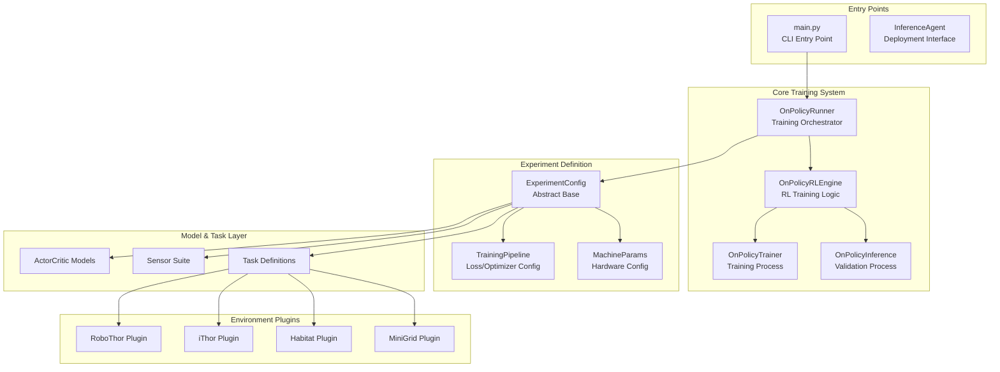
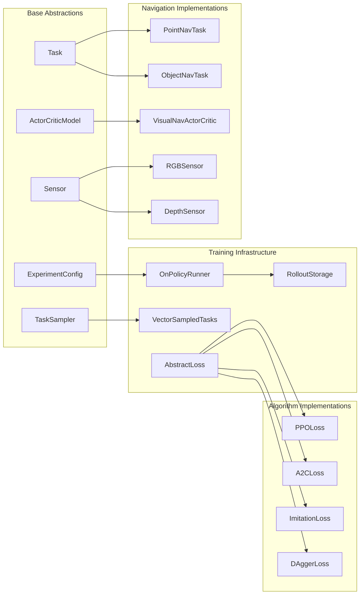

<!-- source: DeepWiki mcp.deepwiki.com · repo allenai/allenact · page 1 Overview · fetched 2026-10-26 -->

# Overview

Relevant source files

The following files were used as context for generating this wiki page:

- [README.md](README.md)
- [allenact/setup.py](allenact/setup.py)
- [allenact_plugins/gym_plugin/extra_environment.yml](allenact_plugins/gym_plugin/extra_environment.yml)
- [allenact_plugins/setup.py](allenact_plugins/setup.py)
- [conda/environment-10.1.yml](conda/environment-10.1.yml)
- [conda/environment-10.2.yml](conda/environment-10.2.yml)
- [conda/environment-9.2.yml](conda/environment-9.2.yml)
- [conda/environment-base.yml](conda/environment-base.yml)
- [docs/img/AI2_Logo_Square_Gradients_crop.png](docs/img/AI2_Logo_Square_Gradients_crop.png)
- [docs/img/PRIORLogoBlackEmbedded.png](docs/img/PRIORLogoBlackEmbedded.png)
- [main.py](main.py)
- [mkdocs.yml](mkdocs.yml)
- [requirements.txt](requirements.txt)
- [scripts/build_docs.py](scripts/build_docs.py)

This document provides a high-level introduction to AllenAct, an open-source framework for embodied AI research. It covers the framework's purpose, core architecture, and key components. For detailed installation instructions, see [Installation and Setup](#2.1). For step-by-step guidance on running experiments, see [Running Your First Experiment](#2.2).

## What is AllenAct

AllenAct is a modular and flexible learning framework designed specifically for embodied AI research. The framework provides first-class support for multiple simulation environments, task abstractions, and reinforcement learning algorithms, enabling researchers to easily implement and experiment with embodied AI agents.

The framework is built around several core principles:
- **Environment-Task Decoupling**: Tasks and environments are separated, allowing the same task to run across different simulators
- **Modular Architecture**: Components can be easily swapped and extended
- **PyTorch-First Design**: Native PyTorch support throughout the framework
- **Distributed Training**: Built-in support for multi-process and multi-machine training

**Sources:** [README.md:16-18](), [README.md:31-42]()

## Package Structure

AllenAct is organized into two main Python packages that serve distinct purposes:

| Package | Purpose | Location |
|---------|---------|----------|
| `allenact` | Core framework with base abstractions, algorithms, and utilities | [allenact/]() |
| `allenact_plugins` | Environment-specific implementations and extensions | [allenact_plugins/]() |

The core `allenact` package contains framework essentials like the training engine, base classes, and algorithms. The `allenact_plugins` package provides concrete implementations for specific environments like RoboTHOR, iTHOR, Habitat, and MiniGrid, allowing users to install only the plugins they need.

**Sources:** [allenact/setup.py:86-133](), [allenact_plugins/setup.py:98-127]()

## Core Architecture Overview

The following diagram illustrates AllenAct's high-level architecture and the relationships between major system components:

The training system centers around `OnPolicyRunner`, which orchestrates the entire training process by spawning training and validation processes, managing checkpoints, and collecting metrics. The `ExperimentConfig` system provides a declarative way to configure all aspects of an experiment.

**Sources:** [main.py:4-7](), [mkdocs.yml:28-66]()

## Key Framework Components

This diagram maps the major framework abstractions to their concrete implementations in the codebase:

The framework follows a clear inheritance hierarchy where abstract base classes define interfaces and concrete implementations provide environment-specific functionality. For example, `Task` is the base abstraction while `PointNavTask` and `ObjectNavTask` provide specific navigation behaviors.

**Sources:** [mkdocs.yml:91-110](), [mkdocs.yml:221-295]()

## Supported Environments and Tasks

AllenAct provides built-in support for multiple simulation environments through its plugin system:

| Environment | Plugin | Tasks | Key Features |
|-------------|--------|-------|--------------|
| **RoboTHOR** | `robothor_plugin` | PointNav, ObjectNav | Robotic embodiment, realistic physics |
| **iTHOR** | `ithor_plugin` | PointNav, ObjectNav, Manipulation | Interactive scenes, object manipulation |
| **Habitat** | `habitat_plugin` | PointNav | Photorealistic environments, large datasets |
| **MiniGrid** | `minigrid_plugin` | Grid navigation | Lightweight, fast prototyping |

Each plugin provides environment-specific implementations of tasks, sensors, and utilities while maintaining compatibility with the core framework abstractions.

**Sources:** [README.md:31](), [README.md:44-45](), [mkdocs.yml:126-183]()

## Training Algorithms

The framework includes implementations of several on-policy and imitation learning algorithms:

- **PPO (Proximal Policy Optimization)**: Standard policy gradient method with clipped objectives
- **DD-PPO (Decentralized Distributed PPO)**: Distributed version of PPO for multi-machine training  
- **A2C (Advantage Actor-Critic)**: Synchronous variant of actor-critic methods
- **Imitation Learning**: Learning from expert demonstrations
- **DAgger**: Dataset Aggregation for imitation learning with iterative expert feedback

All algorithms are implemented as modular loss functions that can be combined and sequenced within training pipelines.

**Sources:** [README.md:33](), [README.md:45](), [mkdocs.yml:98-111]()

## Next Steps

To start using AllenAct:
1. Follow the [Installation and Setup](#2.1) guide to install the framework and required dependencies
2. Try [Running Your First Experiment](#2.2) to verify your installation
3. Explore the [Tutorials](#7) for hands-on examples with different environments and tasks
4. Consult [Experiment Configuration](#4) to learn how to define custom experiments

**Sources:** [mkdocs.yml:30-47]()

---

