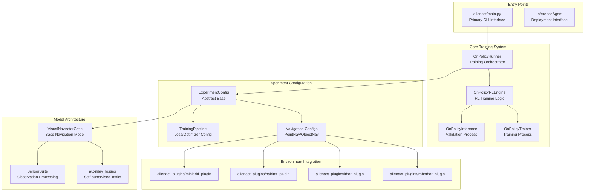
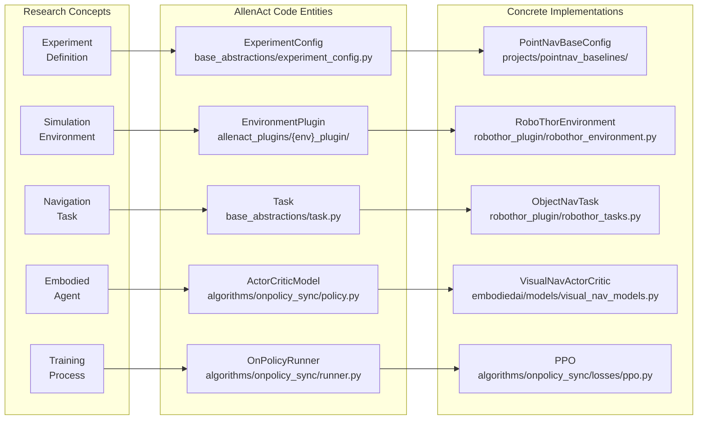

<!-- source: DeepWiki mcp.deepwiki.com · repo allenai/allenact · page 1.1 What is AllenAct · fetched 2026-10-26 -->

# What is AllenAct

<details>
<summary>Relevant source files</summary>

The following files were used as context for generating this wiki page:

- [README.md](README.md)
- [docs/getting_started/abstractions.md](docs/getting_started/abstractions.md)
- [docs/getting_started/running-your-first-experiment.md](docs/getting_started/running-your-first-experiment.md)
- [docs/getting_started/structure.md](docs/getting_started/structure.md)
- [docs/howtos/changing-rewards-and-losses.md](docs/howtos/changing-rewards-and-losses.md)
- [docs/howtos/defining-a-new-model.md](docs/howtos/defining-a-new-model.md)
- [docs/howtos/defining-a-new-task.md](docs/howtos/defining-a-new-task.md)
- [docs/howtos/defining-an-experiment.md](docs/howtos/defining-an-experiment.md)
- [docs/img/AI2_Logo_Square_Gradients_crop.png](docs/img/AI2_Logo_Square_Gradients_crop.png)
- [docs/img/PRIORLogoBlackEmbedded.png](docs/img/PRIORLogoBlackEmbedded.png)
- [mkdocs.yml](mkdocs.yml)
- [scripts/build_docs.py](scripts/build_docs.py)

</details>


This document explains AllenAct's role as an embodied AI research framework, its key features, target use cases, and high-level architecture. For detailed installation instructions, see [Installation and Setup](#2.1). For hands-on tutorials, see [Getting Started](#2).

## Overview

AllenAct is a modular and flexible learning framework designed specifically for **Embodied AI research**. It provides a unified platform for training and evaluating agents that must learn to navigate, manipulate, and interact with simulated environments through visual observations and discrete or continuous actions.

The framework abstracts away the complexity of distributed training, environment management, and experiment configuration while maintaining the flexibility needed for cutting-edge research. AllenAct supports multiple simulation environments, navigation tasks, and reinforcement learning algorithms out of the box.

**Sources:** [README.md:16-16](), [mkdocs.yml:2-2]()

## Key Features and Capabilities

AllenAct provides several core capabilities that distinguish it as an embodied AI research platform:

| Feature | Description | Implementation |
|---------|-------------|----------------|
| **Multi-Environment Support** | Unified interface across simulation platforms | iTHOR, RoboTHOR, Habitat, MiniGrid plugins |
| **Task Abstraction** | Decouple tasks from environments | `Task` and `TaskSampler` base classes |
| **Distributed Training** | Scale across multiple machines/GPUs | `OnPolicyRunner` with `TCPStore` communication |
| **Algorithm Modularity** | Mix and match RL algorithms | PPO, A2C, DAgger, Imitation Learning |
| **Sequential Training** | Multi-stage training pipelines | `TrainingPipeline` with `PipelineStage` |
| **Auxiliary Tasks** | Self-supervised learning integration | Inverse dynamics, CPCA, other auxiliary losses |

**Sources:** [README.md:29-42](), [docs/getting_started/abstractions.md:1-86]()

## Framework Architecture Overview

The following diagram shows AllenAct's high-level architecture and how components interact:

**AllenAct Framework Architecture**


**Sources:** [allenact/main.py](), [allenact/algorithms/onpolicy_sync/runner.py](), [allenact/algorithms/onpolicy_sync/engine.py](), [allenact/base_abstractions/experiment_config.py]()

## Core Abstractions and Code Mapping

AllenAct's design centers around several key abstractions that map directly to code entities:

**Core Abstractions and Their Code Implementations**


**Sources:** [allenact/base_abstractions/](), [allenact_plugins/](), [projects/](), [allenact/algorithms/onpolicy_sync/]()

## Supported Environments and Tasks

AllenAct provides plugin-based support for major embodied AI simulation environments:

### Environment Plugins

| Environment | Plugin Location | Tasks Supported | Key Features |
|-------------|----------------|----------------|--------------|
| **AI2-THOR iThor** | `allenact_plugins/ithor_plugin/` | ObjectNav, PointNav | Interactive scenes, physics |
| **AI2-THOR RoboThor** | `allenact_plugins/robothor_plugin/` | ObjectNav, PointNav | Robotic navigation datasets |
| **Habitat** | `allenact_plugins/habitat_plugin/` | PointNav | Photorealistic environments |
| **MiniGrid** | `allenact_plugins/minigrid_plugin/` | Simple navigation | Grid worlds, fast prototyping |

### Navigation Tasks

The framework implements two primary navigation paradigms:

- **PointNav**: Navigate to specific coordinates using GPS/compass sensors
- **ObjectNav**: Navigate to objects of specific categories using vision

**Sources:** [allenact_plugins/](), [README.md:31-31](), [README.md:43-45]()

## Training System and Algorithms

AllenAct's training system is built around the `OnPolicyRunner` which orchestrates distributed training across multiple processes and machines:

### Supported Algorithms

| Algorithm | Implementation | Use Case |
|-----------|----------------|----------|
| **PPO** | `allenact/algorithms/onpolicy_sync/losses/ppo.py` | Stable policy optimization |
| **A2C** | `allenact/algorithms/onpolicy_sync/losses/a2cacktr.py` | Actor-critic baseline |
| **DAgger** | `allenact/algorithms/onpolicy_sync/losses/imitation.py` | Imitation learning |
| **DD-PPO** | Distributed PPO via `OnPolicyRunner` | Large-scale training |

### Training Pipeline Structure

Training is configured through `TrainingPipeline` objects that support:
- **Sequential stages** with different loss combinations
- **Teacher forcing** with decay schedules  
- **Auxiliary tasks** for improved sample efficiency
- **Multi-stage curricula** (e.g., DAgger → PPO)

**Sources:** [allenact/algorithms/onpolicy_sync/](), [allenact/utils/experiment_utils.py](), [README.md:33-34]()

## Entry Points and Usage

AllenAct provides two primary interfaces:

### Command Line Interface
The main entry point is `allenact/main.py`, which accepts experiment configurations:

```bash
python allenact/main.py experiment_name -b projects/baselines -o output_dir
```

### Programmatic Interface  
Experiments are defined by subclassing `ExperimentConfig` and implementing:
- `create_model()` - Instantiate the actor-critic model
- `training_pipeline()` - Define losses and training stages  
- `make_sampler_fn()` - Specify task sampling logic
- Machine configuration methods for distributed training

**Sources:** [allenact/main.py](), [docs/getting_started/running-your-first-experiment.md:6-8](), [allenact/base_abstractions/experiment_config.py]()

## Target Use Cases

AllenAct is designed for researchers and practitioners working on:

- **Embodied AI research** requiring multi-environment experimentation
- **Navigation algorithm development** with standardized benchmarks  
- **Large-scale distributed training** of visual navigation agents
- **Multi-modal sensor fusion** for robotics applications
- **Curriculum learning** and sequential training methodologies

The framework abstracts environment-specific details while providing the flexibility needed for novel research directions in embodied artificial intelligence.

**Sources:** [README.md:16-18](), [docs/getting_started/abstractions.md:3-6]()

---

