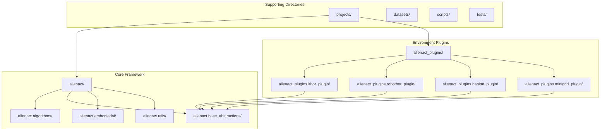
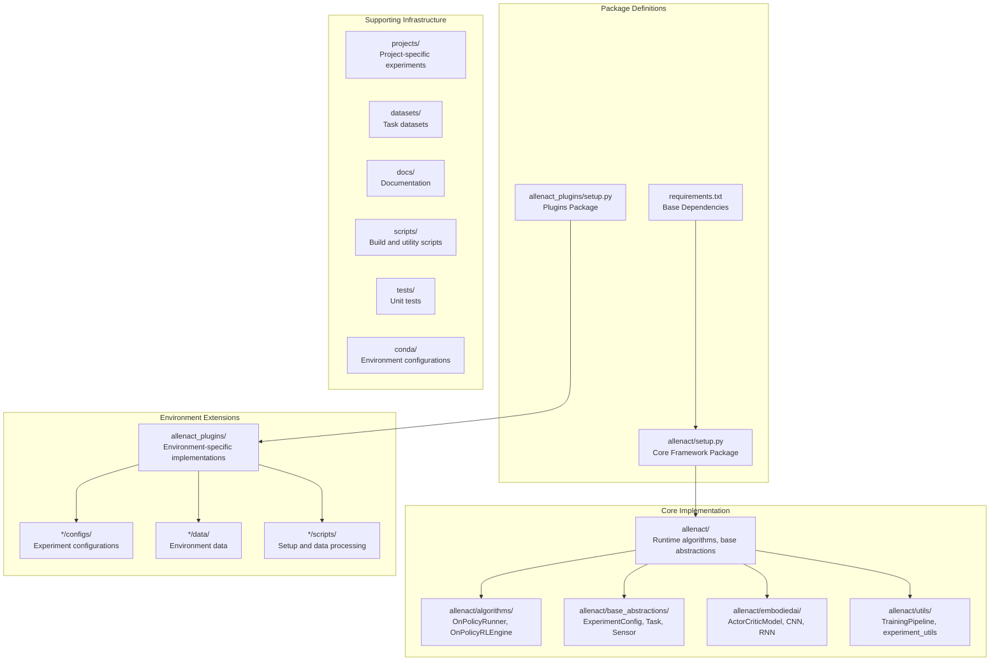
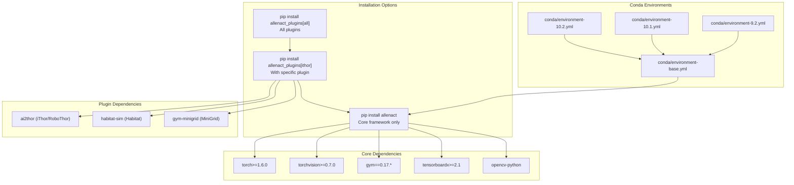

<!-- source: DeepWiki mcp.deepwiki.com · repo allenai/allenact · page 1.2 Package Structure · fetched 2026-10-26 -->

# Package Structure

<details>
<summary>Relevant source files</summary>

The following files were used as context for generating this wiki page:

- [allenact/setup.py](allenact/setup.py)
- [allenact_plugins/gym_plugin/extra_environment.yml](allenact_plugins/gym_plugin/extra_environment.yml)
- [allenact_plugins/setup.py](allenact_plugins/setup.py)
- [conda/environment-10.1.yml](conda/environment-10.1.yml)
- [conda/environment-10.2.yml](conda/environment-10.2.yml)
- [conda/environment-9.2.yml](conda/environment-9.2.yml)
- [conda/environment-base.yml](conda/environment-base.yml)
- [docs/getting_started/abstractions.md](docs/getting_started/abstractions.md)
- [docs/getting_started/running-your-first-experiment.md](docs/getting_started/running-your-first-experiment.md)
- [docs/getting_started/structure.md](docs/getting_started/structure.md)
- [docs/howtos/changing-rewards-and-losses.md](docs/howtos/changing-rewards-and-losses.md)
- [docs/howtos/defining-a-new-model.md](docs/howtos/defining-a-new-model.md)
- [docs/howtos/defining-a-new-task.md](docs/howtos/defining-a-new-task.md)
- [docs/howtos/defining-an-experiment.md](docs/howtos/defining-an-experiment.md)
- [requirements.txt](requirements.txt)

</details>


This page explains the organization of the AllenAct repository structure, focusing on the core packages (`allenact` vs `allenact_plugins`) and how different components are organized across directories. For information about specific abstractions and APIs within these packages, see [Core Abstractions](#9.1). For installation details, see [Installation and Setup](#2.1).

## Repository Architecture Overview

AllenAct is organized as a modular framework with a clear separation between core functionality and environment-specific extensions. The repository follows a two-package architecture that enables flexible installation and dependency management.

### Core Package Architecture



Sources: [allenact/setup.py:111](), [allenact_plugins/setup.py:122](), [docs/getting_started/structure.md:7-20]()

### Repository Directory Structure



Sources: [docs/getting_started/structure.md:3-78](), [allenact/setup.py:1-137](), [allenact_plugins/setup.py:1-131]()

## Core Framework Package (`allenact`)

The `allenact` package contains the framework's core functionality and is designed to be environment-agnostic. It provides the fundamental abstractions and algorithms needed for embodied AI research.

### Key Modules

| Module | Purpose | Key Classes |
|--------|---------|-------------|
| `allenact.algorithms` | On-policy and off-policy training algorithms | `OnPolicyRunner`, `OnPolicyRLEngine`, `PPO`, `A2C` |
| `allenact.base_abstractions` | Core abstractions for experiments | `ExperimentConfig`, `Task`, `TaskSampler`, `Sensor` |
| `allenact.embodiedai` | Basic models for embodied AI | `ActorCriticModel`, `SimpleCNN`, `RNNStateEncoder` |
| `allenact.utils` | Utilities and experiment configuration | `TrainingPipeline`, `PipelineStage`, `Builder` |

The core package includes essential dependencies like PyTorch, OpenCV, and TensorboardX, as defined in [allenact/setup.py:112-128]().

Sources: [docs/getting_started/structure.md:12-19](), [allenact/setup.py:86-133]()

## Plugin Architecture (`allenact_plugins`)

The `allenact_plugins` package contains environment-specific implementations that extend the core framework. Each plugin follows a consistent structure with three subdirectories.

### Plugin Structure Pattern

Each plugin directory (`{environment}_plugin`) contains:

- **`configs/`** - Experiment configurations specific to the environment
- **`data/`** - Environment-specific data files 
- **`scripts/`** - Setup scripts and data processing utilities

### Available Plugins

| Plugin | Environment | Key Components |
|--------|-------------|----------------|
| `ithor_plugin` | AI2-THOR Interactive | `IThorEnvironment`, `ObjectNaviThorGridTask`, `RGBSensorThor` |
| `robothor_plugin` | AI2-THOR Robotic | `RobothorEnvironment`, `PointNavTask`, `ObjectNavTask` |
| `habitat_plugin` | Habitat Simulator | `HabitatEnvironment`, `PointNavHabitatTask` |
| `minigrid_plugin` | MiniGrid | `MiniGridEnvironment`, `MiniGridTask` |

The plugins package uses dynamic dependency resolution, with each plugin's extra requirements defined in `extra_requirements.txt` files that are parsed during setup [allenact_plugins/setup.py:70-83]().

Sources: [docs/getting_started/structure.md:37-44](), [allenact_plugins/setup.py:60-127]()

## Package Dependencies and Installation

### Dependency Architecture



The framework provides flexible installation through setuptools extras, allowing users to install only the components they need. The `allenact_plugins` package depends on the core `allenact` package [allenact_plugins/setup.py:123](), ensuring version compatibility.

### Console Script Entry Point

The core package provides a console script entry point `allenact` that maps to `allenact.main:main` [allenact/setup.py:131](), enabling command-line usage:

```bash
allenact experiment_name -b projects/directory
```

Sources: [allenact/setup.py:112-133](), [allenact_plugins/setup.py:69-127](), [conda/environment-base.yml:1-43](), [requirements.txt:1-35]()

## Supporting Directories

### Project Organization

- **`projects/`** - Contains project-specific experiment configurations and result processing scripts
- **`datasets/`** - Stores task-specific datasets, populated by download scripts  
- **`scripts/`** - Framework-wide utilities for documentation, formatting, and testing
- **`tests/`** - Unit tests for the core `allenact` package
- **`docs/`** - Documentation source files and configuration
- **`overrides/`** - Documentation theme customizations for MkDocs

The `datasets/` directory structure follows plugin organization, with subdirectories like `robothor-pointnav/` created by download scripts [docs/getting_started/structure.md:23-25]().

Sources: [docs/getting_started/structure.md:21-78]()

---

