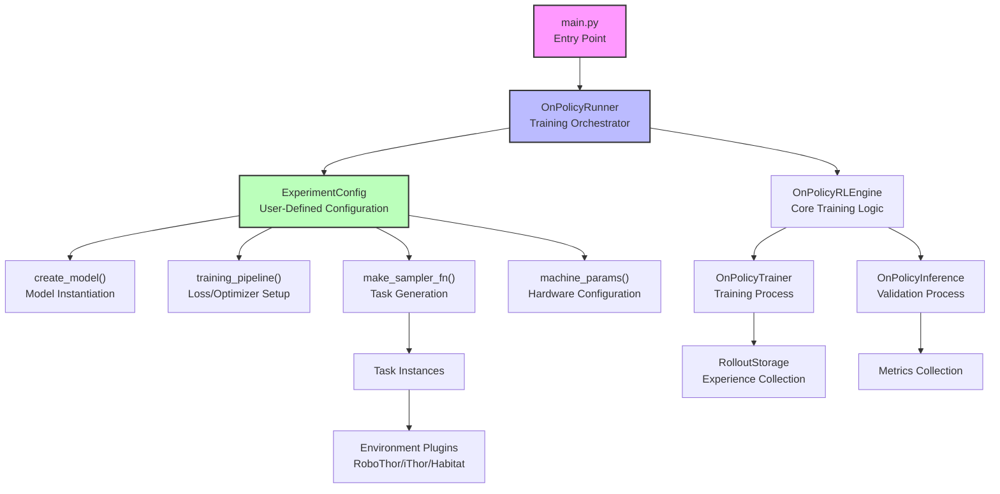
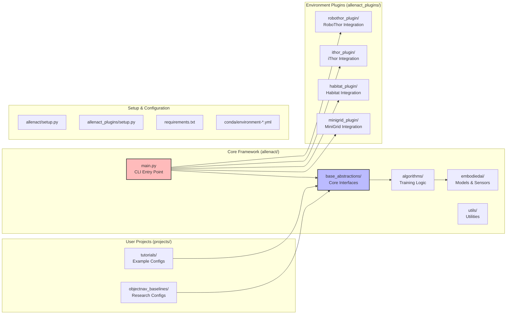
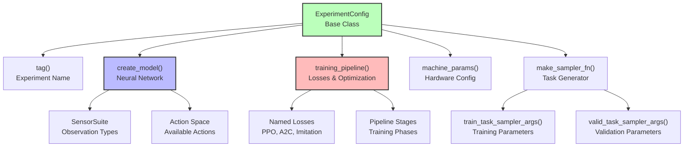

<!-- source: DeepWiki mcp.deepwiki.com · repo allenai/allenact · page 2 Getting Started · fetched 2026-10-26 -->

# Getting Started

<details>
<summary>Relevant source files</summary>

The following files were used as context for generating this wiki page:

- [allenact/setup.py](allenact/setup.py)
- [allenact_plugins/gym_plugin/extra_environment.yml](allenact_plugins/gym_plugin/extra_environment.yml)
- [allenact_plugins/setup.py](allenact_plugins/setup.py)
- [conda/environment-10.1.yml](conda/environment-10.1.yml)
- [conda/environment-10.2.yml](conda/environment-10.2.yml)
- [conda/environment-9.2.yml](conda/environment-9.2.yml)
- [conda/environment-base.yml](conda/environment-base.yml)
- [docs/getting_started/abstractions.md](docs/getting_started/abstractions.md)
- [docs/getting_started/running-your-first-experiment.md](docs/getting_started/running-your-first-experiment.md)
- [docs/getting_started/structure.md](docs/getting_started/structure.md)
- [docs/howtos/changing-rewards-and-losses.md](docs/howtos/changing-rewards-and-losses.md)
- [docs/howtos/defining-a-new-model.md](docs/howtos/defining-a-new-model.md)
- [docs/howtos/defining-a-new-task.md](docs/howtos/defining-a-new-task.md)
- [docs/howtos/defining-an-experiment.md](docs/howtos/defining-an-experiment.md)
- [main.py](main.py)
- [requirements.txt](requirements.txt)

</details>


This page provides an overview of how to begin using AllenAct, from installation through running your first experiment. It covers the essential concepts and entry points needed to start training embodied AI agents. 

For detailed installation instructions across different environments, see [Installation and Setup](#2.1). For a step-by-step guide to running a complete experiment, see [Running Your First Experiment](#2.2). For comprehensive information about the core abstractions used throughout the framework, see page 4.

## Framework Overview

AllenAct is structured around a central training engine that orchestrates experiments defined through configuration classes. The framework separates core functionality (`allenact` package) from environment-specific implementations (`allenact_plugins` package).

**Main Entry Point and Training Flow**



Sources: [main.py:1-8](), [docs/getting_started/running-your-first-experiment.md:1-52](), [docs/getting_started/abstractions.md:1-86]()

## Package Structure and Key Files

AllenAct's codebase is organized into distinct packages with clear separation of concerns:

**Core Framework Architecture**



Sources: [docs/getting_started/structure.md:1-79](), [allenact/setup.py:1-138](), [allenact_plugins/setup.py:1-132]()

| Package | Purpose | Key Components |
|---------|---------|----------------|
| `allenact` | Core framework | Training algorithms, base abstractions, models |
| `allenact_plugins` | Environment integrations | RoboThor, iThor, Habitat, MiniGrid plugins |
| `projects` | User experiments | Tutorial configs, baseline implementations |
| `datasets` | Task-specific data | Navigation datasets, scene definitions |
| `scripts` | Build utilities | Documentation, formatting, testing scripts |

## Installation Overview

AllenAct supports installation through multiple methods depending on your needs:

### Package Installation Options

1. **Core Framework Only**: Install just `allenact` for custom environments
2. **With Environment Plugins**: Install `allenact_plugins[ENVIRONMENT]` for specific simulators
3. **Full Installation**: Install all plugins with `allenact_plugins[all]`

The framework requires Python 3.6+ and PyTorch 1.6+. CUDA support is optional but recommended for training.

**Dependency Structure**

| Component | Dependencies | Installation Command |
|-----------|-------------|---------------------|
| Core Framework | PyTorch, TensorboardX, OpenCV | `pip install allenact` |
| RoboThor Plugin | AI2-THOR | `pip install allenact_plugins[robothor]` |
| Habitat Plugin | Habitat-Sim | `pip install allenact_plugins[habitat]` |
| All Plugins | All simulators | `pip install allenact_plugins[all]` |

For detailed installation instructions including Conda environments and CUDA configurations, see [Installation and Setup](#2.1).

Sources: [allenact/setup.py:112-133](), [allenact_plugins/setup.py:68-83](), [requirements.txt:1-35](), [conda/environment-base.yml:1-43]()

## Running Your First Experiment

AllenAct experiments are launched through the `main.py` entry point with an experiment configuration name. The framework includes tutorial experiments that demonstrate core functionality.

### Basic Command Structure

```bash
PYTHONPATH=. python allenact/main.py EXPERIMENT_NAME -b PROJECT_DIR [OPTIONS]
```

**Command Line Arguments**

| Argument | Purpose | Example |
|----------|---------|---------|
| `EXPERIMENT_NAME` | Configuration class name | `minigrid_tutorial` |
| `-b PROJECT_DIR` | Base directory for configs | `-b projects/tutorials` |
| `-o OUTPUT_DIR` | Output directory | `-o experiment_output/minigrid` |
| `-m PROCESSES` | Number of processes | `-m 8` |
| `-s SEED` | Random seed | `-s 12345` |

### Tutorial Experiment

The simplest way to verify your installation is to run the MiniGrid tutorial:

```bash
PYTHONPATH=. python allenact/main.py minigrid_tutorial -b projects/tutorials -m 8 -o experiment_output/minigrid -s 12345
```

This command will:
1. Load the `minigrid_tutorial` experiment configuration from `projects/tutorials/`
2. Train a simple navigation agent in MiniGrid environments
3. Save checkpoints and logs to `experiment_output/minigrid/`
4. Use 8 parallel processes for faster training

For a complete walkthrough of this tutorial, see [Running Your First Experiment](#2.2).

Sources: [main.py:1-8](), [docs/getting_started/running-your-first-experiment.md:6-17]()

## Key Concepts for New Users

### ExperimentConfig: The Central Abstraction

All AllenAct experiments are defined by subclassing `ExperimentConfig`. This class provides methods that the training system calls to configure your experiment:

**Essential ExperimentConfig Methods**



Sources: [docs/getting_started/abstractions.md:11-22](), [docs/howtos/defining-an-experiment.md:40-49]()

### Task and Environment System

AllenAct separates task definition (what the agent should accomplish) from environment implementation (how the agent interacts with the world):

- **Tasks**: Define goals, rewards, and termination conditions
- **TaskSamplers**: Generate sequences of task instances
- **Environments**: Provide simulation capabilities (RoboThor, iThor, Habitat, etc.)
- **Sensors**: Extract observations from environments or tasks

### Training Pipeline Components

The framework uses a flexible pipeline system that supports:
- Multiple loss functions (PPO, A2C, Imitation Learning)
- Multi-stage training (e.g., DAgger followed by PPO)
- Auxiliary tasks for improved learning
- Distributed training across multiple GPUs/machines

## Next Steps

1. **Set up your environment**: Follow the detailed instructions in [Installation and Setup](#2.1)
2. **Run the tutorial**: Complete the walkthrough in [Running Your First Experiment](#2.2)
3. **Explore the tutorials**: See page 7 for step-by-step tutorials on different types of experiments
4. **Learn the core abstractions**: Review page 4 for detailed information about Tasks, Sensors, and Models
5. **Understand the training system**: See page 3 for in-depth coverage of the training architecture

Sources: [docs/getting_started/structure.md:1-79](), [docs/getting_started/abstractions.md:1-86]()

---

