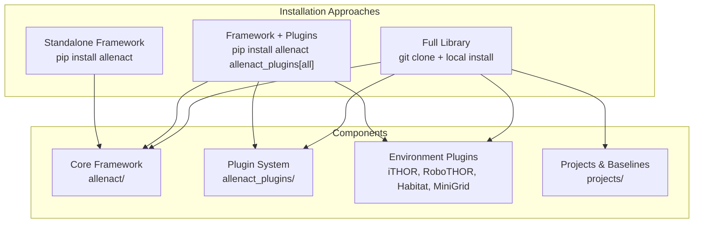
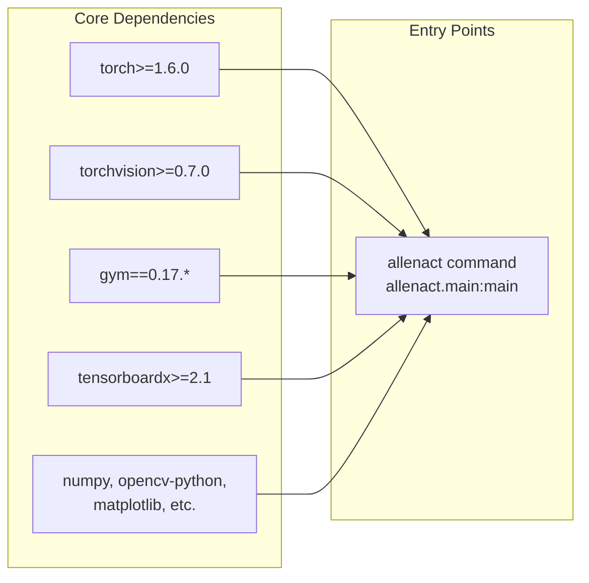
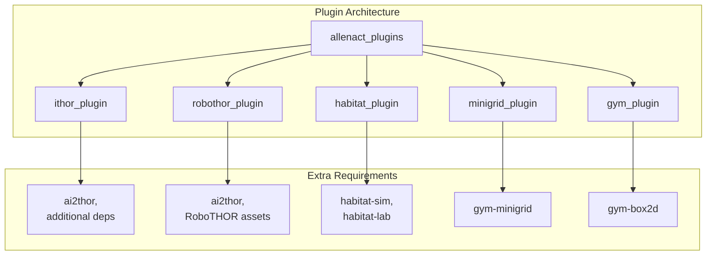
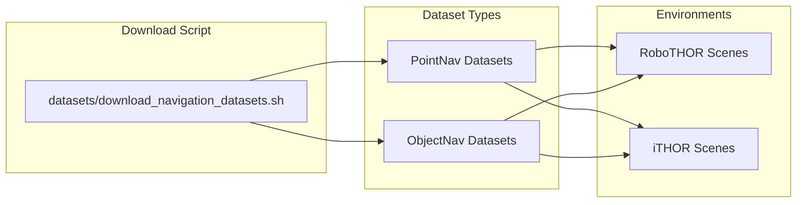

<!-- source: DeepWiki mcp.deepwiki.com · repo allenai/allenact · page 2.1 Installation and Setup · fetched 2026-10-26 -->

# Installation and Setup

<details>
<summary>Relevant source files</summary>

The following files were used as context for generating this wiki page:

- [allenact/setup.py](allenact/setup.py)
- [allenact_plugins/gym_plugin/extra_environment.yml](allenact_plugins/gym_plugin/extra_environment.yml)
- [allenact_plugins/setup.py](allenact_plugins/setup.py)
- [conda/environment-10.1.yml](conda/environment-10.1.yml)
- [conda/environment-10.2.yml](conda/environment-10.2.yml)
- [conda/environment-9.2.yml](conda/environment-9.2.yml)
- [conda/environment-base.yml](conda/environment-base.yml)
- [datasets/download_navigation_datasets.sh](datasets/download_navigation_datasets.sh)
- [docs/installation/download-datasets.md](docs/installation/download-datasets.md)
- [docs/installation/installation-allenact.md](docs/installation/installation-allenact.md)
- [docs/installation/installation-framework.md](docs/installation/installation-framework.md)
- [docs/tutorials/training-a-pointnav-model.md](docs/tutorials/training-a-pointnav-model.md)
- [docs/tutorials/transfering-to-a-different-environment-framework.md](docs/tutorials/transfering-to-a-different-environment-framework.md)
- [requirements.txt](requirements.txt)

</details>


This document provides detailed installation instructions for AllenAct, including the core framework, plugins, and environment-specific configurations. It covers multiple installation approaches to accommodate different use cases, from basic framework usage to full development setups with all supported simulation environments.

For information about running your first experiment after installation, see [Running Your First Experiment](#2.2). For environment-specific configuration details, see the individual environment sections under [Simulation Environments](#5).

## Installation Overview

AllenAct supports three primary installation approaches, each targeting different user needs and development workflows:



Sources: [docs/installation/installation-allenact.md:19-32](), [allenact/setup.py:86-133](), [allenact_plugins/setup.py:98-127]()

## System Requirements

| Component | Requirements |
|-----------|-------------|
| Python Version | 3.6, 3.7, 3.8, 3.9, or 3.10 |
| PyTorch | ≥1.6.0, !=1.8.0, <2.0.0 |
| CUDA | Optional, auto-detected or manual configuration |
| Memory | ≥8GB RAM recommended for training |
| Storage | ≥10GB for full installation with datasets |

The framework automatically detects available hardware and configures GPU usage accordingly. For older CUDA versions, manual PyTorch installation may be required.

Sources: [allenact/setup.py:100-105](), [allenact/setup.py:113-128](), [docs/installation/installation-allenact.md:3-10]()

## Standalone Framework Installation

The minimal installation provides core AllenAct functionality without environment-specific plugins:

```bash
pip install allenact
```

This installs the essential components defined in the core setup configuration:



For bleeding-edge installations directly from GitHub:

```bash
pip install -e "git+https://github.com/allenai/allenact.git@main#egg=allenact&subdirectory=allenact"
```

Sources: [docs/installation/installation-allenact.md:34-43](), [allenact/setup.py:112-128](), [allenact/setup.py:131]()

## Framework and Plugins Installation

To install AllenAct with environment plugins for simulation support:

```bash
# Install all available plugins
pip install allenact allenact_plugins[all]

# Install specific plugins only
pip install allenact allenact_plugins[ithor,minigrid]
```

The plugin system dynamically discovers and configures available environments:



Sources: [docs/installation/installation-allenact.md:64-81](), [allenact_plugins/setup.py:69-83]()

## Full Library Installation

For development and access to all baselines and projects:

```bash
git clone git@github.com:allenai/allenact.git
cd allenact
```

### Using pip

Install core requirements and development dependencies:

```bash
pip install -r requirements.txt
pip install -r dev_requirements.txt
```

Install plugin-specific requirements:

```bash
pip install -r allenact_plugins/<PLUGIN_NAME>_plugin/extra_requirements.txt
```

### Using conda

Set up a conda environment with all dependencies:

```bash
export MY_ENV_NAME=allenact
export CONDA_BASE="$(dirname $(dirname "${CONDA_EXE}"))"
export PIP_SRC="${CONDA_BASE}/envs/${MY_ENV_NAME}/pipsrc"
conda env create --file ./conda/environment-base.yml --name $MY_ENV_NAME
```

For specific CUDA versions:

```bash
conda env update --file ./conda/environment-<CUDA_VERSION>.yml --name allenact
```

Available environment files:

| File | Purpose |
|------|---------|
| `environment-base.yml` | Base dependencies with latest CUDA |
| `environment-dev.yml` | Development dependencies |
| `environment-cpu.yml` | CPU-only installation |
| `environment-9.2.yml` | CUDA 9.2 compatibility |
| `environment-10.1.yml` | CUDA 10.1 compatibility |
| `environment-10.2.yml` | CUDA 10.2 compatibility |

Sources: [docs/installation/installation-allenact.md:84-172](), [conda/environment-base.yml:1-43](), [conda/environment-10.2.yml:1-8]()

## Environment-Specific Setup

### iTHOR/RoboTHOR Configuration

For headless server environments without attached displays:

```bash
sudo python scripts/startx.py &
```

The AI2-THOR environments automatically download required assets on first use.

### Habitat Installation

Install Habitat components after setting up the base environment:

```bash
# For machines with display
conda env update --file allenact_plugins/habitat_plugin/extra_environment.yml --name $MY_ENV_NAME

# For headless servers
conda env update --file allenact_plugins/habitat_plugin/extra_environment_headless.yml --name $MY_ENV_NAME
```

Additional requirements include downloading scene assets (Gibson/Matterport) and task datasets separately.

### MiniGrid Setup

MiniGrid environments require minimal additional configuration and work out-of-the-box after plugin installation.

Sources: [docs/installation/installation-framework.md:11-104](), [allenact_plugins/gym_plugin/extra_environment.yml:1-6]()

## Dataset Installation

AllenAct provides automated scripts for downloading navigation datasets:



Download specific datasets:

```bash
# RoboTHOR PointNav
bash datasets/download_navigation_datasets.sh robothor-pointnav

# iTHOR ObjectNav  
bash datasets/download_navigation_datasets.sh ithor-objectnav

# All THOR datasets
bash datasets/download_navigation_datasets.sh all-thor
```

The script automatically:
1. Downloads compressed dataset archives
2. Extracts them to appropriate directories
3. Generates debug datasets for testing

Sources: [datasets/download_navigation_datasets.sh:1-65](), [docs/installation/download-datasets.md:16-47]()

## Installation Verification

Verify your installation by running a simple experiment:

```bash
# Activate your environment (if using conda)
conda activate allenact

# Test with MiniGrid tutorial
PYTHONPATH=. python allenact/main.py training_a_pointnav_model -o storage/test -b projects/tutorials

# Check available plugins
python -c "import allenact_plugins; print('Plugins installed successfully')"
```

The installation is complete when:
- The `allenact` command is available
- Required plugins import without errors
- Test experiments can be launched
- Datasets are accessible in the `datasets/` directory

Sources: [docs/tutorials/training-a-pointnav-model.md:534-540](), [allenact/setup.py:131]()

---

