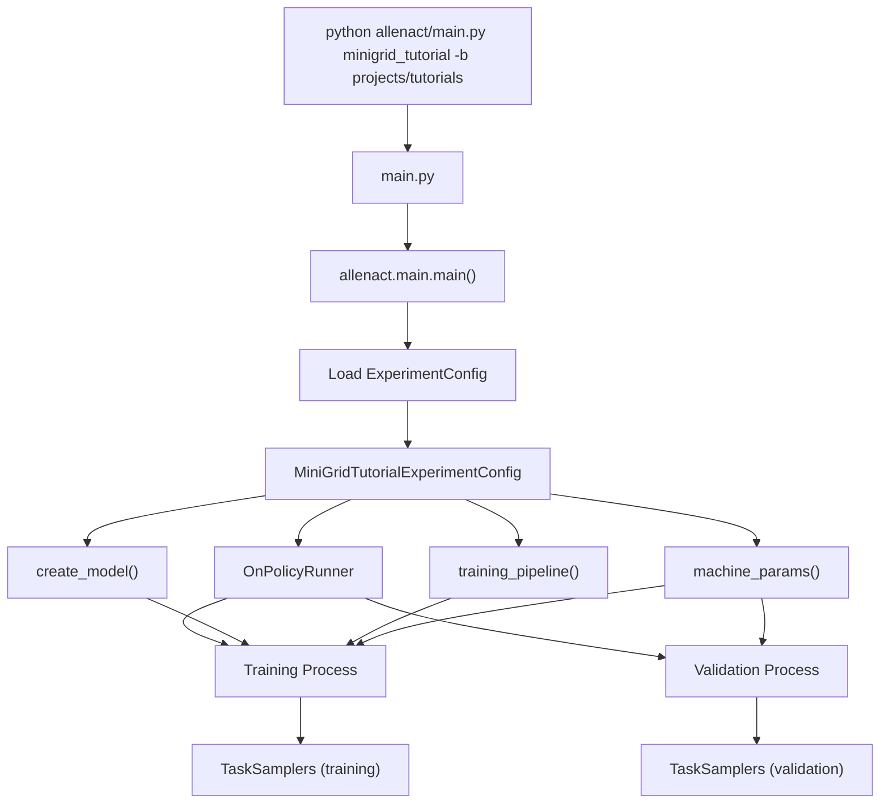
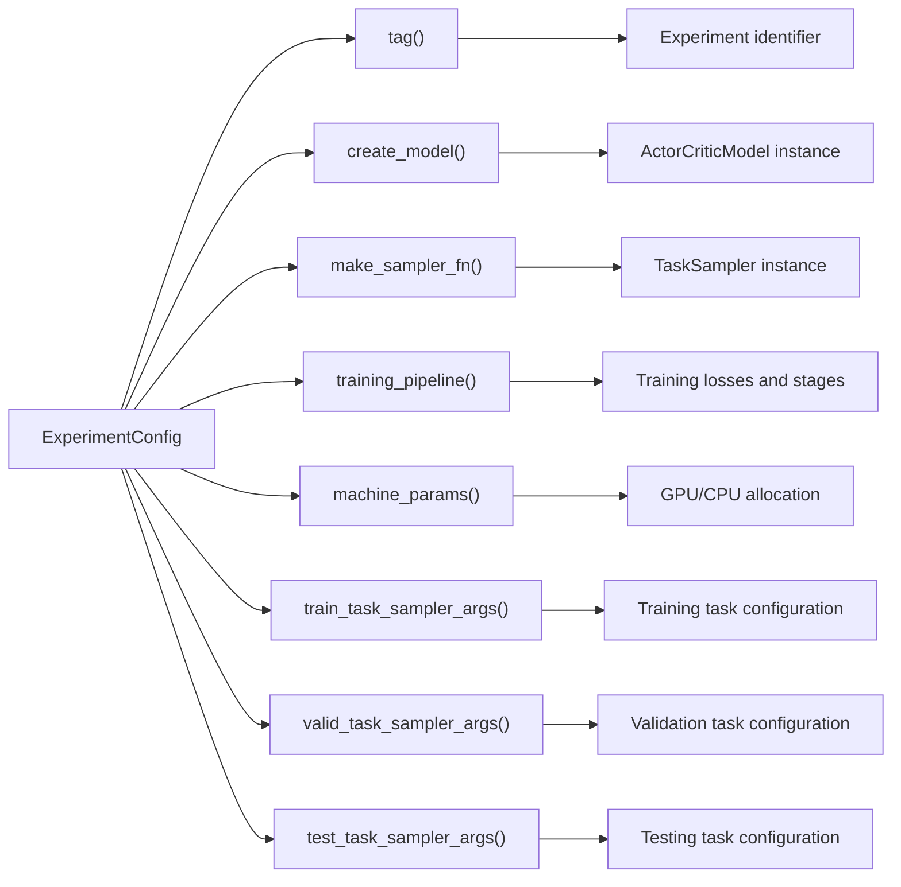
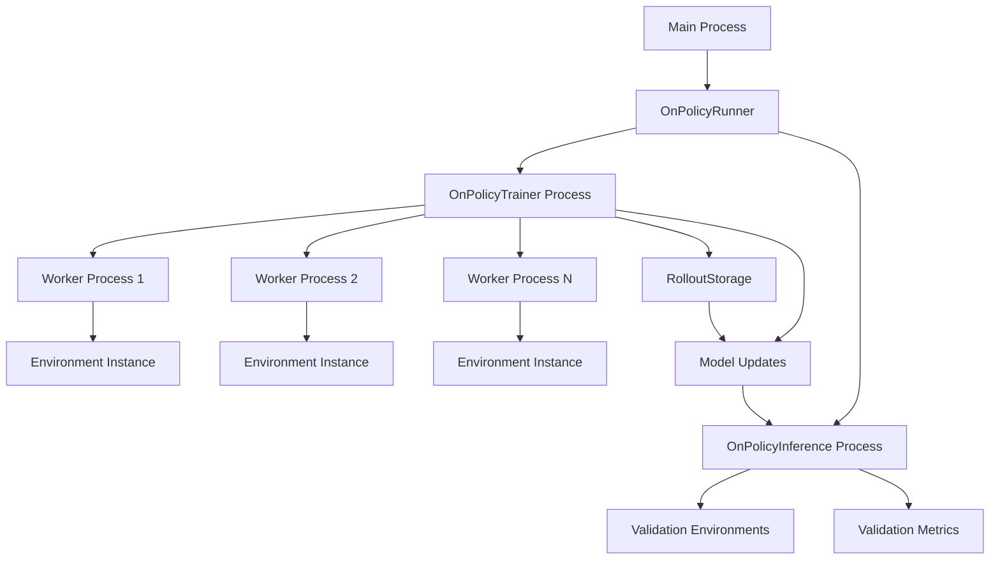

<!-- source: DeepWiki mcp.deepwiki.com · repo allenai/allenact · page 2.2 Running Your First Experiment · fetched 2026-10-26 -->

# Running Your First Experiment

<details>
<summary>Relevant source files</summary>

The following files were used as context for generating this wiki page:

- [docs/getting_started/abstractions.md](docs/getting_started/abstractions.md)
- [docs/getting_started/running-your-first-experiment.md](docs/getting_started/running-your-first-experiment.md)
- [docs/getting_started/structure.md](docs/getting_started/structure.md)
- [docs/howtos/changing-rewards-and-losses.md](docs/howtos/changing-rewards-and-losses.md)
- [docs/howtos/defining-a-new-model.md](docs/howtos/defining-a-new-model.md)
- [docs/howtos/defining-a-new-task.md](docs/howtos/defining-a-new-task.md)
- [docs/howtos/defining-an-experiment.md](docs/howtos/defining-an-experiment.md)
- [main.py](main.py)
- [projects/tutorials/minigrid_tutorial.py](projects/tutorials/minigrid_tutorial.py)

</details>


This page provides a step-by-step guide to executing your first training experiment in AllenAct. It covers the command-line interface, experiment configuration basics, output structure, and monitoring tools needed to get started with training agents.

For detailed information about creating custom experiment configurations, see [Experiment Configuration](#4). For understanding the underlying training architecture, see [Core Training Architecture](#3).

## Quick Start

The simplest way to run your first experiment is using the provided MiniGrid tutorial:

```bash
PYTHONPATH=. python allenact/main.py minigrid_tutorial -b projects/tutorials -m 8 -o experiment_output/minigrid -s 12345
```

This command trains a simple navigation agent in a grid environment and demonstrates all core AllenAct functionality.

**Sources:** [docs/getting_started/running-your-first-experiment.md:6-8](), [projects/tutorials/minigrid_tutorial.py:320-322]()

## Command Line Interface

AllenAct experiments are executed through the main entry point with the following structure:

```bash
PYTHONPATH=. python allenact/main.py <experiment_name> [options]
```

### Core Arguments

| Argument | Description | Example |
|----------|-------------|---------|
| `experiment_name` | Name of experiment config class (without .py extension) | `minigrid_tutorial` |
| `-b, --base_dir` | Directory containing experiment configs | `projects/tutorials` |
| `-o, --output_dir` | Output directory for results and checkpoints | `experiment_output/minigrid` |
| `-s, --seed` | Random seed for reproducibility | `12345` |
| `-m, --max_processes` | Maximum number of worker processes | `8` |

### Evaluation Arguments

| Argument | Description |
|----------|-------------|
| `--eval` | Run in evaluation mode instead of training |
| `--checkpoint` | Path to checkpoint file for evaluation |

**Sources:** [docs/getting_started/running-your-first-experiment.md:12-16](), [projects/tutorials/minigrid_tutorial.py:325-330]()

## Execution Flow

The following diagram shows how command-line arguments flow through AllenAct's execution system:



**Sources:** [main.py:1-7](), [projects/tutorials/minigrid_tutorial.py:46-50]()

## Experiment Configuration Basics

Every experiment requires an `ExperimentConfig` class that defines the training setup. The configuration specifies:

### Key Configuration Methods



### Example Configuration Structure

The `MiniGridTutorialExperimentConfig` demonstrates the essential components:

- **Sensors**: Define observation types (e.g., `EgocentricMiniGridSensor`)
- **Model**: Actor-critic network architecture (`MiniGridSimpleConvRNN`)
- **Task Sampler**: Environment and task generation (`MiniGridTaskSampler`)
- **Training Pipeline**: Loss functions and optimization (`PPO`)

**Sources:** [projects/tutorials/minigrid_tutorial.py:100-308](), [docs/getting_started/abstractions.md:11-22]()

## Output Structure

When an experiment runs, AllenAct creates a structured output directory:

```
experiment_output/minigrid/
├── checkpoints/
│   └── MiniGridTutorial/
│       └── 2024-01-15_14-30-45/
│           ├── exp_MiniGridTutorial__stage_00__steps_000010000.pt
│           ├── exp_MiniGridTutorial__stage_00__steps_000020000.pt
│           └── ...
├── used_configs/
│   └── MiniGridTutorial/
│       └── 2024-01-15_14-30-45/
│           └── config.json
└── tb/
    └── MiniGridTutorial/
        └── 2024-01-15_14-30-45/
            └── events.out.tfevents.*
```

### Directory Contents

| Directory | Purpose |
|-----------|---------|
| `checkpoints/` | Model weight checkpoints saved during training |
| `used_configs/` | Configuration files used for reproducibility |
| `tb/` | TensorBoard log files for monitoring |

The timestamp format `YYYY-MM-DD_HH-MM-SS` records when the experiment started.

**Sources:** [docs/getting_started/running-your-first-experiment.md:19-26]()

## Monitoring Training Progress

### TensorBoard Integration

Start TensorBoard to monitor training metrics:

```bash
tensorboard --logdir experiment_output/minigrid/tb
```

Access the dashboard at [http://localhost:6006/](http://localhost:6006/).

### Key Metrics to Watch

- **Success Rate**: Percentage of tasks completed successfully
- **Episode Length**: Average number of steps per task
- **Reward**: Cumulative reward per episode
- **Loss Values**: Training loss convergence

For the MiniGrid tutorial, expect:
- Valid success rate converging to 1.0
- Mean episode length below 4 steps
- Training completing in ~150,000 steps

**Sources:** [docs/getting_started/running-your-first-experiment.md:28-44](), [projects/tutorials/minigrid_tutorial.py:332-348]()

## Testing Trained Models

### Evaluation Mode

After training completes, evaluate checkpoints using the `--eval` flag:

```bash
PYTHONPATH=. python allenact/main.py minigrid_tutorial \
    -b projects/tutorials \
    -m 1 \
    -o experiment_output/minigrid \
    -s 12345 \
    --eval \
    --checkpoint experiment_output/minigrid/checkpoints/MiniGridTutorial/2024-01-15_14-30-45/exp_MiniGridTutorial__stage_00__steps_000150000.pt
```

### Evaluation Configuration

The experiment configuration automatically handles evaluation differences:

- **Training**: Infinite task sampling (`max_tasks=None`)
- **Validation**: Fixed task sets (20 tasks)  
- **Testing**: Larger fixed sets (40 tasks)
- **Sampling**: Deterministic for validation/testing, random for training

**Sources:** [projects/tutorials/minigrid_tutorial.py:356-364](), [projects/tutorials/minigrid_tutorial.py:208-241]()

## Process Architecture

AllenAct distributes training across multiple processes for efficiency:



### Process Allocation

The `-m` argument controls process distribution:
- **Training**: 128 task samplers across 8 subprocesses (16 samplers each)
- **Validation**: 16 task samplers for concurrent evaluation
- **Memory**: Each process maintains separate environment instances

**Sources:** [projects/tutorials/minigrid_tutorial.py:268-271](), [docs/getting_started/running-your-first-experiment.md:13-14]()

## Common Issues and Solutions

### Environment Setup

Ensure the Python path includes the AllenAct root:
```bash
PYTHONPATH=. python allenact/main.py ...
```

### Memory and Performance

- Reduce `-m` value if experiencing memory issues
- Use CPU training for simple environments (`devices: []`)
- Monitor GPU memory usage for complex visual environments

### Configuration Errors

- Verify experiment config file exists in specified base directory
- Check that all required dependencies are installed
- Ensure sensor and model compatibility

**Sources:** [projects/tutorials/minigrid_tutorial.py:14-20](), [docs/getting_started/running-your-first-experiment.md:3-4]()

---

