<!-- source: DeepWiki mcp.deepwiki.com · repo allenai/allenact · page 3 Core Training Architecture · fetched 2026-10-26 -->

# Core Training Architecture

Relevant source files

The following files were used as context for generating this wiki page:

- [allenact/algorithms/onpolicy_sync/engine.py](allenact/algorithms/onpolicy_sync/engine.py)
- [allenact/algorithms/onpolicy_sync/runner.py](allenact/algorithms/onpolicy_sync/runner.py)
- [allenact/algorithms/onpolicy_sync/storage.py](allenact/algorithms/onpolicy_sync/storage.py)
- [allenact/algorithms/onpolicy_sync/vector_sampled_tasks.py](allenact/algorithms/onpolicy_sync/vector_sampled_tasks.py)
- [allenact/base_abstractions/callbacks.py](allenact/base_abstractions/callbacks.py)
- [allenact/base_abstractions/preprocessor.py](allenact/base_abstractions/preprocessor.py)
- [allenact/base_abstractions/task.py](allenact/base_abstractions/task.py)
- [allenact/embodiedai/mapping/mapping_utils/map_builders.py](allenact/embodiedai/mapping/mapping_utils/map_builders.py)
- [allenact/embodiedai/mapping/mapping_utils/point_cloud_utils.py](allenact/embodiedai/mapping/mapping_utils/point_cloud_utils.py)
- [allenact/main.py](allenact/main.py)
- [allenact/utils/experiment_utils.py](allenact/utils/experiment_utils.py)
- [allenact/utils/misc_utils.py](allenact/utils/misc_utils.py)
- [allenact_plugins/ithor_plugin/ithor_sensors.py](allenact_plugins/ithor_plugin/ithor_sensors.py)
- [allenact_plugins/robothor_plugin/robothor_sensors.py](allenact_plugins/robothor_plugin/robothor_sensors.py)

This document describes AllenAct's core training system, which is the framework's most critical component responsible for orchestrating reinforcement learning training, validation, and testing processes. The training architecture handles distributed execution, experience collection, model updates, and checkpoint management across multiple environments and workers.

For information about experiment configuration and setup, see [Experiment Configuration](#4). For details about specific simulation environments, see [Simulation Environments](#5). For model architecture details, see [Models and Algorithms](#6).

## System Overview

AllenAct's training architecture is built around a hierarchical system where `OnPolicyRunner` serves as the main orchestrator, spawning and managing multiple `OnPolicyRLEngine` worker processes. Each worker specializes in either training (`OnPolicyTrainer`) or inference (`OnPolicyInference`) tasks.

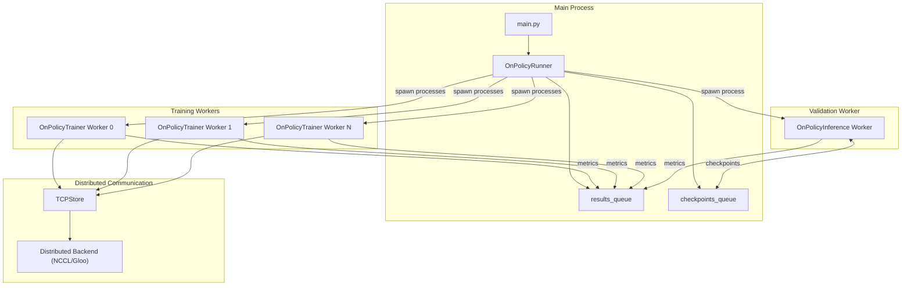

**Training System Architecture Overview**

Sources: [allenact/algorithms/onpolicy_sync/runner.py:80-141](), [allenact/algorithms/onpolicy_sync/engine.py:93-101](), [allenact/main.py:463-525]()

## OnPolicyRunner - Training Orchestration

The `OnPolicyRunner` class serves as the primary controller for the entire training system. It handles process spawning, resource management, and coordination between training and validation workers.

### Runner Initialization and Process Management

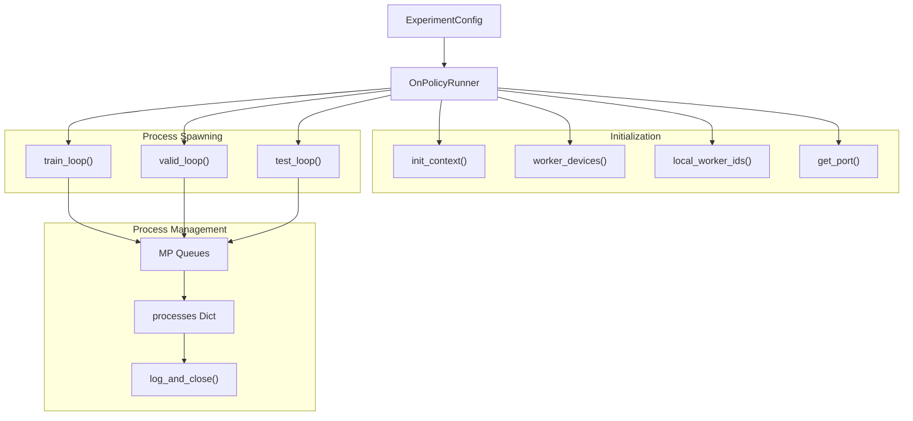

**OnPolicyRunner Process Management Flow**

The `OnPolicyRunner` manages the following key responsibilities:

| Component | Purpose | Implementation |
|-----------|---------|----------------|
| **Process Spawning** | Creates worker processes for training/validation | `start_train()`, `start_test()` methods |
| **Queue Management** | Handles inter-process communication | `mp.Queue` for results and checkpoints |
| **Resource Allocation** | Distributes GPU/CPU devices across workers | `worker_devices()`, `local_worker_ids()` |
| **Distributed Coordination** | Sets up TCP communication for multi-machine training | `get_port()`, distributed IP/port management |

Sources: [allenact/algorithms/onpolicy_sync/runner.py:495-669](), [allenact/algorithms/onpolicy_sync/runner.py:671-769]()

### Training and Validation Process Coordination

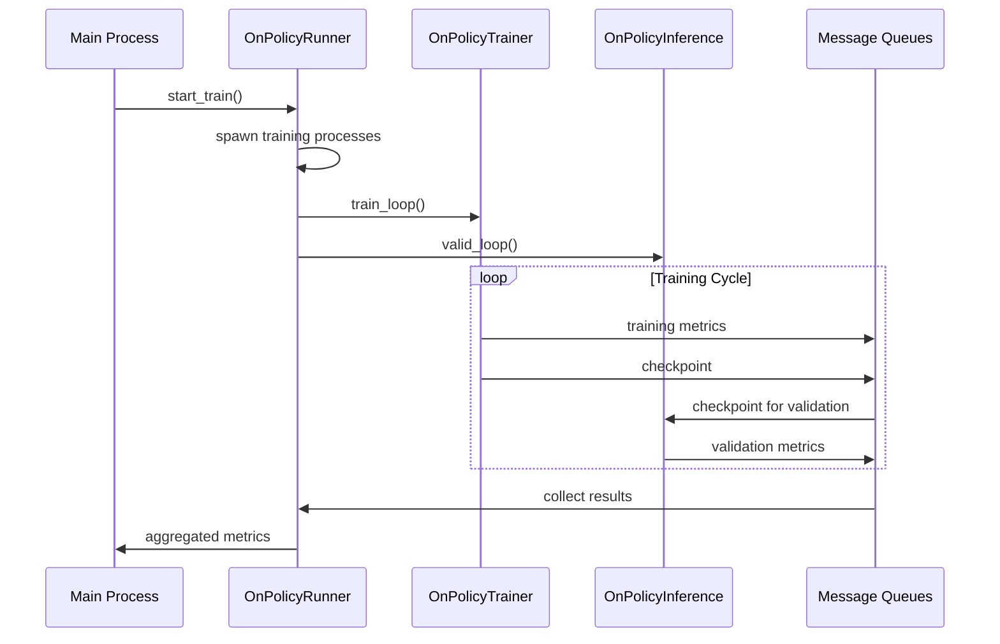

**Training and Validation Coordination Sequence**

Sources: [allenact/algorithms/onpolicy_sync/runner.py:404-429](), [allenact/algorithms/onpolicy_sync/runner.py:432-442](), [allenact/algorithms/onpolicy_sync/runner.py:445-453]()

## OnPolicyRLEngine Architecture

The `OnPolicyRLEngine` serves as the base class for all training and inference workers. It provides the core RL functionality and is specialized into `OnPolicyTrainer` and `OnPolicyInference` subclasses.

### Engine Class Hierarchy

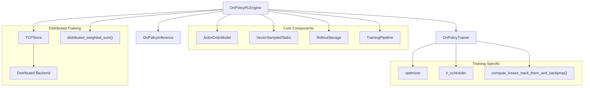

**OnPolicyRLEngine Class Architecture**

### Core Engine Functionality

The `OnPolicyRLEngine` implements several critical systems:

| System | Purpose | Key Methods |
|--------|---------|-------------|
| **Experience Collection** | Manages interaction with environments | `collect_step_across_all_task_samplers()` |
| **Model Management** | Handles neural network operations | `act()`, model loading/saving |
| **Storage Integration** | Coordinates with experience storage | `initialize_storage_and_viz()` |
| **Distributed Communication** | Handles multi-worker coordination | `distributed_weighted_sum()`, `distributed_reduce()` |

Sources: [allenact/algorithms/onpolicy_sync/engine.py:103-281](), [allenact/algorithms/onpolicy_sync/engine.py:532-547]()

### Training vs Inference Specialization

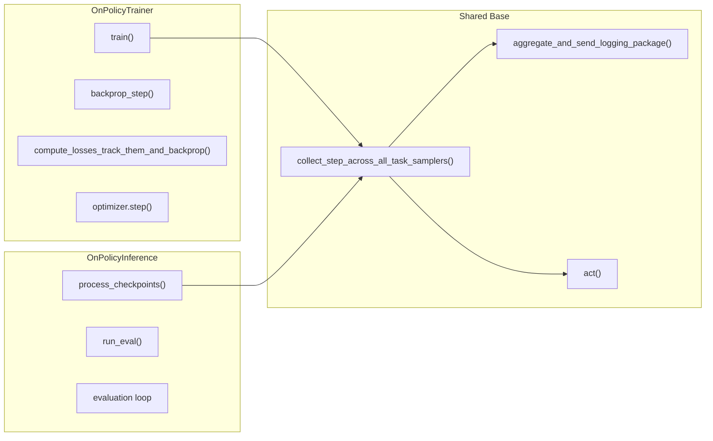

**Training vs Inference Specialization**

Sources: [allenact/algorithms/onpolicy_sync/engine.py:823-966]()

## Experience Collection and Storage

The training system uses `VectorSampledTasks` to manage multiple environment instances and `RolloutStorage` to accumulate experience for training updates.

### VectorSampledTasks Architecture

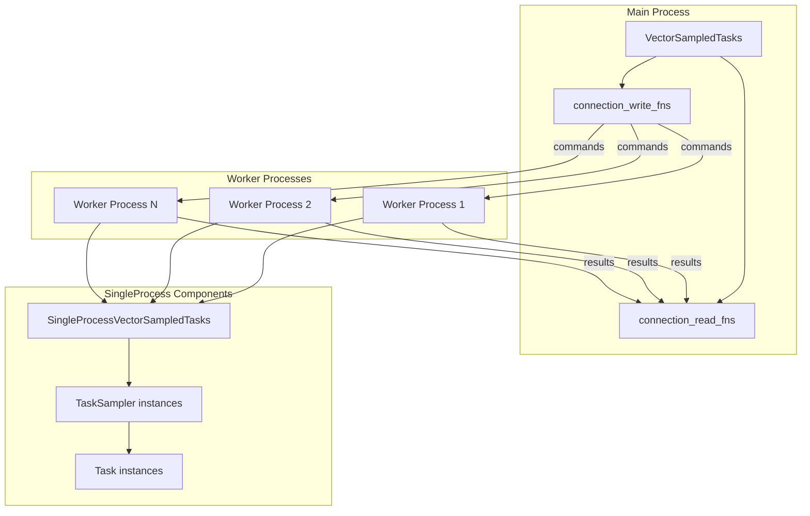

**VectorSampledTasks Multiprocess Architecture**

The `VectorSampledTasks` system handles:

- **Process Management**: Spawns worker processes using `_spawn_workers()`
- **Command Distribution**: Sends actions via `step()`, `call_at()`, etc.
- **Result Aggregation**: Collects observations and rewards from all workers
- **Task Lifecycle**: Manages task completion and resampling via `auto_resample_when_done`

Sources: [allenact/algorithms/onpolicy_sync/vector_sampled_tasks.py:116-259](), [allenact/algorithms/onpolicy_sync/vector_sampled_tasks.py:329-422]()

### RolloutStorage and Experience Management

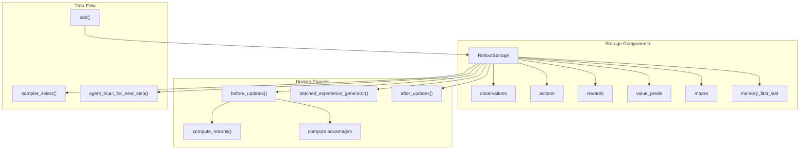

**RolloutStorage Experience Management**

The `RolloutStorage` provides:

| Function | Purpose | Key Features |
|----------|---------|-------------|
| **Experience Accumulation** | Stores agent trajectories | Dynamic storage sizing, multi-sampler support |
| **Advantage Computation** | Calculates GAE advantages | Configurable γ and λ parameters |
| **Batch Generation** | Creates mini-batches for training | Supports both mini-batch and streaming modes |
| **Memory Management** | Handles recurrent model states | First/last memory storage for RNNs |

Sources: [allenact/algorithms/onpolicy_sync/storage.py:130-567](), [allenact/algorithms/onpolicy_sync/storage.py:438-501]()

## Distributed Training System

AllenAct supports distributed training across multiple machines and GPUs using PyTorch's distributed backend with `TCPStore` for coordination.

### Distributed Communication Architecture

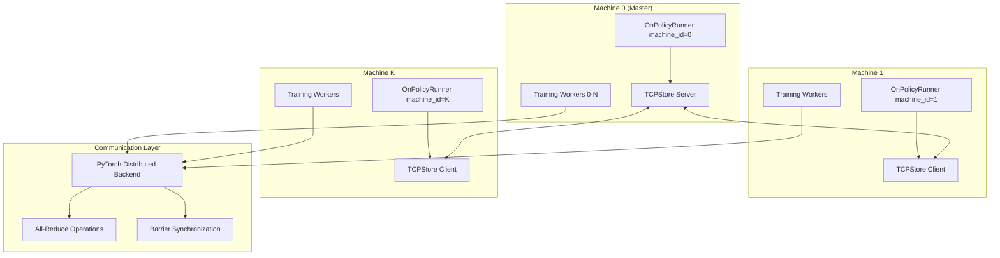

**Distributed Training Communication Architecture**

### Distributed Training Coordination

The distributed training system coordinates through several mechanisms:

| Component | Purpose | Implementation |
|-----------|---------|----------------|
| **TCPStore** | Shared key-value store for coordination | `torch.distributed.TCPStore` with master/worker setup |
| **Process Groups** | Grouped communication for workers | NCCL for GPU, Gloo for CPU/testing |
| **All-Reduce** | Gradient synchronization | `distributed_weighted_sum()`, `distributed_reduce()` |
| **Barriers** | Synchronization points | Used before loss computation and updates |

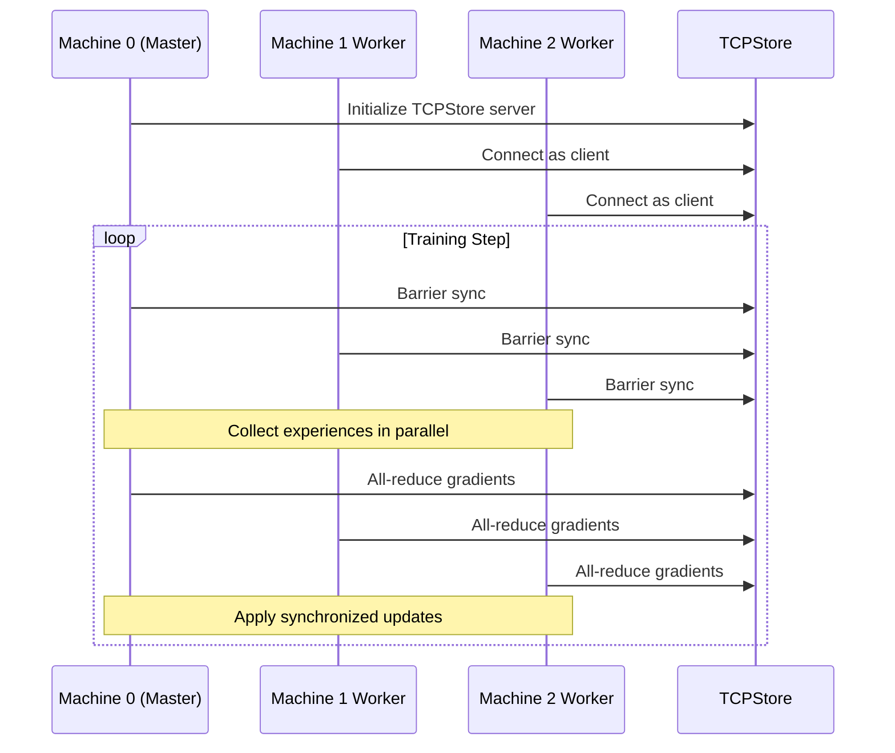

**Distributed Training Synchronization Sequence**

Sources: [allenact/algorithms/onpolicy_sync/engine.py:242-274](), [allenact/algorithms/onpolicy_sync/engine.py:776-802]()

## Training Pipeline and Configuration

The training system is configured through `TrainingPipeline` and `PipelineStage` objects that define losses, learning schedules, and training progression.

### Pipeline Architecture

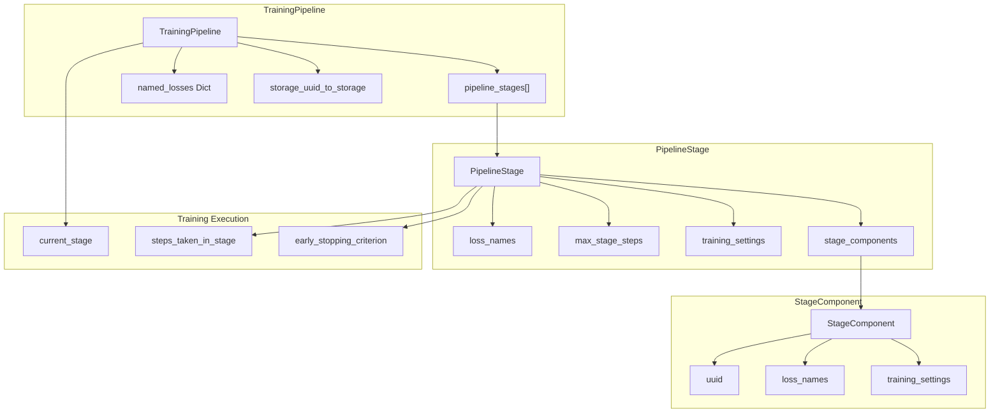

**Training Pipeline Configuration Architecture**

### Pipeline Execution Flow

The training pipeline executes in stages with configurable loss functions and training settings:

| Stage Element | Purpose | Configuration |
|---------------|---------|---------------|
| **Loss Functions** | Define training objectives | PPO, A2C, auxiliary losses |
| **Training Settings** | Control update parameters | Learning rate, batch size, update repeats |
| **Early Stopping** | Terminate stages early | Custom criteria based on metrics |
| **Stage Components** | Custom training components | Override settings per component |

Sources: [allenact/utils/experiment_utils.py:612-814](), [allenact/utils/experiment_utils.py:469-494](), [allenact/utils/experiment_utils.py:570-610]()

## Process Lifecycle and Error Handling

The training system includes robust process management with graceful shutdown and error recovery mechanisms.

### Process Management and Cleanup

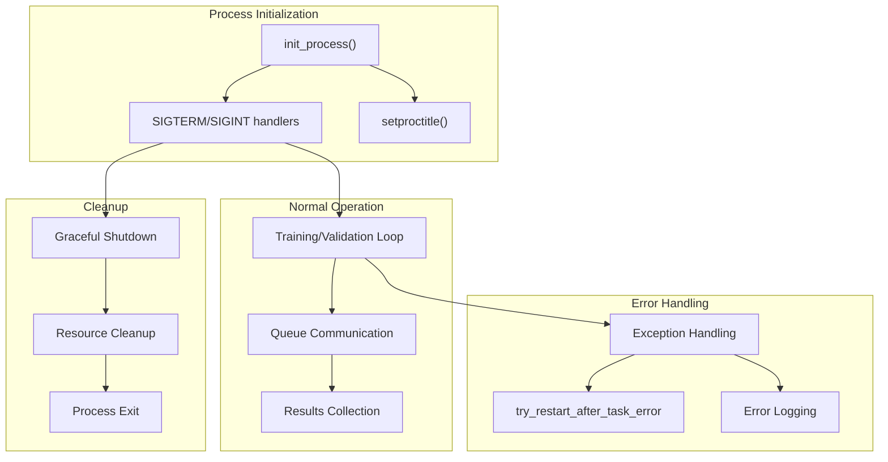

**Process Lifecycle and Error Handling**

The system provides comprehensive process management including:

- **Signal Handling**: Graceful shutdown on SIGTERM/SIGINT
- **Error Recovery**: Optional restart after task errors
- **Resource Cleanup**: Proper cleanup of multiprocessing resources
- **Logging Integration**: Comprehensive error logging and debugging support

Sources: [allenact/algorithms/onpolicy_sync/runner.py:342-377](), [allenact/algorithms/onpolicy_sync/runner.py:379-392](), [allenact/algorithms/onpolicy_sync/engine.py:125-157]()

---

