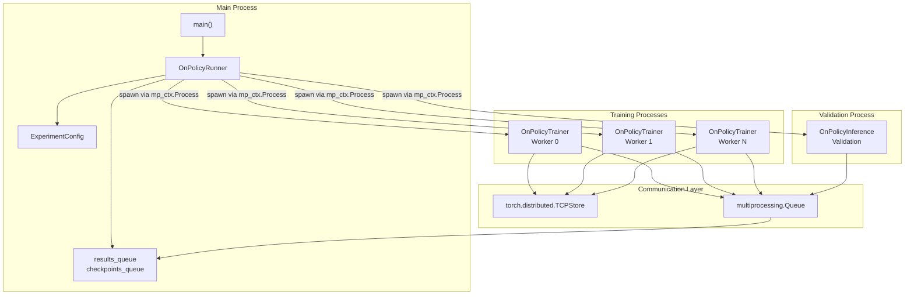
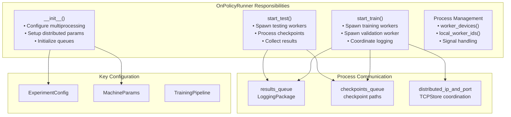
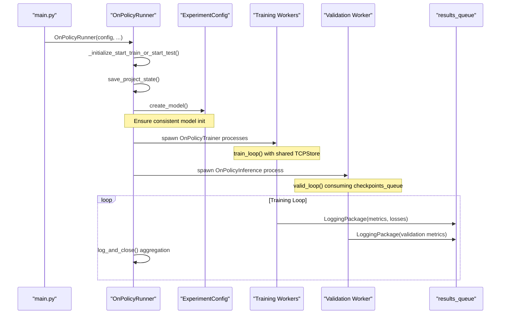
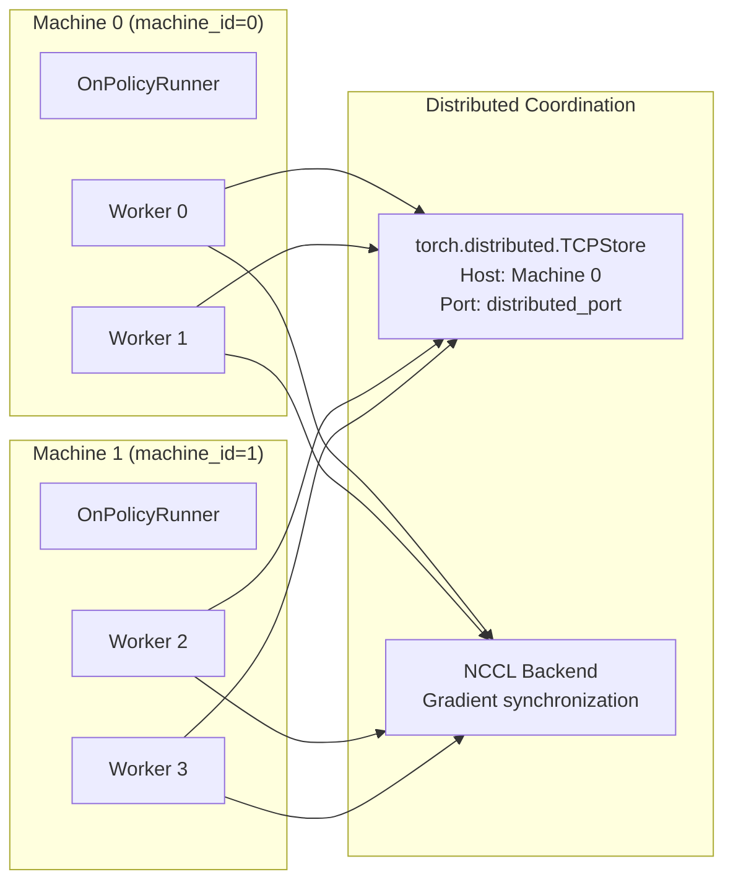
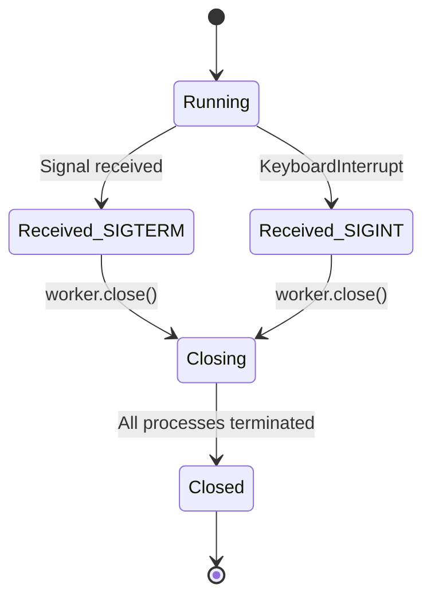
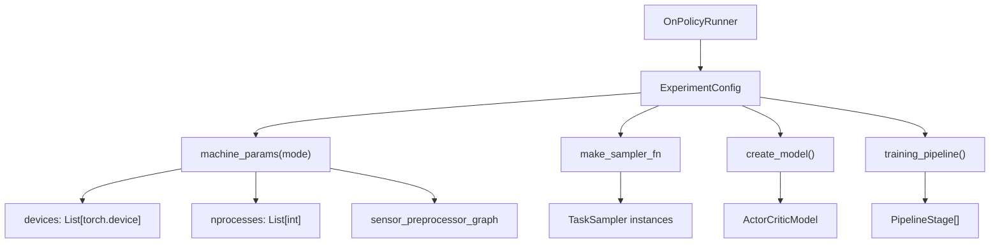

<!-- source: DeepWiki mcp.deepwiki.com · repo allenai/allenact · page 3.1 OnPolicyRunner and Training Orchestration · fetched 2026-10-26 -->

# OnPolicyRunner and Training Orchestration

Relevant source files

The following files were used as context for generating this wiki page:

- [allenact/algorithms/onpolicy_sync/engine.py](allenact/algorithms/onpolicy_sync/engine.py)
- [allenact/algorithms/onpolicy_sync/runner.py](allenact/algorithms/onpolicy_sync/runner.py)
- [allenact/algorithms/onpolicy_sync/storage.py](allenact/algorithms/onpolicy_sync/storage.py)
- [allenact/algorithms/onpolicy_sync/vector_sampled_tasks.py](allenact/algorithms/onpolicy_sync/vector_sampled_tasks.py)
- [allenact/base_abstractions/callbacks.py](allenact/base_abstractions/callbacks.py)
- [allenact/base_abstractions/preprocessor.py](allenact/base_abstractions/preprocessor.py)
- [allenact/base_abstractions/task.py](allenact/base_abstractions/task.py)
- [allenact/embodiedai/mapping/mapping_utils/map_builders.py](allenact/embodiedai/mapping/mapping_utils/map_builders.py)
- [allenact/embodiedai/mapping/mapping_utils/point_cloud_utils.py](allenact/embodiedai/mapping/mapping_utils/point_cloud_utils.py)
- [allenact/main.py](allenact/main.py)
- [allenact/utils/experiment_utils.py](allenact/utils/experiment_utils.py)
- [allenact/utils/misc_utils.py](allenact/utils/misc_utils.py)
- [allenact_plugins/ithor_plugin/ithor_sensors.py](allenact_plugins/ithor_plugin/ithor_sensors.py)
- [allenact_plugins/robothor_plugin/robothor_sensors.py](allenact_plugins/robothor_plugin/robothor_sensors.py)
- [main.py](main.py)

This document covers the `OnPolicyRunner` class and its role as the central orchestrator for training, validation, and testing in AllenAct. The `OnPolicyRunner` manages the lifecycle of distributed training processes, coordinates communication between components, and handles experiment state management.

For information about the specific RL training algorithms and loss computation, see [OnPolicyRLEngine and Training Logic](#3.2). For details on distributed training mechanics, see [Distributed Training System](#3.3).

## System Overview

The `OnPolicyRunner` serves as the main coordinator that:
- Spawns and manages training/validation worker processes  
- Handles distributed training coordination across multiple machines
- Manages inter-process communication via queues
- Orchestrates experiment lifecycle (initialization, checkpointing, logging, cleanup)
- Integrates with the experiment configuration system

**OnPolicyRunner Process Orchestration**

Sources: [allenact/algorithms/onpolicy_sync/runner.py:80-151](), [allenact/main.py:474-521]()

## OnPolicyRunner Architecture

The `OnPolicyRunner` class is instantiated from the main entry point and coordinates the entire training pipeline:

**OnPolicyRunner Core Architecture**

### Key Attributes and Methods

| Component | Purpose | Key Methods/Attributes |
|-----------|---------|----------------------|
| `config` | Experiment configuration | `ExperimentConfig` instance |
| `mp_ctx` | Multiprocessing context | `multiprocessing.get_context()` |
| `queues` | Inter-process communication | `results_queue`, `checkpoints_queue` |
| `processes` | Worker process tracking | `Dict[str, List[BaseProcess]]` |
| `distributed_ip_and_port` | Distributed coordination | TCP address for worker sync |

Sources: [allenact/algorithms/onpolicy_sync/runner.py:81-151](), [allenact/algorithms/onpolicy_sync/runner.py:470-474]()

## Training Orchestration Flow

The training orchestration follows a specific sequence managed by `start_train()`:

**Training Orchestration Sequence**

### Process Spawning Logic

The `start_train()` method follows this pattern:

1. **Initialize shared state** - Create queues, acquire unique time string
2. **Model synchronization** - Ensure all workers start with identical model weights  
3. **Spawn training workers** - One per device, sharing distributed coordination
4. **Spawn validation worker** - Single process consuming checkpoint queue
5. **Monitor and aggregate** - Collect results via queues until completion

Sources: [allenact/algorithms/onpolicy_sync/runner.py:495-670](), [allenact/algorithms/onpolicy_sync/runner.py:404-430]()

## Distributed Training Coordination

For multi-worker training, the `OnPolicyRunner` sets up distributed coordination:

**Distributed Training Architecture**

### Key Distributed Components

- **TCPStore**: Centralized key-value store for worker synchronization
- **Process Groups**: PyTorch distributed groups for gradient communication
- **Machine IDs**: Coordinate which machine hosts the master process
- **Port Management**: `find_free_port()` for automatic port allocation

Sources: [allenact/algorithms/onpolicy_sync/runner.py:477-494](), [allenact/algorithms/onpolicy_sync/engine.py:242-274]()

## Process Management and Communication

The `OnPolicyRunner` uses multiprocessing queues and signal handling for robust process management:

### Queue-Based Communication

| Queue | Producer | Consumer | Content |
|-------|----------|----------|---------|
| `results_queue` | Training/Validation workers | `OnPolicyRunner.log_and_close()` | `LoggingPackage` with metrics |
| `checkpoints_queue` | Training workers | Validation workers | Checkpoint file paths |

### Signal Handling and Cleanup

The runner implements graceful shutdown via signal handlers:

**Process Lifecycle Management**

Sources: [allenact/algorithms/onpolicy_sync/runner.py:342-378](), [allenact/algorithms/onpolicy_sync/runner.py:845-932]()

## Integration with Core Components

The `OnPolicyRunner` integrates with several key AllenAct systems:

### ExperimentConfig Integration

**ExperimentConfig Dependencies**

### Worker Process Templates

Each worker process follows the same initialization pattern via static methods:

- `train_loop()`: Template for training worker processes
- `valid_loop()`: Template for validation worker processes  
- `test_loop()`: Template for testing worker processes
- `init_worker()`: Common worker initialization with error handling

Sources: [allenact/algorithms/onpolicy_sync/runner.py:404-454](), [allenact/base_abstractions/experiment_config.py]()

The `OnPolicyRunner` serves as the central orchestration layer that transforms a declarative `ExperimentConfig` into a running distributed training system, managing the complexity of process coordination, communication, and lifecycle management.

---

