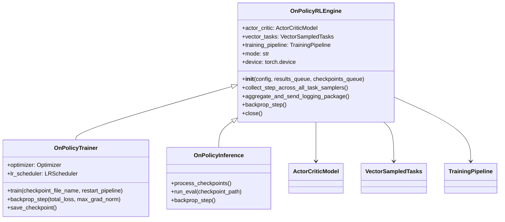
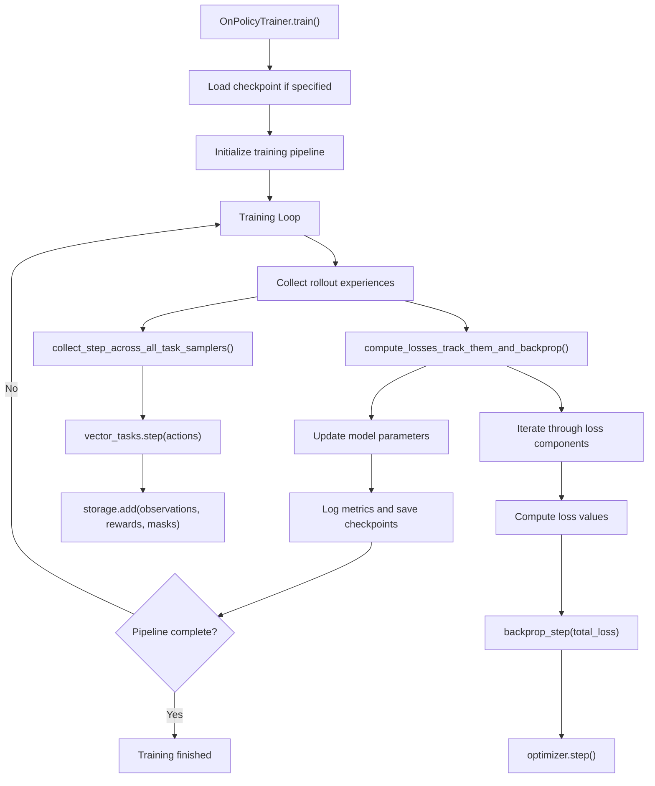
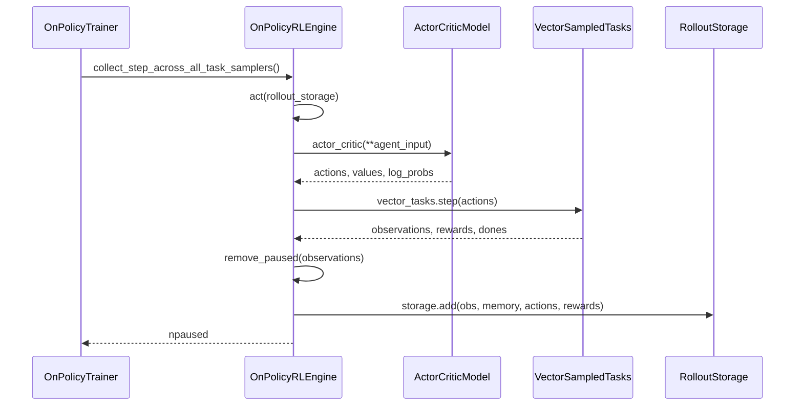
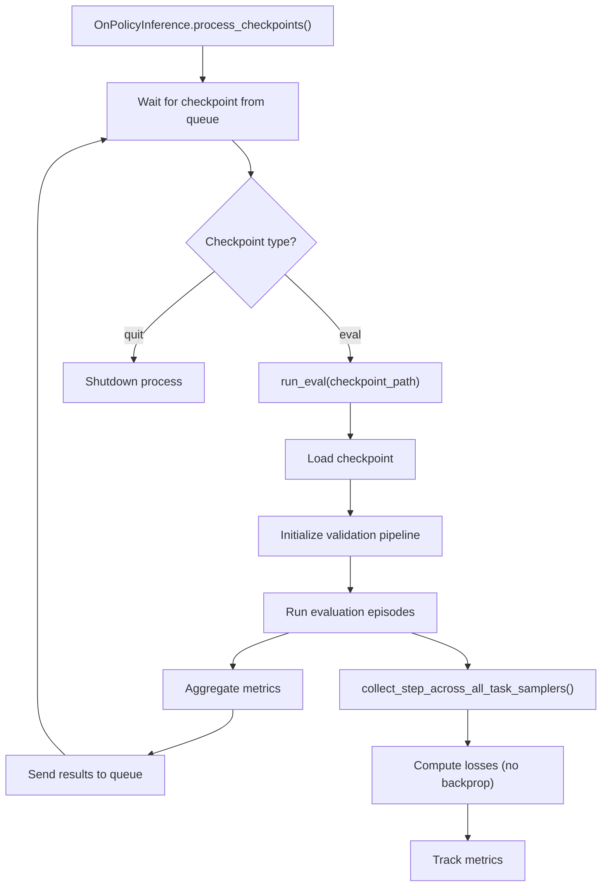
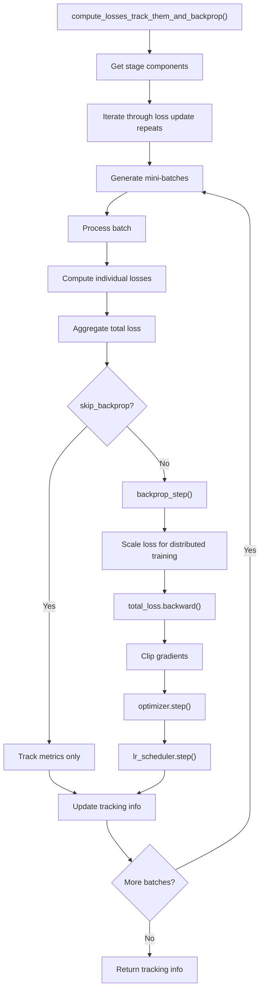
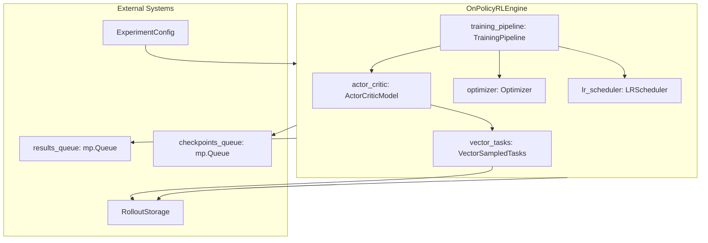

<!-- source: DeepWiki mcp.deepwiki.com · repo allenai/allenact · page 3.2 OnPolicyRLEngine and Training Logic · fetched 2026-10-26 -->

# OnPolicyRLEngine and Training Logic

Relevant source files

The following files were used as context for generating this wiki page:

- [allenact/algorithms/onpolicy_sync/engine.py](allenact/algorithms/onpolicy_sync/engine.py)
- [allenact/algorithms/onpolicy_sync/runner.py](allenact/algorithms/onpolicy_sync/runner.py)
- [allenact/algorithms/onpolicy_sync/storage.py](allenact/algorithms/onpolicy_sync/storage.py)
- [allenact/algorithms/onpolicy_sync/vector_sampled_tasks.py](allenact/algorithms/onpolicy_sync/vector_sampled_tasks.py)
- [allenact/base_abstractions/callbacks.py](allenact/base_abstractions/callbacks.py)
- [allenact/base_abstractions/preprocessor.py](allenact/base_abstractions/preprocessor.py)
- [allenact/base_abstractions/task.py](allenact/base_abstractions/task.py)
- [allenact/embodiedai/mapping/mapping_utils/map_builders.py](allenact/embodiedai/mapping/mapping_utils/map_builders.py)
- [allenact/embodiedai/mapping/mapping_utils/point_cloud_utils.py](allenact/embodiedai/mapping/mapping_utils/point_cloud_utils.py)
- [allenact/main.py](allenact/main.py)
- [allenact/utils/experiment_utils.py](allenact/utils/experiment_utils.py)
- [allenact/utils/misc_utils.py](allenact/utils/misc_utils.py)
- [allenact_plugins/ithor_plugin/ithor_sensors.py](allenact_plugins/ithor_plugin/ithor_sensors.py)
- [allenact_plugins/robothor_plugin/robothor_sensors.py](allenact_plugins/robothor_plugin/robothor_sensors.py)

This document covers the core reinforcement learning training engine in AllenAct, specifically the `OnPolicyRLEngine` class and its implementations for training and inference. This engine handles the fundamental RL operations including experience collection, loss computation, model updates, and distributed training coordination.

For information about the orchestration layer that manages these engines across processes, see [OnPolicyRunner and Training Orchestration](#3.1). For details about experience storage mechanisms, see [Experience Storage and Memory Management](#3.4). For distributed training coordination, see [Distributed Training System](#3.3).

## Core OnPolicyRLEngine Architecture

The `OnPolicyRLEngine` serves as the base class for all on-policy reinforcement learning operations in AllenAct. It provides a common interface for both training and inference while handling device management, experience collection, and interaction with the vectorized task environment.

**Sources:** [allenact/algorithms/onpolicy_sync/engine.py:93-300]()

## Training Implementation

The `OnPolicyTrainer` class implements the training-specific logic, including optimizer management, checkpoint saving, and the main training loop. It extends the base engine with training-specific functionality while maintaining the common interface for experience collection.

### Training Loop Structure

**Sources:** [allenact/algorithms/onpolicy_sync/engine.py:1540-1670](), [allenact/algorithms/onpolicy_sync/engine.py:804-975]()

### Experience Collection Process

The experience collection process is the core mechanism by which the training engine gathers data from the environment. This involves coordinating with vectorized tasks, processing observations, and storing experiences for later use in loss computation.

**Sources:** [allenact/algorithms/onpolicy_sync/engine.py:656-774](), [allenact/algorithms/onpolicy_sync/engine.py:532-547]()

## Inference Implementation

The `OnPolicyInference` class handles validation and testing operations. Unlike training, it processes checkpoints from a queue and runs evaluation episodes without updating model parameters.

### Checkpoint Processing Flow

**Sources:** [allenact/algorithms/onpolicy_sync/engine.py:1672-1750](), [allenact/algorithms/onpolicy_sync/engine.py:1808-1890]()

## Loss Computation and Model Updates

The engine coordinates loss computation across different pipeline stages and handles the complexities of distributed training, mixed precision, and gradient accumulation.

### Loss Computation Pipeline

**Sources:** [allenact/algorithms/onpolicy_sync/engine.py:823-975](), [allenact/algorithms/onpolicy_sync/engine.py:1388-1435]()

## Distributed Training Coordination

The engine includes built-in support for distributed training using PyTorch's distributed communication primitives. It handles synchronization, gradient aggregation, and coordination of training across multiple workers.

### Distributed Operations

| Operation | Method | Purpose |
|-----------|---------|---------|
| Weight Synchronization | `distributed_reduce()` | Aggregate scalars across workers |
| Gradient All-Reduce | `dist.all_reduce()` | Sum gradients from all workers |
| Barrier Synchronization | `dist.barrier()` | Synchronize worker execution |
| Insufficient Data Handling | `insufficient_data_for_update` | Coordinate when workers lack training data |

**Sources:** [allenact/algorithms/onpolicy_sync/engine.py:776-802](), [allenact/algorithms/onpolicy_sync/engine.py:242-274]()

## Key Components and Their Interactions

The `OnPolicyRLEngine` orchestrates several key components to implement the training loop:

### Core Component Relationships

**Sources:** [allenact/algorithms/onpolicy_sync/engine.py:103-300](), [allenact/algorithms/onpolicy_sync/engine.py:288-299]()

## Engine Lifecycle and State Management

The engine maintains several important state variables and follows a specific lifecycle for proper resource management:

### State Variables

- `_is_closing`: Indicates the engine is shutting down
- `_is_closed`: Indicates the engine has completed shutdown
- `step_count`: Current step within the training pipeline
- `training_pipeline`: Manages loss functions, optimizers, and training stages
- `insufficient_data_for_update`: Distributed coordination for data availability

The engine ensures proper cleanup of vectorized tasks, model parameters, and distributed communication resources through its `close()` method.

**Sources:** [allenact/algorithms/onpolicy_sync/engine.py:278-286](), [allenact/algorithms/onpolicy_sync/engine.py:815-822]()

---

