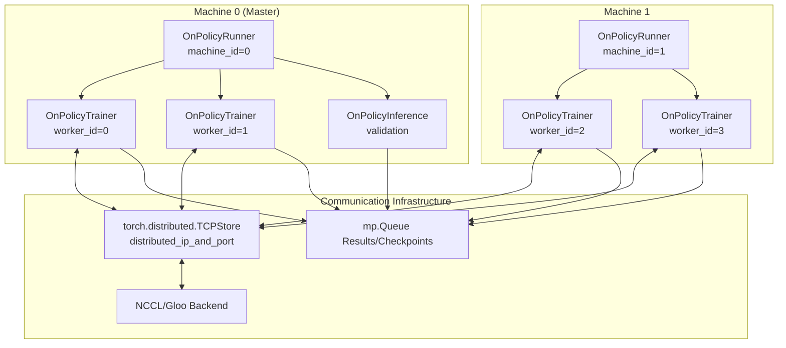
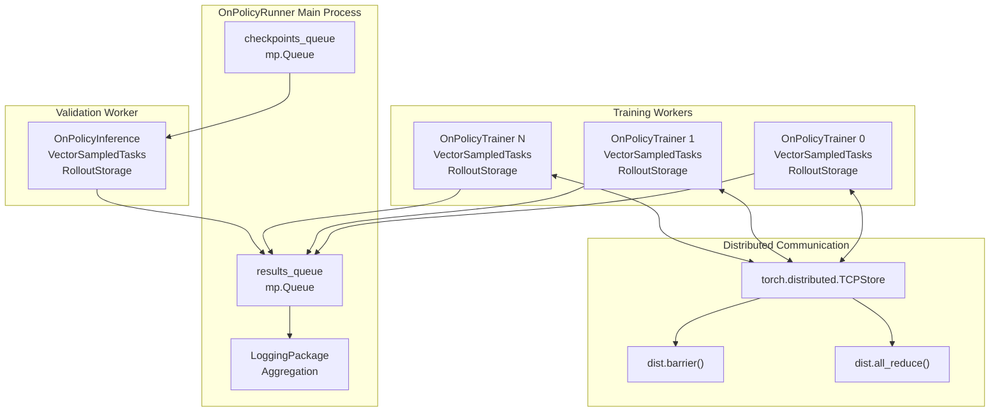

<!-- source: DeepWiki mcp.deepwiki.com · repo allenai/allenact · page 3.3 Distributed Training System · fetched 2026-10-26 -->

# Distributed Training System

<details>
<summary>Relevant source files</summary>

The following files were used as context for generating this wiki page:

- [allenact/algorithms/onpolicy_sync/engine.py](allenact/algorithms/onpolicy_sync/engine.py)
- [allenact/algorithms/onpolicy_sync/runner.py](allenact/algorithms/onpolicy_sync/runner.py)
- [allenact/algorithms/onpolicy_sync/storage.py](allenact/algorithms/onpolicy_sync/storage.py)
- [allenact/algorithms/onpolicy_sync/vector_sampled_tasks.py](allenact/algorithms/onpolicy_sync/vector_sampled_tasks.py)
- [allenact/base_abstractions/callbacks.py](allenact/base_abstractions/callbacks.py)
- [allenact/base_abstractions/preprocessor.py](allenact/base_abstractions/preprocessor.py)
- [allenact/base_abstractions/task.py](allenact/base_abstractions/task.py)
- [allenact/embodiedai/mapping/mapping_utils/map_builders.py](allenact/embodiedai/mapping/mapping_utils/map_builders.py)
- [allenact/embodiedai/mapping/mapping_utils/point_cloud_utils.py](allenact/embodiedai/mapping/mapping_utils/point_cloud_utils.py)
- [allenact/main.py](allenact/main.py)
- [allenact/utils/experiment_utils.py](allenact/utils/experiment_utils.py)
- [allenact/utils/misc_utils.py](allenact/utils/misc_utils.py)
- [allenact_plugins/ithor_plugin/ithor_sensors.py](allenact_plugins/ithor_plugin/ithor_sensors.py)
- [allenact_plugins/robothor_plugin/robothor_sensors.py](allenact_plugins/robothor_plugin/robothor_sensors.py)
- [scripts/dkill.py](scripts/dkill.py)
- [scripts/dmain.py](scripts/dmain.py)

</details>


This document describes AllenAct's distributed training system, which enables training across multiple processes and machines. The system coordinates multiple worker processes to parallelize experience collection and model updates while maintaining synchronization through PyTorch's distributed communication primitives.

For information about the core training pipeline architecture, see [Core Training Architecture](#3). For experiment configuration, see [Experiment Configuration](#4).

## Architecture Overview

AllenAct's distributed training system operates at two levels: machine-level distribution (multiple physical or virtual machines) and process-level distribution (multiple processes/GPUs within a machine). The `OnPolicyRunner` orchestrates the entire system, spawning training and validation workers that communicate through PyTorch's distributed backend.

**Distributed Training Architecture**


Sources: [allenact/algorithms/onpolicy_sync/runner.py:80-150](), [allenact/algorithms/onpolicy_sync/engine.py:93-280]()

## Worker Process Coordination

The distributed training system creates multiple `OnPolicyTrainer` processes and coordinates them through a combination of multiprocessing queues and PyTorch's distributed communication primitives. Each worker handles a subset of environment samplers and contributes gradients to shared model updates.

**Worker Process Communication Flow**


Sources: [allenact/algorithms/onpolicy_sync/engine.py:242-275](), [allenact/algorithms/onpolicy_sync/runner.py:495-640]()

## Machine-Level Distribution

The `dmain.py` script coordinates training across multiple machines by using SSH to launch AllenAct processes on remote hosts. Each machine runs its own `OnPolicyRunner` instance with a unique `machine_id`, and all workers coordinate through a shared TCP store.

### Distributed Launch Process

The `dmain.py` script performs the following steps:

1. **Code Synchronization**: Uses `rsync` to synchronize the codebase across all machines
2. **Process Spawning**: Launches `main.py` on each machine with appropriate `machine_id` and distributed parameters
3. **Screen Management**: Runs each process in a named `screen` session for monitoring and management
4. **Cleanup Tracking**: Creates killfiles for later termination via `dkill.py`

Key distributed launch parameters:
- `--distributed_ip_and_port`: Specifies the master node's IP and port for the TCP store
- `--machine_id`: Unique identifier for each machine (0 = master)
- `--runs_on`: Comma-separated list of machine IP addresses

Sources: [scripts/dmain.py:130-220](), [allenact/main.py:257-275]()

## Process-Level Distribution

Within each machine, the `OnPolicyRunner` spawns multiple training worker processes based on the `MachineParams.nprocesses` configuration. Each worker is assigned to specific GPU devices and handles a subset of environment samplers.

### Worker Process Creation

The `OnPolicyRunner.start_train()` method creates worker processes as follows:

```python
# From OnPolicyRunner.start_train()
for trainer_id in worker_ids:
    train: BaseProcess = self.mp_ctx.Process(
        target=self.train_loop,
        kwargs=training_kwargs,
    )
    train.start()
    self.processes[TRAIN_MODE_STR].append(train)
```

Each `OnPolicyTrainer` worker:
- Manages its own `VectorSampledTasks` for environment interaction
- Maintains separate `RolloutStorage` for experience collection  
- Participates in distributed gradient synchronization
- Reports metrics via shared result queues

Sources: [allenact/algorithms/onpolicy_sync/runner.py:547-605](), [allenact/algorithms/onpolicy_sync/engine.py:103-195]()

## Communication Mechanisms

The distributed training system uses multiple communication mechanisms for different purposes:

| Mechanism | Purpose | Scope |
|-----------|---------|-------|
| `torch.distributed.TCPStore` | Worker coordination and discovery | All workers across machines |
| `dist.barrier()` | Synchronization points | All workers |
| `dist.all_reduce()` | Gradient aggregation | All workers |
| `mp.Queue` | Metrics and checkpoint passing | Within machine |

### TCP Store Configuration

The distributed TCP store is configured in `OnPolicyRLEngine.__init__()`:

```python
if self.num_workers > 1:
    self.store = torch.distributed.TCPStore(
        host_name=self.distributed_ip,
        port=self.distributed_port,
        world_size=self.num_workers,
        is_master=self.worker_id == 0,
        timeout=datetime.timedelta(seconds=300)
    )
```

### Gradient Synchronization

Gradient synchronization occurs in the `distributed_weighted_sum()` and `distributed_reduce()` methods, which aggregate values across all workers:

```python
def distributed_weighted_sum(self, to_share, weight):
    if self.is_distributed:
        aggregate = torch.tensor(to_share * weight).to(self.device)
        dist.all_reduce(aggregate)
        return aggregate.item()
```

Sources: [allenact/algorithms/onpolicy_sync/engine.py:243-275](), [allenact/algorithms/onpolicy_sync/engine.py:776-802]()

## Synchronization and Checkpointing

Distributed training requires careful synchronization to ensure all workers remain coordinated and can recover from failures.

### Barrier Synchronization

Workers synchronize at key points using `dist.barrier()`:
- Before computing losses and updates
- During insufficient data checks
- At training stage transitions

### Distributed Checkpointing

Checkpoints are managed centrally by the master machine (machine_id=0):
- Only the master saves checkpoints to avoid conflicts
- Validation workers receive checkpoints via the `checkpoints_queue`
- Model state synchronization ensures all workers start with identical parameters

The `initial_model_state_dict` parameter ensures deterministic initialization across workers:

```python
if initial_model_state_dict is not None:
    if isinstance(initial_model_state_dict, int):
        # Verify hash matches expected model initialization
        assert md5_hash_of_state_dict(self.actor_critic.state_dict()) == initial_model_state_dict
    else:
        self.actor_critic.load_state_dict(initial_model_state_dict)
```

Sources: [allenact/algorithms/onpolicy_sync/engine.py:834-842](), [allenact/algorithms/onpolicy_sync/engine.py:214-235]()

## Scripts and Entry Points

The distributed training system provides several entry points and utilities:

### Main Entry Points

| Script | Purpose | Key Parameters |
|--------|---------|----------------|
| `main.py` | Single-machine training/testing | `--distributed_ip_and_port`, `--machine_id` |
| `dmain.py` | Multi-machine distributed launch | `--runs_on`, `--ssh_cmd`, `--env_activate_path` |
| `dkill.py` | Distributed process termination | `--screen_ids_file`, `--ssh_cmd` |

### Usage Example

```bash
# Launch distributed training across 3 machines
python scripts/dmain.py \
    experiments/objectnav_robothor_large_config.py \
    --runs_on "192.168.1.100,192.168.1.101,192.168.1.102" \
    --distributed_ip_and_port "192.168.1.100:8888" \
    --env_activate_path "/home/user/miniconda3/envs/allenact/bin/activate" \
    --output_dir experiments/distributed_output

# Terminate distributed training
python scripts/dkill.py --screen_ids_file ~/.allenact/killfile
```

### Signal Handling

Worker processes implement signal handlers for graceful shutdown:
- `SIGTERM`: Graceful termination with cleanup
- `SIGINT`: Interrupt handling with state preservation

Sources: [allenact/main.py:463-525](), [scripts/dmain.py:167-215](), [scripts/dkill.py:48-106](), [allenact/algorithms/onpolicy_sync/runner.py:342-378]()

---

