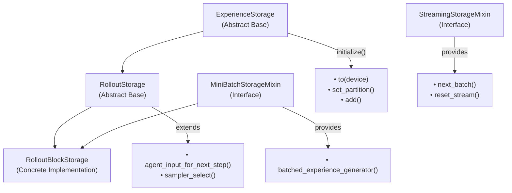
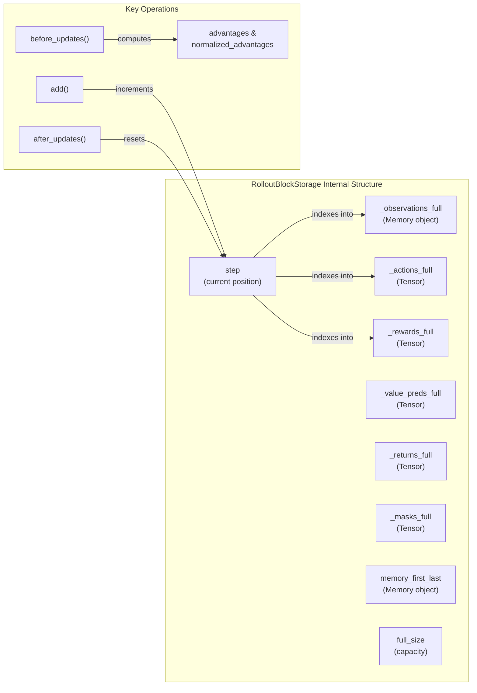
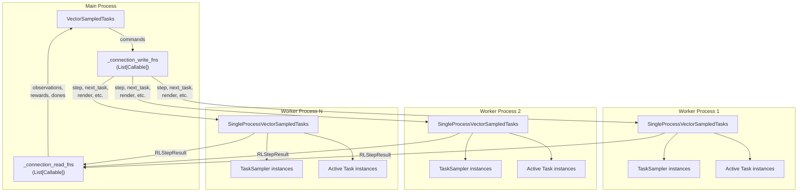
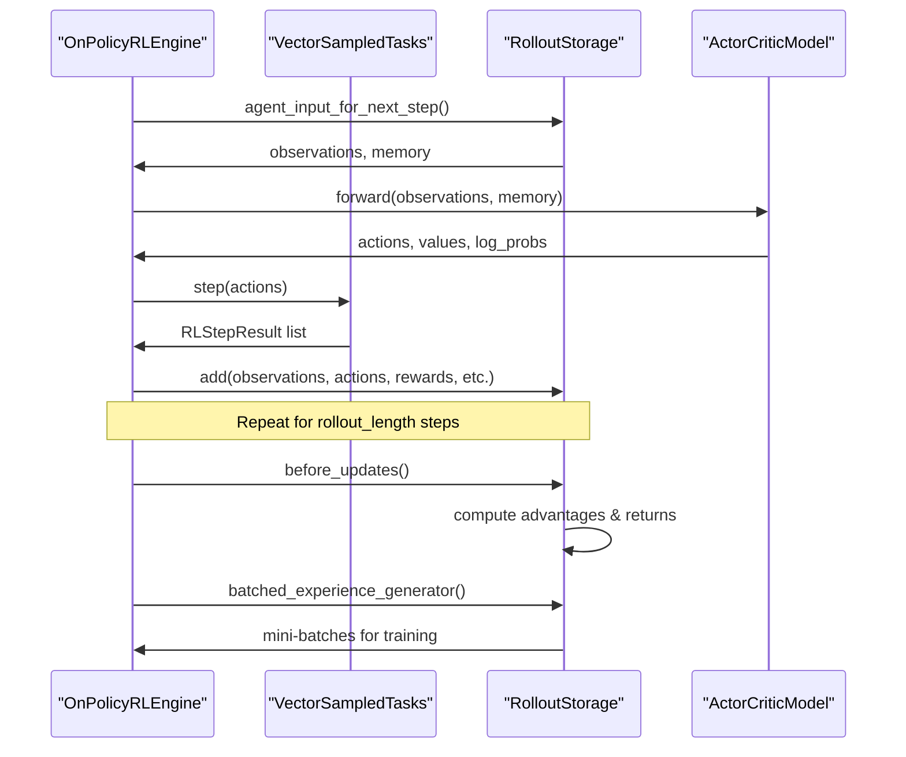
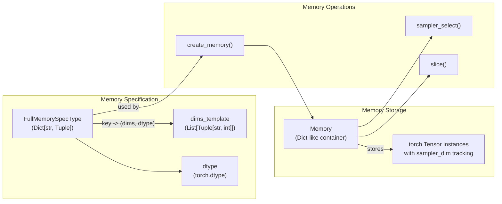
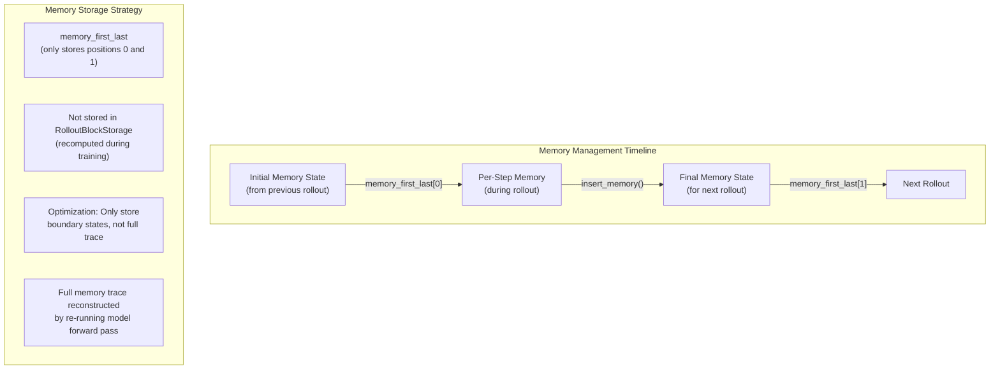
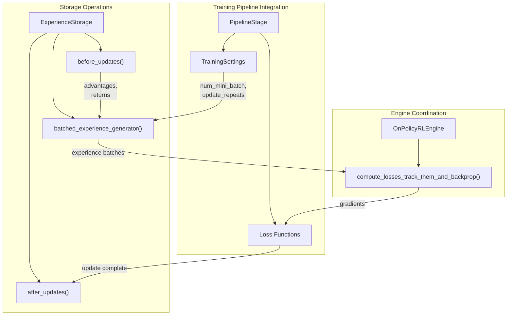
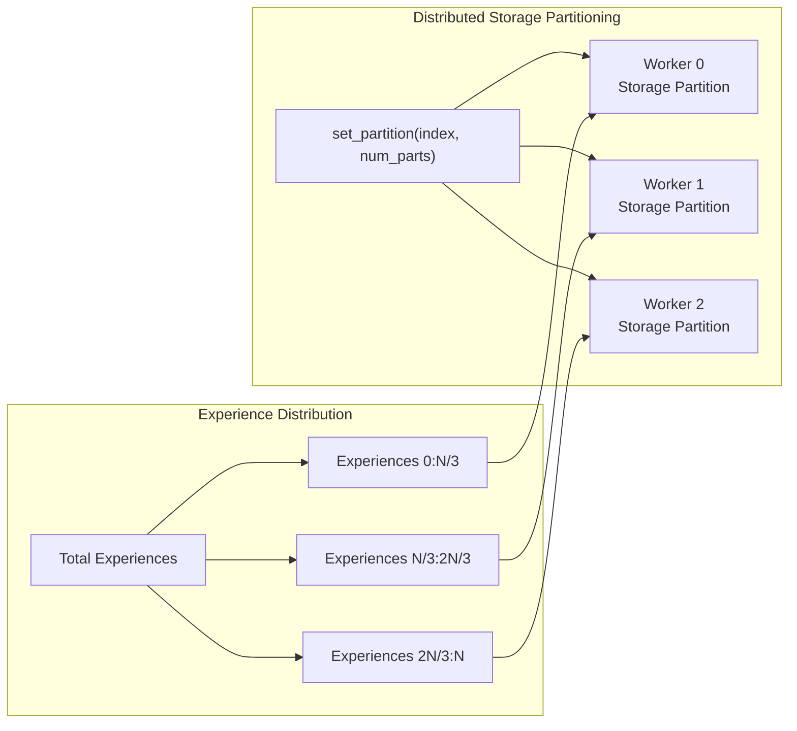

<!-- source: DeepWiki mcp.deepwiki.com · repo allenai/allenact · page 3.4 Experience Storage and Memory Management · fetched 2026-10-26 -->

# Experience Storage and Memory Management

Relevant source files

The following files were used as context for generating this wiki page:

- [allenact/algorithms/onpolicy_sync/engine.py](allenact/algorithms/onpolicy_sync/engine.py)
- [allenact/algorithms/onpolicy_sync/runner.py](allenact/algorithms/onpolicy_sync/runner.py)
- [allenact/algorithms/onpolicy_sync/storage.py](allenact/algorithms/onpolicy_sync/storage.py)
- [allenact/algorithms/onpolicy_sync/vector_sampled_tasks.py](allenact/algorithms/onpolicy_sync/vector_sampled_tasks.py)
- [allenact/base_abstractions/callbacks.py](allenact/base_abstractions/callbacks.py)
- [allenact/base_abstractions/preprocessor.py](allenact/base_abstractions/preprocessor.py)
- [allenact/base_abstractions/task.py](allenact/base_abstractions/task.py)
- [allenact/embodiedai/mapping/mapping_utils/map_builders.py](allenact/embodiedai/mapping/mapping_utils/map_builders.py)
- [allenact/embodiedai/mapping/mapping_utils/point_cloud_utils.py](allenact/embodiedai/mapping/mapping_utils/point_cloud_utils.py)
- [allenact/main.py](allenact/main.py)
- [allenact/utils/experiment_utils.py](allenact/utils/experiment_utils.py)
- [allenact/utils/misc_utils.py](allenact/utils/misc_utils.py)
- [allenact_plugins/ithor_plugin/ithor_sensors.py](allenact_plugins/ithor_plugin/ithor_sensors.py)
- [allenact_plugins/robothor_plugin/robothor_sensors.py](allenact_plugins/robothor_plugin/robothor_sensors.py)

This document covers AllenAct's experience storage and memory management systems, which handle the collection, organization, and retrieval of agent experiences during training and evaluation. The system manages experiences from multiple parallel environments, batches them efficiently for neural network training, and maintains memory states for recurrent models.

For information about the training orchestration that uses these storage systems, see [OnPolicyRunner and Training Orchestration](#3.1). For details about the distributed training coordination, see [Distributed Training System](#3.3).

## Core Storage Architecture

AllenAct implements a hierarchical storage system built around abstract base classes that define different storage patterns and concrete implementations optimized for specific use cases.

### Storage Class Hierarchy

**Sources:** [allenact/algorithms/onpolicy_sync/storage.py:34-83](), [allenact/algorithms/onpolicy_sync/storage.py:85-106](), [allenact/algorithms/onpolicy_sync/storage.py:121-128](), [allenact/algorithms/onpolicy_sync/storage.py:108-119]()

### RolloutBlockStorage Implementation

The `RolloutBlockStorage` class serves as the primary storage implementation for on-policy algorithms, managing experiences in fixed-size blocks with automatic resizing capabilities.

**Sources:** [allenact/algorithms/onpolicy_sync/storage.py:130-171](), [allenact/algorithms/onpolicy_sync/storage.py:438-501](), [allenact/algorithms/onpolicy_sync/storage.py:519-544]()

## Experience Collection System

The experience collection system coordinates multiple parallel environments through the `VectorSampledTasks` class, which manages task samplers across multiple processes and handles the aggregation of experiences.

### VectorSampledTasks Architecture

**Sources:** [allenact/algorithms/onpolicy_sync/vector_sampled_tasks.py:116-166](), [allenact/algorithms/onpolicy_sync/vector_sampled_tasks.py:328-422]()

### Experience Collection Flow

The experience collection process involves coordination between the engine, vector tasks, and storage systems:

**Sources:** [allenact/algorithms/onpolicy_sync/engine.py:656-774](), [allenact/algorithms/onpolicy_sync/engine.py:532-547]()

## Memory Management for Recurrent Models

AllenAct provides sophisticated memory management for recurrent neural networks, handling both short-term memory states during rollouts and long-term memory persistence across episodes.

### Memory Specification System

**Sources:** [allenact/algorithms/onpolicy_sync/storage.py:254-277](), [allenact/base_abstractions/misc.py:1-50]()

### Memory Lifecycle in RolloutBlockStorage

The storage system maintains two key memory components: the full memory trace for training and the first/last memory states for efficient rollout continuation:

**Sources:** [allenact/algorithms/onpolicy_sync/storage.py:309-327](), [allenact/algorithms/onpolicy_sync/storage.py:546-562]()

## Integration with Training Pipeline

The storage and memory systems integrate tightly with AllenAct's training pipeline, providing the interface between experience collection and neural network updates.

### Storage-Pipeline Integration

**Sources:** [allenact/algorithms/onpolicy_sync/engine.py:823-1021](), [allenact/utils/experiment_utils.py:869-906]()

### Storage Partitioning for Distributed Training

For distributed training, storage systems implement partitioning to ensure each worker processes a distinct subset of experiences:

**Sources:** [allenact/algorithms/onpolicy_sync/storage.py:76-77](), [allenact/algorithms/onpolicy_sync/storage.py:218-219]()

The experience storage and memory management system forms the foundation of AllenAct's training efficiency, enabling scalable multi-environment training while maintaining the complex state requirements of modern reinforcement learning algorithms.

---

