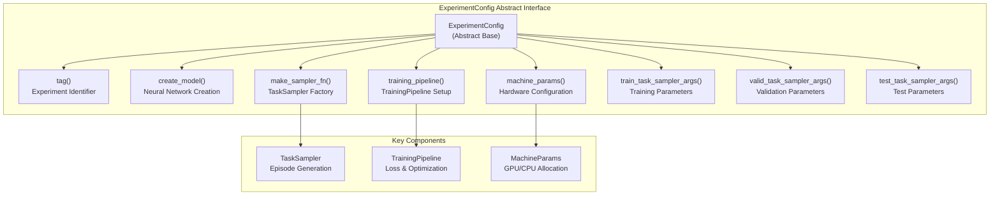
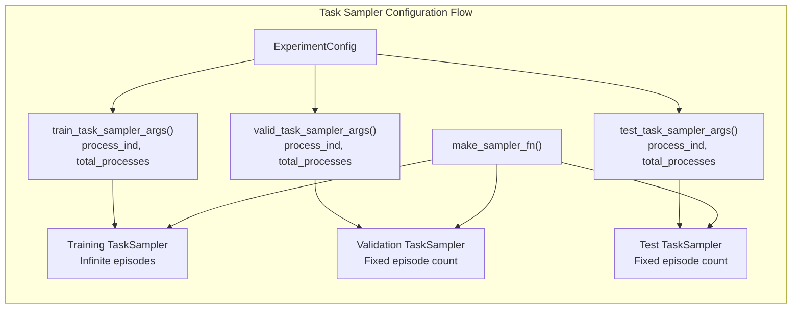
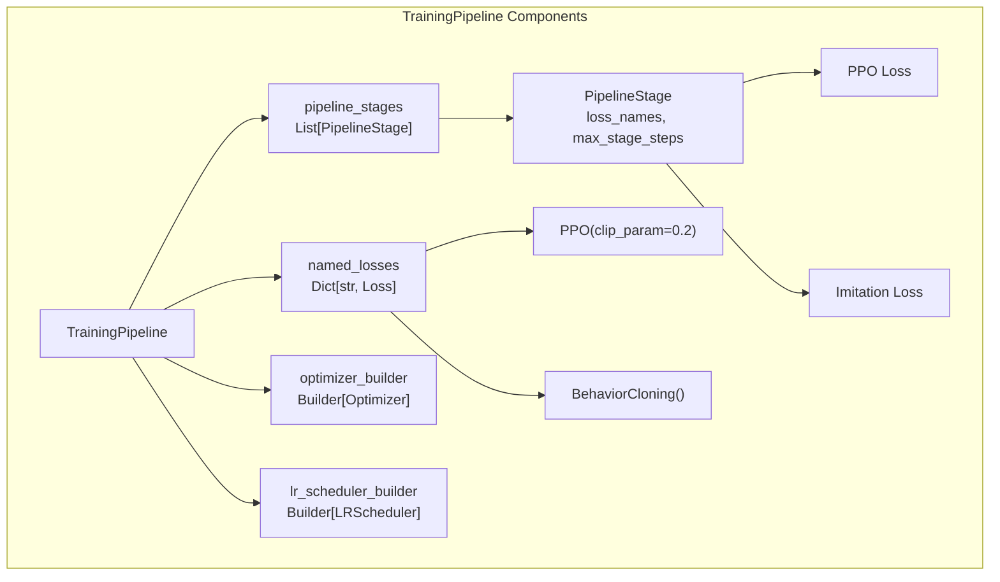
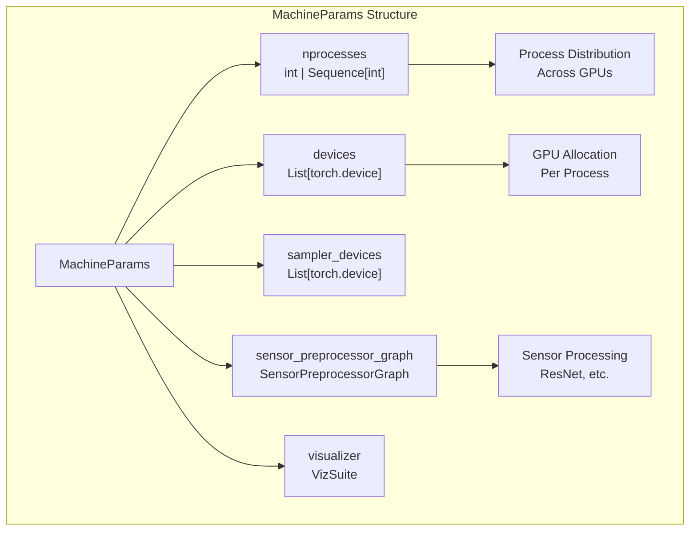
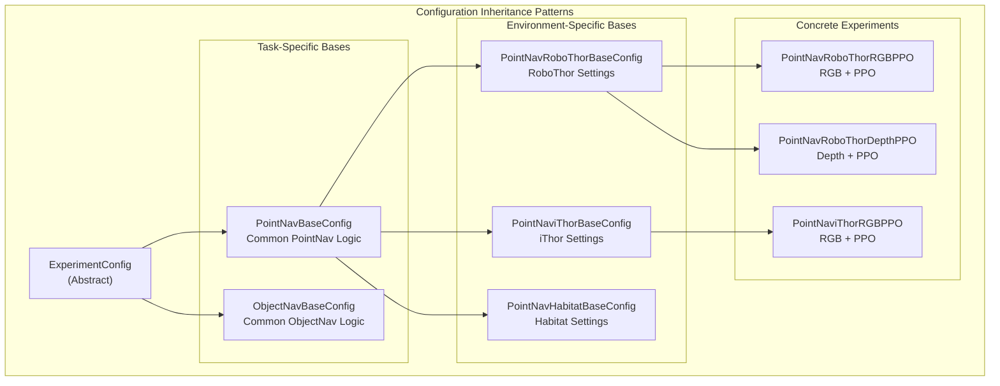
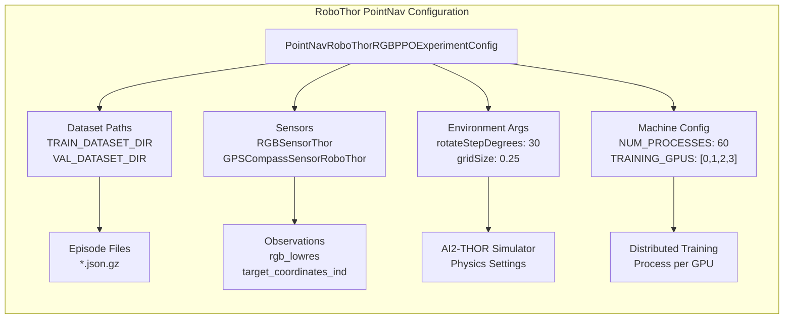
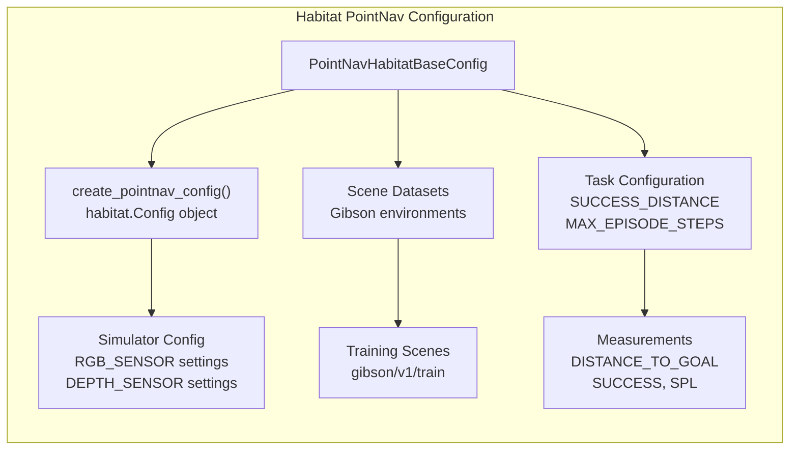
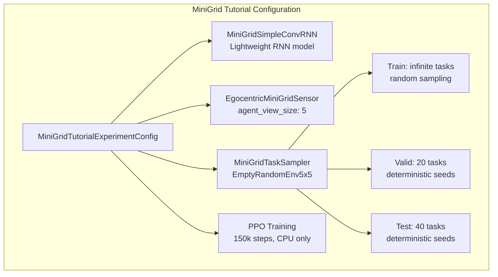
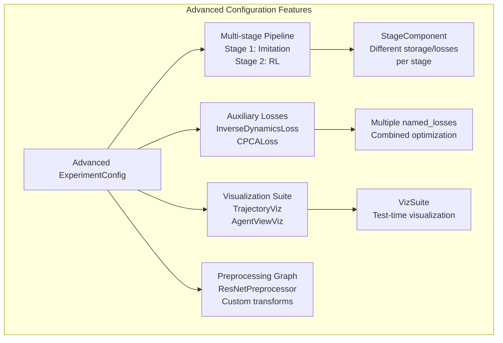

<!-- source: DeepWiki mcp.deepwiki.com · repo allenai/allenact · page 4 Experiment Configuration · fetched 2026-10-26 -->

# Experiment Configuration

Relevant source files

The following files were used as context for generating this wiki page:

- [allenact/base_abstractions/experiment_config.py](allenact/base_abstractions/experiment_config.py)
- [allenact/utils/viz_utils.py](allenact/utils/viz_utils.py)
- [docs/tutorials/gym-tutorial.md](docs/tutorials/gym-tutorial.md)
- [docs/tutorials/index.md](docs/tutorials/index.md)
- [docs/tutorials/minigrid-tutorial.md](docs/tutorials/minigrid-tutorial.md)
- [docs/tutorials/offpolicy-tutorial.md](docs/tutorials/offpolicy-tutorial.md)
- [docs/tutorials/running-inference-on-a-pretrained-model.md](docs/tutorials/running-inference-on-a-pretrained-model.md)
- [projects/objectnav_baselines/experiments/ithor/objectnav_ithor_base.py](projects/objectnav_baselines/experiments/ithor/objectnav_ithor_base.py)
- [projects/objectnav_baselines/experiments/robothor/objectnav_robothor_base.py](projects/objectnav_baselines/experiments/robothor/objectnav_robothor_base.py)
- [projects/pointnav_baselines/experiments/habitat/pointnav_habitat_base.py](projects/pointnav_baselines/experiments/habitat/pointnav_habitat_base.py)
- [projects/pointnav_baselines/experiments/ithor/pointnav_ithor_base.py](projects/pointnav_baselines/experiments/ithor/pointnav_ithor_base.py)
- [projects/pointnav_baselines/experiments/robothor/pointnav_robothor_base.py](projects/pointnav_baselines/experiments/robothor/pointnav_robothor_base.py)
- [projects/tutorials/gym_tutorial.py](projects/tutorials/gym_tutorial.py)
- [projects/tutorials/minigrid_offpolicy_tutorial.py](projects/tutorials/minigrid_offpolicy_tutorial.py)
- [projects/tutorials/object_nav_ithor_dagger_then_ppo_one_object_viz.py](projects/tutorials/object_nav_ithor_dagger_then_ppo_one_object_viz.py)
- [projects/tutorials/pointnav_habitat_rgb_ddppo.py](projects/tutorials/pointnav_habitat_rgb_ddppo.py)
- [projects/tutorials/pointnav_ithor_rgb_ddppo.py](projects/tutorials/pointnav_ithor_rgb_ddppo.py)
- [projects/tutorials/running_inference_tutorial.py](projects/tutorials/running_inference_tutorial.py)
- [projects/tutorials/training_a_pointnav_model.py](projects/tutorials/training_a_pointnav_model.py)

This document covers AllenAct's experiment configuration system, which provides a declarative way to define complete embodied AI experiments through the `ExperimentConfig` abstraction. This system handles model creation, task sampling, training pipelines, hardware allocation, and evaluation parameters.

For information about the core training execution that uses these configurations, see [Core Training Architecture](#3). For details about specific simulation environments, see [Simulation Environments](#5).

## ExperimentConfig Abstract Base Class

The `ExperimentConfig` class serves as the foundation for all experiments in AllenAct. It defines a comprehensive interface that specifies every aspect of an experiment, from model architecture to hardware allocation.

**Core ExperimentConfig Methods**

The `ExperimentConfig` abstract base class requires implementation of eight essential methods:

| Method | Purpose | Returns |
|--------|---------|---------|
| `tag()` | Unique experiment identifier | `str` |
| `create_model()` | Instantiate the neural network | `nn.Module` |
| `make_sampler_fn()` | Create task sampler instance | `TaskSampler` |
| `training_pipeline()` | Define losses and optimization | `TrainingPipeline` |
| `machine_params()` | Configure hardware allocation | `MachineParams` |
| `train_task_sampler_args()` | Training task parameters | `Dict[str, Any]` |
| `valid_task_sampler_args()` | Validation task parameters | `Dict[str, Any]` |
| `test_task_sampler_args()` | Test task parameters | `Dict[str, Any]` |

Sources: [allenact/base_abstractions/experiment_config.py:188-314]()

## Configuration Components

### TaskSampler Configuration

TaskSamplers generate episodes for training, validation, and testing. The three `*_task_sampler_args` methods provide different parameters for different phases:

### TrainingPipeline Configuration

The `TrainingPipeline` defines the complete training process including losses, optimizers, learning rate schedules, and multi-stage training:

### MachineParams Configuration

`MachineParams` handles hardware allocation, process distribution, and preprocessing graphs:

Sources: [allenact/base_abstractions/experiment_config.py:27-161](), [allenact/utils/experiment_utils.py]()

## Configuration Hierarchy and Inheritance

AllenAct experiments typically use inheritance to share common configurations across related tasks and environments:

This hierarchy allows sharing of:
- **Task logic** (reward functions, sensors, action spaces)
- **Environment settings** (dataset paths, simulation parameters)
- **Model architectures** (common network designs)
- **Training parameters** (hyperparameters, schedules)

Sources: [projects/pointnav_baselines/experiments/robothor/pointnav_robothor_base.py:1-16](), [projects/pointnav_baselines/experiments/ithor/pointnav_ithor_base.py:1-16](), [projects/objectnav_baselines/experiments/robothor/objectnav_robothor_base.py:1-60]()

## Environment-Specific Configurations

### RoboThor Configuration Example

RoboThor configurations typically define dataset paths, simulation parameters, and hardware allocation:

### Habitat Configuration Example

Habitat configurations use a different approach with habitat-specific config objects:

Sources: [projects/pointnav_baselines/experiments/habitat/pointnav_habitat_base.py:34-97](), [projects/tutorials/pointnav_habitat_rgb_ddppo.py:44-281]()

## Tutorial Examples

### MiniGrid Configuration

The MiniGrid tutorial demonstrates a minimal but complete configuration:

### Advanced Configuration Features

More complex configurations can include:

- **Multi-stage training** (DAgger → PPO)
- **Auxiliary losses** (inverse dynamics, CPCA)
- **Visualization setup** for testing
- **Distributed training** across multiple nodes

Sources: [docs/tutorials/minigrid-tutorial.md:32-279](), [projects/tutorials/training_a_pointnav_model.py:133-468](), [projects/tutorials/running_inference_tutorial.py:118-182]()

---

