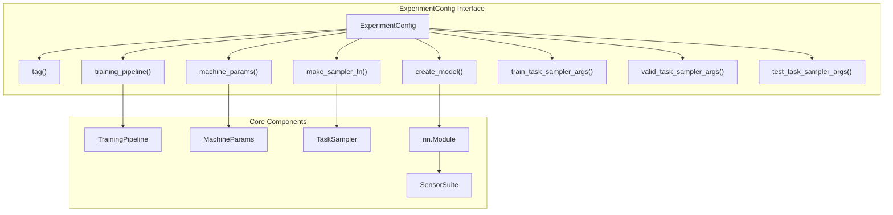
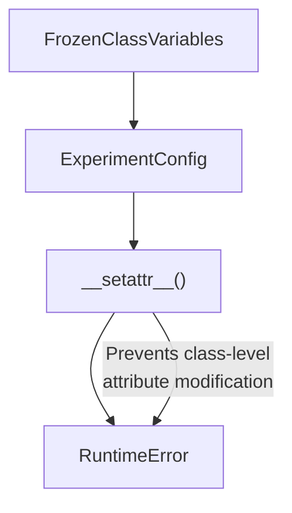
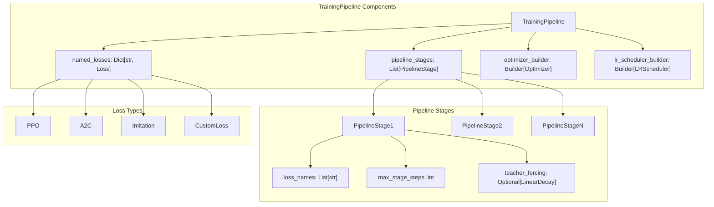
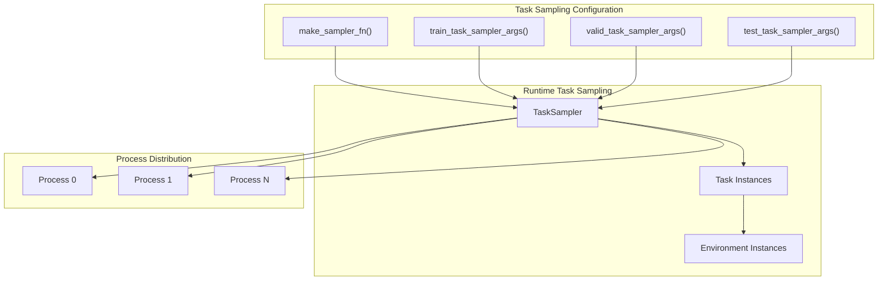
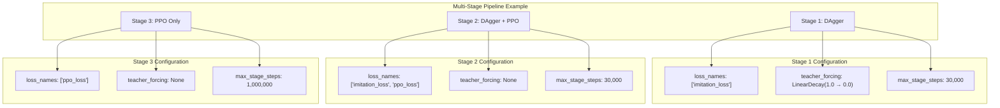
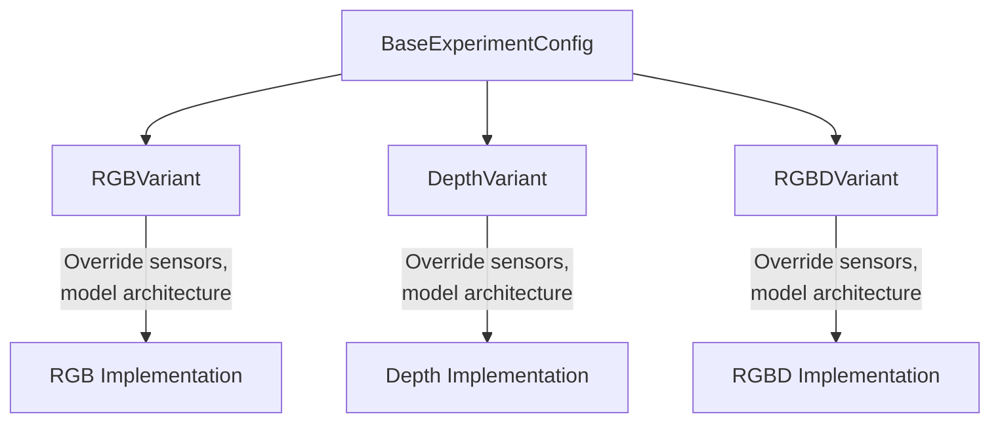
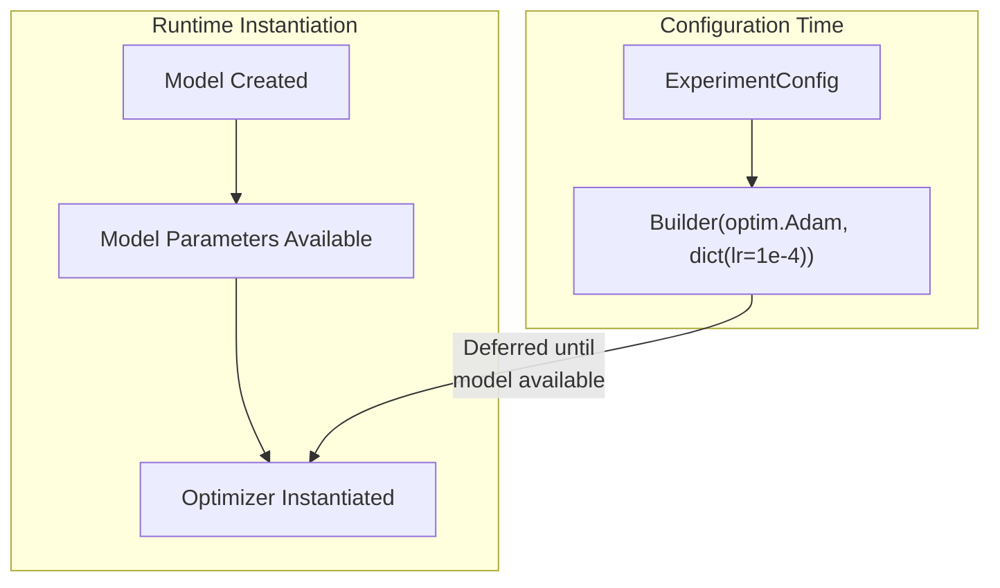
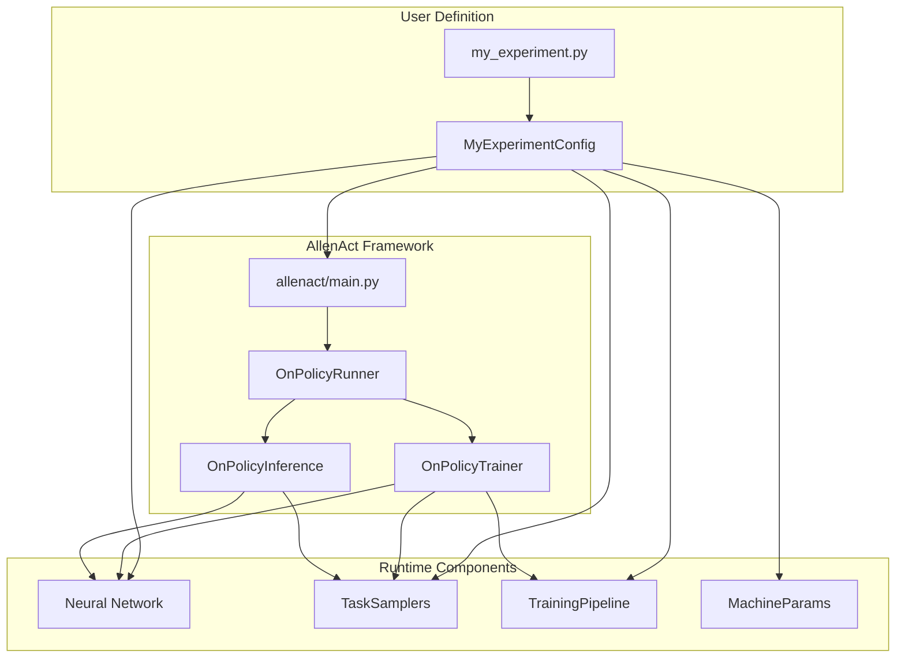

<!-- source: DeepWiki mcp.deepwiki.com · repo allenai/allenact · page 4.1 ExperimentConfig Fundamentals · fetched 2026-10-26 -->

# ExperimentConfig Fundamentals

<details>
<summary>Relevant source files</summary>

The following files were used as context for generating this wiki page:

- [allenact/base_abstractions/experiment_config.py](allenact/base_abstractions/experiment_config.py)
- [allenact/utils/viz_utils.py](allenact/utils/viz_utils.py)
- [docs/getting_started/abstractions.md](docs/getting_started/abstractions.md)
- [docs/getting_started/running-your-first-experiment.md](docs/getting_started/running-your-first-experiment.md)
- [docs/getting_started/structure.md](docs/getting_started/structure.md)
- [docs/howtos/changing-rewards-and-losses.md](docs/howtos/changing-rewards-and-losses.md)
- [docs/howtos/defining-a-new-model.md](docs/howtos/defining-a-new-model.md)
- [docs/howtos/defining-a-new-task.md](docs/howtos/defining-a-new-task.md)
- [docs/howtos/defining-an-experiment.md](docs/howtos/defining-an-experiment.md)
- [docs/tutorials/gym-tutorial.md](docs/tutorials/gym-tutorial.md)
- [docs/tutorials/index.md](docs/tutorials/index.md)
- [docs/tutorials/minigrid-tutorial.md](docs/tutorials/minigrid-tutorial.md)
- [docs/tutorials/offpolicy-tutorial.md](docs/tutorials/offpolicy-tutorial.md)
- [docs/tutorials/running-inference-on-a-pretrained-model.md](docs/tutorials/running-inference-on-a-pretrained-model.md)
- [projects/tutorials/gym_tutorial.py](projects/tutorials/gym_tutorial.py)
- [projects/tutorials/minigrid_offpolicy_tutorial.py](projects/tutorials/minigrid_offpolicy_tutorial.py)
- [projects/tutorials/object_nav_ithor_dagger_then_ppo_one_object_viz.py](projects/tutorials/object_nav_ithor_dagger_then_ppo_one_object_viz.py)
- [projects/tutorials/running_inference_tutorial.py](projects/tutorials/running_inference_tutorial.py)
- [projects/tutorials/training_a_pointnav_model.py](projects/tutorials/training_a_pointnav_model.py)

</details>


This document covers the core `ExperimentConfig` abstraction that serves as the primary interface for defining experiments in AllenAct. It explains the fundamental components, their relationships, and implementation patterns that enable reproducible machine learning experiments in embodied AI.

For information about the training orchestration system that executes these experiments, see [OnPolicyRunner and Training Orchestration](#3.1). For details about specific navigation task configurations, see [Navigation Experiment Configurations](#4.2).

## Core Purpose and Architecture

The `ExperimentConfig` class serves as a declarative specification that defines every aspect of a machine learning experiment. Rather than using configuration files, AllenAct uses Python classes that implement the `ExperimentConfig` interface to ensure type safety and programmatic validation.

### Primary Experiment Components



**Sources:** [allenact/base_abstractions/experiment_config.py:188-314](), [docs/tutorials/minigrid-tutorial.md:40-58]()

## ExperimentConfig Abstract Interface

The `ExperimentConfig` class defines the contract that all experiment configurations must implement:

### Required Abstract Methods

| Method | Purpose | Returns |
|--------|---------|---------|
| `tag()` | Unique experiment identifier | `str` |
| `training_pipeline()` | Defines losses, optimization, and training stages | `TrainingPipeline` |
| `machine_params()` | Hardware configuration for train/valid/test | `MachineParams` or `Dict[str, Any]` |
| `create_model()` | Instantiates the neural network model | `nn.Module` |
| `make_sampler_fn()` | Creates task samplers for episodes | `TaskSampler` |
| `train_task_sampler_args()` | Training sampler configuration | `Dict[str, Any]` |
| `valid_task_sampler_args()` | Validation sampler configuration | `Dict[str, Any]` |
| `test_task_sampler_args()` | Testing sampler configuration | `Dict[str, Any]` |

**Sources:** [allenact/base_abstractions/experiment_config.py:198-314]()

### Class-Level Immutability

The `ExperimentConfig` uses the `FrozenClassVariables` metaclass to prevent modification of class-level attributes during multiprocessing, ensuring experiment reproducibility:



**Sources:** [allenact/base_abstractions/experiment_config.py:163-186]()

## MachineParams Configuration

The `MachineParams` class encapsulates hardware and process configuration for distributed training:

### Core MachineParams Components

```mermaid
graph TB
    subgraph "MachineParams Structure"
        MP[MachineParams]
        NPROC["nprocesses: Union[int, Sequence[int]]"]
        DEVICES["devices: Sequence[torch.device]"]
        SAMPLER_DEVICES["sampler_devices: Sequence[torch.device]"]
        PREPROCESSOR["sensor_preprocessor_graph: SensorPreprocessorGraph"]
        VIZ["visualizer: VizSuite"]
    end

    subgraph "Device Management"
        STANDARDIZE["_standardize_devices()"]
        CPU[torch.device("cpu")]
        GPU[torch.device("cuda:0")]
    end

    MP --> NPROC
    MP --> DEVICES
    MP --> SAMPLER_DEVICES
    MP --> PREPROCESSOR
    MP --> VIZ

    DEVICES --> STANDARDIZE
    STANDARDIZE --> CPU
    STANDARDIZE --> GPU
```

**Sources:** [allenact/base_abstractions/experiment_config.py:27-161]()

### Device Assignment Pattern

The framework automatically distributes processes across available devices:

```python
# From split_processes_onto_devices function
def split_processes_onto_devices(nprocesses: int, ndevices: int):
    res = [0] * ndevices
    for it in range(nprocesses):
        res[it % ndevices] += 1
    return res
```

**Sources:** [allenact/base_abstractions/experiment_config.py:17-24]()

## TrainingPipeline Architecture

The `TrainingPipeline` defines the learning algorithm, loss functions, and optimization schedule:

### TrainingPipeline Structure



**Sources:** [allenact/utils/experiment_utils.py](), [docs/tutorials/minigrid-tutorial.md:254-278]()

## TaskSampler Integration

The experiment configuration integrates with task sampling through the `make_sampler_fn` method and mode-specific argument methods:

### Task Sampling Flow



**Sources:** [allenact/base_abstractions/experiment_config.py:244-313](), [docs/tutorials/minigrid-tutorial.md:150-222]()

## Implementation Patterns

### Basic ExperimentConfig Implementation

The most common pattern for implementing `ExperimentConfig` involves defining class-level constants and implementing required methods:

```python
class MyExperimentConfig(ExperimentConfig):
    # Class-level configuration
    SENSORS = [RGBSensorThor(...), DepthSensorThor(...)]
    MAX_STEPS = 500
    
    @classmethod
    def tag(cls) -> str:
        return "MyExperiment"
    
    @classmethod
    def create_model(cls, **kwargs) -> nn.Module:
        return ActorCriticModel(...)
    
    @classmethod
    def training_pipeline(cls, **kwargs) -> TrainingPipeline:
        return TrainingPipeline(...)
```

**Sources:** [docs/tutorials/minigrid-tutorial.md:88-131](), [projects/tutorials/training_a_pointnav_model.py:133-298]()

### Multi-Stage Training Pipeline

For complex training scenarios, pipelines can include multiple stages with different loss combinations:



**Sources:** [docs/howtos/defining-an-experiment.md:149-208](), [docs/howtos/changing-rewards-and-losses.md:55-90]()

### Configuration Inheritance

AllenAct encourages configuration reuse through class inheritance:



**Sources:** [docs/howtos/defining-an-experiment.md:210-215]()

## Builder Pattern for Deferred Instantiation

The framework uses the `Builder` pattern to defer object instantiation until runtime when all dependencies are available:

### Builder Usage Pattern



**Sources:** [allenact/utils/experiment_utils.py](), [docs/tutorials/minigrid-tutorial.md:279-280]()

## Integration with Training System

The `ExperimentConfig` serves as the primary interface between user-defined experiments and the AllenAct training infrastructure:

### Experiment Execution Flow



**Sources:** [allenact/main.py](), [docs/getting_started/running-your-first-experiment.md:1-16]()

The `ExperimentConfig` abstraction provides a powerful and flexible foundation for defining reproducible machine learning experiments in AllenAct, ensuring that all aspects of an experiment are explicitly specified and version-controlled through code rather than configuration files.

---

