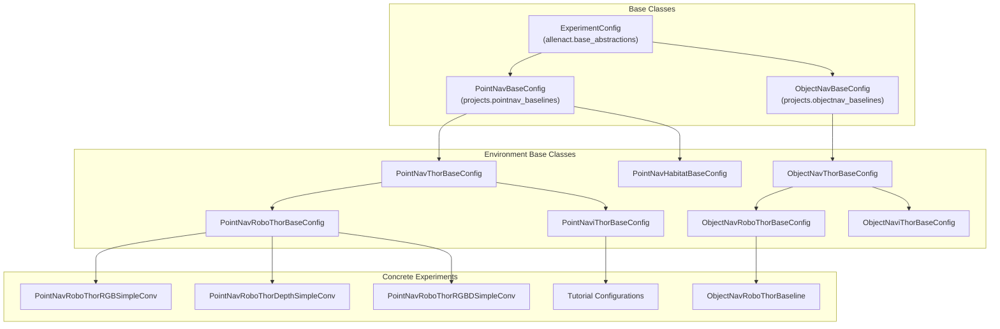
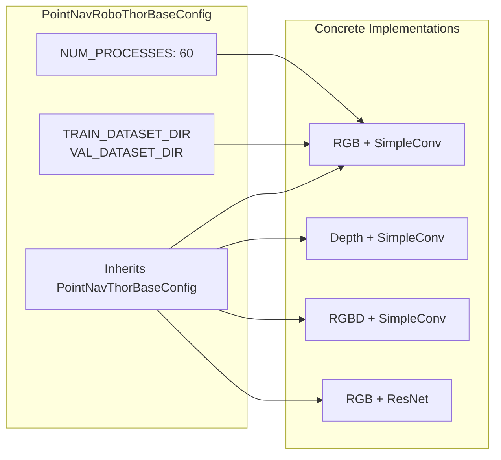
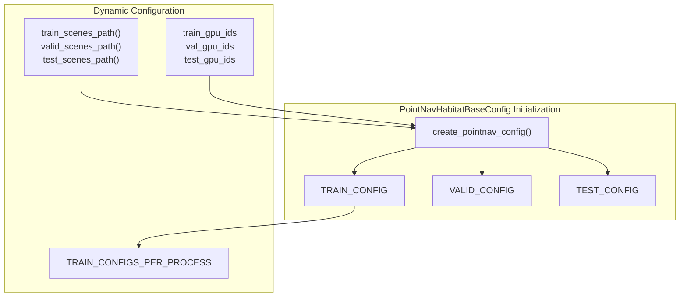
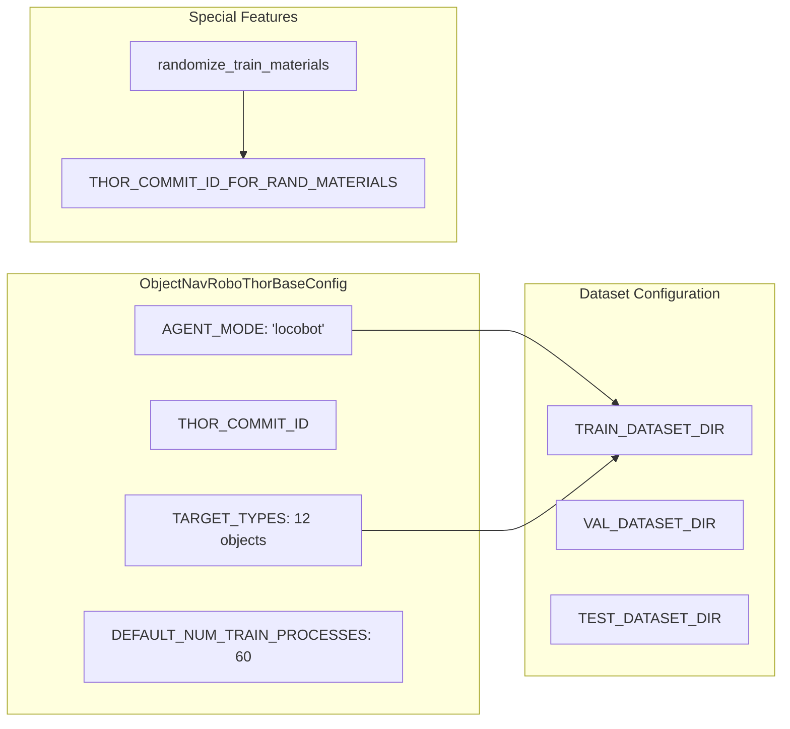
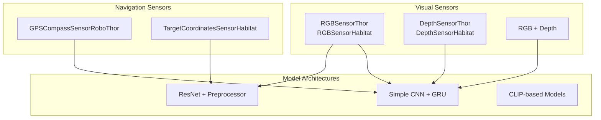
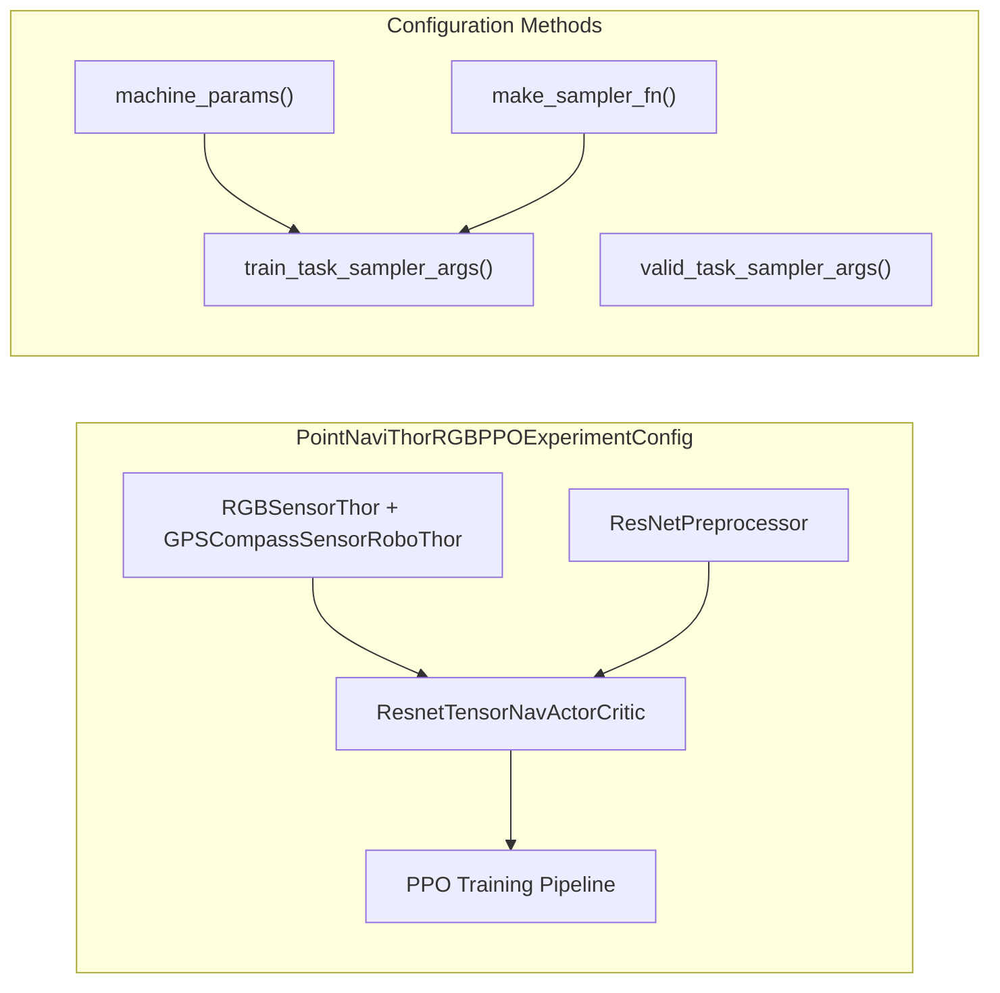
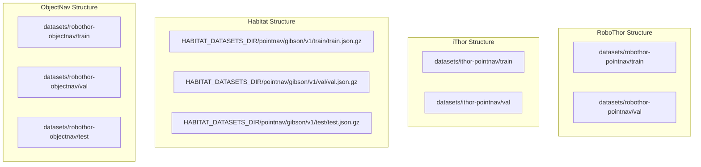

<!-- source: DeepWiki mcp.deepwiki.com · repo allenai/allenact · page 4.2 Navigation Experiment Configurations · fetched 2026-10-26 -->

# Navigation Experiment Configurations

Relevant source files

The following files were used as context for generating this wiki page:

- [projects/objectnav_baselines/experiments/ithor/objectnav_ithor_base.py](projects/objectnav_baselines/experiments/ithor/objectnav_ithor_base.py)
- [projects/objectnav_baselines/experiments/robothor/objectnav_robothor_base.py](projects/objectnav_baselines/experiments/robothor/objectnav_robothor_base.py)
- [projects/pointnav_baselines/experiments/habitat/pointnav_habitat_base.py](projects/pointnav_baselines/experiments/habitat/pointnav_habitat_base.py)
- [projects/pointnav_baselines/experiments/habitat/pointnav_habitat_depth_simpleconvgru_ddppo.py](projects/pointnav_baselines/experiments/habitat/pointnav_habitat_depth_simpleconvgru_ddppo.py)
- [projects/pointnav_baselines/experiments/habitat/pointnav_habitat_rgb_simpleconvgru_ddppo.py](projects/pointnav_baselines/experiments/habitat/pointnav_habitat_rgb_simpleconvgru_ddppo.py)
- [projects/pointnav_baselines/experiments/habitat/pointnav_habitat_rgbd_simpleconvgru_ddppo.py](projects/pointnav_baselines/experiments/habitat/pointnav_habitat_rgbd_simpleconvgru_ddppo.py)
- [projects/pointnav_baselines/experiments/ithor/pointnav_ithor_base.py](projects/pointnav_baselines/experiments/ithor/pointnav_ithor_base.py)
- [projects/pointnav_baselines/experiments/ithor/pointnav_ithor_depth_simpleconvgru_ddppo.py](projects/pointnav_baselines/experiments/ithor/pointnav_ithor_depth_simpleconvgru_ddppo.py)
- [projects/pointnav_baselines/experiments/ithor/pointnav_ithor_rgb_simpleconvgru_ddppo.py](projects/pointnav_baselines/experiments/ithor/pointnav_ithor_rgb_simpleconvgru_ddppo.py)
- [projects/pointnav_baselines/experiments/ithor/pointnav_ithor_rgbd_simpleconvgru_ddppo.py](projects/pointnav_baselines/experiments/ithor/pointnav_ithor_rgbd_simpleconvgru_ddppo.py)
- [projects/pointnav_baselines/experiments/robothor/pointnav_robothor_base.py](projects/pointnav_baselines/experiments/robothor/pointnav_robothor_base.py)
- [projects/pointnav_baselines/experiments/robothor/pointnav_robothor_depth_simpleconvgru_ddppo.py](projects/pointnav_baselines/experiments/robothor/pointnav_robothor_depth_simpleconvgru_ddppo.py)
- [projects/pointnav_baselines/experiments/robothor/pointnav_robothor_rgb_simpleconvgru_ddppo.py](projects/pointnav_baselines/experiments/robothor/pointnav_robothor_rgb_simpleconvgru_ddppo.py)
- [projects/pointnav_baselines/experiments/robothor/pointnav_robothor_rgbd_simpleconvgru_ddppo.py](projects/pointnav_baselines/experiments/robothor/pointnav_robothor_rgbd_simpleconvgru_ddppo.py)
- [projects/tutorials/pointnav_habitat_rgb_ddppo.py](projects/tutorials/pointnav_habitat_rgb_ddppo.py)
- [projects/tutorials/pointnav_ithor_rgb_ddppo.py](projects/tutorials/pointnav_ithor_rgb_ddppo.py)

## Purpose and Scope

This document covers the specific experiment configuration classes used for navigation tasks in AllenAct, focusing on PointNav and ObjectNav configurations across different simulation environments (RoboThor, iThor, Habitat, MiniGrid). These configurations define the complete experimental setup including sensors, models, training parameters, and environment-specific settings.

For general experiment configuration concepts and the base `ExperimentConfig` class, see [ExperimentConfig Fundamentals](#4.1). For training pipeline and loss configuration details, see [Training Pipelines and Loss Functions](#4.3).

## Configuration Hierarchy Overview

Navigation experiment configurations follow a clear inheritance hierarchy that separates task types, environments, and specific experimental variants:

Sources: [projects/pointnav_baselines/experiments/robothor/pointnav_robothor_base.py:9-10](), [projects/objectnav_baselines/experiments/robothor/objectnav_robothor_base.py:13-14](), [projects/pointnav_baselines/experiments/habitat/pointnav_habitat_base.py:99-100]()

## PointNav Configuration Classes

### Base Configuration Structure

PointNav configurations inherit from `PointNavBaseConfig` and are specialized for different environments:

| Configuration Class | Environment | Key Features |
|---------------------|-------------|--------------|
| `PointNavRoboThorBaseConfig` | RoboThor | 60 processes, locobot agent mode |
| `PointNaviThorBaseConfig` | iThor | 40 processes, default agent mode |
| `PointNavHabitatBaseConfig` | Habitat | Dynamic GPU allocation, Gibson scenes |

### RoboThor PointNav Configuration

The `PointNavRoboThorBaseConfig` provides the foundation for RoboThor-based point navigation:

Sources: [projects/pointnav_baselines/experiments/robothor/pointnav_robothor_base.py:9-16]()

### Habitat PointNav Configuration

The Habitat configuration is more complex, dynamically creating environment configs:

Sources: [projects/pointnav_baselines/experiments/habitat/pointnav_habitat_base.py:172-224](), [projects/pointnav_baselines/experiments/habitat/pointnav_habitat_base.py:236-245]()

## ObjectNav Configuration Classes

### Target Object Specification

ObjectNav configurations define specific target object types for each environment:

| Environment | Target Objects | Count |
|-------------|----------------|-------|
| RoboThor | AlarmClock, Apple, BaseballBat, BasketBall, Bowl, GarbageCan, HousePlant, Laptop, Mug, SprayBottle, Television, Vase | 12 |
| iThor | AlarmClock, Apple, Book, Bowl, Box, Candle, GarbageCan, HousePlant, Laptop, SoapBottle, Television, Toaster | 12 |

### ObjectNav Environment Configuration

Sources: [projects/objectnav_baselines/experiments/robothor/objectnav_robothor_base.py:16-44](), [projects/objectnav_baselines/experiments/ithor/objectnav_ithor_base.py:22-39]()

## Sensor and Model Selection Patterns

### Common Sensor Configurations

Navigation experiments typically use these sensor combinations:

### Tutorial Configuration Example

The tutorial configurations demonstrate complete experiment setup:

Sources: [projects/tutorials/pointnav_ithor_rgb_ddppo.py:67-98](), [projects/tutorials/pointnav_ithor_rgb_ddppo.py:192-201]()

## Environment-Specific Configuration Details

### Dataset Directory Structure

Each environment follows specific dataset organization patterns:

### Process and GPU Allocation

Different environments use different default process counts and GPU allocation strategies:

| Configuration | Train Processes | GPU Strategy |
|---------------|----------------|--------------|
| RoboThor PointNav | 60 | Fixed allocation |
| iThor PointNav | 40 | Fixed allocation |
| Habitat PointNav | 5 × GPU count | Dynamic per GPU |
| RoboThor ObjectNav | 60 | Fixed allocation |
| iThor ObjectNav | 40 | Fixed allocation |

Sources: [projects/pointnav_baselines/experiments/robothor/pointnav_robothor_base.py:12](), [projects/pointnav_baselines/experiments/ithor/pointnav_ithor_base.py:12](), [projects/pointnav_baselines/experiments/habitat/pointnav_habitat_base.py:132-134]()

### Task Sampler Arguments

Each configuration provides environment-specific task sampler arguments through the `train_task_sampler_args()`, `valid_task_sampler_args()`, and `test_task_sampler_args()` methods. These methods handle:

- Scene distribution across processes
- Environment-specific parameters
- GPU device assignment
- Dataset looping and sampling strategies

Sources: [projects/pointnav_baselines/experiments/habitat/pointnav_habitat_base.py:299-351](), [projects/tutorials/pointnav_ithor_rgb_ddppo.py:260-332]()

---

