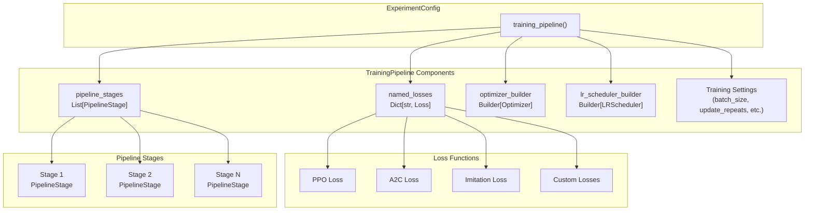
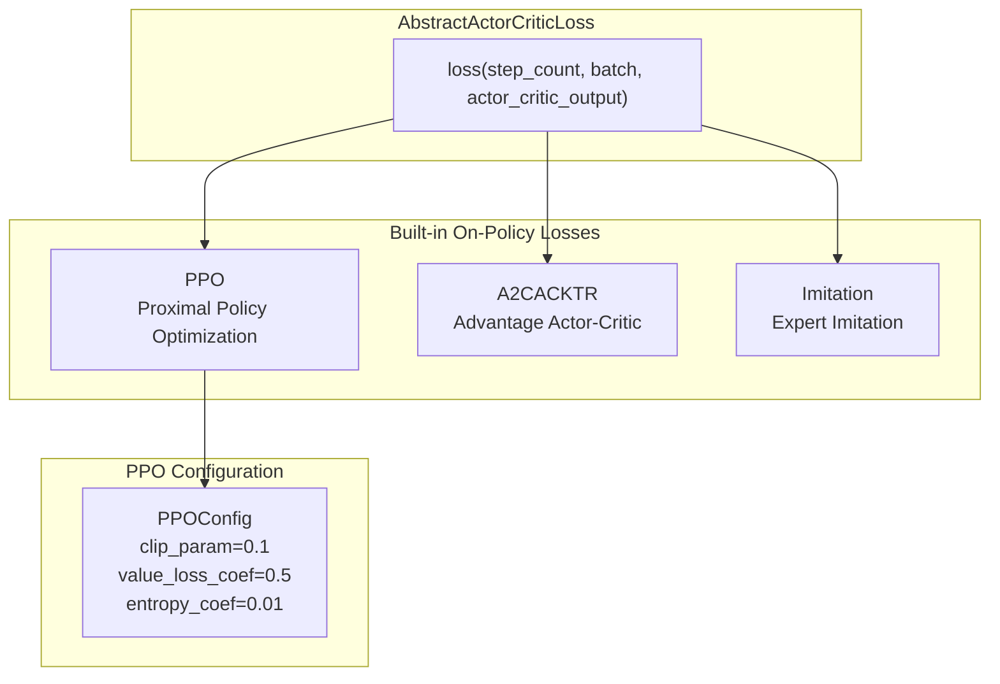
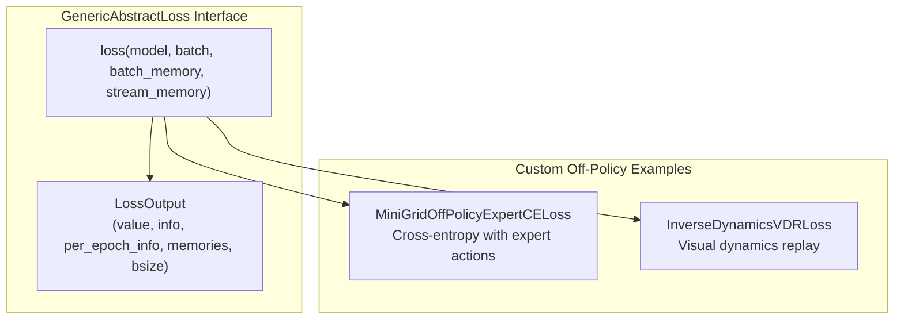
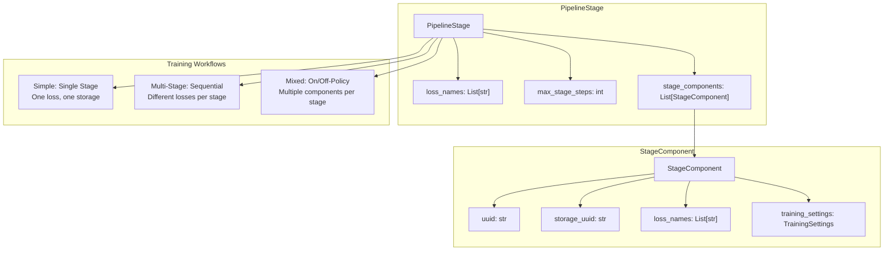
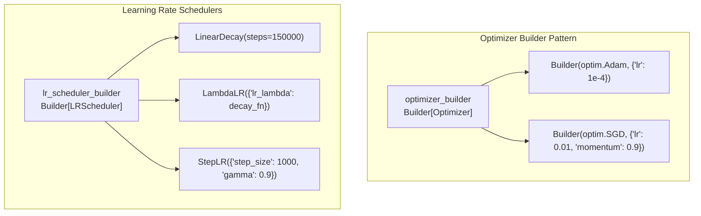

<!-- source: DeepWiki mcp.deepwiki.com · repo allenai/allenact · page 4.3 Training Pipelines and Loss Functions · fetched 2026-10-26 -->

# Training Pipelines and Loss Functions

<details>
<summary>Relevant source files</summary>

The following files were used as context for generating this wiki page:

- [allenact/algorithms/offpolicy_sync/losses/abstract_offpolicy_loss.py](allenact/algorithms/offpolicy_sync/losses/abstract_offpolicy_loss.py)
- [allenact/algorithms/onpolicy_sync/losses/a2cacktr.py](allenact/algorithms/onpolicy_sync/losses/a2cacktr.py)
- [allenact/algorithms/onpolicy_sync/losses/abstract_loss.py](allenact/algorithms/onpolicy_sync/losses/abstract_loss.py)
- [allenact/algorithms/onpolicy_sync/losses/imitation.py](allenact/algorithms/onpolicy_sync/losses/imitation.py)
- [allenact/algorithms/onpolicy_sync/losses/ppo.py](allenact/algorithms/onpolicy_sync/losses/ppo.py)
- [allenact/algorithms/onpolicy_sync/misc.py](allenact/algorithms/onpolicy_sync/misc.py)
- [allenact/base_abstractions/distributions.py](allenact/base_abstractions/distributions.py)
- [allenact/base_abstractions/experiment_config.py](allenact/base_abstractions/experiment_config.py)
- [allenact/base_abstractions/misc.py](allenact/base_abstractions/misc.py)
- [allenact/base_abstractions/sensor.py](allenact/base_abstractions/sensor.py)
- [allenact/embodiedai/storage/vdr_storage.py](allenact/embodiedai/storage/vdr_storage.py)
- [allenact/utils/spaces_utils.py](allenact/utils/spaces_utils.py)
- [allenact/utils/system.py](allenact/utils/system.py)
- [allenact/utils/viz_utils.py](allenact/utils/viz_utils.py)
- [allenact_plugins/minigrid_plugin/__init__.py](allenact_plugins/minigrid_plugin/__init__.py)
- [docs/tutorials/gym-tutorial.md](docs/tutorials/gym-tutorial.md)
- [docs/tutorials/index.md](docs/tutorials/index.md)
- [docs/tutorials/minigrid-tutorial.md](docs/tutorials/minigrid-tutorial.md)
- [docs/tutorials/offpolicy-tutorial.md](docs/tutorials/offpolicy-tutorial.md)
- [docs/tutorials/running-inference-on-a-pretrained-model.md](docs/tutorials/running-inference-on-a-pretrained-model.md)
- [projects/tutorials/gym_tutorial.py](projects/tutorials/gym_tutorial.py)
- [projects/tutorials/minigrid_offpolicy_tutorial.py](projects/tutorials/minigrid_offpolicy_tutorial.py)
- [projects/tutorials/object_nav_ithor_dagger_then_ppo_one_object_viz.py](projects/tutorials/object_nav_ithor_dagger_then_ppo_one_object_viz.py)
- [projects/tutorials/running_inference_tutorial.py](projects/tutorials/running_inference_tutorial.py)
- [projects/tutorials/training_a_pointnav_model.py](projects/tutorials/training_a_pointnav_model.py)
- [tests/mapping/test_ai2thor_mapping.py](tests/mapping/test_ai2thor_mapping.py)

</details>


This page covers how to configure training pipelines, loss functions, and optimization schedules in AllenAct. Training pipelines define the complete training process including which losses to use, how to organize training into stages, optimization parameters, and learning rate schedules.

For fundamental concepts about ExperimentConfig and its role in defining experiments, see [ExperimentConfig Fundamentals](#4.1). For specific pre-built configurations for navigation tasks, see [Navigation Experiment Configurations](#4.2).

## TrainingPipeline Overview

The `TrainingPipeline` class is the core abstraction for defining how training should proceed. It is created by implementing the `training_pipeline` method in your `ExperimentConfig` class and supports both simple single-stage training and complex multi-stage training workflows.



**TrainingPipeline Core Components**

The `TrainingPipeline` constructor accepts several key parameters that define the complete training configuration:

- `named_losses`: Dictionary mapping loss names to loss function instances
- `pipeline_stages`: List of `PipelineStage` objects defining training progression
- `optimizer_builder`: `Builder` object for creating the optimizer
- `lr_scheduler_builder`: Optional `Builder` for learning rate scheduling
- Training hyperparameters: `num_mini_batch`, `update_repeats`, `num_steps`, etc.

Sources: [docs/tutorials/minigrid-tutorial.md:251-278](), [projects/tutorials/minigrid_offpolicy_tutorial.py:206-277]()

## Loss Functions

AllenAct provides several built-in loss functions and supports custom loss implementations. Loss functions fall into two main categories: on-policy losses for reinforcement learning and off-policy losses for imitation learning or replay-based training.

### On-Policy Loss Functions



**PPO Loss Implementation**

The `PPO` class implements Proximal Policy Optimization with clipping. Key parameters include:

- `clip_param`: Clipping parameter for policy ratio (default 0.1)
- `value_loss_coef`: Weight for value function loss (default 0.5) 
- `entropy_coef`: Weight for entropy regularization (default 0.01)
- `use_clipped_value_loss`: Whether to clip value function updates
- `normalize_advantage`: Whether to normalize advantages

**A2C Loss Implementation**

The `A2CACKTR` class implements Advantage Actor-Critic training:

- `value_loss_coef`: Weight for value function loss
- `entropy_coef`: Weight for entropy regularization  
- `acktr`: Whether to use ACKTR variant (partially supported)

**Imitation Loss Implementation**

The `Imitation` class supports expert imitation learning by minimizing cross-entropy between agent actions and expert actions. It requires expert action observations from an `AbstractExpertSensor`.

Sources: [allenact/algorithms/onpolicy_sync/losses/ppo.py:15-224](), [allenact/algorithms/onpolicy_sync/losses/a2cacktr.py:16-91](), [allenact/algorithms/onpolicy_sync/losses/imitation.py:23-214]()

### Off-Policy Loss Functions

For off-policy training scenarios like imitation learning from fixed datasets, AllenAct provides the `GenericAbstractLoss` interface:



Off-policy losses return a `LossOutput` object containing the loss value, logging information, and updated memory states. The interface supports both `batch_memory` (reset per batch) and `stream_memory` (persistent across batches).

Sources: [allenact/base_abstractions/misc.py:368-432](), [projects/tutorials/minigrid_offpolicy_tutorial.py:127-188](), [allenact/embodiedai/storage/vdr_storage.py:31-66]()

## Pipeline Stages and Components

Training pipelines can be organized into multiple stages, each with different loss functions, training settings, or data sources. This enables complex training workflows like curriculum learning or multi-phase training.



**Simple Single-Stage Configuration**

Most basic experiments use a single stage with one loss function:

```python
pipeline_stages=[
    PipelineStage(
        loss_names=["ppo_loss"], 
        max_stage_steps=150000
    )
]
```

**Multi-Stage Configuration**

Complex training can involve multiple sequential stages with different objectives:

```python
pipeline_stages=[
    PipelineStage(
        loss_names=["imitation_loss"],
        max_stage_steps=50000  # Imitation learning phase
    ),
    PipelineStage(
        loss_names=["ppo_loss"],
        max_stage_steps=100000  # RL fine-tuning phase
    )
]
```

**Mixed On-Policy/Off-Policy Configuration**

Advanced configurations can combine on-policy and off-policy training within the same stage using `StageComponent` objects:

```python
stage_components=[
    StageComponent(
        uuid="offpolicy",
        storage_uuid="expert_demos",
        loss_names=["imitation_loss"],
        training_settings=TrainingSettings(
            update_repeats=4,
            num_mini_batch=1
        )
    )
]
```

Sources: [docs/tutorials/minigrid-tutorial.md:258-264](), [projects/tutorials/minigrid_offpolicy_tutorial.py:252-268]()

## Optimization Configuration

Training pipelines specify optimization settings including optimizers, learning rate schedules, and training hyperparameters.

### Optimizer Configuration

Optimizers are specified using the `Builder` pattern to delay instantiation until model parameters are available:



**Common Optimizer Configurations**

- **Adam**: `Builder(optim.Adam, dict(lr=1e-4))` - Most common choice
- **SGD**: `Builder(optim.SGD, dict(lr=0.01, momentum=0.9))` - For specific scenarios
- **RMSprop**: `Builder(optim.RMSprop, dict(lr=7e-4))` - Alternative option

**Learning Rate Scheduling**

The `lr_scheduler_builder` parameter accepts a `Builder` for PyTorch learning rate schedulers:

- **Linear Decay**: `Builder(LambdaLR, {"lr_lambda": LinearDecay(steps=ppo_steps)})`
- **Step Decay**: `Builder(StepLR, {"step_size": 1000, "gamma": 0.9})`
- **Exponential**: `Builder(ExponentialLR, {"gamma": 0.995})`

Sources: [docs/tutorials/minigrid-tutorial.md:274-276](), [allenact/utils/experiment_utils.py]()

### Training Hyperparameters

Key training hyperparameters are specified directly in the `TrainingPipeline` constructor:

| Parameter | Description | Typical Values |
|-----------|-------------|----------------|
| `num_mini_batch` | Number of mini-batches per update | 4-32 |
| `update_repeats` | Epochs per batch of experience | 3-10 |
| `num_steps` | Rollout length | 16-128 |
| `gamma` | Discount factor | 0.99 |
| `use_gae` | Use Generalized Advantage Estimation | True |
| `gae_lambda` | GAE lambda parameter | 0.95 |
| `max_grad_norm` | Gradient clipping threshold | 0.5 |

**Training Schedule Parameters**

- `save_interval`: Steps between checkpoint saves
- `metric_accumulate_interval`: Steps between metric logging
- `advance_scene_rollout_period`: Episode advancement schedule

Sources: [docs/tutorials/minigrid-tutorial.md:264-276]()

## Common Training Pipeline Patterns

### Basic PPO Configuration

The most common configuration uses PPO with standard hyperparameters:

```python
@classmethod
def training_pipeline(cls, **kwargs) -> TrainingPipeline:
    return TrainingPipeline(
        named_losses=dict(ppo_loss=PPO(**PPOConfig)),
        pipeline_stages=[
            PipelineStage(
                loss_names=["ppo_loss"], 
                max_stage_steps=150000
            )
        ],
        optimizer_builder=Builder(optim.Adam, dict(lr=1e-4)),
        num_mini_batch=4,
        update_repeats=3,
        max_grad_norm=0.5,
        num_steps=16,
        gamma=0.99,
        use_gae=True,
        gae_lambda=0.95,
        lr_scheduler_builder=Builder(
            LambdaLR, {"lr_lambda": LinearDecay(steps=150000)}
        ),
    )
```

### DAgger + PPO Multi-Stage Training

Sequential imitation learning followed by reinforcement learning:

```python
pipeline_stages=[
    PipelineStage(  # DAgger phase
        loss_names=["imitation_loss"],
        max_stage_steps=50000,
        teacher_forcing=LinearDecay(steps=50000)
    ),
    PipelineStage(  # PPO phase  
        loss_names=["ppo_loss"],
        max_stage_steps=100000
    )
]
```

### Mixed On-Policy/Off-Policy Training

Combining reinforcement learning with expert demonstrations:

```python
named_storages={
    "rollout": RolloutBlockStorage(),
    "expert_demos": ExpertTrajectoryStorage(...)
},
pipeline_stages=[
    PipelineStage(
        loss_names=["ppo_loss", "imitation_loss"],
        max_stage_steps=200000,
        stage_components=[
            StageComponent(
                uuid="offpolicy",
                storage_uuid="expert_demos", 
                loss_names=["imitation_loss"],
                training_settings=TrainingSettings(
                    update_repeats=1,
                    num_mini_batch=1
                )
            )
        ]
    )
]
```

Sources: [docs/tutorials/minigrid-tutorial.md:251-278](), [projects/tutorials/minigrid_offpolicy_tutorial.py:232-277](), [docs/tutorials/offpolicy-tutorial.md:206-277]()

---

