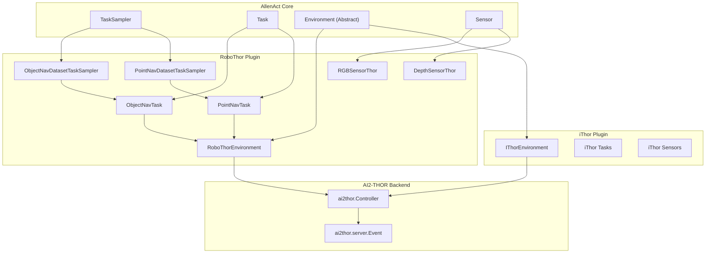
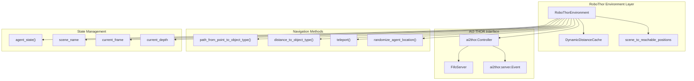
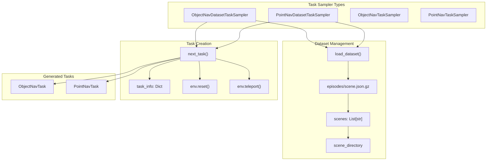

<!-- source: DeepWiki mcp.deepwiki.com · repo allenai/allenact · page 5 Simulation Environments · fetched 2026-10-26 -->

# Simulation Environments

<details>
<summary>Relevant source files</summary>

The following files were used as context for generating this wiki page:

- [allenact_plugins/ithor_plugin/ithor_environment.py](allenact_plugins/ithor_plugin/ithor_environment.py)
- [allenact_plugins/ithor_plugin/ithor_util.py](allenact_plugins/ithor_plugin/ithor_util.py)
- [allenact_plugins/robothor_plugin/robothor_environment.py](allenact_plugins/robothor_plugin/robothor_environment.py)
- [allenact_plugins/robothor_plugin/robothor_task_samplers.py](allenact_plugins/robothor_plugin/robothor_task_samplers.py)
- [allenact_plugins/robothor_plugin/robothor_tasks.py](allenact_plugins/robothor_plugin/robothor_tasks.py)
- [projects/objectnav_baselines/experiments/objectnav_base.py](projects/objectnav_baselines/experiments/objectnav_base.py)
- [projects/objectnav_baselines/experiments/objectnav_thor_base.py](projects/objectnav_baselines/experiments/objectnav_thor_base.py)
- [projects/pointnav_baselines/experiments/pointnav_thor_base.py](projects/pointnav_baselines/experiments/pointnav_thor_base.py)

</details>


AllenAct provides a plugin architecture for integrating various simulation environments used in embodied AI research. This document covers the supported simulation environments, their integration patterns, environment wrapper classes, and configuration approaches. For information about training algorithms and model architectures, see [Core Training Architecture](#3) and [Models and Algorithms](#6).

## Supported Simulation Environments

AllenAct currently supports four primary simulation environments through dedicated plugins:

| Environment | Plugin Path | Primary Use Cases |
|-------------|------------|-------------------|
| **RoboThor** | `allenact_plugins/robothor_plugin/` | Robotic navigation in realistic indoor scenes |
| **iThor** | `allenact_plugins/ithor_plugin/` | Interactive scenes with manipulation tasks |
| **Habitat** | `allenact_plugins/habitat_plugin/` | Photorealistic navigation environments |
| **MiniGrid** | `allenact_plugins/minigrid_plugin/` | Simple grid-world environments for prototyping |

Each environment plugin provides environment wrappers, task definitions, sensors, and configuration utilities that integrate with AllenAct's core training system.

## Environment Integration Architecture



Sources: [allenact_plugins/robothor_plugin/robothor_environment.py:18-30](), [allenact_plugins/ithor_plugin/ithor_environment.py:20-30](), [allenact_plugins/robothor_plugin/robothor_task_samplers.py:22-40]()

## RoboThor Environment Integration

The `RoboThorEnvironment` class provides the primary interface for robotic navigation tasks in AI2-THOR scenes. It wraps the underlying `ai2thor.Controller` and adds functionality for path planning, distance computation, and agent state management.

### Core RoboThor Components



Sources: [allenact_plugins/robothor_plugin/robothor_environment.py:18-78](), [allenact_plugins/robothor_plugin/robothor_environment.py:105-188]()

### Key RoboThor Environment Features

The `RoboThorEnvironment` provides several key capabilities:

**Path Planning and Distance Computation**
- `path_from_point_to_object_type()` - Computes shortest path to objects of a given type
- `distance_to_object_type()` - Returns geodesic distance to nearest object of specified type  
- `distance_to_point()` - Computes geodesic distance between two points
- Uses `DynamicDistanceCache` for efficient repeated distance queries

**Agent State Management**
- `agent_state()` - Returns current agent position, rotation, and horizon
- `teleport()` - Precisely positions agent at specified location and orientation
- `randomize_agent_location()` - Places agent at random reachable position

**Scene Information**
- `currently_reachable_points` - Dynamic list of reachable positions in current scene
- `scene_to_reachable_positions` - Cached reachable positions per scene
- `all_objects()` - Metadata for all objects in scene
- `visible_objects()` - Objects currently visible to agent

Sources: [allenact_plugins/robothor_plugin/robothor_environment.py:105-144](), [allenact_plugins/robothor_plugin/robothor_environment.py:271-394](), [allenact_plugins/robothor_plugin/robothor_environment.py:486-508]()

## iThor Environment Integration

The `IThorEnvironment` class provides similar functionality to `RoboThorEnvironment` but is designed for more general AI2-THOR interactions including manipulation tasks.

### iThor Environment Configuration

Key configuration parameters for `IThorEnvironment`:

```python
IThorEnvironment(
    x_display="0.0",                    # X display for rendering
    visibility_distance=1.0,            # Object visibility range
    fov=90.0,                           # Camera field of view  
    player_screen_width=300,            # Image width
    player_screen_height=300,           # Image height
    restrict_to_initially_reachable_points=False,  # Movement constraints
    make_agents_visible=True,           # Agent visibility
    object_open_speed=1.0,              # Animation speed
    simplify_physics=False              # Physics simulation level
)
```

**Distinctive iThor Features**
- `object_pixels_in_frame()` - Pixel mask for specific objects
- `object_in_hand()` - Metadata for held objects
- `initially_reachable_points` - Fixed set of reachable positions from scene start
- `teleport_agent_to()` - More flexible teleportation with validation

Sources: [allenact_plugins/ithor_plugin/ithor_environment.py:32-76](), [allenact_plugins/ithor_plugin/ithor_environment.py:418-452](), [allenact_plugins/ithor_plugin/ithor_environment.py:273-376]()

## Task Sampling and Environment Interaction

Task samplers bridge environments with AllenAct's training system by generating task instances and managing episode data.

### RoboThor Task Sampling Architecture



Sources: [allenact_plugins/robothor_plugin/robothor_task_samplers.py:292-368](), [allenact_plugins/robothor_plugin/robothor_task_samplers.py:757-815](), [allenact_plugins/robothor_plugin/robothor_task_samplers.py:445-522]()

### Dataset-Based Task Sampling

The `ObjectNavDatasetTaskSampler` and `PointNavDatasetTaskSampler` classes load pre-generated episode datasets:

**Dataset Structure**
- Episodes stored as compressed JSON files (`scene.json.gz`)
- Each episode contains initial position, target information, and optimal path
- Scenes distributed across processes for parallel training

**Key Sampling Parameters**
- `loop_dataset: bool` - Whether to repeat dataset infinitely or stop after one pass
- `allow_flipping: bool` - Enable horizontal mirroring for data augmentation
- `randomize_materials_in_training: bool` - Randomize textures in training scenes

**Episode Loading Process**
1. `load_dataset()` reads compressed episode files for each scene
2. Episodes filtered by target object types if specified
3. Task sampler cycles through scenes and episodes within each scene
4. Environment reset and agent teleported to episode starting position

Sources: [allenact_plugins/robothor_plugin/robothor_task_samplers.py:371-385](), [allenact_plugins/robothor_plugin/robothor_task_samplers.py:445-522](), [allenact_plugins/robothor_plugin/robothor_task_samplers.py:292-365]()

## Environment Configuration Patterns

Environment integration follows consistent patterns across the experiment configuration system.

### Base Configuration Structure

Environment configurations inherit from base classes and define environment-specific parameters:

```python
class ObjectNavThorBaseConfig(ObjectNavBaseConfig, ABC):
    THOR_COMMIT_ID = "your_commit_id"
    AGENT_MODE = "locobot"
    
    def env_args(self):
        return dict(
            width=self.CAMERA_WIDTH,
            height=self.CAMERA_HEIGHT,
            continuousMode=True,
            agentMode=self.AGENT_MODE,
            rotateStepDegrees=self.ROTATION_DEGREES,
            gridSize=self.STEP_SIZE,
            # ... additional parameters
        )
```

**Machine Parameters Configuration**
- Distributes processes across available GPUs
- Configures different process counts for train/valid/test modes
- Handles sensor preprocessing graphs
- Manages X-display allocation for headless servers

**Task Sampler Arguments**
- Scene dataset directories for train/validation/test splits
- Process-specific scene assignment to avoid overlap
- Environment arguments passed to simulator initialization
- Reward configuration and episode constraints

Sources: [projects/objectnav_baselines/experiments/objectnav_thor_base.py:98-122](), [projects/objectnav_baselines/experiments/objectnav_thor_base.py:124-181](), [projects/objectnav_baselines/experiments/objectnav_thor_base.py:276-367]()

## Environment Plugin Development

To integrate a new simulation environment:

1. **Create Environment Wrapper** - Implement environment-specific interface extending AllenAct base classes
2. **Define Task Classes** - Implement task types with action spaces, rewards, and success conditions  
3. **Implement Task Samplers** - Create samplers that generate task instances from datasets or procedurally
4. **Configure Sensors** - Define sensor classes that extract observations from environment state
5. **Add Experiment Configs** - Create configuration classes that set up training pipelines

Each plugin should follow the established patterns for consistency with AllenAct's training infrastructure and experiment configuration system.

Sources: [allenact_plugins/robothor_plugin/robothor_environment.py:18-30](), [allenact_plugins/robothor_plugin/robothor_tasks.py:41-85](), [allenact_plugins/robothor_plugin/robothor_task_samplers.py:22-96]()

---

