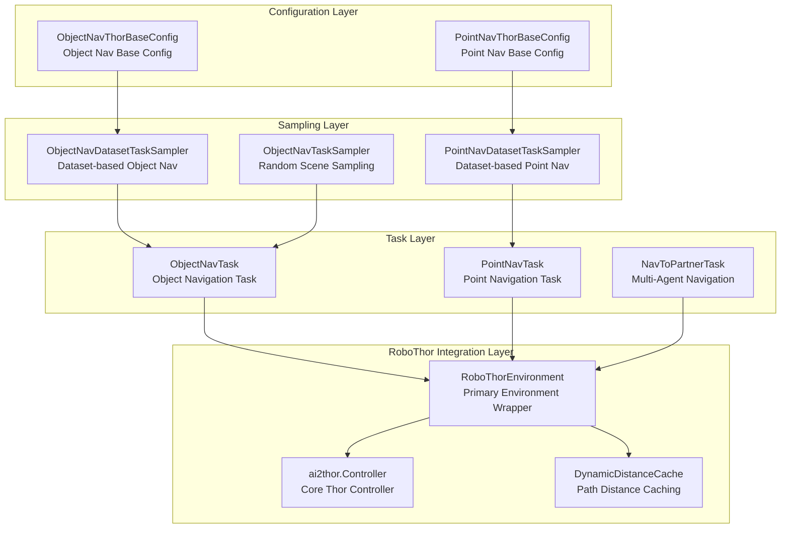
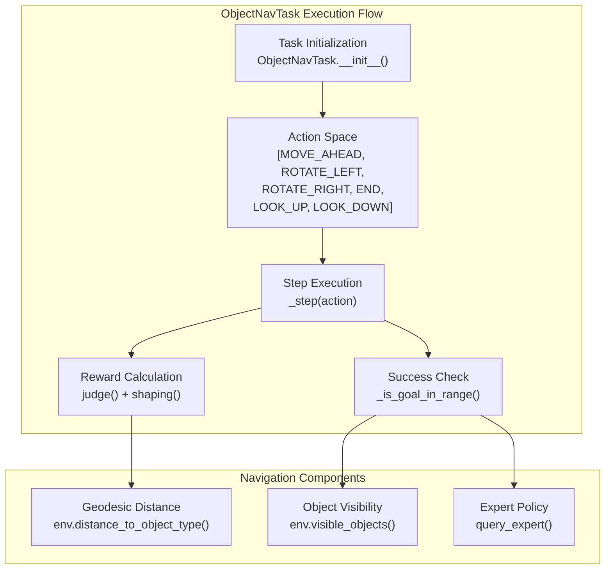
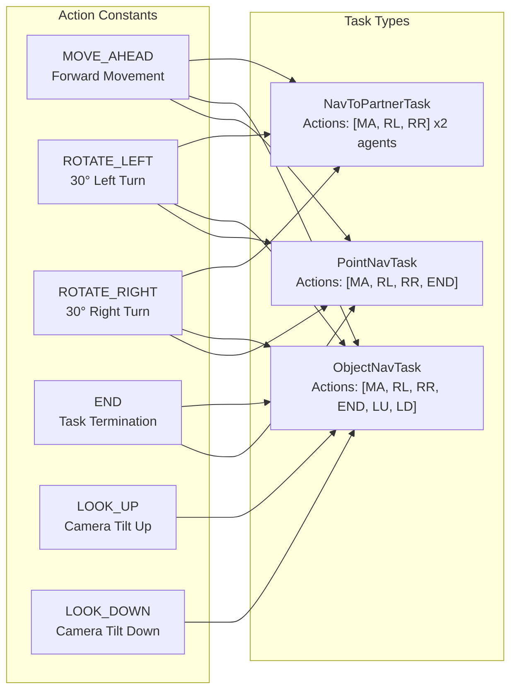
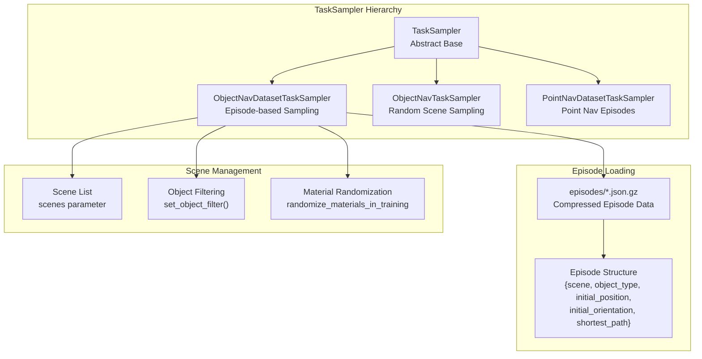
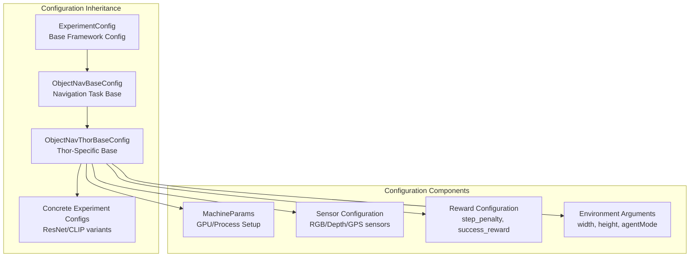
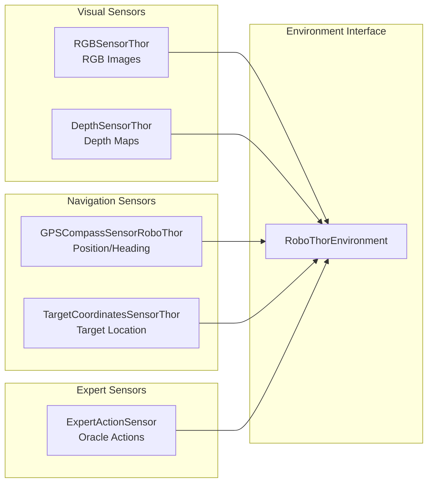
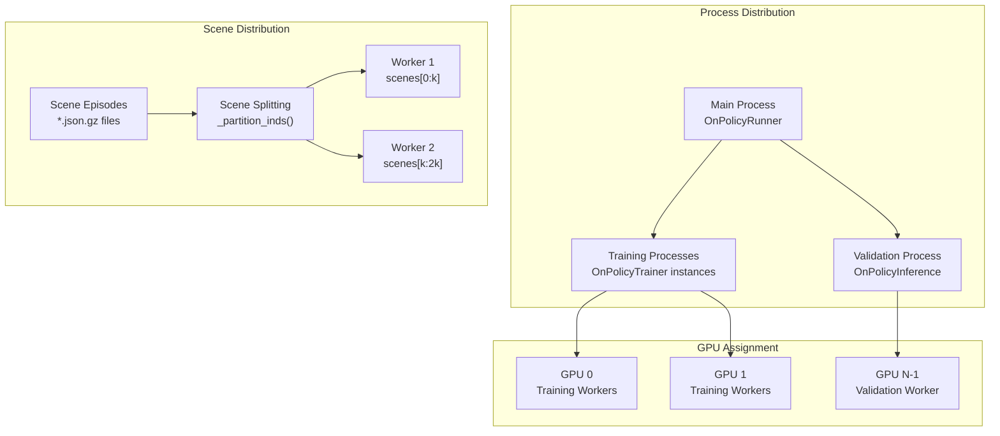

<!-- source: DeepWiki mcp.deepwiki.com · repo allenai/allenact · page 5.1 RoboThor Integration · fetched 2026-10-26 -->

# RoboThor Integration

Relevant source files

The following files were used as context for generating this wiki page:

- [allenact_plugins/ithor_plugin/ithor_environment.py](allenact_plugins/ithor_plugin/ithor_environment.py)
- [allenact_plugins/ithor_plugin/ithor_util.py](allenact_plugins/ithor_plugin/ithor_util.py)
- [allenact_plugins/robothor_plugin/robothor_environment.py](allenact_plugins/robothor_plugin/robothor_environment.py)
- [allenact_plugins/robothor_plugin/robothor_task_samplers.py](allenact_plugins/robothor_plugin/robothor_task_samplers.py)
- [allenact_plugins/robothor_plugin/robothor_tasks.py](allenact_plugins/robothor_plugin/robothor_tasks.py)
- [projects/objectnav_baselines/experiments/objectnav_base.py](projects/objectnav_baselines/experiments/objectnav_base.py)
- [projects/objectnav_baselines/experiments/objectnav_thor_base.py](projects/objectnav_baselines/experiments/objectnav_thor_base.py)
- [projects/pointnav_baselines/experiments/pointnav_thor_base.py](projects/pointnav_baselines/experiments/pointnav_thor_base.py)

This page provides a comprehensive guide to integrating RoboThor simulation environments with AllenAct for embodied AI research. RoboThor is AI2's robotic simulation platform that provides realistic household environments for navigation and manipulation tasks.

For information about other simulation environments, see iThor Integration ([5.2](#5.2)), Habitat Integration ([5.3](#5.3)), or MiniGrid Integration ([5.4](#5.4)). For general navigation task configuration, see Navigation Experiment Configurations ([4.2](#4.2)).

## RoboThor Environment Architecture

The RoboThor integration centers around the `RoboThorEnvironment` class, which wraps the AI2-THOR controller with additional functionality for reinforcement learning tasks.

### Core Environment Components

**Sources:** [allenact_plugins/robothor_plugin/robothor_environment.py:18-30](), [allenact_plugins/robothor_plugin/robothor_tasks.py:41-85](), [allenact_plugins/robothor_plugin/robothor_task_samplers.py:22-40]()

### Environment Capabilities

The `RoboThorEnvironment` provides core simulation functionality:

| Feature | Method | Description |
|---------|--------|-------------|
| Agent Control | `step()`, `teleport()` | Execute actions and position agent |
| Scene Management | `reset()`, `scene_name` | Load and switch between scenes |
| Spatial Queries | `distance_to_point()`, `distance_to_object_type()` | Geodesic distance computation |
| Navigation | `path_from_point_to_point()`, `currently_reachable_points` | Path planning and reachability |
| Visual Data | `current_frame`, `current_depth` | RGB and depth image access |
| Object Interaction | `visible_objects()`, `set_object_filter()` | Object detection and filtering |

**Sources:** [allenact_plugins/robothor_plugin/robothor_environment.py:31-58](), [allenact_plugins/robothor_plugin/robothor_environment.py:467-485]()

## Task Types and Implementation

### ObjectNav Task Structure

**Sources:** [allenact_plugins/robothor_plugin/robothor_tasks.py:207-264](), [allenact_plugins/robothor_plugin/robothor_tasks.py:315-320]()

### Task Action Definitions

**Sources:** [allenact_plugins/robothor_plugin/robothor_constants.py:1-6](), [allenact_plugins/robothor_plugin/robothor_tasks.py:42-43](), [allenact_plugins/robothor_plugin/robothor_tasks.py:208-209]()

## Dataset-Based Task Sampling

### Task Sampler Architecture

The RoboThor plugin provides multiple task sampling strategies:

**Sources:** [allenact_plugins/robothor_plugin/robothor_task_samplers.py:292-309](), [allenact_plugins/robothor_plugin/robothor_task_samplers.py:371-385]()

### Episode Data Structure

| Field | Type | Description |
|-------|------|-------------|
| `scene` | `str` | Scene name (e.g., "FloorPlan1_physics") |
| `object_type` | `str` | Target object type for ObjectNav |
| `initial_position` | `Dict[str, float]` | Starting {x, y, z} coordinates |
| `initial_orientation` | `float` | Starting rotation in degrees |
| `shortest_path_length` | `float` | Optimal geodesic distance |
| `shortest_path` | `List[Dict]` | Waypoint coordinates |
| `id` | `str` | Unique episode identifier |

**Sources:** [allenact_plugins/robothor_plugin/robothor_task_samplers.py:493-499]()

## Configuration System

### Base Configuration Classes

**Sources:** [projects/objectnav_baselines/experiments/objectnav_thor_base.py:45-47](), [projects/objectnav_baselines/experiments/objectnav_base.py:10-11]()

### Environment Configuration Parameters

| Parameter | Default | Description |
|-----------|---------|-------------|
| `agentMode` | `"locobot"` | Robot agent type |
| `gridSize` | `0.25` | Movement discretization |
| `rotateStepDegrees` | `30.0` | Rotation increment |
| `visibilityDistance` | `1.0` | Object visibility range |
| `width`, `height` | `640x480` | Image resolution |
| `continuousMode` | `True` | Smooth movement mode |
| `snapToGrid` | `False` | Disable grid snapping |

**Sources:** [allenact_plugins/robothor_plugin/robothor_environment.py:32-43](), [projects/objectnav_baselines/experiments/objectnav_thor_base.py:98-122]()

## Sensors and Data Types

### Available Sensor Types

**Sources:** [allenact_plugins/robothor_plugin/robothor_sensors.py:1-50](), [projects/objectnav_baselines/experiments/objectnav_thor_base.py:121]()

### Data Processing Pipeline

The sensor data flows through the following pipeline:

1. **Environment Step**: `RoboThorEnvironment.step()` executes action
2. **Data Extraction**: Sensors query environment state via `current_frame`, `current_depth`, `agent_state`
3. **Preprocessing**: Optional transformations via `SensorPreprocessorGraph`
4. **Task Consumption**: Task receives processed observations for policy input

**Sources:** [allenact_plugins/robothor_plugin/robothor_environment.py:467-477](), [projects/objectnav_baselines/experiments/objectnav_thor_base.py:161-172]()

## Distributed Training Setup

### Multi-Process Configuration

**Sources:** [projects/objectnav_baselines/experiments/objectnav_thor_base.py:124-156](), [projects/objectnav_baselines/experiments/objectnav_thor_base.py:187-234]()

### Machine Parameters Configuration

The `machine_params()` method configures distributed training:

- **Training Mode**: Multiple processes per GPU with scene-based work distribution
- **Validation Mode**: Single process for deterministic evaluation  
- **Test Mode**: Configurable process count for evaluation throughput
- **Device Assignment**: Automatic GPU allocation based on availability

**Sources:** [projects/objectnav_baselines/experiments/objectnav_thor_base.py:124-181]()

This integration provides a complete framework for training navigation agents in realistic robotic simulation environments, with support for both dataset-based and procedural task generation.

---

