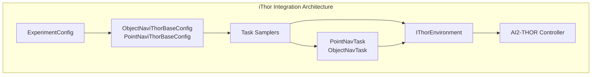
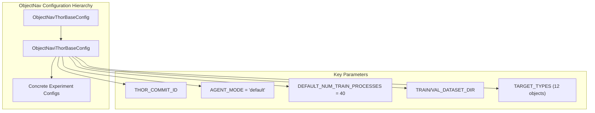
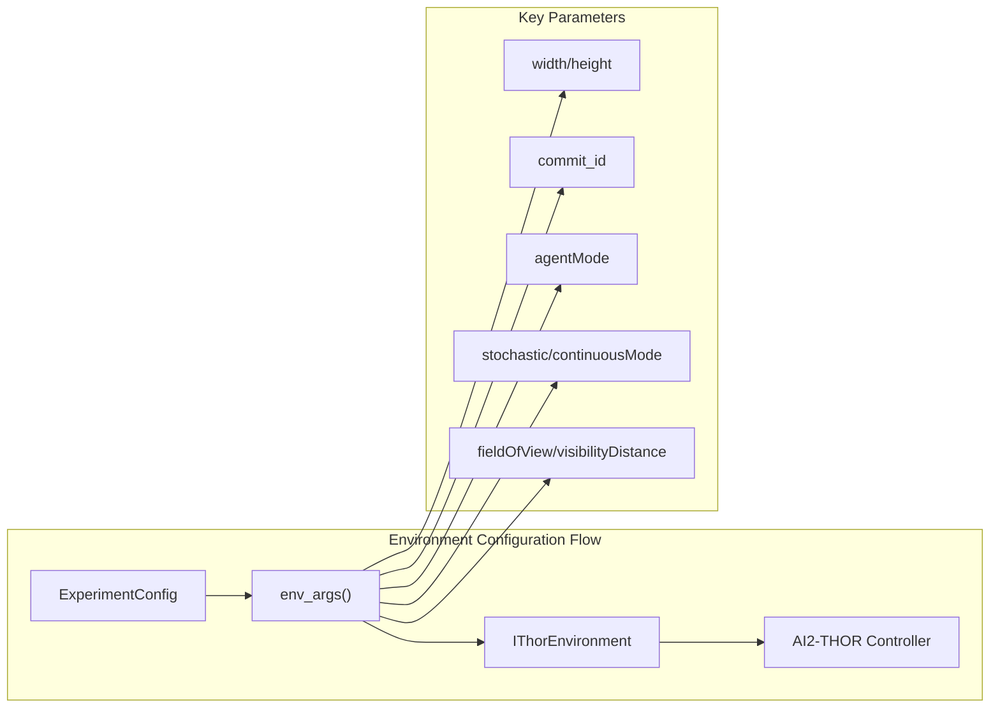
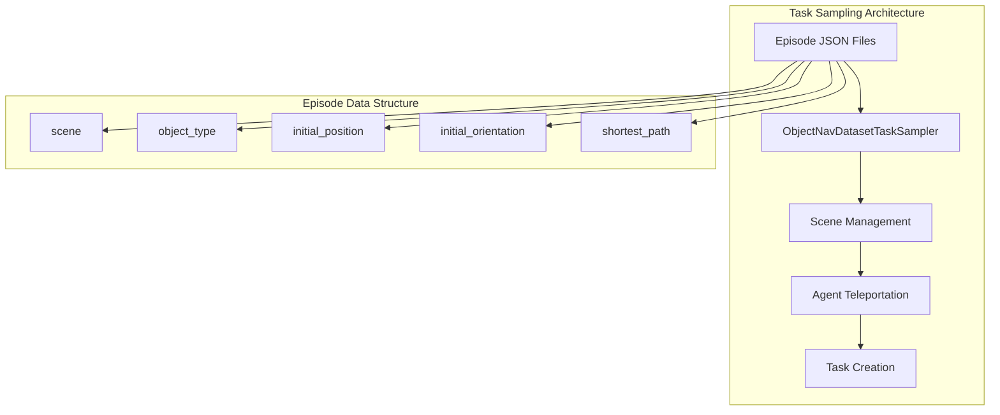
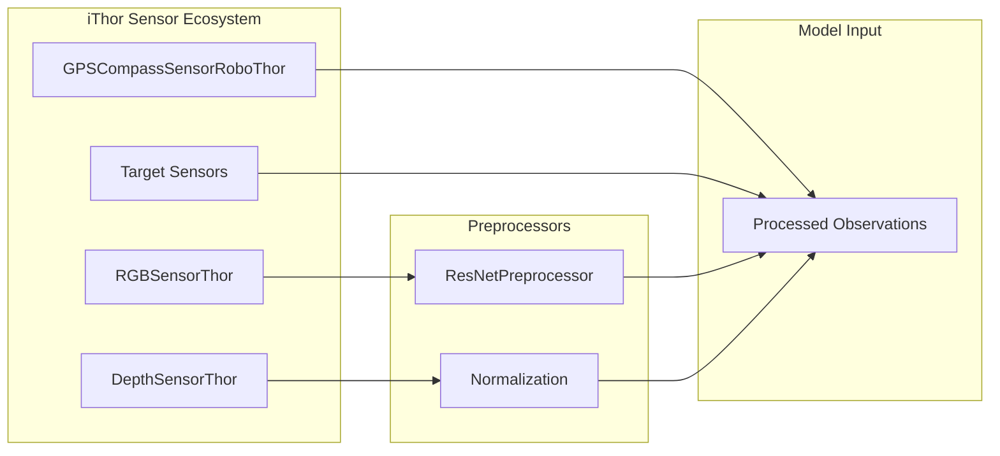
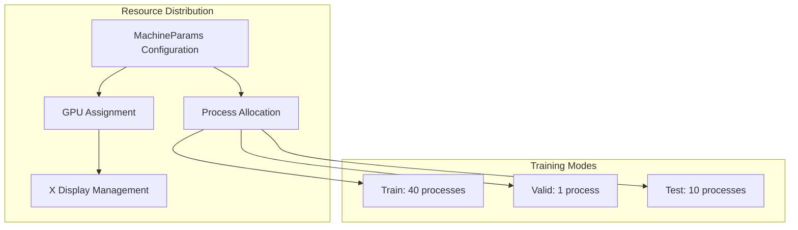

<!-- source: DeepWiki mcp.deepwiki.com · repo allenai/allenact · page 5.2 iThor Integration · fetched 2026-10-26 -->

# iThor Integration

<details>
<summary>Relevant source files</summary>

The following files were used as context for generating this wiki page:

- [allenact_plugins/ithor_plugin/ithor_environment.py](allenact_plugins/ithor_plugin/ithor_environment.py)
- [allenact_plugins/ithor_plugin/ithor_util.py](allenact_plugins/ithor_plugin/ithor_util.py)
- [allenact_plugins/robothor_plugin/robothor_environment.py](allenact_plugins/robothor_plugin/robothor_environment.py)
- [allenact_plugins/robothor_plugin/robothor_task_samplers.py](allenact_plugins/robothor_plugin/robothor_task_samplers.py)
- [allenact_plugins/robothor_plugin/robothor_tasks.py](allenact_plugins/robothor_plugin/robothor_tasks.py)
- [projects/objectnav_baselines/experiments/ithor/objectnav_ithor_base.py](projects/objectnav_baselines/experiments/ithor/objectnav_ithor_base.py)
- [projects/objectnav_baselines/experiments/objectnav_thor_base.py](projects/objectnav_baselines/experiments/objectnav_thor_base.py)
- [projects/objectnav_baselines/experiments/robothor/objectnav_robothor_base.py](projects/objectnav_baselines/experiments/robothor/objectnav_robothor_base.py)
- [projects/pointnav_baselines/experiments/habitat/pointnav_habitat_base.py](projects/pointnav_baselines/experiments/habitat/pointnav_habitat_base.py)
- [projects/pointnav_baselines/experiments/ithor/pointnav_ithor_base.py](projects/pointnav_baselines/experiments/ithor/pointnav_ithor_base.py)
- [projects/pointnav_baselines/experiments/pointnav_thor_base.py](projects/pointnav_baselines/experiments/pointnav_thor_base.py)
- [projects/pointnav_baselines/experiments/robothor/pointnav_robothor_base.py](projects/pointnav_baselines/experiments/robothor/pointnav_robothor_base.py)
- [projects/tutorials/pointnav_habitat_rgb_ddppo.py](projects/tutorials/pointnav_habitat_rgb_ddppo.py)
- [projects/tutorials/pointnav_ithor_rgb_ddppo.py](projects/tutorials/pointnav_ithor_rgb_ddppo.py)

</details>


This document covers AllenAct's integration with the iThor (interactive THOR) simulation environment, including environment setup, configuration classes, and task implementations. iThor provides interactive indoor scenes for embodied AI research, particularly navigation tasks.

For RoboThor integration, see [RoboThor Integration](#5.1). For Habitat integration, see [Habitat Integration](#5.3).

## iThor Environment Overview

The core iThor integration is built around the `IThorEnvironment` class, which wraps the AI2-THOR controller and provides additional functionality for AllenAct tasks.



**iThor Environment Architecture**

The `IThorEnvironment` class provides:
- Scene management and agent teleportation
- Reachable position computation and caching
- Object visibility and interaction capabilities
- Camera and sensor data access
- Action execution and validation

Sources: [allenact_plugins/ithor_plugin/ithor_environment.py:20-100]()

## Configuration Base Classes

AllenAct provides base configuration classes specifically for iThor experiments that handle common setup patterns.

### ObjectNav iThor Configuration

The `ObjectNaviThorBaseConfig` class provides the foundation for object navigation experiments in iThor:



**ObjectNav iThor Configuration Structure**

Key configuration parameters include:
- **THOR_COMMIT_ID**: Specific AI2-THOR version for reproducibility
- **AGENT_MODE**: Set to `"default"` for standard iThor agent
- **DEFAULT_NUM_TRAIN_PROCESSES**: 40 parallel training processes (GPU dependent)
- **TARGET_TYPES**: 12 object types for navigation tasks

Sources: [projects/objectnav_baselines/experiments/ithor/objectnav_ithor_base.py:11-40]()

### PointNav iThor Configuration

The `PointNaviThorBaseConfig` provides similar functionality for point navigation tasks:

| Parameter | Value | Purpose |
|-----------|-------|---------|
| `NUM_PROCESSES` | 40 | Training process count |
| `TRAIN_DATASET_DIR` | `datasets/ithor-pointnav/train` | Training episode directory |
| `VAL_DATASET_DIR` | `datasets/ithor-pointnav/val` | Validation episode directory |

Sources: [projects/pointnav_baselines/experiments/ithor/pointnav_ithor_base.py:9-16]()

## Environment Setup and Parameters

### Core Environment Arguments

The iThor environment accepts several key parameters through the `env_args()` method:



**Environment Parameter Flow**

Essential environment parameters include:
- **Camera dimensions**: Width/height from `CAMERA_WIDTH`/`CAMERA_HEIGHT`
- **Physics settings**: Continuous mode, action noise, grid size
- **Agent configuration**: Field of view, visibility distance, rotation degrees
- **Scene handling**: Private scene inclusion, depth rendering

Sources: [projects/objectnav_baselines/experiments/objectnav_thor_base.py:98-122]()

### Display and GPU Management

iThor requires proper display management, especially on Linux systems:

```python
# X Display assignment for multi-GPU setups
x_display = x_displays[process_ind % len(x_displays)]
device_dict = dict(x_display=x_display)
```

The system automatically:
- Detects available X displays using `get_open_x_displays()`
- Distributes processes across available displays
- Warns when GPU count exceeds display count

Sources: [allenact_plugins/ithor_plugin/ithor_util.py:65-98](), [projects/objectnav_baselines/experiments/objectnav_thor_base.py:236-258]()

## Task Samplers and Dataset Handling

### Dataset Task Sampling

iThor experiments use dataset-based task sampling with pre-generated episode files:



**Dataset Task Sampling Flow**

The sampling process involves:
1. Loading compressed episode files (`*.json.gz`) from dataset directories
2. Filtering episodes by target object types
3. Cycling through scenes and episodes with optional shuffling
4. Teleporting agents to episode-specified starting positions
5. Creating task instances with all necessary metadata

Sources: [allenact_plugins/robothor_plugin/robothor_task_samplers.py:292-385]()

### Scene and Episode Management

The task sampler handles scene transitions and episode cycling:

| Method | Purpose |
|--------|---------|
| `load_dataset()` | Load and shuffle episodes from compressed files |
| `next_task()` | Generate next task instance with proper scene/episode |
| `reset()` | Reset episode indices and task counters |

Key features include:
- **Scene caching**: Avoids unnecessary scene reloads
- **Episode shuffling**: Randomizes training order
- **Material randomization**: Optional for training scenes
- **Flipping support**: Horizontal mirroring for data augmentation

Sources: [allenact_plugins/robothor_plugin/robothor_task_samplers.py:371-385](), [allenact_plugins/robothor_plugin/robothor_task_samplers.py:445-523]()

## Sensors and Observations

### Available Sensor Types

iThor supports multiple sensor types for different observation modalities:



**Sensor Processing Pipeline**

Common sensor configurations include:
- **RGB sensors**: With ResNet preprocessing for visual features
- **Depth sensors**: For spatial understanding
- **GPS/Compass**: For position and orientation information
- **Target coordinate sensors**: For goal specification

Sources: [projects/tutorials/pointnav_ithor_rgb_ddppo.py:67-76]()

### Sensor Configuration Example

A typical sensor suite setup:

```python
SENSORS = [
    RGBSensorThor(
        height=SCREEN_SIZE,
        width=SCREEN_SIZE, 
        use_resnet_normalization=True,
        uuid="rgb_lowres"
    ),
    GPSCompassSensorRoboThor(),
]
```

This configuration provides RGB visual input with proper normalization and positional information for navigation tasks.

Sources: [projects/tutorials/pointnav_ithor_rgb_ddppo.py:67-75]()

## Integration with Training Pipeline

### Machine Parameters and Process Distribution

iThor experiments require careful resource management across multiple processes and GPUs:



**Resource Management Architecture**

The system automatically:
- Distributes processes evenly across available GPUs
- Assigns X displays to prevent conflicts
- Configures sensor preprocessing graphs per mode
- Handles CPU fallback when GPUs unavailable

Sources: [projects/pointnav_baselines/experiments/pointnav_thor_base.py:70-114]()

### Task Sampler Arguments

Each process receives specific arguments for consistent task sampling:

| Argument | Purpose |
|----------|---------|
| `scenes` | Subset of scenes for this process |
| `object_types` | Target object types (ObjectNav only) |
| `sensors` | Sensor suite configuration |
| `env_args` | Environment parameters including display |
| `rewards_config` | Reward structure specification |

Sources: [projects/objectnav_baselines/experiments/objectnav_thor_base.py:260-274]()

---

