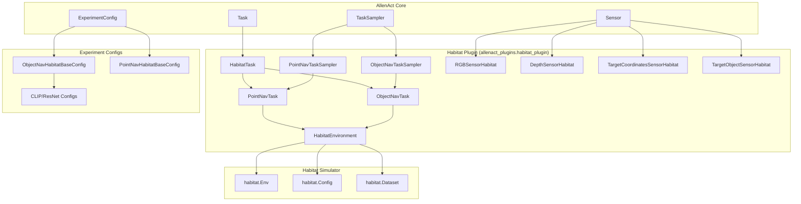
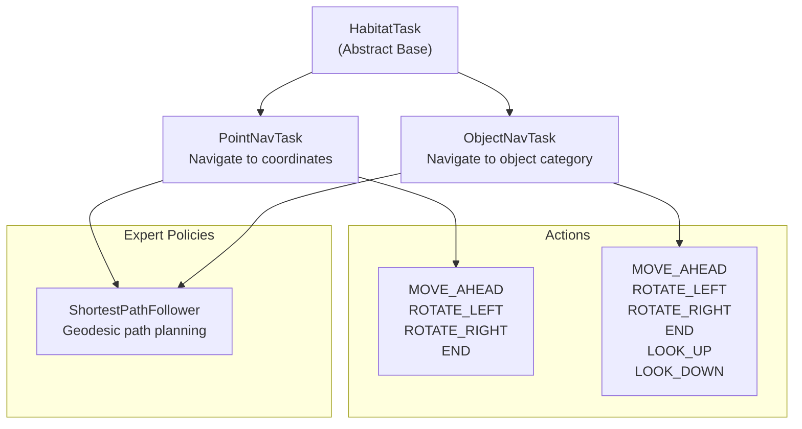
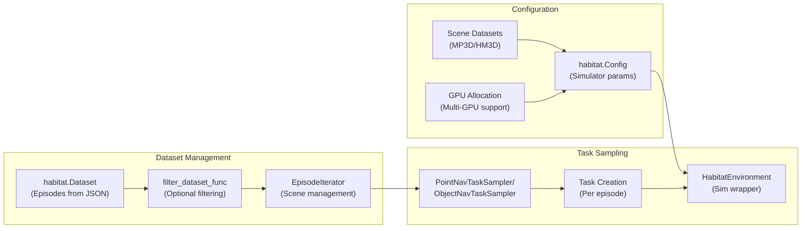
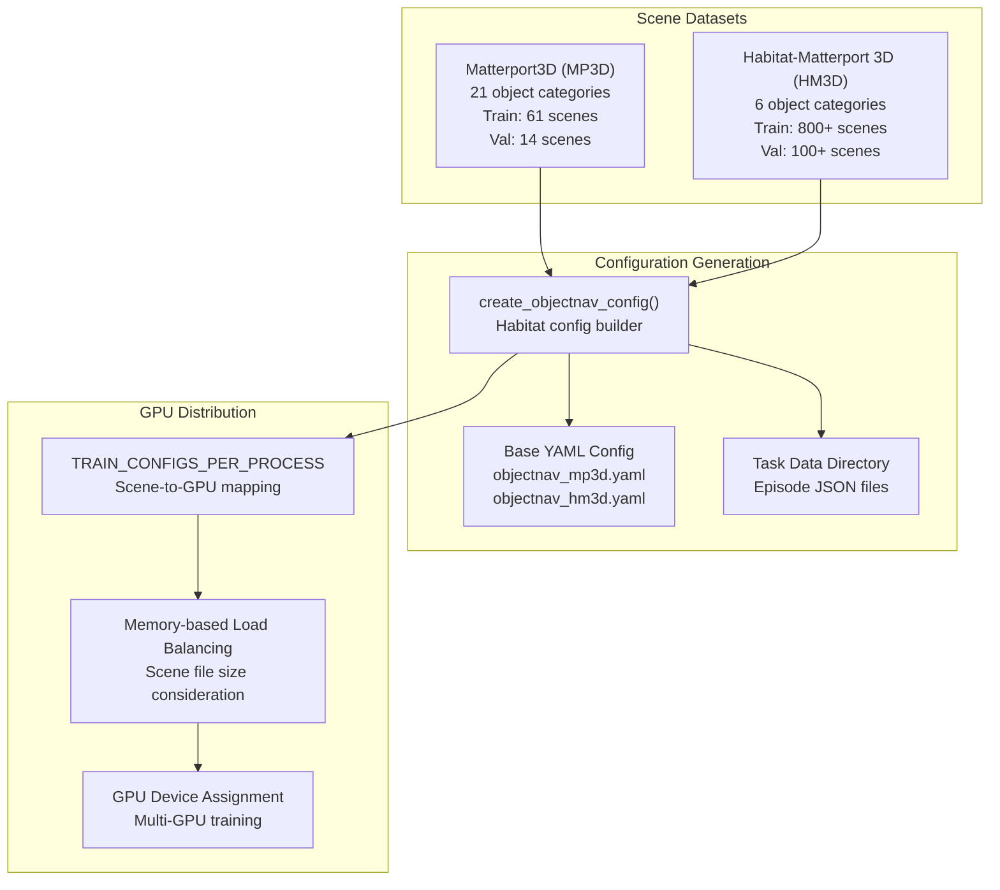
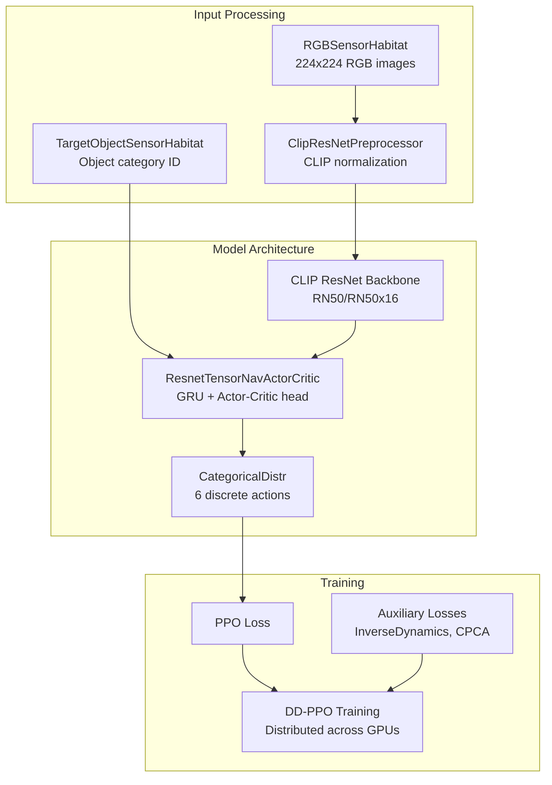
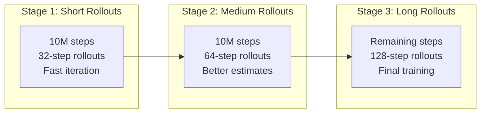

<!-- source: DeepWiki mcp.deepwiki.com · repo allenai/allenact · page 5.3 Habitat Integration · fetched 2026-10-26 -->

# Habitat Integration

<details>
<summary>Relevant source files</summary>

The following files were used as context for generating this wiki page:

- [allenact/utils/inference.py](allenact/utils/inference.py)
- [allenact_plugins/habitat_plugin/habitat_environment.py](allenact_plugins/habitat_plugin/habitat_environment.py)
- [allenact_plugins/habitat_plugin/habitat_sensors.py](allenact_plugins/habitat_plugin/habitat_sensors.py)
- [allenact_plugins/habitat_plugin/habitat_task_samplers.py](allenact_plugins/habitat_plugin/habitat_task_samplers.py)
- [allenact_plugins/habitat_plugin/habitat_tasks.py](allenact_plugins/habitat_plugin/habitat_tasks.py)
- [allenact_plugins/minigrid_plugin/minigrid_models.py](allenact_plugins/minigrid_plugin/minigrid_models.py)
- [allenact_plugins/minigrid_plugin/minigrid_tasks.py](allenact_plugins/minigrid_plugin/minigrid_tasks.py)
- [projects/objectnav_baselines/experiments/clip/mixins.py](projects/objectnav_baselines/experiments/clip/mixins.py)
- [projects/objectnav_baselines/experiments/habitat/clip/objectnav_habitat_rgb_clipresnet50gru_ddppo.py](projects/objectnav_baselines/experiments/habitat/clip/objectnav_habitat_rgb_clipresnet50gru_ddppo.py)
- [projects/objectnav_baselines/experiments/habitat/clip/objectnav_habitat_rgb_clipresnet50gru_ddppo_increasingrollouts.py](projects/objectnav_baselines/experiments/habitat/clip/objectnav_habitat_rgb_clipresnet50gru_ddppo_increasingrollouts.py)
- [projects/objectnav_baselines/experiments/habitat/objectnav_habitat_base.py](projects/objectnav_baselines/experiments/habitat/objectnav_habitat_base.py)
- [projects/objectnav_baselines/experiments/robothor/clip/objectnav_robothor_rgb_clipresnet50gru_ddppo.py](projects/objectnav_baselines/experiments/robothor/clip/objectnav_robothor_rgb_clipresnet50gru_ddppo.py)
- [projects/objectnav_baselines/experiments/robothor/clip/objectnav_robothor_rgb_clipresnet50x16gru_ddppo.py](projects/objectnav_baselines/experiments/robothor/clip/objectnav_robothor_rgb_clipresnet50x16gru_ddppo.py)
- [projects/objectnav_baselines/mixins.py](projects/objectnav_baselines/mixins.py)
- [projects/pointnav_baselines/experiments/habitat/clip/pointnav_habitat_rgb_clipresnet50gru_ddppo.py](projects/pointnav_baselines/experiments/habitat/clip/pointnav_habitat_rgb_clipresnet50gru_ddppo.py)
- [projects/tutorials/minigrid_tutorial_conds.py](projects/tutorials/minigrid_tutorial_conds.py)
- [tests/hierarchical_policies/__init__.py](tests/hierarchical_policies/__init__.py)
- [tests/hierarchical_policies/test_minigrid_conditional.py](tests/hierarchical_policies/test_minigrid_conditional.py)
- [tests/sync_algs_cpu/test_to_to_obj_trains.py](tests/sync_algs_cpu/test_to_to_obj_trains.py)

</details>


## Purpose and Scope

This document covers AllenAct's integration with the Habitat simulator, a photorealistic 3D environment for embodied AI research. Habitat provides high-quality visual environments based on real-world 3D scans from datasets like Matterport3D (MP3D) and HM3D. For information about other simulator integrations, see [RoboThor Integration](#5.1), [iThor Integration](#5.2), and [MiniGrid Integration](#5.4).

The Habitat integration supports point navigation and object navigation tasks with RGB and depth sensors, and provides distributed training capabilities across multiple GPUs and scenes.

## Habitat Integration Architecture



Sources: [allenact_plugins/habitat_plugin/habitat_environment.py:1-81](), [allenact_plugins/habitat_plugin/habitat_tasks.py:1-421](), [allenact_plugins/habitat_plugin/habitat_sensors.py:1-147](), [allenact_plugins/habitat_plugin/habitat_task_samplers.py:1-253]()

## Core Components

### HabitatEnvironment

The `HabitatEnvironment` class serves as the main interface between AllenAct and the Habitat simulator. It wraps the native `habitat.Env` and provides a consistent API for environment interaction.

**Key Features:**
- Wraps `habitat.Env` with AllenAct-compatible interface
- Manages episode iteration and scene switching
- Provides caching for geodesic distance calculations
- Handles environment reset and stepping

**Core Methods:**
- `step(action_dict)` - Execute actions in the environment
- `reset()` - Reset to a new episode
- `get_location()` - Get agent's current position
- `get_rotation()` - Get agent's current orientation
- `get_shortest_path()` - Compute shortest path between states

Sources: [allenact_plugins/habitat_plugin/habitat_environment.py:17-81]()

### Habitat Tasks

#### Task Hierarchy



#### PointNavTask

Point navigation task where agents navigate to specific coordinates. The task provides:
- 4 discrete actions: move forward, turn left, turn right, end episode
- Reward based on geodesic distance progress toward target
- Success determined by reaching within threshold distance
- Expert policy using `ShortestPathFollower`

#### ObjectNavTask

Object navigation task where agents find specific object categories. Enhanced features include:
- 6 discrete actions: navigation actions plus look up/down
- Optional look constraints to limit vertical movement
- Success based on Habitat's SPL (Success weighted by Path Length) metric
- Tracking of invalid actions and minimum distance to goal

Sources: [allenact_plugins/habitat_plugin/habitat_tasks.py:28-421]()

### Habitat Sensors

The plugin provides specialized sensors for extracting observations from Habitat environments:

| Sensor | Purpose | Output |
|--------|---------|--------|
| `RGBSensorHabitat` | RGB camera observations | 3-channel images |
| `DepthSensorHabitat` | Depth camera observations | 1-channel depth maps |
| `TargetCoordinatesSensorHabitat` | Goal coordinates for PointNav | 2D polar coordinates |
| `TargetObjectSensorHabitat` | Target object category for ObjectNav | Discrete object ID |
| `AgentCoordinatesSensorHabitat` | Agent position and orientation | Position (x,y,z) + rotation |

**Key Features:**
- Automatic normalization for deep learning models
- ResNet-compatible preprocessing options
- Configurable image dimensions and field of view
- Integration with CLIP preprocessing

Sources: [allenact_plugins/habitat_plugin/habitat_sensors.py:17-147]()

### Task Samplers

#### Data Flow Architecture



Both `PointNavTaskSampler` and `ObjectNavTaskSampler` manage episode iteration and task creation:

- **Episode Management**: Load episodes from Habitat datasets (train/val/test splits)
- **Environment Creation**: Initialize Habitat environments with proper GPU allocation
- **Task Generation**: Create task instances with episode-specific information
- **Filtering Support**: Optional dataset filtering for custom episode subsets

Sources: [allenact_plugins/habitat_plugin/habitat_task_samplers.py:14-253]()

## Experiment Configuration

### ObjectNavHabitatBaseConfig

The base configuration class provides a foundation for object navigation experiments in Habitat:

#### Scene Dataset Support



#### Key Configuration Parameters

| Parameter | MP3D | HM3D | Purpose |
|-----------|------|------|---------|
| Object Categories | 21 | 6 | Target object types |
| Camera Resolution | 224x224 | 224x224 | RGB/Depth sensor size |
| Action Space | 6 actions | 6 actions | Movement + look actions |
| Max Episode Steps | 500 | 500 | Episode length limit |
| Success Distance | 0.1m | 0.1m | Goal reach threshold |

#### GPU Memory Management

The configuration includes sophisticated GPU memory management for multi-GPU training:

1. **Scene-based Partitioning**: Distributes scenes across GPUs based on file size
2. **Memory Load Balancing**: Considers 3D model complexity for even GPU utilization  
3. **Dynamic Config Generation**: Creates per-process configs with appropriate GPU assignment

Sources: [projects/objectnav_baselines/experiments/habitat/objectnav_habitat_base.py:111-491](), [projects/objectnav_baselines/experiments/habitat/objectnav_habitat_base.py:39-108]()

### Configuration Methods

**Core Configuration Methods:**
- `_create_config()` - Generate Habitat configuration for train/val/test
- `train_scenes_path()` - Path to training episode data
- `valid_scenes_path()` - Path to validation episode data  
- `make_sampler_fn()` - Create task sampler instances
- `machine_params()` - Configure GPU allocation and processes

**Task Sampler Arguments:**
- `train_task_sampler_args()` - Training sampler configuration
- `valid_task_sampler_args()` - Validation sampler configuration
- `test_task_sampler_args()` - Testing sampler configuration

Sources: [projects/objectnav_baselines/experiments/habitat/objectnav_habitat_base.py:193-491]()

## Model Integration

### CLIP Integration Example

The Habitat plugin integrates seamlessly with CLIP-based models for object navigation:



**Example Configuration:**
- `ObjectNavHabitatRGBClipResNet50GRUDDPPOExperimentConfig` - CLIP ResNet50 + GRU model
- `ClipResNetPreprocessGRUActorCriticMixin` - Preprocessing and model creation
- CLIP normalization: `mean=[0.48145466, 0.4578275, 0.40821073]`, `std=[0.26862954, 0.26130258, 0.27577711]`

Sources: [projects/objectnav_baselines/experiments/habitat/clip/objectnav_habitat_rgb_clipresnet50gru_ddppo.py:22-78](), [projects/objectnav_baselines/experiments/clip/mixins.py:60-155]()

## Training Pipeline Configuration

### Progressive Rollout Length Training

Habitat experiments support progressive training with increasing rollout lengths:



This approach balances training speed and gradient estimate quality by starting with shorter rollouts and progressively increasing length.

Sources: [projects/objectnav_baselines/experiments/habitat/clip/objectnav_habitat_rgb_clipresnet50gru_ddppo_increasingrollouts.py:18-109]()

### Training Configuration Parameters

| Parameter | Value | Purpose |
|-----------|-------|---------|
| Learning Rate | 1e-4 | Adam optimizer rate |
| Num Mini Batch | 1 | Gradient accumulation |
| Update Repeats | 4 | PPO updates per rollout |
| Gamma | 0.99 | Discount factor |
| GAE Lambda | 0.95 | Advantage estimation |
| Max Grad Norm | 0.5 | Gradient clipping |

Sources: [projects/objectnav_baselines/mixins.py:332-393]()

## Usage Examples

### Basic Object Navigation Setup

```python
# Import required components
from allenact_plugins.habitat_plugin.habitat_task_samplers import ObjectNavTaskSampler
from allenact_plugins.habitat_plugin.habitat_sensors import RGBSensorHabitat, TargetObjectSensorHabitat
from projects.objectnav_baselines.experiments.habitat.objectnav_habitat_base import ObjectNavHabitatBaseConfig

# Create sensors for RGB input and object target
sensors = [
    RGBSensorHabitat(height=224, width=224, use_resnet_normalization=True),
    TargetObjectSensorHabitat(num_objects=21)  # MP3D has 21 object categories
]

# Configure for MP3D dataset
config = ObjectNavHabitatBaseConfig(
    scene_dataset="mp3d",
    num_train_processes=40,  # Multi-GPU training
    train_gpu_ids=[0, 1, 2, 3]  # 4 GPUs
)
```

### Task Sampler Configuration

Task samplers handle episode loading and environment management:

```python
# Training task sampler (infinite episodes)
def train_task_sampler_args(self, process_ind, total_processes, **kwargs):
    config = self.TRAIN_CONFIGS_PER_PROCESS[process_ind]  # Pre-assigned scene config
    return {
        "env_config": config,
        "max_steps": 500,
        "sensors": self.SENSORS,
        "action_space": gym.spaces.Discrete(6)  # 6 object navigation actions
    }

# Validation task sampler (fixed episodes)
def valid_task_sampler_args(self, process_ind, total_processes, **kwargs):
    return {
        "env_config": self.VALID_CONFIG,
        "max_steps": 500,
        "sensors": self.SENSORS,
        "action_space": gym.spaces.Discrete(6)
    }
```

Sources: [projects/objectnav_baselines/experiments/habitat/objectnav_habitat_base.py:437-491]()

---

