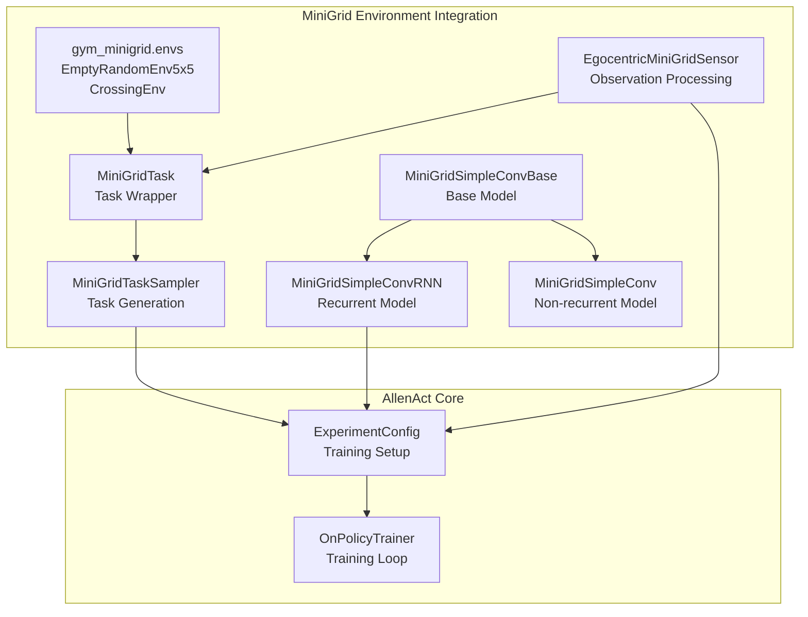
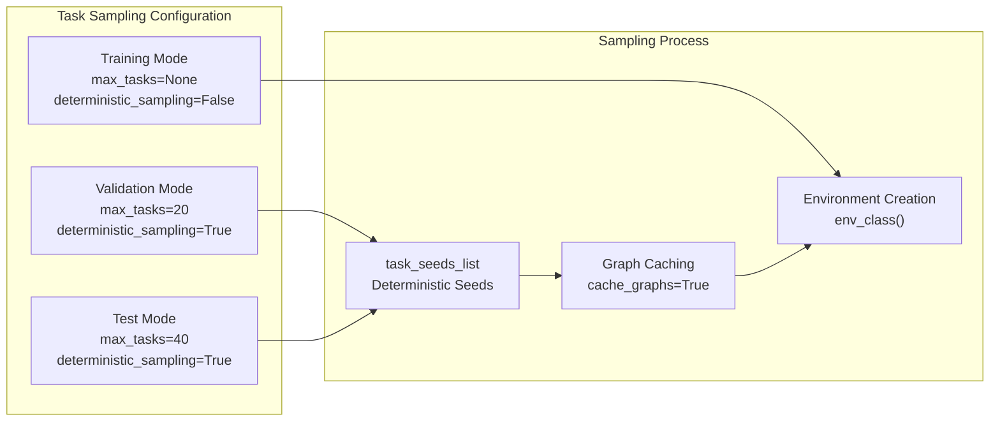
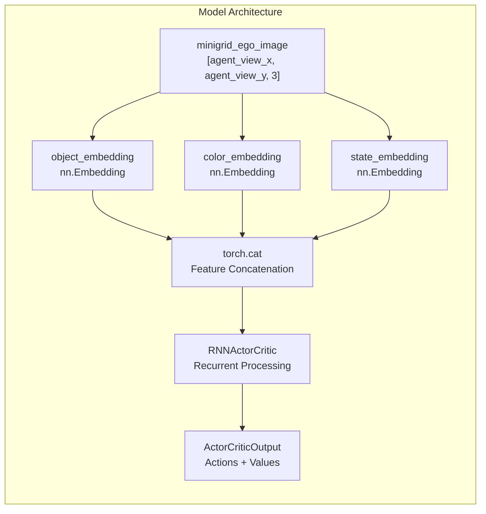
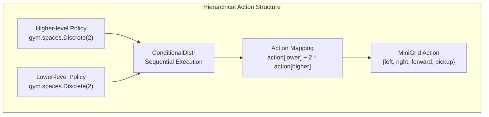

<!-- source: DeepWiki mcp.deepwiki.com · repo allenai/allenact · page 5.4 MiniGrid Integration · fetched 2026-10-26 -->

# MiniGrid Integration

<details>
<summary>Relevant source files</summary>

The following files were used as context for generating this wiki page:

- [allenact_plugins/habitat_plugin/habitat_environment.py](allenact_plugins/habitat_plugin/habitat_environment.py)
- [allenact_plugins/habitat_plugin/habitat_sensors.py](allenact_plugins/habitat_plugin/habitat_sensors.py)
- [allenact_plugins/habitat_plugin/habitat_task_samplers.py](allenact_plugins/habitat_plugin/habitat_task_samplers.py)
- [allenact_plugins/minigrid_plugin/minigrid_models.py](allenact_plugins/minigrid_plugin/minigrid_models.py)
- [allenact_plugins/minigrid_plugin/minigrid_tasks.py](allenact_plugins/minigrid_plugin/minigrid_tasks.py)
- [projects/tutorials/minigrid_tutorial.py](projects/tutorials/minigrid_tutorial.py)
- [projects/tutorials/minigrid_tutorial_conds.py](projects/tutorials/minigrid_tutorial_conds.py)
- [tests/hierarchical_policies/__init__.py](tests/hierarchical_policies/__init__.py)
- [tests/hierarchical_policies/test_minigrid_conditional.py](tests/hierarchical_policies/test_minigrid_conditional.py)
- [tests/sync_algs_cpu/test_to_to_obj_trains.py](tests/sync_algs_cpu/test_to_to_obj_trains.py)

</details>


This document covers AllenAct's integration with the [MiniGrid](https://github.com/maximecb/gym-minigrid) environment, which provides simple grid-world environments for navigation tasks. MiniGrid integration is primarily designed for educational purposes, prototyping, and testing framework components with minimal computational requirements.

For more complex navigation environments, see RoboThor Integration ([5.1](#5.1)), iThor Integration ([5.2](#5.2)), or Habitat Integration ([5.3](#5.3)). For complete training tutorials using MiniGrid, see the MiniGrid Tutorial ([7.1](#7.1)).

## Architecture Overview

The MiniGrid plugin follows AllenAct's standard environment integration pattern, providing task wrappers, sensors, models, and samplers specifically designed for grid-world environments.



Sources: [allenact_plugins/minigrid_plugin/minigrid_tasks.py:25-124](), [allenact_plugins/minigrid_plugin/minigrid_models.py:22-260](), [projects/tutorials/minigrid_tutorial.py:100-308]()

## Core Components

### MiniGridTask

The `MiniGridTask` class wraps MiniGrid environments to work with AllenAct's task abstraction. It handles action translation, observation processing, and expert policy integration.

| Component | Purpose | Key Methods |
|-----------|---------|-------------|
| Action Translation | Maps AllenAct actions to MiniGrid actions | `_step()`, `action_space` |
| Expert Integration | Provides shortest-path expert policy | `query_expert()`, `generate_graph()` |
| Metrics Collection | Tracks success and episode statistics | `metrics()` |

The task supports three primary actions: left turn, right turn, and move forward, mapped through `_ACTION_IND_TO_MINIGRID_IND`.

Sources: [allenact_plugins/minigrid_plugin/minigrid_tasks.py:25-124]()

### MiniGridTaskSampler

The `MiniGridTaskSampler` generates tasks for training, validation, and testing with configurable sampling strategies.



Key configuration parameters:

- `max_tasks`: Controls finite vs infinite task generation
- `deterministic_sampling`: Ensures reproducible evaluation
- `cache_graphs`: Enables graph reuse for expert policies
- `task_seeds_list`: Provides deterministic task sequences

Sources: [allenact_plugins/minigrid_plugin/minigrid_tasks.py:387-560](), [projects/tutorials/minigrid_tutorial.py:172-241]()

### Neural Network Models

The plugin provides two main model architectures optimized for grid-world observations.

#### MiniGridSimpleConvBase

Base class that handles MiniGrid-specific observation processing through embeddings:

- **Object Embedding**: Maps grid objects to learned representations
- **Color Embedding**: Encodes object colors 
- **State Embedding**: Represents object states

#### MiniGridSimpleConvRNN

Recurrent model combining convolutional processing with RNN memory:



Sources: [allenact_plugins/minigrid_plugin/minigrid_models.py:22-209]()

### Sensors

The `EgocentricMiniGridSensor` processes MiniGrid observations into a format suitable for neural networks.

| Parameter | Purpose | Default |
|-----------|---------|---------|
| `agent_view_size` | Size of agent's field of view | 5 |
| `view_channels` | Number of observation channels | 3 |
| `num_objects` | Object vocabulary size | - |
| `num_colors` | Color vocabulary size | - |
| `num_states` | State vocabulary size | - |

The sensor extracts a partial observation around the agent, simulating limited field of view constraints typical in navigation tasks.

Sources: [projects/tutorials/minigrid_tutorial.py:120-122]()

## Expert Policy Integration

MiniGrid tasks include sophisticated expert policy support through graph-based shortest path computation.

### Graph Generation

The `generate_graph()` method creates a navigation graph from the fully observable environment:

1. **Node Creation**: Each (x, y, rotation) state becomes a graph node
2. **Edge Creation**: Valid transitions between adjacent states  
3. **Action Labeling**: Edges labeled with required actions ("left", "right", "forward")

### Expert Querying

The `query_expert()` method provides optimal actions using NetworkX shortest path algorithms:

```python
paths.append(nx.shortest_path(self.graph, source_state_key, "unified_goal"))
```

This enables:
- **Imitation Learning**: Training agents to follow expert demonstrations
- **Curriculum Learning**: Gradually reducing expert guidance
- **Evaluation**: Comparing agent performance to optimal policies

Sources: [allenact_plugins/minigrid_plugin/minigrid_tasks.py:250-347]()

## Usage Patterns

### Basic Experiment Configuration

A typical MiniGrid experiment configuration includes:

```python
class MiniGridTutorialExperimentConfig(ExperimentConfig):
    SENSORS = [EgocentricMiniGridSensor(agent_view_size=5, view_channels=3)]
    
    @classmethod
    def create_model(cls, **kwargs) -> nn.Module:
        return MiniGridSimpleConvRNN(
            action_space=gym.spaces.Discrete(len(MiniGridTask.class_action_names())),
            observation_space=SensorSuite(cls.SENSORS).observation_spaces,
            num_objects=cls.SENSORS[0].num_objects,
            num_colors=cls.SENSORS[0].num_colors,
            num_states=cls.SENSORS[0].num_states,
        )
```

### Training Configuration

Training typically uses PPO with linear learning rate decay:

| Parameter | Value | Purpose |
|-----------|-------|---------|
| `num_steps` | 16 | Rollout length |
| `num_mini_batch` | 4 | Batch size for updates |
| `update_repeats` | 3 | SGD steps per rollout |
| `lr` | 1e-4 | Initial learning rate |
| `total_steps` | 150,000 | Total training steps |

Sources: [projects/tutorials/minigrid_tutorial.py:285-308]()

### Hierarchical Policies

The plugin supports hierarchical action spaces through conditional distributions:



This enables training policies with compositional action spaces and expert supervision at multiple levels.

Sources: [projects/tutorials/minigrid_tutorial_conds.py:305-352](), [tests/hierarchical_policies/test_minigrid_conditional.py:30-175]()

## Testing Integration

The MiniGrid plugin includes comprehensive test coverage demonstrating various training scenarios:

- **Basic PPO Training**: Standard reinforcement learning setup
- **Hierarchical Policies**: Multi-level action spaces with conditional distributions  
- **Imitation Learning**: Expert-guided training with teacher forcing
- **Custom Storage**: Integration with different experience storage backends

Test configurations provide minimal computational requirements while validating core framework functionality.

Sources: [tests/sync_algs_cpu/test_to_to_obj_trains.py:126-204](), [tests/hierarchical_policies/test_minigrid_conditional.py:177-220]()

---

