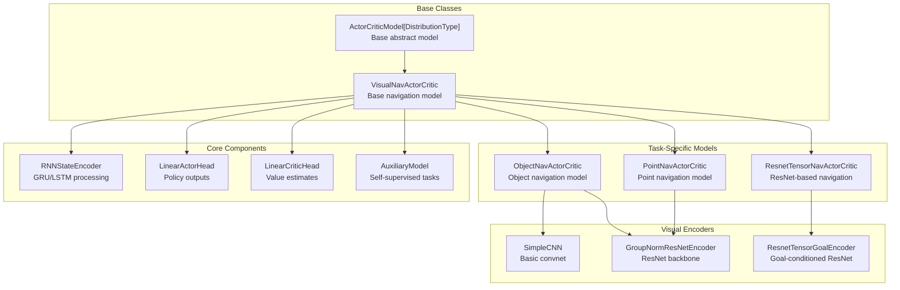
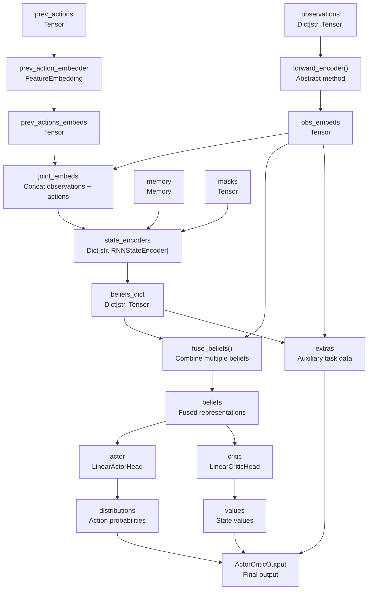
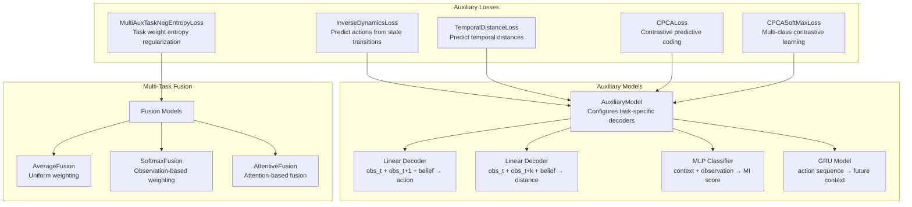
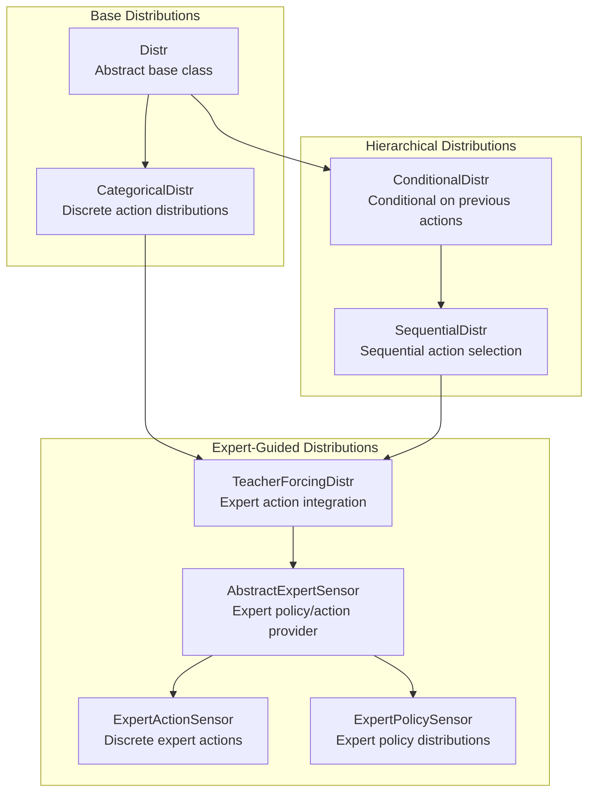
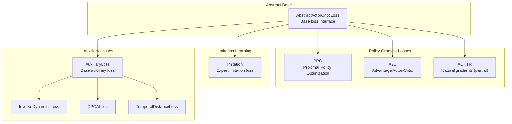
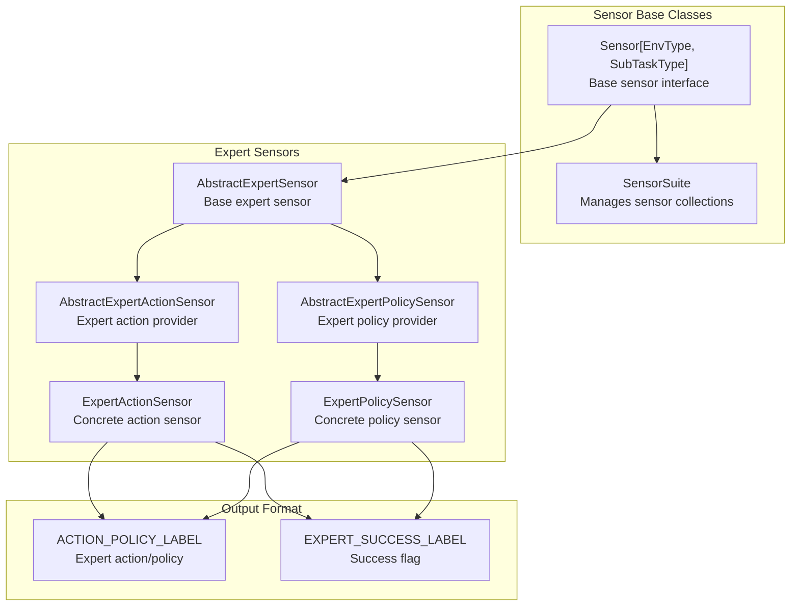

<!-- source: DeepWiki mcp.deepwiki.com · repo allenai/allenact · page 6 Models and Algorithms · fetched 2026-10-26 -->

# Models and Algorithms

<details>
<summary>Relevant source files</summary>

The following files were used as context for generating this wiki page:

- [allenact/algorithms/offpolicy_sync/losses/abstract_offpolicy_loss.py](allenact/algorithms/offpolicy_sync/losses/abstract_offpolicy_loss.py)
- [allenact/algorithms/onpolicy_sync/losses/a2cacktr.py](allenact/algorithms/onpolicy_sync/losses/a2cacktr.py)
- [allenact/algorithms/onpolicy_sync/losses/abstract_loss.py](allenact/algorithms/onpolicy_sync/losses/abstract_loss.py)
- [allenact/algorithms/onpolicy_sync/losses/imitation.py](allenact/algorithms/onpolicy_sync/losses/imitation.py)
- [allenact/algorithms/onpolicy_sync/losses/ppo.py](allenact/algorithms/onpolicy_sync/losses/ppo.py)
- [allenact/algorithms/onpolicy_sync/misc.py](allenact/algorithms/onpolicy_sync/misc.py)
- [allenact/base_abstractions/distributions.py](allenact/base_abstractions/distributions.py)
- [allenact/base_abstractions/misc.py](allenact/base_abstractions/misc.py)
- [allenact/base_abstractions/sensor.py](allenact/base_abstractions/sensor.py)
- [allenact/embodiedai/aux_losses/losses.py](allenact/embodiedai/aux_losses/losses.py)
- [allenact/embodiedai/models/aux_models.py](allenact/embodiedai/models/aux_models.py)
- [allenact/embodiedai/models/fusion_models.py](allenact/embodiedai/models/fusion_models.py)
- [allenact/embodiedai/models/resnet.py](allenact/embodiedai/models/resnet.py)
- [allenact/embodiedai/models/visual_nav_models.py](allenact/embodiedai/models/visual_nav_models.py)
- [allenact/embodiedai/storage/vdr_storage.py](allenact/embodiedai/storage/vdr_storage.py)
- [allenact/utils/model_utils.py](allenact/utils/model_utils.py)
- [allenact/utils/spaces_utils.py](allenact/utils/spaces_utils.py)
- [allenact/utils/system.py](allenact/utils/system.py)
- [allenact_plugins/minigrid_plugin/__init__.py](allenact_plugins/minigrid_plugin/__init__.py)
- [allenact_plugins/navigation_plugin/objectnav/models.py](allenact_plugins/navigation_plugin/objectnav/models.py)
- [allenact_plugins/navigation_plugin/pointnav/models.py](allenact_plugins/navigation_plugin/pointnav/models.py)
- [allenact_plugins/robothor_plugin/robothor_models.py](allenact_plugins/robothor_plugin/robothor_models.py)
- [tests/mapping/test_ai2thor_mapping.py](tests/mapping/test_ai2thor_mapping.py)

</details>


This page covers the neural network architectures and reinforcement learning algorithms implemented in AllenAct. It focuses on the core model classes, auxiliary learning frameworks, action distributions, and training losses that power embodied AI agents. For information about configuring these models in experiments, see [Experiment Configuration](#4). For details about the training orchestration that uses these models, see [Core Training Architecture](#3).

## Actor-Critic Model Architecture

AllenAct implements a modular actor-critic architecture centered around the `VisualNavActorCritic` base class. This design separates visual encoding, recurrent state processing, and auxiliary task integration into composable components.

### Core Architecture Hierarchy



Sources: [allenact/embodiedai/models/visual_nav_models.py:29-278](), [allenact_plugins/navigation_plugin/objectnav/models.py:39-203](), [allenact_plugins/navigation_plugin/pointnav/models.py:23-146]()

### Model Forward Pass Flow

The `VisualNavActorCritic` implements a standardized forward pass that all navigation models inherit:



Sources: [allenact/embodiedai/models/visual_nav_models.py:195-277]()

## Visual Navigation Models

### ObjectNavActorCritic

The `ObjectNavActorCritic` handles object navigation tasks where agents must navigate to specific object types. It combines visual perception with goal object embeddings.

Key components:
- **Visual Encoder**: Supports `SimpleCNN`, `GroupNormResNetEncoder`, or simple projection layers
- **Goal Embedding**: Maps object type IDs to learned embeddings via `nn.Embedding`
- **Observation Fusion**: Concatenates visual features with goal embeddings

```python
# Core encoding logic from ObjectNavActorCritic
def forward_encoder(self, observations: ObservationType) -> torch.Tensor:
    target_encoding = self.get_object_type_encoding(observations)
    obs_embeds = [target_encoding]
    
    if not self.is_blind:
        perception_embed = self.visual_encoder(observations)
        obs_embeds = [perception_embed] + obs_embeds
    
    return torch.cat(obs_embeds, dim=-1)
```

Sources: [allenact_plugins/navigation_plugin/objectnav/models.py:191-202]()

### PointNavActorCritic

The `PointNavActorCritic` handles point navigation where agents navigate to specific coordinates. It processes spatial goal coordinates alongside visual observations.

Key features:
- **Coordinate Embedding**: Optional learned embedding of 2D target coordinates
- **Sensor Fusion**: Can combine RGB and depth through learned linear fusion
- **Flexible Backbones**: Supports both CNN and ResNet visual encoders

Sources: [allenact_plugins/navigation_plugin/pointnav/models.py:23-146]()

### ResNet-based Models

AllenAct provides sophisticated ResNet-based encoders through `GroupNormResNetEncoder` supporting:
- **Group Normalization**: More stable than BatchNorm for RL
- **Multiple Architectures**: ResNet-18, ResNet-50, ResNeXt variants
- **Squeeze-and-Excitation**: Optional attention mechanisms
- **Multi-modal Input**: Combined RGB and depth processing

Sources: [allenact/embodiedai/models/resnet.py:315-418]()

## Auxiliary Task Framework

AllenAct implements a comprehensive auxiliary learning system to improve sample efficiency and representation learning through self-supervised objectives.

### Auxiliary Model Architecture



Sources: [allenact/embodiedai/aux_losses/losses.py:1-798](), [allenact/embodiedai/models/aux_models.py:21-112](), [allenact/embodiedai/models/fusion_models.py:14-120]()

### Auxiliary Loss Implementation

The auxiliary task system integrates seamlessly with the main actor-critic training:

| Auxiliary Task | Purpose | Input | Output |
|---|---|---|---|
| `InverseDynamicsLoss` | Action prediction from state transitions | `obs_t`, `obs_t+1`, `belief_t` | Action logits |
| `TemporalDistanceLoss` | Temporal distance prediction | `obs_t`, `obs_t+k`, `belief_t` | Scalar distance |
| `CPCALoss` | Contrastive predictive coding | Action sequences, observations | Binary classification |
| `CPCASoftMaxLoss` | Multi-class contrastive learning | Action sequences, observations | Multi-class classification |

Sources: [allenact/embodiedai/aux_losses/losses.py:146-701]()

### Multi-Belief Integration

For models using multiple auxiliary tasks, AllenAct supports different fusion strategies:

```python
# Multiple belief fusion in VisualNavActorCritic
def fuse_beliefs(self, beliefs_dict: Dict[str, torch.FloatTensor], 
                obs_embeds: torch.FloatTensor) -> Tuple[torch.FloatTensor, Optional[torch.FloatTensor]]:
    all_beliefs = torch.stack(list(beliefs_dict.values()), dim=-1)
    
    if self.multiple_beliefs:  # Use fusion model
        return self.fusion_model(all_beliefs=all_beliefs, obs_embeds=obs_embeds)
    
    # Single belief case
    beliefs = all_beliefs.squeeze(-1)
    return beliefs, None
```

Sources: [allenact/embodiedai/models/visual_nav_models.py:182-193]()

## Action Distributions and Expert Policies

AllenAct provides a flexible distribution system supporting various action spaces and expert-guided learning.

### Distribution Hierarchy



Sources: [allenact/base_abstractions/distributions.py:22-376](), [allenact/base_abstractions/sensor.py:137-408]()

### Teacher Forcing Implementation

The `TeacherForcingDistr` enables curriculum learning by gradually transitioning from expert to learned policies:

```python
# Teacher forcing with annealing schedule
def sample(self, sample_shape=torch.Size()):
    teacher_force_info = {
        "teacher_ratio/enforced": self.teacher_forcing(self.approx_steps),
    }
    
    # Sample from model distribution
    model_sample = self.distr.sample(sample_shape)
    
    # Replace with expert actions based on annealing schedule
    return self.enforce(model_sample, self.action_space, 
                       self.expert, teacher_force_info)
```

Sources: [allenact/base_abstractions/distributions.py:316-350]()

## Loss Functions and Training Algorithms

AllenAct implements several reinforcement learning algorithms through modular loss functions.

### Primary RL Losses



Sources: [allenact/algorithms/onpolicy_sync/losses/ppo.py:15-224](), [allenact/algorithms/onpolicy_sync/losses/a2cacktr.py:16-179](), [allenact/algorithms/onpolicy_sync/losses/imitation.py:23-215]()

### PPO Implementation Details

The PPO loss implements clipped surrogate objectives with optional value function clipping:

| Component | Formula | Purpose |
|---|---|---|
| **Policy Loss** | `min(r_t * A_t, clip(r_t, 1-ε, 1+ε) * A_t)` | Clipped policy improvement |
| **Value Loss** | `max((V - V_target)², (V_clipped - V_target)²)` | Clipped value function updates |
| **Entropy Loss** | `-H(π)` | Exploration encouragement |

Where `r_t = π_new(a|s) / π_old(a|s)` is the probability ratio and `A_t` is the advantage estimate.

Sources: [allenact/algorithms/onpolicy_sync/losses/ppo.py:62-163]()

## Sensor System Integration

Models integrate with AllenAct's sensor system to process diverse input modalities and expert demonstrations.

### Expert Sensor Framework



Sources: [allenact/base_abstractions/sensor.py:38-408]()

The expert sensor system provides standardized interfaces for incorporating expert demonstrations into model training, supporting both discrete action sequences and continuous policy distributions for imitation learning and teacher forcing scenarios.

---

