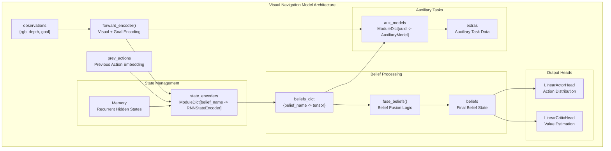
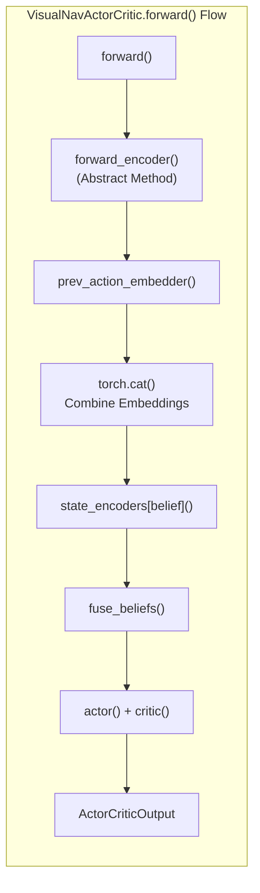
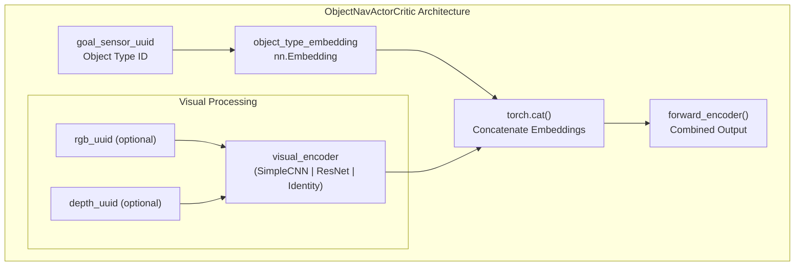
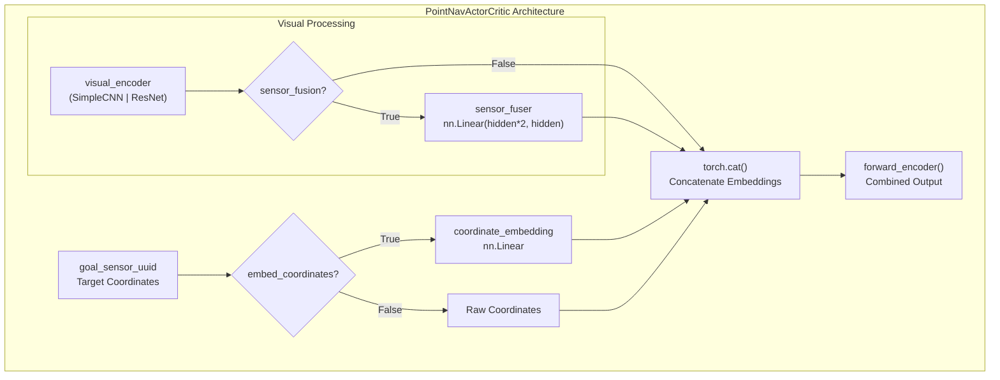
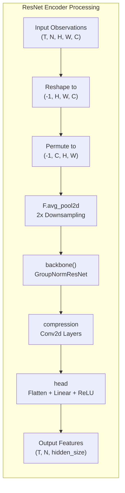
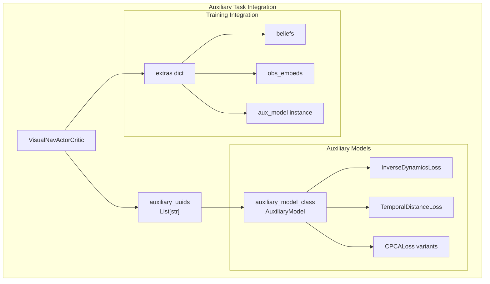
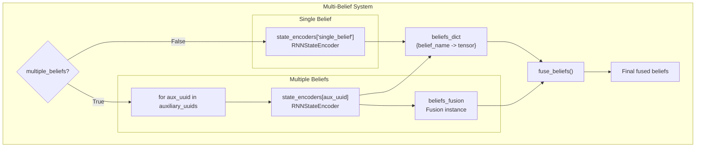

<!-- source: DeepWiki mcp.deepwiki.com · repo allenai/allenact · page 6.1 Visual Navigation Models · fetched 2026-10-26 -->

# Visual Navigation Models

<details>
<summary>Relevant source files</summary>

The following files were used as context for generating this wiki page:

- [allenact/embodiedai/aux_losses/losses.py](allenact/embodiedai/aux_losses/losses.py)
- [allenact/embodiedai/models/aux_models.py](allenact/embodiedai/models/aux_models.py)
- [allenact/embodiedai/models/fusion_models.py](allenact/embodiedai/models/fusion_models.py)
- [allenact/embodiedai/models/resnet.py](allenact/embodiedai/models/resnet.py)
- [allenact/embodiedai/models/visual_nav_models.py](allenact/embodiedai/models/visual_nav_models.py)
- [allenact/utils/model_utils.py](allenact/utils/model_utils.py)
- [allenact_plugins/navigation_plugin/objectnav/models.py](allenact_plugins/navigation_plugin/objectnav/models.py)
- [allenact_plugins/navigation_plugin/pointnav/models.py](allenact_plugins/navigation_plugin/pointnav/models.py)
- [allenact_plugins/robothor_plugin/robothor_models.py](allenact_plugins/robothor_plugin/robothor_models.py)

</details>


This document covers the neural network architectures used for visual navigation tasks in AllenAct. These models combine visual perception, recurrent memory, and auxiliary learning to enable agents to navigate in embodied AI environments. For information about the training pipeline that uses these models, see [Core Training Architecture](#3). For sensor and preprocessing details, see [Sensors and Preprocessors](#6.3).

## Architecture Overview

Visual navigation models in AllenAct follow a modular actor-critic architecture with several key components working together:



Sources: [allenact/embodiedai/models/visual_nav_models.py:29-278]()

## Base VisualNavActorCritic Class

The `VisualNavActorCritic` class serves as the foundation for all visual navigation models in AllenAct. It implements the core actor-critic pattern with support for auxiliary tasks and multi-belief systems.

### Core Components

| Component | Type | Purpose |
|-----------|------|---------|
| `state_encoders` | `nn.ModuleDict` | Maps belief names to RNN encoders |
| `actor` | `LinearActorHead` | Generates action distributions |
| `critic` | `LinearCriticHead` | Estimates state values |
| `aux_models` | `nn.ModuleDict` | Auxiliary task models |
| `prev_action_embedder` | `FeatureEmbedding` | Embeds previous actions |

### Key Methods

The abstract `forward_encoder()` method must be implemented by subclasses to define how observations are processed into embeddings:



The `forward()` method orchestrates the complete forward pass, processing observations through visual encoding, combining with previous actions, updating recurrent states, and producing actor-critic outputs.

Sources: [allenact/embodiedai/models/visual_nav_models.py:29-278]()

## Concrete Model Implementations

### ObjectNavActorCritic

The `ObjectNavActorCritic` is designed for object navigation tasks where agents must find specific object types in the environment.



Key features:
- Supports multiple visual backbone options: `"simple_cnn"`, `"gnresnet18"`, `"identity"`, `"projection"`
- Object goal embedding using `nn.Embedding` for discrete object types
- Optional RGB and depth sensor fusion

Sources: [allenact_plugins/navigation_plugin/objectnav/models.py:39-203]()

### PointNavActorCritic

The `PointNavActorCritic` is designed for point navigation tasks where agents navigate to specific coordinate locations.



Key features:
- Optional coordinate embedding through `nn.Linear` transformation
- Sensor fusion capability for combining RGB and depth modalities
- Configurable coordinate dimensions and embedding dimensions

Sources: [allenact_plugins/navigation_plugin/pointnav/models.py:23-146]()

## Visual Encoder Architectures

### ResNet-Based Encoders

The `GroupNormResNetEncoder` provides state-of-the-art visual feature extraction:

| Component | Purpose |
|-----------|---------|
| `backbone` | GroupNorm ResNet variants (18, 50, ResNeXt, SE) |
| `compression` | Reduces feature map channels for efficiency |
| `head` | Linear layer + ReLU for final feature output |

### ResNet Tensor Encoders

For more complex goal-conditioned models, AllenAct provides tensor-based ResNet encoders:

- `ResnetTensorGoalEncoder`: Single ResNet stream with goal conditioning
- `ResnetDualTensorGoalEncoder`: Dual RGB/depth ResNet streams



Sources: [allenact/embodiedai/models/resnet.py:315-459](), [allenact_plugins/navigation_plugin/objectnav/models.py:295-583]()

## Auxiliary Task Integration

Visual navigation models seamlessly integrate with auxiliary learning tasks to improve sample efficiency and representation learning.

### Auxiliary Model Types

| UUID | Model Class | Purpose |
|------|-------------|---------|
| `"InvDyn"` | `InverseDynamicsLoss` | Predict actions from state transitions |
| `"TempDist"` | `TemporalDistanceLoss` | Predict temporal distances between states |
| `"CPCA"` | `CPCALoss` | Contrastive predictive coding for planning |

### Integration Architecture



The auxiliary tasks receive model beliefs and observation embeddings through the `extras` dictionary returned by the main forward pass.

Sources: [allenact/embodiedai/models/visual_nav_models.py:141-155](), [allenact/embodiedai/models/aux_models.py:21-112]()

## Multi-Belief and Fusion Systems

AllenAct supports multi-belief models where different auxiliary tasks maintain separate belief states that are then fused for action selection.

### Belief Management



### Fusion Strategies

| Fusion Type | Class | Strategy |
|-------------|-------|----------|
| `"avg"` | `AverageFusion` | Simple averaging of all beliefs |
| `"smax"` | `SoftmaxFusion` | Observation-conditioned softmax weighting |
| `"attn"` | `AttentiveFusion` | Scaled dot-product attention mechanism |

Sources: [allenact/embodiedai/models/visual_nav_models.py:68-121](), [allenact/embodiedai/models/fusion_models.py:14-120]()

## Memory and State Management

Visual navigation models maintain recurrent hidden states across time steps to enable temporal reasoning and memory.

### Memory Specification

The `_recurrent_memory_specification()` method defines the structure of memory tensors:

```python
{
    memory_key: (
        (
            ("layer", self.num_recurrent_layers),
            ("sampler", None),
            ("hidden", self.recurrent_hidden_state_size),
        ),
        torch.float32,
    )
    for memory_key in self.belief_names
}
```

### State Encoder Configuration

| Parameter | Purpose |
|-----------|---------|
| `rnn_input_size` | Combined observation + action embedding size |
| `hidden_size` | RNN hidden state dimensionality |
| `num_rnn_layers` | Number of stacked RNN layers |
| `rnn_type` | RNN variant ("GRU", "LSTM") |
| `trainable_masked_hidden_state` | Whether to learn initial hidden states |

Sources: [allenact/embodiedai/models/visual_nav_models.py:166-177](), [allenact/embodiedai/models/basic_models.py]()

---

