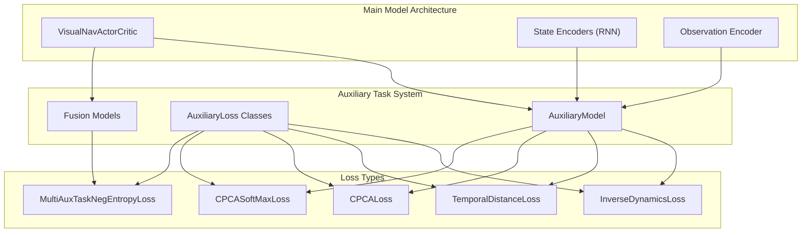
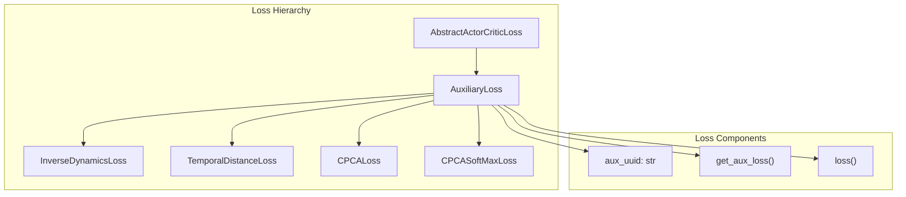
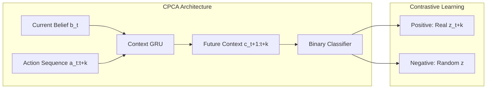
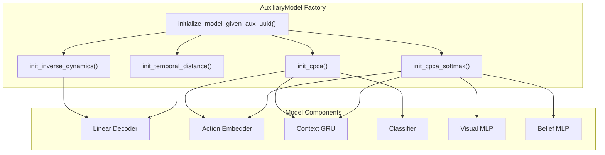
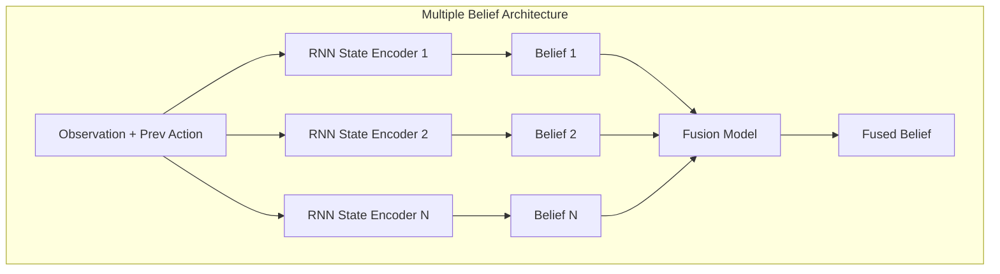
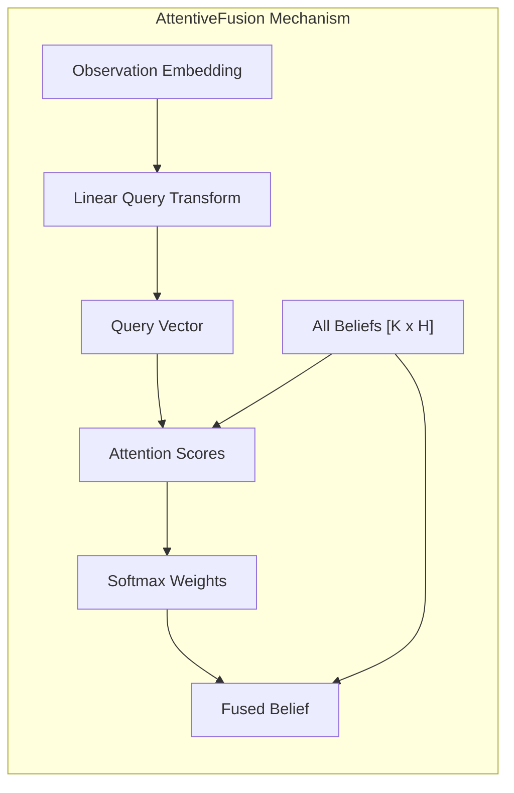
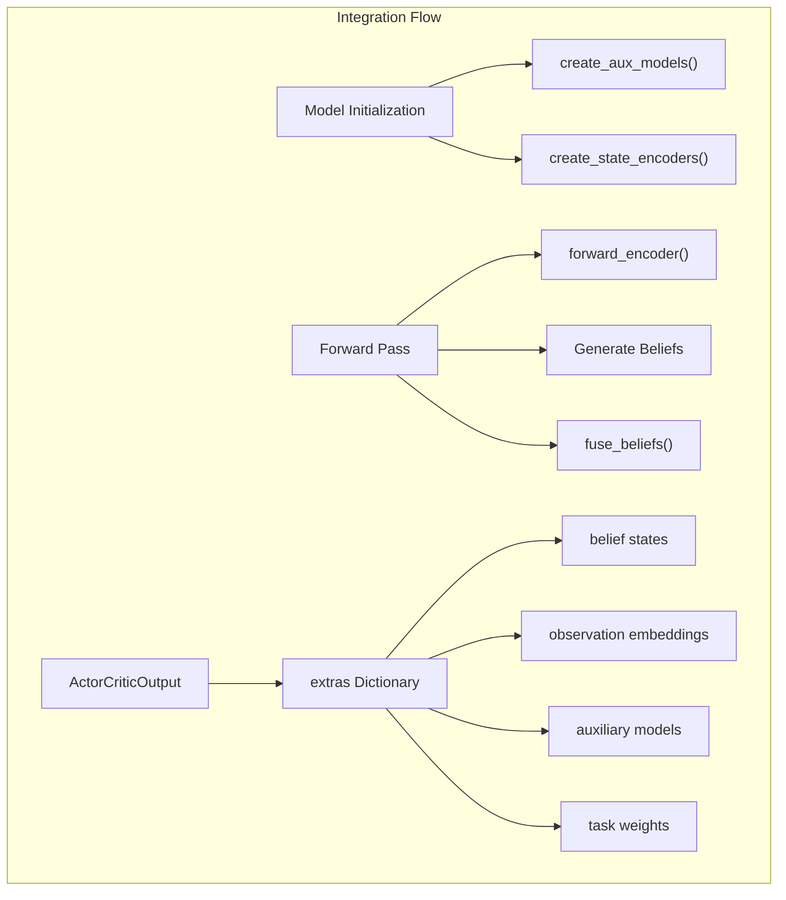

<!-- source: DeepWiki mcp.deepwiki.com · repo allenai/allenact · page 6.2 Auxiliary Task Framework · fetched 2026-10-26 -->

# Auxiliary Task Framework

<details>
<summary>Relevant source files</summary>

The following files were used as context for generating this wiki page:

- [allenact/embodiedai/aux_losses/losses.py](allenact/embodiedai/aux_losses/losses.py)
- [allenact/embodiedai/models/aux_models.py](allenact/embodiedai/models/aux_models.py)
- [allenact/embodiedai/models/fusion_models.py](allenact/embodiedai/models/fusion_models.py)
- [allenact/embodiedai/models/resnet.py](allenact/embodiedai/models/resnet.py)
- [allenact/embodiedai/models/visual_nav_models.py](allenact/embodiedai/models/visual_nav_models.py)
- [allenact/utils/model_utils.py](allenact/utils/model_utils.py)
- [allenact_plugins/navigation_plugin/objectnav/models.py](allenact_plugins/navigation_plugin/objectnav/models.py)
- [allenact_plugins/navigation_plugin/pointnav/models.py](allenact_plugins/navigation_plugin/pointnav/models.py)
- [allenact_plugins/robothor_plugin/robothor_models.py](allenact_plugins/robothor_plugin/robothor_models.py)

</details>


The auxiliary task framework in AllenAct provides a systematic way to add self-supervised learning objectives alongside the primary reinforcement learning task. These auxiliary tasks help improve sample efficiency, generalization, and representation learning by leveraging additional supervision signals derived from the agent's experience.

For information about the core visual navigation models that integrate with this framework, see [Visual Navigation Models](#6.1). For details about training pipeline configuration, see [Training Pipelines and Loss Functions](#4.3).

## Overview and Architecture

The auxiliary task framework consists of three main components: auxiliary loss functions, auxiliary models, and integration mechanisms with the main actor-critic architecture. The system supports both single-task and multi-task auxiliary learning with belief fusion capabilities.

### Core Components Architecture



Sources: [allenact/embodiedai/models/visual_nav_models.py:19-70](), [allenact/embodiedai/aux_losses/losses.py:72-114](), [allenact/embodiedai/models/aux_models.py:21-57]()

## Auxiliary Loss Classes

### Base Auxiliary Loss

The `AuxiliaryLoss` class provides the foundation for all auxiliary tasks. It inherits from `AbstractActorCriticLoss` and defines the interface for auxiliary loss computation.



The base class handles extraction of auxiliary information from `ActorCriticOutput.extras` and delegates specific loss computation to subclasses through the `get_aux_loss` method.

Sources: [allenact/embodiedai/aux_losses/losses.py:72-114]()

### Inverse Dynamics Loss

`InverseDynamicsLoss` predicts the action taken between two consecutive observations. This encourages the model to learn representations that capture action-relevant information.

**Key Features:**
- **UUID**: `"InvDyn"`
- **Input**: Current observation embedding, next observation embedding, and final belief state
- **Output**: Action logits (cross-entropy loss)
- **Subsampling**: Configurable subsampling rate to reduce computational overhead

The loss computation uses:
```
decoder_input = concat([obs_embeds[t], obs_embeds[t+1], final_beliefs[t]])
predicted_actions = aux_model(decoder_input)
loss = CrossEntropyLoss(predicted_actions, true_actions[t])
```

Sources: [allenact/embodiedai/aux_losses/losses.py:146-249]()

### Temporal Distance Loss

`TemporalDistanceLoss` predicts the temporal distance between observation pairs within an episode, encouraging temporal reasoning capabilities.

**Key Features:**
- **UUID**: `"TempDist"`
- **Input**: Two observation embeddings and initial belief state
- **Output**: Predicted temporal distance (MSE loss)
- **Sampling**: Random pairs within episodes with configurable episode length constraints

Sources: [allenact/embodiedai/aux_losses/losses.py:251-371]()

### Contrastive Predictive Coding (CPCA)

The CPCA family implements contrastive predictive coding with actions, learning representations that can predict future observations given action sequences.

#### CPCALoss (Binary Classification)

**Key Features:**
- **UUID**: `"CPCA"`
- **Mechanism**: Autoregressive GRU predicts future contexts, binary classifier distinguishes positive/negative pairs
- **Planning Steps**: Configurable lookahead horizon (1, 2, 4, 8, 16 step variants available)



#### CPCASoftMaxLoss (Multi-class Classification)

**Key Features:**
- **UUID**: `"cpcA_SOFTMAX"`
- **Mechanism**: Uses softmax over all possible future observations instead of binary classification
- **Efficiency**: More computationally efficient than binary variant

Sources: [allenact/embodiedai/aux_losses/losses.py:373-797]()

## Auxiliary Models

The `AuxiliaryModel` class creates task-specific neural network components based on the auxiliary loss UUID.

### Model Initialization by Task Type



**Component Details:**
- **Linear Decoder**: Used for inverse dynamics and temporal distance prediction
- **Action Embedder**: `FeatureEmbedding` with action_dim + 1 inputs (extra for padding)
- **Context GRU**: Autoregressive model for CPCA variants
- **Classifier/MLPs**: Task-specific output layers

Sources: [allenact/embodiedai/models/aux_models.py:46-111]()

## Multi-Task Learning and Belief Fusion

### Multiple Beliefs System

When `multiple_beliefs=True` in `VisualNavActorCritic`, the framework creates separate RNN state encoders for each auxiliary task, allowing task-specific representation learning.



Sources: [allenact/embodiedai/models/visual_nav_models.py:86-121]()

### Fusion Models

The framework provides several strategies for combining multiple task-specific beliefs:

| Fusion Type | UUID | Description |
|-------------|------|-------------|
| `AverageFusion` | `"avg"` | Simple average of all beliefs |
| `SoftmaxFusion` | `"smax"` | Observation-dependent softmax weighting |
| `AttentiveFusion` | `"attn"` | Scaled dot-product attention mechanism |

#### Attention-Based Fusion



The fusion process generates task weights that are used by `MultiAuxTaskNegEntropyLoss` to encourage diversity in task utilization.

Sources: [allenact/embodiedai/models/fusion_models.py:98-120]()

## Integration with Main Architecture

### Actor-Critic Integration

The auxiliary task framework integrates seamlessly with `VisualNavActorCritic` through several mechanisms:



**Key Integration Points:**
1. **Initialization**: `auxiliary_uuids` parameter specifies which auxiliary tasks to enable
2. **State Encoders**: Created for each auxiliary task when using multiple beliefs
3. **Auxiliary Models**: Task-specific models instantiated via `AuxiliaryModel`
4. **Forward Pass**: Auxiliary information passed through `extras` dictionary

Sources: [allenact/embodiedai/models/visual_nav_models.py:141-277]()

### Training Pipeline Integration

Auxiliary losses are added to the training pipeline through the `TrainingPipeline` configuration. Each auxiliary loss is instantiated with its specific parameters and added to the loss computation.

**Example Configuration Pattern:**
```python
auxiliary_uuids = ["InvDyn", "CPCA_4"]
losses = [
    PPOLoss(),
    InverseDynamicsLoss(auxiliary_uuid="InvDyn"),
    CPCA4Loss(auxiliary_uuid="CPCA_4"),
]
```

The framework automatically handles:
- Loss scaling and weighting
- Gradient computation for auxiliary objectives
- Memory management for multi-task scenarios

Sources: [allenact/embodiedai/aux_losses/losses.py:84-99]()

## Usage Examples and Best Practices

### Single Auxiliary Task Configuration

For simple auxiliary task integration:
- Set `auxiliary_uuids=["InvDyn"]` in model configuration
- Add corresponding loss to training pipeline
- Use `multiple_beliefs=False` for shared representations

### Multi-Task Configuration

For multiple auxiliary tasks with belief fusion:
- Set `auxiliary_uuids=["InvDyn", "CPCA_4", "TempDist"]`
- Enable `multiple_beliefs=True`
- Choose appropriate fusion strategy (`beliefs_fusion=AttentiveFusion`)
- Add `MultiAuxTaskNegEntropyLoss` for task weight regularization

### Performance Considerations

- **Subsampling**: Use subsample rates (0.1-0.2) for computationally expensive losses
- **Planning Steps**: Start with smaller values (1-4) for CPCA variants
- **Memory**: Multiple beliefs increase memory usage proportionally to number of tasks

Sources: [allenact/embodiedai/models/visual_nav_models.py:38-66](), [allenact/embodiedai/aux_losses/losses.py:155-164]()

---

