<!-- source: DeepWiki mcp.deepwiki.com · repo allenai/allenact · page 6.3 Sensors and Preprocessors · fetched 2026-10-26 -->

# Sensors and Preprocessors

<details>
<summary>Relevant source files</summary>

The following files were used as context for generating this wiki page:

- [allenact/algorithms/offpolicy_sync/losses/abstract_offpolicy_loss.py](allenact/algorithms/offpolicy_sync/losses/abstract_offpolicy_loss.py)
- [allenact/algorithms/onpolicy_sync/losses/a2cacktr.py](allenact/algorithms/onpolicy_sync/losses/a2cacktr.py)
- [allenact/algorithms/onpolicy_sync/losses/abstract_loss.py](allenact/algorithms/onpolicy_sync/losses/abstract_loss.py)
- [allenact/algorithms/onpolicy_sync/losses/imitation.py](allenact/algorithms/onpolicy_sync/losses/imitation.py)
- [allenact/algorithms/onpolicy_sync/losses/ppo.py](allenact/algorithms/onpolicy_sync/losses/ppo.py)
- [allenact/algorithms/onpolicy_sync/misc.py](allenact/algorithms/onpolicy_sync/misc.py)
- [allenact/base_abstractions/distributions.py](allenact/base_abstractions/distributions.py)
- [allenact/base_abstractions/misc.py](allenact/base_abstractions/misc.py)
- [allenact/base_abstractions/sensor.py](allenact/base_abstractions/sensor.py)
- [allenact/embodiedai/storage/vdr_storage.py](allenact/embodiedai/storage/vdr_storage.py)
- [allenact/utils/spaces_utils.py](allenact/utils/spaces_utils.py)
- [allenact/utils/system.py](allenact/utils/system.py)
- [allenact_plugins/ithor_plugin/ithor_environment.py](allenact_plugins/ithor_plugin/ithor_environment.py)
- [allenact_plugins/ithor_plugin/ithor_util.py](allenact_plugins/ithor_plugin/ithor_util.py)
- [allenact_plugins/minigrid_plugin/__init__.py](allenact_plugins/minigrid_plugin/__init__.py)
- [allenact_plugins/robothor_plugin/robothor_environment.py](allenact_plugins/robothor_plugin/robothor_environment.py)
- [allenact_plugins/robothor_plugin/robothor_task_samplers.py](allenact_plugins/robothor_plugin/robothor_task_samplers.py)
- [allenact_plugins/robothor_plugin/robothor_tasks.py](allenact_plugins/robothor_plugin/robothor_tasks.py)
- [projects/objectnav_baselines/experiments/objectnav_thor_base.py](projects/objectnav_baselines/experiments/objectnav_thor_base.py)
- [projects/pointnav_baselines/experiments/pointnav_thor_base.py](projects/pointnav_baselines/experiments/pointnav_thor_base.py)
- [tests/mapping/test_ai2thor_mapping.py](tests/mapping/test_ai2thor_mapping.py)

</details>


This page covers AllenAct's sensor and preprocessor system, which handles data collection from environments and transformation of observations for model consumption. Sensors are responsible for extracting specific types of information (RGB images, depth maps, GPS coordinates, etc.) from simulation environments, while preprocessors transform this raw sensor data into formats suitable for neural network training.

For information about how sensors integrate with specific environments, see [Simulation Environments](#5). For details on how sensor data flows through training pipelines, see [Core Training Architecture](#3).

## Core Sensor Architecture

AllenAct's sensor system is built around a hierarchical abstraction that separates data collection responsibilities from data transformation. The base `Sensor` class defines the interface, while specialized implementations handle specific data types and environments.

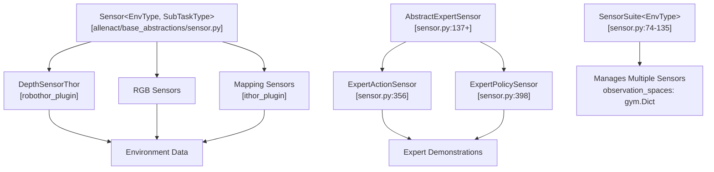

**Sources:** [allenact/base_abstractions/sensor.py:38-72](), [allenact/base_abstractions/sensor.py:74-135](), [allenact/base_abstractions/sensor.py:137-408]()

## Base Sensor Interface

The `Sensor` class provides the fundamental interface that all sensors must implement:

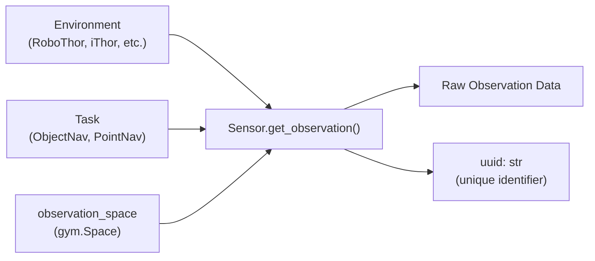

Key components of the base sensor interface:
- `uuid`: Unique string identifier for the sensor
- `observation_space`: Gym space defining the structure and bounds of sensor output
- `get_observation()`: Core method that extracts data from environment/task

**Sources:** [allenact/base_abstractions/sensor.py:38-72]()

## Sensor Suite Management

The `SensorSuite` class manages collections of sensors and provides unified observation collection:

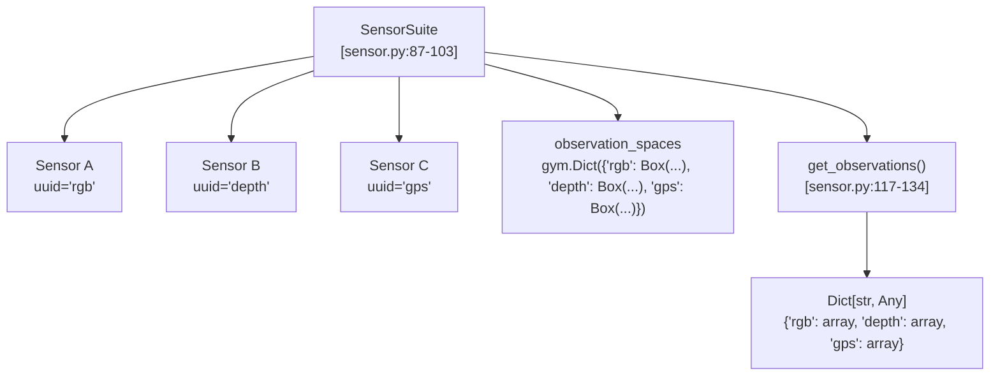

The sensor suite ensures:
- No duplicate sensor UUIDs within a suite
- Unified observation space as a `gym.Dict`
- Batch observation collection from all sensors

**Sources:** [allenact/base_abstractions/sensor.py:87-103](), [allenact/base_abstractions/sensor.py:117-134]()

## Sensor Types and Implementations

AllenAct includes several categories of sensors for different data types and environments:

| Sensor Category | Examples | Purpose | Environment Support |
|-----------------|----------|---------|-------------------|
| **Visual Sensors** | RGB, Depth, Segmentation | Image-based perception | AI2-THOR, Habitat |
| **Positional Sensors** | GPS, Compass, Relative Position | Navigation and localization | AI2-THOR, Habitat |
| **Mapping Sensors** | Point Cloud, Semantic Map | Spatial understanding | AI2-THOR |
| **Expert Sensors** | Expert Actions, Expert Policies | Imitation learning | All environments |
| **Task-Specific** | Target Coordinates, Object Visibility | Task-dependent information | Environment-specific |

### Depth Sensors

Depth sensors extract depth information from 3D environments:

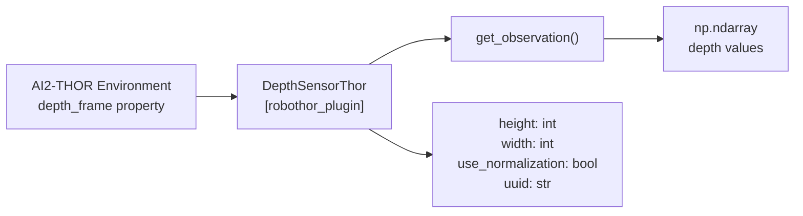

**Sources:** [projects/objectnav_baselines/experiments/objectnav_thor_base.py:25](), [tests/mapping/test_ai2thor_mapping.py:94-99]()

### Mapping Sensors

Advanced mapping sensors build spatial representations incrementally:

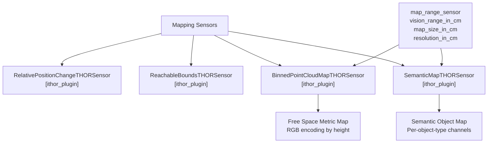

**Sources:** [tests/mapping/test_ai2thor_mapping.py:84-111]()

## Expert Sensors for Imitation Learning

Expert sensors provide ground-truth demonstrations for imitation learning by querying optimal actions or policies from tasks:

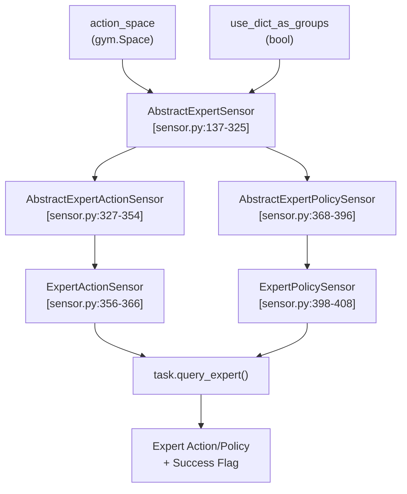

Expert sensors provide two key pieces of information:
- **Expert Action/Policy**: The optimal action or action distribution
- **Expert Success Flag**: Whether the expert could determine the optimal action

**Sources:** [allenact/base_abstractions/sensor.py:137-325](), [allenact/base_abstractions/sensor.py:327-408]()

### Expert Sensor Output Format

Expert sensors flatten their output for neural network consumption:

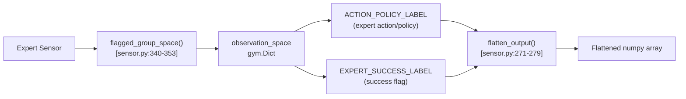

**Sources:** [allenact/base_abstractions/sensor.py:340-353](), [allenact/base_abstractions/sensor.py:271-279]()

## Preprocessors and Data Transformation

Preprocessors transform raw sensor observations into formats suitable for neural network training. The `SensorPreprocessorGraph` manages preprocessing pipelines:

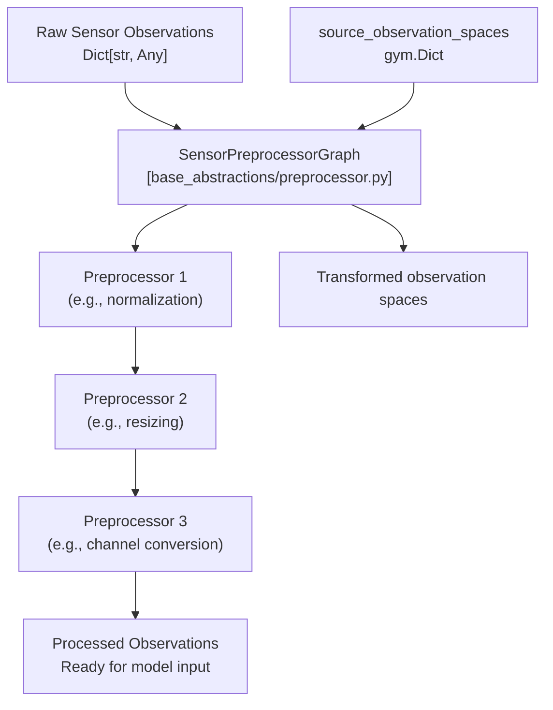

### Preprocessor Integration in Experiments

Experiment configurations define preprocessing pipelines through the `preprocessors()` method:

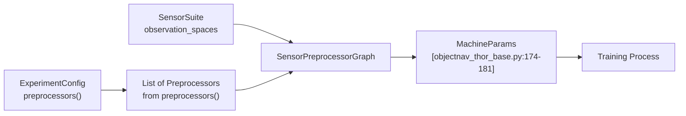

**Sources:** [projects/objectnav_baselines/experiments/objectnav_thor_base.py:161-172](), [projects/pointnav_baselines/experiments/pointnav_thor_base.py:94-105]()

## Sensor Integration with Tasks and Environments

Sensors integrate with the broader AllenAct ecosystem through tasks and environment wrappers:

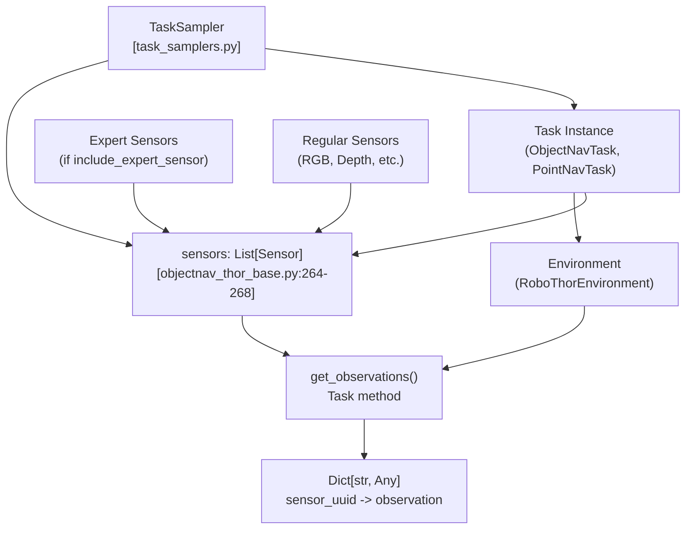

The sensor filtering mechanism allows different sensor sets for training vs. evaluation:

```python
# Training includes expert sensors
sensors = [s for s in self.SENSORS]

# Validation/test excludes expert sensors  
sensors = [s for s in self.SENSORS if not isinstance(s, ExpertActionSensor)]
```

**Sources:** [projects/objectnav_baselines/experiments/objectnav_thor_base.py:157-160](), [projects/objectnav_baselines/experiments/objectnav_thor_base.py:264-268](), [projects/pointnav_baselines/experiments/pointnav_thor_base.py:180-184]()

## Usage Patterns and Best Practices

### Sensor Configuration in Experiment Configs

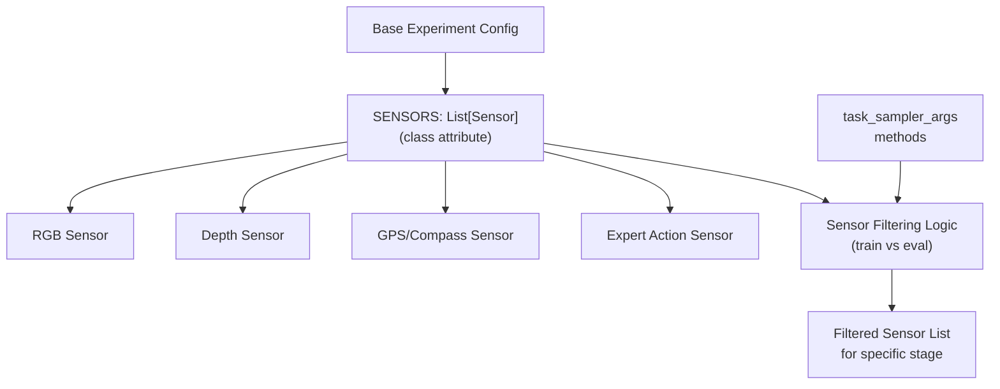

### Environment-Specific Sensor Support

Different simulation environments support different sensor types:

| Environment | RGB | Depth | Semantic | Expert | Mapping |
|-------------|-----|-------|----------|--------|---------|
| **RoboThor** | ✓ | ✓ | ✓ | ✓ | ✓ |
| **iThor** | ✓ | ✓ | ✓ | ✓ | ✓ |
| **Habitat** | ✓ | ✓ | ✓ | ✓ | Limited |
| **MiniGrid** | ✓ | ✗ | ✓ | ✓ | ✗ |

**Sources:** [allenact_plugins/robothor_plugin/robothor_environment.py:417-441](), [allenact_plugins/ithor_plugin/ithor_environment.py:109-116](), [tests/mapping/test_ai2thor_mapping.py:91-111]()

---

