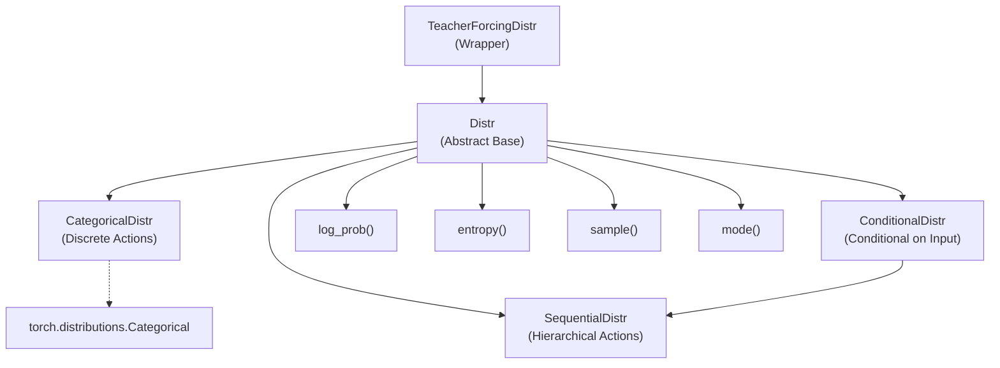
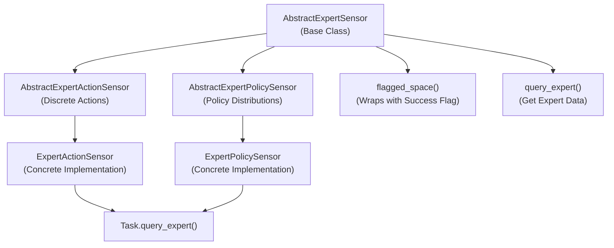
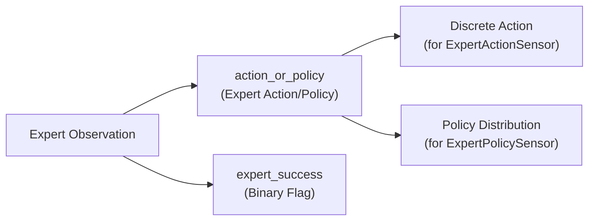
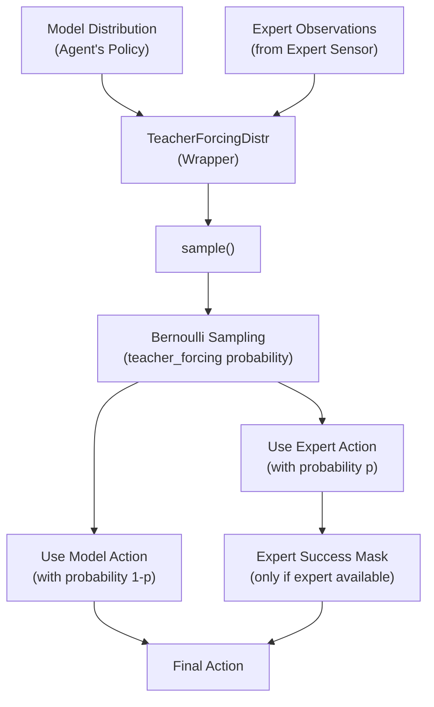
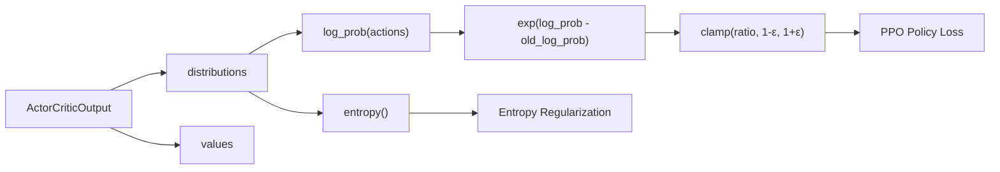
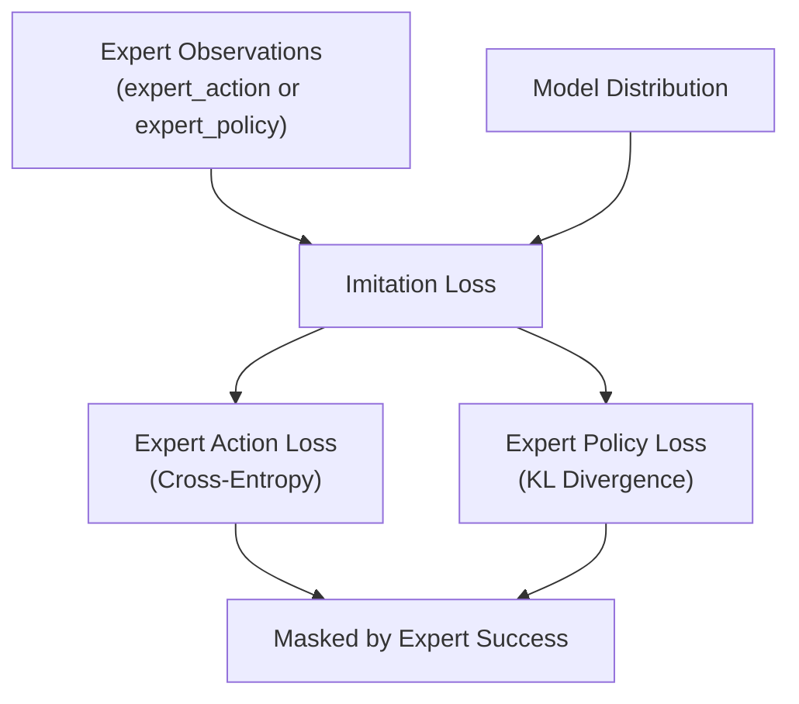
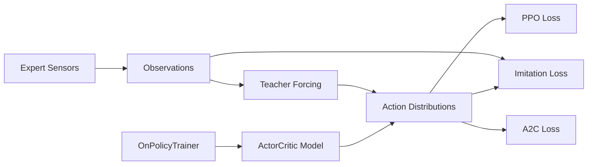

<!-- source: DeepWiki mcp.deepwiki.com · repo allenai/allenact · page 6.4 Action Distributions and Expert Policies · fetched 2026-10-26 -->

# Action Distributions and Expert Policies

Relevant source files

The following files were used as context for generating this wiki page:

- [allenact/algorithms/offpolicy_sync/losses/abstract_offpolicy_loss.py](allenact/algorithms/offpolicy_sync/losses/abstract_offpolicy_loss.py)
- [allenact/algorithms/onpolicy_sync/losses/a2cacktr.py](allenact/algorithms/onpolicy_sync/losses/a2cacktr.py)
- [allenact/algorithms/onpolicy_sync/losses/abstract_loss.py](allenact/algorithms/onpolicy_sync/losses/abstract_loss.py)
- [allenact/algorithms/onpolicy_sync/losses/imitation.py](allenact/algorithms/onpolicy_sync/losses/imitation.py)
- [allenact/algorithms/onpolicy_sync/losses/ppo.py](allenact/algorithms/onpolicy_sync/losses/ppo.py)
- [allenact/algorithms/onpolicy_sync/misc.py](allenact/algorithms/onpolicy_sync/misc.py)
- [allenact/base_abstractions/distributions.py](allenact/base_abstractions/distributions.py)
- [allenact/base_abstractions/misc.py](allenact/base_abstractions/misc.py)
- [allenact/base_abstractions/sensor.py](allenact/base_abstractions/sensor.py)
- [allenact/embodiedai/storage/vdr_storage.py](allenact/embodiedai/storage/vdr_storage.py)
- [allenact/utils/spaces_utils.py](allenact/utils/spaces_utils.py)
- [allenact/utils/system.py](allenact/utils/system.py)
- [allenact_plugins/minigrid_plugin/__init__.py](allenact_plugins/minigrid_plugin/__init__.py)
- [tests/mapping/test_ai2thor_mapping.py](tests/mapping/test_ai2thor_mapping.py)

This document covers AllenAct's action distribution system and expert policy integration mechanisms. These components handle how agents sample actions during training and inference, and how expert demonstrations can be incorporated to guide learning through imitation and teacher forcing.

For information about the core training architecture that uses these distributions, see [Core Training Architecture](#3). For details about specific model architectures that output these distributions, see [Visual Navigation Models](#6.1).

## Action Distribution System

AllenAct provides a flexible action distribution framework that extends PyTorch's distribution classes to work seamlessly with the framework's training infrastructure.

### Distribution Hierarchy

**Distribution Types:**
- `CategoricalDistr`: For discrete action spaces, extends PyTorch's Categorical distribution
- `ConditionalDistr`: Actions conditioned on previously sampled actions in hierarchical policies
- `SequentialDistr`: Combines multiple conditional distributions for complex action spaces
- `TeacherForcingDistr`: Wrapper that enables expert action injection during training

Sources: [allenact/base_abstractions/distributions.py:22-154]()

### Key Distribution Methods

| Method | Purpose | Usage in Training |
|--------|---------|-------------------|
| `log_prob()` | Compute log probability of actions | Policy gradient losses (PPO, A2C) |
| `entropy()` | Distribution entropy | Entropy regularization |
| `sample()` | Sample actions | Action selection during rollouts |
| `mode()` | Most likely action | Deterministic evaluation |

Sources: [allenact/base_abstractions/distributions.py:22-44]()

## Expert Policy Integration

AllenAct supports integrating expert demonstrations through a sensor-based approach that provides expert actions or policies alongside environment observations.

### Expert Sensor Architecture

**Expert Data Format:**
- Actions wrapped with success flags indicating whether expert could provide guidance
- Support for both single actions and grouped action spaces
- Flattened observation format compatible with AllenAct's sensor system

Sources: [allenact/base_abstractions/sensor.py:137-408]()

### Expert Data Structure

Expert sensors produce observations containing:

The `expert_success` flag enables masking when the expert cannot provide guidance (e.g., in novel situations).

Sources: [allenact/base_abstractions/sensor.py:141-143]()

## Teacher Forcing Mechanism

Teacher forcing allows injecting expert actions during training with configurable probability, enabling curriculum learning and improved exploration.

### Teacher Forcing Workflow

**Annealing Support:**
- Teacher forcing probability can decay over training steps
- Configurable through `TeacherForcingAnnealingType` functions
- Tracks metrics for monitoring expert usage

Sources: [allenact/base_abstractions/distributions.py:216-351]()

## Integration with Training Losses

Action distributions integrate seamlessly with AllenAct's loss functions for both reinforcement learning and imitation learning.

### PPO Loss Integration

Sources: [allenact/algorithms/onpolicy_sync/losses/ppo.py:74-91]()

### Imitation Learning Integration

The imitation loss directly uses expert observations to train the policy:

**Key Features:**
- Automatic masking based on expert success flags
- Support for grouped action spaces in `SequentialDistr`
- Integration with standard RL losses for hybrid training

Sources: [allenact/algorithms/onpolicy_sync/losses/imitation.py:23-214]()

## Key Classes and Interfaces

### Core Distribution Classes

| Class | Purpose | Key Methods |
|-------|---------|-------------|
| `CategoricalDistr` | Discrete action sampling | `log_prob()`, `mode()`, `probs_tensor` |
| `SequentialDistr` | Hierarchical action spaces | `conditional_entropy()`, grouped sampling |
| `TeacherForcingDistr` | Expert action injection | `enforce()`, configurable annealing |

### Expert Sensor Classes

| Class | Output Type | Use Case |
|-------|-------------|----------|
| `ExpertActionSensor` | Discrete actions | Direct action imitation |
| `ExpertPolicySensor` | Policy distributions | Policy distillation |
| `AbstractExpertSensor` | Base interface | Custom expert integration |

### Training Integration Points

This system enables flexible action representation and expert guidance, supporting both pure reinforcement learning and imitation learning approaches within AllenAct's unified training framework.

Sources: [allenact/base_abstractions/distributions.py](), [allenact/base_abstractions/sensor.py](), [allenact/algorithms/onpolicy_sync/losses/ppo.py](), [allenact/algorithms/onpolicy_sync/losses/imitation.py]()

---

