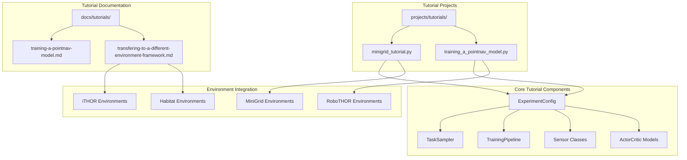
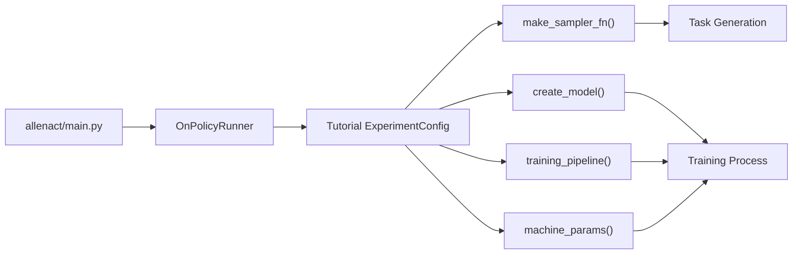
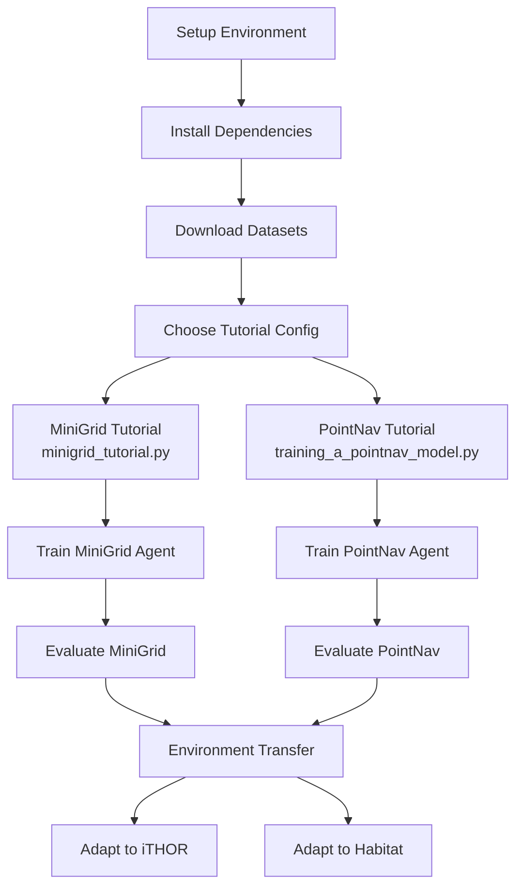
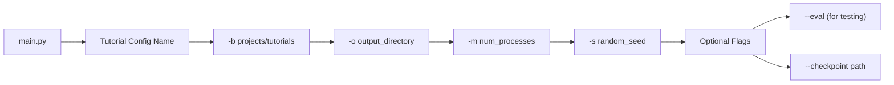

<!-- source: DeepWiki mcp.deepwiki.com · repo allenai/allenact · page 7 Tutorials · fetched 2026-10-26 -->

# Tutorials

<details>
<summary>Relevant source files</summary>

The following files were used as context for generating this wiki page:

- [datasets/download_navigation_datasets.sh](datasets/download_navigation_datasets.sh)
- [docs/installation/download-datasets.md](docs/installation/download-datasets.md)
- [docs/installation/installation-allenact.md](docs/installation/installation-allenact.md)
- [docs/installation/installation-framework.md](docs/installation/installation-framework.md)
- [docs/tutorials/training-a-pointnav-model.md](docs/tutorials/training-a-pointnav-model.md)
- [docs/tutorials/transfering-to-a-different-environment-framework.md](docs/tutorials/transfering-to-a-different-environment-framework.md)
- [projects/tutorials/minigrid_tutorial.py](projects/tutorials/minigrid_tutorial.py)

</details>


This document provides an overview of AllenAct's tutorial system and available learning materials. The tutorials are designed to teach users how to configure experiments, train agents, and work with different simulation environments through practical, hands-on examples.

For information about the core training architecture that these tutorials demonstrate, see [Core Training Architecture](#3). For details about specific environment integrations used in tutorials, see [Simulation Environments](#5).

## Tutorial Structure and Organization

AllenAct tutorials are structured as complete, runnable experiment configurations that demonstrate specific concepts and capabilities. Each tutorial consists of:

- **Experiment Configuration Classes**: Complete `ExperimentConfig` implementations that can be executed directly
- **Documentation**: Detailed explanations of concepts and code walkthrough
- **Datasets**: Sample or debug datasets for quick experimentation
- **Command Examples**: Ready-to-run commands for training and evaluation

### Tutorial Code Organization



Sources: [projects/tutorials/minigrid_tutorial.py:1-372](), [docs/tutorials/training-a-pointnav-model.md:1-558](), [docs/tutorials/transfering-to-a-different-environment-framework.md:1-172]()

### Tutorial Execution Pattern

All tutorials follow a consistent execution pattern using the main entry point:



Sources: [docs/tutorials/training-a-pointnav-model.md:73-74](), [projects/tutorials/minigrid_tutorial.py:320-324]()

## Available Tutorials

### MiniGrid Tutorial

The MiniGrid tutorial provides the simplest introduction to AllenAct's core concepts using grid-world environments.

| Component | Implementation | Purpose |
|-----------|---------------|---------|
| **Environment** | `EmptyRandomEnv5x5` | Simple 5x5 grid navigation |
| **Config Class** | `MiniGridTutorialExperimentConfig` | Complete experiment definition |
| **Model** | `MiniGridSimpleConvRNN` | Lightweight CNN-RNN architecture |
| **Sensor** | `EgocentricMiniGridSensor` | Grid observation processing |
| **Task Sampler** | `MiniGridTaskSampler` | Random task generation |

**Key Learning Points:**
- Basic `ExperimentConfig` structure
- Task sampler configuration for train/valid/test modes
- Simple model definition and sensor usage
- Training pipeline setup with PPO

Sources: [projects/tutorials/minigrid_tutorial.py:100-308]()

### PointNav Training Tutorial

The PointNav tutorial demonstrates navigation training in photorealistic environments using RoboTHOR.

| Component | Implementation | Purpose |
|-----------|---------------|---------|
| **Environment** | RoboTHOR scenes | Photorealistic indoor navigation |
| **Config Class** | `PointNavRoboThorRGBPPOExperimentConfig` | Complete RoboTHOR experiment |
| **Model** | `ResnetTensorPointNavActorCritic` | ResNet-based navigation model |
| **Sensors** | `RGBSensorThor`, `GPSCompassSensorRoboThor` | RGB vision and GPS/compass |
| **Task Sampler** | `PointNavDatasetTaskSampler` | Dataset-based task loading |
| **Preprocessor** | `ResNetPreprocessor` | ResNet feature extraction |

**Key Learning Points:**
- Dataset-based training configuration
- Multi-sensor integration (RGB + GPS/Compass)
- ResNet preprocessing for visual inputs
- Distributed training across multiple processes
- Reward function configuration

Sources: [docs/tutorials/training-a-pointnav-model.md:126-526]()

### Environment Transfer Tutorial

The environment transfer tutorial shows how to adapt experiments across different simulation frameworks.

**Supported Transfers:**
- RoboTHOR → iTHOR: Simple dataset path changes
- RoboTHOR → Habitat: Complete sensor and config adaptation

**Key Learning Points:**
- Cross-platform experiment adaptation
- Environment-specific sensor replacement
- Configuration object management for different simulators

Sources: [docs/tutorials/transfering-to-a-different-environment-framework.md:17-171]()

## Tutorial Learning Path

### Beginner Path

1. **Start with MiniGrid Tutorial**
   - Understand basic `ExperimentConfig` structure
   - Learn task sampler concepts
   - Practice with simple training pipeline

2. **Move to PointNav Tutorial**  
   - Work with realistic environments
   - Learn multi-sensor integration
   - Understand dataset-based training

3. **Experiment with Environment Transfer**
   - Practice cross-platform adaptation
   - Learn environment-specific configurations

### Tutorial Execution Flow



Sources: [docs/tutorials/training-a-pointnav-model.md:58-66](), [projects/tutorials/minigrid_tutorial.py:320-370]()

## Getting Started with Tutorials

### Prerequisites

| Requirement | Installation Command | Purpose |
|-------------|---------------------|---------|
| **Base AllenAct** | `pip install allenact allenact_plugins[all]` | Core framework |
| **MiniGrid Plugin** | `pip install -r allenact_plugins/minigrid_plugin/extra_requirements.txt` | Grid environments |
| **RoboTHOR Plugin** | `pip install -r allenact_plugins/robothor_plugin/extra_requirements.txt` | RoboTHOR environments |
| **Datasets** | `bash datasets/download_navigation_datasets.sh robothor-pointnav` | Training data |

Sources: [docs/installation/installation-allenact.md:69-79](), [projects/tutorials/minigrid_tutorial.py:18-20](), [datasets/download_navigation_datasets.sh:22-28]()

### Running Your First Tutorial

**MiniGrid Tutorial (CPU-based, fast):**
```bash
PYTHONPATH=. python allenact/main.py minigrid_tutorial -b projects/tutorials -m 8 -o minigrid_output -s 12345
```

**PointNav Tutorial (GPU recommended):**
```bash
PYTHONPATH=. python allenact/main.py training_a_pointnav_model -o storage/robothor-pointnav-rgb-resnet-resnet -b projects/tutorials
```

Sources: [projects/tutorials/minigrid_tutorial.py:320-324](), [docs/tutorials/training-a-pointnav-model.md:538-540]()

### Tutorial Command Structure



Sources: [projects/tutorials/minigrid_tutorial.py:320-324](), [docs/tutorials/training-a-pointnav-model.md:534-540]()

---

