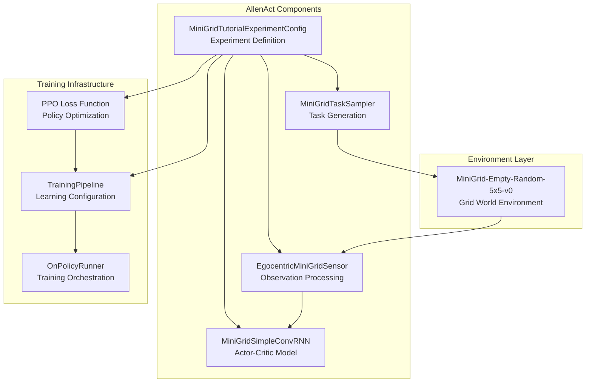
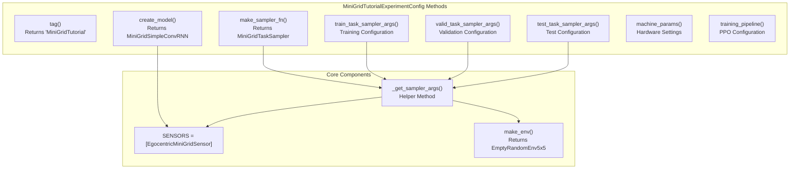
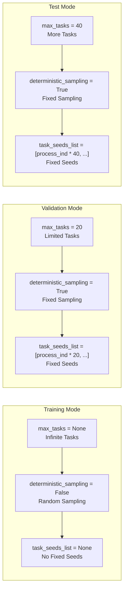
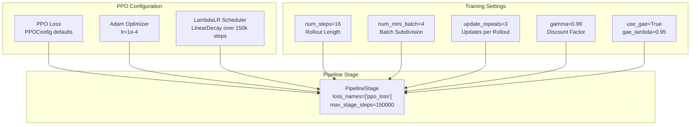
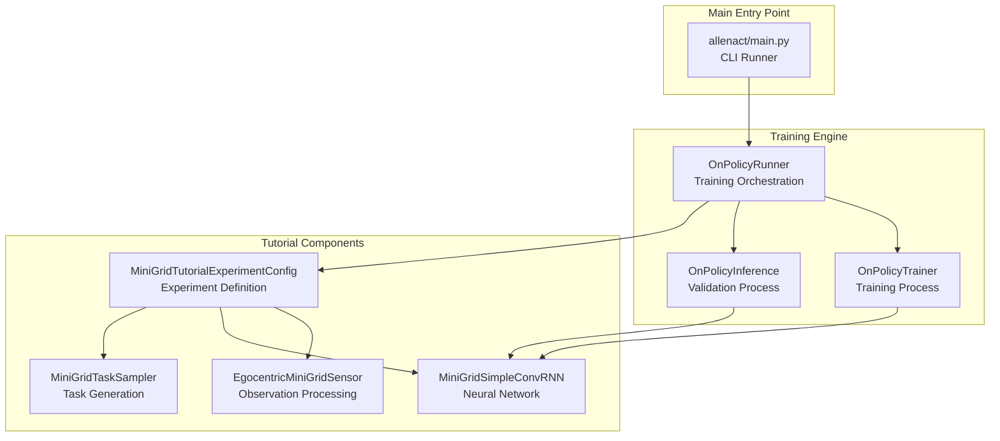

<!-- source: DeepWiki mcp.deepwiki.com · repo allenai/allenact · page 7.1 MiniGrid Tutorial · fetched 2026-10-26 -->

# MiniGrid Tutorial

<details>
<summary>Relevant source files</summary>

The following files were used as context for generating this wiki page:

- [allenact/base_abstractions/experiment_config.py](allenact/base_abstractions/experiment_config.py)
- [allenact/utils/viz_utils.py](allenact/utils/viz_utils.py)
- [docs/tutorials/gym-tutorial.md](docs/tutorials/gym-tutorial.md)
- [docs/tutorials/index.md](docs/tutorials/index.md)
- [docs/tutorials/minigrid-tutorial.md](docs/tutorials/minigrid-tutorial.md)
- [docs/tutorials/offpolicy-tutorial.md](docs/tutorials/offpolicy-tutorial.md)
- [docs/tutorials/running-inference-on-a-pretrained-model.md](docs/tutorials/running-inference-on-a-pretrained-model.md)
- [projects/tutorials/gym_tutorial.py](projects/tutorials/gym_tutorial.py)
- [projects/tutorials/minigrid_offpolicy_tutorial.py](projects/tutorials/minigrid_offpolicy_tutorial.py)
- [projects/tutorials/minigrid_tutorial.py](projects/tutorials/minigrid_tutorial.py)
- [projects/tutorials/object_nav_ithor_dagger_then_ppo_one_object_viz.py](projects/tutorials/object_nav_ithor_dagger_then_ppo_one_object_viz.py)
- [projects/tutorials/running_inference_tutorial.py](projects/tutorials/running_inference_tutorial.py)
- [projects/tutorials/training_a_pointnav_model.py](projects/tutorials/training_a_pointnav_model.py)

</details>


This document provides a comprehensive guide to the MiniGrid tutorial in AllenAct, which demonstrates how to train an agent to navigate in simple grid-world environments. The tutorial covers the complete workflow from defining an experiment configuration to training and evaluating a navigation agent.

For more complex navigation tasks in 3D environments, see [PointNav Training Tutorial](#7.2). For off-policy training approaches, see [Off-policy Training Tutorial](#7.3).

## Tutorial Overview

The MiniGrid tutorial teaches users how to train an agent to complete the `MiniGrid-Empty-Random-5x5-v0` task, where an agent must navigate from a random starting position to the bottom-right corner of a 5x5 grid using three possible actions: rotate left, rotate right, and move forward.

The tutorial demonstrates:
- Writing an `ExperimentConfig` from scratch
- Integrating with the MiniGrid environment
- Configuring sensors, models, and task samplers
- Setting up training pipelines with PPO
- Running training, validation, and testing

**Tutorial Architecture Overview**



Sources: [projects/tutorials/minigrid_tutorial.py:1-372](), [docs/tutorials/minigrid-tutorial.md:1-338]()

## Core Components

### ExperimentConfig Implementation

The tutorial centers around the `MiniGridTutorialExperimentConfig` class, which implements the `ExperimentConfig` abstraction to define all aspects of the experiment.

**ExperimentConfig Component Relationships**



Sources: [projects/tutorials/minigrid_tutorial.py:100-307]()

### Sensor Configuration

The tutorial uses `EgocentricMiniGridSensor` to provide observations from the MiniGrid environment:

| Parameter | Value | Purpose |
|-----------|-------|---------|
| `agent_view_size` | 5 | Size of agent's field of view |
| `view_channels` | 3 | Objects, colors, and states channels |

The sensor processes the environment's partial observations into a format consumable by the neural network model.

Sources: [projects/tutorials/minigrid_tutorial.py:120-122]()

### Model Architecture

The tutorial employs `MiniGridSimpleConvRNN`, a lightweight actor-critic model with recurrent memory designed specifically for MiniGrid environments:

```python
MiniGridSimpleConvRNN(
    action_space=gym.spaces.Discrete(len(MiniGridTask.class_action_names())),
    observation_space=SensorSuite(cls.SENSORS).observation_spaces,
    num_objects=cls.SENSORS[0].num_objects,
    num_colors=cls.SENSORS[0].num_colors,
    num_states=cls.SENSORS[0].num_states,
)
```

Sources: [projects/tutorials/minigrid_tutorial.py:138-145]()

## Task Sampling Strategy

The tutorial implements different sampling strategies for training versus evaluation phases:

**Task Sampling Configuration**



Sources: [projects/tutorials/minigrid_tutorial.py:208-241]()

### Environment Factory

The `make_env()` static method returns `EmptyRandomEnv5x5()` instances, which create 5x5 grid environments where agents spawn at random locations and must navigate to the goal.

Sources: [projects/tutorials/minigrid_tutorial.py:244-245]()

## Machine Configuration

The tutorial configures hardware parameters optimized for CPU training:

| Mode | Processes | Devices | Purpose |
|------|-----------|---------|---------|
| Training | 128 | `[]` (CPU) | Maximum parallelism for training |
| Validation/Test | 16 | `[]` (CPU) | Sufficient for evaluation |

The empty device list defaults to CPU usage, making the tutorial accessible without GPU requirements.

Sources: [projects/tutorials/minigrid_tutorial.py:267-271]()

## Training Pipeline

The tutorial implements a single-stage PPO training pipeline with the following configuration:

| Parameter | Value | Purpose |
|-----------|-------|---------|
| `ppo_steps` | 150,000 | Total training steps |
| `lr` | 1e-4 | Initial learning rate |
| `num_mini_batch` | 4 | Batch subdivision |
| `update_repeats` | 3 | Updates per rollout |
| `num_steps` | 16 | Rollout length |
| `save_interval` | 10,000 | Checkpoint frequency |

**Training Pipeline Flow**



Sources: [projects/tutorials/minigrid_tutorial.py:286-307]()

## Training and Evaluation Workflow

### Training Execution

The tutorial is executed using AllenAct's main runner with the following command structure:

```bash
PYTHONPATH=. python allenact/main.py minigrid_tutorial -b projects/tutorials -m 8 -o /PATH/TO/minigrid_output -s 12345
```

Command line parameters:
- `-b projects/tutorials`: Base directory for experiment configs
- `-m 8`: Limit to 8 subprocesses (each running 16 of 128 task samplers)
- `-o`: Output directory for results and logs
- `-s`: Random seed for reproducibility

Sources: [docs/tutorials/minigrid-tutorial.md:287-297]()

### Performance Expectations

The tutorial provides specific performance benchmarks:

| Metric | Expected Value | Notes |
|--------|----------------|-------|
| Valid Success Rate | 1.0 | Perfect navigation |
| Mean Episode Length | <4 steps | Optimal path length ≈3.75 |
| Training Duration | 150,000 steps | Complete training cycle |

### Testing Evaluation

Testing is performed on saved checkpoints using the `--eval` flag:

```bash
PYTHONPATH=. python allenact/main.py minigrid_tutorial \
-b projects/tutorials \
-m 1 \
-o /PATH/TO/minigrid_output \
-s 12345 \
--eval \
--checkpoint /PATH/TO/checkpoint.pt
```

The evaluation process loads the trained model and runs it on the test task distribution to measure final performance.

Sources: [docs/tutorials/minigrid-tutorial.md:323-337]()

## Integration with AllenAct Framework

The MiniGrid tutorial demonstrates integration with AllenAct's core training infrastructure:

**Framework Integration Points**



Sources: [docs/tutorials/minigrid-tutorial.md:44-50](), [projects/tutorials/minigrid_tutorial.py:1-372]()

The tutorial serves as an entry point for understanding AllenAct's experiment configuration system while providing a simple, reproducible example of reinforcement learning in grid environments.

---

