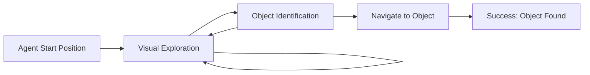
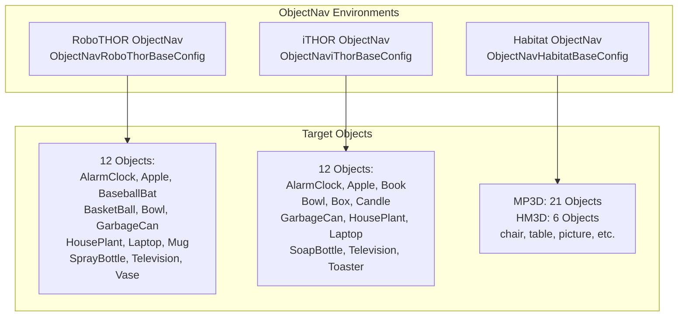
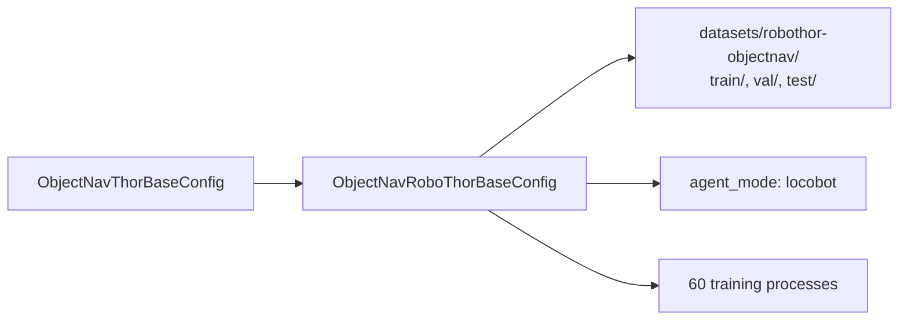
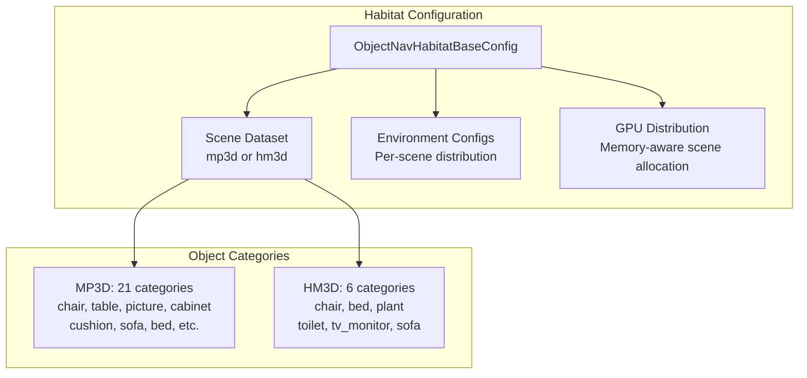
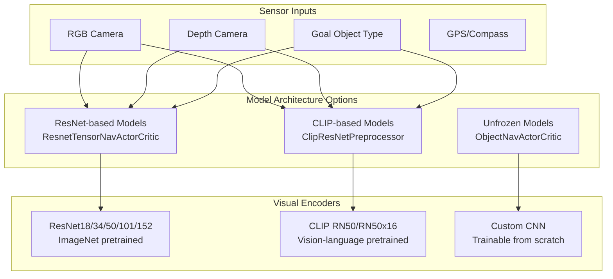
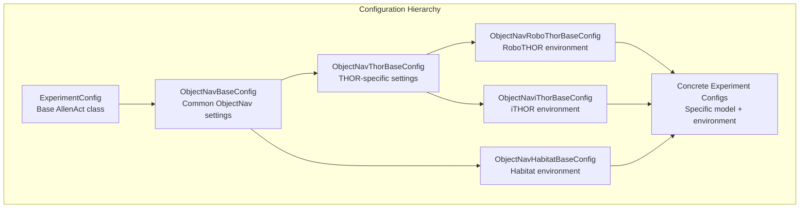
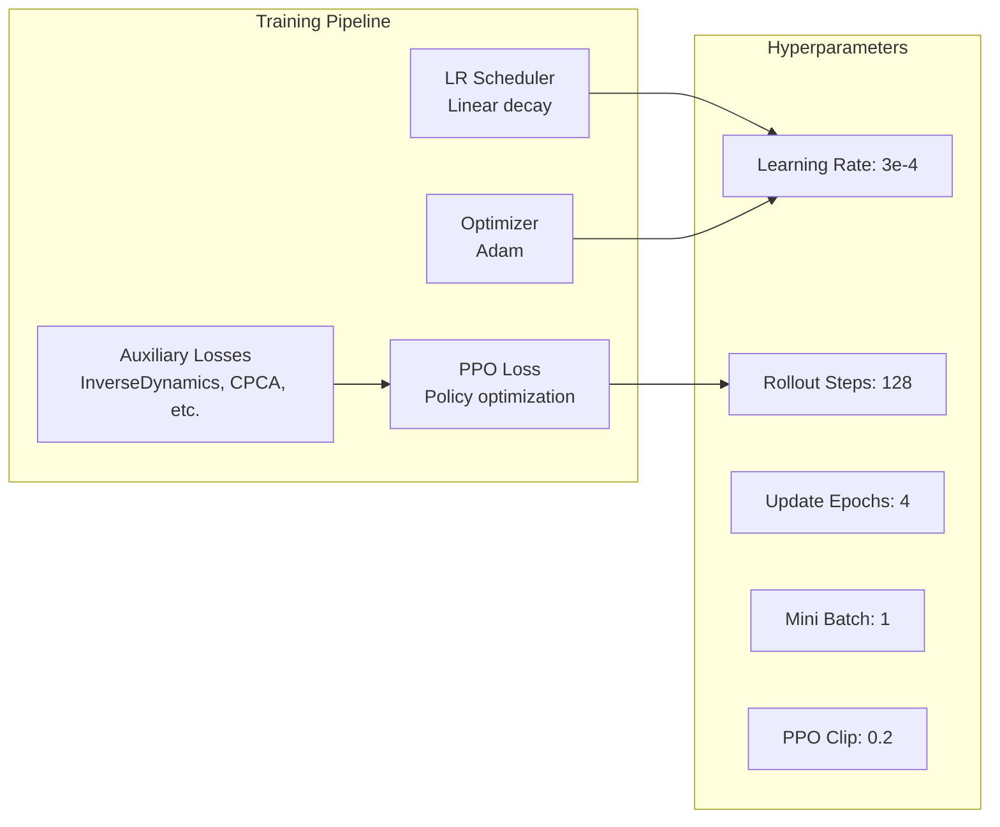
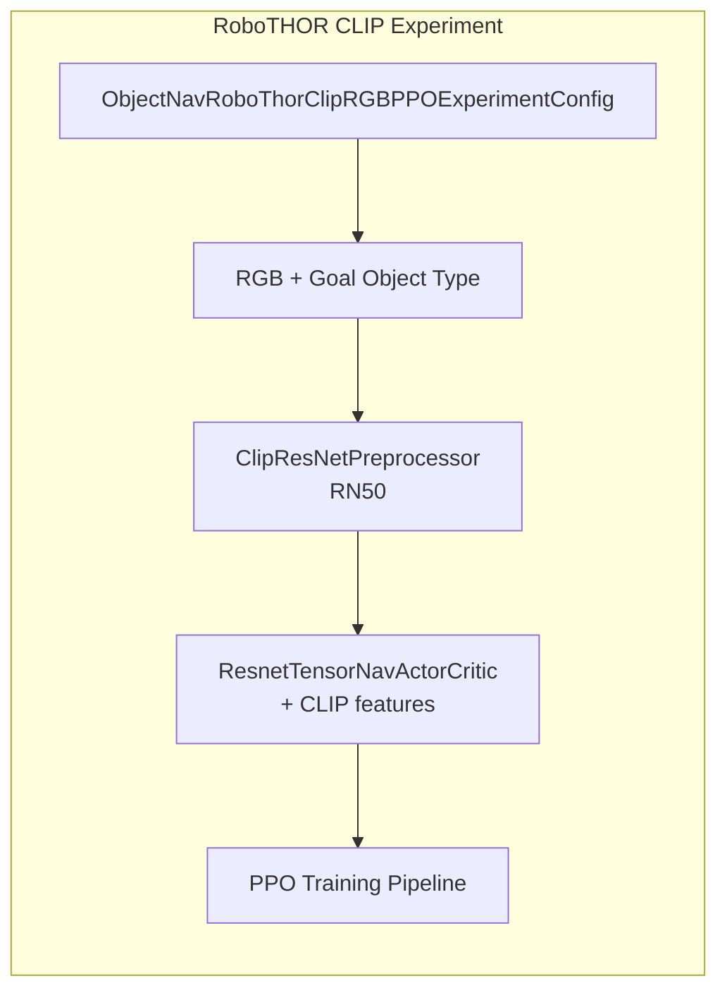
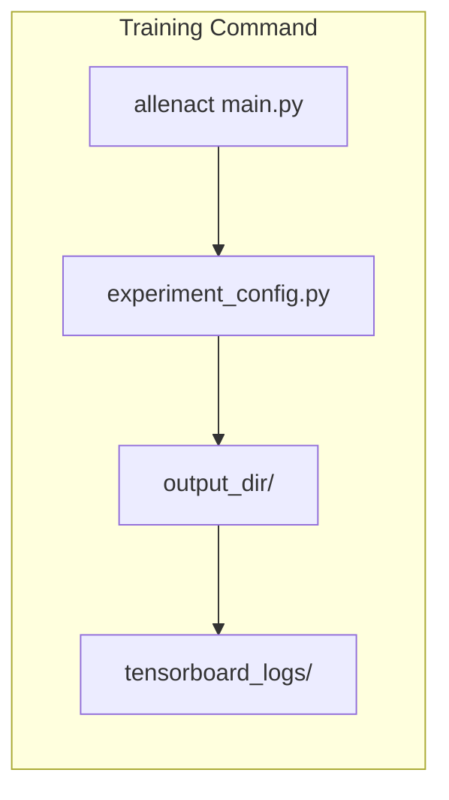

<!-- source: DeepWiki mcp.deepwiki.com · repo allenai/allenact · page 7.3 ObjectNav Training Tutorial · fetched 2026-10-26 -->

# ObjectNav Training Tutorial

<details>
<summary>Relevant source files</summary>

The following files were used as context for generating this wiki page:

- [allenact/utils/inference.py](allenact/utils/inference.py)
- [allenact_plugins/habitat_plugin/habitat_tasks.py](allenact_plugins/habitat_plugin/habitat_tasks.py)
- [projects/objectnav_baselines/experiments/clip/mixins.py](projects/objectnav_baselines/experiments/clip/mixins.py)
- [projects/objectnav_baselines/experiments/habitat/clip/objectnav_habitat_rgb_clipresnet50gru_ddppo.py](projects/objectnav_baselines/experiments/habitat/clip/objectnav_habitat_rgb_clipresnet50gru_ddppo.py)
- [projects/objectnav_baselines/experiments/habitat/clip/objectnav_habitat_rgb_clipresnet50gru_ddppo_increasingrollouts.py](projects/objectnav_baselines/experiments/habitat/clip/objectnav_habitat_rgb_clipresnet50gru_ddppo_increasingrollouts.py)
- [projects/objectnav_baselines/experiments/habitat/objectnav_habitat_base.py](projects/objectnav_baselines/experiments/habitat/objectnav_habitat_base.py)
- [projects/objectnav_baselines/experiments/ithor/objectnav_ithor_base.py](projects/objectnav_baselines/experiments/ithor/objectnav_ithor_base.py)
- [projects/objectnav_baselines/experiments/robothor/clip/objectnav_robothor_rgb_clipresnet50gru_ddppo.py](projects/objectnav_baselines/experiments/robothor/clip/objectnav_robothor_rgb_clipresnet50gru_ddppo.py)
- [projects/objectnav_baselines/experiments/robothor/clip/objectnav_robothor_rgb_clipresnet50x16gru_ddppo.py](projects/objectnav_baselines/experiments/robothor/clip/objectnav_robothor_rgb_clipresnet50x16gru_ddppo.py)
- [projects/objectnav_baselines/experiments/robothor/objectnav_robothor_base.py](projects/objectnav_baselines/experiments/robothor/objectnav_robothor_base.py)
- [projects/objectnav_baselines/mixins.py](projects/objectnav_baselines/mixins.py)
- [projects/pointnav_baselines/experiments/habitat/clip/pointnav_habitat_rgb_clipresnet50gru_ddppo.py](projects/pointnav_baselines/experiments/habitat/clip/pointnav_habitat_rgb_clipresnet50gru_ddppo.py)
- [projects/pointnav_baselines/experiments/habitat/pointnav_habitat_base.py](projects/pointnav_baselines/experiments/habitat/pointnav_habitat_base.py)
- [projects/pointnav_baselines/experiments/ithor/pointnav_ithor_base.py](projects/pointnav_baselines/experiments/ithor/pointnav_ithor_base.py)
- [projects/pointnav_baselines/experiments/robothor/pointnav_robothor_base.py](projects/pointnav_baselines/experiments/robothor/pointnav_robothor_base.py)
- [projects/tutorials/pointnav_habitat_rgb_ddppo.py](projects/tutorials/pointnav_habitat_rgb_ddppo.py)
- [projects/tutorials/pointnav_ithor_rgb_ddppo.py](projects/tutorials/pointnav_ithor_rgb_ddppo.py)

</details>


This tutorial covers training object navigation agents in AllenAct across different simulation environments. Object navigation is a fundamental embodied AI task where agents must navigate to find specific objects in complex 3D environments.

For point navigation training (navigating to coordinates), see [PointNav Training Tutorial](#7.2). For basic AllenAct concepts and setup, see [Getting Started](#2).

## What is Object Navigation

Object navigation (ObjectNav) is an embodied AI task where an agent must explore an environment to locate and navigate to a specific target object category. Unlike point navigation which uses GPS coordinates as targets, ObjectNav requires visual understanding to identify objects in the environment.



**Key ObjectNav Components:**

| Component | Description | Code Reference |
|-----------|-------------|----------------|
| Task Definition | Navigate to target object within episode step limit | `ObjectNavTask` |
| Action Space | Movement + look actions (6 actions total) | `_actions = (MOVE_AHEAD, ROTATE_LEFT, ROTATE_RIGHT, END, LOOK_UP, LOOK_DOWN)` |
| Success Criteria | Agent within success distance of target object | `_is_goal_in_range()` |
| Reward Structure | Distance-based shaping + success bonus | `judge()` method |

Sources: [allenact_plugins/habitat_plugin/habitat_tasks.py:234-421]()

## Simulation Environments

AllenAct supports ObjectNav training across three major simulation environments, each with different characteristics and object sets.



### RoboTHOR ObjectNav Configuration

RoboTHOR provides realistic robotic navigation scenarios with a Locobot agent.



**Key Configuration Parameters:**

- **Agent Mode**: `locobot` for realistic robot embodiment
- **Training Processes**: 60 (GPU-dependent)
- **Dataset Path**: `datasets/robothor-objectnav/`
- **Target Objects**: 12 household objects
- **THOR Commit**: Specific AI2-THOR version for reproducibility

Sources: [projects/objectnav_baselines/experiments/robothor/objectnav_robothor_base.py:13-60]()

### iTHOR ObjectNav Configuration  

iTHOR provides interactive household environments with different object sets than RoboTHOR.

**Key Differences from RoboTHOR:**
- **Agent Mode**: `default` instead of `locobot`
- **Training Processes**: 40 instead of 60
- **Object Set**: Includes Book, Box, Candle, SoapBottle, Toaster (different from RoboTHOR)
- **Dataset Path**: `datasets/ithor-objectnav/`

Sources: [projects/objectnav_baselines/experiments/ithor/objectnav_ithor_base.py:11-40]()

### Habitat ObjectNav Configuration

Habitat provides photorealistic environments using MP3D and HM3D scene datasets with more sophisticated configuration options.



**Advanced Habitat Features:**
- **Multi-GPU Training**: Automatic scene distribution across GPUs based on memory usage
- **Scene Dataset Support**: MP3D (21 object categories) and HM3D (6 object categories)  
- **Flexible Configuration**: Debug mode, look constraints, auxiliary losses
- **Memory Optimization**: Scene allocation based on file sizes

Sources: [projects/objectnav_baselines/experiments/habitat/objectnav_habitat_base.py:111-491]()

## Model Architectures

ObjectNav agents use different visual encoding architectures depending on the complexity and requirements of the task.



### ResNet-based Models

ResNet models use ImageNet-pretrained backbones for visual feature extraction.

**Key Components:**
- **Preprocessor**: `ResNetPreprocessor` extracts 7x7x512 or 7x7x2048 features
- **Actor-Critic**: `ResnetTensorNavActorCritic` with GRU memory
- **Goal Integration**: Object type embeddings combined with visual features
- **Variants**: RN18, RN34, RN50, RN101, RN152

```python
# Example configuration in mixins
if self.resnet_type in ["RN18", "RN34"]:
    output_shape = (512, 7, 7)
elif self.resnet_type in ["RN50", "RN101", "RN152"]:
    output_shape = (2048, 7, 7)
```

Sources: [projects/objectnav_baselines/mixins.py:50-129]()

### CLIP-based Models

CLIP models leverage vision-language pretraining for better object understanding.

**Key Advantages:**
- **Object Recognition**: Better generalization to novel objects
- **Language Grounding**: Implicit understanding of object categories  
- **Transfer Learning**: Pretrained on web-scale image-text data
- **Model Variants**: RN50, RN50x16 available

**Configuration Requirements:**
- **Normalization**: Must use CLIP-specific RGB normalization
- **Preprocessor**: `ClipResNetPreprocessor` instead of standard ResNet
- **Memory**: Higher memory requirements than standard ResNet

Sources: [projects/objectnav_baselines/experiments/clip/mixins.py:60-155]()

## Training Configuration Classes

ObjectNav experiments follow a hierarchical configuration structure that allows code reuse across environments while enabling environment-specific customizations.



### Base Configuration Components

Each configuration class defines specific aspects of the training setup:

| Component | Purpose | Key Methods |
|-----------|---------|-------------|
| `SENSORS` | Define observation space | RGB, Depth, Goal sensors |
| `preprocessors()` | Visual preprocessing pipeline | ResNet or CLIP feature extraction |
| `create_model()` | Neural network architecture | Actor-critic model instantiation |
| `training_pipeline()` | Loss functions and optimization | PPO, auxiliary losses, schedules |
| `machine_params()` | Hardware configuration | GPU allocation, process distribution |
| `make_sampler_fn()` | Task sampling strategy | Dataset loading and episode generation |

Sources: [projects/objectnav_baselines/experiments/objectnav_base.py](), [allenact/base_abstractions/experiment_config.py]()

### Training Pipeline Configuration

ObjectNav training uses PPO (Proximal Policy Optimization) with optional auxiliary losses for improved learning.



**Key Training Parameters:**
- **Learning Rate**: 3e-4 with linear decay over 300M steps
- **Rollout Length**: 128 steps per environment
- **Update Frequency**: 4 epochs per rollout batch
- **PPO Clipping**: 0.2 for stable policy updates
- **Auxiliary Loss Weight**: 2.0 total weight distributed across losses

Sources: [projects/objectnav_baselines/mixins.py:332-392]()

## Concrete Experiment Examples

This section shows how to configure and run specific ObjectNav experiments with different model architectures and environments.

### RoboTHOR + CLIP ResNet50



**Key Configuration:**
```python
CLIP_MODEL_TYPE = "RN50"
SENSORS = [
    RGBSensorThor(use_resnet_normalization=True, 
                  mean=ClipResNetPreprocessor.CLIP_RGB_MEANS,
                  stdev=ClipResNetPreprocessor.CLIP_RGB_STDS),
    GoalObjectTypeThorSensor(object_types=TARGET_TYPES)
]
```

Sources: [projects/objectnav_baselines/experiments/robothor/clip/objectnav_robothor_rgb_clipresnet50gru_ddppo.py:21-72]()

### Habitat + MP3D + CLIP ResNet50

```python
# Initialize with scene dataset and learning rate
config = ObjectNavHabitatRGBClipResNet50GRUDDPPOExperimentConfig(
    scene_dataset="mp3d", 
    lr=3e-4
)
```

**Key Features:**
- **Scene Dataset**: MP3D with 21 object categories
- **Multi-GPU**: Automatic scene distribution across available GPUs
- **Memory Management**: Scenes allocated based on file sizes
- **CLIP Preprocessing**: RN50 model with proper normalization

Sources: [projects/objectnav_baselines/experiments/habitat/clip/objectnav_habitat_rgb_clipresnet50gru_ddppo.py:22-78]()

## Running ObjectNav Experiments

ObjectNav experiments are run using AllenAct's command-line interface with experiment configuration files.



### Basic Training Command

```bash
# RoboTHOR ObjectNav with CLIP
python allenact/main.py \
    projects/objectnav_baselines/experiments/robothor/clip/objectnav_robothor_rgb_clipresnet50gru_ddppo \
    --output_dir output/robothor_objectnav_clip \
    --num_train_processes 60 \
    --gpus 0,1,2,3

# Habitat ObjectNav with MP3D
python allenact/main.py \
    projects/objectnav_baselines/experiments/habitat/clip/objectnav_habitat_rgb_clipresnet50gru_ddppo \
    --extra_tag mp3d \
    --output_dir output/habitat_objectnav_mp3d \
    --config_kwargs '{"scene_dataset": "mp3d", "lr": 3e-4}'
```

### Dataset Requirements

Before training, ensure datasets are downloaded and structured correctly:

```bash
# RoboTHOR ObjectNav datasets
datasets/
├── robothor-objectnav/
│   ├── train/
│   ├── val/
│   └── test/

# Habitat datasets  
datasets/
├── habitat/
│   ├── objectnav/
│   │   ├── mp3d/v1/train/
│   │   └── mp3d/v1/val/
│   └── scene_datasets/mp3d/
```

### Monitoring Training Progress

Training metrics are logged to TensorBoard and can be monitored in real-time:

```bash
# Start TensorBoard
tensorboard --logdir output/robothor_objectnav_clip/tb/

# Key metrics to monitor:
# - success_rate: Episode success percentage
# - spl: Success weighted by Path Length  
# - ep_length: Average episode length
# - total_reward: Cumulative reward per episode
```

**Important Training Considerations:**
- **Memory Requirements**: CLIP models require more GPU memory than ResNet
- **Training Time**: ObjectNav typically requires 100M+ training steps for convergence
- **Validation Frequency**: Run validation every 5M steps to monitor progress
- **Checkpointing**: Models are saved every 5M steps automatically

Sources: [allenact/main.py](), [allenact/utils/inference.py:43-86]()

---

