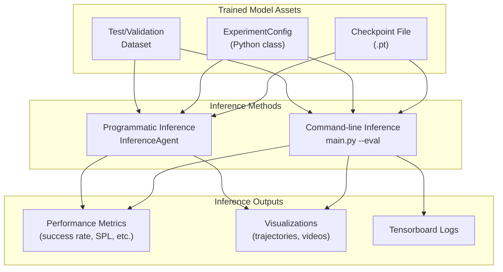
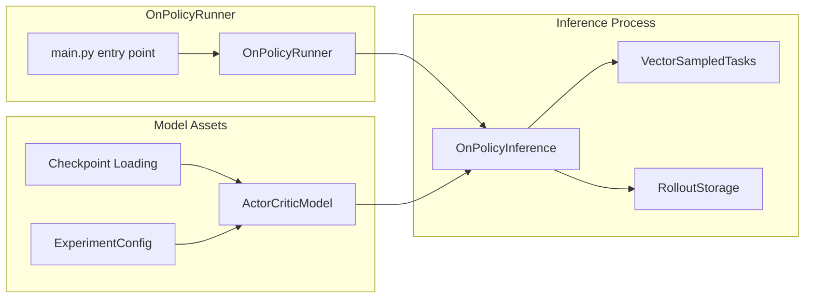
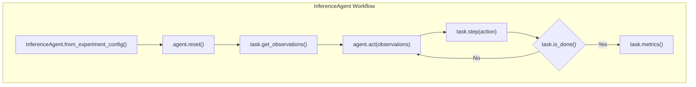
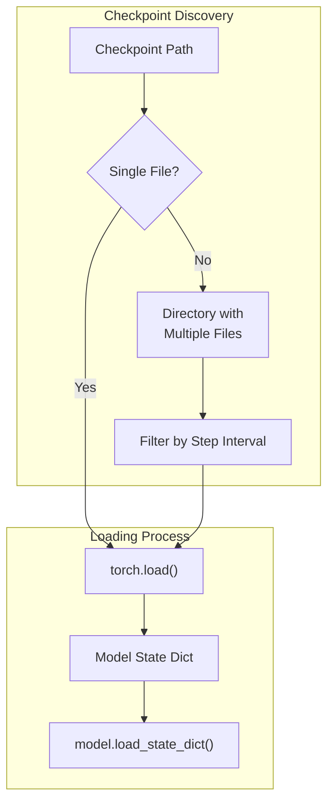
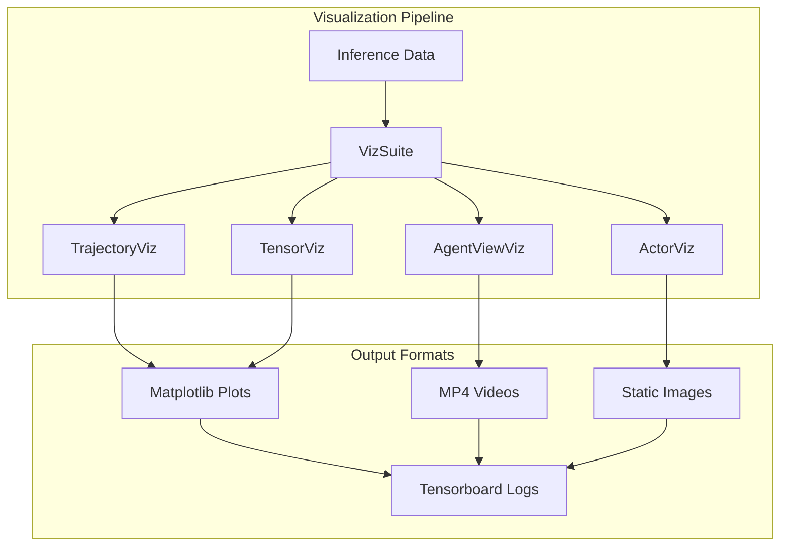
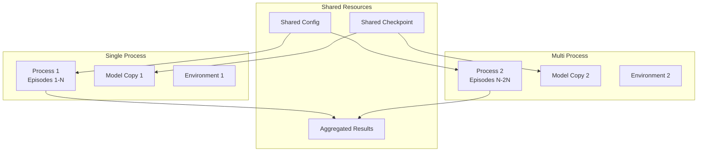

<!-- source: DeepWiki mcp.deepwiki.com · repo allenai/allenact · page 7.4 Inference and Model Deployment · fetched 2026-10-26 -->

# Inference and Model Deployment

<details>
<summary>Relevant source files</summary>

The following files were used as context for generating this wiki page:

- [.VERSION](.VERSION)
- [allenact/base_abstractions/experiment_config.py](allenact/base_abstractions/experiment_config.py)
- [allenact/utils/viz_utils.py](allenact/utils/viz_utils.py)
- [docs/tutorials/gym-tutorial.md](docs/tutorials/gym-tutorial.md)
- [docs/tutorials/index.md](docs/tutorials/index.md)
- [docs/tutorials/minigrid-tutorial.md](docs/tutorials/minigrid-tutorial.md)
- [docs/tutorials/offpolicy-tutorial.md](docs/tutorials/offpolicy-tutorial.md)
- [docs/tutorials/running-inference-on-a-pretrained-model.md](docs/tutorials/running-inference-on-a-pretrained-model.md)
- [projects/tutorials/gym_tutorial.py](projects/tutorials/gym_tutorial.py)
- [projects/tutorials/minigrid_offpolicy_tutorial.py](projects/tutorials/minigrid_offpolicy_tutorial.py)
- [projects/tutorials/object_nav_ithor_dagger_then_ppo_one_object_viz.py](projects/tutorials/object_nav_ithor_dagger_then_ppo_one_object_viz.py)
- [projects/tutorials/running_inference_tutorial.py](projects/tutorials/running_inference_tutorial.py)
- [projects/tutorials/training_a_pointnav_model.py](projects/tutorials/training_a_pointnav_model.py)
- [tests/manipulathor_plugin/__init__.py](tests/manipulathor_plugin/__init__.py)
- [tests/utils/test_inference_agent.py](tests/utils/test_inference_agent.py)
- [tests/vision/test_pillow_rescaling.py](tests/vision/test_pillow_rescaling.py)

</details>


This page covers how to deploy and run inference with trained AllenAct models. It includes both command-line evaluation using the main training script and programmatic inference using the `InferenceAgent` class. For information about the training process itself, see [Core Training Architecture](#3). For model architectures and algorithms, see [Models and Algorithms](#6).

## Overview

AllenAct provides two primary methods for running inference on trained models:

1. **Command-line evaluation** using `allenact/main.py` with the `--eval` flag
2. **Programmatic inference** using the `InferenceAgent` class for custom applications

Both approaches support loading checkpoints, running models on test/validation datasets, and generating visualizations of results.



Sources: [projects/tutorials/running_inference_tutorial.py:32-63](), [tests/utils/test_inference_agent.py:46-97](), [docs/tutorials/running-inference-on-a-pretrained-model.md:34-62]()

## Command-line Inference

The simplest way to run inference is using the main training script with evaluation flags. This approach leverages the same `OnPolicyInference` system used during training validation.

### Basic Evaluation Command

```bash
PYTHONPATH=. python allenact/main.py <experiment_name> \
    -b <base_directory> \
    -o <output_directory> \
    -c <checkpoint_path> \
    --eval
```

### Key Parameters

| Parameter | Description | Example |
|-----------|-------------|---------|
| `<experiment_name>` | Name of the experiment config class | `training_a_pointnav_model` |
| `-b <base_directory>` | Directory containing experiment config | `projects/tutorials` |
| `-o <output_directory>` | Output directory for results | `./results` |
| `-c <checkpoint_path>` | Path to checkpoint file or directory | `./checkpoints/model.pt` |
| `--eval` | Enable evaluation mode | Required flag |

### Checkpoint Loading Options

The system supports loading either individual checkpoint files or entire checkpoint directories:

```bash
# Single checkpoint
-c ./checkpoints/exp_PointNav__stage_00__steps_000039031200.pt

# All checkpoints in directory  
-c ./checkpoints/PointNavRobothorRGBPPO/2020-08-31_12-13-30

# Skip checkpoints with interval
--approx_ckpt_step_interval 800000
```



Sources: [docs/tutorials/running-inference-on-a-pretrained-model.md:34-63](), [docs/tutorials/gym-tutorial.md:313-327](), [docs/tutorials/minigrid-tutorial.md:321-337]()

## Programmatic Inference

The `InferenceAgent` class provides a clean API for running inference programmatically within custom applications.

### Creating an InferenceAgent

```python
from allenact.utils.inference import InferenceAgent
import torch

# Create agent from experiment config
agent = InferenceAgent.from_experiment_config(
    exp_config=experiment_config_instance,
    device=torch.device("cpu"),  # or cuda device
)
```

### Basic Inference Loop

```python
# Reset agent for new episode
agent.reset()

# Get initial observations from task
observations = task.get_observations()

# Run inference loop
while not task.is_done():
    action = agent.act(observations=observations)
    observations = task.step(action).observation

# Get final metrics
metrics = task.metrics()
```



### InferenceAgent Components

The `InferenceAgent` encapsulates several key components:

| Component | Purpose | Key Methods |
|-----------|---------|-------------|
| `ActorCriticModel` | Neural network for action prediction | `forward()` |
| `TaskSampler` | Generates test tasks | `next_task()` |
| `Preprocessors` | Input preprocessing pipeline | `process()` |
| `Device Management` | GPU/CPU allocation | `to(device)` |

Sources: [tests/utils/test_inference_agent.py:46-97](), [allenact/utils/inference.py]()

## Checkpoint Management

AllenAct saves model checkpoints periodically during training, and these can be loaded for inference using specific naming conventions.

### Checkpoint File Structure

```
checkpoints/
├── ExperimentName/
│   └── YYYY-MM-DD_HH-MM-SS/
│       ├── exp_ExperimentName__stage_00__steps_000001000.pt
│       ├── exp_ExperimentName__stage_00__steps_000005000.pt
│       └── ...
```

### Checkpoint Loading Process



### Loading Strategies

The system supports different checkpoint loading strategies:

- **Latest checkpoint**: Load the most recent checkpoint from a directory
- **Best checkpoint**: Load checkpoint with best validation performance  
- **Specific step**: Load checkpoint from a specific training step
- **Interval sampling**: Load checkpoints at regular step intervals

Sources: [docs/tutorials/running-inference-on-a-pretrained-model.md:53-63](), [docs/tutorials/gym-tutorial.md:284-295]()

## Visualization and Analysis

AllenAct provides extensive visualization capabilities for analyzing inference results through the `VizSuite` framework.

### Visualization Types

| Visualization | Purpose | Data Source |
|---------------|---------|-------------|
| `TrajectoryViz` | 2D trajectory plotting | Task output |
| `AgentViewViz` | Egocentric video generation | Vector task render |
| `ActorViz` | Action probability heatmaps | Actor-critic output |
| `TensorViz1D` | Scalar time series | Rollout storage |
| `TensorViz2D` | Vector evolution over time | Rollout storage |

### Setting Up Visualizations

```python
from allenact.utils.viz_utils import VizSuite, TrajectoryViz, AgentViewViz

viz = VizSuite(
    episode_ids=["episode_1", "episode_2"],
    mode="test",
    base_trajectory=TrajectoryViz(
        path_to_target_location=("task_info", "target")
    ),
    egocentric=AgentViewViz(
        max_video_length=100,
        fps=30
    )
)
```



### Enabling Visualizations

Visualizations are configured in the `machine_params` method of the experiment config:

```python
def machine_params(self, mode="train", **kwargs):
    params = super().machine_params(mode, **kwargs)
    if mode == "test":
        params.set_visualizer(self.get_viz(mode))
    return params
```

Sources: [projects/tutorials/running_inference_tutorial.py:118-182](), [allenact/utils/viz_utils.py:693-805](), [docs/tutorials/running-inference-on-a-pretrained-model.md:97-174]()

## Performance Evaluation

The inference system automatically computes standard embodied AI metrics during evaluation.

### Common Metrics

| Metric | Description | Task Types |
|--------|-------------|------------|
| `success` | Task completion rate | Navigation, Manipulation |
| `spl` | Success weighted by Path Length | Navigation |
| `ep_length` | Average episode length | All tasks |
| `reward` | Average episode reward | All tasks |

### Metric Collection Process


### Custom Metrics

Tasks can implement custom metrics by overriding the `metrics()` method:

```python
def metrics(self) -> Dict[str, Any]:
    metrics = super().metrics()
    metrics.update({
        "custom_metric": self.compute_custom_metric(),
        "normalized_reward": self.reward / self.max_steps
    })
    return metrics
```

Sources: [tests/utils/test_inference_agent.py:74-86](), [docs/tutorials/minigrid-tutorial.md:310-337]()

## Deployment Considerations

### Resource Management

- **Memory**: Each inference process loads environment and model into memory
- **GPU**: Model can be moved between CPU/GPU using device parameters
- **Parallelization**: Multiple processes can run inference simultaneously

### Scaling Inference



### Production Deployment

For production deployment, consider:

- **Checkpoint versioning**: Track model versions and experiment metadata
- **Input validation**: Validate observations before inference
- **Error handling**: Graceful handling of malformed inputs or model failures
- **Monitoring**: Track inference latency and accuracy metrics
- **Caching**: Cache preprocessed inputs when possible

Sources: [allenact/base_abstractions/experiment_config.py:17-125](), [projects/tutorials/training_a_pointnav_model.py:351-430]()

---

